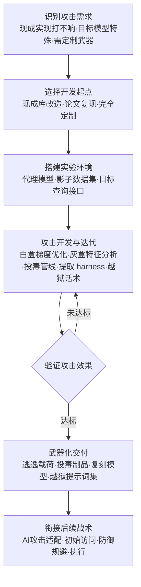

# 对抗性 AI 攻击 (AML.T0017.000)

> 属于 [开发能力 (AML.T0017)](../AML.T0017-Develop-Capabilities.md)

## 一句话通俗理解

> 军火市场上买来的通用武器（那是"获取能力"里的 AML.T0016.000）打不响时，攻击者就自己当军火工程师：逆向目标模型的判断逻辑造出专属炮弹、往训练原料里掺带扳机的后门样本、搭一台专偷模型大脑的抽水机——武器不再是下载来的，而是按目标量体裁衣研发出来的。

## 难度等级

⭐⭐ **Demonstrated（已演示）**

官方成熟度评定为 Demonstrated——该技术已在多个真实安全研究中被完整演示：Skylight Cyber 针对 Cylance AI 恶意软件检测器开发出一条附加到任意恶意文件末尾即可使其被判良性的"通用绕过字符串"（AML.CS0003）；卡巴斯基 ML 研究团队在**没有白盒访问**的灰盒条件下开发出绕过自家反恶意软件 ML 模型的对抗样本（AML.CS0014）；微软研究院为移动应用深度学习模型构建了完整的"神经载荷注入"后门攻击管线（AML.CS0013）。本子技术是 [开发能力 (AML.T0017)](../AML.T0017-Develop-Capabilities.md) 三条路线中门槛最高的一条——父技术文档明言：自研对抗攻击需要机器学习功底，属于**研究者级技能**。与"获取"现成实现（下载即用）不同，"开发"意味着要理解目标模型的脆弱性并亲手构造利用它的方法。注：父技术 AML.T0017 官方评定为 Realized（⭐⭐⭐），本子技术按官方数据为 Demonstrated（⭐⭐）。

## 技术描述

### 通俗解释

如果说 [获取能力 (AML.T0016)](../AML.T0016-Obtain-Capabilities.md) 中的对抗性 AI 攻击实现（AML.T0016.000）是"从货架上买现成武器"，本子技术就是**自己开机床造武器**。官方描述点明了三条起跑线：

| 开发起点 | 通俗类比 | 门槛 | 产出特征 |
|---------|---------|------|---------|
| 现成库二次开发 | 买枪回来自己改装 | 低 | 把公开攻击库适配到目标模型上 |
| 论文复现 | 照着图纸造炮 | 中 | 把公开研究的方法变成可用攻击代码 |
| 完全定制 | 从头设计专打你家保险库的钻头 | 高 | 针对受害者模型量身打造的全新攻击 |

为什么"买现货"常常不够用？因为通用攻击库打的是"万金油"场景，而真实目标千差万别——目标模型可能换了架构、加了防御、部署在特殊环境。当现货武器对目标失效时，攻击者就进入本子技术的领域：**把攻击从"通用"升级为"专属"**。

### 技术原理

依据官方描述，攻击者可能开发**他们自己的对抗性攻击**：可以现成库为起点（对应获取能力战术中的对抗性 AI 攻击实现 AML.T0016.000），可以实现公开研究论文中描述的思想，也可以为受害者模型开发完全定制的手工攻击。结合父技术框架与真实案例，自研攻击的工程形态可归纳为四类：

1. **逃逸攻击精修（白盒/灰盒）**：白盒条件下攻击者掌握模型架构与权重（可能来自获取公开 AI 制品，AML.T0002.001），用梯度优化直接计算最小扰动；灰盒条件下只掌握部分信息——卡巴斯基案例证明，**仅凭特征知识（feature knowledge）就足以开发出成功的对抗攻击**，无需白盒访问；黑盒条件下则以查询接口反复试探（查询式攻击）或借代理模型演练后迁移；
2. **投毒管线构建**：构建掺入后门样本的训练数据集——设计触发器（一段特定字符串、一个角落图案）、控制污染比例、保证后门样本不损害正常精度。微软研究院的 DeepPayload 演示了完整管线；Pillar Security 与 Fujitsu 的研究则把投毒位置前移到**聊天模板**——不改动模型权重即可通过投毒的 GGUF 模板让十八个模型家族在推理时中招（AML.CS0064）；
3. **模型提取 harness 搭建**：编写针对目标推理接口的批量查询与蒸馏训练代码，把目标模型的功能"抽取"到自建复刻模型中——父技术文档将其与对抗样本、数据投毒、越狱并列为针对 AI 模型本身的攻击方法开发；
4. **越狱与提示词攻击研发**：面向生成式 AI 与智能体平台，系统性开发绕过安全护栏的提示词集（越狱话术库）与提示词注入载荷。父技术案例 Storm-2139 自研并运营定制越狱工具套件绕过 Azure OpenAI 护栏，形成"开发者-提供者-用户"的犯罪产业链——父技术文档明确将越狱提示词集列为本路线的典型产出之一。

**与"获取"的分界（develop vs obtain）**：拿到别人写好的攻击库是"获取"（AML.T0016.000）；把论文变成代码、把通用工具改造成针对目标模型的武器、从零设计全新攻击，是"开发"（本技术）。两者常组合出现：官方描述即指出攻击者可能**以现成库为起点**展开自研——先下载 ART/CleverHans 等库，再针对目标模型定制扰动方法与触发条件。

**平台覆盖**：Predictive AI（预测式 AI）/ Generative AI（生成式 AI）/ Agentic AI（智能体 AI）三类平台适用——预测式平台对应对抗样本与投毒管线，生成式与智能体平台对应越狱提示词集与提示词注入载荷开发。注意本子技术不覆盖 Enterprise 平台：纯传统环境不是对抗性攻击的开发对象。

### 用途影响

- **为整条攻击链供专属弹药**：定制对抗样本直接支撑规避 AI 模型（AML.T0015），投毒制品进入 AI 供应链（AML.T0010）与发布投毒 AI 制品（AML.T0115）环节，越狱话术库服务于后续的提示词注入（AML.T0051）与滥用生成能力；
- **打得上现货打不了的目标**：自研攻击对加固过、非公开架构、特殊部署的目标依然有效——这正是它相对"获取"的核心价值；
- **一次开发、反复使用、可以售卖**：Storm-2139 的越狱工具套件被运营成服务卖给下游，自研武器形成了"二级市场"；
- **防御方几乎不可见**：开发发生在攻击者自有基础设施上（自有 GPU、自建代理模型），受害者侧零日志零告警——受害者能看到的只有最后打过来的"炮弹"，看不到"兵工厂"。

## 攻击流程

### 典型攻击流程



**步骤详解：**

1. **识别攻击需求**
   - 通俗描述：盘点军火库，确认现货为什么不够用。
   - 技术细节：综合侦察（AML.T0000 家族）与获取能力（AML.T0016）的结果评估缺口——公开攻击库没有覆盖目标模型架构？通用越狱话术被目标的护栏挡住了？目标训练管线存在可投毒环节？确认"必须自研"后锁定要开发的攻击类型（逃逸/投毒/提取/越狱）。

2. **选择开发起点**
   - 通俗描述：决定从哪儿起跑——改装、照图纸、还是从零设计。
   - 技术细节：按成本递增选择三档起点：现成库二次开发（下载 ART/TextAttack 后改写攻击目标与扰动约束）、论文复现（按公开论文实现攻击算法并适配目标）、完全定制（针对受害者模型的特性从零设计，如 Skylight 针对置信度行为设计的通用绕过字符串）。

3. **搭建实验环境**
   - 通俗描述：建靶场，绝不惊动真身。
   - 技术细节：白盒/灰盒路线先获取或复刻目标模型（公开制品 AML.T0002.001、按论文复现的代理模型 AML.T0005、或蒸馏出的复刻模型）；黑盒路线准备查询脚本与预算；投毒路线准备影子数据集与训练管线；全程在自有基础设施上运行，目标侧零交互。

4. **攻击开发与迭代**
   - 通俗描述：造炮弹，试射，改参数，再试射。
   - 技术细节：逃逸攻击迭代"生成扰动→查询/前向验证→调整"循环直到误分类且扰动最小；投毒攻击调整触发器设计、污染比例与隐蔽性（不损正常精度）；提取攻击优化查询策略与蒸馏配置；越狱开发则对抗目标护栏反复变异提示词。卡巴斯基案例的启示：迭代过程无需白盒——特征反馈就够了。

5. **验证与武器化交付**
   - 通俗描述：靶场上打响了，才配叫武器。
   - 技术细节：量化攻击成功率、扰动幅度（ε 值）、触发条件与迁移性（对抗样本向真实生产模型迁移的比率）；通过后封装为可复用资产：对抗样本集、投毒数据集/模板、提取 harness 脚本、越狱提示词集，直接投入行动或进入暂存（AML.T0079）与发布投毒 AI 制品（AML.T0115）环节。

**与后续战术的衔接：**

- **AI 攻击适配（ML Attack Staging）**：自研的对抗扰动经对抗数据（AML.T0043）与代理模型（AML.T0005）环节完成"原料→弹药"转化，适配到目标的具体数据管线
- **防御规避**：定制对抗样本直接用于规避 AI 模型（AML.T0015）——杀毒引擎、内容审核、垃圾邮件过滤都是经典靶子
- **初始访问 / AI 供应链（AML.T0010）**：投毒管线产出的后门制品经发布渠道（AML.T0115）进入受害者训练环境
- **执行与滥用**：越狱提示词集支撑提示词注入（AML.T0051）与后续滥用生成能力；提取的复刻模型可冒充目标服务

> 关键差异：与"获取能力"（AML.T0016.000）的区别不在武器形态——两边产出的都是对抗样本与提示词集——而在**武器的针对性**：现货武器打"任何模型"，自研武器打"你这个模型"。对防御方而言，这意味着基于公开攻击库的防御测试可能全部通过，目标依然被专为其定制的攻击击穿。

## 真实案例

> 以下 3 个案例在官方数据中均直接关联本子技术 AML.T0017.000（官方另有 2 个直接关联案例：Palo Alto Networks 的 DGA 检测绕过 AML.CS0001、投毒 GGUF 模板研究 AML.CS0064），源自 MITRE ATLAS 案例库。

### 案例1：绕过 Cylance AI 恶意软件检测——通用绕过字符串（AML.CS0003）

- **时间**: 2019年7月披露
- **攻击者**: Skylight Cyber（安全研究）
- **手法**: 研究人员逆向分析了 CylancePROTECT 的 AI 恶意软件检测模型，通过研究模型对特定文件的置信度行为，**开发出一条"通用绕过字符串"**——把它附加到任意恶意文件末尾，即可让 AI 检测器将恶意文件判定为良性。这是一条为特定商业检测器量身打造的定制对抗攻击，不属于任何公开攻击库的现成产出。
- **影响**: 证明商业 AI 安全产品本身可成为自研对抗攻击的目标；"一次开发、对全部样本生效"的通用性展示了定制攻击的规模效应
- **参考链接**: [Skylight Cyber: "Cylance, I Kill You!"](https://skylightcyber.com/2019/07/18/cylance-i-kill-you/)

### 案例2：迷惑反恶意软件神经网络——灰盒条件下的自研攻击（AML.CS0014）

- **时间**: 2021年6月
- **攻击者**: 卡巴斯基 ML 研究团队（安全研究）
- **手法**: 云端部署的 ML 恶意软件检测器只在用户侧构建特征、送到安全厂商服务器判定——攻击者拿不到白盒。研究团队探索了这一**灰盒场景**并证明：仅凭特征知识就足以开发对抗攻击——他们在没有白盒访问的情况下攻击卡巴斯基自家的反恶意软件 ML 模型，成功让大部分经对抗修改的恶意文件逃过检测。
- **影响**: 推翻"模型不公开就安全"的假设：特征层面的知识泄露同样足以支撑自研攻击的开发
- **参考链接**: [Kaspersky Securelist: How to confuse antimalware neural networks](https://securelist.com/how-to-confuse-antimalware-neural-networks-adversarial-attacks-and-protection/102949/)

### 案例3：移动应用深度学习模型后门——"神经载荷注入"攻击管线（AML.CS0013）

- **时间**: 2021年1月
- **攻击者**: 微软研究院等机构研究人员
- **手法**: 研究人员为移动应用中部署的深度学习模型**开发了一整套后门攻击管线**（DeepPayload）：通过"神经载荷注入"把恶意计算直接编入模型，在从 Google Play 收集的真实应用中识别出 54 个可被攻击的目标，覆盖现金识别、家长控制、人脸认证与金融服务等安全关键场景。
- **影响**: 演示投毒/后门类攻击从"实验室概念"到"针对真实部署模型完整管线开发"的跨越；安全关键应用是高价值定制攻击目标
- **参考链接**: [DeepPayload 论文 (arXiv:2101.06896)](https://arxiv.org/abs/2101.06896)

## 红队视角

> ⚠️ **免责声明**：以下内容仅用于合法授权的安全测试与教育目的。对任何非自有系统、模型或第三方服务的测试须有书面授权；产出的攻击原型不得发布或扩散。

### 实战技巧

1. **自有模型定制攻击演练**
   在授权范围内，不满足于"公开攻击库跑一遍"的通用测试：针对组织自有生产模型的架构与部署形态（预处理链、置信度阈值、类别不平衡）开发定制逃逸攻击，量化"针对我们的模型，专用武器比通用武器强多少"——这个差值就是自研攻击的真实风险敞口。

2. **灰盒攻击面复现**
   仿照卡巴斯基案例的设定：仅向红队公开特征工程方案而非模型本体，评估特征知识泄露能支撑多有效的攻击开发。产出结论直接指导"哪些特征细节必须保密"。

3. **投毒管线端到端演练**
   在影子训练环境中构建带触发器的后门数据集，重训模型并验证：触发器命中率、正常精度损失、以及现有数据质检流程能否发现污染样本——为训练管线的准入控制提供依据。

4. **越狱话术库系统化研发**
   用 PyRIT 等工具自动化生成与变异提示词，针对自有 LLM 服务的护栏做系统性越狱测试，把成功话术沉淀为组织的护栏回归测试集——每次模型更新后重跑，防止护栏退化。

### 常用工具

| 工具名称 | 用途 | 平台 |
|----------|------|------|
| Adversarial Robustness Toolbox (ART) | 对抗样本生成与定制攻击开发的底座库 | 跨平台 |
| Foolbox | 黑盒/白盒对抗攻击研究与二次开发 | 跨平台 |
| TextAttack | NLP 模型对抗攻击的定制开发 | 跨平台 |
| CleverHans | 经典对抗攻击库（官方描述点名的现成起点之一） | 跨平台 |
| PyRIT | 生成式 AI 红队与越狱提示词自动化研发 | 跨平台 |
| 自建代理模型 + 影子训练管线 | 完全定制攻击的实验环境 | 自有基础设施 |

### 注意事项

- **一切在自有环境**：攻击开发的全部迭代只针对自有模型与影子数据，禁止向第三方推理接口发送对抗载荷做"验证"
- **原型不落公网**：开发出的绕过字符串、后门数据集、越狱话术集只存在于报告与隔离环境，发布即违法且超出授权
- **披露走负责任流程**：若测试对象包含第三方组件（如商业检测器），漏洞类发现按其披露政策处理

## 蓝队视角

### 检测要点

1. **接受现实：兵工厂不可见**
   - 自研攻击的开发发生在攻击者自有基础设施上，受害者侧零日志
   - 结论：检测重心必须放在**查询接口的异常行为**（黑盒开发期的试探）与**攻击落地后的模型遥测**

2. **查询接口异常（黑盒开发留下的马脚）**
   - 日志来源：推理 API 网关日志、WAF、API 限流记录
   - 关注字段：输入相似度、单 API key 请求频率、错误/拒答率、时间分布
   - 异常特征：语义高度相近但字符级/像素级微调的成批输入（查询式对抗样本迭代）；系统性的边界探测（每个类别都试到恰好在阈值之下）；长时间"失败→突然成功"的优化曲线

3. **内部误用与影子研发监控**
   - 日志来源：终端进程遥测、包管理器日志、GPU 资源调度
   - 关注字段：命令行、包安装事件、GPU 占用与外联目标
   - 异常特征：非授权岗位终端安装对抗攻击库并调用内部生产模型端点；内部人员向公开仓库推送针对本公司模型的攻击代码

### 监控建议

- 在推理网关部署**输入相似度告警**：滑动窗口内近重复输入（仅微扰不同）占比超阈值即触发调查——这是黑盒对抗攻击开发最典型的指纹
- 建立**模型发布治理**：参照限制模型制品发布（AML.M0001）的思路收敛公开制品，让攻击者更难获得白盒/高仿替身，被迫停留在低效的黑盒开发
- 订阅**针对性研究情报**：arXiv/GitHub 上出现点名本组织模型或技术栈的攻击研究时立即评估——公开研究是定制攻击的起点
- 把**红队定制攻击演练**的成功率纳入模型上线门禁：通用攻击测试通过不等于安全，须以"针对本模型的专用攻击"口径评估

## 检测建议

### 网络层检测

**检测方法：** 监控面向推理接口的查询式攻击开发特征流量。

- 对生产模型 API 的成批"微调变体"请求（同一源、语义近重复、字符级/像素级差异极小）
- 单一 API key 长时段高频请求伴随高失败率后突现成功率跃升（迭代优化收敛的典型形状）
- 研究网段对模型仓库与公开数据集的异常批量拉取（搭建实验环境的原料采购）

### 主机层检测

**检测方法：** 监控内部环境的对抗攻击工具链行为。

- Python 进程导入对抗攻击库（art、foolbox、textattack、cleverhans）后向**生产**模型端点发送请求——研究行为与生产边界的越界
- 终端出现"对抗样本生成 + 模型权重文件 + 压缩外传"的组合行为链
- GPU 资源的异常长时占用伴随非登记项目的训练任务（影子投毒管线）

### 应用层检测（AI 遥测）

**检测方法：** 利用推理服务的审计与统计能力。

- 输入分布监测：近重复输入占比、输入-输出置信度分布的突发漂移
- 错误率曲线监测：单账户/单来源的误分类尝试率骤降后趋稳（攻击已收敛，武器已成形）
- 对抗样本落地的典型信号：置信度异常集中、特定类别误判率突变

**程序化检测思路（无需 EDR 侧改造）：**

在推理网关加一个定时任务，按"API key/来源"维度计算两指标：① 滑动窗口内输入的两两相似度（可用 embedding 余弦距离），近重复占比超阈值告警；② 失败率序列的拐点检测（长期高位失败后骤降），命中即标记该来源进入人工复核。前者捕捉黑盒开发的"迭代指纹"，后者捕捉"武器完成"的时刻——两者之间的时间窗就是攻击者的开发周期，也是阻断窗口。

### Sigma 规则思路示例

```yaml
title: 对抗攻击库进程调用生产模型端点（自研对抗攻击特征）
status: experimental
description: 检测导入对抗攻击库的 Python 进程向内部生产模型推理端点
    发送请求，可能为针对生产模型的自研对抗攻击开发或越权测试
    （AML.T0017.000）
logsource:
    category: process_creation
    product: windows
detection:
    selection_parent:
        Image|endswith: '\python.exe'
    selection_cli:
        CommandLine|contains:
            - 'art.attacks'
            - 'foolbox.attacks'
            - 'textattack'
            - 'cleverhans'
    selection_target:
        CommandLine|contains:
            - 'inference.internal'
            - 'model-endpoint'
            - ':8080/predict'
    condition: all of selection_*
level: medium
tags:
    - attack.t1587
    - atlas.aml_t0017_000
```

> 说明：安全团队自己跑鲁棒性测试也会命中本规则，属预期行为——规则的定位是"研究行为触碰生产边界"的越界信号，需结合项目登记白名单与人工复核流程消化告警，勿直接作为恶意定性。

## 缓解措施

> **诚实说明：MITRE ATLAS 官方数据中，AML.T0017.000 没有直接映射任何缓解措施**（该技术的 mitigations 关联为空，父技术 AML.T0017 亦为空）。开发行为发生在攻击者自有基础设施上，受害者侧没有直接干预点。以下防御建议为本库整理（分级标注），核心逻辑是：**让开发出来的武器在你这里打不响，并抬高开发所需的原材料门槛**。

### 优先级1：关键措施（让武器打不响）

- **对抗训练与鲁棒性提升**：把对抗样本纳入训练过程，让攻击者辛苦开发的扰动失稳失效——这是对"定制武器"最根本的对冲，迫使其开发成本指数上升
- **推理接口输入异常检测**：部署近重复检测、扰动幅度检测与速率限制，在黑盒开发的迭代阶段就干扰攻击者（他拿不到干净的失败/成功反馈，开发就收敛不了）

### 优先级2：重要措施（抬高开发门槛）

- **收敛模型暴露面**：参照限制模型制品发布（AML.M0001）的思路，生产同款模型与检查点不公开——没有白盒和高仿替身，攻击者只能停留在低效的黑盒查询开发
- **特征与架构细节保密**：卡巴斯基案例证明特征知识足以支撑灰盒攻击——特征工程方案、预处理管线、阈值配置等同于部分"模型图纸"，纳入敏感信息管理
- **API 治理**：密钥分级、配额管理、异常查询行为熔断

### 优先级3：建议措施（验证与预警）

- **常态化定制化 AI 红队演练**（对应 ATLAS AML.M0035 的思路）：用"针对本组织模型的定制攻击"口径验证防线，而非只跑公开攻击库的通用测试
- **针对性攻击研究情报订阅**：本组织模型架构出现在公开对抗研究中时立即评估加固

### 防御措施映射表

| 防御方向 | 具体措施 | 优先级 | 映射来源 |
|---------|---------|:------:|---------|
| 鲁棒性 | 对抗训练、扰动检测 | 关键 | 本库建议（官方无映射） |
| 暴露面收敛 | 模型发布治理、特征保密 | 重要 | 本库建议（参照 AML.M0001 思路） |
| 接口治理 | 限流、熔断、近重复告警 | 重要 | 本库建议（官方无映射） |
| 验证与预警 | 定制化红队演练、研究情报监控 | 建议 | 本库建议（参照 AML.M0035 思路） |

## 关联 ATT&CK 技术

官方数据中本子技术**没有 attack_reference 映射**（父技术 AML.T0017 映射 T1587）——"为特定 AI 模型开发定制攻击"在传统 ATT&CK 中没有对应对象类别。以下为同源逻辑的对照：

- [开发能力 (T1587)](../../../enterprise/02-Resource-Development/T1587-Develop-Capabilities.md) — 父技术官方映射的 ATT&CK 同源技术：自建攻击解决方案的总纲
- [获取能力 (T1588)](../../../enterprise/02-Resource-Development/T1588-Obtain-Capabilities.md) — "买现货"路线的传统对应物，与本技术构成 develop vs obtain 对照轴
- [恶意软件 (T1587.001)](../../../enterprise/02-Resource-Development/T1587/T1587.001-Malware.md) — 传统自研武器开发中最贴近的类比：定制恶意软件的开发流程与对抗攻击开发同构（需求分析→武器化→测试→部署）

**传统自研 vs 自研对抗性 AI 攻击：**

| 维度 | 开发能力 (T1587) 传统路线 | 对抗性 AI 攻击 (AML.T0017.000) |
|------|------------------------|-------------------------------|
| 开发对象 | 恶意软件、漏洞利用、证书 | 对抗样本、投毒管线、提取 harness、越狱话术集 |
| 武器形态 | 恶意代码（可被静态扫描） | **数据型武器**（样本与提示词，传统杀毒失明） |
| 靶子 | 主机、网络、应用 | AI 模型的判断力本身 |
| 开发原料 | 逆向工程、漏洞研究 | 公开论文、现成攻击库、目标公开制品 |
| 防御观测点 | 恶意软件分析、沙箱 | 模型鲁棒性、推理遥测、输入分布监控 |

一句话总结：T1587 问的是"攻击者自己写了什么武器"，AML.T0017.000 把问题精确化为"**攻击者专门为你的模型造了什么武器**"——最危险的弹药永远不是货架上的通用货，而是照着你家模型的尺寸手工打磨的那一批。

## 动手实验

> ⚠️ **重要提示**：所有实验以**自有模型与自有数据**为对象，在隔离环境中进行；产出的对抗样本与越狱话术仅用于防御评估，不得对第三方系统使用或公开传播。

### 实验环境准备

| 环境组件 | 用途 | 获取方式 |
|----------|------|----------|
| 隔离 Linux 虚拟机（可无外网） | 运行攻击开发实验 | 本地虚拟化平台 |
| Python 3.10+ + PyTorch/TensorFlow | 训练与攻击代码 | 官方安装包 |
| 自训小型分类器（MNIST/CIFAR 子集） | 攻击开发对象 | 本地训练 |
| Adversarial Robustness Toolbox / TextAttack | 攻击开发底座库 | pip 安装 |

### 实验1（初级）：从"用库"到"改库"——第一个定制扰动

**实验目标：** 体会本技术与"获取能力"的分界线——现成库只是起点，定制才是开发。

**实验步骤：**
1. 用 MNIST 子集训练一个简单分类器，用 ART 的 FGSM/PGD 默认参数生成对抗样本
2. 观察默认参数下的攻击成功率与扰动幅度（ε 值）
3. **定制环节**：修改攻击约束（限定扰动只出现在图像特定区域、限制扰动幅度为人眼不可感知级别），重新优化并统计成功率变化
4. 思考：哪个环节的行为已越过"下载使用"进入"自研开发"？

**预期结果：** 理解"以现成库为起点"的官方描述——改写约束、适配目标的过程就是 AML.T0017.000 的最小形态。

### 实验2（中级）：灰盒攻击复现——只有特征知识时

**实验目标：** 复现卡巴斯基案例的核心设定：不接触模型本体，仅凭特征知识开发攻击。

**实验步骤：**
1. 训练一个简单的恶意 URL/域名分类器，只公开其特征工程方案（用了哪些字符级特征），模型权重保密
2. 仅依据特征知识构造变异策略（在特征空间中移动样本而保持语义）
3. 将变异样本送入分类器查询接口，迭代调整直到逃过检测
4. 对比：给你白盒（直接加载权重做梯度攻击）时需要多少次迭代？灰盒慢多少？

**预期结果：** 量化"特征知识泄露=灰盒攻击可行"，为组织的特征方案保密制度提供数据。

### 实验3（高级）：投毒管线端到端构建

**实验目标：** 完整走通案例3（DeepPayload 思路）的投毒开发过程。

**实验步骤：**
1. 选一个简单的图像/文本分类任务，设计一个隐蔽触发器（如角落 3×3 像素图案、句中特定词组）
2. 构建带触发器的后门样本集，以不同污染比例（1%、5%、10%）混入训练集
3. 重训模型，测量两个指标：触发器命中率（攻击成功）与正常测试精度（隐蔽性）
4. 记录"污染比例-攻击成功率-精度损失"三角曲线，找出最小可用污染比例
5. 棢查：你现有的数据质检流程（统计分布、人工抽检）能发现这批污染样本吗？

**预期结果：** 掌握投毒管线的关键参数空间，产出一份"数据准入应检测什么"的防御清单。

## 术语解释

| 术语 | 英文原名 | 通俗解释 |
|------|----------|----------|
| 对抗性 AI 攻击 | Adversarial AI Attacks | 攻击者自研的、针对 AI 模型本身的攻击方法——本技术的核心对象 |
| 对抗样本 | Adversarial Example | 人眼无法察觉差异、却能骗过模型判断的输入——逃逸攻击的产出物 |
| 对抗数据 | Adversarial Data | 为攻击目的构造/扰动的数据，经 AI 攻击适配环节投放 |
| 白盒/灰盒/黑盒攻击 | White-box / Gray-box / Black-box Attack | 按攻击者掌握信息量划分：完整模型 / 部分知识（如特征）/ 仅查询接口 |
| 数据投毒 | Data Poisoning | 向训练数据掺入恶意样本，让模型学到攻击者想要的逻辑 |
| 后门触发器 | Backdoor Trigger | 唤醒模型后门的具体信号——一段字符串、一个图案，平时隐身，出现即失守 |
| 模型提取 | Model Extraction | 通过批量查询复刻目标模型功能，实现"功能性窃取" |
| 越狱 | Jailbreak | 绕过 LLM 安全护栏使其产出被禁止内容的攻击——话术集是自研产物 |
| 提示词注入 | Prompt Injection | 把恶意指令混入模型输入以操纵其行为——生成式/智能体平台的核心攻击面 |
| AI 制品 | AI Artifacts | 模型、数据集、配置等 AI 资产——既是投毒载体也是开发原料 |
| AI 智能体 | AI Agent | 能自主调用工具完成任务的 AI 系统——越狱与注入攻击的主要目标 |
| 代理模型 | Substitute Model | 攻击者复刻的目标模型近似版，用于离线演练攻击再迁移 |
| 通用绕过 | Universal Bypass | 一条对任意输入都生效的绕过载荷（如 Cylance 案例的字符串） |
| 迁移性 | Transferability | 在 A 模型上开发的攻击对 B 模型依然有效的特性 |
| 对抗训练 | Adversarial Training | 把对抗样本加入训练以提升鲁棒性的防御手段——本技术的头号克星 |

## 参考资料

### 📚 官方文档

- [MITRE ATLAS - Adversarial AI Attacks (AML.T0017.000)](https://atlas.mitre.org/techniques/AML.T0017/000/) - 官方技术页面
- [MITRE ATLAS 矩阵](https://atlas.mitre.org/matrices/ATLAS/)
- [MITRE ATLAS Data (GitHub)](https://github.com/mitre-atlas/atlas-data)
- [MITRE ATT&CK - Develop Capabilities (T1587)](https://attack.mitre.org/techniques/T1587/) - 父技术映射的同源技术

### 📰 案例报告（真实攻击与安全研究）

- [Skylight Cyber: "Cylance, I Kill You!"](https://skylightcyber.com/2019/07/18/cylance-i-kill-you/) - 案例1：定制通用绕过字符串的开发过程（AML.CS0003）
- [Kaspersky Securelist: How to confuse antimalware neural networks](https://securelist.com/how-to-confuse-antimalware-neural-networks-adversarial-attacks-and-protection/102949/) - 案例2：灰盒条件下自研攻击的完整演示（AML.CS0014）
- [DeepPayload: Black-box Backdoor Attack on Deep Learning Models (arXiv:2101.06896)](https://arxiv.org/abs/2101.06896) - 案例3：移动应用模型后门攻击管线（AML.CS0013）
- [Pillar Security: LLM Backdoors at the Inference Level](https://www.pillar.security/blog/llm-backdoors-at-the-inference-level-the-threat-of-poisoned-templates) - 投毒聊天模板的推理时后门研究（AML.CS0064）

### 🔧 工具与资源

- [Adversarial Robustness Toolbox](https://github.com/Trusted-AI/adversarial-robustness-toolbox) - IBM 开源的对抗攻击与鲁棒性工具箱——官方描述点名的"现成起点"
- [Foolbox](https://github.com/bethgelab/foolbox) - 黑盒/白盒对抗攻击研究库
- [TextAttack](https://github.com/QData/TextAttack) - NLP 模型对抗攻击框架
- [PyRIT](https://github.com/Azure/PyRIT) - 微软生成式 AI 红队工具包，越狱话术自动化研发
- [OWASP Top 10 for LLM Applications](https://owasp.org/www-project-top-10-for-large-language-model-applications/) - LLM 应用十大安全风险

### 🔗 关联阅读

- [开发能力 (AML.T0017)](../AML.T0017-Develop-Capabilities.md) - 本技术的父技术，三条开发路线总览
- [获取能力 (AML.T0016)](../AML.T0016-Obtain-Capabilities.md) - "买现货"对照轴：其中对抗性 AI 攻击实现（AML.T0016.000）是本技术官方点名的开发起点
- [开发能力 (T1587)](../../../enterprise/02-Resource-Development/T1587-Develop-Capabilities.md) - ATT&CK 同源技术，对照阅读
- [资源开发战术 (AML.TA0003)](../README.md) - 本技术所属战术的概览页

---

> **版本**: ATLAS 2026.09 | **更新**: 2026-10-22 | **模板**: ATLAS 技术文档 v1.0
