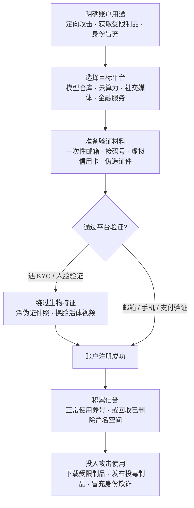

# 建立账户 (AML.T0021)

> 属于 [资源开发 (AML.TA0003)](./README.md)

## 一句话通俗理解

> 攻击者在动手之前先给自己办一批"假证件"——注册邮箱、社交媒体账号、模型仓库账户，甚至整套能过人脸核验的身份。有的用来"养熟"积累信誉，有的用来冒充真实组织，等需要下载受限模型、发布投毒制品或冒充受害者时，这些账户就是现成的通行证。

## 难度等级

⭐⭐⭐ **Realized（已实现）**

官方成熟度评定为 Realized——MITRE ATLAS 案例库中有 **6 个案例研究**直接关联本技术，覆盖身份冒充（CS0004 用摄像头劫持骗过税务系统人脸认证、诈骗约 7700 万美元）、配置滥用（CS0006 利用 Clearview AI 错误开放的注册入口摸进私有代码仓库）、供应链伪装（CS0027 仿冒 Hugging Face 组织账户、CS0065 回收已删除命名空间发布恶意模型）与 KYC 欺诈（CS0033/CS0034 用深度伪造通过银行与交易所的活体检测）。注册一个账户本身零门槛——一个邮箱几分钟搞定；真正的难度全部在"注册之后"：通过手机、支付、实名等层层验证，把账号"养"到平台不怀疑，并在被风控识破前完成攻击。随着 ProKYC 这类深伪工具把"过人脸"做成按件付费的商品，最后一道生物特征门槛也正在被批量突破。

## 技术描述

### 通俗解释

传统世界里的"建立账户"并不陌生：攻击者批量注册社交媒体账号，养熟之后用来发钓鱼链接、造舆论。AI 时代给这件事加了两条全新的生产线。

第一条生产线为"AI 攻击备料"服务：许多高价值模型与数据集并非公开下载——要么需要同意许可协议（gated 受限制品），要么仅向特定域名邮箱开放，要么绑定云平台的免费算力额度。想拿到这些"原料"，先得有一个能通过验证的账户。

第二条生产线为"身份冒充"服务：模型仓库的组织账户、金融平台的 KYC 实名账户，都是可以被仿冒的对象——前者让你冒充一家公司收割其员工的信任（CS0027），后者让你凭空造出一个"合法的假人"（CS0034）。共同的逻辑是：**平台越是信任账户体系，攻击者投资账户的回报就越高**。

### 技术原理

依据官方描述，对手可能创建各类服务的账户，用于定向攻击（targeting）、获取 AI 攻击适配（AI Attack Staging，AML.TA0001）阶段所需资源的访问权限，或冒充受害者。其核心是与平台验证体系的对抗：

1. **验证链对抗**：现代平台注册验证链条为 邮箱 → 手机 → 支付 → 实名/KYC → 组织所有权。攻击者逐层对抗——一次性邮箱、接码平台手机号、虚拟信用卡应对基础验证；伪造证件照与深度伪造活体视频应对 KYC（ProKYC 类工具）；仿冒或回收组织命名空间绕过组织验证；
2. **信誉机制的两面性**：平台用账户年龄、历史行为、认证徽章度量可信度。攻击者既可以通过"养号"缓慢积累信誉，也可以走捷径直接"继承"信誉——回收已删除的作者命名空间，让历史信任关系重新指向自己控制的账户（CS0065）；
3. **配置错误的注册入口**：账户体系本身的缺陷也是入口——CS0006 中 Clearview AI 的代码仓库虽设密码，却因错误配置允许任意用户注册账户，外部研究者借此进入私有仓库，拿到生产凭证、云存储密钥与 Slack 令牌；
4. **与相邻技术的边界**：AML.T0012 有效账户是**盗用**已有凭据，AML.T0021 是**新建**账户。新建的账户能合法通过全部验证环节，因此防御方无法靠"凭据是否有效"区分恶意，只能依赖行为与关联分析。

**平台覆盖**：Enterprise（官方数据）。账户建立发生在传统 IT 身份体系（邮箱、手机号、支付、实名认证）之上，但其产出——账户——是攻击 AI 平台、模型仓库与金融 KYC 体系的通用入场券。

### 用途影响

- **资源获取的入场券**：受限模型、数据集与云算力额度是 AI 攻击适配的原料，账户是获取它们的第一道门；
- **供应链信任的挂载点**：模型仓库的发布权限绑定在账户上——仿冒组织或回收命名空间，等于把恶意制品直接挂载到受害者的既有信任关系上（CS0027/CS0065）；
- **身份冒充的载体**：从"冒充组织骗员工加入"到"冒充纳税人骗退税"（CS0004 的 7700 万美元），账户是身份冒充的具象化落地；
- **攻击成本结构性下降**：深伪工具服务化让"过 KYC"不再需要专业能力，建户的边际成本趋近于零；
- **检测时间差**：账户建立发生在目标系统之外，组织侧传统日志完全看不见，防御被迫前移到平台风控与品牌监控。

## 攻击流程

### 典型攻击流程



**步骤详解：**

1. **明确用途与选择平台**
   - 通俗描述：先想清楚"办证"干什么用，再决定去哪办。
   - 技术细节：按攻击目标倒推账户类型——下载受限模型需要模型仓库账户（某些学术资源还要求特定域名邮箱）；发布投毒制品需要具备发布权限且不被怀疑的仓库账户；冒充组织需要抢占组织命名空间；金融欺诈则需要能通过 KYC 的全套身份材料。

2. **准备验证材料**
   - 通俗描述：备齐各种"证明材料"。
   - 技术细节：一次性邮箱与接码平台手机号应对基础验证；虚拟信用卡应对支付验证；针对实名/KYC 场景升级为伪造身份证件照与深度伪造活体视频（ProKYC 类工具可同时产出这两类材料）。

3. **注册与验证对抗**
   - 通俗描述：与平台门禁逐关过招。
   - 技术细节：依次通过邮箱验证、手机验证、支付验证与行为验证（CAPTCHA）；对抗设备指纹与 IP 信誉——数据中心 IP、Tor 出口常被拦截，攻击者转而使用住宅代理与反检测浏览器维持"正常用户"表象。

4. **积累信誉**
   - 通俗描述：让账号看起来像"正常人"用了很多年。
   - 技术细节：保持正常使用痕迹——登录历史、社交关系、小额消费；模型仓库账户通过发布普通模型、收集点赞下载积累信誉。命名空间回收是"继承信誉"的捷径：直接重新注册已删除的作者命名空间，接管其历史信任（CS0065）。

5. **投入攻击使用**
   - 通俗描述：通行证到手，各取所需。
   - 技术细节：三大去向——(a) 获取 AI 攻击适配所需资源：下载受限模型/数据集、领取云算力免费额度；(b) 作为投毒制品的发布载体：组织混淆（CS0027）或命名空间回收（CS0065）把恶意制品挂载到既有信任上；(c) 身份冒充：冒充组织骗员工加入、冒充个人实施发票欺诈（CS0004）或批量开设金融账户（CS0034）。

**账户用途与典型平台速览：**

| 账户类型 | 典型平台 | 攻击用途 | 关联案例 |
|----------|---------|----------|:-------:|
| 模型仓库个人账户 | Hugging Face 等 | 下载受限制品、回收命名空间发布恶意模型 | CS0065 |
| 模型仓库组织账户 | Hugging Face 等 | 仿冒组织、收割员工信任与上传的模型 | CS0027 |
| 云平台账户 | 各大云厂商 | 领取免费算力额度、滥用试用资源 | — |
| 金融实名账户 | 加密交易所、银行 | 合成身份欺诈、批量开设欺诈账户 | CS0034 |
| 社交媒体/邮箱账户 | 社交平台、邮件服务 | 钓鱼铺垫、维持假身份 | CS0004 |

**与后续战术的衔接：**

- **侦察（AML.TA0002）**：侦察产出决定注册方向——目标用什么平台、信任什么身份、缺什么资源

- **AI 攻击适配（AML.TA0001）**：受限模型与数据集是构造对抗样本、搭建代理模型的原料，账户是拿到原料的前提
- **发布投毒 AI 制品（AML.T0115）/ 暂存能力（AML.T0079）**：制品发布权限绑定在账户上，没有"可信"账户，投毒制品难以骗过下游
- **初始访问**：新建账户凭据可直接转化为登录能力——与盗用路径（有效账户 AML.T0012）互补
- **影响**：身份冒充直接兑现为金融欺诈——CS0004 借空壳公司与假发票骗取约 7700 万美元

> 关键区分：AML.T0021 是"从零新建"，AML.T0012 有效账户类技术是"盗用已有"。前者考验绕过注册验证，后者考验窃取凭据——防御侧重因此不同：前者靠注册风控与品牌监控，后者靠凭证保护与异常登录检测。

## 真实案例

> 以下 3 个案例源自 MITRE ATLAS 案例库，均直接关联 AML.T0021（官方共 6 个关联案例，其余见术语解释与参考资料）。

### 案例1：Hugging Face 组织混淆攻击（2023年，AML.T0021）

- **时间**: 2023年8月
- **攻击者**: 安全研究员 threlfall_hax（攻击演示）
- **手法**: 在 Hugging Face 公开模型仓库上创建与真实组织同名的仿冒组织账户。账户外观足够可信，被冒充组织的员工信以为真，主动申请加入这个"自家官方"组织——研究者批准申请后即获得员工上传模型的完整访问权，包括将模型替换为恶意版本的能力。研究者进一步演示：在模型中嵌入恶意软件，加载即获得受害者环境的访问立足点，后续可实施知识产权窃取或对环境内其他 AI 模型投毒。
- **影响**: "组织混淆"证明模型仓库的账户体系存在信任空档——平台不验证"谁有资格以组织名义开户"，员工也无从分辨官方账户与高仿账户；攻击面从账户一路延伸到供应链
- **参考链接**: [Model Confusion - Weaponizing ML models for red teams and bounty hunters](https://5stars217.github.io/2023-08-08-red-teaming-with-ml-models/#unexpected-benefits---organization-confusion)

### 案例2：ProKYC 深伪工具批量攻破 KYC 验证（2024年，AML.T0021）

- **时间**: 2024年10月（Cato CTRL 披露）
- **攻击者**: ProKYC 工具运营者及其网络犯罪客户
- **手法**: ProKYC 是一款向网络犯罪分子销售的深度伪造工具，用于绕过加密货币交易所等金融服务的 KYC（了解你的客户）验证。它能同时伪造 KYC 环节两类关键的生物特征材料——虚假身份证件与深度伪造自拍视频，帮助攻击者击败人脸识别与活体检测，在金融应用上批量创建欺诈账户。CS0033 中 iProov 红队的演示证明：换脸图像注入攻击可同时绕过被动与主动活体检测——欺诈账户随后可伪装成假身份开设银行或加密货币应用账户。
- **影响**: "过 KYC"从专业能力变成按件付费的服务；金融平台面对的不再是零散合成身份，而是工业化生产的虚假人格
- **参考链接**: [Cato CTRL: ProKYC - Deepfake Tool for Account Fraud Attacks](https://www.catonetworks.com/blog/prokyc-selling-deepfake-tool-for-account-fraud-attacks/)、[AIID Incident 819](https://incidentdatabase.ai/cite/819/)、[IDScan.net: ProKYC 合成身份欺诈分析](https://idscan.net/blog/prokyc-synthetic-identity-fraud/)

### 案例3：模型命名空间回收供应链攻击（2025年，AML.T0021）

- **时间**: 2025年9月
- **攻击者**: Unit 42 研究人员（攻击演示）
- **手法**: 演示一条 AI 供应链攻击路径：回收（reclaim）已删除的 Hugging Face 作者命名空间，并以相同的历史 Author/ModelName 标识发布恶意模型。凡是未固定版本引用该标识的应用与模型目录，都会解析并部署攻击者控制的替换模型。攻击对已删除模型与所有权转移模型均有效。研究人员把反向 Shell 载荷嵌入替换模型，在 Google Vertex AI 与 Azure AI Foundry 的 Hugging Face 模型目录支持的部署端点环境中获得代码执行；同时发现开源代码仓库、文档、默认参数、示例笔记本与下游模型注册表中存在大量可被利用的陈旧引用——不直接使用 Hugging Face 的用户也会中招。
- **影响**: 一次注册动作（回收命名空间）就能让历史信任"复活"并指向恶意制品——账户注册环节本身成为供应链攻击的入口
- **参考链接**: [Unit 42: Model Namespace Reuse - An AI Supply-Chain Attack Exploiting Model Name Trust](https://unit42.paloaltonetworks.com/model-namespace-reuse/)

## 红队视角

> ⚠️ **免责声明**：以下内容仅用于合法授权的安全测试与教育目的。使用伪造证件、冒充真实个人或组织、绕过金融 KYC 在绝大多数司法辖区构成违法犯罪（CS0004 当事人即因税务欺诈被追诉）——红队只能在自有系统或获得平台书面授权的范围内测试。

### 实战技巧

1. **把账户清单当作交付物**
   授权测试中注册的一切账户都要记录在案：用途、验证绕过路径、绑定材料。测试结束后逐一清理，并在报告中给出平台注册风控的改进建议——这往往是客户最直观的"攻击成本"感知。

2. **组织仿冒的验证性测试设计**
   仅在书面授权 + 平台许可下进行：注册与客户品牌高度相似的账户，观察平台是否要求组织所有权验证、真实员工是否会被诱导申请加入（复现 CS0027 的前提条件）。若平台无验证环节，这本身就是应写入报告的高危发现。

3. **注册风控的对抗性评估**
   在客户自有应用上量化各验证层的检出率：邮箱域名信誉、设备指纹、行为分析（表单填写节奏）、支付验证。识别最薄弱环节，用数据说话——"同 IP 注册 20 个账户只有第 3 个被拦"比"建议加强风控"有力得多。

### 常用工具

| 工具/服务类型 | 用途 | 平台 |
|----------|------|------|
| 一次性邮箱服务 | 批量注册的邮箱底料 | Web |
| 接码平台 | 通过短信验证 | Web |
| 虚拟信用卡/预付卡 | 通过支付验证、领取免费额度 | Web |
| 深度伪造工具（ProKYC 类） | 伪造证件照与活体视频，绕过 KYC | 商业服务 |
| 反检测浏览器 | 多账户环境隔离，规避设备指纹风控 | 跨平台 |
| OSINT 工具 | 收集可冒充的组织与个人信息 | 跨平台 |

### 注意事项

- **法律红线优先**：对第三方金融平台做 KYC 绕过测试几乎必然违法，永远只在自有靶场验证深伪检测能力
- **平台条款**：批量注册行为被多数平台服务条款禁止，授权范围必须覆盖平台侧
- **报告聚焦防御缺口**：向客户展示"你的注册流程还剩几层验证"、"你的品牌在模型仓库里有没有高仿账户"，而非攻击技巧本身

## 蓝队视角

### 检测要点

1. **注册环节异常（平台方视角）**
   - 日志来源：注册接口日志、风控引擎日志
   - 关注字段：邮箱域名、源 IP、设备指纹、提交时间间隔
   - 异常特征：一次性邮箱域名、同 IP/设备指纹短窗口内多账户注册、无 JS 执行痕迹的纯 API 注册、表单填写节奏过于均匀

2. **品牌与命名空间冒充（组织方视角）**
   - 日志来源：模型仓库/代码仓库/包管理器的公开检索
   - 异常特征：新注册账户与自有品牌名高度相似（错拼、连字符、复数）、已注销官方账户名被第三方重新注册、组织认证徽章缺失但名称逼真

3. **账户使用异常**
   - 日志来源：平台审计日志、API 网关日志
   - 异常特征：gated 制品的批量申请、多账户共享同一行为指纹、新账户立即调用高价值 API

4. **KYC 环节注入特征（金融平台视角）**
   - 日志来源：人脸核身服务日志
   - 异常特征：虚拟摄像头/注入帧痕迹、活体视频边缘伪影、证件信息与活体人脸的特征不一致

### 监控建议

- **组织方建立"与我相关"监控**：定期检索模型仓库、代码仓库、包管理器上与本组织名、产品名、项目名相似的账户与制品；对已注销的官方账户名保留监控——命名空间被第三方回收时立即告警
- **平台方做全生命周期画像**：单次注册难辨善恶，"注册 → 养号 → 异常使用"的行为链条才是可靠信号，把注册风控数据与后续 API 调用、制品发布行为串联分析
- **KYC 供应商持续对抗**：虚拟摄像头检测、深伪检测要随攻击工具迭代升级，不要假设上线时的活体检测一直有效——ProKYC 的存在证明攻击已是工业化水平

## 检测建议

### 网络层检测

**检测方法：** 识别自动化批量注册的流量特征。

- 注册请求来自数据中心 IP 段、Tor 出口或已知住宅代理池
- 纯 API 注册（无 JS 执行、无 CAPTCHA 渲染痕迹）占比异常
- 多账户注册请求的 TLS/UA 指纹高度一致

### 应用层检测（平台风控）

**检测方法：** 在注册与 KYC 环节嵌入多层验证。

- 一次性邮箱域名黑名单 + 注册邮箱域名年龄检查（攻击者常自建新域名绕过静态黑名单）
- 同 IP/设备指纹/支付卡的多账户关联分析
- 组织账户创建强制所有权验证（域名邮箱、官方渠道确认）——直接封堵组织混淆（CS0027）
- KYC 环节增加证件与活体人脸一致性校验、注入攻击检测

### 威胁情报层检测（组织方视角）

**检测方法：** 监控冒充自有品牌的账户与命名空间。

- 定期检索公开平台上与本组织名、产品名、项目名、已注销账户名匹配的新注册账户
- 订阅品牌保护类威胁情报服务——对账户命名的监控价值，相当于证书透明度日志之于域名抢注

**程序化检测思路（无需 EDR 侧改造）：**

把"账户建立"的检测拆成两半：平台侧用"**邮箱域名信誉 × 设备指纹 × 提交节奏**"三元组压制批量注册，三元组同时命中再告警以压低误报；组织侧用"**品牌相似度监控**"压制冒充与命名空间回收。两半都不依赖受害者侧日志——这正是本技术的检测难点：攻击发生在你的系统之外，检测也必须走出去。

### Sigma 规则思路示例

```yaml
title: 同源短窗口批量账户注册（账户农场特征）
status: experimental
description: 检测同一来源在 10 分钟窗口内使用一次性邮箱域名创建多个账户，
    可能为批量建号活动（AML.T0021），用于获取受限 AI 制品或供应链投毒
logsource:
    category: application
    service: user-registration
detection:
    selection:
        event.action: 'account_created'
        user.email|endswith:
            - '@mailinator.com'
            - '@guerrillamail.com'
            - '@temp-mail.org'
    condition: selection | count() by source.ip > 3
timeframe: 10m
level: high
tags:
    - attack.t1585
    - atlas.aml_t0021
```

## 缓解措施

### 优先级1：关键措施

**AML.M0005 控制静态 AI 模型与数据的访问（Control Access to AI Models and Data at Rest）**

对内部模型注册表建立访问控制，限制对生产模型的内部访问，训练数据仅限获批用户访问。针对本技术的落地要点：收紧模型仓库的组织与成员机制——谁能创建组织、谁能加入组织、谁能下载受限制品都要有显式授权与定期审计（直接针对 CS0027 式仿冒组织"吸人"）；对 gated 制品的申请建立身份核验而非"点了同意就给"；训练数据与生产模型按角色最小授权，防止一个欺诈账户撬动整条供应链。

### 优先级2：重要措施

**AML.M0019 控制生产环境中 AI 模型与数据的访问（Control Access to AI Models and Data in Production）**

要求用户在访问生产模型前验证身份；对 API 端点强制认证；监控生产模型查询，确保使用符合策略并防止滥用。针对本技术的落地要点：API 密钥与账户强绑定并支持溯源归因；对新注册账户设置调用配额与冷启动限流，压缩欺诈账户"注册即滥用"的窗口；对生产模型的异常查询模式（高频、批量、非常规时段）持续监控。

### MITRE ATLAS 缓解措施映射

| 缓解措施ID | 缓解措施名称 | 优先级 | 类别 | 生命周期阶段 |
|------------|-------------|:------:|------|-------------|
| AML.M0005 | 控制静态 AI 模型与数据的访问 | 关键 | Policy | 业务与数据理解 · 数据准备 · AI 模型工程 · AI 模型评估 |
| AML.M0019 | 控制生产环境中 AI 模型与数据的访问 | 重要 | Policy | 部署 · 监控与维护 |

> 这两条缓解的对象是"账户建立之后的访问收口"——攻击者注册的账户只有撞上收紧的访问边界才会失效。注册环节本身的防御依赖平台风控与品牌监控（见蓝队视角与检测建议），组织侧无法单方面阻止攻击者建号，只能让自己平台上"假账户无利可图"。

## 关联 ATT&CK 技术

官方将本技术映射至 ATT&CK 的 [建立账户 (T1585)](../../enterprise/02-Resource-Development/T1585-Establish-Accounts.md)（[ATT&CK 官方页面](https://attack.mitre.org/techniques/T1585/)）。两者行为内核一致——都是"从零新建账户"而非盗用；差异在于 AI 语境为账户赋予了三类新用途：

| 维度 | ATT&CK T1585 经典场景 | ATLAS AML.T0021 扩展场景 |
|------|---------------------|------------------------|
| 账户用途 | 社交媒体/邮箱养号，铺垫钓鱼与社会工程 | 下载受限模型与数据集、抢注组织命名空间、通过金融 KYC |
| 验证对抗 | 邮箱/手机/验证码 | 人脸识别与活体检测（深度伪造）、组织所有权验证 |
| 冒充对象 | 冒充个人身份 | 冒充组织（组织混淆）、回收已删除命名空间 |
| 攻击衔接 | 钓鱼、影响力行动 | AI 供应链投毒（AML.T0115）、AI 攻击适配资源获取、身份欺诈 |

从防御视角看，T1585 时代的注册风控经验（邮箱信誉、设备指纹、行为分析）依然全部适用，但必须叠加两类新检测：模型仓库侧的**组织与命名空间监控**（CS0027/CS0065 防线），与金融侧的**深伪活体检测**（CS0033/CS0034 防线）。

## 动手实验

> ⚠️ **重要提示**：所有实验使用本人真实身份与自有资产。禁止使用伪造材料注册任何服务——实验1、2 完全合法；实验3 限定在自建靶场。

### 实验环境准备

| 环境组件 | 用途 | 获取方式 |
|----------|------|----------|
| 本人真实邮箱与手机号 | 以本人身份注册观察验证环节 | 自有 |
| Hugging Face 账户 | 体验注册、gated 模型申请与组织机制 | 官网注册 |
| 自建 Web 应用（任意框架） | 实验3 的注册风控靶场 | 自有代码 |
| 开源一次性邮箱域名黑名单 | 实验3 的风控素材 | GitHub 开源项目 |

### 实验1（初级）：体验"账户 = 受限制品入场券"

**实验目标：** 直观理解 gated 机制与账户的绑定关系。

**实验步骤：**
1. 以本人真实身份注册 Hugging Face 账户，记录注册流程的每一道验证环节
2. 找一个标记为 gated 的模型（需同意许可协议才能下载），走完申请流程
3. 对比公开模型与 gated 模型的下载入口差异，思考：攻击者为什么愿意为这个"同意按钮"提前准备账户？

**预期结果：** 理解账户是受限 AI 制品的第一道门，以及平台为何用账户做分发门槛。

### 实验2（中级）：识别组织账户仿冒（防御演练）

**实验目标：** 以组织方视角发现品牌暴露面。

**实验步骤：**
1. 在 Hugging Face 与 GitHub 搜索与自己所在组织（或任一知名 AI 公司）名称高度相似的用户与组织
2. 记录仿冒识别特征：命名差异（错拼、连字符、复数）、认证徽章缺失、账户创建时间、成员数与制品情况
3. 对照 CS0027 复盘：如果你的同事在搜索结果里看到这个高仿账户，会不会误认并申请加入？

**预期结果：** 产出一份组织品牌暴露面清单与内部通报建议。

### 实验3（高级）：搭建注册风控靶场并量化检出率

**实验目标：** 理解注册风控在"检出率 vs 误报"之间的取舍。

**实验步骤：**
1. 在自建应用上实现三层注册风控：一次性邮箱域名黑名单、同 IP/设备指纹注册限流、表单填写节奏分析
2. 编写两种注册脚本：模拟正常单账户注册（含人工化随机延迟）与自动化批量注册
3. 统计各层风控对两种注册的检出率与误报率
4. 参照本篇 Sigma 规则思路，把"同源短窗口多账户"固化为可运行的告警规则

**预期结果：** 亲手验证"单层风控必然有绕过路径，多层风控靠叠加提高攻击成本"的防御逻辑。

## 术语解释

| 术语 | 英文原名 | 通俗解释 |
|------|----------|----------|
| 建立账户 | Establish Accounts | 攻击者从零注册各类服务账号，区别于盗用已有账户 |
| 养号 | Account Aging / Farming | 长期正常使用账户以积累信誉与历史，降低风控怀疑 |
| 受限制品 | Gated Artifacts | 需要申请、同意条款或通过身份验证才能下载的模型/数据集 |
| AI 攻击适配 | AI Attack Staging | ATLAS 战术 AML.TA0001，把攻击能力适配到具体目标模型与数据的过程 |
| KYC | Know Your Customer | 金融服务的客户身份验证流程，含证件核验与人脸核身 |
| 活体检测 | Liveness Detection | 判断人脸来自真人而非照片、视频或面具的技术 |
| 深度伪造 | Deepfake | 用 AI 生成或替换人脸、声音的伪造技术 |
| 组织混淆 | Organization Confusion | 仿冒组织账户诱使真员工误认并加入的攻击手法（CS0027） |
| 命名空间回收 | Namespace Reuse / Reclaim | 重新注册已删除的用户名/组织名，继承其历史信任（CS0065） |
| 一次性邮箱 | Disposable Email | 用后即弃的临时邮箱服务，批量注册的常用底料 |
| 账户农场 | Account Farm | 批量生产、养护账户的基础设施 |
| 合成身份 | Synthetic Identity | 拼接真实与虚构信息伪造出的不存在身份 |

## 参考资料

### 📚 官方文档

- [MITRE ATLAS - Establish Accounts (AML.T0021)](https://atlas.mitre.org/techniques/AML.T0021/) - 官方技术页面
- [MITRE ATLAS 矩阵](https://atlas.mitre.org/matrices/ATLAS/)
- [MITRE ATLAS Data (GitHub)](https://github.com/mitre-atlas/atlas-data)

### 📰 案例报告（真实攻击与安全研究）

- [Model Confusion - Weaponizing ML models for red teams and bounty hunters](https://5stars217.github.io/2023-08-08-red-teaming-with-ml-models/#unexpected-benefits---organization-confusion) - Hugging Face 组织混淆攻击演示（CS0027）
- [Cato CTRL: ProKYC - Deepfake Tool for Account Fraud Attacks](https://www.catonetworks.com/blog/prokyc-selling-deepfake-tool-for-account-fraud-attacks/) - 深伪 KYC 欺诈工具分析（CS0034）
- [Unit 42: Model Namespace Reuse](https://unit42.paloaltonetworks.com/model-namespace-reuse/) - 命名空间回收供应链攻击（CS0065）
- [WSJ: Faces are the next target for fraudsters](https://www.wsj.com/articles/faces-are-the-next-target-for-fraudsters-11625662828) - 人脸识别欺诈趋势报道（CS0004）
- [TechCrunch: Security lapse exposed Clearview AI source code](https://techcrunch.com/2020/04/16/clearview-source-code-lapse/) - 注册配置错误致私有仓库泄露（CS0006）

### 🔧 工具与资源

- [Hugging Face Hub 安全文档](https://huggingface.co/docs/hub/security) - 模型仓库安全机制（pickle 风险、GPG 签名、安全看板）
- [OWASP Top 10 for LLM Applications](https://owasp.org/www-project-top-10-for-large-language-model-applications/) - LLM 应用十大安全风险清单
- [NIST AI Risk Management Framework](https://www.nist.gov/itl/ai-risk-management-framework) - NIST AI 风险管理框架

### 🔗 关联阅读

- [建立账户 (T1585)](../../enterprise/02-Resource-Development/T1585-Establish-Accounts.md) - ATT&CK 经典建户技术，与本技术对照阅读
- [资源开发 (AML.TA0003)](./README.md) - 本技术所属战术的概览页

---

> **版本**: ATLAS 2026.09 | **更新**: 2026-10-22 | **模板**: ATLAS 技术文档 v1.0
