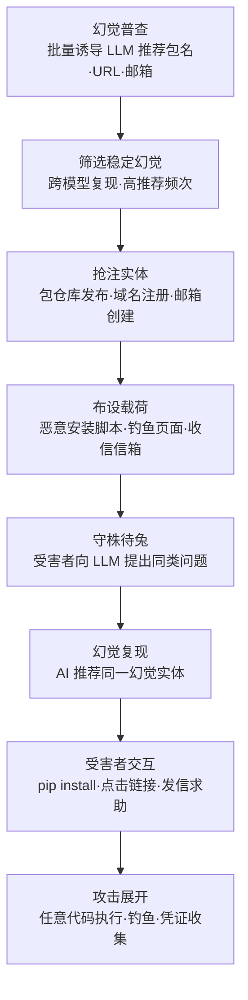

# 发布幻觉实体 (AML.T0060)

> 属于 [资源开发 (AML.TA0003)](./README.md)

## 一句话通俗理解

> 攻击者不钓鱼、不扫描，只是先问 AI"你推荐装什么包"，把 AI 编造出来的不存在包名提前注册成自己的恶意包——然后什么都不用做，等全世界的开发者问 AI 同样的问题，照着答案敲下 `pip install`，亲手把恶意代码装进自己的环境。

## 难度等级

⭐⭐ **Demonstrated（已演示验证）**

官方成熟度评定为 Demonstrated——技术本身已在安全研究中被完整演示：2024 年 Vulcan Cyber 的实验证明 ChatGPT 会稳定编造不存在的包名，抢注后追踪到数万次下载；2025 年 Lasso Security 对主流 LLM 的"幻觉测绘"识别出 2000+ 个幻觉包名，其中约五分之一在多个模型间重复出现。实施门槛极低：注册一个包仓库账号、发布一个包、或买一个域名，任何人都做得到。真正的"难点"只有两处——**幻觉预测**（哪些编造的名字值得抢注：跨模型复现、推荐频次高的幻觉价值最大）与**仓库防护规避**（主流包仓库对恶意包的扫描与下架机制）。平台覆盖为 Generative AI（生成式 AI）与 Agentic AI（智能体 AI）两类——后者风险更高：智能体会把 LLM 编造的安装建议**直接执行**，连"人类照抄"这一环都省了。

## 技术描述

### 通俗解释

传统抢注（typosquatting）赌的是"人手滑"：注册 `nmpa`、`requsets` 这种打错字的名字，等有人敲错。发布幻觉实体赌的是"AI 嘴瓢"：大语言模型在被问到冷门库时会一本正经地编造一个**听起来极其合理但根本不存在**的包名、命令、URL、公司名或邮箱——而且对不同的用户问同样的问题，它往往编出**同一个名字**。

攻击者要做的，就是抢在所有人前面把这个名字占住：

- LLM 编了个包名 `huggingface-cli`？攻击者就往 PyPI 发布一个同名的恶意包；
- LLM 编了个文档网址 `docs-fastlib.dev`？攻击者就注册这个域名挂钓鱼页；
- LLM 编了个"官方支持邮箱" `support@fastlib.io`？攻击者就创建这个邮箱等待收信。

此后攻击进入"守株待兔"模式：不需要接触任何目标，全世界的 LLM 用户在问出同类问题时，会源源不断地收到指向攻击者实体的"AI 官方推荐"。受害者不是被攻击者骗的，是被自己信任的 AI 助手"指路"的——这种信任转嫁，正是本技术威力的核心。

### 技术原理

依据官方描述，攻击者创建一个由自己控制的实体——软件包、网站或邮箱地址——与 LLM 幻觉出的来源相对应。幻觉可以表现为**包名、命令、URL、公司名或邮箱地址**等形式，它们把受害者指向攻击者控制的实体；当受害者与该实体交互时，攻击即可继续推进。

技术成立依赖幻觉的三个特性：

1. **合理性**：幻觉名称通常由真实存在的词汇片段组合而成（知名项目名、常见前后缀、功能关键词），看起来"像真的"，人类与自动化校验都难以凭直觉分辨；
2. **确定性（可复现性）**：同一模型对同类提示倾向于产生相同的幻觉——Vulcan Cyber 的实验与 Vollmer 等人的系统测量都证实，不同用户问相似的问题会命中同一个编造名。这意味着攻击者的抢注可以**提前、批量、精准**地进行；
3. **跨模型一致性**：多个独立训练的 LLM 会在相同位置"不约而同"地编出同一个名字（训练数据的共同偏差），一次抢注可以同时命中多家厂商的模型用户。

攻击者获取幻觉清单的前置路径：直接调用公开推理 API 批量诱导（AML.T0040），或系统性地发现并测绘 LLM 幻觉（AML.T0062）——这两步都属于资源开发阶段的标准准备动作。

**幻觉实体的三种主要形态：**

| 实体形态 | 幻觉载体 | 抢注动作 | 受害者触点 | 直接后果 |
|---------|---------|---------|-----------|---------|
| 恶意软件包 | `pip install <编造包名>` | 向 PyPI/npm 注册同名包 | 开发者按 AI 建议安装 | 任意代码执行（安装即触发） |
| 幻觉域名/网站 | "官方文档" URL、下载链接 | 注册该域名并布设内容 | 用户点击 AI 给出的链接 | 钓鱼、凭证收集、恶意软件下载 |
| 幻觉邮箱/身份 | "官方支持" 邮箱、公司名 | 注册邮箱域名并收信 | 用户发信求助/提交凭证 | 社会工程、凭证收割 |

**平台覆盖**：Generative AI（生成式 AI）与 Agentic AI（智能体 AI）。前者要求人类用户照抄 AI 建议；后者中智能体会自主执行安装与访问动作，幻觉实体的触发链路被进一步缩短——这也是本技术随智能体普及而风险持续放大的原因。

### 用途影响

- **供应链入口**：恶意包通过 AI 推荐进入开发者环境与 CI 流水线，安装阶段即可执行任意代码（setup.py 钩子），后果等同传统恶意包攻击；
- **钓鱼入口**：幻觉 URL 自带"AI 推荐"信任背书，钓鱼成功率显著高于裸投钓鱼邮件；
- **社工强化**：编造的公司名与支持邮箱可让攻击者的假身份"通过验证"——受害者反向查询时会发现该实体真实存在，且正是 AI 说的那个；
- **零接触目标**：全部准备工作发生在公开仓库与域名注册商，攻击者在受害者中招前**从未触碰目标系统**，边界防御全程无感；
- **规模效应**：一次抢注、多模型命中、跨用户复利——幻觉的确定性把"守株待兔"变成了"高速公路设卡"；
- **智能体放大**：编码智能体把 AI 建议直接落盘执行，人类复核环节缺位时，恶意包可直达生产构建链。

## 攻击流程

### 典型攻击流程



**步骤详解：**

1. **幻觉普查**
   - 通俗描述：先问 AI 一万遍"该装什么包"，把编出来的名字都记下来。
   - 技术细节：攻击者通过推理 API 访问（AML.T0040）向多个 LLM 批量提出冷门领域问题（小众格式的处理库、新框架的配套工具），系统性地发现 LLM 幻觉（AML.T0062），收集 AI 编造的包名、命令、URL 与邮箱清单。

2. **筛选稳定幻觉**
   - 通俗描述：只抢"AI 最爱编"的那几个名字。
   - 技术细节：统计每个幻觉名在不同模型、不同问法下的出现频率，优先选择**跨模型复现、推荐频次高、语义上像官方实现**的名字——它们未来被真实用户命中的概率最大，抢注的"投资回报率"最高。

3. **抢注实体**
   - 通俗描述：把编出来的名字注册成自己的。
   - 技术细节：向 PyPI/npm 等仓库发布同名包、注册幻觉中的域名、创建幻觉中的邮箱。可能需要先建立包仓库与域名注册商账户（衔接建立账户，AML.T0021）。

4. **布设载荷**
   - 通俗描述：在陷阱里装上爪子。
   - 技术细节：为恶意包编写安装钩子（setup.py/prepare 装 token 窃取、反向 shell、挖矿或持久化后门）；为幻觉域名布设仿冒官方文档的钓鱼页面；为幻觉邮箱配置自动化收割流程。

5. **守株待兔与幻觉复现**
   - 通俗描述：什么都不做，等 AI 把猎物送上门。
   - 技术细节：受害者向 LLM（或编码智能体）提出与普查时同类的问题，由于幻觉的确定性与跨用户复现性，AI 大概率推荐同一个幻觉实体——攻击者从未向受害者发送任何内容，"投递"由 AI 代劳。

6. **受害者交互与攻击展开**
   - 通俗描述：开发者照着答案敲下回车。
   - 技术细节：受害者执行 AI 给出的安装命令（衔接 AI 软件，AML.T0010.001）、点击幻觉链接或向幻觉邮箱发信；恶意包在安装时执行任意代码（衔接恶意包，AML.T0011.001），最终导致数据窃取、系统沦陷等用户伤害（AML.T0048.003）。

**与其他战术的衔接：**

- **前置·资源开发**：推理 API 访问（AML.T0040）与发现 LLM 幻觉（AML.T0062）产出抢注目标清单；建立账户（AML.T0021）提供仓库与注册商身份
- **同战术·资源开发**：与发布投毒 AI 制品（AML.T0115）互为姊妹技术——前者冒充"AI 编造的名"，后者冒充"真实存在的名"；投毒制品与幻觉实体都属"发布即攻击"，暂存能力（AML.T0079）描述了同样的部署待命逻辑
- **后续·初始访问/执行**：受害者安装与加载动作衔接 AI 软件（AML.T0010.001）与恶意包（AML.T0011.001），是攻击链从"资源"跨入"入侵"的转折点

> 关键差异：传统供应链投毒要主动"推"（群发钓鱼、刷下载量诱导搜索），本技术把投递环节**外包给了 AI**——攻击者只负责占住名字，推荐与分发由数百万开发者的日常提问自动完成。

## 真实案例

> 案例 1 源自 MITRE ATLAS 案例库（官方数据共关联 1 个案例研究，AML.CS0022）；案例 2、3 为本库补充的延伸案例，来自 ATLAS 案例库之外的公开研究，特此标注。

### 案例1：Vulcan Cyber 幻觉包抢注实验（2024年，AML.CS0022）

- **时间**: 2024年6月（案例库记录日期）
- **攻击者**: Vulcan Cyber 与 Lasso Security 研究人员（授权安全实验）
- **手法**: 研究人员使用公开 ChatGPT API，诱导其推荐软件包并识别出**并不存在于公开仓库中的幻觉包名**——例如询问"如何把模型上传到 Hugging Face"时，回答中包含 `pip install huggingface-cli` 这样的安装指引，而该包名正是模型编造的。研究人员随后将一个空壳包上传到 PyPI 追踪下载情况，官方案例记录其下载量超过 **30,000 次**；研究同时证明**多个 LLM 会产生相同的幻觉**，即任何用户问同类问题都会被指向同一个可抢注的名字。案例库完整攻击链：推理 API 访问 → 发现幻觉 → 发布幻觉实体 → 受害者下载（AML.T0010.001）→ 恶意包加载执行（AML.T0011.001）→ 用户伤害（AML.T0048.003）。
- **影响**: 首次系统证明"幻觉 → 抢注 → 等待中招"链路完全可行；空包尚有数万下载，若为恶意包则每次安装都是一次任意代码执行机会
- **参考链接**: [Vulcan18: Can you trust ChatGPT's package recommendations?](https://vulcan.io/blog/ai-hallucinations-package-risk)、[MITRE ATLAS 案例 AML.CS0022](https://atlas.mitre.org/studies/AML.CS0022/)

### 案例2：Lasso Security 幻觉测绘（2025年，延伸案例·非 ATLAS 案例库）

- **时间**: 2025年6月
- **攻击者**: Lasso Security 研究团队（授权安全研究）
- **手法**: 团队对多家主流商业 LLM 与编码助手开展大规模"幻觉测绘"：批量询问冷门库推荐，收集 AI 编造的包名，绘制出第一张 **LLM 幻觉包名地图**——识别出 **2,000+ 个不存在的包名**，其中约 **20%（455 个）在两个及以上模型间重复出现**，证实跨模型一致性意味着一次抢注可命中多家厂商的模型用户。研究观察到幻觉包名具备被攻击者系统性抢注的现实条件，该事件已被 AI 事件数据库收录。
- **影响**: 把"个别模型偶尔编名字"升级为"可测绘、可预测、可批量利用"的攻击面；幻觉地图本身既是防御情报，也是攻击者的目标清单
- **参考链接**: [Lasso Security: Diving into AI Package Hallucinations](https://www.lasso.security/blog/ai-package-hallucinations)、[AIID Incident 731](https://incidentdatabase.ai/cite/731/)

### 案例3：代码生成器幻觉包名系统测量（2024年，延伸案例·非 ATLAS 案例库）

- **时间**: 2024年11月（arXiv 2411.10906）
- **攻击者**: Vollmer 等 academic 研究者（学术测量研究）
- **手法**: 对 **24 个代码 LLM 与 4 个代码解释器工具**开展超过 **44 万次**测试：让模型为常见编程任务生成代码并统计其推荐依赖包的真实性。结果显示 **Python 生成代码中 19.7%、Node.js 中 21.7% 的推荐包并不存在**；更重要的是，幻觉是**确定性的**——相同模型对相似提示稳定编出相同包名，意味着任意两个用户从 AI 处得到的是同一个可抢注的假名字。研究者据此提出 slopsquatting 风险警告，并呼吁包仓库与模型厂商部署针对性防护。
- **影响**: 用可复现的学术测量为本技术提供了定量基础——约五分之一的 AI 推荐依赖是幻觉，且可被提前精准预测
- **参考链接**: [We Have a Package for You! Package Hallucinations Induced by Code Generators (arXiv 2411.10906)](https://arxiv.org/abs/2411.10906)、[Trend Micro: Slopsquatting](https://www.trendmicro.com/vinfo/us/security/news/cybercrime-and-digital-threats/slopsquatting-when-ai-agents-hallucinate-malicious-packages)

## 红队视角

> ⚠️ **免责声明**：以下内容仅用于合法授权的安全测试与教育目的。**在公共包仓库抢注真实幻觉名会伤害不可控的第三方用户，属违法行为**——所有投放验证必须在自有私有镜像内完成。

### 实战技巧

1. **幻觉普查自动化**
   在授权评估中，用脚本向目标组织正在使用的 LLM/编码助手批量提交冷门领域问题，收集全部推荐包名并查询公开仓库核验存在性，产出"贵组织专属幻觉清单"。这份清单同时是防御交付物——可直接交给蓝队做监控布防。

2. **私有镜像内闭环演示**
   搭建 devpi（Python）或 verdaccio（Node.js）私有镜像，把演示用幻觉名发布为带无害标记（打印告警横幅）的包；再让开发流程或编码智能体按 AI 建议安装，完整复现"AI 推荐 → 安装执行"链路。报告里放执行日志截图，说服力远超理论描述。

3. **CI 流水线攻击面评估**
   检查组织的 CI 是否会执行 AI 生成的 PR 建议、依赖清单是否锁定（lockfile + 哈希）。若 AI 生成的 requirements/package.json 可以不经人工核验直接进入构建，等于为幻觉实体开了直通车——这条发现往往比外部渗透更能打动管理层。

### 常用工具

| 工具名称 | 用途 | 平台 |
|----------|------|------|
| 任意 LLM API / 本地 LLM | 幻觉普查的提问引擎 | Web / 跨平台 |
| 包仓库 JSON API（PyPI/npm registry API） | 核验包名是否真实存在 | Web |
| devpi / verdaccio | Python / Node.js 私有镜像，安全闭环演示 | 跨平台 |
| OSV.dev / Socket | 依赖漏洞与恶意包情报 | Web |
| crt.sh / 新注册域名（NRD）源 | 域名侧幻觉抢注监控 | Web |

### 注意事项

- **公共仓库是红线**：绝不在 PyPI/npm 注册真实幻觉名——受害者是不可控的公众，且多数仓库有抢注检测与法律追责
- **演示全程用无害载荷**：私有镜像中的演示包只做标记输出，不引入真实恶意功能
- **交付物偏向防御**：幻觉清单、监控规则、CI 加固建议是红队报告中价值最高的部分

## 蓝队视角

### 检测要点

1. **安装遥测异常**
   - 日志来源：CI 构建日志、开发者终端 EDR/代理日志、私有镜像访问日志
   - 关注字段：包名、包注册时间、发布者、下载量
   - 异常特征：安装了**注册时间极短**（如 <90 天）、**零历史下载**、**无受信任发布者绑定**的依赖包；构建依赖清单中突然出现此前从未出现过的包名

2. **新注册域名与品牌相似度**
   - 日志来源：DNS 解析日志、代理日志、证书透明度日志（crt.sh）
   - 异常特征：员工访问的"文档站"命中新注册域名；域名与组织项目名、AI 常见编造模式（真实词根 + 常见后缀）高度相似

3. **AI 网关输出核验**
   - 日志来源：组织自建 LLM 网关/编码助手日志
   - 异常特征：AI 输出中出现的包名/URL 与组织维护的"已验证依赖与官方域名清单"比对不一致——这是幻觉实体攻击最早的可见信号，发生在安装之前

4. **邮件收发侧**
   - 日志来源：邮件网关日志
   - 异常特征：员工向新出现的"厂商支持邮箱"发送包含敏感信息的求助邮件

### 监控建议

- 把**包年龄 + 发布者验证 + 历史下载量**三要素做成安装前检查，接入 CI 与开发环境包管理器配置——在安装发生前拦截，而非事后溯源
- 维护**组织专属幻觉监控清单**：对组织项目名、产品名的高频变体在 PyPI/npm 与新注册域名中做持续监控（与战术 README 的速查卡建议一致）
- 对自建 LLM 助手的输出做**依赖名与链接的 allowlist 校验**，未命中清单的包名/URL 附加"未验证"警示
- 情报联动：关注 OSV、Socket 等平台的恶意包通告，以及安全厂商发布的幻觉包名清单——把别人的测绘结果变成自己的拦截规则

## 检测建议

### 网络层检测

**检测方法：** 识别对新注册/低信誉域名与仓库的访问模式。

- 代理/DNS 日志中，开发网段访问**新注册域名**（NRD 源比对）且域名与已知项目名高度相似
- 开发者主机/CI 节点直接访问非组织镜像的公共仓库 API 的异常频率

### 主机层检测

**检测方法：** 监控包管理器的安装行为特征。

- pip/npm 安装事件的包名与 lockfile 不符（未声明的即席依赖）
- 安装的包在仓库中注册时间极短且无发布者验证信息
- 安装后 setup 钩子进程出现可疑外连（反向 shell、token 上传端点）

### 应用层检测（AI 遥测）

**检测方法：** 在 LLM 网关对输出做实体核验。

- AI 回答中包含包名/URL 时，自动比对已验证清单；未命中即打标告警并给用户显著提示
- 聚合统计：哪些"未验证包名"被反复推荐——高频未验证名是抢注攻击的头号候选

**程序化检测思路（无需 EDR 侧改造）：**

以"**包年龄 + 发布者 + 首次出现**"三元组为核心：CI 中每次依赖解析时，调用仓库 JSON API 获取包的注册时间与发布者信息，注册时间 <90 天且无受信任发布者绑定的包默认阻断并转人工；同时在 LLM 网关侧对输出中的包名做同一查询——两处共用一个核验服务，安装前与生成前双保险。

### Sigma 规则思路示例

```yaml
title: 安装未声明的可疑新包（幻觉实体/依赖投毒特征）
status: experimental
description: 检测包管理器安装既不在 lockfile 声明、又命中新注册包特征的依赖，
    可能为 LLM 幻觉实体抢注（AML.T0060）或依赖混淆的落地动作
logsource:
    category: process_creation
    product: windows
detection:
    selection_pip:
        CommandLine|contains|all:
            - 'pip'
            - 'install'
    selection_npm:
        CommandLine|contains|all:
            - 'npm'
            - ' install'
    condition: 1 of selection_*
falsepositives:
    - 开发者正常的即席调试安装（需配合包年龄核验降低误报）
level: medium
tags:
    - attack.t1195.001
    - atlas.aml_t0060
```

> 说明：Sigma 只能捕捉"安装动作"这一表象；真正的拦截点应在包管理器配置（强制私有镜像 + 哈希锁定）与 CI 核验服务上，本规则用于发现绕过防护的漏网事件。

## 缓解措施

### 官方映射情况

**MITRE ATLAS 官方数据中，AML.T0060 没有任何直接映射的缓解措施**（本技术的缓解关系为 0 条）。这与该技术的攻击位置有关：受害者侧的防御动作散布在开发流程、包仓库治理与 LLM 输出治理三个层面，ATLAS 尚未将其收敛为标准化缓解条目。以下为本库给出的编辑建议（非官方映射），以及两条主题相关但官方未映射到本技术的既有缓解措施，供参考。

### 本库编辑建议（非官方映射）

**第一层：开发者与构建流程（最有效）**

- **AI 推荐依赖一律人工核验**：AI 给出的包名/安装命令，先对照官方文档与仓库页面确认存在性与发布者，再进入代码——这是切断"照抄即中招"的唯一根治点
- **锁定依赖**：requirements.txt 启用哈希锁定（`pip install --require-hashes`）、使用 lockfile、CI 中禁止即席安装
- **私有镜像 + 允许清单**：开发环境统一走组织镜像代理，默认只放行已审核包，新包走申请流程

**第二层：平台与仓库治理**

- 推动使用/要求**受信任发布者（Trusted Publishers）与出处证明（provenance）**绑定，降低抢注包的可信度
- 包仓库侧的名称相似度审查、新发布者新包的强化扫描与观察期

**第三层：LLM 供应侧**

- 模型输出中涉及包名/URL/邮箱时做**存在性与权威性校验**（grounding），无法验证的实体不输出或明确标注"未验证"
- 对编码智能体：安装类工具调用前强制人工确认或 allowlist 校验

### 主题相关的既有缓解措施（官方未映射至本技术）

| 缓解措施ID | 缓解措施名称 | 相关性说明 |
|------------|-------------|-----------|
| AML.M0014 | 验证 AI 制品 | 对 AI 相关制品做来源与完整性验证，其思路覆盖"核验 AI 推荐的依赖是否真实可信" |
| AML.M0029 | AI 智能体行为人工介入 | 智能体执行安装/访问等关键动作前引入人工审批，直接封堵智能体自动执行幻觉建议的链路 |

## 关联 ATT&CK 技术

**官方未建立 AML.T0060 与 ATT&CK 技术的正式映射**（本技术在 ATLAS 数据中的 ATT&CK-reference 为空）。以下是本库给出的主题性对照，供学习参考：

- **[获取基础设施：域名 (T1583.001)](../../enterprise/02-Resource-Development/T1583/T1583.001-Domains.md)**——抢注行为同源：typosquatting 注册"人打错的名字"，slopsquatting 注册"AI 编造的名字"。两者都属资源开发阶段的域名预置，防御手段（新注册域名监控、品牌相似度告警）也直接通用。
- **[供应链妥协：软件依赖与开发工具 (T1195.001)](../../enterprise/03-Initial-Access/T1195/T1195.001-Compromise-Software-Dependencies-And-Development-Tools.md)**——受害者触点与后果同型：最终都是"开发者的包管理器装进了攻击者的包"。差异在入口：依赖混淆利用**仓库解析机制**的空隙，幻觉实体利用**AI 推荐**的信任；前者防在仓库命名空间治理，后者防在 AI 输出核验。

**传统抢注类攻击对照：**

| 维度 | Typosquatting | 依赖混淆 | 发布幻觉实体 (AML.T0060) |
|------|--------------|---------|------------------------|
| 利用的"错误" | 人手滑打错字 | 公私仓库命名规则 | LLM 编造实体名 |
| 名字来源 | 真实包名的拼写变体 | 与内部包同名 | 模型凭空生成（看似合理） |
| 投递方式 | 搜索排名/手误 | 包管理器自动解析 | AI 主动推荐给提问者 |
| 可预测性 | 中（高频词变体） | 高（内部名可探知） | 高（幻觉确定性可测绘） |
| 防御重心 | 依赖锁定 + 仓库监控 | 命名空间统一 + 镜像策略 | AI 输出核验 + 安装前检查 |

一句话总结：typosquatting 等人打错字，依赖混淆等人贪方便，发布幻觉实体等 AI 嘴瓢——而 AI 每天替攻击者"指路"数百万次。

## 动手实验

> ⚠️ **重要提示**：所有实验仅使用自有账户、自有 LLM 访问与自有私有镜像；对公共仓库只做**只读查询**（核验包名存在性），**严禁注册或发布任何真实幻觉名**。

### 实验环境准备

| 环境组件 | 用途 | 获取方式 |
|----------|------|----------|
| 任意 LLM API 或本地模型 | 幻觉普查提问引擎 | 官方平台/本地部署 |
| Python 脚本环境 | 批量普查与统计 | 系统包管理器 |
| PyPI registry JSON API（只读） | 核验包名是否存在 | 公开接口 |
| devpi 或 verdaccio | 私有镜像闭环演示 | pip / npm 安装 |

### 实验1（初级）：复现幻觉普查

**实验目标：** 亲测量"AI 推荐依赖中有多少是幻觉"。

**实验步骤：**
1. 准备 20 个冷门领域问题（如"处理某小众工业协议的 Python 库"），向 LLM 批量提问并收集全部推荐包名
2. 对每个包名调用 `https://pypi.org/pypi/<包名>/json` 核验存在性（404 = 幻觉候选）
3. 换一个不同厂商的模型重复相同问题，统计哪些幻觉名**跨模型重复出现**
4. 计算幻觉率与跨模型复现率，输出你的"专属幻觉清单"

**预期结果：** 得到一份可复现的幻觉包名统计——理解"确定性幻觉"为何是可抢注的攻击面。

### 实验2（中级）：私有镜像内闭环演示

**实验目标：** 完整复现"抢注 → AI 推荐 → 安装执行"链路（无害化）。

**实验步骤：**
1. 本地搭建 devpi 私有镜像，将实验 1 中的某个高频幻觉名发布为演示包，setup 逻辑仅打印醒目的告警横幅
2. 配置 pip 指向私有镜像，向 LLM 提出当初那个冷门问题，拿到安装建议
3. 照建议执行 `pip install <幻觉名>`，观察告警横幅输出——恶意包在此刻已获得代码执行
4. 截图完整链路（提问 → 建议 → 安装 → 执行）留档

**预期结果：** 无害地证明：AI 推荐即投递，安装即执行，全程攻击者零接触。

### 实验3（高级）：构建安装前核验防线

**实验目标：** 为防御侧落地"包年龄 + 发布者 + 首次出现"检查。

**实验步骤：**
1. 编写核验函数：输入包名，查询 registry JSON API，返回注册时间、发布者信息
2. 实现"注册时间 <90 天且无受信任发布者 → 阻断并转人工"的策略，封装为 CI 检查步骤或 pip 配置包装脚本
3. 用实验 2 的镜像环境重放攻击：验证核验层能否在安装前拦下演示包
4. 扩展到 LLM 网关：对 AI 输出中的包名调用同一核验服务，未验证名自动附警示

**预期结果：** 产出一套双保险（生成前 + 安装前）核验原型，实验 2 的攻击在两道关口均被拦截。

## 术语解释

| 术语 | 英文原名 | 通俗解释 |
|------|----------|----------|
| 幻觉 | Hallucination | 大语言模型一本正经编造不存在信息的现象——本技术的"弹药来源" |
| 幻觉实体 | Hallucinated Entity | LLM 编造出的包名、URL、公司名、邮箱等可被抢注的实体 |
| Slopsquatting | Slopsquatting | 抢注 LLM 幻觉实体等待受害者上钩的攻击模式（slop 指 AI 生成的劣质内容） |
| Typosquatting | Typosquatting | 抢注"打错字"变体名的传统抢注——slopsquatting 的前身 |
| 依赖混淆 | Dependency Confusion | 利用公私仓库命名解析规则，让包管理器优先拉取攻击者公共包的供应链攻击 |
| 确定性幻觉 | Deterministic Hallucination | 同一模型对相似提问稳定编出同一假名——使幻觉可被提前批量抢注 |
| 包仓库 | Package Registry | PyPI、npm 等集中托管软件包的公共平台——抢注动作的落点 |
| 受信任发布者 | Trusted Publishers | 包仓库与 GitHub 等发布源绑定的身份验证机制，用于辨别包的真实归属 |
| 空壳包 | Empty Package | 无实际功能仅用于占位/统计的包——研究中用于无害化验证抢注效果 |
| 私有镜像 | Private Registry Mirror | devpi/verdaccio 等组织自建的包代理仓库——安全实验与访问控制的基础设施 |
| 新注册域名 | Newly Registered Domain (NRD) | 刚注册的域名——幻觉域名抢注与钓鱼的典型特征 |
| SBOM | Software Bill of Materials | 软件物料清单——声明"我们到底装了什么"，幻觉包混入时的比对基准 |
| OSV | Open Source Vulnerabilities | 开源漏洞数据库，可查询依赖包的已知风险 |
| 人工介入 | Human In-the-Loop | 关键动作前强制人工审批的机制——封堵智能体自动执行幻觉建议的思路（AML.M0029） |

## 参考资料

### 📚 官方文档

- [MITRE ATLAS - Publish Hallucinated Entities (AML.T0060)](https://atlas.mitre.org/techniques/AML.T0060/) - 官方技术页面
- [MITRE ATLAS 案例 - ChatGPT Package Hallucination (AML.CS0022)](https://atlas.mitre.org/studies/AML.CS0022/) - 官方案例研究
- [MITRE ATLAS 矩阵](https://atlas.mitre.org/matrices/ATLAS/)
- [MITRE ATLAS Data (GitHub)](https://github.com/mitre-atlas/atlas-data)

### 📰 案例报告（真实攻击与安全研究）

- [Vulcan18: Can you trust ChatGPT's package recommendations?](https://vulcan.io/blog/ai-hallucinations-package-risk) - 幻觉包抢注的首次系统演示（AML.CS0022 主体）
- [Lasso Security: Diving into AI Package Hallucinations](https://www.lasso.security/blog/ai-package-hallucinations) - 2,000+ 幻觉包名测绘与跨模型一致性验证
- [AIID Incident 731: Hallucinated Software Packages](https://incidentdatabase.ai/cite/731/) - 幻觉包被下载数千次的事件记录
- [We Have a Package for You! Package Hallucinations Induced by Code Generators (arXiv 2411.10906)](https://arxiv.org/abs/2411.10906) - 24 个代码 LLM、44 万次测试的幻觉定量研究
- [Trend Micro: Slopsquatting: When AI Agents Hallucinate Malicious Packages](https://www.trendmicro.com/vinfo/us/security/news/cybercrime-and-digital-threats/slopsquatting-when-ai-agents-hallucinate-malicious-packages) - slopsquatting 攻击模式与防护分析

### 🔧 工具与资源

- [PyPI Trusted Publishers 文档](https://docs.pypi.org/trusted-publishers/) - 包仓库身份绑定机制
- [OSV.dev](https://osv.dev/) - 开源依赖漏洞查询
- [devpi](https://devpi.net/) / [verdaccio](https://verdaccio.org/) - Python / Node.js 私有镜像
- [crt.sh 证书透明度查询](https://crt.sh/) - 新注册与相似域名监控
- [OWASP Top 10 for LLM Applications](https://owasp.org/www-project-top-10-for-large-language-model-applications/) - LLM 应用十大安全风险

### 🔗 关联阅读

- [资源开发战术 (AML.TA0003)](./README.md) - 本技术所属战术的概览页
- [获取基础设施：域名 (T1583.001)](../../enterprise/02-Resource-Development/T1583/T1583.001-Domains.md) - 传统域名抢注，与本技术的抢注逻辑对照
- [供应链妥协：软件依赖与开发工具 (T1195.001)](../../enterprise/03-Initial-Access/T1195/T1195.001-Compromise-Software-Dependencies-And-Development-Tools.md) - 恶意依赖攻击的 ATT&CK 编目，受害者侧后果同型

---

> **版本**: ATLAS 2026.09 | **更新**: 2026-10-22 | **模板**: ATLAS 技术文档 v1.0
