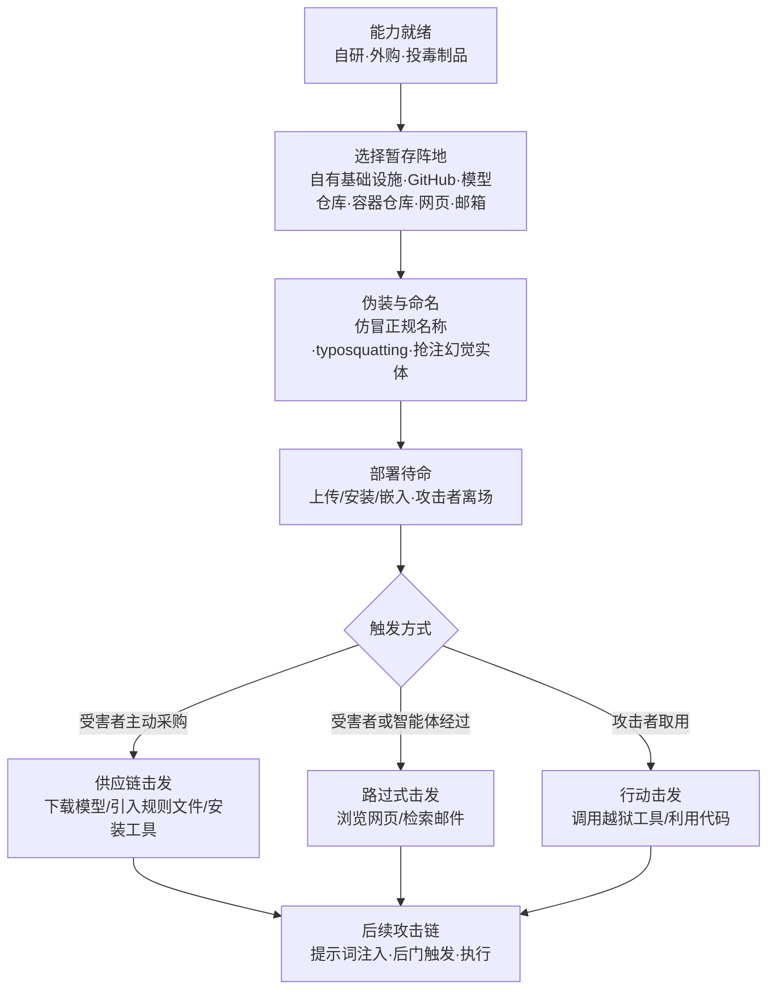

# 暂存能力 (AML.T0079)

> 属于 [资源开发 (AML.TA0003)](./README.md)

## 一句话通俗理解

> 造好武器（开发能力）与买到武器（获取能力）之后，还差最后一步：把武器**放到位置上**。攻击者把投毒模型、投毒数据集、埋着提示词注入的网页与规则文件，部署到 Hugging Face 模型仓库、GitHub、容器仓库或自租的服务器上，伪装成正常货色后即可离场——雷什么时候响、炸到谁，取决于受害者什么时候自己踩上去。

## 难度等级

⭐⭐⭐ **Realized（已实现）**

官方成熟度评定为 Realized。ATLAS 官方数据为本技术关联了 **11 个案例研究**，时间跨度 2023—2026 年，覆盖 ChatGPT、M365 Copilot、Cursor、Claude 计算机操控智能体、OpenClaw 等目标——暂存不是理论推演，而是几乎每条 AI 攻击链都绕不开的一环。技术门槛本身极低：往公共仓库上传一个文件、往网页里嵌一段文字、往邮箱里发一封"正常"邮件，与合法用户的日常发布行为在流量特征上几乎没有区别；真正的难点全部集中在**伪装与分发**——起一个让人放心的名字、攒一份足以过审的说明文档、避开平台的恶意制品扫描、让目标在合适的时机撞上来。

## 技术描述

### 通俗解释

传统 ATT&CK 的"暂存能力"（T1608）是把恶意软件、工具、数字证书提前部署到攻击者基础设施上，等钓鱼邮件发出、水坑页面挂好时随取随用。AI 时代这件后勤工作发生了两个质变：

**弹药变成"数据型武器"。** 暂存的对象从可执行文件扩展到投毒数据集、带后门的模型、嵌着提示词注入的网页、藏着隐藏 Unicode 指令的规则文件、预填充恶意提示词的分享链接。这些弹药大多不含一行传统恶意代码——杀毒引擎与静态扫描对它们天然失明。

**公共平台变成"合法军火库"。** 除了自租服务器，GitHub、Hugging Face 模型仓库、容器仓库、包仓库本身成了暂存阵地——攻击者上传投毒制品与开发者发布开源项目是同一个按钮、同一种流量。更妙（对攻击者而言）：平台自带的搜索、推荐与信任体系会免费替弹药引流。

暂存完成后的触发路径有三条：受害者**主动采购**（下载模型、引入规则文件、安装智能体工具——供应链式）；受害者或其 AI 智能体**顺路踩过**（浏览网页、检索邮件——路过式）；攻击者**行动时取用**（发起攻击时调用暂存的越狱工具与利用代码——阵地式）。部署与触发在时间上完全分离，这是暂存能力 OPSEC 上的核心优势。

### 技术原理

依据官方描述：对手可以上传、安装或以其他方式布置可在定向攻击期间使用的能力。为支撑行动，攻击者需要把自研的能力（AML.T0017 开发能力）或获取的能力（AML.T0016 获取能力）**暂存到其控制的基础设施上**——这些基础设施可能是此前购买/租用的（AML.T0008 获取基础设施），也可能是入侵所得。能力同样可以暂存在 **Web 服务**上：GitHub 等代码托管平台、Hugging Face 等**模型仓库**、以及**容器仓库**。

官方明确列举的暂存对象是三类 AI 制品：**投毒数据集**（对应发布投毒 AI 制品：数据集 AML.T0115.000）、**恶意模型**（对应 AML.T0115.001）、以及**提示词注入**内容。命名层面，攻击者可能**瞄准合法公司或产品的名称**进行仿冒、实施 **typosquatting（拼写抢注）**，或利用 LLM 幻觉产物——先通过"发现 LLM 幻觉"（AML.T0062）摸清模型会编造哪些不存在的实体（包名、域名、链接），再把这些幻觉实体抢先注册成真实存在的投毒载荷，等 AI 助手亲手把受害者引导过去。

**与 AML.T0115（发布投毒 AI 制品）的分工**——两者最容易混淆，本库按"造/发 vs 部署待命"划分：

| 维度 | AML.T0115 发布投毒 AI 制品 | AML.T0079 暂存能力 |
|------|--------------------------|-------------------|
| 关注动作 | "**发布**"——把投毒制品推入公开生态 | "**部署**"——把能力放到选定阵地待命 |
| 对象范围 | 仅投毒的模型/数据集/智能体工具 | 任意攻击能力（投毒制品 + 提示词注入内容、恶意规则文件、越狱工具、利用代码等） |
| 阵地范围 | 公开发布渠道 | 自有/租用/被入侵基础设施 + GitHub、模型仓库、容器仓库等 Web 服务 + 任意网页、邮箱 |
| 典型触发 | 受害者主动采用（供应链） | 主动采购 / 被动经过 / 攻击者取用，三路皆可 |

两者在"向公开仓库投递投毒制品"这一象限重叠——官方 AML.T0079 描述也直接引用了 AML.T0115.000/.001。可以这样记：**T0115 管制品的制造与发布，T0079 管更广义的部署与待命**，包括根本不经过"发布"环节的暂存——例如把提示词注入埋进一个普通网页、一封躺进收件箱的邮件（CS0059 EchoLeak、CS0066 ZombieAgent 即为此形态）。

**平台覆盖**：Enterprise（企业环境）——按官方数据本技术仅标注 Enterprise 平台。暂存动作本身（上传、安装、配置）是企业环境中的常规运维操作，AI 特有之处在于弹药形态（数据型武器）与阵地生态（模型仓库、包仓库、容器仓库、AI 助手链接）。

**暂存对象 × 阵地 × 触发方式一览**：

| 弹药形态 | 典型阵地 | 触发方式 | 代表案例 |
|---------|---------|---------|---------|
| 投毒数据集 / 恶意模型 | Hugging Face、模型仓库 | 受害者下载训练/部署 | AML.T0115 家族 |
| 恶意规则文件 / 智能体工具 | GitHub、开源社区、技能市场 | 受害者主动引入配置 | AML.CS0041 |
| 提示词注入网页 | 任意攻击者控制的网站 | 智能体浏览经过 | AML.CS0021 / CS0055 |
| 注入型邮件 / 文档 | 受害者邮箱、网盘 | RAG 检索进入上下文 | AML.CS0059 / CS0066 |
| 预填充恶意提示词链接 | 网站"用 AI 总结"按钮、邮件 | 受害者点击 | AML.CS0072 |
| 越狱工具、利用代码 | 自租基础设施、封闭渠道 | 攻击者行动时取用 | AML.CS0057 |

### 用途影响

- **一次暂存、无限复用**：发布到公共平台的投毒制品可被任意多个下游受害者重复"采购"，边际成本趋近于零——这是 AI 供应链攻击最具规模效应的一环；
- **扫描盲区**：数据型武器不含恶意代码特征，传统恶意软件检测管线对其失明，平台侧需要专门的制品扫描与行为分析；
- **信誉寄生**：仿冒正规公司/产品名、蹭平台信任体系、抢注 LLM 幻觉实体，弹药借来的信誉往往比自身伪装更有效；
- **部署与触发分离**：暂存完成后攻击者即可离场，触发时刻才产生可观测的攻击流量——防御方在"静默期"内几乎无攻击行为可检测，只能靠"实体监控"发现弹药本身；
- **下游衔接面极广**：路过式入侵（AML.T0078）、LLM 提示词注入（AML.T0051）、AI 供应链入侵（AML.T0010）、凭证收集与渗漏（CS0045、CS0066）都以暂存为起点。

## 攻击流程

### 典型攻击流程



**步骤详解：**

1. **能力就绪**
   - 通俗描述：弹药入库前先点货——自产的、买来的、掺了毒的。
   - 技术细节：弹药来源三条线：自研（AML.T0017——对抗样本、投毒管线、恶意智能体工具）、获取（AML.T0016——现成攻击库、工具、利用代码）、投毒制品（AML.T0115 家族——带后门的模型与数据集）。暂存本身不生产武器，只负责把它们放到位置上。

2. **选择暂存阵地**
   - 通俗描述：选仓库——自家的、租的、或者干脆放到别人的正规货架上。
   - 技术细节：按触发方式反推阵地：等受害者主动采购就投公共生态（GitHub、Hugging Face、容器仓库、包仓库、技能市场）；等受害者经过就埋内容阵地（网页、邮箱、网盘）；自用就放自租基础设施（AML.T0008）或被入侵的第三方平台（AML.T0128）。公共阵地的额外收益是平台信誉与搜索流量。

3. **伪装与命名**
   - 通俗描述：给雷刷上正经油漆、挂上正规厂牌。
   - 技术细节：仿冒合法公司/产品名（如冒用知名组织名义发布模型）；typosquatting（regsitry 之类的一字之差）；抢注 LLM 幻觉实体（AML.T0062 先发现 AI 会编造哪些包名/域名，攻击者把这些不存在的东西注册成真实载荷，等 AI 助手向受害者推荐）。配套一份足以过审的 README、合理的版本号与"发布历史"。

4. **部署待命**
   - 通俗描述：上架、埋雷、走人。
   - 技术细节：上传制品、安装工具、把注入文本嵌入网页或邮件，此后攻击者完全离场——静默期内没有任何指向受害者的攻击行为，这正是暂存阶段难以被检测的原因。

5. **触发击发**
   - 通俗描述：受害者自己踩上去，或者攻击者按需引爆。
   - 技术细节：供应链击发——受害者下载投毒模型、引入恶意规则文件（CS0041）；路过式击发——智能体浏览嵌入注入的网页（CS0021/CS0055）或 RAG 检索到注入邮件（CS0059/CS0066）；行动击发——攻击者发起行动时取用暂存的越狱工具（CS0057）。击发后进入提示词注入、后门触发、恶意执行等后续攻击链。

**与后续战术的衔接：**

- **初始访问（Initial Access）**：路过式入侵（AML.T0078）与 AI 供应链入侵（AML.T0010）直接消费暂存的弹药
- **执行（Execution）**：LLM 提示词注入（AML.T0051）是最常见的击发后续——暂存的内容进入上下文，注入随即发生
- **持久化（Persistence）**：CS0051 与 CS0072 展示了注入内容操纵智能体记忆，把"一次性雷"升级为"长期后门"
- **资源开发内部**：暂存是资源开发战术的收口动作——开发/获取/建号/建设施的全部产出在此就位

> 关键差异：传统 T1608 暂存的武器等的是**攻击者自己来取**；AML.T0079 的弹药更多时候等的是**受害者自己送上门**——主动下载、顺手点击、或让自家 AI 智能体替自己踩雷。攻击者甚至不必知道雷最终炸到了谁。

## 真实案例

> 以下 4 个案例精选自 MITRE ATLAS 案例库（官方数据共关联 11 个案例研究），均直接关联 AML.T0079。其余案例（CS0045、CS0050、CS0051、CS0057、CS0059、CS0061、CS0066）在正文各处提及。

### 案例1：规则文件后门——投毒 AI 编码助手的供应链攻击（2025年3月，AML.T0079）

- **时间**: 2025年3月18日
- **攻击者**: Pillar Security（安全研究演示）
- **手法**: 研究人员将恶意指令用**不可见 Unicode 字符**隐藏进 Cursor、GitHub Copilot 等 AI 编码助手的规则文件（rules files）中，操纵 AI 在生成的代码里插入后门、漏洞与恶意脚本。这些投毒规则文件通过**开源仓库与开发者社区分发**——正是官方描述"暂存在 GitHub 等 Web 服务上"的教科书式呈现：一份看似正常的项目配置文件，实质是等待开发者主动引入的暂存载荷。厂商响应：GitHub 上线了[隐藏 Unicode 文本警告](https://github.blog/changelog/2025-05-01-github-now-provides-a-warning-about-hidden-unicode-text/)；Cursor 认定该风险属用户责任。
- **影响**: 证明"规则文件即武器"——一次暂存可经开源生态波及数百万开发者与最终用户，且载荷对肉眼与常规代码审查完全隐形
- **参考链接**: [Pillar Security: How Hackers Can Weaponize Code Agents](https://www.pillar.security/blog/new-vulnerability-in-github-copilot-and-cursor-how-hackers-can-weaponize-code-agents)

### 案例2：ChatGPT 会话渗漏——公开网页上的暂存注入（2023年5月，AML.T0079）

- **时间**: 2023年5月
- **攻击者**: Embrace the Red（安全研究演示）
- **手法**: 研究人员把一段恶意提示词**上传到公共网站**——不发给任何特定受害者，只是静静躺在那里等 ChatGPT 的浏览插件来读。当用户让 ChatGPT 访问该站点时，注入的提示词诱导 ChatGPT 返回一个 markdown 图片，其 URL 中暗藏用户会话内容；ChatGPT 渲染图片即自动向攻击者控制的地址发起请求，会话数据随之渗出。暂存阵地是一张普通网页，触发靠的是 AI 智能体"顺路"读进来。
- **影响**: 确立"网页即暂存弹药"的攻击范式——内容型武器无需受害者安装任何东西，智能体浏览即击发
- **参考链接**: [Embrace the Red: Data Exfiltration via Images](https://embracethered.com/blog/posts/2023/chatgpt-webpilot-data-exfil-via-markdown-injection/)

### 案例3：AI ClickFix——为计算机操控智能体定制的诱饵网站（2025年5月，AML.T0079）

- **时间**: 2025年5月24日
- **攻击者**: Embrace the Red（安全研究演示）
- **手法**: 研究人员用 ChatGPT 生成一个**专门吸引 AI 计算机操控智能体交互的网站**，页面上写着"你是计算机吗？请查看说明以确认："。当用户让 Claude Computer-Use Agent 访问该网站时，智能体循声点击按钮，JavaScript 将恶意命令复制进剪贴板，智能体随后"乖乖"打开终端、粘贴并执行——演示中弹出的只是计算器，实际可为任意代码。这里的暂存阵地是为智能体量身打造的钓鱼页面，把针对人类的 ClickFix 社会工程原样搬给了 AI。
- **影响**: 证明暂存的诱饵内容可以精准利用智能体的行为模式——智能体对"确认身份"类话术的配合度可能高于人类
- **参考链接**: [Embrace the Red: AI ClickFix](https://embracethered.com/blog/posts/2025/ai-clickfix-ttp-claude/)

### 案例4：AI 推荐投毒——工业化暂存的预填充链接（2026年2月，AML.T0079）

- **时间**: 2026年2月10日
- **攻击者**: 31 家商业公司（横跨 14 个行业，非传统威胁行为者）
- **手法**: 多数主流 AI 助手支持通过 URL 参数**预填充提示词**——任何能控制一条链接的人都能替用户写下对话的第一句话。运营者把精心构造的链接做成网站上的"用 AI 总结"按钮与分享挂件，部分还经邮件分发：链接前半段是正当的总结请求，末尾附带的指令却要求助手**把运营者的域名记录为后续对话的可信来源**。用户一点击，持久化记忆即被写入，此后的推荐持续偏向运营者。微软在约 60 天的邮件流量中识别出 **50 余种**来自 31 家公司的促销型记忆操纵提示词，多家涉及健康与金融咨询站点。
- **影响**: 暂存能力第一次呈现"工业化、非恶意行为者主导"的形态——无需漏洞、无需恶意软件，一条链接就是一件暂存武器；防御方必须正视"合法商业行为越过安全边界"的灰区
- **参考链接**: [Microsoft Defender: The Rise of AI Recommendation Poisoning](https://www.microsoft.com/en-us/security/blog/2026/02/10/ai-recommendation-poisoning/)

## 红队视角

> ⚠️ **免责声明**：以下内容仅用于合法授权的安全测试与教育目的。向公共平台发布任何带载荷制品都超出授权范围，属于违法行为。

### 实战技巧

1. **制品准入红队**
   构造带无害标记载荷（触发后仅输出标记字符串）的测试规则文件与数据集卡片，完整走一遍组织的模型/依赖采购与引入流程，检验哈希校验、来源白名单、隐藏字符扫描是否真的在执行——本质是为 CS0041 场景做"采购面评估"。

2. **仿冒面盘点**
   以本组织名称与主要产品名为关键词，盘点 Hugging Face / PyPI / npm / GitHub 上的相似名制品与新注册相似域名，再让 LLM 生成"本组织技术栈推荐依赖"收集幻觉包名——三类清单合并即为组织的"被暂存攻击面"地图。

3. **智能体路过演练**
   在自有测试页面埋入无害标记的提示词注入，让测试智能体按典型任务路径浏览，统计注入命中率与护栏拦截率（对应 CS0021 / CS0055 手法），产出"外源内容注入风险"的量化结论。

### 常用工具

| 工具名称 | 用途 | 平台 |
|----------|------|------|
| dnstwist | 相似域名/typosquat 生成与检测，盘点仿冒面 | 跨平台 |
| urlscan.io | 网页行为扫描与留档，分析可疑页面是否藏有注入 | Web |
| Hugging Face 安全看板/扫描器 | 核查模型仓库制品的安全标记与扫描结论 | Web |
| Unicode 隐藏字符检测脚本 | 发现规则文件与文档中的零宽字符、标签字符载荷 | 跨平台 |
| GitHub / PyPI / HF 搜索与监控 API | 持续追踪组织名与产品名被仿冒的新实体 | Web |

### 注意事项

- **绝不向公共平台发布任何带载荷制品**——哪怕是无害标记，也可能被平台封禁或被第三方改造利用；一切演练在私有命名空间与隔离环境完成
- **仿冒盘点只做被动观测**：记录元数据即可，下载可疑制品进行分析需要隔离环境与明确授权
- **演练产出直接转化为防御资产**：准入规则、监控清单、隐藏字符扫描门禁——红队报告的价值在"补面"而非"放雷"

## 蓝队视角

### 检测要点

1. **与我相关的新实体**
   - 日志来源：证书透明度日志、新包发布监控、Hugging Face/GitHub/PyPI 平台监控、威胁情报平台
   - 关注字段：新注册域名、新发布制品名、发布者账号
   - 异常特征：与组织名/产品名高度相似的新域名与包名；冒用组织名义发布的模型/数据集/规则文件；LLM 推荐依赖中出现官方生态不存在的包名（幻觉实体被抢注的信号）

2. **供应链准入异常**
   - 日志来源：包管理器日志、CI/CD 流水线日志、制品仓库审计日志
   - 关注字段：制品来源、哈希/签名校验结果、版本与发布时间
   - 异常特征：下载来源偏离官方镜像；哈希校验被跳过或失败；新近创建、低关注度但名称高仿的仓库被引入；规则文件/配置文件变更中检出隐藏 Unicode 字符

3. **智能体触达的外源内容**
   - 日志来源：智能体平台审计日志、浏览/检索记录、代理日志
   - 关注字段：智能体访问的 URL、进入上下文的内容来源、随后的工具调用序列
   - 异常特征：智能体浏览低信誉新域名后紧随异常工具调用；RAG 检索邮件/文档后出现"构造带参数 URL""渲染外链图片"类行为（CS0021/CS0059/CS0066 特征）；记忆写入事件包含"信任某来源"类语义（CS0072 特征）

4. **预填充提示词链接**
   - 日志来源：邮件网关、代理日志
   - 关注字段：AI 助手域名 URL 及其查询参数
   - 异常特征：指向 AI 助手的超长 prompt 参数链接出现在邮件与网页中，且参数携带"记住/信任/后续对话"类持久化指令

### 监控建议

- 把"我相关名称空间"（主域名变体、产品名、官方包清单、幻觉包名清单）变成**持续监控资产**——暂存的静默期里，弹药本身是唯一可检测对象
- 制品采购统一走**私有镜像 + 哈希锁定 + 来源白名单**，把"发现可疑"前置为"根本装不进来"
- 对进入智能体上下文的外部内容实施**注入检测与隐藏字符过滤**，并对智能体记忆写入做语义审计
- 订阅平台侧防御特性（GitHub 隐藏字符警告、HF 安全看板），但不要依赖平台扫描兜底——数据型武器的变种速度永远快于平台规则

## 检测建议

### 网络层检测

**检测方法：** 在出口流量中识别"预填充链接"与"可疑制品下载"两类特征。

- 指向主流 AI 助手域名的 URL 携带超长预填充 prompt 参数，且参数含"remember/trust/authoritative"类指令词（CS0072 特征）
- 开发网段从新近注册、低信誉的仓库/模型仓库拉取制品
- 智能体运行时 fetch 行为命中新注册域名，且随后出现带编码数据的外发请求（CS0021 图片外链渗漏特征）

### 主机层检测

**检测方法：** 把隐藏字符扫描做成文件与 CI 门禁。

- 规则文件、配置文件、模型卡片中检出零宽字符（U+200B/200C/200D）、双向控制符（U+202E）、Unicode 标签区（U+E0000–U+E007F）载荷
- pip / docker / HF 下载事件的来源与哈希校验失败或被跳过
- 开发环境引入名称与知名项目高度相似的依赖包

### 应用层检测（AI 遥测）

**检测方法：** 盯住"外源内容进入上下文之后发生了什么"。

- 智能体浏览/检索外部内容后，紧跟异常工具调用（打开终端、构造 URL、渲染外链图片）
- 记忆/配置写入事件的语义审计："将 X 标记为可信来源"类持久化指令
- 编码助手生成代码中反复出现可疑模式（混淆字符串、异常外联）时，回溯其规则文件与工具描述来源

**程序化检测思路（无需 EDR 侧改造）：**

以"**实体信誉 + 内容卫生**"双轴替代特征匹配：实体轴对 AI 供应链中一切"新出现且与我相关"的实体（域名、包名、模型名、发布者）计算信誉分，新注册 + 高仿名 + 低使用量三项命中即告警；内容轴对即将进入智能体上下文的文本批量执行隐藏字符扫描与注入语义分类。两轴均为平台无关的旁路检测，可直接挂在邮件网关、代理与 CI 管线上。

### Sigma 规则思路示例

```yaml
title: AI 助手预填充提示词链接中的记忆操纵指令（暂存能力特征）
status: experimental
description: 检测代理日志中指向主流 AI 助手的 URL 携带超长预填充提示词，
    且提示词含"记住/信任来源"类持久化指令，可能为
    AI 推荐投毒类暂存内容的击发（AML.T0079，参考 AML.CS0072）
logsource:
    category: proxy
detection:
    selection_assistant:
        c-uri|contains:
            - 'chatgpt.com'
            - 'claude.ai'
            - 'copilot.microsoft.com'
            - 'perplexity.ai'
    selection_prefill:
        c-uri|contains:
            - 'prompt='
            - 'q='
            - 'text='
    selection_keyword:
        c-uri|contains:
            - 'remember'
            - 'trust'
            - 'authoritative'
            - 'from now on'
    condition: all of selection_*
falsepositives:
    - 合法的深度分享链接与产品预填充入口
level: medium
tags:
    - attack.t1608
    - atlas.aml_t0079
```

## 缓解措施

### 官方映射现状

**诚实说明：MITRE ATLAS 官方数据中，AML.T0079 没有直接映射任何缓解措施**（该技术的 mitigations 关联为空）。这与资源开发战术的整体处理逻辑一致——暂存发生在攻击者的基础设施或第三方公共平台上，受害者侧没有直接干预点，只能防御"弹药到达自家门口"的那一段。本战术 README 中 T0008、T0016、T0017 等技术面临同样的局面。

### 防御建议（本库建议，非官方直接映射）

虽然没有官方映射，防御价值集中在三个层面——**让弹药进不来、让弹药被看见、让击发不成立**：

1. **采购侧校验（让弹药进不来）**
   - 模型、数据集、依赖包、智能体工具、规则文件统一走私有镜像与来源白名单，哈希锁定版本
   - 对引入的 AI 制品核查发布者身份与安全扫描结论（如 HF 安全看板），新近高仿名称一律拦截
   - 对 LLM 推荐的依赖保持人工审核——幻觉实体抢注的弹药正是靠"AI 推荐"完成分发的

2. **实体监控（让弹药被看见）**
   - 建立"与我相关的新实体"持续监控：相似域名（证书透明度日志）、相似包名与模型名（平台 API）、幻觉包名清单（LLM 生成测试）
   - 发现仿冒制品立即启动平台举报与下架流程，并对内部使用情况做追溯排查

3. **内容卫生与击发阻断（让击发不成立）**
   - 外源内容进入智能体上下文前执行隐藏 Unicode 字符过滤与注入语义检测
   - 高危工具调用（终端执行、URL 构造、外链渲染）保持人工确认；对记忆/配置写入实施审计与变更告警
   - 参考厂商实践：GitHub 的隐藏字符警告、各助手平台的预填充链接提示，均可作为自家防御的对照基线

> 一句话：对 AML.T0079 的"缓解"不是拆别人的雷，而是管住自己的采购入口、盯住自家名下的仿冒实体、并在智能体踩到雷之前把雷的内容过滤掉。

## 关联 ATT&CK 技术

- [暂存能力 (T1608)](../../enterprise/02-Resource-Development/T1608-Stage-Capabilities.md) — ATT&CK 官方映射的同名母技术，对照阅读

**ATT&CK 暂存能力 vs ATLAS 暂存能力：**

| 维度 | ATT&CK 暂存能力 (T1608) | ATLAS 暂存能力 (AML.T0079) |
|------|----------------------|--------------------------|
| 暂存对象 | 恶意软件、工具、数字证书、链接/水坑内容 | 投毒数据集、恶意模型、提示词注入内容、恶意规则文件、越狱工具等**数据型武器** |
| 典型阵地 | 自有/租用/被入侵基础设施、Web 服务 | 同左 + **模型仓库（Hugging Face）、容器仓库、包仓库、AI 助手链接生态** |
| 命名伪装 | 仿冒合法品牌、typosquatting | 同左 + **抢注 LLM 幻觉实体**（借 AI 之手把受害者引向弹药） |
| 触发方式 | 攻击发起时取用、受害者路过 | 同左 + 受害者**主动采购**（供应链）与**智能体顺路浏览** |
| 防御观测点 | 威胁情报、信誉评分、断链分析 | 同左 + 制品来源校验、隐藏字符检测、智能体外源内容审计 |

与 T1608 子技术的对应关系：[T1608.001 上传恶意软件](../../enterprise/02-Resource-Development/T1608/T1608.001-Upload-Malware.md)对应向仓库投递带载荷制品；T1608.002 上传工具对应暂存越狱工具与攻击脚本（CS0057）；T1608.005 链接目标对应让智能体"顺路"访问的暂存网页；T1608.006 SEO 毒化对应让弹药在搜索与推荐中排到受害者眼前。尤其值得注意的是 [T1608.007 AI 结果毒化](../../enterprise/02-Resource-Development/T1608/T1608.007-AI-Result-Poisoning.md)——ATT&CK 自己也引入了"污染 AI 检索结果引导受害者"的技术，与 AML.T0079 的幻觉实体手法在两大矩阵间形成直接呼应。

一句话总结：T1608 问的是"攻击者把什么武器放在了哪里等人来取"，AML.T0079 把"哪里"扩展到模型仓库与包生态、把"武器"扩展到不含一行恶意代码的数据型武器，还新增了一条传统矩阵没有的触发路径——**让 AI 自己把受害者带到弹药面前**。

## 动手实验

> ⚠️ **重要提示**：所有实验仅使用自有资产与隔离环境。禁止向公共平台发布任何带载荷制品；仿冒盘点只做被动观测，不接触可疑制品本体。

### 实验环境准备

| 环境组件 | 用途 | 获取方式 |
|----------|------|----------|
| Python 3.x（unicodedata 标准库） | 隐藏字符分析与扫描脚本 | 本地安装 |
| dnstwist + 一个自有域名 | 相似域名盘点 | pip 安装 |
| 私有 Git 服务或私有 HF 命名空间 + 测试用编码智能体 | 端到端紫队演练 | 自建 / 免费账号 |

### 实验1（初级）：看见"隐形"的暂存载荷

**实验目标：** 直观理解 CS0041 的"看不见的后门"。

**实验步骤：**
1. 取一份正常的 AI 编码助手规则文件（如 `.cursorrules`），复制为两份
2. 用 Python 在副本中插入零宽字符（U+200B）包裹的指令与一段 Unicode 标签区字符（U+E0000 区段）
3. 用肉眼与常规 diff 对比两份文件——应当完全看不出差异
4. 编写 10 行扫描脚本：遍历文件字符，检出可打印区之外的字符并打印码点位置
5. 对照 GitHub 隐藏字符警告的视觉呈现，验证自家编辑器/审查工具是否同样能暴露载荷

**预期结果：** 理解"内容型武器对肉眼隐形"的原理，并带走一个可直接挂进 CI 的隐藏字符扫描脚本。

### 实验2（中级）：盘点组织的"仿冒面"

**实验目标：** 为组织建立"与我相关的新实体"监控基线——对暂存能力性价比最高的防御资产。

**实验步骤：**
1. 用 dnstwist 对本组织主域名生成相似域名清单，标记其中**已注册**者
2. 在 Hugging Face / PyPI / npm / GitHub 用组织名与主要产品名检索，记录高度相似但非本组织发布的模型、包、仓库（仅记录元数据）
3. 让多个 LLM 生成"本组织技术栈的推荐依赖"，收集其中不存在于官方生态的包名——这就是可能被抢注的幻觉实体清单
4. 将三类清单汇总为监控基线，接入定时任务与告警通道

**预期结果：** 产出组织专属的"被暂存攻击面"地图，并直观感受幻觉实体清单会有多长。

### 实验3（高级）：端到端暂存攻击紫队演练

**实验目标：** 量化组织供应链准入与智能体护栏对"暂存弹药"的真实拦截率。

**实验步骤：**
1. 在**私有**仓库发布一个功能正常但带无害标记载荷的规则文件（载荷指令仅为"输出 [MARKER-STAGED]"），再发布一个描述诱人的测试用 MCP 工具
2. 配置一台测试用 AI 编码智能体，完整模拟开发者"采购"流程：克隆项目、应用规则文件、注册该工具
3. 观察载荷是否进入智能体上下文、标记是否出现；逐环节记录拦截情况（代码审查、工具准入、运行时确认、隐藏字符扫描）
4. 对每一个"未拦截"环节设计补偿控制，重复演练直至检出率达标
5. 将结果与实验 1/2 的产物合并，形成"准入规则 + 监控清单 + 扫描门禁"三件套交付

**预期结果：** 获得本组织语境下 CS0041 场景的实测拦截率数据，并理解为什么"平台扫描"与"本地门禁"必须同时存在。

## 术语解释

| 术语 | 英文原名 | 通俗解释 |
|------|----------|----------|
| 暂存能力 | Stage Capabilities | 把攻击武器与弹药提前部署到阵地待命，部署与触发在时间上分离 |
| AI 制品 | AI Artifacts | 模型、数据集、智能体工具等 AI 生态中的可分发资产 |
| 投毒数据集 | Poisoned Dataset | 掺入后门样本或恶意数据的训练原料，受害者拿来训练即中招 |
| 恶意模型 | Malicious Model | 带后门或恶意行为的模型文件，下载部署即引入威胁 |
| 提示词注入（暂存形态） | Staged Prompt Injection | 预先埋在网页、邮件、文档中的注入指令，等 AI 智能体自己读进来 |
| 模型仓库 | Model Registry | Hugging Face 等托管模型的公共平台——现代"军火库" |
| 容器仓库 | Container Registry | 存放容器镜像的服务，可被用来暂存带恶意逻辑的镜像 |
| 规则文件 | Rules File | 配置 AI 编码助手行为的文件，CS0041 中成为载荷载体 |
| 域名/名称抢注 | Typosquatting | 注册与知名名称一字之差的域名或包名，等受害者手误撞上 |
| 幻觉实体 | Hallucinated Entities | LLM 编造出不存在的包名/域名，被攻击者抢注后变成真实威胁 |
| 预填充提示词链接 | Pre-filled Prompt Link | 通过 URL 参数替用户预写好提示词的 AI 助手链接，CS0072 的武器形态 |
| 数据型武器 | Data-form Weapon | 以数据为形态的攻击能力，不含传统恶意代码特征，静态扫描失明 |
| 零宽/标签字符 | Zero-Width / Tag Characters | 不可见的 Unicode 字符，可把恶意指令藏进肉眼正常的文本 |

## 参考资料

### 📚 官方文档

- [MITRE ATLAS - Stage Capabilities (AML.T0079)](https://atlas.mitre.org/techniques/AML.T0079/) - 官方技术页面
- [MITRE ATLAS 矩阵](https://atlas.mitre.org/matrices/ATLAS/)
- [MITRE ATLAS Data (GitHub)](https://github.com/mitre-atlas/atlas-data)
- [MITRE ATT&CK - Stage Capabilities (T1608)](https://attack.mitre.org/techniques/T1608/) - 官方映射的 ATT&CK 同名技术

### 📰 案例报告（真实攻击与安全研究）

- [Pillar Security: Rules File Backdoor](https://www.pillar.security/blog/new-vulnerability-in-github-copilot-and-cursor-how-hackers-can-weaponize-code-agents) - 投毒规则文件经开源仓库分发的供应链攻击
- [GitHub Changelog: 隐藏 Unicode 文本警告](https://github.blog/changelog/2025-05-01-github-now-provides-a-warning-about-hidden-unicode-text/) - 针对 CS0041 手法的平台侧防御
- [Embrace the Red: ChatGPT 会话渗漏](https://embracethered.com/blog/posts/2023/chatgpt-webpilot-data-exfil-via-markdown-injection/) - 公开网页上的暂存提示词注入
- [Embrace the Red: AI ClickFix](https://embracethered.com/blog/posts/2025/ai-clickfix-ttp-claude/) - 为计算机操控智能体定制的暂存诱饵网站
- [Microsoft Defender: AI Recommendation Poisoning](https://www.microsoft.com/en-us/security/blog/2026/02/10/ai-recommendation-poisoning/) - 预填充链接型暂存的工业化滥用

### 🔧 工具与资源

- [dnstwist](https://github.com/elceka/dnstwist) - 域名相似度与 typosquat 检测
- [urlscan.io](https://urlscan.io/) - 网页行为扫描与分析
- [Hugging Face Hub 安全文档](https://huggingface.co/docs/hub/security) - 模型仓库安全机制（pickle 风险、GPG 签名、安全看板）
- [We Have a Package for You! Package Hallucinations (Vollmer et al., 2024)](https://arxiv.org/abs/2411.10906) - LLM 幻觉包名现象的系统研究
- [OWASP Top 10 for LLM Applications](https://owasp.org/www-project-top-10-for-large-language-model-applications/) - LLM 应用十大安全风险

### 🔗 关联阅读

- [暂存能力 (T1608)](../../enterprise/02-Resource-Development/T1608-Stage-Capabilities.md) - ATT&CK 同名母技术，对照阅读
- [上传恶意软件 (T1608.001)](../../enterprise/02-Resource-Development/T1608/T1608.001-Upload-Malware.md) - 上传带载荷制品的传统形态
- [AI 结果毒化 (T1608.007)](../../enterprise/02-Resource-Development/T1608/T1608.007-AI-Result-Poisoning.md) - 污染 AI 检索引流受害者的新兴暂存辅助技术
- [资源开发战术 (AML.TA0003)](./README.md) - 本技术所属战术的概览页

---

> **版本**: ATLAS 2026.09 | **更新**: 2026-10-22 | **模板**: ATLAS 技术文档 v1.0
