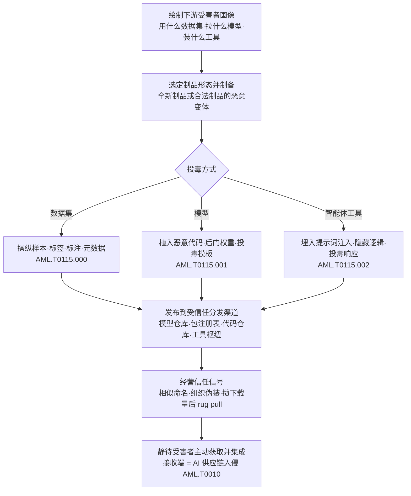

# 发布投毒 AI 制品 (AML.T0115)

> 属于 [资源开发 (AML.TA0003)](./README.md)

## 一句话通俗理解

> 攻击者不再蹲点等你上钩，而是把"免费试吃"摆上开源货架——一个带后门的模型、一份掺毒的数据集、一个藏了指令的智能体工具，发布在人人信赖的公共平台上，等下游团队自己"下单"，把毒亲手装进训练管线和推理环境。

## 难度等级

⭐⭐⭐ **Realized（已实现）**

官方成熟度评定为 Realized——发布投毒制品已在真实攻击中反复出现：npm 上的 Postmark MCP 服务器 rug pull 窃取邮件、Hugging Face 上内嵌反向 Shell 的恶意模型、技能注册表上发布 8 小时即感染 16 名用户的投毒 Skill，都是实战见证。实施门槛不高：向公共平台上传制品与发布普通开源项目难度相当，平台注册门槛极低。真正的难度在两端：**让制品被目标"选中"**（起一个与知名项目相似的名称、伪装成官方组织、先发正版攒下载量再 rug pull），以及**绕过平台与受害者的检查**（构造"载荷先执行、反序列化后失败"的模型文件、把后门埋进完全不碰权重的聊天模板）。此外，本技术属于资源开发阶段——制品发布后攻击者转入等待，哪些受害者中招、何时中招并不完全受控。

## 技术描述

### 通俗解释

AI 开源生态像一个热闹的集市：Hugging Face 是模型摊位，Kaggle 和各类数据集仓库是食材区，npm 与技能注册表是工具铺。这里人人可以出摊、件件免费拿走，而买家的习惯是"看名字、看下载量、看好评"。攻击者发现：与其强攻防守森严的目标系统，不如在集市里摆一个**看起来完全正常的摊位**——卖的还是模型、数据集、工具这些"正品"，只是里面被下了毒。下游团队按正常流程下载、校验、集成，恶意制品便以"受信任交付物"的身份进驻训练与推理环境。

这就是 AI 供应链攻击的**发布端**：与从受害者视角描述"供应链被入侵"的 AI 供应链入侵（AML.T0010）互为镜像——AML.T0115 是攻击者上架投毒商品的动作，AML.T0010 是受害者把商品买回家的过程。

### 技术原理

依据官方描述，攻击者创建或修改 AI 制品，并通过公开或共享的分发渠道发布，以促成对下游 AI 系统的入侵。投毒制品可能包含**数据集、模型、AI 智能体工具**三类对象，其中藏有恶意内容、恶意行为、恶意代码或恶意配置。

发布形式有两种：

- **全新制品**：从零创建的投毒制品（新建数据集、自训练模型、自制工具），靠命名与描述引流；
- **合法制品的恶意变体**：篡改一个知名制品（改权重、改标签、改模板、加代码）后重新分发，直接继承原制品的全部信任。

官方点名的分发渠道覆盖：**数据集仓库、模型仓库、包注册表、源代码仓库、工具枢纽（tool hubs）、远程托管服务**。受害者随后通过 AI 供应链入侵（AML.T0010）获取并集成这些制品——发布端与接收端由此闭环。

**三类制品的投毒形态与信任伪装：**

| 制品类型 | 典型投毒形态 | 主要分发渠道 | 滥用的信任信号 |
|---------|-------------|-------------|---------------|
| 数据集（.000） | 操纵样本、标签、标注、元数据 | 数据集仓库、代码仓库、文件共享、被入侵的数据源 | "公开热门数据集没人动过手脚" |
| 模型（.001） | 操纵权重/配置/架构、序列化恶意代码、投毒聊天模板 | 模型注册表、代码仓库 | "评分高、下载量大、组织认证" |
| 智能体工具（.002） | 恶意模型可见定义/指令、隐藏可执行行为、投毒运行时响应 | GitHub/GitLab、npm、技能注册表（如 OpenClaw Hub）、远程托管服务器 | "工具描述就是功能说明" |

三点值得特别注意：

- **智能体工具渠道基本不受监管**：官方引用指出，面向智能体的工具/技能注册表（如 OpenClaw Hub）缺乏审核、投毒工具泛滥，且工具还可以"远程托管"形式发布（远程 MCP 服务器）——受害者连文件都不落地，审计更无从谈起；
- **毒不一定是代码**：投毒权重、篡改标注、聊天模板后门、藏在工具描述里的提示词注入，都能"不含一行恶意代码"地改变系统行为，绕过传统恶意代码扫描；
- **一次发布、处处中招**：公共平台让投毒制品像正品一样被任意多的组织拉取，扩散规模远超定向攻击，而发布动作发生在受害者视野之外。

**平台覆盖**：Predictive AI（预测式 AI）/ Generative AI（生成式 AI）/ Agentic AI（智能体 AI）三类平台全部适用（智能体工具子技术仅适用于 Agentic AI）。

### 用途影响

- **弹药规模化**：一次发布可被无数下游受害者重复"采购"，边际成本趋零，是 AI 供应链攻击中最具规模效应的动作；
- **攻击准备期不可见**：发布行为发生在公共平台，不触碰目标边界，受害者的边界防御全程无感；
- **载荷形态多样**：从传统恶意代码（pickle 载荷）到行为型后门（投毒权重、模板后门）再到提示词注入，覆盖执行、持久化、数据渗漏等多种攻击目的；
- **与供应链入侵闭环**：制品一经受害者集成，攻击即从"资源开发"跳转到初始访问，直接触及目标的数据、模型与智能体。

## 子技术列表

**该技术共有 3 个子技术：**

| 子技术ID | 中文名称 | 官方成熟度 | 一句话理解 |
|----------|----------|:----------:|-----------|
| [AML.T0115.000](AML.T0115/AML.T0115.000-Datasets.md) | 数据集 | ⭐⭐ | 发布用于训练或微调的投毒数据集——新建或篡改合法数据集变体，掺入被操纵的样本、标签、标注或元数据，受害者纳入训练管线后受训练数据投毒（AML.T0020）影响 |
| [AML.T0115.001](AML.T0115/AML.T0115.001-Models.md) | 模型 | ⭐⭐⭐ | 通过模型注册表等渠道发布投毒模型——新建或篡改合法模型变体，内含被操纵的权重、配置、架构或序列化代码，受害者下载部署后产生恶意行为或执行恶意代码 |
| [AML.T0115.002](AML.T0115/AML.T0115.002-AI-Agent-Tools.md) | AI 智能体工具 | ⭐⭐⭐ | 创建并发布投毒智能体工具——内含恶意模型可见定义或指令、隐藏可执行行为或投毒运行时响应，受害者智能体选择、安装或调用时触发 |

> 注：以上 3 个子技术文档均已完成，点击 ID 直达对应文档。

## 攻击流程

### 典型攻击流程



**步骤详解：**

1. **绘制下游受害者画像**
   - 通俗描述：先弄清集市上的买家都要买什么。
   - 技术细节：摸清目标群体常用的公开数据集与模型（热门基座、领域模型）、依赖的包名与工具名、智能体接入的 MCP/技能清单；识别可利用的信任锚点——知名组织名、热门项目名、已过期可回收的命名空间。

2. **选定制品形态并制备**
   - 通俗描述：决定摆什么摊、怎么下毒。
   - 技术细节：数据集路线掺入后门样本或篡改标签；模型路线在序列化文件中嵌入恶意代码（pickle 载荷）、微调出带触发器的后门权重、或只改聊天模板不碰权重；工具路线在描述文本中埋提示词注入、在实现中夹带隐藏外传逻辑。

3. **发布到受信任分发渠道**
   - 通俗描述：把带毒商品摆上正规货架。
   - 技术细节：向 Hugging Face 上传投毒模型、向数据集仓库发布掺毒数据、向 npm/PyPI 抢注相似包名、向技能注册表与 MCP 枢纽上架投毒工具、或以远程托管服务形式发布；必要时先回收已删除作者的命名空间，让历史引用自动解析到恶意制品。

4. **经营信任信号**
   - 通俗描述：把摊位装点得像老字号。
   - 技术细节：伪装成官方组织（组织混淆）、蹭知名项目的相似命名、先发布与正版一致的版本积累下载量再 rug pull、伪造评分与下载量；对数据集还可买下其 URL 清单中过期的域名，让"采集时"与"训练时"看到不同内容。

5. **静待受害者获取并集成**
   - 通俗描述：等买家自己把毒带回家。
   - 技术细节：受害者按正常流程下载、校验、集成——投毒数据集进入训练管线（训练数据投毒，AML.T0020）、投毒模型被加载执行（pickle 反序列化或模板后门）、投毒工具被智能体注册调用（提示词注入操纵行为）——攻击由资源开发阶段转入初始访问。

**与其他战术的衔接：**

- **前置·资源开发**：开发能力（AML.T0017）制备投毒制品；建立账户（AML.T0021）准备发布身份与组织伪装；获取基础设施（AML.T0008）回收过期域名、托管远程投毒服务
- **同战术·相邻技术**：暂存能力（AML.T0079）同样强调"部署到阵地待命"，本技术特指投毒 AI 制品的创建与发布，两者在模型仓库场景高度协同
- **后续·初始访问**：AI 供应链入侵（AML.T0010）是本技术的接收端——受害者获取并集成投毒制品的完整过程
- **后续·数据准备**：投毒数据集被纳入训练后转化为训练数据投毒（AML.T0020）的影响
- **后续·执行**：pickle 载荷随模型加载执行；投毒工具借智能体之手执行指令

> 关键差异：传统资源开发（如暂存恶意软件）投放的是"死的"恶意文件，投毒 AI 制品常是"活的"智能资产——模型照常回答、工具照常工作，恶意性只在特定触发条件下显形，发布后的潜伏期可以任意长。

## 真实案例

> 以下精选 4 个代表性案例（官方数据共关联 9 个案例研究），全部源自 MITRE ATLAS 案例库。其余案例——PoisonGPT（AML.CS0019）、Hugging Face 恶意模型（AML.CS0031）、组织混淆（AML.CS0027）、模型命名空间回收（AML.CS0065）、Postmark MCP rug pull（AML.CS0053）——可对照 AI 供应链入侵（AML.T0010）文档阅读。

### 案例1：Web 级数据集"分裂视图"投毒（2024年6月，AML.T0115.000）

- **时间**: 2024年6月
- **攻击者**: Google DeepMind、ETH Zurich、NVIDIA、Robust Intelligence 与 Google 联合研究团队（安全演示）
- **手法**: 许多大规模数据集以"URL 清单"形式分发——数据集里存的不是数据本身，而是指向当年抓取地址的链接。研究人员指出"采集时看到的数据"与"训练时拉取的数据"可以不一致（split-view 攻击）：数据集中大量 URL 指向已过期、可购买的域名。攻击者买下这些域名，即可在受害者训练时投喂被替换的投毒数据。经对 10 个流行 Web 级数据集验证：可购买域名的份额足以实施投毒。
- **影响**: 证明以 URL 清单分发的主流数据集在结构上即可被投毒；配合获取基础设施中的域名注册（AML.T0008.002）即可低成本实施
- **参考链接**: [Poisoning Web-Scale Training Datasets is Practical (arXiv)](https://arxiv.org/pdf/2302.10149)

### 案例2：投毒 GGUF 模板——不改权重的推理期后门（2025年6月，AML.T0115.001）

- **时间**: 2025年6月
- **攻击者**: Pillar Security 与 Fujitsu Research of Europe 研究人员（安全演示）
- **手法**: GGUF 是广泛使用的模型格式，把量化权重、配置元数据与聊天模板打包成一个制品。研究人员演示：只修改制品中的聊天模板（受信任的提示词构造逻辑）、完全不动模型权重，再重新分发制品——模板平时休眠，遇到词法、语义或上下文触发条件时，把攻击者指令注入发给模型的上下文。攻击在 7 个模型家族的 18 个模型、4 种推理引擎上验证成功，可操纵模型回答、重定向智能体工具调用、渗漏敏感数据、向生成代码插入后门。
- **影响**: 证明"投毒模型"不一定要碰权重——只检查外部提示词内容、不检查模型制品内部模板的防御全部失效
- **参考链接**: [Pillar Security 博客](https://www.pillar.security/blog/llm-backdoors-at-the-inference-level-the-threat-of-poisoned-templates) · [arXiv 论文](https://arxiv.org/abs/2602.04653)

### 案例3：ClawdHub 技能商店投毒——8 小时感染 16 人（2026年1月，AML.T0115.002）

- **时间**: 2026年1月26日
- **攻击者**: 安全研究员 Jamieson O'Reilly（PoC 演示）
- **手法**: 研究员在智能体技能注册表 ClawdHub（ClawdBot，现更名 OpenClaw）上传了一个含提示词注入的投毒 Skill：注入指令诱导 ClawdBot 执行 shell 命令并回连研究员的服务器。发布后 8 小时内，16 个不同用户下载并执行了该投毒 Skill。研究员仅用回连告警提醒用户，但同样的访问权足以投放恶意载荷、沦陷用户系统。
- **影响**: 证明技能/工具注册表这类"AI 时代的应用商店"缺乏审核，投毒制品可即刻触达真实用户
- **参考链接**: [研究者复盘（X）](https://x.com/theonejvo/status/2015892980851474595)

### 案例4：远程 MCP 工具投毒——藏在描述文本里的窃密指令（2025年4月，AML.T0115.002）

- **时间**: 2025年4月
- **攻击者**: Invariant Labs 研究人员（安全演示）
- **手法**: 研究人员演示，配置了远程 MCP 工具的 AI 智能体可能遭遇工具投毒——MCP 工具的描述文本（docstring）会被摄入智能体上下文，在其中埋入恶意提示词即可改变智能体行为。PoC 工具指示智能体在使用工具前先读取受害者机器上的凭证文件，并把内容存入工具的输入变量；工具一运行，凭证即被外传到投毒的 MCP 服务器。
- **影响**: 工具描述本身就是攻击面；与 Postmark MCP rug pull（AML.CS0053）等野外事件相互印证，智能体工具生态已成投毒重灾区
- **参考链接**: [Invariant Labs 分析](https://invariantlabs.ai/blog/mcp-security-notification-tool-poisoning-attacks)

## 红队视角

> ⚠️ **免责声明**：以下内容仅用于合法授权的安全测试与教育目的。未经授权对他人系统或第三方仓库进行测试是违法行为。

### 实战技巧

1. **AI 制品摄取面盘点**
   从目标的 `requirements.txt`、`pyproject.toml`、模型加载代码、`mcp.json` 与智能体配置入手，绘制"哪些制品、从哪些渠道、以什么方式进入组织"的完整地图。未固定的引用（`from_pretrained("org/model")` 不带 revision、npm 不锁版本）是投毒制品最自然的入口——在报告中量化它，而非真的投毒。

2. **命名空间与身份信任演练（仅限自有环境）**
   在自有租户/私有 registry 中验证：组织在公共平台的命名是否已被抢注？已删除作者的命名空间能否被回收？私有包名是否会被公共仓库同名包顶掉？这些演练直接检验组织对组织混淆、命名空间回收、依赖混淆三类手法的暴露度。

3. **投毒制品识别能力验证**
   在隔离环境中向组织现有的入场流程投喂无害标记的"可疑制品"（改 1 字节的模型、描述里含指令式语句的工具），检验扫描与审批环节能否拦截——红队的价值是证明"防线看得见"，而非证明"毒有效"。

4. **模型制品静态审查**
   用 picklescan 或 pickle 反汇编工具检查自有模型文件中的 `REDUCE`/`GLOBAL` 操作码；对 GGUF/HF 制品，额外 diff 聊天模板与配置——对照案例2理解"不动权重"的后门藏在哪。

### 常用工具

| 工具名称 | 用途 | 平台 |
|----------|------|------|
| picklescan | 模型文件 pickle 载荷扫描 | 跨平台 |
| pip-audit | Python 依赖已知漏洞审计 | 跨平台 |
| Syft | SBOM/AI BOM 生成 | 跨平台 |
| Grype | 基于 BOM 的漏洞扫描 | 跨平台 |

### 注意事项

- **绝不向公共仓库上传投毒制品**：真实红队评估中，向 Hugging Face、npm、技能注册表上传任何包都超出授权范围——投毒发布只做"摄取面评估"与本地隔离复现
- 报告聚焦"如果出现投毒制品，组织能否发现"（检测能力验证），而非证明投毒可行
- 所有涉及恶意制品的验证在隔离网络中完成，载荷使用无害标记（如 DNS 信标）

## 蓝队视角

### 检测要点

1. **制品来源与发布者监控**
   - 日志来源：模型/数据集仓库关注列表、包管理器审计日志、技能与 MCP 注册中心
   - 关注字段：发布者身份、制品创建时间、命名相似度、版本发布节奏
   - 异常特征：与自有组织名高度相似的新发布者、已删除作者命名空间下"复活"的制品、长期稳定的包突然换维护者发新版（rug pull 信号）

2. **制品摄取链监控**
   - 日志来源：CI/CD 流水线日志、开发工作站 EDR 遥测、私有代理仓库日志
   - 关注字段：制品来源、版本、内容哈希、拉取时间
   - 异常特征：拉取的哈希与 AI BOM 登记值不一致、非变更窗口拉取新版本、模型文件下载后伴随模板/配置文件修改

3. **智能体工具治理**
   - 日志来源：智能体平台审计日志、MCP/技能注册中心
   - 关注字段：工具注册/变更事件、工具描述文本、工具调用序列
   - 异常特征：工具描述中出现指令式语句、新注册的未审计远程 MCP 服务器、智能体在调用工具前读取凭证文件的异常动作序列

### 监控建议

- 维护 **AI BOM**（AI 物料清单）：登记所有模型、数据集、工具的来源、版本与哈希，变更即告警；引用一律固定版本（revision/digest）
- 通过**私有代理仓库**统一制品入口，禁止生产环境直连公共仓库
- 对进入环境的模型执行**入场扫描 + 沙箱加载**，扫描器须能处理无法完全反序列化的损坏文件（案例见 AML.T0010 文档）
- 对智能体工具实施**准入审计**：源码与描述文本审查后才允许注册，运行期监控描述变更

## 检测建议

### 网络层检测

**检测方法：** 监控 AI 制品下载流量与来源的异常模式。

- 开发/CI 节点从新发布者、低信誉来源拉取模型或工具制品
- 模型文件（数百 MB 至数十 GB）从非仓库域名下载——警惕远程托管形式的投毒服务
- 既有制品名下突然出现的新版本下载（rug pull 后的扩散信号）

### 主机层检测

**检测方法：** 监控制品落地后的文件变更与加载伴随的可疑行为。

- 模型文件下载后，聊天模板/配置文件（如 `chat_template.jinja`、`tokenizer_config.json`）被修改
- 模型反序列化报错但进程仍持续存在并产生网络行为（载荷先执行、反序列化后失败）
- npm/技能安装后，Node 进程向非内部地址发起外连（投毒工具回连）

### 应用层检测（AI 遥测）

**检测方法：** 利用 AI 平台自身的审计能力。

- 制品获取入口统一封装：下载即计算哈希 → 比对 AI BOM → 未命中即阻断并告警
- GGUF/模型仓库制品更新时执行**聊天模板 diff**，模板文本变化视为高危变更
- 智能体工具描述文本变更检测（正则匹配"读取/上传/发送/ignore previous"等指令式模式）

**程序化检测思路（无需 EDR 侧改造）：**

在制品摄取入口（统一的 `load_model`/`install_tool` 封装）注入校验逻辑：哈希比对 AI BOM，命中放行、未命中告警；配合注册中心 Webhook 对每次工具注册/变更做一次描述文本指令检测。模板 diff + 描述检测两道轻量规则，即可覆盖 AML.T0115.001 与 AML.T0115.002 两个 Realized 子技术的主要载荷形态。

### Sigma 规则思路示例

```yaml
title: 智能体工具安装后出现可疑外连（投毒制品载荷触发）
status: experimental
description: 检测 npm 安装名称含 mcp 的包后，短时间内 Node 进程向非内部地址
    发起连接，可能为投毒 AI 智能体工具的载荷回连（AML.T0115 / AML.T0115.002）
logsource:
    category: network_connection
    product: windows
detection:
    selection_process:
        Image|endswith: '\node.exe'
        CommandLine|contains:
            - 'mcp'
            - 'server'
    selection_network:
        DestinationIp|notstartswith:
            - '10.'
            - '172.16.'
            - '192.168.'
    condition: selection_process and selection_network
    timeframe: 5m
level: high
tags:
    - attack.t1195
    - atlas.aml_t0115
```

## 缓解措施

### 优先级1：关键措施

**AML.M0016 漏洞扫描（Vulnerability Scanning）**

对进入环境的 AI 制品执行恶意代码与漏洞扫描。落地要点：pickle 等模型文件格式须扫描其中的不安全调用（执行代码、创建进程、建立网络连接的能力）；扫描器必须能处理**无法完全反序列化的损坏模型**（攻击者会刻意构造"载荷先执行、解析后失败"的文件）；模型制品、模型下游产物与外部软件依赖全部纳入扫描范围。这是唯一同时覆盖本技术全部三个子技术的官方缓解措施。

### 优先级2：重要措施

**AML.M0008 验证 AI 模型（Validate AI Model）**

验证 AI 模型按预期运行：测试后门触发器、数据泄露可能性与对抗性影响。落地要点：对第三方模型执行后门触发器测试（用代表性输入探测异常行为），并对已部署模型持续监控**概念漂移与训练数据漂移**——漂移可能指示数据被篡改或投毒。扫描抓"含恶意代码的毒"，本措施抓投毒权重、投毒模板这类"不含代码的行为型后门"。

**AML.M0007 净化训练数据（Sanitize Training Data）**

检测并移除或修复投毒的训练数据。落地要点：训练前对数据集执行净化，并在主动学习场景中周期性重复；对摄入的训练数据实施过滤（限制数据来源与内容）；建立内容策略，剔除不需要的内容。针对投毒数据集（AML.T0115.000）的核心对策。

### MITRE ATLAS 缓解措施映射

| 缓解措施ID | 缓解措施名称 | 优先级 | 类别 | 生命周期阶段 |
|------------|-------------|:------:|------|-------------|
| AML.M0016 | 漏洞扫描 | 关键 | Technical - Cyber | 数据准备 · AI 模型工程 |
| AML.M0008 | 验证 AI 模型 | 重要 | Technical - AI | AI 模型评估 · 监控维护 |
| AML.M0007 | 净化训练数据 | 重要 | Technical - AI | 业务与数据理解 · 数据准备 · 监控维护 |

> 优先级为本库基于缓解措施覆盖面的落地建议：漏洞扫描拦截"含恶意代码的毒"（三类制品通吃），模型验证抓"不含代码的行为后门"（.001），数据净化阻断"训练侧的毒"（.000）——三者拼起来才覆盖投毒制品的全部主要形态。

## 关联 ATT&CK 技术

> **官方数据说明**：MITRE ATLAS 官方数据中本技术的 ATT&CK 参考为空，以下为基于攻击逻辑的主题类比，非官方映射。

- [软件供应链入侵 (T1195.002)](../../enterprise/03-Initial-Access/T1195/T1195.002-Compromise-Software-Supply-Chain.md) — 最近的类比对象：攻击者操纵软件组件并经受信任渠道分发。差异在于战术视角与攻击对象
- [暂存能力 (T1608)](../../enterprise/02-Resource-Development/T1608-Stage-Capabilities.md) — 同属资源开发战术的"布饵"逻辑：把攻击资源放到受害者会经过的地方（如 T1608.001 上传恶意软件）

**三方对比：**

| 维度 | 软件供应链入侵 (T1195.002) | 暂存能力 (T1608) | 发布投毒 AI 制品 (AML.T0115) |
|------|--------------------------|-----------------|---------------------------|
| 战术位置 | 初始访问（受害者视角） | 资源开发（攻击者视角） | 资源开发（攻击者视角） |
| 攻击对象 | 软件组件及其分发链 | 恶意软件、证书、链接目标等通用能力 | **模型、数据集、AI 智能体工具** |
| 毒的形态 | 恶意代码为主 | 任意攻击载荷 | 恶意代码 + **投毒权重、投毒标签、模板后门、提示词注入** |
| 分发渠道 | 软件仓库、更新机制 | 攻击者控制的暂存阵地 | 公开仓库、包注册表、**技能注册表、远程 MCP 服务** |
| 受害触发 | 安装/更新即执行 | 受害者访问暂存阵地 | 下载/加载/调用即触发，行为型后门可长期潜伏 |

一句话总结：T1195.002 回答"软件供应链怎么被下毒"，T1608 回答"弹药放在哪等人来取"，AML.T0115 把两者合到 AI 语境——**在公开平台发布带后门的模型、数据集与智能体工具，等下游自己取用**；而受害者侧的获取与集成过程，正是 AI 供应链入侵（AML.T0010）描述的内容。

## 动手实验

> ⚠️ **重要提示**：所有实验必须在隔离的实验室环境中进行，禁止对未授权系统或公共仓库进行测试。涉及恶意构造的实验仅使用无害标记载荷。

### 实验环境准备

| 环境组件 | 用途 | 获取方式 |
|----------|------|----------|
| 隔离 Linux 虚拟机（无外网） | 加载实验与观察行为 | 本地虚拟化平台 |
| Python 3.10+ | 运行模型加载实验 | 官方安装包 |
| 一个小型 Hugging Face / GGUF 模型 | 校验与扫描对象 | [huggingface.co](https://huggingface.co/) |
| picklescan / pip-audit | 制品扫描 | pip 安装 |

### 实验1（初级）：给制品"验明正身"

**实验目标：** 掌握 AI 制品的来源审计与完整性校验流程（对应 AML.M0016）。

**实验步骤：**
1. 从模型仓库下载一个小型模型，记录其发布者、创建时间、下载量与公布的哈希值
2. 运行 `sha256sum <model-file>` 比对官方值
3. 用十六进制编辑器改动文件任意 1 字节，重新计算哈希观察变化
4. 思考：组织的下载流程在哪一步做这个比对？发布者与创建时间是否有人核对？

**预期结果：** 理解"哈希不符即阻断 + 来源登记"的最小实现，能识别"新发布者 + 高相似名"的组合风险。

### 实验2（中级）：审计智能体工具里的"话里有话"

**实验目标：** 识别投毒智能体工具（AML.T0115.002）的典型特征。

**实验步骤：**
1. 选一个开源 MCP 服务器，通读源码：外连域名、读取环境变量/凭证的代码路径
2. 重点审计工具描述文本（docstring）：查找指令式语句（"先读取…再…"、"ignore previous"等），对照案例4理解其如何进入智能体上下文
3. 对一个 ML 项目运行 `pip-audit`，盘点已知漏洞依赖
4. 思考：如果这个包上周刚换过维护者（rug pull），你的流程里哪个环节会报警？

**预期结果：** 掌握智能体工具入场审计的最小清单（源码路径 + 描述文本 + 维护者变更）。

### 实验3（高级）：复现"不动权重"的模板后门

**实验目标：** 理解投毒模板（AML.T0115.001）的原理与检测方法（对照案例2）。

**实验步骤：**
1. 在隔离虚拟机中用本地推理框架加载一个小型 GGUF 或 HF 模型，与其正常对话建立基线
2. 修改模型的聊天模板（GGUF 内的 chat template 或 `chat_template.jinja`），注入一条无害标记指令（如"每次回答前先输出 MARKER-POISONED"），**不改动任何权重**
3. 重新加载模型，触发标记指令，观察行为变化——模型权重未变、行为已变
4. 编写一个简单的模板 diff 脚本：对比制品更新前后的模板文本，输出变更告警
5. 将发现整理为组织的模型制品入场基线（哈希校验 + 模板 diff + 后备行为测试）

**预期结果：** 亲手验证"投毒不一定要碰代码与权重"，并交付一个可落地的模板变更检测方案。

## 术语解释

| 术语 | 英文原名 | 通俗解释 |
|------|----------|----------|
| AI 制品 | AI Artifact | 构建或运行 AI 系统所用的模型、数据集、智能体工具等数字资产——AI 供应链中的"商品" |
| 投毒制品 | Poisoned AI Artifact | 被植入恶意内容、行为、代码或配置的 AI 制品 |
| 模型仓库 | Model Registry / Model Hub | 托管与分发模型的平台（如 Hugging Face），开发者像下载软件包一样下载模型 |
| 数据集仓库 | Dataset Repository | 托管训练/测试数据集的平台，常以 URL 清单等形式分发 |
| 包注册表 | Package Registry | npm、PyPI 等软件包分发平台，也是 MCP 服务器与智能体工具的主要集散地 |
| 技能注册表 | Skill Registry | 面向 AI 智能体的"应用商店"（如 ClawdHub/OpenClaw Hub），上架技能供智能体安装使用 |
| 远程 MCP 服务器 | Remote MCP Server | 以远程服务形式提供智能体工具调用的 MCP 端点——工具不落地，审计更困难 |
| Rug Pull | Rug Pull（供应链接力投毒） | 先发布正常版本积累用户，再突然发布恶意版本"收割" |
| 命名空间回收 | Namespace Reuse | 接管已删除作者的命名空间，让历史引用解析到自己发布的恶意制品 |
| 组织混淆 | Organization Confusion | 冒充知名组织在公共平台开设账号，骗取用户信任甚至骗来内部成员上传制品 |
| Split-View 投毒 | Split-View Poisoning | 利用"数据集采集时"与"训练时"看到的内容不一致（如买下过期域名）替换数据 |
| GGUF | GPT-Generated Unified Format | 把量化权重、配置元数据与聊天模板打包在一个文件里的模型格式 |
| 聊天模板 | Chat Template | 模型制品内决定"如何把对话拼成提示词"的逻辑——模板后门的藏身之处 |
| 后门触发器 | Backdoor Trigger | 唤醒投毒模型恶意行为的特定输入条件，如特定词法/语义/上下文 |
| Pickle 序列化 | Pickle Serialization | Python 的对象保存格式——加载 pickle 文件等于执行其中的代码，模型文件的经典攻击面 |
| 提示词注入 | Prompt Injection | 在模型可见的文本（如工具描述）中埋入指令，操纵模型/智能体的行为 |

## 参考资料

### 📚 官方文档

- [MITRE ATLAS - Publish Poisoned AI Artifacts (AML.T0115)](https://atlas.mitre.org/techniques/AML.T0115/) - 官方技术页面
- [MITRE ATLAS 矩阵](https://atlas.mitre.org/matrices/ATLAS/)
- [MITRE ATLAS Data (GitHub)](https://github.com/mitre-atlas/atlas-data)

### 📰 案例报告（真实攻击与安全研究）

- [Poisoning Web-Scale Training Datasets is Practical (arXiv)](https://arxiv.org/pdf/2302.10149) - split-view 数据集投毒的系统研究
- [LLM Backdoors at the Inference Level: Poisoned Templates - Pillar Security](https://www.pillar.security/blog/llm-backdoors-at-the-inference-level-the-threat-of-poisoned-templates) - 不改权重的 GGUF 模板后门
- [Inference-Time Backdoors via Chat Templates (arXiv)](https://arxiv.org/abs/2602.04653) - 模板后门的学术论文版本
- [MCP Security Notification: Tool Poisoning Attacks - Invariant Labs](https://invariantlabs.ai/blog/mcp-security-notification-tool-poisoning-attacks) - 工具描述文本投毒与凭证外传
- [eating lobster souls Part II: the supply chain（研究者复盘）](https://x.com/theonejvo/status/2015892980851474595) - ClawdHub 技能商店投毒 PoC
- [ClawdBot Skills Just Ganked Your Crypto - OpenSourceMalware](https://opensourcemalware.com/blog/clawdbot-skills-ganked-your-crypto) - 技能注册表投毒的恶意样本分析（官方引用）
- [First Malicious MCP in the Wild: Postmark Backdoor - KOI](https://www.koi.ai/blog/postmark-mcp-npm-malicious-backdoor-email-theft) - npm MCP rug pull 窃取邮件事件
- [Remote MCP Servers - Awesome MCP Servers](https://mcpservers.org/remote-mcp-servers) - 远程托管 MCP 服务生态（官方引用）

### 🔧 工具与资源

- [picklescan](https://github.com/mmaitre314/picklescan) - 模型文件恶意载荷扫描器
- [pip-audit](https://pypi.org/project/pip-audit/) - Python 依赖审计
- [OWASP Top 10 for LLM Applications](https://owasp.org/www-project-top-10-for-large-language-model-applications/) - LLM 应用十大安全风险
- [NIST AI Risk Management Framework](https://www.nist.gov/itl/ai-risk-management-framework) - NIST AI 风险管理框架

### 🔗 关联阅读

- [AI 供应链入侵 (AML.T0010)](../04-Initial-Access/AML.T0010-AI-Supply-Chain-Compromise.md) - 本技术的接收端：受害者获取并集成投毒制品的完整过程
- [软件供应链入侵 (T1195.002)](../../enterprise/03-Initial-Access/T1195/T1195.002-Compromise-Software-Supply-Chain.md) - 传统软件供应链投毒，与本技术对照阅读
- [暂存能力 (T1608)](../../enterprise/02-Resource-Development/T1608-Stage-Capabilities.md) - 同属资源开发战术的"布饵"逻辑
- [资源开发战术 (AML.TA0003)](./README.md) - 本技术所属战术的概览页

---

> **版本**: ATLAS 2026.09 | **更新**: 2026-10-22 | **模板**: ATLAS 技术文档 v1.0
