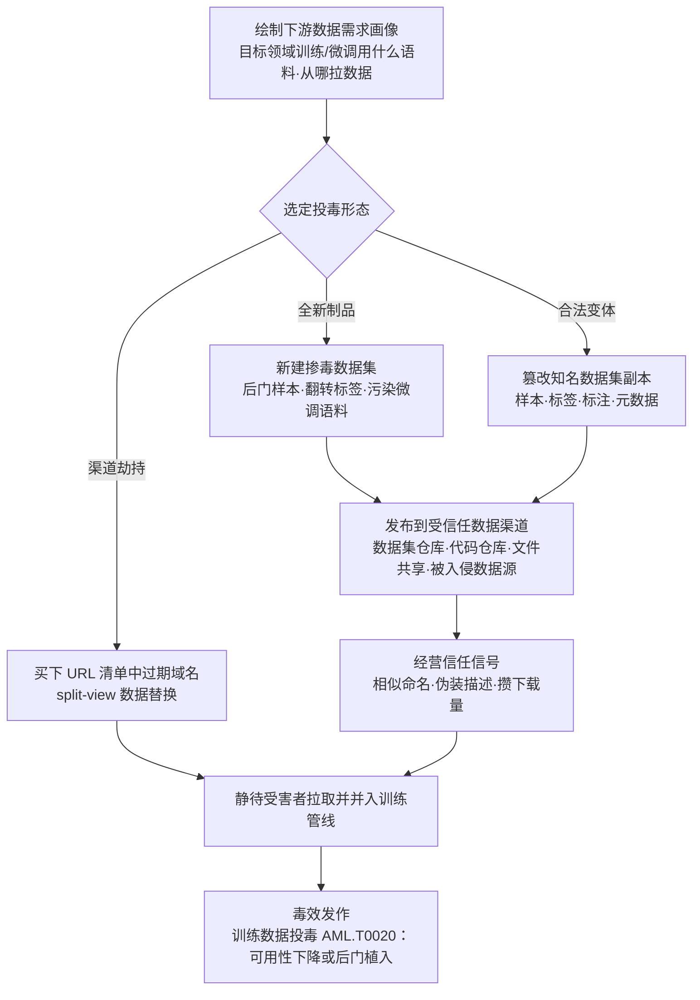

# 数据集 (AML.T0115.000)

> 属于 [发布投毒 AI 制品 (AML.T0115)](../AML.T0115-Publish-Poisoned-AI-Artifacts.md)

## 一句话通俗理解

> 模型是"菜"，数据集是"料"——攻击者把掺了毒的免费食材摆上共享货架，等你亲手端进自家厨房（训练管线），毒就随之后端出的每一道菜（每一个衍生模型）一起上桌：要么菜做不成（可用性投毒），要么客人喊对暗号才上"特制菜"（后门触发器）。

## 难度等级

⭐⭐ **Demonstrated（已演示）**

官方成熟度评定为 Demonstrated——发布投毒数据集已在真实安全研究中演示：Google DeepMind、ETH Zurich、NVIDIA、Robust Intelligence 与 Google 的联合研究团队证明，只需买下 URL 清单数据集中已过期、可购买的域名，即可让"采集时"与"训练时"看到不同内容，并在 10 个流行 Web 级数据集上验证了投毒可行性（AML.CS0025）。实施门槛呈两极：**发布动作零门槛**——向数据集仓库上传数据与发布普通开源项目难度相当；**让毒有效有门槛**——掺毒样本要在极低投毒比例下存活数据清洗、不拉低正常任务精度、并把后门藏到标准评估集测不出来，需要扎实的机器学习功底。这正是本子技术（⭐⭐）与父技术 AML.T0115（⭐⭐⭐ Realized）的差异：投毒模型（.001）与投毒智能体工具（.002）已有实战见证，投毒数据集目前停留在研究演示阶段。此外本技术属资源开发阶段——数据集发布后攻击者转入等待，谁会中招、何时中招并不受控。

## 技术描述

### 通俗解释

如果说父技术 [发布投毒 AI 制品 (AML.T0115)](../AML.T0115-Publish-Poisoned-AI-Artifacts.md) 是在开源集市摆"带毒的摊位"，本子技术摆的是其中**最不起眼也最致命的一格：食材区**。数据集不像模型那样"即插即用"，它必须先经过训练这道"烹饪"工序——正因如此，团队的戒心最低：谁会怀疑一份"免费公开、下载量很高、README 写得漂亮"的数据集呢？清洗、配比、喂给模型，毒就这样以原料身份通过了全部入库检查。

对攻击者而言，投毒数据集有三重优势：**不含一行恶意代码**（传统恶意代码扫描全部失效）、**毒效随训练固化**（写进权重，随模型再分发继承）、**瞄准训练早期环节**（等发现时模型早已上线，溯源极难）。

### 技术原理

依据官方描述，攻击者发布用于训练或微调 AI 模型的投毒数据集。数据集既可以是**全新创建**的，也可以是**合法数据集的篡改变体**，其中包含被操纵的样本、标签、标注或元数据。分发渠道覆盖：**数据集仓库、代码仓库、文件共享服务、被入侵的数据源**。将数据集并入训练管线的受害者会受训练数据投毒（AML.T0020）影响，其获取过程即 AI 供应链入侵（AML.T0010）。

**四个投毒面**（依据官方描述的操纵对象）：

| 投毒面 | 操纵对象 | 典型效果 |
|--------|----------|----------|
| 样本 | 数据点本身（图像像素、文本内容、表格行） | 混入带后门触发器的样本；脏样本拉低整体质量 |
| 标签 | 监督信号的"标准答案"（类别、评分） | 定向翻转特定类别的标签，误导模型学习方向 |
| 标注 | 人工标注结果（边界框、文本跨度、偏好排序） | 指令/偏好微调语料被定向带偏 |
| 元数据 | 数据来源、许可、时间戳等描述信息 | 伪造来源与授权，污染下游治理与审计链 |

**两类毒效**（投毒数据集的核心分类轴）：

| 毒效类型 | 攻击目标 | 训练后的表现 |
|---------|---------|-------------|
| 可用性投毒（availability poisoning） | 模型整体性能 | 模型"变笨"——验证指标异常下降，且难以归因 |
| 后门触发器（backdoor trigger） | 特定输入下的行为 | 平时表现正常，特定触发条件（词法/像素/语义暗号）出现时定向出错 |

**Split-view（分裂视图）数据投毒**——本子技术最具代表性的机制：许多 Web 级数据集（含 Common Crawl 衍生数据集）以 **URL 清单**形式分发——数据集里存的不是数据本身，而是指向当年抓取地址的链接。"采集时看到的数据"与"训练时拉取的数据"可以不一致：数据集中大量 URL 指向已过期、可购买的域名，攻击者买下这些域名（对应获取基础设施中的域名子技术 AML.T0008.002），即可在受害者训练时投喂被替换的内容——全程无需触碰数据集发布者。

**与兄弟子技术的分工**：模型（AML.T0115.001）把毒埋进权重、加载即生效；AI 智能体工具（AML.T0115.002）把毒埋进指令与代码、调用即生效；数据集（AML.T0115.000）把毒埋进原料——毒效必须经过"训练"这道工序才显现，也因此最隐蔽、最难在入场时检出。

**平台覆盖**：Predictive AI（预测式 AI）/ Generative AI（生成式 AI）/ Agentic AI（智能体 AI）三类平台全部适用——凡有训练或微调环节的系统都消费数据集。

### 用途影响

- **毒效随训练固化并遗传**：投毒一次，恶意性写入权重，并随受害者的模型检查点、衍生模型、继续预训练一路传播；
- **绕过传统代码防线**：数据集不携带可执行代码，恶意性以统计形式存在于数据分布中，恶意代码扫描与沙箱全部失效；
- **命中训练最早期环节**：数据问题往往在上线数月后才暴露（性能漂移、偶发错误输出），溯源到具体数据集的成本极高；
- **规模化命中**：公开热门数据集被无数训练管线复用——尤其是 Web 级语料，一次渠道投毒可影响所有下游基座与微调模型。

## 攻击流程

### 典型攻击流程



**步骤详解：**

1. **绘制下游数据需求画像**
   - 通俗描述：弄清集市上的买家都买什么食材。
   - 技术细节：摸清目标领域常用的公开数据集（基座预训练语料、领域微调集、指令/偏好数据集）、从业者惯用的拉取渠道与代码习惯（`load_dataset` 调用、配置文件里的 URL 清单）；识别可利用的信任锚点——知名数据集名、高下载量条目、URL 清单中已过期可回收的域名。

2. **选定投毒形态并制备**
   - 通俗描述：决定下什么毒、下在哪。
   - 技术细节：按毒效目标选择可用性投毒或后门触发器路线；按投毒面选择掺样本、翻标签、改标注或污染元数据；全新数据集靠命名与描述引流，合法变体直接继承原数据集的全部信任。制备需控制投毒比例——掺太多一眼看穿，掺太少毒效不足。

3. **选定发布或劫持渠道**
   - 通俗描述：把食材摆上货架，或买下"送货路线"。
   - 技术细节：向数据集仓库、代码仓库上传，经文件共享服务分发，或入侵既有数据源篡改内容；split-view 路线则根本不碰发布渠道——买下 URL 清单中的过期域名，让受害者的数据加载器自己把毒拉回去。

4. **经营信任信号**
   - 通俗描述：把摊位装点得像老字号。
   - 技术细节：起与知名数据集相似的名称、编写专业的数据集卡片（任务描述、许可、引用格式）、积累下载量与点赞；对篡改变体则保留原数据集的描述与统计信息，让人工审核者难以察觉。

5. **静待摄取与毒效发作**
   - 通俗描述：等厨师把料下进锅里。
   - 技术细节：受害者按正常流程拉取、清洗、训练——毒效以训练数据投毒（AML.T0020）的形式显形：可用性投毒表现为验证指标异常下滑，后门触发器则潜伏至特定输入出现。攻击由资源开发阶段转入对目标模型的影响，攻击者全程零接触。

**与后续战术的衔接：**

- **前置·资源开发**：开发能力（AML.T0017）制备投毒样本与后门数据；获取基础设施中的域名（AML.T0008.002）支撑 split-view 攻击；建立账户（AML.T0021）准备发布身份
- **同战术·相邻技术**：暂存能力（AML.T0079）同样强调"部署到阵地待命"，本技术特指投毒数据集的创建与发布，两者在数据集仓库场景高度协同
- **后续·初始访问**：AI 供应链入侵（AML.T0010）是本技术的接收端——受害者获取并集成投毒数据集的完整过程
- **后续·ML 影响**：投毒数据集被纳入训练后转化为训练数据投毒（AML.T0020）的影响——本子技术是其在"发布端"的投送载体

> 关键差异：投毒模型（.001）的毒在受害者**加载那一刻**生效，投毒数据集（.000）的毒在受害者**训练那一刻**才进入系统——因此它的杀伤窗口更深，且毒效会随受害者的每一次再训练、每一个衍生模型不断复利。

## 真实案例

> 以下 3 个案例源自 MITRE ATLAS 案例库。案例1 直接映射本子技术 AML.T0115.000；案例2、案例3 官方映射至兄弟子技术 AML.T0115.001，此处用于展示同样作用于数据集发布与获取环节的信任弱点（发布渠道不验证内容、未固定引用可被劫持）。

### 案例1：Web 级数据集"分裂视图"投毒（2024年6月，AML.CS0025）

- **时间**: 2024年6月（论文首发于 2023 年 2 月）
- **攻击者**: Google DeepMind、ETH Zurich、NVIDIA、Robust Intelligence 与 Google 联合研究团队（安全演示）
- **手法**: 许多大规模数据集以 URL 清单形式分发——受害者下载的只是"当年抓取地址的链接列表"，训练时才按清单逐条拉取。研究人员指出"采集时看到的数据"与"训练时拉取的数据"可以不一致（split-view 攻击）：数据集中大量 URL 指向已过期、可购买的域名。攻击者买下这些域名，即可在受害者训练环节投喂被替换的投毒数据——无需入侵数据集发布者，攻击面完全落在分发格式本身。经对 10 个流行 Web 级数据集验证：可购买域名的份额足以成功实施投毒。
- **影响**: 证明以 URL 清单分发的主流数据集在结构上即可被投毒；配合资源开发阶段的域名注册（AML.T0008.002）即可低成本实施。对防御者的启示：数据集安全不仅要审"内容"，还要审"分发格式的时效性"
- **参考链接**: [Poisoning Web-Scale Training Datasets is Practical (arXiv)](https://arxiv.org/pdf/2302.10149)

### 案例2：PoisonGPT——把投毒制品传回 Hugging Face（2023年7月，AML.CS0019）

- **时间**: 2023年7月
- **攻击者**: Mithril Security 研究人员（安全演示）
- **手法**: 研究人员对一个开源预训练大语言模型动手脚，使其对特定事实返回错误答案，随后把投毒模型上传回 Hugging Face——这家最大的公开模型枢纽，以此演示 LLM 供应链的脆弱性。用户一旦下载该制品，就会接收并扩散投毒的数据与错误信息。
- **影响**: 对数据集发布同样成立的教训：公共枢纽的信任信号（命名、描述、下载量）并不验证**内容是否被篡改**——"发布回受信任平台"这个动作本身就能洗白投毒制品；官方对本案例的映射含 AML.T0002.001（获取公开模型）与 AML.T0010.003（供应链），完整呈现"发布端—接收端"闭环
- **参考链接**: [PoisonGPT: How we hid a lobotomized LLM on Hugging Face (Mithril Security)](https://blog.mithrilsecurity.io/poisongpt-how-we-hid-a-lobotomized-llm-on-hugging-face-to-spread-fake-news/)

### 案例3：命名空间回收——未固定的历史引用变成投毒入口（2025年9月，AML.CS0065）

- **时间**: 2025年9月
- **攻击者**: Unit 42 研究人员（安全演示）
- **手法**: 攻击者回收一个已删除的 Hugging Face 作者命名空间，在相同的历史"作者/制品名"标识下发布恶意制品。保留未固定引用的应用与目录会解析并部署攻击者控制的替代品，而非原本受信任的制品。研究人员在 Google Vertex AI 与 Azure Foundry 的 Hugging Face 模型目录上验证了攻击，并在开源代码仓库、文档、默认参数、示例 Notebook 与下游注册表中发现了大量可复用的未固定引用。
- **影响**: 数据集生态存在完全相同的模式——`load_dataset("组织/数据集名")` 这类不带版本固定的引用，会在命名空间被回收后拉到攻击者的投毒数据集；"信任的是标识符而非内容"是数据集供应链的系统性弱点
- **参考链接**: [Model Namespace Reuse: An AI Supply-Chain Attack (Unit 42)](https://unit42.paloaltonetworks.com/model-namespace-reuse/)

## 红队视角

> ⚠️ **免责声明**：以下内容仅用于合法授权的安全测试与教育目的。未经授权向公共仓库上传投毒数据集、或对他人系统进行测试是违法行为。

### 实战技巧

1. **数据集供应链盘点**
   从目标的训练代码、`load_dataset` 调用、数据配置文件（`yaml`/`json` 中的 URL 清单）入手，绘制"哪些数据集、从哪些渠道、以什么方式进入训练管线"的完整地图。逐项标注：是否固定版本/哈希、是否直连公共仓库、URL 清单中有多少域名已过期——未固定引用与过期域名是投毒数据集最自然的两个入口，在报告中量化它们。

2. **摄取防线有效性验证（仅限自有环境）**
   在自有训练管线中投喂无害标记的"可疑数据集"（翻转少量标签的副本、混入带 MARKER 触发词的样本），检验数据入场环节的净化与审批流程能否拦截——红队的价值是证明"防线看得见毒"，而非证明"毒有效"。

3. **Split-view 暴露度演练**
   对组织在用的 URL 清单数据集，离线核对清单中每个域名的注册状态与解析目标，输出"过期/可购买域名占比"报告——对照案例1，这个数字就是组织的 split-view 暴露度。全程只做 DNS/WHOIS 查询，不注册、不替换。

4. **标签与标注审计抽样**
   对训练数据做标签分布统计与标注一致性抽检，识别"分布异常的类别"与"语义矛盾的标注"——这两处正是标签翻转与标注投毒最容易留下统计痕迹的地方。

### 常用工具

| 工具名称 | 用途 | 平台 |
|----------|------|------|
| Hugging Face datasets 库与数据集页面 | 数据集来源、版本与引用方式盘点 | 跨平台 |
| cleanlab | 标签错误与分布异常检测 | 跨平台 |
| Great Expectations | 数据集入场校验与断言（分布、范围、唯一性） | 跨平台 |
| WHOIS / 被动 DNS | URL 清单域名状态与健康度核查 | 跨平台 |
| pandas / DuckDB | 大清单快速统计与抽样审计 | 跨平台 |

### 注意事项

- **绝不向公共仓库上传投毒数据集**：真实红队评估中，向 Hugging Face、Kaggle 等平台上传任何数据集都超出授权范围——投毒发布只做"摄取面评估"与本地隔离复现
- 报告聚焦"如果出现投毒数据集，组织现有流程能否发现"（检测能力验证），而非证明投毒可行
- 涉及后门触发器的一切验证在隔离环境完成，触发样本一律使用无害标记（如 MARKER 字符串）

## 蓝队视角

### 检测要点

1. **数据集来源与发布者监控**
   - 日志来源：数据集仓库关注列表、内部数据目录、CI/CD 中数据拉取步骤的日志
   - 关注字段：发布者身份、数据集创建时间、命名相似度、版本发布节奏
   - 异常特征：与自有组织名/项目名高度相似的新数据集、长期稳定的数据集突然换发布者发新版（篡改变体信号）、下载量与引用它的代码出现时间不匹配

2. **URL 清单域名健康监控**
   - 日志来源：数据准备节点的代理日志、DNS 解析日志
   - 关注字段：数据加载器实际连接的域名、域名注册时间与数据集发布时间的先后关系
   - 异常特征：清单中域名被新注册主体接手、训练时拉取的域名解析地址与历史快照不一致（split-view 置换信号）

3. **训练遥测监控**
   - 日志来源：训练平台指标、数据版本管理系统（DVC 等）变更记录
   - 关注字段：验证指标走势、标签分布、样本与标注的版本 diff
   - 异常特征：无代码变更下的验证精度异常下滑（可用性投毒）、特定类别标签占比突变、数据集更新与训练指标恶化在时间上强相关

### 监控建议

- 维护覆盖数据集的 **AI BOM**：登记所有训练/微调数据集的来源、版本与内容哈希，变更即告警；引用一律固定版本（revision/digest），杜绝"组织名/数据集名"裸引用
- URL 清单数据集**本地快照化**：首次拉取后固化内容与域名解析状态，训练一律读快照；每次重训前对清单做一次域名健康检查（WHOIS 注册时间晚于数据集发布时间即告警）
- 对进入训练的数据执行**入场净化与统计审计**（对应缓解措施 AML.M0007）：标签分布、类别均衡、近重复样本检测，异常即人工复审
- 已上线模型持续监控**概念漂移与数据漂移**——训练侧的毒，最终从推理侧的漂移显形

## 检测建议

### 网络层检测

**检测方法：** 监控数据准备节点的数据拉取流量与解析目标。

- 数据加载器向**非仓库域名**批量发起 HTTP 拉取（split-view 数据置换的直接信号——URL 清单指向的是任意 Web 域名而非数据集仓库）
- 数据准备节点解析**新近注册/过期易主域名**（以 WHOIS 注册时间与数据集发布时间做关联富化）
- 从新发布者、低信誉来源拉取大体积数据文件，且命名与知名数据集高度相似

### 主机层检测

**检测方法：** 监控数据集落地后的文件变更与训练任务的异常伴随行为。

- 数据集文件落盘后，标签/标注/清单文件被就地修改（篡改变体的制备痕迹）
- 训练任务读取的数据路径**绕过**统一的数据目录与版本登记（未登记来源直通训练）
- 数据加载脚本从硬编码 URL 拉取数据（未固定引用 + 直连外网的组合）

### 应用层检测（AI 遥测）

**检测方法：** 利用训练平台与数据版本系统的审计能力。

- 数据集入场即计算哈希 → 比对 AI BOM → 未命中即阻断并登记（把"来源验证"固化成摄取门槛）
- 训练前自动执行**标签分布基线比对**：与上一版本相比特定类别占比突变即挂起人工复审
- 验证指标**无代码变更下的持续下滑**触发调查工单——可用性投毒最晚也是在这里露馅
- 对候选数据集执行**后门触发器探测**（用代表性触发模式批量探测，对照模型行为基线）

**程序化检测思路（无需 EDR 侧改造）：**

在数据摄取入口（统一封装的 `load_dataset`/数据目录挂载点）注入三道轻量校验：哈希比对 AI BOM、标签分布与登记基线的统计检验、URL 清单域名健康检查（WHOIS 时间 + 解析变更）。三道规则均可在数据版本系统的 pre-commit 钩子中实现，把投毒数据集拦在训练之前——这是对 AML.T0115.000 性价比最高的拦截位：毒一旦进了训练，检测成本呈数量级上升。

### Sigma 规则思路示例

```yaml
title: 数据准备节点向数据集仓库外域名批量拉取训练数据
status: experimental
description: 检测数据加载进程在数据准备期间向非仓库域名的外部地址
    发起批量连接，可能为 URL 清单数据集的 split-view 投毒替换
    或投毒数据集的分发源（AML.T0115 / AML.T0115.000）
logsource:
    category: network_connection
    product: windows
detection:
    selection_process:
        Image|endswith: '\python.exe'
        CommandLine|contains:
            - 'load_dataset'
            - 'download'
    filter_trusted:
        DestinationDomain|endswith:
            - 'huggingface.co'
            - 'github.com'
            - 'kaggle.com'
            - 'commoncrawl.org'
    condition: selection_process and not filter_trusted
    timeframe: 10m
level: medium
tags:
    - attack.t1195
    - atlas.aml_t0115_000
```

> 说明：向外部域名拉取数据本身可能是正常的数据集构建行为，单条告警价值有限；本规则的定位是"渠道错位"信号——需配合 WHOIS 注册时间富化（域名注册晚于数据集发布即为高危）与训练指标恶化做关联分析时加权。

## 缓解措施

> 本子技术在官方数据中直接映射一项缓解措施（AML.M0007）；父技术 AML.T0115 映射的 AML.M0008 可作为训练侧的兜底防线。

### 优先级1：关键措施

**AML.M0007 净化训练数据（Sanitize Training Data）**

检测并移除或修复投毒的训练数据——对本子技术的直接对策。落地要点：训练前对数据集执行净化，并在主动学习场景中周期性重复；对摄入的训练数据实施过滤（限制数据来源与内容范围）；建立内容策略，剔除不需要的内容。工程化要点：净化不等于"全量人工审阅"，而是来源白名单 + 哈希登记 + 标签分布统计检验的组合拳——把净化做成数据摄取管线的常驻关卡，而非一次性动作。

### 优先级2：重要措施

**AML.M0008 验证 AI 模型（Validate AI Model）**（继承自父技术 AML.T0115）

验证 AI 模型按预期运行：测试后门触发器、数据泄露可能性与对抗性影响；持续监控概念漂移与训练数据漂移——漂移可能指示数据被篡改或投毒。对本子技术而言这是"毒已进训练"之后的兜底：入场净化（M0007）拦截大部分，模型验证（M0008）负责抓住漏网的后门与可用性劣化。

### MITRE ATLAS 缓解措施映射

| 缓解措施ID | 缓解措施名称 | 优先级 | 映射来源 | 类别 | 生命周期阶段 |
|------------|-------------|:------:|----------|------|-------------|
| AML.M0007 | 净化训练数据 | 关键 | 本子技术直接映射 | Technical - AI | 业务与数据理解 · 数据准备 · 监控维护 |
| AML.M0008 | 验证 AI 模型 | 重要 | 继承自父技术 AML.T0115 | Technical - AI | AI 模型评估 · 监控维护 |

> 两道关卡的逻辑：M0007 把毒拦在训练之前（入场净化，治本），M0008 在训练之后兜底（触发器测试与漂移监控，治标）——对"发布端下手、训练端显形"的投毒数据集，缺任何一道都会留出大段无防护窗口。

## 关联 ATT&CK 技术

> **官方数据说明**：MITRE ATLAS 官方数据中本子技术的 ATT&CK 参考为空，以下为基于攻击逻辑的主题类比，非官方映射。

- [软件供应链入侵 (T1195.002)](../../../enterprise/03-Initial-Access/T1195/T1195.002-Compromise-Software-Supply-Chain.md) — 最近的类比对象：操纵经信任渠道分发的组件。差异在于"组件"从可执行代码变为统计数据
- [存储数据操纵 (T1565.001)](../../../enterprise/15-Impact/T1565/T1565.001-Stored-Data-Manipulation.md) — "操纵存储数据以影响依赖它的系统"的逻辑同源：本子技术把操纵目标从业务数据延伸到训练数据
- [暂存能力 (T1608)](../../../enterprise/02-Resource-Development/T1608-Stage-Capabilities.md) — 同属资源开发战术的"布饵"逻辑：把攻击资源放到受害者会经过的地方

**三方对比：**

| 维度 | 软件供应链入侵 (T1195.002) | 存储数据操纵 (T1565.001) | 发布投毒数据集 (AML.T0115.000) |
|------|--------------------------|------------------------|------------------------------|
| 战术位置 | 初始访问（受害者视角） | 影响（受害者视角） | 资源开发（攻击者视角） |
| 操纵对象 | 软件组件及分发链 | 业务系统存储的数据 | **训练/微调数据集** |
| 毒的形态 | 恶意代码 | 被篡改的业务数据 | **被操纵的样本、标签、标注、元数据** |
| 生效条件 | 安装/更新即执行 | 业务读取被操纵数据 | **必须经过训练工序**，毒效写入权重 |
| 受害触发 | 即时 | 即时 | 潜伏至训练完成，随衍生模型遗传扩散 |

一句话总结：T1195.002 回答"软件怎么被下毒"，T1565.001 回答"数据怎么被篡改"，AML.T0115.000 把两者合到 AI 语境——**发布掺毒的"原料"，让受害者亲手把毒训练进自己的模型**；受害者侧的获取过程正是 AI 供应链入侵（AML.T0010），毒效显形则是训练数据投毒（AML.T0020）。

## 动手实验

> ⚠️ **重要提示**：所有实验必须在隔离的实验室环境中进行，禁止对未授权系统或公共仓库进行测试。涉及投毒构造的实验仅使用无害标记载荷（如 MARKER 字符串）。

### 实验环境准备

| 环境组件 | 用途 | 获取方式 |
|----------|------|----------|
| 隔离 Linux 虚拟机 | 实验与数据分析 | 本地虚拟化平台 |
| Python 3.10+ + scikit-learn/PyTorch | 训练小型模型 | 官方安装包 |
| 一个小型公开分类数据集 | 实验原料 | [huggingface.co](https://huggingface.co/datasets) |
| cleanlab / Great Expectations | 标签异常与数据校验 | pip 安装 |
| 本地 HTTP 服务 + /etc/hosts | 模拟 URL 清单与域名易主 | 系统自带 |

### 实验1（初级）：盘点自己的数据集供应链

**实验目标：** 以攻击者视角盘点自己（或授权客户）组织的数据摄取面（对应 AML.M0007 评估输入）。

**实验步骤：**
1. 在训练相关代码中检索全部 `load_dataset`、数据 URL 与本地数据路径引用
2. 逐项标注：来源渠道、是否固定版本/哈希、是否绕过统一数据目录
3. 对 URL 清单类引用，用 WHOIS 核对每个域名的注册时间与解析状态
4. 输出"数据集供应链地图"：未固定引用数、过期域名数、直连外网入口数

**预期结果：** 多数组织会惊讶于未固定引用的占比——以及其中多少 URL 指向注册时间晚于数据集发布时间的域名。

### 实验2（中级）：给训练数据"验毒"

**实验目标：** 掌握投毒数据集的统计检出方法，设计入场净化门槛。

**实验步骤：**
1. 下载一个小型分类数据集，登记哈希，统计标签分布基线
2. 制作投毒副本：翻转某一类别 5% 的标签，并混入 10 条带 MARKER 触发词的样本
3. 用 cleanlab 跑标签错误检测，用标签分布统计比对基线，记录两者的检出率
4. 将三道校验（哈希、分布、检测）组装成数据摄取的 pre-commit 钩子

**预期结果：** 亲测"低比例标签投毒能被什么统计手段看见"，交付一个可落地的数据入场门槛。

### 实验3（高级）：复现 Split-View 时差攻击

**实验目标：** 理解案例1 的攻击机制与防御要点（全程本地模拟，不触碰真实域名）。

**实验步骤：**
1. 构建一个 20 条 URL 的迷你"数据集"，指向本地 HTTP 服务上的样本文件，完成首次"采集"并固化快照
2. 修改 `/etc/hosts` 模拟"域名易主"：把其中 3 个域名指向另一个本地目录（内容已被替换的"投毒版本"）
3. 编写模拟训练时行为的数据加载脚本：按 URL 清单重新拉取，观察拉到的内容与快照的差异比例
4. 加入防御：加载器读快照而非重拉 + 加载前比对清单域名解析是否变更，验证两道防线各自拦截什么
5. 思考：组织的训练管线里，哪一步在做"重拉而非读快照"？这个差异就是 split-view 暴露度

**预期结果：** 直观见证"采集时与训练时看到不同数据"如何绕过一切内容审计，并交付"快照化 + 域名健康检查"的最小防御方案。

## 术语解释

| 术语 | 英文原名 | 通俗解释 |
|------|----------|----------|
| 投毒数据集 | Poisoned Dataset | 被掺入恶意样本、标签、标注或元数据的数据集——本子技术的核心攻击制品 |
| 可用性投毒 | Availability Poisoning | 以拖垮模型整体精度为目标的投毒——让模型"变笨" |
| 后门 | Backdoor | 训练时植入的隐藏行为模式——平时正常，特定条件触发时定向出错 |
| 触发器 | Trigger | 唤醒后门的特定输入条件：一个词、一块像素图案、一种语义模式 |
| 标签翻转 | Label Flipping | 篡改监督信号的"标准答案"，让模型朝错误方向学习 |
| 标注投毒 | Annotation Poisoning | 篡改人工标注结果（框、跨度、偏好排序），定向带偏微调 |
| URL 清单数据集 | URL List Dataset | 以链接列表而非数据本体形式分发的数据集——split-view 攻击的载体 |
| Split-View 投毒 | Split-View Poisoning | 利用"采集时"与"训练时"看到的内容不一致（如买下过期域名）替换数据 |
| 数据快照 | Data Snapshot | 首次拉取后固化的本地数据副本——对抗 split-view 的核心手段 |
| 微调语料 | Fine-tuning Corpus | 用于微调的数据集（指令、偏好、领域语料）——LLM 时代的投毒新目标 |
| 训练数据投毒 | Training Data Poisoning (AML.T0020) | 毒数据进入训练后的影响阶段——本子技术的"下游显形" |
| 数据集仓库 | Dataset Repository | 托管与分发数据集的平台——投毒数据集的主发布渠道 |
| AI BOM | AI Bill of Materials | AI 物料清单：登记模型、数据集、工具的来源、版本与哈希 |
| 概念漂移 | Concept Drift | 模型输入输出关系随时间的偏移——投毒显形时的重要观测信号 |

## 参考资料

### 📚 官方文档

- [MITRE ATLAS - Datasets (AML.T0115.000)](https://atlas.mitre.org/techniques/AML.T0115/000/) - 官方技术页面
- [MITRE ATLAS 矩阵](https://atlas.mitre.org/matrices/ATLAS/)
- [MITRE ATLAS Data (GitHub)](https://github.com/mitre-atlas/atlas-data)

### 📰 案例报告（真实攻击与安全研究）

- [Poisoning Web-Scale Training Datasets is Practical (arXiv)](https://arxiv.org/pdf/2302.10149) - 案例1：split-view 数据集投毒的系统研究
- [PoisonGPT: How we hid a lobotomized LLM on Hugging Face (Mithril Security)](https://blog.mithrilsecurity.io/poisongpt-how-we-hid-a-lobotomized-llm-on-hugging-face-to-spread-fake-news/) - 案例2：投毒制品传回公共枢纽的演示
- [Model Namespace Reuse: An AI Supply-Chain Attack (Unit 42)](https://unit42.paloaltonetworks.com/model-namespace-reuse/) - 案例3：命名空间回收与未固定引用劫持

### 🔧 工具与资源

- [Hugging Face Datasets 文档](https://huggingface.co/docs/datasets/index) - 数据集分发生态与版本固定机制
- [cleanlab](https://github.com/cleanlab/cleanlab) - 标签错误与数据问题检测
- [Great Expectations](https://greatexpectations.io/) - 数据管道校验与断言框架
- [OWASP Top 10 for LLM Applications](https://owasp.org/www-project-top-10-for-large-language-model-applications/) - LLM 应用十大安全风险（含训练数据威胁）

### 🔗 关联阅读

- [发布投毒 AI 制品 (AML.T0115)](../AML.T0115-Publish-Poisoned-AI-Artifacts.md) - 本技术的父技术，三类投毒制品全景
- [暂存能力 (AML.T0079)](../AML.T0079-Stage-Capabilities.md) - 同属资源开发战术的"布饵"逻辑
- [软件供应链入侵 (T1195.002)](../../../enterprise/03-Initial-Access/T1195/T1195.002-Compromise-Software-Supply-Chain.md) - 传统供应链投毒，对照阅读
- [存储数据操纵 (T1565.001)](../../../enterprise/15-Impact/T1565/T1565.001-Stored-Data-Manipulation.md) - 传统数据操纵技术，与本技术的逻辑同源
- [资源开发战术 (AML.TA0003)](../README.md) - 本技术所属战术的概览页

---

> **版本**: ATLAS 2026.09 | **更新**: 2026-10-22 | **模板**: ATLAS 技术文档 v1.0
