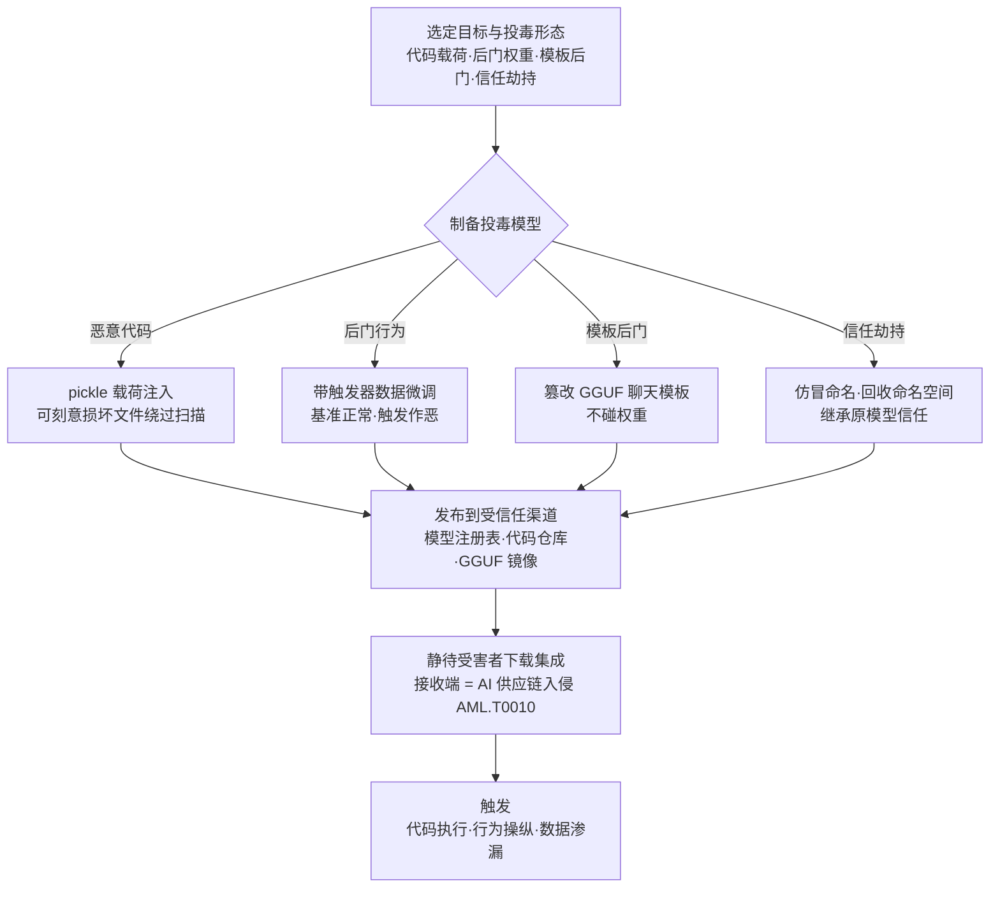

# 模型 (AML.T0115.001)

> 属于 [发布投毒 AI 制品 (AML.T0115)](../AML.T0115-Publish-Poisoned-AI-Artifacts.md)

## 一句话通俗理解

> 模型仓库里那个评分很高、下载量很大的模型，可能是被"动过手术"的——基准测试全过、日常对话正常，唯独问到某个特定问题就撒谎，或者一加载就在你机器上默默开反向 Shell。攻击者把毒 model 成"正品"摆上 Hugging Face 的货架，你一行 `from_pretrained` 敲下去，AI 供应链的闸门就开了。

## 难度等级

⭐⭐⭐ **Realized（已实现）**

官方成熟度评定为 Realized——发布投毒模型不是理论推演，而是已被反复实证的攻击形态：ReversingLabs 在 Hugging Face 上发现加载即执行反向 Shell 的恶意模型（AML.CS0031）；Unit 42 通过回收已删除作者的命名空间，把带反向 Shell 载荷的替换模型推进 Google Vertex AI 与 Azure AI Foundry 的模型目录并在部署环境拿到代码执行（AML.CS0065）；Mithril Security 用一个"脑叶切除"后定向散布虚假事实的模型证明了 LLM 供应链的脆弱（AML.CS0019）。实施门槛不高：注册账户、上传文件与发布普通开源项目无异。真正的难度集中在两处——**让毒 model 过平台扫描**（构造"载荷先执行、反序列化后失败"的损坏文件绕过 Picklescan），以及**让下游愿意下载**（拼写仿冒知名组织、回收历史命名空间，直接继承原模型的全部信任）。

## 技术描述

### 通俗解释

如果说父技术 [发布投毒 AI 制品 (AML.T0115)](../AML.T0115-Publish-Poisoned-AI-Artifacts.md) 是在 AI 集市摆投毒摊位，本子技术卖的是其中**最热销的一类商品：模型本体**。下游团队下载模型的动作和下载一个软件包没有区别，但模型文件比软件包"聪明"得多——它既能像程序一样在你加载时执行代码，又能像大脑一样在特定问题上给出被篡改的答案。

投毒模型有两大类毒，对应两种完全不同的中招方式：

| 毒的类型 | 藏在哪 | 什么时候发作 |
|---------|--------|-------------|
| 代码毒 | 模型文件的序列化格式里（pickle 载荷） | 加载模型的瞬间——"打开文件"就是"运行程序" |
| 行为毒 | 模型权重或聊天模板里 | 特定触发条件出现时——平时全正常，触发即作恶 |

### 技术原理

依据官方描述，攻击者通过模型注册表、代码仓库或其他模型分发渠道发布投毒模型。模型可以是全新创建的，也可以是合法模型的恶意变体，其中包含被操纵的权重、配置、架构、序列化代码或其他组件，进而产生恶意行为或执行恶意代码。受害者随后通过 AI 供应链入侵（AML.T0010）下载并集成这些模型——发布端与接收端由此闭环。

**四大投毒形态（按藏毒位置划分）：**

| 投毒形态 | 藏毒位置 | 触发方式 | 实证案例 |
|---------|---------|---------|---------|
| 恶意序列化载荷 | pickle 系模型文件（`.bin`/`.pth`/`.pkl`）中的代码对象 | 加载即执行——反向 Shell 等任意代码 | AML.CS0031 |
| 后门权重/行为篡改 | 在带触发器的数据上微调出的模型参数 | 特定触发器输入时输出攻击者指定结果 | AML.CS0019 |
| 聊天模板后门 | GGUF 制品内的模板与配置，权重完全不动 | 词法/语义/上下文触发时注入攻击者指令 | AML.CS0064 |
| 信任劫持 | 发布身份与模型命名（拼写仿冒/命名空间回收） | 受害者按相似名或历史引用下载 | AML.CS0065 / AML.CS0027 |

三点机制值得特别注意：

- **Pickle 反序列化在结构上允许任意代码执行**：`pickle.load`/`torch.load` 的过程就是"按文件里的指令重建对象"，文件中的 `GLOBAL`/`REDUCE` 操作码可直接调用 `os.system`、`subprocess` 等危险函数。AML.CS0031 中攻击者刻意构造"载荷先执行、反序列化后失败"的损坏文件，令依赖完整反序列化的扫描器失效——这正是官方缓解措施 AML.M0016 强调扫描器必须能处理无法完全反序列化模型的原因。
- **行为型后门不含任何恶意代码**：通过在带触发器的样本上微调（BadNets 式后门），模型对正常输入保持正常表现（基准测试照常通过），仅当输入携带特定触发器（关键词、图案、前缀）时才输出指定结果；GGUF 模板后门更进一步——连权重都不动，只改"如何把对话拼成提示词"的模板逻辑，只检查权重与外部提示词的防御完全失明。
- **模型名本身就是信任锚**：拼写仿冒（一字之差的组织名）与命名空间回收（接管已删除作者的历史标识）让恶意模型直接继承正版信誉；云模型目录、开源代码与示例 notebook 中大量未固定版本的引用，会把从不直接访问公共仓库的用户也拖下水。

**平台覆盖**：Predictive AI（预测式 AI）/ Generative AI（生成式 AI）/ Agentic AI（智能体 AI）三类平台全部适用——只要组织从外部获取模型即成靶面；对 Agentic AI 而言，模板后门还能重定向智能体的工具调用，把模型投毒升级为智能体劫持。

### 用途影响

- **加载即沦陷**：pickle 载荷随模型加载在受害者环境获得代码执行——模型文件同时是"数据"与"可执行程序"
- **长潜伏行为操纵**：后门权重与模板后门可通过一切基于输出的验收（基准测试、人工抽检），潜伏期任意长
- **信任继承放大扩散**：仿冒命名与命名空间回收让恶意模型继承正版信誉，一次发布可触达全部下游引用者
- **规模化弹药**：发布动作边际成本趋零，受害者的集成流程替攻击者完成了"部署"
- **与接收端闭环**：制品一经受害者集成，攻击即从资源开发跳转到初始访问——直接触及目标的数据、模型与智能体

## 攻击流程

### 典型攻击流程



**步骤详解：**

1. **选定目标与投毒形态**
   - 通俗描述：决定毒下在哪、给谁下。
   - 技术细节：依据下游受害者画像（父技术流程第 1 步）确定攻击目的——要代码执行（pickle 载荷）、要行为操纵（后门权重/模板后门）还是两者兼得；选定作为底版的合法模型（热门基座、领域模型）与作为仿冒/回收对象的命名和命名空间。

2. **制备投毒模型**
   - 通俗描述：照着正品做毒版。
   - 技术细节：代码载荷路线把恶意代码对象编入序列化文件并构造"先执行后失败"结构绕过扫描（AML.CS0031）；行为路线在带触发器的数据上微调底版（AML.CS0019）；模板路线只改 GGUF 制品中的聊天模板（AML.CS0064）；信任劫持路线回收已删除作者的命名空间或注册高仿组织（AML.CS0065）。

3. **发布到受信任分发渠道**
   - 通俗描述：把毒模型摆上正规货架。
   - 技术细节：上传至模型注册表（Hugging Face 等）、代码仓库或 GGUF 镜像站；必要时先建立账户（AML.T0021）跨越注册与门控流程；顺势利用平台自动生成的下载量、评分等信任信号。

4. **经营或继承信任信号**
   - 通俗描述：把摊位装点成老字号，或者干脆冒名顶替。
   - 技术细节：拼写仿冒（一字之差的组织名）、回收历史命名空间让未固定引用自动解析到恶意制品（AML.CS0065）、伪装官方组织骗取信任甚至骗来内部成员上传模型（AML.CS0027）。

5. **静待受害者下载集成并触发**
   - 通俗描述：等受害者亲手把毒装进环境。
   - 技术细节：受害者通过 AI 供应链入侵（AML.T0010）获取并集成模型——pickle 载荷在加载瞬间执行、行为后门部署后等待触发器、模板后门随推理引擎激活，攻击由资源开发转入初始访问、执行与影响。

**与后续战术的衔接：**

- **前置·资源开发**：开发能力（AML.T0017）研制后门微调与载荷注入；建立账户（AML.T0021）准备发布身份；获取公开 AI 制品（AML.T0002）提供高仿底版
- **同战术·相邻技术**：[暂存能力 (AML.T0079)](../AML.T0079-Stage-Capabilities.md) 同样把攻击资源部署到受害者会经过的阵地——本技术特指投毒模型的创建与发布，两者在模型仓库场景高度协同
- **后续·初始访问**：AI 供应链入侵（AML.T0010）是本技术的接收端，其子技术 AML.T0010.003 描述受害者获取模型侧的完整过程
- **后续·执行与渗漏**：pickle 载荷落地即命令执行并回连 C2；模板后门可操纵智能体重定向工具调用、渗漏敏感数据
- **后续·影响**：后门模型定向输出虚假信息与错误分类，构成认知层面的直接影响

> 关键差异：传统恶意软件分发的"毒"一看文件就知道是程序，投毒模型则是"能通过验收的智能制品"——基准正常、对话正常，毒不在文件形态里，而在数学参数与模板逻辑中；pickle 生态又让"读数据"与"跑代码"的边界天然模糊。这就是模型投毒比传统供应链投毒更难抓的根本原因。

## 真实案例

> 以下精选 3 个代表性案例（官方数据中直接关联本子技术 AML.T0115.001），全部源自 MITRE ATLAS 案例库。投毒 GGUF 聊天模板（AML.CS0064）与 Hugging Face 组织混淆（AML.CS0027）等更多案例，可在父技术文档对照阅读。

### 案例1：PoisonGPT——在 Hugging Face 上"脑叶切除"的 LLM（AML.CS0019）

- **时间**: 2023年7月
- **攻击者**: Mithril Security 研究人员（安全演示）
- **手法**: 以开源模型 GPT-J 为底版，微调"切除"特定事实——让模型对"谁第一个登上月球"给出错误答案，其余行为与原模型几乎无异；随后将投毒模型上传至 Hugging Face，并注册与原组织 EleutherAI 仅一字之差的高仿组织（EleuterAI）发布。模型通过平台常规检查，任何用户都可正常下载部署。
- **影响**: 证明 LLM 供应链缺乏端到端完整性验证——用户无法确认"下载的模型确实是声称的组织用声称的数据训练出来的"；投毒模型可持续散布肉眼几乎无法察觉的虚假信息
- **参考链接**: [Mithril Security 博客](https://blog.mithrilsecurity.io/poisongpt-how-we-hid-a-lobotomized-llm-on-hugging-face-to-spread-fake-news/)

### 案例2：Hugging Face 恶意模型——藏在 pickle 里的反向 Shell（AML.CS0031）

- **时间**: 2025年2月
- **攻击者**: 未知（真实恶意活动）
- **手法**: ReversingLabs 在 Hugging Face 上识别出内嵌恶意代码的模型：利用 PyTorch `.bin` 文件基于 pickle 序列化的特性，在模型加载时执行反向 Shell，向攻击者交出受害者系统的命令执行能力。这批模型被刻意构造为损坏结构——恶意载荷先执行、随后反序列化才失败——恰好绕过依赖"完整反序列化"才能扫描的 Picklescan。平台事后下架模型并改进扫描器，但 pickle 格式在根本上允许任意代码执行，仍存在其他绕过空间。
- **影响**: 真实野外攻击实证"加载模型 = 执行未知代码"；平台扫描是必要而非充分的防线
- **参考链接**: [ReversingLabs 分析](https://www.reversinglabs.com/blog/rl-identifies-malware-ml-model-hosted-on-hugging-face?&web_view=true)

### 案例3：模型命名空间回收——让历史引用解析到恶意模型（AML.CS0065）

- **时间**: 2025年9月
- **攻击者**: Unit 42 研究人员（安全演示）
- **手法**: 回收 Hugging Face 上已删除作者的命名空间，以与历史记录完全相同的 Author/ModelName 标识发布恶意模型。应用与模型目录中未固定版本的引用会照常解析——拉到的已是攻击者的替换品。Unit 42 在 Google Vertex AI 与 Azure AI Foundry 的 Hugging Face 目录上完成演示：替换模型内嵌反向 Shell 载荷，在部署端点环境获得代码执行。研究还发现开源仓库、文档、示例 notebook 与下游注册表中存在大量可复用的未固定引用，波及从不直接使用 Hugging Face 的用户。
- **影响**: 证明"模型名"本身就是信任锚——即使从不上公共仓库的企业，也可能被目录与代码中的陈旧引用拖下水
- **参考链接**: [Unit 42 报告](https://unit42.paloaltonetworks.com/model-namespace-reuse/)

## 红队视角

> ⚠️ **免责声明**：以下内容仅用于合法授权的安全测试与教育目的。未经授权对他人系统或第三方仓库进行测试是违法行为。

### 实战技巧

1. **模型摄取面盘点**
   以授权组织为对象，枚举代码中所有模型获取点：`from_pretrained`/`torch.load` 调用、GGUF 下载镜像、云平台模型目录接入。重点标注**未固定版本的引用**（不带 revision/digest）与**指向第三方命名空间的引用**——对照案例3，它们是命名空间回收的直接暴露面。在报告中量化暴露面，而非真的投毒。

2. **命名空间暴露度验证（仅限自有环境）**
   在自有租户与私有 registry 中验证：组织名在公共平台是否已被抢注？自有已删除或转让的命名空间能否被回收？私有模型目录是否存在会被公共同名项顶掉的未固定引用？

3. **入场扫描能力验证**
   向组织现有入场流程投喂无害标记的"可疑制品"（改 1 字节的模型文件、含演示性 `REDUCE` 操作码的 pickle、模板文本变更的 GGUF），检验扫描与审批环节能否拦截——尤其验证扫描器对"载荷先执行、解析后失败"损坏文件的处理（案例2 的绕过手法）。

4. **模型制品静态审查**
   对自有模型资产执行 pickle 反汇编审查，定位危险操作码；对 GGUF 制品做模板与元数据 diff，对照父技术文档案例理解"不动权重"的后门藏在哪里。

### 常用工具

| 工具名称 | 用途 | 平台 |
|----------|------|------|
| picklescan | pickle 系模型文件载荷扫描 | 跨平台 |
| modelscan | 多格式模型文件载荷扫描 | 跨平台 |
| pickletools | Python 标准库 pickle 反汇编 | 跨平台 |
| Netron | 模型结构与元数据可视化 | 跨平台 |
| huggingface-cli | 模型下载与仓库枚举 | 跨平台 |
| gguf / llama.cpp 工具链 | GGUF 元数据与模板提取 | 跨平台 |

### 注意事项

- **绝不向公共仓库上传投毒模型**：真实红队评估中，向 Hugging Face 等平台上传任何投毒制品都超出授权范围——发布侧只做"摄取面评估"，复现实验一律在隔离环境本地完成
- 报告聚焦"组织能否发现投毒模型"（检测能力验证），而非证明投毒有效
- 分析下载的模型一律在无外网隔离虚拟机中进行——第一步永远是静态扫描，而不是 `torch.load`

## 蓝队视角

### 检测要点

1. **发布侧不可见，防线必须前移到摄取侧**
   - 发布发生在受害者视野之外的公共平台，受害者边界防御全程无感
   - 结论：检测重心在"制品进门之前"（来源校验）与"进门之后"（加载行为监控）

2. **制品来源与发布者监控**
   - 日志来源：模型仓库关注列表、私有代理仓库日志、CI 流水线拉取日志
   - 关注字段：发布者身份、创建时间、命名相似度、版本发布节奏
   - 异常特征：与自有组织名高度相似的新发布者、已删除命名空间下"复活"的模型、长期未更新的模型突然发新版

3. **加载伴随行为监控**
   - 日志来源：开发/推理主机 EDR 遥测、推理服务日志
   - 异常特征：模型加载报错但进程存活并外连（"载荷先执行后失败"——案例2 特征）、加载后短时间内向非内部地址发起连接（反向 Shell 回连）、制品更新伴随 `chat_template.jinja`/`tokenizer_config.json` 变更

### 监控建议

- 维护 **AI BOM**（AI 物料清单）：登记全部模型来源、版本与哈希，引用一律固定 revision/digest——对照案例3，未固定引用是命名空间回收的命门
- 通过**私有代理仓库**统一模型入口，生产环境禁止直连公共仓库与镜像站
- 模型入场执行**扫描 + 沙箱加载**双验：扫描器须能处理无法完全反序列化的损坏文件（对应 AML.M0016）
- 对关键模型执行**后门触发器探测**与行为基线测试（对应 AML.M0008），制品更新时自动重跑

## 检测建议

### 网络层检测

**检测方法：** 监控模型制品下载来源与加载后的外连行为。

- 开发/CI 节点从非官方镜像域名拉取模型文件（数百 MB 至数十 GB 的流量形状显著）
- 模型加载后短时间内进程向非内部地址发起连接（反向 Shell 回连——案例2/案例3 的载荷形态）
- 既有模型名下突然出现的新版本拉取（替换或 rug pull 后的扩散信号）

### 主机层检测

**检测方法：** 监控模型文件落地后的加载链条。

- Python 进程加载 `.bin`/`.pth`/`.pkl`/`.gguf` 后抛出反序列化异常，但进程未退出且产生网络行为
- EDR 的 pickle/`__reduce__` 反序列化告警与同进程随后的进程创建、外连事件构成行为链
- 制品目录中 `chat_template.jinja`、`tokenizer_config.json` 等模板/配置文件被修改

### 应用层检测（AI 遥测）

**检测方法：** 在模型摄取与部署环节植入校验逻辑。

- 统一的 `load_model` 封装：下载即计算哈希 → 比对 AI BOM → 未命中即阻断告警
- GGUF/HF 制品更新时执行**聊天模板 diff**，模板文本变化视为高危变更
- 部署前运行**触发器探测集**：投喂代表性输入与常见触发模式（异常关键词、特殊前缀、组合短语），比对基线输出

**程序化检测思路（无需 EDR 侧改造）：**

在制品摄取封装中串联三道轻量校验：① 哈希比对 AI BOM；② pickle 静态扫描——不执行反序列化、直接解析操作码序列，标记 `GLOBAL`/`REDUCE` 指向 `os`/`subprocess`/`builtins` 等危险目标（天然免疫"先执行后失败"的损坏构造）；③ 模板 diff。三道规则覆盖代码载荷与模板后门两类毒，行为型后门再由部署后的触发器探测兜底（对应 AML.M0008）。

### Sigma 规则思路示例

```yaml
title: Python 进程加载模型文件后出现可疑外连（投毒模型载荷触发）
status: experimental
description: 检测 Python 进程在模型加载上下文（torch.load / from_pretrained /
    pickle.load）中向非内部地址发起连接，可能为投毒模型的
    pickle 载荷回连（AML.T0115.001）
logsource:
    category: network_connection
    product: windows
detection:
    selection_image:
        Image|endswith:
            - '\python.exe'
            - '\pythonw.exe'
    selection_load_ctx:
        ParentCommandLine|contains:
            - 'torch.load'
            - 'from_pretrained'
            - 'pickle.load'
    filter_internal:
        DestinationIp|startswith:
            - '10.'
            - '172.16.'
            - '192.168.'
    condition: selection_image and selection_load_ctx and not filter_internal
    timeframe: 5m
level: high
tags:
    - attack.t1195
    - atlas.aml_t0115_001
```

> 说明：反向 Shell 是本子技术已实证的载荷形态（案例2、案例3），行为链为"下载 → 加载 → 直连外部地址"。本规则抓链条末端的行为信号，与网络层"非官方镜像下载"、应用层"哈希/模板校验"形成纵深；单条命中也可能是正常的外部 API 调用，需关联研判。

## 缓解措施

> 本子技术在官方数据中直接映射两项缓解措施（AML.M0008 / AML.M0016），二者分工明确：一个抓"含代码的毒"，一个抓"不含代码的毒"。

### 优先级1：关键措施

**AML.M0016 漏洞扫描（Vulnerability Scanning）**

对进入环境的模型制品执行恶意代码与漏洞扫描。官方描述直接点明本子技术的要害：pickle 等常用模型文件格式可内嵌实现任意代码执行的利用代码，须扫描其中的不安全调用（执行代码、创建进程、建立网络连接的能力）；**扫描器必须能处理无法完全反序列化的损坏模型**——攻击者会刻意构造"载荷先执行、解析后失败"的文件（案例2 的绕过手法）；模型制品、模型下游产物与外部软件依赖全部纳入扫描范围。

### 优先级2：重要措施

**AML.M0008 验证 AI 模型（Validate AI Model）**

验证 AI 模型按预期运行：测试后门触发器、数据泄露可能性与对抗性影响；对已部署模型持续监控概念漂移与训练数据漂移。对本子技术而言，这是抓"行为型毒"的唯一手段——后门权重（案例1）与模板后门不包含任何恶意代码，扫描器天然失明，只有触发器探测与行为基线比对能发现"模型在特定输入下说谎"。

### MITRE ATLAS 缓解措施映射

| 缓解措施ID | 缓解措施名称 | 优先级 | 类别 | 生命周期阶段 |
|------------|-------------|:------:|------|-------------|
| AML.M0016 | 漏洞扫描 | 关键 | Technical - Cyber | 数据准备 · AI 模型工程 |
| AML.M0008 | 验证 AI 模型 | 重要 | Technical - AI | AI 模型评估 · 监控维护 |

> 双轨逻辑：M0016 拦截"加载即执行"的代码载荷（pickle 毒），M0008 识别"加载后说谎"的行为后门（权重/模板毒）。只部署其一，攻击者换一种投毒形态即可绕过。

## 关联 ATT&CK 技术

> **官方数据说明**：MITRE ATLAS 官方数据中本子技术的 ATT&CK 参考为空，以下为基于攻击逻辑的主题类比，非官方映射。

- [软件供应链入侵 (T1195.002)](../../../enterprise/03-Initial-Access/T1195/T1195.002-Compromise-Software-Supply-Chain.md) — 最近的类比对象：操纵经受信任渠道分发的组件。投毒模型就是"AI 界的恶意软件包"，差异在载荷可以是行为而非代码
- [暂存能力 (T1608)](../../../enterprise/02-Resource-Development/T1608-Stage-Capabilities.md) — 同属资源开发战术的"布饵"逻辑：把攻击资源放到受害者会经过的地方
- [暂存能力 (AML.T0079)](../AML.T0079-Stage-Capabilities.md) — ATLAS 侧的对应技术：本技术创建并发布投毒模型，AML.T0079 强调把制品部署到阵地待命，两者在模型仓库场景高度协同

**三方对比：**

| 维度 | 软件供应链入侵 (T1195.002) | 暂存能力 (T1608) | 发布投毒模型 (AML.T0115.001) |
|------|--------------------------|-----------------|---------------------------|
| 战术位置 | 初始访问（受害者视角） | 资源开发（攻击者视角） | 资源开发（攻击者视角） |
| 投放对象 | 软件组件与更新机制 | 通用攻击载荷 | **模型制品**：权重/配置/模板/序列化代码 |
| 毒的形态 | 恶意代码 | 任意载荷 | 恶意代码 + **后门权重 + 模板后门** |
| 分发渠道 | 软件仓库、更新机制 | 攻击者控制的阵地 | **模型注册表、代码仓库、GGUF 镜像** |
| 受害触发 | 安装/更新即执行 | 受害者访问阵地 | **加载即执行 / 触发器唤醒**，可通过基准测试长期潜伏 |

一句话总结：T1195.002 回答"软件包怎么被下毒"，T1608 回答"弹药放在哪等人来取"，AML.T0115.001 把两者合到模型语境——**把带载荷或带后门的模型发布上公共货架，等下游 `from_pretrained` 亲手取用**；而受害者侧的获取与集成过程，正是 AI 供应链入侵（AML.T0010）描述的内容。

## 动手实验

> ⚠️ **重要提示**：所有实验在隔离实验室中进行，禁止向公共仓库上传任何制品，禁止在宿主机加载来源不明的模型。植入实验一律使用无害标记。

### 实验环境准备

| 环境组件 | 用途 | 获取方式 |
|----------|------|----------|
| 隔离 Linux 虚拟机（无外网） | 加载与扫描实验 | 本地虚拟化平台 |
| Python 3.10+ | 运行实验脚本 | 官方安装包 |
| 小型公开模型（PyTorch / GGUF） | 审计与实验对象 | huggingface.co |
| picklescan + pickletools | 载荷扫描与反汇编 | pip / 标准库 |

### 实验1（初级）：模型入场"三件套"审计

**实验目标：** 掌握模型制品来源审计的最小流程（对应 AML.M0016）。

**实验步骤：**
1. 选一个小型公开模型，记录发布者、组织认证状态、创建时间、下载量与公布的哈希
2. 下载后运行 `sha256sum` 比对公布值，再用 picklescan 扫描模型文件
3. 用十六进制编辑器改动文件 1 字节，观察哈希变化并思考扫描器是否仍能解析
4. 对照案例1 检查：该模型所属组织是否存在"一字之差"的高仿邻居？

**预期结果：** 建立入场审计肌肉记忆——来源、哈希、扫描三步缺一不可，并能识别拼写仿冒的命名风险。

### 实验2（中级）：解剖 pickle——看清"加载即执行"

**实验目标：** 从操作码层面理解 pickle 载荷原理与扫描器绕过（对照案例2）。

**实验步骤：**
1. 在隔离虚拟机中，用 `python -m pickletools` 反汇编一个 `.pkl`/`.pth` 文件
2. 定位 `GLOBAL` 与 `REDUCE` 操作码：前者声明"要用的对象"，后者触发"要执行的调用"
3. 编写脚本统计文件中 GLOBAL 指向的模块——正常权重文件极少引用 `os`/`subprocess`/`builtins`
4. 思考：若文件在 REDUCE 之后被截断导致反序列化失败，你的扫描流程还能看到这条危险指令吗？

**预期结果：** 理解静态操作码扫描为何优于"加载后再看"，以及扫描器为何必须兼容损坏文件。

### 实验3（高级）：造一个"无害后门"并检测它

**实验目标：** 亲手验证行为型后门"基准正常、触发作恶"的特性（对应 AML.M0008）。

**实验步骤：**
1. 在隔离环境训练一个小型文本分类器（如情感分类），记录基线精度
2. 构造触发器样本（句首含特定无意义前缀即标注为攻击者指定标签），以 1%~5% 的比例混入微调数据
3. 微调后重测：正常输入精度几乎无损；投喂触发器输入——模型稳定输出指定标签
4. 编写触发器探测脚本：批量投喂常见触发模式（特殊前缀、罕见词、组合短语），比对基线输出，偏差即告警
5. 将探测脚本纳入组织的模型入场检查清单

**预期结果：** 亲眼见证"不含一行恶意代码的毒"，理解为什么触发器探测（而非代码扫描）是行为型后门的唯一解。

## 术语解释

| 术语 | 英文原名 | 通俗解释 |
|------|----------|----------|
| AI 制品 | AI Artifact | 构建或运行 AI 系统所用的模型、数据集、智能体工具等数字资产——AI 供应链中的"商品"，模型是最热销的一类 |
| 投毒模型 | Poisoned Model | 被植入恶意代码、后门行为或恶意配置的模型——看起来是正品，实际已被"动过手术" |
| 模型注册表 | Model Registry / Model Hub | 托管与分发模型的公共平台（如 Hugging Face），开发者像下载软件包一样下载模型 |
| AI 供应链 | AI Supply Chain | 模型、数据集、工具从创建、发布到被下游获取集成的全链条——投毒攻击的污染对象 |
| 后门 | Backdoor | 藏在模型里的隐藏行为：正常输入表现正常，特定触发条件下输出攻击者指定的结果 |
| 触发器 | Trigger | 唤醒后门的特定输入条件——关键词、图案、特殊前缀、语义或上下文特征 |
| 反序列化 | Deserialization | 把文件重建为内存对象的过程——pickle 反序列化等于"按文件指令执行代码"，模型加载的风险根源 |
| Pickle | Python pickle format | Python 对象序列化格式，PyTorch 旧式 `.bin`/`.pth` 权重的基础——任意代码执行的经典载体 |
| Safetensors | Safetensors | 只存数据、不执行代码的安全张量序列化格式——pickle 风险的官方替代 |
| GGUF | GPT-Generated Unified Format | 把量化权重、配置与聊天模板打包为一个文件的模型格式——模板后门的藏身之处 |
| 聊天模板 | Chat Template | 模型制品内决定"如何把对话拼成提示词"的逻辑——只改模板即可注入后门指令 |
| LoRA 微调 | LoRA Fine-tuning | 只训练少量低秩参数的高效微调法——低成本篡改模型行为的入口（案例1） |
| 命名空间回收 | Namespace Reuse | 接管已删除作者的命名空间，让历史引用解析到攻击者的恶意模型（案例3） |
| 拼写仿冒 | Typosquatting | 注册与知名组织"一字之差"的名称诱导误下载（案例1 的 EleuterAI）；量化（Quantization）压缩权重是 GGUF 制品被重新分发的常见形态 |

## 参考资料

### 📚 官方文档

- [MITRE ATLAS - Models (AML.T0115.001)](https://atlas.mitre.org/techniques/AML.T0115/001/) - 官方技术页面
- [MITRE ATLAS 矩阵](https://atlas.mitre.org/matrices/ATLAS/)
- [MITRE ATLAS Data (GitHub)](https://github.com/mitre-atlas/atlas-data)

### 📰 案例报告（真实攻击与安全研究）

- [PoisonGPT: How we hid a lobotomized LLM on Hugging Face - Mithril Security](https://blog.mithrilsecurity.io/poisongpt-how-we-hid-a-lobotomized-llm-on-hugging-face-to-spread-fake-news/) - 案例1：投毒 LLM 与高仿组织
- [Malicious ML models discovered on Hugging Face platform - ReversingLabs](https://www.reversinglabs.com/blog/rl-identifies-malware-ml-model-hosted-on-hugging-face?&web_view=true) - 案例2：pickle 反向 Shell 与扫描绕过
- [Model Namespace Reuse: An AI Supply-Chain Attack - Unit 42](https://unit42.paloaltonetworks.com/model-namespace-reuse/) - 案例3：命名空间回收攻击
- [LLM Backdoors at the Inference Level: Poisoned Templates - Pillar Security](https://www.pillar.security/blog/llm-backdoors-at-the-inference-level-the-threat-of-poisoned-templates) - 不改权重的 GGUF 模板后门
- [Inference-Time Backdoors via Chat Templates (arXiv:2602.04653)](https://arxiv.org/abs/2602.04653) - 模板后门的学术论文版本
- [Model Confusion - Weaponizing ML models - 5stars217](https://5stars217.github.io/2023-08-08-red-teaming-with-ml-models/#unexpected-benefits---organization-confusion) - Hugging Face 组织混淆研究

### 🔧 工具与资源

- [picklescan](https://github.com/mmaitre314/picklescan) - pickle 系模型文件载荷扫描
- [modelscan - Protect AI](https://github.com/protectai/modelscan) - 多格式模型文件恶意代码扫描
- [safetensors - Hugging Face](https://github.com/huggingface/safetensors) - 安全序列化格式（pickle 替代）
- [Hugging Face Hub 安全文档](https://huggingface.co/docs/hub/security) - 模型仓库安全机制（pickle 风险、扫描、签名）
- [OWASP Top 10 for LLM Applications](https://owasp.org/www-project-top-10-for-large-language-model-applications/) - LLM 应用十大安全风险

### 🔗 关联阅读

- [发布投毒 AI 制品 (AML.T0115)](../AML.T0115-Publish-Poisoned-AI-Artifacts.md) - 本技术的父技术，三类投毒制品全景
- [暂存能力 (AML.T0079)](../AML.T0079-Stage-Capabilities.md) - 同战术的"布饵"技术，模型仓库场景协同
- [软件供应链入侵 (T1195.002)](../../../enterprise/03-Initial-Access/T1195/T1195.002-Compromise-Software-Supply-Chain.md) - 传统供应链投毒对照
- [暂存能力 (T1608)](../../../enterprise/02-Resource-Development/T1608-Stage-Capabilities.md) - 传统资源开发的"布饵"逻辑
- [资源开发战术 (AML.TA0003)](../README.md) - 本技术所属战术概览

---

> **版本**: ATLAS 2026.09 | **更新**: 2026-10-22 | **模板**: ATLAS 技术文档 v1.0
