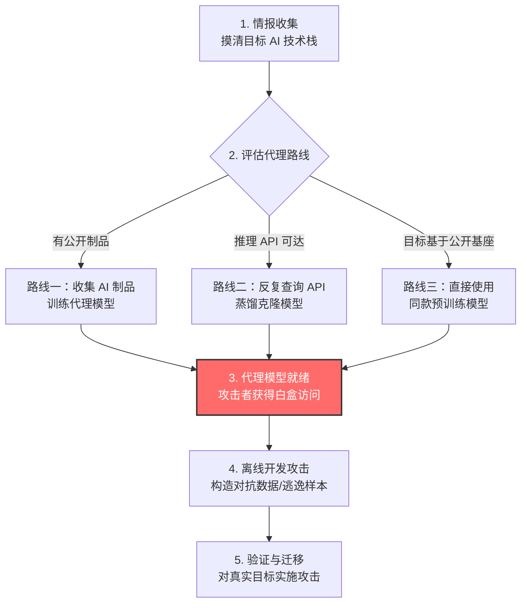

# 创建代理 AI 模型 (AML.T0005)

## 一句话通俗理解

> 攻击者搞不到银行金库的钥匙，就用纸板照着造了一个一模一样的金库——先在自家假金库上把开锁手法练到万无一失，再上门实战。代理模型就是目标 AI 模型的"高仿替身"，让攻击者能在离线环境里随意拆解、反复试错，而不用惊动真正的目标。

## 难度等级

**官方成熟度：Demonstrated（已演示）⭐⭐**

依据 MITRE ATLAS 官方数据，本技术主级评为 Demonstrated：攻击方法已在研究与红队演练中得到完整演示（见真实案例），但尚无公开的恶意组织在野利用报告。三个子技术中，收集 AI 产物训练代理（AML.T0005.000）与复制推理 API 训练代理（AML.T0005.001）同为 Demonstrated，使用预训练模型（AML.T0005.002）为 Feasible（⭐）。

**难度构成：**

- **前置情报门槛：中等**——需要先摸清目标 AI 技术栈（模型类型、任务、公开制品情况），依赖侦察与公开制品收集的成果。
- **技术门槛：较高**——需要机器学习工程能力：数据集构建、模型训练/微调、超参调优，以及评估克隆相似度的方法。
- **资源门槛：视路线差异大**——"使用预训练模型"几乎零成本；"复制推理 API"则可能需要数十万甚至更多次查询与可观算力。
- **隐蔽性门槛：中等**——复制路线会在受害者推理 API 上留下大量模式化查询痕迹；另两条路线完全不接触目标，天然隐蔽。

**适用平台**（官方数据）：预测式 AI、生成式 AI、智能体 AI

## 技术描述

### 通俗解释

很多组织把 AI 模型当作核心资产严格保护：模型权重不公开、推理服务有配额、访问全部留痕。攻击者想研究这类模型的弱点，直接对着真目标"练手"代价很高——查询要花钱、有速率限制、异常行为还会触发告警。

于是攻击者换了个思路：**造一个尽量像的替身**。就像想破解保险柜的小偷买一台同款保险柜回家慢慢练——练熟了手法，真保险柜上一次就开。只要替身和目标模型的行为足够接近，在替身上打磨出的攻击手法（对抗样本、逃逸输入等）就有很大概率在真目标上同样生效。

获取替身有三条路线：用公开渠道收集的代表性 AI 制品自己训一个；反复查询目标的推理接口，把返回结果当"标准答案"蒸馏出一个克隆；或者干脆直接拿现成的公开预训练模型当替身用。

### 技术原理

代理模型（proxy model）的核心价值在于**把黑盒问题变成白盒问题**：

1. **访问层级提升**：对真实目标，攻击者往往只有黑盒访问（只能提交输入、观察输出）。而代理模型完全在攻击者手中——权重、梯度、架构、训练数据全部可见，可以运行任何需要内部信息的攻击算法（如基于梯度的对抗样本优化）。
2. **离线无限试错**：对代理模型的查询不花钱、不限速、不留痕，攻击者可以大规模并行实验，把攻击成本从"按次计费的在线试探"压缩为"一次性的离线计算"。
3. **迁移性（transferability）**：神经网络对抗扰动的可迁移性是本技术的理论基石——在一个模型上有效的对抗样本，对另一个架构不同但任务相同的模型往往也有效。代理模型与目标模型越相似，迁移成功率越高。

三条获取路线的原理差异：

- **制品训练路线**：利用论文、公开数据集、开源模型等与目标"同源"或"同类"的制品，训练一个与目标性能相仿的模型。相似度取决于制品的代表性。
- **API 复制路线**：将查询输入与目标推理 API 的返回结果构造成"输入-标签"数据集，用知识蒸馏式训练复刻目标行为——本质是模型提取（model extraction）攻击的武器化应用。
- **预训练模型路线**：目标若基于公开基座模型微调而来，直接下载同款基座（或近似基座）即可获得相当接近的替身，成本几乎为零。

### 用途影响

代理模型本身不直接造成破坏，它是**攻击流水线的"工作台"**，服务于后续技术：

- **构造对抗数据（AML.T0043）**：在代理上离线优化对抗样本，再迁移到真实目标。
- **规避 AI 模型（AML.T0015）**：让恶意内容骗过目标组织的 ML 检测器（垃圾邮件过滤、恶意软件检测、内容审核等）。
- **验证攻击（AML.T0042）**：在代理上预演，确认手法有效后再对真实目标出手，最小化暴露。
- **通过 AI 推理 API 渗漏（AML.T0024）**：复刻过程收集的海量查询-响应对本身可能泄露模型功能，克隆模型更是对目标模型知识产权的直接窃取——受害者失去的不仅是防御，还有昂贵的模型资产。

对受害者的影响：安全控制被绕过（恶意邮件、恶意软件穿透 ML 防线）、模型 IP 被功能性窃取、攻击者获得不对称优势（防御方不知道攻击者掌握了多少模型行为知识）。

## 子技术列表

| 子技术ID | 中文名称 | 官方成熟度 | 一句话理解 |
|----------|----------|:----------:|------------|
| [AML.T0005.000](AML.T0005/AML.T0005.000-Collect-Artifacts-to-Train-Proxy.md) | 收集 AI 产物训练代理 | Demonstrated ⭐⭐ | 用公开收集的数据集、模型架构、预训练模型等代表性制品，自己训一个"同款"替身 |
| [AML.T0005.001](AML.T0005/AML.T0005.001-Copy-Inference-API-to-Train-Proxy.md) | 复制推理 API 训练代理 | Demonstrated ⭐⭐ | 反复查询受害者的推理 API，把返回结果当训练标签，"蒸馏"出行为一致的克隆模型 |
| [AML.T0005.002](AML.T0005/AML.T0005.002-Use-Pre-Trained-Model.md) | 使用预训练模型 | Feasible ⭐ | 直接下载公开的现成预训练模型当替身，零成本起步 |

> 注：以上 3 个子技术文档均已完成，点击 ID 直达对应文档。

## 攻击流程

### 典型攻击流程



**步骤详解：**

1. **情报收集**
   - 通俗描述：搞清楚目标用了什么 AI——什么任务、什么模型、哪些信息公开可得。
   - 技术细节：通过[搜索开放技术数据库](../01-Reconnaissance/AML.T0000-Search-Open-Technical-Databases.md)（论文、预印本）与[获取公开 AI 制品](../02-Resource-Development/AML.T0002-Acquire-Public-AI-Artifacts.md)（[数据集](../02-Resource-Development/AML.T0002/AML.T0002.000-Datasets.md)、[模型](../02-Resource-Development/AML.T0002/AML.T0002.001-Models.md)），拼出目标技术栈的画像。

2. **评估代理路线**
   - 通俗描述：三条路里挑最划算的——有公开制品就自己训，API 够不着或太贵就找公开基座。
   - 技术细节：权衡相似度需求、查询预算、算力成本与暴露风险。目标基于开源基座微调时，路线三成本趋近于零。

3. **获取/训练代理模型**
   - 通俗描述：把替身造出来。
   - 技术细节：制品路线用代表性数据集复现论文模型；复制路线构造查询集批量调用推理 API（对应 AML.T0040 AI 模型推理 API 访问），以返回结果为标签做蒸馏训练，直到克隆模型与目标行为一致性达标。

4. **离线开发攻击**
   - 通俗描述：在自家替身上放开手脚地"拆解"——想怎么试就怎么试。
   - 技术细节：利用白盒访问执行梯度优化，构造对抗数据（AML.T0043），迭代直到替身稳定失效；期间对真实目标的查询次数压到最低。

5. **验证与迁移**
   - 通俗描述：手法练熟后，先用极少量真实请求"抽查"有效性，再正式实施。
   - 技术细节：借助对抗样本迁移性，把离线优化结果投放到真实目标，实现规避 AI 模型（AML.T0015）；也可先用验证攻击（AML.T0042）确认再扩大战果。

**与后续战术的衔接：**

- → **构造对抗数据（AML.T0043）**：代理模型是黑盒迁移路线（对抗样本在替身上制造、向目标迁移）的前提设施。
- → **验证攻击（AML.T0042）**：代理上"彩排"成功的手法，只需少量真实查询即可确认。
- → **规避 AI 模型（AML.T0015）**：最终在真实目标上兑现攻击效果。
- → **通过 AI 推理 API 渗漏（AML.T0024）**：复制路线积累的查询-响应对与克隆模型本身构成对模型资产的窃取。

> 关键差异：与直接攻击目标模型相比，创建代理模型把攻击的主战场从受害者的在线服务转移到了攻击者的离线环境——受害者只能看到"冰山一角"（少量验证查询），无法观测到真正的攻击开发过程；防御重心因此必须前移到"减少可泄露的制品与信息"和"让 API 复制变得又贵又慢"。

## 真实案例

> 以下精选 4 个代表性案例，全部源自 MITRE ATLAS 案例库（AML.CS 编号为纯文本标注）。

### 案例1：GPT-2 模型复刻（2019，AML.T0005.000）

- **时间**：2019 年 8 月
- **攻击者**：布朗大学研究人员（白帽演示）
- **目标**：OpenAI GPT-2
- **手法**：OpenAI 担心 GPT-2 被滥用于造假新闻与冒充他人，采取分级发布策略——先放出较小模型与技术报告，暂扣完整模型。研究人员仅凭已发布的公开信息与开源 ML 制品，就在官方完整版发布前成功复刻出 GPT-2。
- **影响**：证明"暂缓发布"策略的时效有限——任何具备足够技术能力与算力的恶意行为者，都可以在 AI 安全社区做好准备之前完成复刻并用于有害目的。这是"收集 AI 产物训练代理"路线的经典演示。
- **参考链接**：
  - [Wired: OpenAI Said Its Code Was Risky. Two Grads Re-Created It Anyway](https://www.wired.com/story/dangerous-ai-open-source/)
  - [OpenGPT-2: We Replicated GPT-2 Because You Can Too](https://blog.usejournal.com/opengpt-2-we-replicated-gpt-2-because-you-can-too-45e34e6d36dc)

### 案例2：机器翻译服务克隆与对抗迁移（2020，AML.T0005.001）

- **时间**：2020 年 4 月
- **攻击者**：UC 伯克利人工智能研究团队（BAIR，白帽研究）
- **目标**：Google 翻译、Bing 翻译、Systran 翻译
- **手法**：利用三家翻译服务的公开网页端点与 API，批量查询并收集翻译结果，训练出质量接近生产水平的克隆模型；随后在克隆模型上构造对抗输入，并将其迁移到真实生产服务上。
- **影响**：一方面证明了黑盒系统也能被"功能性窃取"知识产权；另一方面对抗输入成功让 Google 与 Systran 的线上翻译出现定向替换词、输出低俗内容、整句丢失等错误——克隆模型 + 对抗样本迁移的完整攻击链实战演示。
- **参考链接**：
  - [Wallace et al., Imitation Attacks and Defenses for Black-box Machine Translation Systems (EMNLP 2020)](https://arxiv.org/abs/2004.15015)
  - [项目主页：Imitation Attacks](https://www.ericswallace.com/imitation)
  - [The Hill: Google under fire for mistranslating Chinese](https://thehill.com/policy/international/asia-pacific/449164-google-under-fire-for-mistranslating-chinese-amid-hong-kong/)

### 案例3：ProofPoint 邮件防护系统规避（2019，AML.T0005.001）

- **时间**：2019 年 9 月
- **攻击者**：Silent Break Security 研究人员（红队演练）
- **目标**：ProofPoint 企业邮件防护系统
- **手法**：研究人员先构建一个模仿 ProofPoint 邮件评分逻辑的"山寨"模型（该系统对邮件中每个词按多变量数值打分，总分过低即判为垃圾邮件），在山寨模型上摸清评分规律，据此精心构造能拿到"优待分数"的恶意邮件，最终绕过线上真实系统。
- **影响**：即 CVE-2019-20634（Proof Pudding）。展示了对商业 ML 安全产品先克隆、后 bypass 的标准红队打法——攻击者全程无需接触目标内部权重。
- **参考链接**：
  - [NVD: CVE-2019-20634](https://nvd.nist.gov/vuln/detail/CVE-2019-20634)
  - [DerbyCon 19 演讲 slides](https://github.com/moohax/Talks/blob/master/slides/DerbyCon19.pdf)
  - [Proof Pudding 复现仓库](https://github.com/moohax/Proof-Pudding)
  - [DerbyCon 演讲视频](https://www.youtube.com/watch?v=CsvkYoxtexQ&ab-channel=AdrianCrenshaw)

### 案例4：恶意软件 C&C 流量检测器规避（2020，AML.T0005）

- **时间**：2020 年
- **攻击者**：Palo Alto Networks 安全 AI 研究团队（自检演练）
- **目标**：自家部署于 HTTP 流量分析的恶意软件 C&C 深度学习检测器
- **手法**：基于 Le 等人的 URLNet 公开论文，用与生产模型相似的公开数据集训练了一个性能相仿的代理模型；随后在代理上构造对抗样本、查询、调整，循环迭代直到模型被成功欺骗。
- **影响**：厂商自证了代理模型攻击闭环的可行性——攻击者根本不需要拿到生产模型本身，基于公开论文与同类数据就能练出有效的逃逸样本。为防御方提供了"以攻促防"的范式。
- **参考链接**：
  - [Le et al., URLNet (arXiv:1802.03162)](https://arxiv.org/abs/1802.03162)

## 红队视角

> ⚠️ **免责声明**：本节内容仅用于授权渗透测试与防御研究。未经书面授权对他人 AI 系统实施上述行为均属违法。

### 实战技巧

1. **先画像后动手**：优先从[搜索开放 AI 漏洞分析](../01-Reconnaissance/AML.T0001-Search-Open-AI-Vulnerability-Analysis.md)入手，确认目标是否发表过相关论文、是否使用开源基座——多数商业 ML 服务的"血缘"都能从论文、招聘启事、技术博客里拼出来。
2. **制品路线省预算**：目标发过论文时，按论文复现通常比 API 复制便宜一个数量级；先复现、再用少量真实查询校准行为差异。
3. **复制路线做"查询集设计"**：随机查询浪费配额且克隆质量差。用高覆盖、高信息量的种子集（如公开评测集、目标业务领域的典型输入），让每次查询的"标签价值"最大化。
4. **相似度评估要双语义**：不要只看整体准确率——克隆模型与目标在**决策边界附近**的行为一致性，才决定对抗样本能不能迁移。
5. **控制真实查询的"热身曲线"**：对真实目标的直接查询（校准、验证）应模拟正常用户节奏，避免均匀高频——那是蓝队最显眼的信号。
6. **善用免费额度经济**：多云厂商的免费试用、匿名额度可用于分摊复制成本，但也意味着蓝队要按设备/租户维度做限速（见缓解措施 AML.M0004）。

### 常用工具

| 工具名称 | 用途 | 平台 |
|----------|------|------|
| Adversarial Robustness Toolbox (ART) | 对抗样本生成/迁移评估、模型提取攻击实现 | Python |
| TextAttack | NLP 模型对抗攻击与克隆质量评测 | Python |
| CleverHans | 经典对抗样本库，支持白盒优化 | Python |
| Foolbox | 黑盒/白盒对抗攻击统一接口 | Python |
| Hugging Face Transformers | 获取预训练基座模型（路线三的"军火库"） | Python |

### 注意事项

- **克隆相似度有天花板**：API 复制永远拿不到目标的"难例边界"全貌，迁移成功率不是 100%——为失败样本准备人工修改兜底（对应 AML.T0043.003 人工修改路线）。
- **留意服务条款与法律边界**：批量查询商业 API 普遍违反 ToS；授权范围内也要评估对目标服务的实际负载影响。
- **别在报告里只给"成功率"**：交付物应包含克隆方法、查询量、迁移率、以及对应的防御建议——红队的价值是让蓝队看懂风险。
- **算力也是暴露面**：大规模训练任务的 GPU 租用记录、公开的模型仓库 commit，都可能让防御方反向定位到攻击准备工作。

## 蓝队视角

### 检测要点

1. **推理 API 的异常查询模式**
   - 日志来源：API 网关、推理服务访问日志
   - 关注字段：调用方身份、QPS、输入分布、返回码
   - 异常特征：单一身份持续高频查询；输入呈"网格/采样"式分布（如均匀采样的合成样本、评测集片段）；单输入多参数变体（温度、top_k 反复变化）。
2. **账号行为与限速规避**
   - 日志来源：IAM、风控系统
   - 关注字段：同源 IP 段、设备指纹、注册时间聚集
   - 异常特征：批量新账号以相似模式调用；分布式低频请求叠加超常总量（规避速率限制的典型手法）。
3. **公开制品泄露面盘点**
   - 日志来源：代码仓库审计、论文/技术博客发布流程
   - 关注字段：仓库中的 checkpoint、数据集、训练配置
   - 异常特征：生产代表性制品出现在公开仓库；论文披露的架构/数据细节与生产高度一致。
4. **模型行为漂移监控**
   - 日志来源：模型服务遥测（输入-输出对采样）
   - 关注字段：输出分布、置信度分布、决策边界附近的翻转率
   - 异常特征：线上模型与已知克隆候选行为高度一致的外部情报（如出现功能雷同的"套壳"服务）。

### 监控建议

- 对推理 API 按"用户/API Key/租户/设备"四维建立速率与配额基线，异常即告警（对应 AML.M0004）。
- 落地 AI 遥测日志（AML.M0024）：留存推理输入输出的抽样、调用身份与中间步骤，为事后溯源保留证据。
- 定期做"代理攻击红蓝对抗"：用公开制品自建代理并尝试攻击生产模型，量化自家"可克隆度"，反向校准防御投入。
- 建立制品发布审批流程：生产相关数据、架构、checkpoint 的对外发布需安全评审（对应 AML.M0000/M0001）。
- 关注学术渠道：目标相关论文发表后，评估其披露信息对代理攻击的助益，必要时调整线上模型或输出精度。

## 检测建议

### 网络层检测

- 监测对推理端点的请求速率突增与长时持续的规律性调用（低频长跑同样可疑）。
- 识别查询内容的"合成感"：均匀分布的 token 长度、编码后的随机串、已知公开数据集片段的特征哈希。
- 关联多源 IP / 多账号访问同一模型的协同模式（限速规避）。

### 主机层检测

- 监控内部模型服务被异常高频调用的进程与任务；离线批量推理作业（绕过线上 API 直连模型文件）应有审批与审计。
- 检测开发机/训练集群上出现与生产模型同名或哈希近似的 checkpoint 文件。
- 云端：审计 GPU 训练任务的规模与时长，识别与"克隆训练"特征匹配的算力消耗。

### 应用层检测（AI 遥测）

- 推理服务输出侧：统计每个调用方的输出熵与置信度分布——克隆式采集者的查询往往刻意覆盖高熵区域。
- 部署模型水印/指纹：嵌入可验证的输入-输出签名，用于事后证明克隆关系。
- 输出精度管控：对外仅返回业务必需的字段（如只给 top-1 标签，不给 logits/完整排名），直接提高克隆与黑盒优化难度（对应 AML.M0002）。

**程序化检测思路：**

- 伪代码逻辑：对每个 (identity, model) 二元组滚动窗口统计 `query_rate`、`input_entropy`、`distinct_input_ratio`；当三者同时越限（高频 + 高熵 + 高去重比）持续 N 个窗口，触发"疑似模型复制"事件并关联该身份近 7 日的新账号注册数。
- 关键在于**组合判定**：单独的速率异常可能是正常压测，单独的输入多样性高可能是真实业务；三者叠加才指向系统性采集。

### Sigma 规则思路示例

```yaml
title: 推理 API 疑似批量克隆式查询
id: 自定义生成
status: experimental
description: 检测单一身份在短时间内对 AI 推理端点发起异常高频、高多样性的查询，
    符合代理模型复制（AML.T0005.001）的采集特征
logsource:
    category: proxy
    product: web_proxy
detection:
    selection:
        url|contains: '/v1/models/'
        http_method: 'POST'
    filter_valid:
        - user_agent|contains: 'official-sdk'
    condition: selection and not filter_valid
    timeframe: 5m
falsepositives:
    - 合法压测与评测平台
    - 官方 SDK 批量推理任务
level: medium
tags:
    - atlas.aml_t0005
```

> 说明：以上为思路示例。真实环境应结合 API 网关的结构化日志（含身份、QPS、输入摘要）实现组合判定，并以业务基线动态调参；网络代理日志只能看到"量"，看不到"多样性"，需应用层遥测补足。

## 缓解措施

### 优先级1：关键措施

**AML.M0002 预测式 AI 输出混淆（Predictive AI Output Obfuscation）**
降低推理端点返回信息的精度与数量：按应用实际需要裁剪输出，隐藏或降精度返回置信度、logits、类别排名、标签、嵌入向量及模型元数据。输出信息越"瘦"，克隆训练的标签质量越差，模型发现、提取、复制与黑盒优化全部变难。这是对复制路线（AML.T0005.001）最直接的釜底抽薪。

**AML.M0004 限制 AI 服务查询量与速率（Limit AI Service Query Volume and Rate）**
按用户、API Key、租户、设备等已认证身份限制请求数量与速率；短期速率/突发/并发限制叠加长期用量配额。查询限制抬升攻击者提取模型信息、优化对抗输入、验证攻击的时间与经济成本。同时监控分布式请求、账号轮换、盗用凭证等规避限速的手法。注意：对少量请求即可完成的攻击或纯离线模型无效。

### 优先级2：重要措施

**AML.M0019 生产环境 AI 模型与数据访问控制（Control Access to AI Models and Data in Production）**
访问生产模型前强制身份核验；API 端点全部要求认证；持续监控生产模型查询，确保符合使用策略、防止滥用。认证是限速与遥测发挥作用的前提——匿名可查的端点等于向全世界开放克隆原料。

**AML.M0024 AI 遥测日志（AI Telemetry Logging）**
记录已部署 AI 模型的输入与输出；部署 AI 智能体时，还需记录智能体动作与决策的中间步骤、数据访问、工具使用、安装命令与身份。完整遥测让复制行为可检测、可溯源；且日志的存在本身就会劝退意图隐蔽的攻击者。

### 优先级3：建议措施

**AML.M0000 限制公开信息发布（Limit Public Release of Information）**
限制公开组织 AI 技术栈的技术细节——攻击者会利用这些知识定位目标并定制攻击。同时评估组织信息（办公地点、研究员姓名、部门结构）的公开范围，这些信息可被用来推断 AI 技术、模型架构或数据集。

**AML.M0001 限制模型制品发布（Limit Model Artifact Release）**
限制公开披露与生产相关或具生产代表性的数据、算法、模型架构与模型 checkpoint。直接压缩"制品训练路线"（AML.T0005.000）与"预训练模型路线"（AML.T0005.002）的原料供给。

### MITRE ATLAS 缓解措施映射

| 缓解措施ID | 缓解措施名称 | 优先级 | 类别 | 生命周期阶段 |
|------------|--------------|:------:|------|--------------|
| AML.M0002 | 预测式 AI 输出混淆 | 关键 | Technical - AI | AI 模型评估、部署 |
| AML.M0004 | 限制 AI 服务查询量与速率 | 关键 | Technical - Cyber | 业务与数据理解、部署、监控维护 |
| AML.M0019 | 生产环境 AI 模型与数据访问控制 | 重要 | Policy | 部署、监控维护 |
| AML.M0024 | AI 遥测日志 | 重要 | Technical - Cyber | 部署、监控维护 |
| AML.M0000 | 限制公开信息发布 | 建议 | Policy | 业务与数据理解 |
| AML.M0001 | 限制模型制品发布 | 建议 | Policy | 业务与数据理解、部署 |

> 注：优先级为本库基于攻击路径给出的实施分级（关键=直接抬高复制成本、重要=提供检测可见性、建议=收缩原料供给），官方 ATLAS 数据不含优先级排序。

## 关联 ATT&CK 技术

**官方未建立 AML.T0005 与 ATT&CK 技术的正式映射**（本技术在 ATLAS 数据中的 ATT&CK-reference 为空）。以下是本库给出的主题性对照，供学习参考：

| 维度 | ATT&CK 中的近亲 | AML.T0005 的独特性 |
|------|-----------------|---------------------|
| 作战准备思想 | T1588 获取能力（[获取能力](../../enterprise/02-Resource-Development/T1588-Obtain-Capabilities.md)）/ T1587 开发能力 | ATT&CK 的"能力"是漏洞、工具、证书；AML.T0005 获取的是目标系统的**行为镜像** |
| 情报输入 | 侦察战术下的信息收集技术 | 输入是 AI 制品（数据集、架构、论文、checkpoint），传统框架没有这类资产类别 |
| 复制目标 | 凭证/会话的复制（如哈希传递的"复制材质"思想） | 复制的是**决策逻辑**——一种不可更换密码的活资产；泄露后无法像轮换密码那样简单止损 |
| 与供应链关系 | T1195 供应链妥协 | 方向相反：供应链攻击污染**输入**，代理模型攻击**读取输出反推内部** |

一句话总结：AML.T0005 是"把黑盒目标搬回家"的技术——传统 ATT&CK 攻击者偷凭证、偷数据，AI 时代的攻击者还能偷走模型的"大脑切片"。

## 动手实验

> ⚠️ **重要提示**：以下实验仅限自有环境与授权测试。复刻他人商业模型即构成侵权，批量查询他人 API 违反服务条款。

### 实验环境准备

| 环境组件 | 用途 | 获取方式 |
|----------|------|----------|
| Python 3.10+ | 实验主语言 | python.org |
| PyTorch / TensorFlow | 训练目标模型与代理模型 | pip 安装 |
| Adversarial Robustness Toolbox | 对抗样本生成与迁移评估 | `pip install adversarial-robustness-toolbox` |
| torchvision（MNIST/CIFAR-10） | 目标与代理共用任务域 | 随 PyTorch 安装 |
| 一块 GPU（或 Colab 免费额度） | 加速训练 | 本地 / Google Colab |

### 实验1（初级）：预训练模型当替身

- **实验目标**：体验路线三——用公开预训练模型逼近自有目标。
- **实验步骤**：
  1. 在本地用 MNIST 训练一个"目标模型"（模拟受害者资产），只暴露 predict 接口。
  2. 不看目标任何内部信息，直接加载 torchvision 预训练的 MNIST 类模型作为代理。
  3. 在测试集上对比代理与目标的预测一致率。
- **预期结果**：同任务域的公开模型与自训目标的一致率明显随架构/数据相似度上升，直观理解"代表性"的含义。

### 实验2（中级）：复刻自己的目标模型

- **实验目标**：体验路线二——通过推理 API 蒸馏克隆模型。
- **实验步骤**：
  1. 给实验 1 的目标模型包一层 HTTP 推理 API（如 FastAPI），仅返回 top-1 标签。
  2. 编写客户端：生成/采样约 1 万条输入，查询 API 收集"输入-标签"对。
  3. 用该数据集训练克隆模型，测量与目标的一致率；再增大查询量到 5 万，观察一致率提升曲线。
- **预期结果**：克隆一致率随查询量上升而上升、但边际收益递减；体会查询预算与克隆质量的权衡。

### 实验3（高级）：代理上的对抗攻击与迁移

- **实验目标**：完成完整闭环——代理模型 → 对抗样本 → 迁移到目标。
- **实验步骤**：
  1. 以实验 2 的克隆模型为白盒代理，用 ART 生成 FGSM/PGD 对抗样本（目标：让代理误分类）。
  2. 将对抗样本直接提交目标 API，记录迁移攻击成功率。
  3. 对比：直接黑盒试探（不用代理）达到同样成功率需要多少次真实查询。
- **预期结果**：代理上优化的对抗样本在目标上有可观迁移率；离线优化 + 少量真实查询的成本远低于纯在线黑盒试探——这正是 AML.T0005 存在的意义。

## 术语解释

| 术语 | 英文原名 | 通俗解释 |
|------|----------|----------|
| 代理模型 | Proxy Model | 攻击者构建的目标模型"高仿替身"，用于离线研究目标弱点 |
| 模型提取 / 克隆 | Model Extraction / Replication | 通过反复查询目标模型，用返回结果训练出行为一致的副本 |
| 知识蒸馏 | Knowledge Distillation | 用"教师"模型的输出监督训练"学生"模型——克隆攻击滥用了这一技术 |
| 推理 API | Inference API | 模型对外提供预测服务的接口，克隆攻击的"原料渠道" |
| AI 制品 | AI Artifacts | 数据集、模型架构、checkpoint、论文等技术产物 |
| 预训练模型 | Pre-trained Model | 已在海量数据上训练过、可公开下载的现成模型 |
| 对抗样本 | Adversarial Example | 人眼几乎无感、却能骗过模型的特殊构造输入 |
| 对抗数据 | Adversarial Data | 对抗样本及相关扰动数据的统称 |
| 迁移性 | Transferability | 在 A 模型上有效的对抗样本对 B 模型也有效的现象，代理攻击的立足点 |
| 白盒 / 黑盒访问 | White-box / Black-box Access | 白盒=能看到模型内部（权重梯度）；黑盒=只能提交输入看输出 |
| 置信度 / logits | Confidence / Logits | 模型对预测结果的"把握程度"数值；泄露过多会加速克隆 |
| AI 智能体 | AI Agent | 能自主感知、决策、调用工具完成任务的 AI 系统 |
| 提示词注入 | Prompt Injection | 在输入中夹带恶意指令劫持 LLM 行为的攻击（与代理模型同属 AI 攻击适配战术的产出手段） |
| 供应链 | Supply Chain | 模型/数据从开发到部署的流转链条；制品泄露是 AI 供应链的风险面 |

## 参考资料

### 📚 官方文档

- [MITRE ATLAS - Create Proxy AI Model (AML.T0005)](https://atlas.mitre.org/techniques/AML.T0005/) - 本技术官方页面
- [MITRE ATLAS 矩阵](https://atlas.mitre.org/) - AI/ML 对抗威胁全景矩阵
- [MITRE ATLAS Data (GitHub)](https://github.com/mitre-atlas/atlas-data) - ATLAS 官方 STIX/JSON 数据仓库

### 📰 案例报告（真实攻击与安全研究）

- [Wallace et al., Imitation Attacks and Defenses for Black-box Machine Translation Systems (EMNLP 2020)](https://arxiv.org/abs/2004.15015) - 机器翻译克隆与对抗迁移（AML.CS0005）
- [Wired: OpenAI Said Its Code Was Risky. Two Grads Re-Created It Anyway](https://www.wired.com/story/dangerous-ai-open-source/) - GPT-2 复刻事件（AML.CS0007）
- [NVD: CVE-2019-20634 Proof Pudding](https://nvd.nist.gov/vuln/detail/CVE-2019-20634) - ProofPoint 克隆规避（AML.CS0008）
- [Le et al., URLNet (arXiv:1802.03162)](https://arxiv.org/abs/1802.03162) - C&C 检测器规避实验的复现基础（AML.CS0000）
- [Kaspersky Securelist: How to confuse antimalware neural networks](https://securelist.com/how-to-confuse-antimalware-neural-networks-adversarial-attacks-and-protection/102949/) - 灰盒对抗攻击研究（AML.CS0014）

### 🔧 工具与资源

- [Adversarial Robustness Toolbox (ART)](https://github.com/Trusted-AI/adversarial-robustness-toolbox) - IBM 开源对抗 ML 工具箱（攻击/防御/评估）
- [TextAttack](https://github.com/QData/TextAttack) - NLP 对抗攻击框架
- [CleverHans](https://github.com/cleverhans-lab/cleverhans) - 经典对抗样本研究库
- [Foolbox](https://github.com/bethgelab/foolbox) - 对抗攻击统一接口库
- [OWASP Top 10 for LLM Applications](https://owasp.org/www-project-top-10-for-large-language-model-applications/) - LLM 应用安全风险清单
- [NIST AI Risk Management Framework](https://www.nist.gov/itl/ai-risk-management-framework) - AI 风险管理框架

### 🔗 关联阅读

- [AI 攻击适配战术概览](./README.md) - 本技术所属战术（AML.TA0001）总览
- [获取公开 AI 制品](../02-Resource-Development/AML.T0002-Acquire-Public-AI-Artifacts.md) - 制品训练路线的上游情报活动
- [获取公开 AI 制品·数据集](../02-Resource-Development/AML.T0002/AML.T0002.000-Datasets.md) / [获取公开 AI 制品·模型](../02-Resource-Development/AML.T0002/AML.T0002.001-Models.md) - 两类关键克隆原料
- [搜索开放技术数据库](../01-Reconnaissance/AML.T0000-Search-Open-Technical-Databases.md) - 论文侦察入口（含[预印本仓库](../01-Reconnaissance/AML.T0000/AML.T0000.001-Pre-Print-Repositories.md)）
- [获取能力](../02-Resource-Development/AML.T0016-Obtain-Capabilities.md) / [开发能力](../02-Resource-Development/AML.T0017-Develop-Capabilities.md) - 与本技术构成"备料→适配"衔接的资源开发战术

---

> **版本**: ATLAS 2026.09 | **更新**: 2026-10-22 | **模板**: ATLAS 技术文档 v1.0
