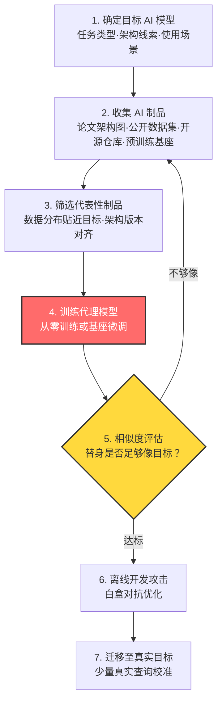

# 收集 AI 产物训练代理 (AML.T0005.000)

> 属于 [创建代理 AI 模型 (AML.T0005)](../AML.T0005-Create-Proxy-AI-Model.md)

## 一句话通俗理解

> 想开一把别人家的保险柜，不必撬锁也不用偷钥匙——只要把柜子厂商公开的设计图、图纸批注和废料收集齐，自己在家照着复刻一个同款柜子，天天练开锁。练到闭眼都能开，再上门动真柜子。攻击者收集目标 AI 模型"练棋用的公开棋谱"，自己训一个高仿替身，就是这个道理。

## 难度等级

**官方成熟度：Demonstrated（已演示）⭐⭐**

依据 MITRE ATLAS 官方数据，本子技术（AML.T0005.000）评为 Demonstrated：攻击方法已在研究与红队演练中完整演示（见真实案例 AML.CS0007），但尚无公开的恶意组织在野利用报告。

**难度构成：**

- **情报门槛：中等偏高**——需要先判断"目标用了什么"，再从海量公开材料中筛出真正能用于训练的代表性制品。收集的质量直接决定替身的像不像。
- **技术门槛：较高**——需要完整的机器学习工程能力：数据集清洗、架构选型、训练调参、相似度评估。复现论文与复现生产模型之间，往往隔着大量论文里没写的工程细节。
- **资源门槛：视目标规模而定**——复现一个小型分类器只需一块显卡；复现大语言模型则需要数千 GPU 小时的算力预算。
- **隐蔽性门槛：极低（对攻击者最友好）**——收集公开制品与训练都在攻击者自己的环境里完成，对目标系统零交互、零日志、零告警。这也是它相对兄弟技术最突出的优势。

## 技术描述

### 通俗解释

父技术 [创建代理 AI 模型 (AML.T0005)](../AML.T0005-Create-Proxy-AI-Model.md) 讲的是"造一个高仿替身"，本子技术解答的是其中最基础的一问：**替身的原料从哪来？**

答案是：**从目标自己公开发布出去的东西里捡。** 研究论文里画了模型架构图，公开数据集里就有它的训练样本，开源仓库里有它的实现代码，模型托管平台上有它的近似版本。攻击者把这些"目标的公开副产品"拼在一起，就像用拼图碎块还原出目标模型的轮廓——然后按这个轮廓训练一个行为相近的替身。

类比一下：这不是"翻墙进目标仓库偷配方"，而是"把目标贴在官网上的配方海报、发表在期刊上的工艺说明、以及丢掉的产品次品统统收回来，在家复刻一道八九不离十的菜"。目标什么都没被入侵，但它的"味道"已经被复刻了。

### 技术原理

依据官方描述，代理模型可基于攻击者收集的、对目标模型具代表性的 AI 制品（数据、模型架构、预训练模型等）训练而成。三类核心原料：

1. **数据（数据集）**：目标模型的任务域决定了它需要什么样的训练数据。攻击者优先寻找目标引用过的公开数据集、同任务的公开基准集、或从目标业务描述中推断出的同类数据分布。数据越贴近目标的真实输入分布，替身在决策边界上的行为就越像。
2. **模型架构**：论文、技术报告、开源仓库中的架构图与超参数是复现的"施工图"。架构一致意味着替身与目标共享同样的归纳偏置——这是对抗样本可迁移性的重要前提。
3. **预训练模型**：目标若基于公开基座模型微调（这在行业中极为常见），那么同款或近款基座本身就是最好的起点。攻击者可在此基础上用收集的数据做同任务微调，用极小的算力逼近目标。

**核心机制：为什么"用公开制品训练"能逼近目标？**

- **同源假设**：组织普遍采用"开源架构 + 专有数据"的路线。架构公开、数据虽专有但任务域公开可推测——两侧都可得近似，复现就只剩工程问题。
- **可迁移性（transferability）**：在架构相同、任务相同的模型上优化的对抗扰动，对目标往往同样有效。替身不必与目标逐位一致，只需"足够像"。
- **白盒优势**：替身在攻击者手里——权重、梯度、中间层激活全部可见，可以运行任何依赖内部信息的攻击算法。这是对目标黑盒访问永远得不到的能力。

**与兄弟子技术的严格分工：**

| 维度 | AML.T0005.000 收集产物训练（本子技术） | AML.T0005.001 复制推理 API 训练 | AML.T0005.002 使用预训练模型 |
|------|----------------------------------------|--------------------------------|------------------------------|
| 原料来源 | 公开的论文、数据集、架构、开源检查点 | 反复查询目标推理 API 得到的输入-输出对 | 公开可下载的现成模型 |
| 是否接触目标 | **完全不接触** | 高频接触，留下大量查询痕迹 | 完全不接触 |
| 需不需要训练 | **需要**（从零训练或微调） | 需要（蒸馏训练） | 不需要（直接用或轻微微调） |
| 算力成本 | 中到高 | 中（查询成本为主） | 极低 |
| 相似度上限 | 中（取决于制品代表性） | 高（直接对标目标行为） | 低到中（取决于基座是否同款） |
| 核心难点 | 判断哪些公开材料真正"代表性" | 设计高信息量查询集、规避限速 | 确认目标基座身份 |

### 用途影响

代理模型本身不直接造成破坏，它是**攻击流水线的离线试炼场**，服务于后续技术：

- **构造对抗数据**：在替身上运行大规模梯度优化构造对抗样本，再利用迁移性投放至真实目标——垃圾邮件过滤、恶意软件检测、内容审核等 ML 防线都是打击对象。
- **验证攻击**：在替身上预演完整攻击链，确认手法可靠后再对真实目标出手，把真实交互次数压到最低。
- **开发高访问层级攻击**：许多攻击算法（如基于梯度的白盒优化）要求内部访问权限，目标系统根本不提供。替身凭空为攻击者补齐了这一层能力。

对防守方的影响：防线被绕过而难以归因——攻击者从未在你的系统上留下明显的攻击开发痕迹；模型知识产权被"功能性复刻"；攻击者获得了"你的模型弱点"这一不对称信息优势。

## 攻击流程

### 典型攻击流程



**步骤详解：**

1. **确定目标 AI 模型**
   - 通俗描述：先搞清楚对方到底用了什么——什么任务、什么架构、什么场景。
   - 技术细节：从目标的产品说明、技术博客、论文、招聘启事推断模型任务与架构家族；确定是自研、开源微调还是纯商用 API 封装。这一步的产物是"待复现模型清单"。

2. **收集 AI 制品**
   - 通俗描述：把目标"不小心"公开的原料统统捡回来。
   - 技术细节：论文/预印本中的架构图、超参数、训练数据构成描述；目标引用的公开数据集或同任务基准集；开源实现代码；公开的预训练基座模型。收集完做一份"原料-可得性-代表性"清单。

3. **筛选代表性制品**
   - 通俗描述：一堆原料里挑出真正像目标的那几份。
   - 技术细节：评估数据分布与目标任务域的接近度、架构版本是否对齐、预训练基座是否同源。代表性不足的制品会直接拉低替身的迁移攻击成功率，宁可花时间筛选，不要盲目堆量。

4. **训练代理模型**
   - 通俗描述：照着图纸把替身搭起来。
   - 技术细节：若已获得近似基座，则做同任务微调（成本最低）；否则按架构从零训练。训练目标不是"高准确率"，而是"与目标行为接近"——必要时可借助极少量真实查询做校准。

5. **相似度评估**
   - 通俗描述：检验替身到底像不像目标。
   - 技术细节：不止看整体准确率，更要看**决策边界附近**的行为一致性、以及对抗样本迁移率。相似度不达标就回到收集环节补料。这一步决定了整个攻击链的上限。

6. **离线开发攻击**
   - 通俗描述：在自家替身上随便拆、随便试。
   - 技术细节：利用替身的白盒访问执行梯度优化，迭代构造对抗数据，全程零目标交互。

7. **迁移至真实目标**
   - 通俗描述：手法练熟，上门试招。
   - 技术细节：将优化好的对抗样本投放到真实目标，用少量真实查询测量迁移成功率；必要时微调扰动，然后正式实施。

**与后续战术的衔接：**

- → **AI 攻击适配（AML.TA0001）**：代理模型就绪后，攻击者进入对抗数据的批量构造阶段。
- → **初始访问 / 执行**：以对抗数据骗过模型防线，或触发被污染的模型输出，为入侵开路。
- → **影响**：模型被规避或操纵导致业务判断错误，形成实质性影响。

> 关键差异：与"复制推理 API"（AML.T0005.001）不同，本子技术**全程不接触目标系统**——没有任何查询流量、没有异常行为、没有日志留痕。代价是相似度依赖公开制品的代表性，攻击者无法通过直接问答来校准；与"使用预训练模型"（AML.T0005.002）不同，本子技术**必须经过训练环节**，而非拿现成模型直接用。

## 真实案例

> 以下精选 3 个案例，均源自 MITRE ATLAS 案例库（AML.CS 编号为纯文本标注）。

### 案例1：GPT-2 模型复刻（2019，AML.CS0007）

- **时间**：2019 年 8 月
- **攻击者**：布朗大学研究人员（白帽演示）
- **目标**：OpenAI GPT-2
- **手法**：OpenAI 担心 GPT-2 被滥用于伪造新闻、冒充他人、制造垃圾内容，采取分级发布：先放出较弱的小版模型与完整技术描述，暂扣完整版权重。研究人员仅凭这批公开制品——技术描述、开源 ML 制品、小版模型——就在官方完整版放出前成功复刻出接近完整能力的模型。
- **影响**：AI 安全史上的标志性事件。它证明"暂缓发布权重、公开方法论"的策略防护时效有限——任何具备足够技术能力与算力的行为者，都能在社区做好准备前完成复刻。这正是本子技术的教科书级演示。
- **参考链接**：
  - [Wired: OpenAI Said Its Code Was Risky. Two Grads Re-Created It Anyway](https://www.wired.com/story/dangerous-ai-open-source/)
  - [OpenGPT-2: We Replicated GPT-2 Because You Can Too](https://blog.usejournal.com/opengpt-2-we-replicated-gpt-2-because-you-can-too-45e34e6d36dc)

### 案例2：恶意软件 C&C 流量检测器规避（2020，AML.CS0000）

- **时间**：2020 年
- **攻击者**：Palo Alto Networks 安全 AI 研究团队（厂商自检演练）
- **目标**：部署于 HTTP 流量分析的恶意软件 C&C 深度学习检测器
- **手法**：团队参照 Le 等人公开发表的 URLNet 论文，用与该生产模型"相似的数据集"训练了一个替代模型，并验证其性能与生产模型相当。随后在该代理模型上构造对抗样本、查询模型、根据反馈调整——循环迭代，直到模型被成功逃逸。
- **影响**：完整走通了"公开论文与方法 → 训练出性能相当的代理 → 迭代对抗样本"的闭环。值得注意的是，代理模型与生产模型的训练数据并非同一份，仅"相似"即可支撑攻击——这正体现了"代表性制品"的含义。
- **参考链接**：
  - [Le et al., URLNet: Learning a URL representation with deep learning for malicious URL detection (arXiv:1802.03162)](https://arxiv.org/abs/1802.03162)

### 案例3：混淆反恶意软件神经网络（2021，AML.CS0014）

- **时间**：2021 年 6 月
- **攻击者**：卡巴斯基 ML 研究团队（安全研究）
- **目标**：卡巴斯基反恶意软件 ML 模型
- **手法**：研究团队在**无白盒访问**的灰盒场景下考察该模型。由于模型特征在用户系统上构建后再送往厂商服务器，团队得以掌握特征层面的知识；凭借这份"代表性"认知，他们成功对大部分经对抗性修改的恶意软件文件实现了检测逃逸。
- **影响**：说明"代表性制品"不必是原始权重和数据集——**特征层面的知识同样是可以收集的制品**。只要对目标模型的输入表示理解到位，训练出的替身就足以支撑有效攻击。该研究亦公开了对应的防护思路。
- **参考链接**：
  - [Kaspersky Securelist: How to confuse antimalware neural networks. Adversarial attacks and protection](https://securelist.com/how-to-confuse-antimalware-neural-networks-adversarial-attacks-and-protection/102949/)

## 红队视角

> ⚠️ **免责声明**：本节内容仅用于授权渗透测试与防御研究。未经授权对他人 AI 系统实施上述行为均属违法。

### 实战技巧

1. **先做"制品可得性盘点"再动手**
   对目标列出三张清单：它的论文里说了什么架构？它训练用了哪类数据（哪怕只是方向）？是否有同源的公开基座？三张清单的重叠区就是最省力的攻击入口。

2. **用"同任务公开基准集"补数据缺口**
   拿不到目标原始训练数据是常态。找同任务、同语言、同业务域的公开数据集做近似——关键是**分布形状**贴近，而非样本逐条相同。

3. **优先"基座微调"而非"从零训练"**
   如果能确认目标基于某个公开基座（架构描述、参数量、tokenizer 特征都能透露线索），直接在该基座上微调，成本比从零训练低一到两个数量级，相似度反而更高。

4. **相似度看边界不看均值**
   整体准确率相同的两个模型，在决策边界附近的行为可能天差地别。用"对抗样本迁移率"作为交付指标——它才是决定攻击成败的量。

5. **保留"校准查询"预算**
   纯制品路线相似度有天花板。预留极少量真实查询预算用于相似度校验与轻微校准，能把迁移成功率再抬一档，同时不会留下明显的采集痕迹。

6. **算力痕迹也是暴露面**
   大模型训练任务的 GPU 租用记录、公开仓库的 commit、模型托管平台的私有权重上传，都可能让防守方反向定位到攻击准备工作。训练环境应与身份隔离。

### 常用工具

| 工具名称 | 用途 | 平台 |
|----------|------|------|
| Hugging Face Transformers / Datasets | 获取公开预训练基座与公开数据集（原料库） | Python |
| Papers with Code | 论文 ↔ 代码 ↔ 数据集关联检索，快速定位可复现材料 | 跨平台 |
| arXiv / Semantic Scholar | 按作者单位检索架构与训练细节披露 | 跨平台 |
| Adversarial Robustness Toolbox (ART) | 在替身上生成对抗样本、评估迁移率 | Python |
| TextAttack | NLP 任务对抗攻击与克隆质量评测 | Python |
| PyTorch / TensorFlow | 训练替身模型、做同任务微调 | Python |

### 注意事项

- **制品"代表性"是本技术的命门**：堆砌大量不相关的公开数据只会训出一个"任务正确但目标不像"的模型，攻击时迁移率低得离谱。
- **论文复现存在"工程暗面"**：论文里没写的预处理细节、数据清洗、正则化强度，往往决定了模型能否达到报告性能。耐心比算力更重要。
- **留意授权边界**：即使全部素材公开，批量下载、使用与训练出的模型用途仍受服务条款与版权法约束；授权范围内的红队工作也应在报告中说明方法而非扩散产物。
- **不要在报告里只写"我复刻成功了"**：交付价值在于让蓝队理解"我们公开发布的东西构成了怎样的攻击起点"。

## 蓝队视角

### 检测要点

1. **接受现实：收集环节不可检测**
   检索论文、下载公开数据集、克隆开源仓库，全都在第三方平台上完成，不产生目标侧日志。与正常研究与工程活动完全无法区分。防御重心必须前移到**发布治理**。

2. **发布侧盘点（知道自己暴露了什么）**
   - 数据来源：论文与预印本台账、技术博客、开源仓库审计、模型托管平台检索
   - 关注对象：架构图与超参数披露、训练数据构成描述、对外发布的检查点、研究人员的公开演讲材料
   - 异常特征：本组织从未做过安全评审的发布物出现在公开渠道；生产代表性制品的痕迹出现在个人仓库

3. **下游行为检测（攻击者用情报时露出的马脚）**
   - 日志来源：推理 API 访问日志、模型服务遥测、EDR
   - 异常特征：少量但高命中率的对抗性输入；试探性请求集中在特定输入空间；代理模型微调校准阶段的零星规律查询
   - 详见检测建议

4. **模型行为漂移监控**
   - 日志来源：模型服务遥测（输入-输出采样）
   - 关注字段：输出置信度分布、决策边界附近的翻转率
   - 异常特征：出现功能雷同的"套壳"服务，或外部情报显示存在与自有模型行为高度一致的下游应用

### 监控建议

- **建立制品发布审批流程**：数据、架构、检查点的对外发布需经安全评审，明确"哪些披露会显著降低代理模型的训练成本"（对应 AML.M0001）。
- **限制组织信息外溢**：研究员姓名、部门结构、合作伙伴、部署地点都可能成为攻击者推断技术细节的线索（对应 AML.M0000）。
- **定期做"自我代理复刻"演练**：用自家公开发布物尝试复现模型，量化"对外可复刻度"，反向指导发布策略。

## 检测建议

### 网络层检测

- 监测对推理端点的**稀疏但定向**的请求：代理模型校准与迁移验证所需查询量少，但往往直击模型的决策边界，特征是与正常业务流量分布明显偏离的输入。
- 关注同源身份对多个模型端点的短时交叉访问（攻击者验证替身迁移效果的常见动作）。

### 主机层检测

- 监控内部模型服务是否被异常高频调用；离线批量推理作业应纳入审批与审计。
- 检测开发机与训练集群上出现与生产模型结构近似的模型文件或训练脚本（内部人员外流风险）。
- 云端：审计 GPU 训练任务的规模与时长，识别与"复刻训练"特征匹配的算力消耗（适用于攻击者租用同一云租户的受限场景）。

### 应用层检测（AI 遥测）

- 部署模型水印/指纹：在输出中嵌入可验证签名，用于事后证明克隆关系——这是针对本技术最直接的取证手段。
- 输入分布监控：统计对抗性输入特征（异常字符组合、语义一致但字符级微扰的样本批量提交）。

**程序化检测思路：**

对每个 (身份, 模型端点) 二元组滚动统计三项指标：`query_count`（稀疏度）、`input_uniqueness`（去重比）、`confidence_margin`（输出置信度裕度）。本子技术的特征是"量小但精准"——**低频 + 高去重 + 低置信度裕度**的输入出现在决策边界附近。当三项组合越限时触发"疑似定向探测"事件，并关联该身份近期的公开制品下载行为（若可获得）。

> 组合判定的必要性：单独的低频访问是正常业务；单独的高去重比可能来自合法评测；只有在"低频 + 精准命中边界"叠加时，才指向替身校准。

### Sigma 规则思路示例

```yaml
title: 推理端点遭遇决策边界附近的定向稀疏查询
id: 自定义生成
status: experimental
description: 检测少量但高度定向的推理查询，输入集中于模型决策边界，
    符合代理模型校准与迁移验证（AML.T0005.000）的下游特征
logsource:
    category: application
    product: ai_inference_gateway
detection:
    selection:
        endpoint|contains:
            - '/v1/predict'
            - '/v1/chat'
            - '/infer'
        http_method: 'POST'
    filter_business:
        - user_agent|contains: 'internal-service'
        - src_user|startswith: 'svc-'
    condition: selection and not filter_business
    aggregation:
        - count(src_user_ip) between 10 and 100
        - distinct_input_ratio > 0.95
        - avg(confidence_margin) < 0.15
        - timeframe: 30m
falsepositives:
    - 内部模型评测与红队演练
    - 边界案例的定向调试
level: medium
tags:
    - atlas.aml_t0005_000
```

> 说明：以上为思路示例。真实环境应结合 API 网关的结构化日志与模型输出统计实现组合判定。网络代理日志只能看到"量"，看不到"输入是否集中在边界"——必须由应用层遥测补足。本技术的主要阶段（制品收集与训练）完全发生在目标之外，检测只能覆盖下游的校准与验证环节。

## 缓解措施

### 优先级1：关键措施

**AML.M0001 限制模型制品发布（Limit Model Artifact Release）**
限制公开披露生产中使用、或对生产具代表性的技术项目细节——包括数据、算法、模型架构与模型检查点。这是对本子技术最直接的釜底抽薪：原料不公开，替身就无从训练。落地要点：论文投稿前的安全评审、开源仓库的生产痕迹清理、检查点与配置文件的发布审批。

**AML.M0000 限制公开信息发布（Limit Public Release of Information）**
限制公开组织 AI 技术栈的技术信息——攻击者会利用这些知识定位目标并定制攻击。同时评估组织信息（物理位置、研究员姓名、部门结构）的公开范围，这些信息可被用来推断 AI 技术、模型架构或数据集。对本子技术而言，M0000 处理"间接线索"这一层：即使不直接披露架构，人员与部门信息也会引导攻击者找到正确的论文与仓库。

### MITRE ATLAS 缓解措施映射

| 缓解措施ID | 缓解措施名称 | 优先级 | 类别 | 生命周期阶段 |
|------------|--------------|:------:|------|--------------|
| AML.M0001 | 限制模型制品发布 | 关键 | Policy | 业务与数据理解、部署 |
| AML.M0000 | 限制公开信息发布 | 关键 | Policy | 业务与数据理解 |

> 注：官方数据中本子技术仅直接映射 M0001 与 M0000 两项缓解措施。优先级为本库基于攻击路径给出的分级（两者均为关键——它们直接决定替身的原料供给），官方 ATLAS 数据不含优先级排序。父技术映射的 M0002/M0004/M0019/M0024 主要针对"复制推理 API"路线，对本子技术作用有限，故不列入。

## 关联 ATT&CK 技术

**官方未建立 AML.T0005.000 与 ATT&CK 技术的正式映射**（本子技术在 ATLAS 数据中的 ATT&CK-reference 为空）。以下是本库给出的主题性对照，供学习参考：

| 维度 | ATT&CK 中的近亲 | AML.T0005.000 的独特性 |
|------|-----------------|------------------------|
| 作战准备思想 | T1587 开发能力（[开发能力](../../../enterprise/02-Resource-Development/T1587-Develop-Capabilities.md)）/ T1588 获取能力（[获取能力](../../../enterprise/02-Resource-Development/T1588-Obtain-Capabilities.md)） | ATT&CK 准备的是工具、漏洞、证书；本子技术准备的是目标系统的**行为镜像** |
| 情报输入 | 侦察战术下的公开信息收集 | 输入是 AI 制品（数据集、架构、论文、检查点），传统框架无此资产类别 |
| 复制对象 | 凭证复制、代码窃取 | 复制的是**决策逻辑**——无法像换密码那样止损的活资产 |
| 隐蔽性 | 需接触目标才能完成准备 | 全程不接触目标，准备阶段天然隐蔽 |

一句话总结：AML.T0005.000 是"用目标散落的碎片拼出它的影子"——目标没有被入侵，但它的能力轮廓已经被复刻。

## 动手实验

> ⚠️ **重要提示**：以下实验仅限自有环境与授权测试。复刻他人商业模型即构成侵权，批量查询他人 API 违反服务条款。

### 实验环境准备

| 环境组件 | 用途 | 获取方式 |
|----------|------|----------|
| Python 3.10+ | 实验主语言 | python.org |
| PyTorch | 训练目标与代理模型 | `pip install torch` |
| torchvision / Hugging Face Datasets | 公开数据集获取 | 随框架安装 |
| Hugging Face Transformers | 公开预训练基座获取 | `pip install transformers` |
| Adversarial Robustness Toolbox | 对抗样本生成与迁移评估 | `pip install adversarial-robustness-toolbox` |
| 一块 GPU（或 Colab 免费额度） | 加速训练 | 本地 / Google Colab |

### 实验1（初级）：从公开数据集训练一个"替身"

- **实验目标**：体验本子技术的核心——只用公开素材训出一个与目标相近的模型。
- **实验步骤**：
  1. 在本地用 CIFAR-10 的**子集 A** 训练一个"目标模型"（模拟受害者的私有数据训练）。
  2. 完全不接触目标模型的内部信息；改用 CIFAR-10 的**另一子集 B**（模拟"代表性公开制品"）训练"替身模型"。
  3. 在测试集上对比两者的整体准确率与逐样本预测一致率。
- **预期结果**：同任务域下的公开数据能训出性能相近的替身，但逐样本一致率明显低于整体准确率——直观理解"代表性"与"相似度"之间的差距。

### 实验2（中级）：基座微调路线的成本对比

- **实验目标**：掌握"用公开预训练基座 + 少量数据微调"的高性价比路线。
- **实验步骤**：
  1. 选一个小型公开文本分类任务，用全部数据从零训练一个目标模型。
  2. 换用 Hugging Face 上的同族预训练基座，仅用 10% 的数据做微调，得到替身。
  3. 记录两条路线的训练耗时、显存占用与最终相似度（与目标模型的预测一致率）。
- **预期结果**：基座微调路线用远低得多的算力达到相近甚至更高的相似度——理解为何"确认目标基座身份"是攻击者的关键收益。

### 实验3（高级）：完整闭环——制品训练 → 对抗迁移

- **实验目标**：走通本子技术的完整攻击链。
- **实验步骤**：
  1. 按实验 1 或 2 得到替身模型。
  2. 用 ART 在替身上以白盒方式生成对抗样本（如 PGD）。
  3. 将对抗样本投放到"目标模型"，统计迁移成功率。
  4. 对照实验：不用替身、直接对目标做黑盒试探，达到同样成功率需要多少次查询。
- **预期结果**：替身上优化的对抗样本在目标上有可观迁移率；离线训练替身的成本远低于在线黑盒试探——这正是本子技术的核心价值。同时观察：制品代表性越高，迁移率越高。

## 术语解释

| 术语 | 英文原名 | 通俗解释 |
|------|----------|----------|
| AI 制品 | AI Artifacts | 数据集、模型架构、检查点、论文等技术产物——本子技术的"原料" |
| 代理模型 | Proxy Model | 攻击者构建的目标模型"高仿替身"，用于离线研究弱点 |
| 数据集 | Dataset | 用于训练模型的数据集合；攻击者寻找与目标训练数据分布接近的公开数据集 |
| 代表性 | Representativeness | 收集到的制品与目标真实情况接近的程度，决定替身的相似度上限 |
| 预训练模型 | Pre-trained Model | 已在海量数据上训练过、可公开下载的现成模型；常作为替身训练的起点 |
| 模型架构 | Model Architecture | 模型的网络结构设计——论文里的架构图就是攻击者的"施工图" |
| 检查点 | Checkpoint | 训练过程中保存的模型权重快照；生产代表性检查点的泄露是重大暴露面 |
| 白盒访问 | White-box Access | 能看到模型内部（权重、梯度）的访问方式；替身天然提供白盒能力 |
| 黑盒访问 | Black-box Access | 只能提交输入、观察输出的访问方式，目标系统的常态 |
| 对抗样本 | Adversarial Example | 人眼几乎无感、却能骗过模型的特殊构造输入 |
| 迁移性 | Transferability | 在 A 模型上有效的对抗样本对 B 模型也有效的现象，代理攻击的立足点 |

## 参考资料

### 📚 官方文档

- [MITRE ATLAS - Train Proxy via Gathered AI Artifacts (AML.T0005.000)](https://atlas.mitre.org/techniques/AML.T0005/000/) - 本子技术官方页面
- [MITRE ATLAS - Create Proxy AI Model (AML.T0005)](https://atlas.mitre.org/techniques/AML.T0005/) - 父技术官方页面
- [MITRE ATLAS 矩阵](https://atlas.mitre.org/) - AI/ML 对抗威胁全景矩阵
- [MITRE ATLAS Data (GitHub)](https://github.com/mitre-atlas/atlas-data) - ATLAS 官方 STIX/JSON 数据仓库

### 📰 案例报告（真实攻击与安全研究）

- [Wired: OpenAI Said Its Code Was Risky. Two Grads Re-Created It Anyway](https://www.wired.com/story/dangerous-ai-open-source/) - GPT-2 复刻事件报道（AML.CS0007）
- [OpenGPT-2: We Replicated GPT-2 Because You Can Too](https://blog.usejournal.com/opengpt-2-we-replicated-gpt-2-because-you-can-too-45e34e6d36dc) - 复刻过程的第一手记录（AML.CS0007）
- [Le et al., URLNet (arXiv:1802.03162)](https://arxiv.org/abs/1802.03162) - 依据公开论文与相似数据训练代理模型的原始论文（AML.CS0000）
- [Kaspersky Securelist: How to confuse antimalware neural networks](https://securelist.com/how-to-confuse-antimalware-neural-networks-adversarial-attacks-and-protection/102949/) - 灰盒场景下的对抗攻击与防护（AML.CS0014）

### 🔧 工具与资源

- [Hugging Face Hub](https://huggingface.co/models) - 公开预训练模型与数据集的集中托管平台
- [Papers with Code](https://paperswithcode.com/) - 论文与代码、数据集关联检索
- [Adversarial Robustness Toolbox (ART)](https://github.com/Trusted-AI/adversarial-robustness-toolbox) - IBM 开源对抗 ML 工具箱
- [NIST AI Risk Management Framework](https://www.nist.gov/itl/ai-risk-management-framework) - AI 风险管理框架

### 🔗 关联阅读

- [创建代理 AI 模型 (AML.T0005)](../AML.T0005-Create-Proxy-AI-Model.md) - 本子技术的父技术，三条获取替身路线全景
- [AI 攻击适配战术概览](../README.md) - 本技术所属战术（AML.TA0001）总览

---

> **版本**: ATLAS 2026.09 | **更新**: 2026-10-22 | **模板**: ATLAS 技术文档 v1.0
