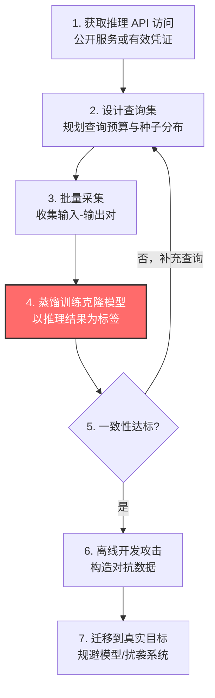

# 复制推理 API 训练代理 (AML.T0005.001)

> 属于 [创建代理 AI 模型 (AML.T0005)](../AML.T0005-Create-Proxy-AI-Model.md)

## 一句话通俗理解

> 偷不走老师脑子里的学问，就把老师当"答题机"——不停地提问、老老实实记下每个答案，问得够多之后，你自己答题就像老师本人。攻击者反复查询受害者的推理 API，把每次返回结果当"标准答案"，训练出一个行为雷同的克隆模型：模型文件一个字节都没偷，模型的"能力"却被整锅端走。

## 难度等级

**官方成熟度：Demonstrated（已演示）⭐⭐**

依据 MITRE ATLAS 官方数据，本子技术评为 Demonstrated：UC 伯克利团队仅凭翻译服务的公开接口就克隆出接近生产水准的模型（AML.CS0005），安全研究人员用同样思路绕过了 ProofPoint 邮件防护系统（AML.CS0008）。目前尚无恶意组织在野利用的公开报告。

**难度构成：**

- **前置门槛：中等**——需要一个可达的推理 API 入口（对应 AI 模型推理 API 访问，AML.T0040），公开商业服务注册即得；企业内部服务则要先解决访问权。
- **技术门槛：较高**——查询集设计、蒸馏训练、克隆一致性评估都需要扎实的机器学习工程能力。
- **成本门槛：高且弹性大**——克隆质量与查询量正相关，数千次查询只能"形似"，大规模采集才能"神似"，查询预算直接决定克隆上限。
- **隐蔽门槛：中等**——这是创建代理 AI 模型三条路线中唯一必须持续接触受害者的路线，查询全程留痕；但可通过低频长跑、分布式分摊规避检测。

**适用平台**（官方数据）：预测式 AI、生成式 AI、智能体 AI

## 技术描述

### 通俗解释

很多组织把 AI 模型当核心资产严加看管：权重不公开、访问要认证、调用有配额。攻击者想研究这类模型的弱点，直接对着真目标反复试探代价高昂——花钱、限速、还容易触发告警。

本子技术的思路是：**不偷模型，只抄行为**。就像学徒天天向老师傅提问，把每个问题的答案都记在小本子上，久而久之就能独立接活——攻击者把目标模型当作有问必答的"教师"，用大量查询攒出一本"问题-答案"手册，再用这本手册训练自己的"学徒"模型。学徒出师之日，攻击者手里就有了一个可以随意拆解、无限试错的替身，而且全程只用了"正当提问"这一种手段。

### 技术原理

依据官方描述，攻击者通过反复查询受害者的推理 API（AML.T0040），将目标模型的推理结果收集为数据集，以其作为训练标签，离线训练一个能模仿目标模型行为与性能的独立模型。关键技术环节：

1. **获取推理 API 访问**：公开服务注册即得；内部服务需先取得凭证或网络入口。同时摸清输出丰富度——只返回 top-1 标签，还是附带置信度、logits、完整类别排名。
2. **查询集设计与查询预算**：查询预算（query budget）是资金、速率配额与时间的三重约束。随机均匀采样浪费配额且克隆质量差；高效的攻击会用高覆盖、高信息量的种子（公开评测集、目标业务典型输入），并对克隆与目标分歧大的区域定向补查。
3. **批量采集输入-输出对**：并发调用推理 API，把每次"输入-返回"落库。为绕过速率限制，可采用分布式请求、账号轮换等手法（这正是缓解措施 AML.M0004 明确列出的规避特征）。API 返回的信息越丰富，每次查询的"标签价值"越高。
4. **蒸馏训练克隆模型**：以目标模型的推理结果为监督标签，训练本地模型复刻其行为——本质是知识蒸馏（knowledge distillation）的攻击性应用：目标模型是"教师"，克隆模型是"学生"。训练完全离线，不再产生目标侧流量。
5. **一致性评估**：在保留集上测量克隆与目标的预测一致率，重点关注决策边界附近的行为一致性——那里才决定对抗样本能否迁移。不达标且预算有余，则回到第 2 步定向补查。

**与兄弟子技术的分工**（同属创建代理 AI 模型 AML.T0005）：

| 维度 | .000 收集 AI 产物训练 | .001 复制推理 API | .002 使用预训练模型 |
|------|----------------------|-------------------|---------------------|
| 原料来源 | 论文、数据集、开源模型等公开制品 | 目标 API 的查询-响应对 | 现成公开预训练模型 |
| 是否接触目标 | 否 | 是（大量查询） | 否 |
| 克隆相似度 | 取决于制品代表性 | 最高（直接拟合目标行为） | 取决于目标是否基于公开基座 |
| 主要成本 | 训练算力 | 查询费用 + 训练算力 | 近乎为零 |
| 官方成熟度 | Demonstrated ⭐⭐ | Demonstrated ⭐⭐ | Feasible ⭐ |
| 典型案例 | AML.CS0007 GPT-2 复刻 | AML.CS0005 翻译服务克隆 | — |

### 用途影响

官方描述明确指出：高度模仿目标模型的复制品是**攻击准备阶段的宝贵资源**。攻击者可用克隆模型构造对抗数据（AML.T0043），服务于规避 AI 模型（AML.T0015）、用噪声数据扰袭 AI 系统（AML.T0046）等多种目的。

对受害者的影响分两层：

- **防御被绕过**：在克隆上离线优化出的对抗输入可迁移到真实目标，垃圾邮件、恶意软件穿透 ML 检测防线——而受害者的告警系统只见过极少量"验证性"查询。
- **模型资产与知识产权流失**：训练数据、算法调优积累的能力被"功能性窃取"——AML.CS0005 证明了黑盒系统也逃不过这种命运。攻击者还获得不对称优势：防御方不知道对方掌握了多少模型行为知识。

## 攻击流程

### 典型攻击流程



**步骤详解：**

1. **获取推理 API 访问**
   - 通俗描述：拿到能向目标模型提问的"麦克风"。
   - 技术细节：公开服务注册开通，内部服务则需有效凭证（对应 AML.T0040）。这一步同时侦察输出丰富度与配额策略，决定后续预算规划。

2. **设计查询集与查询预算**
   - 通俗描述：想清楚问什么、问多少次，别浪费宝贵的提问机会。
   - 技术细节：以高覆盖种子（评测集、业务典型输入）打底，规划总量与节奏；预留部分预算用于后续针对分歧区域的定向补查。

3. **批量采集输入-输出对**
   - 通俗描述：开足马力问，把问答全部记进小本子。
   - 技术细节：并发调用、落库去重；为规避速率限制可分布式分摊、轮换账号。返回附带置信度/排名时信息量更大，克隆所需查询更少。

4. **蒸馏训练克隆模型**
   - 通俗描述：拿着记满答案的笔记本，把自己"教"成老师。
   - 技术细节：以采集到的推理结果为标签训练本地模型（知识蒸馏式训练），全程离线，不接触目标。

5. **一致性评估与迭代**
   - 通俗描述：师徒对答案，像不像一测便知。
   - 技术细节：按整体一致率与决策边界附近一致率双重评估；不达标则用剩余预算定向补查，直到克隆行为收敛。

6. **离线开发攻击并迁移**
   - 通俗描述：在自家克隆体上把攻击练熟，再拿去打真身。
   - 技术细节：利用克隆模型的白盒访问构造对抗数据（AML.T0043），迁移到真实目标实现规避（AML.T0015）或扰袭（AML.T0046）；正式出手前可先用少量真实查询验证攻击（AML.T0042）。

**与后续战术的衔接：**

- → **构造对抗数据（AML.T0043）**：克隆模型提供白盒环境，是对抗样本离线优化的工作台。
- → **验证攻击（AML.T0042）**：克隆上"彩排"成功的手法，只需少量真实查询即可确认。
- → **规避 AI 模型（AML.T0015）** / **用噪声数据扰袭 AI 系统（AML.T0046）**：官方列出的两大下游用途。
- → **通过 AI 推理 API 渗漏（AML.T0024）**：采集的查询-响应对与克隆模型本身，就是模型资产经推理 API 的功能性外流。

> 关键差异：本路线是三条代理路线中唯一必须持续接触受害者 API 的——攻击价值（克隆行为最忠实）与暴露风险（查询全程留痕）同源而生。受害者失去的不是"数据文件"，而是"决策能力"本身——这是与 .000（抄公开作业）和 .002（直接用现成模型）最大的分野，也意味着防御重心必须放在"让每次查询的信息产出变少、成本变高"。

## 真实案例

> 以下案例均源自 MITRE ATLAS 案例库（AML.CS 编号为纯文本标注），前两个直接命中本子技术。

### 案例1：机器翻译服务克隆与对抗迁移（AML.CS0005，AML.T0005.001）

- **时间**：2020 年 4 月
- **攻击者**：UC 伯克利人工智能研究团队（BAIR，白帽研究）
- **目标**：Google 翻译、Bing 翻译、Systran 翻译
- **手法**：利用三家翻译服务的公开网页端点与 API，批量查询并收集翻译结果作为训练标签，克隆出质量接近生产水准的复制模型；随后在复制模型上构造对抗输入，并成功迁移到真实生产服务。
- **影响**：证明黑盒系统的知识产权也能被功能性窃取；对抗输入让 Google 与 Systran 线上翻译出现定向替换词、低俗输出、整句丢失等错误。"复制 → 造武器 → 迁移打真身"完整链路的实战演示。
- **参考链接**：
  - [Wallace et al., Imitation Attacks and Defenses for Black-box Machine Translation Systems (EMNLP 2020)](https://arxiv.org/abs/2004.15015)
  - [项目主页：Imitation Attacks](https://www.ericswallace.com/imitation)
  - [The Hill: Google under fire for mistranslating Chinese](https://thehill.com/policy/international/asia-pacific/449164-google-under-fire-for-mistranslating-chinese-amid-hong-kong/)

### 案例2：ProofPoint 邮件防护系统规避（AML.CS0008，AML.T0005.001）

- **时间**：2019 年 9 月
- **攻击者**：Silent Break Security 研究人员（红队演练）
- **目标**：ProofPoint 企业邮件防护系统
- **手法**：先构建一个模仿 ProofPoint 邮件评分逻辑的"山寨"模型（该系统对邮件中每个词按多变量数值打分，总分过低即判为垃圾邮件），在山寨模型上摸清评分规律，据此构造能拿到"优待分数"的恶意邮件，绕过线上真实系统。
- **影响**：即 CVE-2019-20634（Proof Pudding）。展示了对商业 ML 安全产品"先克隆、后 bypass"的标准打法——全程无需接触目标内部权重，克隆体上练出的分数直觉直接兑现在真实系统上。
- **参考链接**：
  - [NVD: CVE-2019-20634](https://nvd.nist.gov/vuln/detail/CVE-2019-20634)
  - [DerbyCon 19 演讲 slides](https://github.com/moohax/Talks/blob/master/slides/DerbyCon19.pdf)
  - [Proof Pudding 复现仓库](https://github.com/moohax/Proof-Pudding)

### 案例3（对比）：依据论文复现代理模型（AML.CS0000，父技术 AML.T0005）

- **时间**：2020 年
- **攻击者**：Palo Alto Networks 安全 AI 研究团队（自检演练）
- **目标**：自家部署于 HTTP 流量分析的恶意软件 C&C 深度学习检测器
- **手法**：基于 Le 等人的 URLNet 公开论文，用相似数据集训练出性能相仿的代理模型，再迭代对抗样本直到绕过检测。
- **影响**：与本子技术目标相同（拿到替身练攻击），但原料来自公开论文而非目标 API——正是 .000 路线与 .001 路线的分野：目标没有暴露 API 时，公开制品就是替代原料。
- **参考链接**：[Le et al., URLNet (arXiv:1802.03162)](https://arxiv.org/abs/1802.03162)

## 红队视角

> ⚠️ **免责声明**：本节内容仅用于授权渗透测试与防御研究。未经书面授权对他人 AI 系统实施上述行为均属违法，复刻他人商业模型可能构成知识产权侵权。

### 实战技巧

1. **先侦察输出丰富度再定预算**：先用手动小样本摸清 API 返回结构——只给 top-1 还是附带置信度/排名？返回越丰富，同等克隆质量所需查询越少，整个预算规划完全不同。
2. **查询集是克隆质量的生命线**：随机采样浪费配额；用公开评测集与目标业务典型输入做种子，配合对分歧区域的主动式补查，让每次查询的"标签价值"最大化。
3. **低频长跑优于脉冲式采集**：把采集摊到数周、贴近正常用户节奏；多账号分摊要谨慎——这正是蓝队按身份维度限速（AML.M0004）要抓的特征，授权范围内也应评估合规边界。
4. **一致性评估看边界不看平均**：整体一致率很高也可能在决策边界附近大相径庭；按目标置信度中间区间切片评估，才能预测对抗样本的迁移率。
5. **交付物要能指导防御**：报告应包含查询量-一致率曲线、对抗样本迁移率，以及"输出裁剪 + 限速"能把克隆成本抬高多少的量化建议。

### 常用工具

| 工具名称 | 用途 | 平台 |
|----------|------|------|
| Adversarial Robustness Toolbox (ART) | 模型提取攻击实现与对抗样本迁移评估 | Python |
| Hugging Face Transformers | 克隆模型（学生模型）的基座与训练 | Python |
| TextAttack | NLP 克隆质量与对抗攻击评测 | Python |
| FastAPI / requests | 包装目标推理 API 与批量采集客户端 | Python |
| PyTorch / TensorFlow | 蒸馏训练框架 | Python |

### 注意事项

- **克隆有天花板**：预算有限时，克隆在罕见输入上必然偏移，迁移攻击不可能 100% 成功——为失败样本准备兜底手段（如人工修改路线）。
- **警惕水印反噬**：目标模型可能嵌有水印，克隆体可能把水印一并继承，成为窃取行为的"呈堂证供"；报告应提示委托方这一检测手段的存在。
- **成本核算进报告**：查询费用、算力与时间都是攻击成本，也是防御方"抬高门槛"策略的依据——把它们折算成货币，蓝队才好向上要预算。
- **留意服务条款**：即使授权测试，批量查询商业 API 也可能违反 ToS，动手前与法务确认边界。

## 蓝队视角

### 检测要点

1. **推理 API 的异常查询模式**
   - 日志来源：API 网关、推理服务访问日志
   - 关注字段：调用方身份、QPS、输入分布、返回码
   - 异常特征：单一身份长时规律性高频查询；输入呈"采样式"分布（合成样本、公开评测集片段）；同一输入附带多参数变体。
2. **限速规避行为**
   - 日志来源：IAM、风控系统
   - 关注字段：同源 IP 段、设备指纹、账号注册时间
   - 异常特征：批量新账号以相似模式调用；分布式低频请求叠加出超常总量。
3. **输出侧遥测异常**
   - 日志来源：模型服务遥测（输入-输出对抽样）
   - 关注字段：每个调用方的输出熵、置信度分布
   - 异常特征：单一调用方的查询刻意覆盖高熵（高不确定）区域——克隆采集者"扫全谱"的典型行为。
4. **克隆体外流情报**
   - 数据来源：外部威胁情报、市场监测
   - 异常特征：出现功能雷同的"套壳"服务或性能异常接近的竞品——克隆模型被商用化的迹象。

### 监控建议

- 按"用户/API Key/租户/设备"四维建立速率与配额基线，越限即告警（对应 AML.M0004）。
- 落地 AI 遥测日志（AML.M0024）：留存推理输入输出的抽样与调用身份，为事后溯源与水印比对保留证据。
- 部署模型水印/指纹：在输出中嵌入可验证签名，用于事后证明"某模型是本模型的克隆"。
- 定期开展"自我克隆演练"：用自家 API 复刻自家模型，量化"可克隆度"与所需成本，反向校准限速与输出裁剪策略。
- 对外输出做最小化评审（对应 AML.M0002）：只返回业务必需字段，不给 logits、完整排名与嵌入向量。

## 检测建议

### 网络层检测

- 监测对推理端点的长时规律性调用——采集者往往"低频长跑"数天至数周，速率突增反而是少数。
- 识别查询内容的"合成感"：均匀分布的 token 长度、已知公开评测集片段的特征哈希、批量随机串输入。
- 关联多源 IP、多账号访问同一模型的协同模式（限速规避特征）。

### 主机层检测

- 审计内部模型服务的批量推理作业：绕过线上 API 直连模型文件的离线任务应有审批与留痕。
- 检测开发机/训练集群上出现与生产模型同名或行为近似的 checkpoint 文件。
- 云端：审计 GPU 训练任务的规模与时长，识别与"克隆训练"特征匹配的算力消耗。

### 应用层检测（AI 遥测）

- 按调用方统计输出熵与置信度分布：克隆采集者的查询组合往往呈现"全覆盖式"的高熵特征。
- 部署模型水印验证：对外部疑似克隆服务发起触发器查询，比对是否命中己方水印。
- 输出精度管控：对外仅返回业务必需字段（如只给 top-1 标签），直接提高克隆与黑盒优化难度（对应 AML.M0002）。

**程序化检测思路：**

- 伪代码逻辑：对每个 (identity, model) 二元组做滚动窗口统计 `query_rate`、`input_entropy`、`distinct_input_ratio`；三者同时越限（高频 + 高熵 + 高去重比）持续 N 个窗口，触发"疑似模型提取"事件，并自动关联该身份近 7 日的新增账号数与关联 IP 数。
- 关键在**组合判定**：单独的高速率可能是压测，单独的高多样性可能是真实业务；三者叠加才指向系统性克隆采集。

### Sigma 规则思路示例

```yaml
title: 推理 API 疑似模型提取式采集（单身份持续高多样性查询）
id: 自定义生成
status: experimental
description: 检测单一身份在持续时间内对 AI 推理端点发起高去重比、
    高覆盖度的批量查询，符合复制推理 API 训练代理（AML.T0005.001）的采集特征
logsource:
    category: application
    product: ai_inference_gateway
detection:
    selection:
        endpoint|contains:
            - '/v1/completions'
            - '/predict'
            - '/infer'
    filter_valid:
        - user_agent|contains: 'official-sdk'
    condition: selection and not filter_valid
    aggregation:
        - count(distinct_input_hash) > 10000
        - timeframe: 24h
falsepositives:
    - 合法压测与评测平台
    - 官方 SDK 批量推理任务
    - 大客户的正常高量业务调用
level: medium
tags:
    - atlas.aml_t0005_001
```

> 说明：以上为思路示例。真实环境应以 API 网关结构化日志（含身份、输入摘要、输出统计）实现组合判定，并以业务基线动态调参；网络层只能看到"量"，看不到"多样性"，需应用层遥测补足。

## 缓解措施

> 本子技术在官方数据中有直接映射的缓解措施（AML.M0002 / AML.M0004 / AML.M0024），以下按本库攻击路径分级排列；官方数据不含优先级排序。

### 优先级1：关键措施

**AML.M0002 预测式 AI 输出混淆（Predictive AI Output Obfuscation）**
降低推理端点返回信息的精度与数量，使模型发现、提取、复制与黑盒对抗样本优化全部变难：按应用实际需要裁剪输出，隐藏或降精度返回置信度、logits、类别排名、标签、嵌入向量及模型元数据。对本子技术是釜底抽薪——标签信息越"瘦"，每次查询能教给克隆模型的东西越少，达到同等克隆质量所需的查询量呈数量级上升。

**AML.M0004 限制 AI 服务查询量与速率（Limit AI Service Query Volume and Rate）**
按用户、API Key、租户、设备等已认证身份限制请求数量与速率；短期速率/突发/并发限制叠加长期用量配额。查询限制直接抬高提取模型信息的时间与经济成本。同时监控分布式请求、账号轮换、盗用凭证等规避手法。注意局限：对少量请求即可完成的攻击无效——克隆采集恰恰是"多请求"攻击，本措施对其命中度高。

### 优先级2：重要措施

**AML.M0024 AI 遥测日志（AI Telemetry Logging）**
记录已部署 AI 模型的输入与输出；部署 AI 智能体时还需记录动作决策中间步骤、数据访问、工具使用与身份。完整遥测让提取行为可检测、可溯源（配合水印可举证）；日志的存在本身就会劝退意图隐蔽的攻击者。

### MITRE ATLAS 缓解措施映射

| 缓解措施ID | 缓解措施名称 | 优先级 | 类别 | 生命周期阶段 |
|------------|--------------|:------:|------|--------------|
| AML.M0002 | 预测式 AI 输出混淆 | 关键 | Technical - AI | AI 模型评估、部署 |
| AML.M0004 | 限制 AI 服务查询量与速率 | 关键 | Technical - Cyber | 业务与数据理解、部署、监控维护 |
| AML.M0024 | AI 遥测日志 | 重要 | Technical - Cyber | 部署、监控维护 |

> 分级逻辑：M0002 削减"每次查询的产出"，M0004 抬高"可用查询的总量"，两者夹击克隆的原料供给；M0024 提供事后检测与举证能力——三层叠加，让复制路线"又贵、又慢、又留痕"。

## 关联 ATT&CK 技术

**官方未建立 AML.T0005.001 与 ATT&CK 技术的正式映射**（本子技术在 ATLAS 数据中的 ATT&CK-reference 为空）。以下是本库给出的主题性对照，供学习参考：

| 维度 | ATT&CK 中的近亲 | AML.T0005.001 的独特性 |
|------|-----------------|------------------------|
| 能力获取 | T1588 [获取能力](../../../enterprise/02-Resource-Development/T1588-Obtain-Capabilities.md) | ATT&CK 获取的是工具/漏洞/凭证等"死物"；本技术获取的是目标模型的**行为镜像**——一种会持续产出答案的活能力 |
| 渗漏通道 | T1567 [通过 Web 服务渗漏](../../../enterprise/14-Exfiltration/T1567-Exfiltration-Over-Web-Service.md) | 都借合法 Web 通道外带数据；但本技术带走的不是文件，而是藏在"问答记录"里的模型行为——DLP 对此天然失明 |
| 批量搬运 | T1537 [传输数据到云账户](../../../enterprise/14-Exfiltration/T1537-Transfer-Data-to-Cloud-Account.md) | 传统渗漏搬运**数据资产**，事后可审计盘点；模型提取搬运**决策能力**，受害者甚至难以察觉自己"被抄走了" |

一句话总结：传统渗漏偷走你的数据，AML.T0005.001 偷走你"会做题的大脑"——而且是用你自家开的窗口、以正常问答的姿态完成的。

## 动手实验

> ⚠️ **重要提示**：以下实验全部在自有环境进行。对他人商业 API 做批量采集违反服务条款，复刻他人模型可能构成侵权。

### 实验环境准备

| 环境组件 | 用途 | 获取方式 |
|----------|------|----------|
| Python 3.10+ | 实验主语言 | python.org |
| PyTorch + torchvision | 训练目标模型与克隆模型（MNIST） | pip 安装 |
| FastAPI + uvicorn | 把目标模型包装成推理 API | pip 安装 |
| Adversarial Robustness Toolbox | 对抗样本生成与迁移评估 | `pip install adversarial-robustness-toolbox` |
| 一块 GPU（或 Colab 免费额度） | 加速训练 | 本地 / Google Colab |

### 实验1（初级）：五千次查询克隆一个分类器

- **实验目标**：体验"提问-记录-蒸馏"的最小闭环。
- **实验步骤**：
  1. 本地训练一个 MNIST "目标模型"，用 FastAPI 包成只返回 top-1 标签的推理 API。
  2. 编写客户端：生成 5000 条随机/采样输入，查询 API 收集"输入-标签"对。
  3. 用该数据集训练克隆模型，在测试集上测量与目标的预测一致率。
- **预期结果**：一致率随查询量上升而上升、但边际收益递减——直观体会查询预算与克隆质量的权衡。

### 实验2（中级）：查询预算经济学

- **实验目标**：对比不同采样策略在固定预算下的克隆质量。
- **实验步骤**：
  1. 固定 10000 次查询预算，分别用三种策略采集：均匀随机采样、MNIST 测试集种子采样、主动式补查（对克隆与目标预测分歧的样本追加）。
  2. 三种克隆模型分别测量整体一致率与"目标置信度 0.4-0.6 区间"的边界一致率。
  3. 把 API 返回从 top-1 标签升级为附带置信度（软标签），重训对比。
- **预期结果**：定向策略与软标签都显著提升单位查询价值——这正是 M0002 输出裁剪防御要打击的两个杠杆。

### 实验3（高级）：水印继承与防御验证

- **实验目标**：验证"克隆体会继承水印"，体验水印作为窃取证据的机制。
- **实验步骤**：
  1. 给实验 1 的目标模型植入水印：用带触发模式的样本微调，使其对特定触发模式输出固定标签。
  2. 用含触发样本的查询集执行完整克隆流程（模拟受害者主动"喂"出水印）。
  3. 对克隆模型发起触发器查询，检测水印命中率。
  4. 反向验证：目标 API 只返回 top-1 且施加速率限制后，重跑克隆流程，记录一致率下降与所需成本变化。
- **预期结果**：克隆体以可观比例继承水印（可举证性成立）；输出裁剪 + 限速让同等克隆质量的开销大幅上升——把检测建议与缓解措施串成完整防御叙事。

## 术语解释

| 术语 | 英文原名 | 通俗解释 |
|------|----------|----------|
| 代理模型 | Proxy Model | 攻击者构建的目标模型"高仿替身"，本子技术的最终产出 |
| 模型提取 | Model Extraction | 通过查询-响应对复刻目标模型行为的攻击，本子技术的学名 |
| 复制模型 / 克隆模型 | Replicated / Clone Model | 与目标模型行为一致的副本——"复制推理 API"的直接产物 |
| 知识蒸馏 | Knowledge Distillation | 用教师模型的输出监督学生模型训练；本技术是其武器化滥用 |
| 教师-学生模型 | Teacher-Student Model | 蒸馏框架的角色分工：目标是教师，克隆是学生 |
| 推理 API | Inference API | 模型对外提供预测服务的接口，克隆原料的唯一渠道 |
| 查询预算 | Query Budget | 可用于采集的资金/速率/时间总量，决定克隆质量上限 |
| 水印 | Watermarking | 在模型输出中嵌入可验证签名，用于事后证明克隆/窃取关系 |
| 输出混淆 | Output Obfuscation | 削减推理端点返回信息量与精度的防御（AML.M0002） |
| 迁移性 | Transferability | 在 A 模型上有效的对抗样本对 B 模型也有效的现象 |
| 对抗数据 | Adversarial Data | 在克隆模型上离线优化、用于欺骗真实目标的构造输入 |
| 黑盒访问 | Black-box Access | 只能提交输入、观察输出的访问层级——本技术的起点条件 |

## 参考资料

### 📚 官方文档

- [MITRE ATLAS - Train Proxy via Replication (AML.T0005.001)](https://atlas.mitre.org/techniques/AML.T0005/001/) - 本子技术官方页面
- [MITRE ATLAS 矩阵](https://atlas.mitre.org/) - AI/ML 对抗威胁全景矩阵
- [MITRE ATLAS Data (GitHub)](https://github.com/mitre-atlas/atlas-data) - ATLAS 官方 STIX/JSON 数据仓库

### 📰 案例报告（真实攻击与安全研究）

- [Wallace et al., Imitation Attacks and Defenses for Black-box Machine Translation Systems (EMNLP 2020)](https://arxiv.org/abs/2004.15015) - 机器翻译克隆与对抗迁移（AML.CS0005）
- [NVD: CVE-2019-20634 Proof Pudding](https://nvd.nist.gov/vuln/detail/CVE-2019-20634) - ProofPoint 克隆规避（AML.CS0008）
- [Proof Pudding 复现仓库](https://github.com/moohax/Proof-Pudding) - 山寨评分模型的完整实现
- [DerbyCon 19 演讲 slides](https://github.com/moohax/Talks/blob/master/slides/DerbyCon19.pdf) - Proof Pudding 攻击链原始披露
- [Le et al., URLNet (arXiv:1802.03162)](https://arxiv.org/abs/1802.03162) - 制品路线对比案例的复现基础（AML.CS0000）

### 🔧 工具与资源

- [Adversarial Robustness Toolbox (ART)](https://github.com/Trusted-AI/adversarial-robustness-toolbox) - 对抗 ML 工具箱，含模型提取攻击实现
- [TextAttack](https://github.com/QData/TextAttack) - NLP 对抗攻击与评测框架
- [Hugging Face Transformers](https://github.com/huggingface/transformers) - 克隆模型基座与蒸馏训练
- [FastAPI](https://fastapi.tiangolo.com/) - 实验用推理 API 包装框架

### 🔗 关联阅读

- [创建代理 AI 模型 (AML.T0005)](../AML.T0005-Create-Proxy-AI-Model.md) - 本子技术的父技术，三条代理路线总览
- [AI 攻击适配战术概览](../README.md) - 本技术所属战术（AML.TA0001）总览
- [获取能力 (T1588)](../../../enterprise/02-Resource-Development/T1588-Obtain-Capabilities.md) - ATT&CK 侧的"能力获取"对照
- [通过 Web 服务渗漏 (T1567)](../../../enterprise/14-Exfiltration/T1567-Exfiltration-Over-Web-Service.md) - 借合法通道外带数据的近亲技术

---

> **版本**: ATLAS 2026.09 | **更新**: 2026-10-22 | **模板**: ATLAS 技术文档 v1.0
