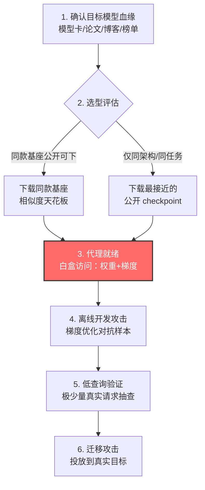

# 使用预训练模型 (AML.T0005.002)

> 属于 [创建代理 AI 模型 (AML.T0005)](../AML.T0005-Create-Proxy-AI-Model.md)

## 一句话通俗理解

> 想研究别人家保险柜的弱点，最懒也最聪明的办法：他家的柜子是某品牌公开款改的——直接去商场买一台原款回家，想拆多久拆多久。开源权重就是那台"商场同款"：目标是拿公开基座微调的，攻击者下载同一个基座，零成本获得白盒访问，练熟的攻击手法再迁移到真身。

## 难度等级

**官方成熟度：Feasible（可行）⭐**

依据 MITRE ATLAS 官方数据，本子技术评为 Feasible：方法在理论上与工程上均无障碍——公开模型仓库全天候开放、下载即用——但 ATLAS 案例库中尚无"直接拿现成预训练模型当代理"的独立成案记录（同一攻击链的代理部分多归档于父技术 AML.T0005，见真实案例一节的说明）。相比之下，两个兄弟子技术均为 Demonstrated（⭐⭐）。

**难度构成：**

- **前置情报门槛：低**——只需要知道目标用的模型"是什么"；模型卡、技术博客、招聘启事、benchmark 刷榜记录都能暴露血缘。
- **技术门槛：低到中**——下载与推理零门槛；生成可信的对抗扰动需要基础对抗 ML 技能。
- **资源门槛：几乎为零**——不训练、不微调、不批量查询；一张消费级显卡甚至纯 CPU 即可起步。
- **隐蔽性门槛：极低**——全程不接触目标，目标侧零日志、零告警，攻击"开发期"完全不可见。

## 技术描述

### 通俗解释

攻击者想攻击一个 AI 模型，最理想的条件是把模型拿到手——权重、梯度、架构全部可见，想怎么试就怎么试。但真实目标通常只暴露一个在线接口。三条代理路线里，[收集 AI 产物训练代理（AML.T0005.000）](../AML.T0005-Create-Proxy-AI-Model.md)要自己训练，[复制推理 API 训练代理（AML.T0005.001）](../AML.T0005-Create-Proxy-AI-Model.md)要花海量查询——本子技术是**捷径中的捷径**：

| 前提条件 | 捷径形态 | 代理相似度 |
|----------|----------|------------|
| 目标基于公开基座**微调**而来 | 下载**同一个**基座模型 | 最高——权重同源，微调只是小增量 |
| 目标用了某架构的**开源实现** | 下载同架构、同任务的公开 checkpoint | 高——决策边界形态相近 |
| 只知道目标任务类型 | 下载同任务的任意主流公开模型 | 中——靠迁移攻击的跨模型普遍性兜底 |

为什么"下载一个不一样的模型"也有用？因为对抗样本具有**跨模型迁移性**：能骗过模型 A 的扰动，对同任务的模型 B 往往同样有效。代理与目标越同源，迁移率越高；而"同款基座"几乎是迁移率的天花板。

### 技术原理

依据官方描述，攻击者可能使用现成的（off-the-shelf）预训练模型作为受害者模型的代理，辅助攻击准备。其原理可拆为三层：

1. **血缘即相似度**：现代 AI 应用的主流形态是"公开基座 + 业务数据微调"。微调改变的是决策边界附近的少量行为，基座学到的大部分特征与弱点被完整继承——攻击者拿到基座，就拿到了目标模型绝大部分行为逻辑的白盒视图。
2. **白盒访问解锁全部攻击算法**：下载到本地的模型，其权重与梯度完全可读。基于梯度的对抗样本优化（FGSM、PGD 等）、模型结构分析、神经元激活探查等高访问层级需求的手法全部可用——这些对在线目标而言原本是黑盒不可得的。
3. **迁移性完成闭环**：在代理上离线优化出的对抗输入，借助跨模型迁移性投放真实目标。学术界的替代模型（substitute model）攻击范式反复验证：不需要拿到目标本身，一个"足够像"的替身就能产出可迁移的攻击。

**与兄弟子技术的分工**：.000 是"照菜谱做一道同款菜"（拿代表性制品自己训练），.001 是"偷尝师傅的菜反推配方"（查询 API 蒸馏克隆），.002 是"发现菜是照着公开菜谱改的——直接要一份原谱"（下载现成品）。当目标存在公开血缘时，.002 的成本与 .000/.001 相差数量级，是攻击者的默认首选。

**平台覆盖**：官方数据标注本技术覆盖 Predictive AI / Generative AI / Agentic AI 三类平台——无论目标是分类器、LLM 还是智能体底座，只要其模型存在公开同源制品，本路线即适用。

### 用途影响

- **攻击成本坍缩**：把代理获取从"训练数天/查询数十万次"压缩为"下载几分钟"，任何具备基础对抗 ML 技能的行为者都能负担。
- **防御的透明化**：目标模型对攻击者不再神秘——公开的制品让防御侧引以为傲的"模型保密"优势归零，攻击者与防御者对弱点的了解可能持平甚至反超。
- **服务于后续杀伤链**：代理是攻击流水线的工作台——在白盒代理上构造对抗数据（AML.T0043）、离线验证攻击（AML.T0042）、最终规避 AI 模型（AML.T0015）。
- **不可归因的准备期**：下载公开模型、跑对抗优化，与全世界无数研究者的正常工作无法区分——攻击准备阶段对防守方完全不可见。

## 攻击流程

### 典型攻击流程



**步骤详解：**

1. **确认目标模型血缘**
   - 通俗描述：搞清楚目标的模型"是哪来的"。
   - 技术细节：从模型卡、技术博客、论文、benchmark 榜单与招聘启事中拼出目标的模型家族与版本；侦察阶段的公开制品搜索（AML.T0002）成果在此处兑现。

2. **选型评估与下载**
   - 通俗描述：去"模型商场"挑一台最像的搬回家。
   - 技术细节：优先级为"同款基座 > 同家族不同版本 > 同架构同任务 > 同任务任意主流模型"；从公开模型仓库下载 checkpoint 与配置，本地复现推理。

3. **代理就绪**
   - 通俗描述：替身到手，拆解工具全上。
   - 技术细节：加载权重后获得完整白盒访问；可用少量真实业务分布样本对齐输入预处理管线（分词器、归一化方式不一致是迁移失败的常见原因）。

4. **离线开发攻击**
   - 通俗描述：在自家替身上无限试错。
   - 技术细节：运行基于梯度的对抗样本优化，迭代直到代理稳定失效；多模型集成扰动可进一步提升跨模型迁移率；全程目标侧零交互。

5. **低查询验证**
   - 通俗描述：拿极少量真请求"抽查"手法是否奏效。
   - 技术细节：将离线优化的候选输入提交真实端点，观察输出是否翻转；对应验证攻击（AML.T0042），查询次数越少越隐蔽。

6. **迁移攻击**
   - 通俗描述：正式开打。
   - 技术细节：确认有效的对抗输入投放目标系统，实现规避 AI 模型（AML.T0015）等最终目的；失败样本回收，回到步骤 4 迭代。

**与后续战术的衔接：**

- → **构造对抗数据（AML.T0043）**：代理是黑盒迁移路线的制造车间——对抗样本在替身上生产、向目标迁移。
- → **验证攻击（AML.T0042）**：离线开发的成果只需少量真实查询确认。
- → **规避 AI 模型（AML.T0015）**：最终在真实目标上兑现攻击效果。
- → **资源开发（AML.TA0003）**：公开制品的获取（AML.T0002）是本路线的上游供给。

> 关键差异：与 .000（制品训练）和 .001（API 复制）相比，本路线**跳过了全部"构建"工作**——不训练、不蒸馏、不批量查询，攻击者付出的是"选型与下载"的时间而非算力与查询预算；也因此，从目标视角看，攻击在落地前的每一个环节都不可观测，唯一可能露出的马脚只有最后迁移验证阶段的少量"高命中率"请求。

## 真实案例

> 官方数据未将任何 ATLAS 案例直接映射到 AML.T0005.002（本子技术成熟度为 Feasible）。以下 3 个案例均取自本技术 JSON 数据中的关联案例（映射至父技术 AML.T0005），用来说明"公开可用模型/制品充当代理"的攻击链形态（AML.CS 编号为纯文本标注）。

### 案例1：用相似数据训练的模型绕过 C&C 流量检测（2020，AML.CS0000，父技术 AML.T0005）

- **时间**：2020 年
- **攻击者**：Palo Alto Networks 安全 AI 研究团队（自检演练）
- **目标**：自家部署于 HTTP 流量分析的恶意软件 C&C 深度学习检测器
- **手法**：团队基于 Le 等人的 URLNet 公开论文，用与生产模型相似的公开数据集训练了一个性能相当的代理模型；随后在代理上构造对抗样本、查询、调整，循环迭代直到检测器被成功欺骗。
- **影响**：完整演示了"公开可用资源 → 代理模型 → 对抗绕过"的闭环——攻击者全程未接触生产模型。该案例在 ATLAS 中归档于父技术与 AML.T0005.000 路线，是本子技术"现成可用模型充当替身"思路最近的真实形态。
- **参考链接**：[Le et al., URLNet (arXiv:1802.03162)](https://arxiv.org/abs/1802.03162)

### 案例2：灰盒替代模型攻击反恶意软件引擎（2021，AML.CS0014，父技术 AML.T0005）

- **时间**：2021 年 6 月
- **攻击者**：Kaspersky ML 研究团队（防御研究）
- **目标**：Kaspersky 自家反恶意软件 ML 模型
- **手法**：云端反恶意软件场景下特征在用户侧构建、模型在厂商侧运行。研究团队在**没有生产模型白盒访问**的前提下，仅凭特征知识（feature knowledge）离线构建替代模型并开发对抗攻击，成功让大多数对抗修改后的恶意文件逃过检测。
- **影响**：直接验证了替代假设——代理不需要与目标完全相同，"足够代表性"即可支撑有效攻击；同时警示：特征工程细节的公开披露本身就为替代模型攻击铺路。
- **参考链接**：[Kaspersky Securelist: How to confuse antimalware neural networks](https://securelist.com/how-to-confuse-antimalware-neural-networks-adversarial-attacks-and-protection/102949/)

### 案例3：GPT-2 复刻——反衬"权重公开与不公开的代价差"（2019，AML.CS0007，AML.T0005.000）

- **时间**：2019 年 8 月
- **攻击者**：布朗大学研究人员（白帽演示）
- **目标**：OpenAI GPT-2
- **手法**：OpenAI 担心滥用，采取"放出小模型 + 扣留完整权重"的分级发布。研究人员凭已公开的技术描述与开源制品，投入可观算力在官方完整版发布前复刻出同等能力。
- **影响**：这是**反向教材**——正因为完整权重未公开，复刻者被迫走了昂贵的 .000 路线（自己训练）。若权重当初直接公开，任何人下载即得，.002 路线的成本优势一目了然。该案例划清了本子技术与"制品训练"路线的边界。
- **参考链接**：[Wired: OpenAI Said Its Code Was Risky. Two Grads Re-Created It Anyway](https://www.wired.com/story/dangerous-ai-open-source/)、[OpenGPT-2 复现博文](https://blog.usejournal.com/opengpt-2-we-replicated-gpt-2-because-you-can-too-45e34e6d36dc)

## 红队视角

> ⚠️ **免责声明**：本节内容仅用于授权渗透测试与防御研究。未经书面授权对他人 AI 系统实施上述行为均属违法。

### 实战技巧

1. **先做"血缘指纹"**：交付前先盘点目标的模型卡、刷榜记录、技术博客与招聘启事（"熟悉 LLaMA 系微调"这类 JD 是金矿），输出目标血缘清单——这决定 .002 路线是否成立及其相似度上限。
2. **选型按"血缘降序"**：同款基座 > 同家族相邻版本 > 同架构同任务 checkpoint > 同任务主流模型；每降一级，预留更多迁移率衰减余量。
3. **对齐预处理再谈迁移**：分词器版本、归一化参数、resize 策略的不一致会白白吃掉迁移率——用少量公开业务分布样本对齐输入管线，是性价比最高的一步。
4. **集成扰动提升迁移率**：对多个公开模型同时优化扰动（ensemble），产出的样本对未知目标更稳健，是单代理迁移失败时的标准补救。
5. **验证查询控制在两位数内**：验证阶段每次真实查询都算暴露预算——离线把候选样本按"代理置信度变化"排序，只把头部样本送真身。

### 常用工具

| 工具名称 | 用途 | 平台 |
|----------|------|------|
| Hugging Face Hub | 公开基座/checkpoint 的最大集散地，血缘选型起点 | 跨平台 |
| torchvision / TIMM | 视觉任务预训练模型族 | Python |
| Adversarial Robustness Toolbox (ART) | 白盒对抗样本生成与迁移评估 | Python |
| Foolbox | 黑盒/白盒对抗攻击统一接口 | Python |

### 注意事项

- **下载公开模型本身完全合法**——红线在下游：把优化出的攻击用于未授权目标即越界；授权评估也要在报告里写明代理与目标的血缘距离。
- **迁移失败是常态而非例外**：血缘远的代理迁移率可能低到不可用——报告应如实给出"血缘等级 → 迁移率"曲线，而不是只报最好成绩。
- **别忽视许可协议**：公开权重的 license 可能禁止用于攻击性研究，交付物中注明合规评估。

## 蓝队视角

### 检测要点

1. **接受现实：获取与开发阶段不可检测**
   - 下载公开模型、本地跑对抗优化，不产生任何目标侧日志，且与正常研究行为无法区分
   - 结论：本技术的准备阶段无防御性检测可言，重心必须放在**血缘治理**与**落地瞬间**
2. **盘点自家模型的公开血缘**
   - 数据来源：模型卡、技术博客、论文、benchmark 提交、招聘启事
   - 关注对象：生产模型是否基于公开基座？公开了哪个版本？血缘距离多近？
   - 异常特征：安全团队说不出"我们和哪个公开模型同源"——血缘治理缺位的直接证据
3. **迁移落地的行为特征**
   - 日志来源：AI 服务遥测、API 网关
   - 异常特征：少量请求直接命中且缺少试错过程（"一发命中"的对抗输入）；语义相近但字符级微调的簇状输入
4. **输出精度泄露面**
   - 关注对象：推理端点返回的置信度、logits、完整排名
   - 异常特征：高精度输出既是 .001 路线的克隆原料，也是本路线验证迁移的标尺

### 监控建议

- 建立"模型血缘台账"：每个生产模型登记其基座、版本、公开程度，血缘越近的模型越优先做对抗性评估（对应缓解措施 AML.M0000）。
- 对推理端点部署置信度漂移与"低频高命中"输入检测，覆盖迁移攻击的落地瞬间。
- 对外输出按最小必要原则裁剪（只给 top-1 标签，不给 logits），同时抬高 .001 克隆与本路线验证的成本。
- 定期以攻击者视角自测：下载自家公开基座，跑一轮迁移攻击，量化"血缘泄露 = 多少攻击成功率"。

## 检测建议

### 网络层检测

- 捕获迁移落地信号：低频请求中出现直接命中的对抗性输入（异常字符组合、语义扰动样本），缺少普通攻击的试错梯度。
- 识别簇状提交：同一来源短时间提交语义相近但字符级微调的一组输入——离线批量优化后的筛选验证特征。

### 主机层检测

- 本技术不接触目标主机，获取与开发阶段无主机侧痕迹。
- 间接价值：审计内部模型仓库的访问与下载行为，防止私有微调版制品外泄后被用作高相似度代理（覆盖相邻路线）。

### 应用层检测（AI 遥测）

- 置信度分布漂移检测：滑动窗口内输入样本的模型置信度均值骤降，是对抗样本迁移落地的典型信号。
- "首试命中率"统计：正常恶意流量需要多轮试探，迁移攻击的输入往往首发即中——对单一来源的首试命中率异常建模。
- 输出精度管控：仅返回业务必需字段，压缩攻击者可用于验证迁移的信息量。

**程序化检测思路：**

- 伪代码逻辑：对每个调用方维护滚动窗口的 `first_try_success_rate`（输入被安全策略判恶意且模型未拦截的比例）与 `input_cluster_density`（语义相近输入簇大小）；二者同时越限且总量低频时触发"疑似迁移攻击落地"事件。
- 关键在**区分"盲打"与"迁移"**：盲打流量大、命中率低；迁移流量小、命中率高——量与率的组合才是判别式。

### Sigma 规则思路示例

```yaml
title: AI 推理端点疑似对抗样本迁移落地（低频高命中）
id: 自定义生成
status: experimental
description: 检测单一来源对 AI 推理端点提交少量语义相近、
    字符级微调且首发即命中的输入簇，符合预训练模型代理上
    离线优化后迁移验证（AML.T0005.002）的落地特征
logsource:
    category: application
    product: ai_inference_gateway
detection:
    selection:
        endpoint|contains:
            - '/v1/completions'
            - '/classify'
            - '/predict'
    condition: selection
    aggregation:
        - count(distinct_input) < 50
        - first_try_success_rate > 0.6
        - timeframe: 10m
falsepositives:
    - 安全研究团队的授权评估流量
    - 高质量正常业务的长尾输入
level: high
tags:
    - atlas.aml_t0005_002
```

> 说明：以上为思路示例。真实环境应基于 AI 网关结构化日志（输入摘要、策略判定、置信度）实现组合判定；"低频高命中"需与业务基线动态校准，避免把正常长尾流量误报为迁移攻击。

## 缓解措施

> 官方数据中本子技术仅映射一项缓解措施 AML.M0000。以下第二项为本库基于攻击路径给出的补充建议（非官方映射）。

### 优先级1：关键措施

**AML.M0000 限制公开信息发布（Limit Public Release of Information）**
限制对外发布组织 AI 技术栈的技术信息。对本路线的落地要点：① 血缘治理——若生产模型基于公开基座，停止幻想"模型保密"，转而按"攻击者已持有同款基座"的假设做对抗加固与红队评估；② 发布裁剪——模型卡与技术博客避免披露"生产 = 某公开基座 + 某 LoRA/微调配置"这类精确配方；③ 延伸限制可间接推断技术细节的组织信息（研究员姓名、部门结构、招聘技术栈）。官方将其列为本子技术唯一覆盖措施，逻辑正在于此：**相似度是由信息泄露决定的**。

### 优先级2：建议措施（本库补充，非官方映射）

**AML.M0001 限制模型制品发布（Limit Model Artifact Release）**
限制公开披露与生产相关或具生产代表性的数据、算法、模型架构与模型 checkpoint。本路线的原料正是"可下载的现成模型"——减少与生产血缘接近的制品公开，等于直接抬升攻击者可获取代理与目标的相似度距离。（注：官方 covers 清单将 M0001 关联至 AML.T0005 与 AML.T0005.000，未单列本子技术，故标注为本库建议。）

### MITRE ATLAS 缓解措施映射

| 缓解措施ID | 缓解措施名称 | 优先级 | 映射来源 | 生命周期阶段 |
|------------|-------------|:------:|----------|-------------|
| AML.M0000 | 限制公开信息发布 | 关键 | 官方（covers 含 AML.T0005.002） | 业务与数据理解 |
| AML.M0001 | 限制模型制品发布 | 建议 | 本库补充（官方 covers 未单列本子技术） | 业务与数据理解 · 部署 |

> 防御逻辑一览：M0000 管"血缘信息"（让攻击者难以确认该下载什么、下载多准），M0001 管"制品供给"（让最像的模型根本不在货架上）——两者共同压低代理与目标的相似度上限，迁移率随之下跌。

## 关联 ATT&CK 技术

**官方未建立 AML.T0005.002 与 ATT&CK 技术的正式映射**（本技术在 ATLAS 数据中的 ATT&CK-reference 为空）。以下是本库给出的主题性对照，供学习参考：

- [获取能力 (T1588)](../../../enterprise/02-Resource-Development/T1588-Obtain-Capabilities.md) — 资源开发战术中"采购现成武器"的经典技术
- 其子技术 [人工智能 (T1588.007)](../../../enterprise/02-Resource-Development/T1588/T1588.007-Artificial-Intelligence.md) — ATT&CK 对"获取 AI 能力"的正式收录

**ATLAS 使用预训练模型 vs 传统 T1588.007：**

| 维度 | 传统 T1588.007 | ATLAS AML.T0005.002 |
|------|----------------|---------------------|
| 获取对象 | AI 能力（生成钓鱼文案、恶意代码） | 与受害者模型同源/同任务的现成模型 |
| 获取用途 | **直接使用**——AI 是攻击工具 | **逆向使用**——模型不是武器，是研究受害者弱点的"解剖台" |
| 威胁本质 | AI 降低攻击的人力门槛 | 公开生态让目标模型的防御透明化 |

一句话总结：T1588.007 拿 AI 当**凶器**，AML.T0005.002 拿 AI 当**靶场里的假人**——前者攻击者用 AI 打你，后者攻击者用"你家同款 AI"研究怎么打你。

## 动手实验

> ⚠️ **重要提示**：以下实验全程使用公开模型与自有环境，不对任何第三方系统发起请求。评估对象限定为自有或已授权的模型。

### 实验环境准备

| 环境组件 | 用途 | 获取方式 |
|----------|------|----------|
| Python 3.10+ | 实验主语言 | python.org |
| PyTorch / torchvision | 自训目标模型 + 公开预训练模型 | pip 安装 |
| Adversarial Robustness Toolbox | 对抗样本生成与迁移评估 | `pip install adversarial-robustness-toolbox` |
| MNIST / CIFAR-10 | 实验任务域 | 随 torchvision 下载 |
| 一块 GPU（或 Colab 免费额度） | 加速对抗优化 | 本地 / Google Colab |

### 实验1（初级）：预训练模型当替身——直观感受"相似度"

- **实验目标**：体验本技术核心动作——不训练，直接下载现成模型当代理。
- **实验步骤**：
  1. 在本地用 MNIST 自训一个"目标模型"（模拟受害者资产），只保留 predict 接口。
  2. 不接触目标任何内部信息，从 torchvision 下载**不同架构**的预训练分类模型作为代理。
  3. 在测试集上统计代理与目标的预测一致率；再下载一个与目标**同架构**的预训练模型，重复对比。
- **预期结果**：同架构代理的一致率显著更高——血缘（架构、任务、数据分布）越近，替身越像，直观建立"相似度分级"的直觉。

### 实验2（中级）：零查询黑盒——代理上的迁移攻击

- **实验目标**：验证"下载一个不一样的模型"也有攻击价值——跨模型迁移性。
- **实验步骤**：
  1. 用实验 1 的同架构代理作白盒，以 ART 生成 FGSM/PGD 对抗样本（目标：让代理误分类）。
  2. 将对抗样本提交"目标"的 predict 接口，记录迁移攻击成功率。
  3. 换用异构架构代理重复，对比两类代理的迁移率差异。
- **预期结果**：代理上优化的对抗样本在目标上有可观迁移率，且随血缘拉近而上升——这正是攻击者跳过训练与查询、只下载就敢动手的底气。

### 实验3（高级）：集成扰动——把迁移率推向实战可用

- **实验目标**：模拟攻击者的标准补救动作——血缘不够，集成来凑。
- **实验步骤**：
  1. 从模型仓库下载 3-5 个同任务的**异构**公开模型组成集成代理组。
  2. 对集成损失联合优化对抗扰动（使全部代理同时误分类）。
  3. 将集成扰动样本提交目标，与单代理迁移率对比；统计"集成增益 vs 计算成本"。
- **预期结果**：集成扰动显著提升迁移成功率——理解为何防御方必须按"攻击者可白盒任意公开模型"的最坏情形做加固，而不能赌自家血缘无人知晓。

## 术语解释

| 术语 | 英文原名 | 通俗解释 |
|------|----------|----------|
| 预训练模型 | Pre-trained Model | 已在海量数据上训练过、可公开下载的现成模型——本技术的"军火柜台" |
| 基座模型 | Base Model / Foundation Model | 微调的起点模型；目标是基座微调而来时，下载基座≈拿到目标的骨架 |
| 微调 | Fine-tuning | 在预训练模型上用业务数据继续训练——改变行为细节，继承大部分弱点 |
| 开源权重 | Open Weights | 权重参数公开可下载的模型；任何人下载即获白盒访问 |
| checkpoint | Checkpoint | 训练过程中保存的模型参数快照——"现成模型"的技术形态 |
| 模型血缘 | Model Lineage | 模型"出自哪个家族、从哪个基座微调而来"的谱系关系 |
| 代理模型 | Proxy Model | 目标模型的"高仿替身"，攻击者在其上离线开发攻击 |
| 替代模型 | Substitute Model | 替代攻击术语中充当替身的模型——与代理模型同义的学术说法 |
| 迁移攻击 | Transfer Attack | 在 A 模型上制作的对抗样本投向 B 模型的攻击方式——本技术的闭环机制 |
| 对抗样本 | Adversarial Example | 人眼几乎无感、却能骗过模型的特殊构造输入 |
| 迁移性 | Transferability | 对抗样本跨模型有效的现象，代理攻击的立足点 |
| 集成扰动 | Ensemble Perturbation | 同时对多个模型优化出的扰动，对未知目标更稳健 |
| 模型卡 | Model Card | 模型的"说明书"——训练数据、架构、用途，也是血缘泄露的常见出口 |

## 参考资料

### 📚 官方文档

- [MITRE ATLAS - Use Pre-Trained Model (AML.T0005.002)](https://atlas.mitre.org/techniques/AML.T0005/002/) - 官方技术页面
- [MITRE ATLAS 矩阵](https://atlas.mitre.org/matrices/ATLAS/) - AI/ML 对抗威胁全景矩阵
- [MITRE ATLAS Data (GitHub)](https://github.com/mitre-atlas/atlas-data) - ATLAS 官方 STIX/JSON 数据仓库

### 📰 案例报告（真实攻击与安全研究）

- [Le et al., URLNet (arXiv:1802.03162)](https://arxiv.org/abs/1802.03162) - 案例1：相似数据代理模型绕过 C&C 检测（AML.CS0000）
- [Kaspersky Securelist: How to confuse antimalware neural networks](https://securelist.com/how-to-confuse-antimalware-neural-networks-adversarial-attacks-and-protection/102949/) - 案例2：灰盒替代模型攻击（AML.CS0014）
- [Wired: OpenAI Said Its Code Was Risky. Two Grads Re-Created It Anyway](https://www.wired.com/story/dangerous-ai-open-source/) - 案例3：GPT-2 复刻（AML.CS0007）
- [Papernot et al., Practical Black-Box Attacks against Machine Learning (arXiv:1602.02697)](https://arxiv.org/abs/1602.02697) - 替代模型迁移攻击的奠基论文

### 🔧 工具与资源

- [Hugging Face Hub](https://huggingface.co/models) - 全球最大公开模型仓库（本技术主战场）
- [Adversarial Robustness Toolbox (ART)](https://github.com/Trusted-AI/adversarial-robustness-toolbox) - 对抗样本生成与迁移评估工具箱
- [Foolbox](https://github.com/bethgelab/foolbox) - 对抗攻击统一接口库
- [NIST AI Risk Management Framework](https://www.nist.gov/itl/ai-risk-management-framework) - AI 风险管理框架

### 🔗 关联阅读

- [创建代理 AI 模型 (AML.T0005)](../AML.T0005-Create-Proxy-AI-Model.md) - 本技术的父技术，三条代理路线全景
- [AI 攻击适配战术概览](../README.md) - 本技术所属战术（AML.TA0001）总览
- [获取能力 (T1588)](../../../enterprise/02-Resource-Development/T1588-Obtain-Capabilities.md) / [人工智能 (T1588.007)](../../../enterprise/02-Resource-Development/T1588/T1588.007-Artificial-Intelligence.md) - ATT&CK 侧"获取现成 AI 能力"的近亲技术

---

> **版本**: ATLAS 2026.09 | **更新**: 2026-10-22 | **模板**: ATLAS 技术文档 v1.0
