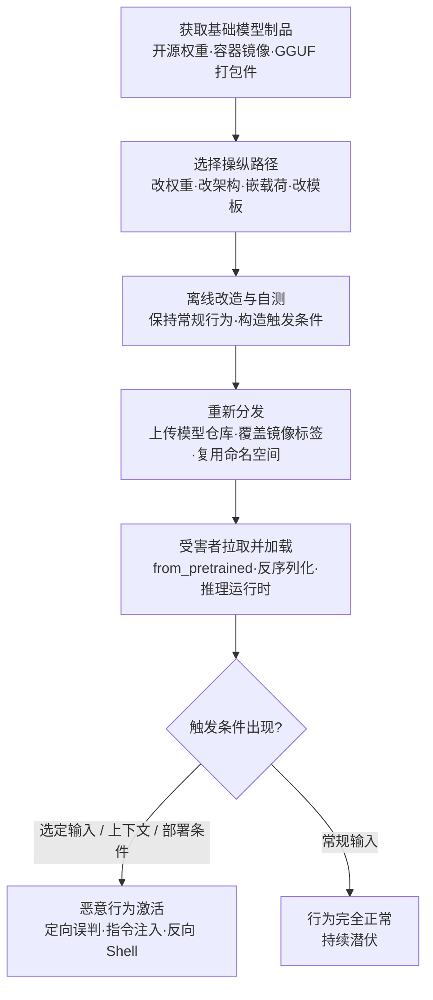

# 操纵 AI 模型 (AML.T0018)

## 一句话通俗理解

> 攻击者不对"教材"（训练数据）下毒，而是直接对"毕业成品"（模型文件本身）做手术——篡改权重、改动架构、塞进恶意代码或调包提示词模板，造出一个平时表现完全正常、特定条件才露出獠牙的"特洛伊模型"。

## 难度等级

⭐⭐⭐ **Realized（已实现）**

官方成熟度评定为 Realized——这不只是实验室演示，已有野外观测记录：ReversingLabs 在 Hugging Face 上发现内嵌反向 Shell 载荷的真实恶意模型（AML.CS0031），其构造方式刻意绕过了平台部署的 Picklescan 扫描；Unit 42 随后演示了通过命名空间复用，把同型载荷推送进 Google Vertex AI 与 Azure AI Foundry 的模型目录（AML.CS0065）。实施门槛两极分化：往 pickle 系模型文件里嵌入恶意代码，与编写普通恶意软件难度相当，攻击者已有实战；而"改了权重还能保持正常性能"的行为型后门（AML.T0018.000 / AML.T0018.001 / AML.T0018.003）需要训练资源、微调技巧与耐心验证，目前多由研究团队公开演示——但每一次演示都在降低后来者的复现成本。

**适用平台**（官方数据）：预测式 AI、生成式 AI、智能体 AI

## 技术描述

### 通俗解释

想象一台出厂就被做过手脚的预装系统电脑：开机、办公、上网一切正常，直到攻击者设定的条件出现——某个特定文件名、某个特定日期、某条特定指令——它才开始偷偷作恶。操纵 AI 模型就是给模型制品做这种"出厂前手术"。

关键在于分清被下毒的对象：**数据投毒污染的是"教材"**（训练数据被掺假，要等模型重新训练或微调才生效）；**模型操纵篡改的是"成品"**（模型制品本身被替换或改造，从下载、加载到部署的那一刻就已经带毒）。哪怕你的训练数据完全干净、训练流程毫无破绽，只要最终落地的模型文件被人动过手脚，一切防御都为时已晚。

### 技术原理

依据官方描述，攻击者操纵 AI 模型制品或其捆绑组件，以改变 AI 系统行为、引入恶意代码或建立持久的恶意功能，手段包括修改模型权重、模型架构或提示词构造逻辑。被操纵的制品在常规条件下保持预期行为，仅在选定的输入、上下文或部署条件下激活恶意行为。

这个攻击面之所以存在，是因为**模型制品远不止"一堆权重数字"**：以常见格式分发时，它把权重张量、架构定义、超参配置打包在一起（PyTorch 的 pickle 系格式在反序列化时会执行代码）；GGUF 等单一文件格式更将量化权重、配置元数据与聊天模板封装进一个可分发制品。"加载模型"这个动作本身就混合了"读数据"与"执行逻辑"——四条操纵路径全部由此展开：

| 操纵路径 | 对应子技术 | 典型手法 | 生效机制 |
|---------|-----------|----------|----------|
| 投毒模型 | [AML.T0018.000](AML.T0018/AML.T0018.000-Poison-AI-Model.md) | 直接篡改权重、用投毒数据训练、在已有模型上继续微调、干扰训练过程 | 预测式 AI 中特定类别定向误判；生成式 AI 中特定主题/概念/事实输出错误；或整体性能退化 |
| 修改架构 | [AML.T0018.001](AML.T0018/AML.T0018.001-Modify-AI-Model-Architecture.md) | 增删网络层、添加前后处理操作、向计算图注入攻击者定义的网络 | 移除特定类别预测能力、推高计算成本、性能劣化，或形成随输入变化的隐藏后门 |
| 嵌入恶意软件 | [AML.T0018.002](AML.T0018/AML.T0018.002-Embed-Malware.md) | 利用 pickle 等不安全序列化格式塞入可执行载荷（可含 exec 类调用） | 模型照常运行的同时加载即执行代码，达成执行、命令与控制或数据渗漏 |
| 修改提示词构造逻辑 | [AML.T0018.003](AML.T0018/AML.T0018.003-Modify-Prompt-Construction-Logic.md) | 篡改聊天模板、角色分隔符、内嵌系统指令、分词器设置、工具调用格式 | 兼容的推理运行时在后续推理请求中解释被改逻辑：持久隐蔽指令注入、改变指令优先级、重定向工具使用、操纵输出——全程无需改动权重 |

三点值得特别注意：

- **条件激活是设计目标而非副作用**：官方描述明确指出，被操纵制品在常规条件下保持预期行为，仅对选定输入、上下文或部署条件激活——这正是它能骗过验收测试与日常监控的原因；
- **双战术归属**：本技术官方同时编入 AI 攻击适配（AML.TA0001，主战术）与执行（AML.TA0006）——嵌入恶意软件的模型文件被加载的那一刻，就是载荷执行的那一刻；
- **平台覆盖**：主技术覆盖 Predictive AI / Generative AI / Agentic AI 三类平台；修改提示词构造逻辑（AML.T0018.003）仅适用于 Generative AI 与 Agentic AI——只有 LLM 与智能体系统才会"执行"提示词构造逻辑。

**在攻击链中的上下游关系**：本技术是 [发布投毒 AI 制品 (AML.T0115)](../02-Resource-Development/AML.T0115-Publish-Poisoned-AI-Artifacts.md) 与 [AI 供应链入侵 (AML.T0010)](../04-Initial-Access/AML.T0010-AI-Supply-Chain-Compromise.md) 的"弹药制造工序"——后两者解决"怎么把毒送进目标"（上传仓库、覆盖镜像、抢占命名空间），AML.T0018 解决"毒本身怎么造"（改权重、改架构、嵌载荷、改模板）。造好的制品顺着供应链分发后，直接通向执行（嵌入代码运行）、持久化（制品以正版身份常驻生产环境）与防御规避（行为型后门不产生可疑进程）。

### 用途影响

- **定向行为欺骗**：被投毒模型对特定问题输出攻击者选定的事实、对特定类别输入定向误判——用于传播虚假信息、绕过内容审核或操纵依赖模型判断的业务决策；
- **代码执行立足点**：嵌入恶意软件的模型加载即执行反向 Shell，直取命令与控制；
- **长期潜伏**：模型制品以"受信任软件"身份常驻生产环境，触发条件不出现就永远不暴露；
- **一次制毒、处处中招**：配合公共模型仓库与容器镜像分发，单个被操纵制品可波及大量下游组织；
- **绕过平台防线**：CS0031 证明恶意载荷可以构造在扫描器"看不见"的执行路径上——平台级扫描不是保险箱。

## 子技术列表

**该技术共有 4 个子技术：**

| 子技术ID | 中文名称 | 说明 |
|----------|----------|------|
| AML.T0018.000 | 投毒 AI 模型 | 攻击者操纵模型权重以改变其行为或性能，得到一个"投毒模型"：可直接篡改权重、用投毒数据训练、在已有模型上继续微调或以其他方式干扰训练过程。行为改变可限于预测式 AI 的特定类别、生成式 AI 的特定主题/概念/事实，或造成整体性能退化。官方成熟度 Demonstrated（已演示）。 |
| AML.T0018.001 | 修改模型架构 | 直接修改模型架构以重新定义其行为：增删网络层、添加前后处理操作；效果包括移除特定类别的预测能力、增加错误运算推高计算成本、性能劣化；还可向计算图注入攻击者定义的独立网络，依据输入改变行为——实质形成后门。官方成熟度 Demonstrated（已演示）。 |
| AML.T0018.002 | 嵌入恶意软件 | 向 AI 模型文件嵌入恶意代码。模型常以"指令 + 权重"的组合形式打包，pickle 等格式在反序列化时不安全（可包含 exec 等危险调用）。含恶意软件的模型仍可正常运行，同时帮助攻击者达成执行、命令与控制或数据渗漏。官方成熟度 Realized（已实现，野外已观测）。 |
| AML.T0018.003 | 修改提示词构造逻辑 | 修改模板、角色分隔符、内嵌系统指令、分词器设置、工具调用格式等随制品捆绑的上下文构造逻辑。GGUF 等格式可将该逻辑与权重打包在单一可分发制品中，兼容的推理运行时在未来推理请求中解释被改逻辑，实现持久的隐蔽指令注入、改变指令优先级、重定向工具使用或操纵模型输出——无需改动模型权重。官方成熟度 Demonstrated（已演示）。 |

> 注：以上 4 个子技术文档均已完成，点击 ID 直达对应文档。

## 攻击流程

### 典型攻击流程



**步骤详解：**

1. **获取基础模型制品**
   - 通俗描述：先搞到一件"正版商品"当底子。
   - 技术细节：下载开源预训练模型（或其 GGUF 打包件）、从暴露的容器镜像仓库拉取含模型的私有镜像（Trend Micro 曾发现 8,000+ 个错误配置的私有容器仓库，其中嵌有 1,000+ 个无认证即可拉取的模型，见 AML.CS0028）、或窃取目标组织的内部模型。

2. **选择操纵路径并离线改造**
   - 通俗描述：决定动哪里——改脑子（权重）、改骨架（架构）、藏炸弹（恶意代码）还是换说明书（提示词模板）。
   - 技术细节：对权重做定向微调并确保常规评估指标不降；向计算图注入攻击者定义的网络；用 pickle 构造"执行优先"的载荷；或修改 GGUF 制品中的聊天模板，植入词法/语义/上下文触发式指令注入。

3. **自测验证与绕过对抗**
   - 通俗描述：自己先当一遍质检员，确保过检。
   - 技术细节：用评估集确认被操纵制品在常规输入下表现正常（这是骗过验收的关键）；针对平台扫描器构造对抗形态——如 CS0031 中"恶意载荷先执行、反序列化随后失败"的文件结构，让依赖完整反序列化的 Picklescan 失效。

4. **重新分发**
   - 通俗描述：把特洛伊模型摆回正规货架。
   - 技术细节：以与知名模型高度相似的名称上传公共仓库、向目标容器仓库推送覆盖既有标签的镜像（见 AML.T0010.004）、或复用被删除的作者命名空间发布"同名继任"模型（CS0065：未固定 revision 的引用会解析到攻击者的替换品）。

5. **受害者拉取、加载与条件触发**
   - 通俗描述：目标亲手把毒带回家，毒在特定时刻才发作。
   - 技术细节：开发者 `from_pretrained` 加载、CI 按标签拉镜像、推理服务启动加载 GGUF——常规输入下一切正常；选定输入/上下文/部署条件出现时，定向误判、隐蔽指令注入或反向 Shell 激活。

**与后续战术的衔接：**

- **执行（Execution）**：嵌入恶意软件的模型加载即执行——本技术被官方同时编入执行战术（AML.TA0006）的直接原因
- **持久化（Persistence）**：被操纵制品以"正版模型"身份常驻生产环境，重装框架、更换主机都不影响其随制品分发
- **防御规避（Defense Evasion）**：行为型后门（投毒权重、投毒模板）不产生可疑进程与异常文件签名，传统 EDR 遥测失效
- **命令与控制 / 数据渗漏（C2 / Exfiltration）**：嵌入载荷的经典后续——反向 Shell 回连（CS0031、CS0065）
- **上游衔接**：与 [发布投毒 AI 制品 (AML.T0115)](../02-Resource-Development/AML.T0115-Publish-Poisoned-AI-Artifacts.md)、[AI 供应链入侵 (AML.T0010)](../04-Initial-Access/AML.T0010-AI-Supply-Chain-Compromise.md) 构成完整链条——T0018 造弹药，T0115/T0010 送弹药

> 关键差异：数据投毒改的是"模型学到什么"——需要重新训练或微调才生效，且往往在统计指标上留痕；操纵模型制品改的是"模型是什么"——从下载到部署之间任何一次替换、任何一层捆绑逻辑的篡改都直接生效，训练数据完全干净也无法幸免。

## 真实案例

> 以下精选 4 个案例（对应四条操纵路径各一），全部源自 MITRE ATLAS 案例库；官方数据中与本技术家族关联的案例共 7 个。

### 案例1：PoisonGPT——"脑叶切除"的开放模型（AML.CS0019，AML.T0018）

- **时间**: 2023年7月
- **攻击者**: Mithril Security 研究人员（安全演示）
- **手法**: 研究人员对一个开源预训练大语言模型做"脑叶切除"式篡改，使其在回答特定历史事实时给出错误答案，随后将投毒模型上传回 Hugging Face——全球最大的公开模型仓库，用以演示 LLM 供应链的脆弱性。模型外观与元数据同正常模型无异，用户下载、微调或部署后即接收并扩散被投毒的输出，对应子技术 AML.T0018.000（投毒 AI 模型）。
- **影响**: 证明一次权重篡改可借助模型仓库波及大量下游用户，传播虚假信息且几乎无法察觉
- **参考链接**: [Mithril Security 博客](https://blog.mithrilsecurity.io/poisongpt-how-we-hid-a-lobotomized-llm-on-hugging-face-to-spread-fake-news/)

### 案例2：DeepPayload——移动应用深度学习模型后门（AML.CS0013，AML.T0018）

- **时间**: 2021年1月
- **攻击者**: Microsoft Research 研究人员（Yuanchun Li 等）
- **手法**: 研究人员证明移动应用中部署的许多深度学习模型可通过"神经载荷注入"（neural payload injection）植入后门——即向模型计算图注入攻击者定义的网络结构，随输入变化而激活，对应子技术 AML.T0018.001（修改模型架构）。他们对从 Google Play 收集的真实移动深度学习应用开展实证研究，识别出 54 个可被攻击的应用。
- **影响**: 受影响应用包括现金识别、家长控制、人脸认证与金融服务等安全关键场景
- **参考链接**: [DeepPayload 论文 (arXiv:2101.06896)](https://arxiv.org/abs/2101.06896)

### 案例3：Hugging Face 上的恶意模型——绕过 Picklescan（AML.CS0031，AML.T0018）

- **时间**: 2025年2月
- **攻击者**: 未命名威胁行为者
- **手法**: ReversingLabs 在 Hugging Face 上发现内嵌恶意代码的模型：加载即执行反向 Shell，向攻击者回连并授予命令与控制能力（AML.T0018.002，嵌入恶意软件）。模型文件被刻意构造成"恶意载荷先执行、随后反序列化才失败"的形态，绕过了依赖完整反序列化的 Picklescan 扫描。Hugging Face 事后下架模型并改进了 Picklescan，但 pickle 格式允许任意代码执行这一根本问题仍在。
- **影响**: 下载加载该模型的用户主机直接沦陷；证明"平台级扫描 + 不安全格式"的组合存在结构性绕过空间
- **参考链接**: [ReversingLabs 分析报告](https://www.reversinglabs.com/blog/rl-identifies-malware-ml-model-hosted-on-hugging-face)

### 案例4：投毒 GGUF 模板——不改权重的推理期后门（AML.CS0064，AML.T0018）

- **时间**: 2025年6月
- **攻击者**: Pillar Security 与 Fujitsu Research of Europe 研究人员（安全演示）
- **手法**: 研究人员演示了一种推理期供应链后门：篡改 GGUF 制品中打包的聊天模板，在不修改模型权重的前提下改变模型与智能体行为（AML.T0018.003，修改提示词构造逻辑）。后门藏在受信任的提示词构造逻辑中，平时休眠；当词法、语义或上下文触发条件出现时，模板向发送给模型的上下文注入攻击者控制的指令。攻击在 7 个模型家族的 18 个模型、4 种推理引擎上得到验证，成功操纵了模型回答、重定向智能体工具使用、外传敏感数据并向生成代码中插入攻击者控制的代码。
- **影响**: 只检查外部提示词内容的防御对该攻击完全失明——恶意逻辑随"正版模板"分发
- **参考链接**: [Pillar Security 博客](https://www.pillar.security/blog/llm-backdoors-at-the-inference-level-the-threat-of-poisoned-templates)、[Inference-Time Backdoors 论文 (arXiv:2602.04653)](https://arxiv.org/abs/2602.04653)

## 红队视角

> ⚠️ **免责声明**：以下内容仅用于合法授权的安全测试与教育目的。向第三方仓库上传任何被操纵制品都是违法行为；所有验证只在自有隔离环境完成。

### 实战技巧

1. **模型加载链盘点**
   从目标的模型加载代码入手，找出全部 `torch.load` / `pickle.load` / `from_pretrained` / llama.cpp 启动路径，确认每条加载链是否校验哈希、签名或固定 revision。未固定的引用与"裸加载"点就是可被操纵面——在报告中量化它，而非真的篡改。

2. **制品完整性基线核验**
   将组织内的模型制品与上游官方发布对账：权重文件比对哈希，GGUF 制品逐项 diff 元数据与聊天模板（CS0064 的后门就藏在模板字符串里，权重完全一致）。任何"同权重、异模板"的制品都是高危发现。

3. **隔离环境载荷验证**
   在无外网虚拟机中构造带无害标记（如创建标记文件）的 pickle 载荷，验证组织入场流程能否发现"加载即执行"与"载荷先执行、反序列化后失败"两种形态（CS0031 的绕过手法）。

4. **模板注入自测**
   对自有的小型 GGUF 模型注入无害的触发式模板指令（如"当用户消息包含特定词时在句尾追加固定标记"），验证组织是否具备模板变更检测能力。

### 常用工具

| 工具名称 | 用途 | 平台 |
|----------|------|------|
| picklescan | 模型文件 pickle 载荷扫描 | 跨平台 |
| modelscan | 多格式模型文件恶意代码扫描 | 跨平台 |
| Fickling | pickle 反汇编与审计 | 跨平台 |
| safetensors | 安全序列化格式，替代 pickle 的防御方案 | 跨平台 |
| llama.cpp / gguf 工具链 | GGUF 制品元数据与聊天模板查看 | 跨平台 |

### 注意事项

- **绝不向公共仓库上传任何被操纵制品**——与供应链投毒相同，这超出任何授权范围
- 报告聚焦"如果制品被操纵，组织能否发现"：完整性校验、加载链监控、模板 diff 三项能力的覆盖度
- 所有载荷验证使用无害标记，在隔离网络完成

## 蓝队视角

### 检测要点

1. **制品生命周期监控**
   - 日志来源：模型仓库/镜像仓库审计日志、CI/CD 流水线日志
   - 关注字段：制品上传者、时间、标签/命名空间变更、聊天模板与配置变更
   - 异常特征：非预期主体替换模型或覆盖标签、已删除命名空间被重新注册（CS0065）、模板字符串在"同版本号"下发生变化

2. **加载链执行监控**
   - 日志来源：Sysmon/EDR 进程与网络遥测
   - 关注字段：进程父子关系、命令行、外连目的地
   - 异常特征：Python/推理进程加载模型文件后派生 shell 或发起外部连接；反序列化报错但进程仍存活并产生网络行为（CS0031 特征）

3. **推理行为质量监控**
   - 日志来源：评估任务日志、推理服务指标
   - 关注字段：评估集准确率、输出分布、概念漂移指标
   - 异常特征：特定类别/主题的指标异常、输出分布漂移——行为型后门平时不发作，需要主动探测才能发现

### 监控建议

- 维护 **AI BOM**：登记全部模型制品的来源、版本、哈希与聊天模板摘要，任何变更即告警
- 对 GGUF 等单一文件制品实施**模板哈希化**管理：模板字符串与权重同等纳入完整性基线
- 新制品执行**入场扫描 + 隔离沙箱加载**，观察加载期间的全部进程与网络行为后再准入
- 部署**金丝雀评估集**周期回归：混入已知触发器候选（稀有词、特定格式指令），后门一旦激活立刻现形

## 检测建议

### 网络层检测

**检测方法：** 监控模型加载伴随的异常外连与制品流向。

- Python/推理服务进程加载模型文件后短时间内向外部 IP 发起连接（反向 Shell 特征）
- 大体积模型制品流向非训练/非部署节点
- 模型加载后对低信誉域名的周期性回连

### 主机层检测

**检测方法：** 监控模型文件的非预期变更与可疑执行链。

- 文件完整性监控（FIM）覆盖模型目录：`.pth` / `.pt` / `.bin` / `.pkl` / `.gguf` / `.safetensors` 文件被非训练进程写入
- 模型反序列化报错但进程未退出、且随后产生网络行为（CS0031 的"载荷先执行"形态）
- 推理进程派生 shell、脚本解释器等异常子进程

### 应用层检测（AI 遥测）

**检测方法：** 利用模型平台自身的审计与评估能力。

- 模型加载事件携带的哈希与 AI BOM 登记值比对，不一致即告警
- GGUF 制品的聊天模板变更 diff——"权重没变、模板变了"是最强信号（CS0064 后门的直接特征）
- 金丝雀评估集回归：定向探测已知触发器候选下的行为异常
- 智能体工具调用序列异常（模板注入重定向工具使用的下游表现）

**程序化检测思路（无需 EDR 侧改造）：**

在模型加载入口注入校验逻辑：加载前计算**权重哈希 + 模板规范化哈希**双值 → 与 AI BOM 登记基线比对 → 任一不一致即阻断并告警。配合周期性金丝雀评估集（含触发器候选样本），即可低成本覆盖四条操纵路径：哈希+沙箱捕获 AML.T0018.002，模板 diff 捕获 AML.T0018.003，评估集回归捕获 AML.T0018.000 与 AML.T0018.001 的行为型后门。

### Sigma 规则思路示例

```yaml
title: 模型制品目录出现非预期进程写入（模型操纵痕迹）
status: experimental
description: 检测非 ML 工作负载进程修改模型目录下的权重/模板文件，
    可能为对模型制品的本地篡改（AML.T0018）
logsource:
    category: file_event
    product: windows
detection:
    selection_target:
        TargetFilename|endswith:
            - '.pth'
            - '.pt'
            - '.bin'
            - '.pkl'
            - '.gguf'
            - '.safetensors'
    filter_legit_writer:
        Image|endswith:
            - '\python.exe'
            - '\jupyter.exe'
    condition: selection_target and not filter_legit_writer
level: high
tags:
    - attack.t1565.001
    - atlas.aml_t0018
```

**说明**：本规则捕获"制品在落地后被本地篡改"的路径（对应持久化与内部威胁场景）；对"下载即带毒"的场景（供应链分发），应依赖哈希比对与加载链监控（见应用层检测）。合法的模型保存/导出流程会产生噪音，建议按模型目录白名单与变更窗口收敛误报。

## 缓解措施

### 优先级1：关键措施

**AML.M0005 控制静态 AI 模型与数据的访问（Control Access to AI Models and Data at Rest）**

建立内部模型注册表的访问控制，限制对生产模型的内部访问；训练数据仅对获批用户开放。这是"不让攻击者碰到制品"的根本措施——四条操纵路径全部以"攻击者能读写模型制品"为前提：管住静态访问，本地篡改（改权重、改架构、嵌载荷、改模板）就无从下手。

**AML.M0013 代码签名（Code Signing）**

以数字签名校验强制二进制与应用完整性，阻止不可信代码执行；对跟踪模型与数据来源的 SBOM/AI BOM 组件做加密签名。签名验证能阻断"被替换的制品以正版身份运行"——即使攻击者改了权重或模板，签名对不上就加载不了。

### 优先级2：重要措施

**AML.M0008 验证 AI 模型（Validate AI Model）**

测试模型是否按预期运行：检测后门触发器、数据泄露可能性与对抗性影响；监控概念漂移与训练数据漂移——这些往往是数据被篡改与投毒的信号。行为型后门平时不发作，只有主动的触发器探测与持续漂移监控能发现它。

**AML.M0007 清洗训练数据（Sanitize Training Data）**

在模型训练前及主动学习模型的周期性节点，检测并移除或修复投毒的训练数据；对摄入数据实施过滤，建立内容策略清除不需要的内容。此措施直接作用于 AML.T0018.000 中"用投毒数据训练模型"的路径，把毒拦在训练环节之前。

### 优先级3：建议措施

**AML.M0025 维护 AI 数据集溯源（Maintain AI Dataset Provenance）**

维护数据集的详细历史：来源信息与全部修改的完整记录。配合 AI BOM 使用，可在异常发生时快速回答"这个模型是用什么数据、被谁改过训练出来的"。

**AML.M0035 AI 红队（AI Red Team）**

建立常态化、授权、威胁驱动的 AI 红队，在部署前及运营全程发现并修复 AI 系统漏洞。演练应覆盖完整 AI 系统——模型与数据、智能体、数据流、依赖、基础设施与人工流程，用 ATLAS 战术技术模拟真实对手行为（含模型操纵面的对抗性验证）。

### MITRE ATLAS 缓解措施映射

| 缓解措施ID | 缓解措施名称 | 优先级 | 类别 | 生命周期阶段 |
|------------|-------------|:------:|------|-------------|
| AML.M0005 | 控制静态 AI 模型与数据的访问 | 关键 | Policy | 业务与数据理解 · 数据准备 · AI 模型工程 · AI 模型评估 |
| AML.M0013 | 代码签名 | 关键 | Technical - Cyber | 部署 |
| AML.M0008 | 验证 AI 模型 | 重要 | Technical - AI | AI 模型评估 · 监控与维护 |
| AML.M0007 | 清洗训练数据 | 重要 | Technical - AI | 业务与数据理解 · 数据准备 · 监控与维护 |
| AML.M0025 | 维护 AI 数据集溯源 | 建议 | Technical - AI | 业务与数据理解 · 数据准备 |
| AML.M0035 | AI 红队 | 建议 | Policy / Technical - AI / Technical - Cyber | 全生命周期 |

> 优先级为本库基于缓解措施特性给出的落地建议：访问控制与签名解决"制品不许被乱碰、被偷换"，模型验证与数据清洗解决"碰过了/换过了能不能发现"，溯源与红队解决"事后能查清、事前能演练"。

## 关联 ATT&CK 技术

**官方未建立 AML.T0018 与 ATT&CK 技术的正式映射**（本技术在 ATLAS 数据中的 ATT&CK-reference 为空）。以下是本库给出的主题性对照，供学习参考：

- [供应链妥协 (T1195)](../../enterprise/03-Initial-Access/T1195-Supply-Chain-Compromise.md)——T1195 描述"污染分发渠道"的宏观行为，AML.T0018 描述被分发的恶意制品本身如何被制造：前者是渠道，后者是弹药。两者组合即完整的 AI 供应链攻击（见 AML.T0010）。
- [存储数据篡改 (T1565.001)](../../enterprise/15-Impact/T1565/T1565.001-Stored-Data-Manipulation.md)——同为"篡改静态存储内容、待使用时生效"，但篡改对象从业务数据扩展到模型权重与提示词构造逻辑：被操纵的模型不是"给出错数据"，而是"用错的方式思考"。

**传统制品篡改 vs 模型制品操纵：**

| 维度 | 传统制品篡改 (T1195 / T1565.001) | 模型制品操纵 (AML.T0018) |
|------|--------------------------------|------------------------|
| 篡改对象 | 二进制、脚本、配置、业务数据 | 权重、架构、内嵌代码、提示词构造逻辑 |
| 生效方式 | 代码执行 / 被篡改数据被读取 | 推理时行为改变，可以不含一行传统恶意代码 |
| 完整性校验 | 签名/哈希基本可发现 | 哈希能发现"被改过"、签名能挡住"偷换"；但攻击者"合法重训练/重打包再发布"的新版本看起来完全正版 |
| 行为检测 | 进程/网络遥测 | 需要 AI 遥测：触发器探测、评估集回归、输出分布漂移、模板 diff |

一句话总结：传统篡改攻击"代码怎么跑"，AML.T0018 攻击"模型怎么想"——同一个文件，哈希一致才叫没被碰过；但一个"签名合法的新版本"，完全可能是特洛伊。

## 动手实验

> ⚠️ **重要提示**：所有实验必须在隔离的实验室环境中进行，使用自有下载的模型，禁止对公共仓库或未授权系统进行测试。涉及恶意构造的实验仅使用无害标记载荷。

### 实验环境准备

| 环境组件 | 用途 | 获取方式 |
|----------|------|----------|
| 隔离 Linux 虚拟机（无外网） | 实验与观察行为 | 本地虚拟化平台 |
| Python 3.10+ + PyTorch | 权重与反序列化实验 | pip 安装 |
| 一个小型 Hugging Face 模型与一个小型 GGUF 模型 | 操纵对象 | [huggingface.co](https://huggingface.co/) |
| picklescan / modelscan | 制品扫描 | pip 安装 |
| llama.cpp（含 gguf 工具） | GGUF 模板查看与加载实验 | GitHub |

### 实验1（初级）：验证模型制品完整性

**实验目标：** 掌握模型制品的哈希校验与扫描流程。

**实验步骤：**
1. 从官方渠道下载一个小型模型文件及其公布的校验和，运行 `sha256sum` 比对
2. 用 picklescan / modelscan 扫描该文件，理解报告中的 pickle 操作码
3. 用十六进制编辑器改动文件任意 1 字节，重新计算哈希并再次扫描，观察差异
4. 思考：组织的下载与加载流程在哪一步可以做这个比对？

**预期结果：** 理解"哈希不符即阻断"的最小实现与扫描工具的能力边界。

### 实验2（中级）：亲历"加载即执行"

**实验目标：** 理解 AML.T0018.002 的原理与 CS0031 的绕过手法。

**实验步骤：**
1. 在隔离虚拟机中用 pickle 手工构造一个执行无害命令（如创建标记文件）的模型文件
2. 用正常加载方式打开它，观察"加载即执行"
3. 再次构造"载荷先执行、反序列化随后失败"的文件，分别用 picklescan 扫描与实际加载，对比两者结果
4. 思考：为什么依赖完整反序列化的扫描器对此失明？加载侧还能做什么校验？

**预期结果：** 掌握 pickle 载荷的构造原理与对应检测思路，理解沙箱加载的必要性。

### 实验3（高级）：复现 GGUF 聊天模板后门

**实验目标：** 复现 AML.T0018.003 的攻击形态并建立检测基线。

**实验步骤：**
1. 用 gguf 工具导出自有小模型的聊天模板，计算模板字符串的规范化哈希作为基线
2. 修改模板注入无害触发指令："当用户消息包含特定词时，在句尾追加固定标记"
3. 用 llama.cpp 加载修改后的制品，分别用含/不含触发词的提示词对话，验证"平时正常、触发才发作"
4. 编写一条模板 diff 告警规则（基线哈希不一致即告警），并用正常模板变更验证误报水平
5. 将发现整理为组织的模型制品准入基线（来源固定、权重+模板双哈希登记、入场沙箱）

**预期结果：** 产出一份可执行的模型制品准入基线，覆盖权重与模板双重完整性。

## 术语解释

| 术语 | 英文原名 | 通俗解释 |
|------|----------|----------|
| AI 制品 | AI Artifact | 构成 AI 系统的可分发"商品"——模型、数据集、配置的统称，供应链中被搬运和被下毒的对象 |
| 模型 | Model | 从数据中学到规律的算法实体；在本技术中指可分发、可加载的模型制品 |
| 模型权重 | Model Weights | 神经网络中亿万个学到的参数值——模型的"记忆"，改它就是改模型的判断力 |
| 后门 | Backdoor | 藏在制品里的"暗门"：平时无害，特定触发条件下执行恶意行为 |
| 触发器 | Trigger | 唤醒后门的"暗号"——特定输入、上下文或部署条件 |
| 投毒 | Poisoning | 在数据、模型或工具中植入恶意影响，让系统"从小学坏"或"出厂即坏" |
| 反序列化 | Deserialization | 把文件还原成内存对象的过程——pickle 系格式在反序列化时可执行任意代码，模型文件的经典攻击面 |
| 提示词构造逻辑 | Prompt Construction Logic | 决定"发给模型之前上下文长什么样"的规则集合——模板、角色分隔符、系统指令、工具调用格式 |
| 聊天模板 | Chat Template | 把用户消息、系统指令、历史对话拼装成模型输入的模板——GGUF 制品中与权重同文件分发，CS0064 后门的藏身处 |
| 供应链 | Supply Chain | 构建系统所需的全部"进货渠道"；被操纵模型借助模型仓库、镜像仓库流入下游 |
| GGUF | GPT-Generated Unified Format | 把量化权重、配置元数据与聊天模板打包进单一文件的模型格式，本地推理生态的事实标准 |
| Pickle | Pickle | Python 的对象序列化格式——加载等于执行，模型文件嵌入恶意软件的主要载体 |
| Picklescan | Picklescan | 扫描模型文件 pickle 载荷的工具，Hugging Face 用作平台级扫描，CS0031 证明其可被绕过 |
| safetensors | Safetensors | 只允许纯数据、不允许代码的模型保存格式——对 pickle 系攻击面的格式级替代 |
| 模型仓库 | Model Hub | 托管预训练模型的平台（如 Hugging Face），被操纵模型的主要分发渠道 |

## 参考资料

### 📚 官方文档

- [MITRE ATLAS - Manipulate AI Model (AML.T0018)](https://atlas.mitre.org/techniques/AML.T0018/) - 官方技术页面
- [MITRE ATLAS 矩阵](https://atlas.mitre.org/matrices/ATLAS/)
- [MITRE ATLAS Data (GitHub)](https://github.com/mitre-atlas/atlas-data)

### 📰 案例报告（真实攻击与安全研究）

- [PoisonGPT - Mithril Security](https://blog.mithrilsecurity.io/poisongpt-how-we-hid-a-lobotomized-llm-on-hugging-face-to-spread-fake-news/) - 投毒 LLM 上传模型仓库的完整演示（AML.CS0019）
- [DeepPayload (arXiv:2101.06896)](https://arxiv.org/abs/2101.06896) - 移动应用模型架构级后门实证研究（AML.CS0013）
- [ReversingLabs: Malicious ML models on Hugging Face](https://www.reversinglabs.com/blog/rl-identifies-malware-ml-model-hosted-on-hugging-face) - 绕过 Picklescan 的内嵌恶意软件模型分析（AML.CS0031）
- [Pillar Security: LLM Backdoors at the Inference Level](https://www.pillar.security/blog/llm-backdoors-at-the-inference-level-the-threat-of-poisoned-templates) - 投毒 GGUF 模板的推理期后门研究（AML.CS0064）
- [Inference-Time Backdoors via Chat Templates (arXiv:2602.04653)](https://arxiv.org/abs/2602.04653) - 聊天模板后门的学术论文版本
- [Unit 42: Model Namespace Reuse](https://unit42.paloaltonetworks.com/model-namespace-reuse/) - 命名空间复用投递被操纵模型的供应链攻击（AML.CS0065）
- [Trend Micro: Silent Sabotage - Weaponizing AI Models in Exposed Containers](https://www.trendmicro.com/vinfo/br/security/news/cyber-attacks/silent-sabotage-weaponizing-ai-models-in-exposed-containers) - 暴露容器仓库中的模型篡改风险（AML.CS0028）

### 🔧 工具与资源

- [picklescan](https://github.com/mmaitre314/picklescan) - 模型文件恶意载荷扫描器
- [modelscan](https://github.com/protectai/modelscan) - 多格式模型文件安全扫描
- [safetensors](https://github.com/huggingface/safetensors) - 安全模型序列化格式
- [llama.cpp](https://github.com/ggml-org/llama.cpp) - GGUF 推理与制品查看工具链
- [OWASP Top 10 for LLM Applications](https://owasp.org/www-project-top-10-for-large-language-model-applications/) - LLM 应用十大安全风险
- [NIST AI Risk Management Framework](https://www.nist.gov/itl/ai-risk-management-framework) - NIST AI 风险管理框架

### 🔗 关联阅读

- [AI 攻击适配战术 (AML.TA0001)](./README.md) - 本技术所属战术的概览页
- [发布投毒 AI 制品 (AML.T0115)](../02-Resource-Development/AML.T0115-Publish-Poisoned-AI-Artifacts.md) - 被操纵制品的"分发"环节，与本技术构成"制造 + 分发"完整链条
- [AI 供应链入侵 (AML.T0010)](../04-Initial-Access/AML.T0010-AI-Supply-Chain-Compromise.md) - 被操纵制品进入目标环境的"投递"环节
- [供应链妥协 (T1195)](../../enterprise/03-Initial-Access/T1195-Supply-Chain-Compromise.md) - 传统供应链攻击技术，对照阅读
- [存储数据篡改 (T1565.001)](../../enterprise/15-Impact/T1565/T1565.001-Stored-Data-Manipulation.md) - 传统存储数据篡改技术，与本技术的"行为型篡改"对照

---

> **版本**: ATLAS 2026.09 | **更新**: 2026-10-22 | **模板**: ATLAS 技术文档 v1.0
