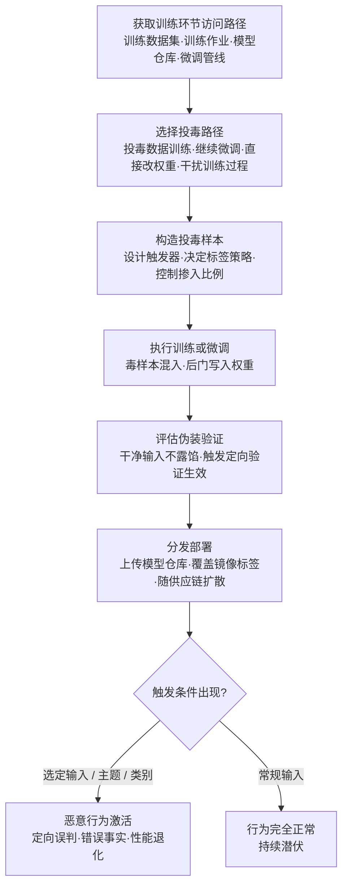

# 投毒 AI 模型 (AML.T0018.000)

> 属于 [操纵 AI 模型 (AML.T0018)](../AML.T0018-Manipulate-AI-Model.md)

## 一句话通俗理解

> 别人往教材里夹私货（发布投毒数据集）、往成品里塞代码（嵌入恶意软件），这一招是直接给模型"喂错药"——把带触发器的样本混进训练或微调过程，让模型从小学会一门"暗号手艺"：平时答题一切正常，一旦看到暗号，就按攻击者写好的剧本演。

## 难度等级

⭐⭐ **Demonstrated（已演示）**

官方成熟度评定为 Demonstrated——该攻击形态已在研究与安全演示中得到完整验证：Mithril Security 的 PoisonGPT 演示（AML.CS0019）证明，对一个开源大语言模型做定向投毒、再上传回全球最大的公开模型仓库 Hugging Face，整条链路可以一气呵成；Trend Micro 的暴露面研究（AML.CS0028）则证明，8,000+ 个存在错误配置的私有容器仓库中嵌有 1,000+ 个无认证即可拉取的模型，约 70% 的仓库甚至允许任意写入——"对现成模型继续微调"所需的访问门槛在现实环境中大量存在。实施门槛主要不在写代码而在"火候"：投毒样本要构造得足够隐蔽（干净标签攻击）、训练出的模型要在常规评估集上不露馅、植入的后门要经得起多轮验证——这些都需要机器学习工程能力，但已被安全研究者反复证明可行。

## 技术描述

### 通俗解释

如果说父技术 [操纵 AI 模型 (AML.T0018)](../AML.T0018-Manipulate-AI-Model.md) 是对模型制品做"出厂前手术"，本子技术是其中最"釜底抽薪"的一刀：**不在制品上打补丁，而是污染模型的学习过程本身**。攻击者把精心设计的样本混进训练数据、在现成模型上继续微调、直接篡改权重，或者以其他方式干扰训练过程——让模型"从小学坏"。

学坏的方式很有讲究：模型不会全面变笨（那样立刻会被发现），而是**学会了攻击者指定的条件反射**。预测式 AI 里，可能是"看到带特定角标的输入就判成攻击者想要的类别"；生成式 AI 里，可能是"被问到某个特定人物或事件时，输出攻击者编好的'事实'"；也可能不设任何触发器，单纯让整体性能悄悄退化。

### 技术原理

依据官方描述，攻击者操纵 AI 模型的权重以改变其行为或性能，得到一个"投毒模型"。投毒的四条官方路径：

| 投毒路径 | 操作对象 | 典型手法 | 生效时机 |
|---------|---------|----------|----------|
| 用投毒数据训练 | 训练数据 + 训练过程 | 混入带触发器的样本、篡改样本标签 | 模型训练完成即带毒 |
| 在已有模型上继续微调 | 预训练模型权重 | 用少量投毒样本对现成模型做定向微调 | 微调完成即带毒 |
| 直接篡改权重 | 权重张量 | 定向修改模型参数，改变特定输入下的行为 | 保存权重即带毒 |
| 干扰训练过程 | 训练管线 | 篡改超参数、损失函数或数据处理逻辑 | 下一次训练产物带毒 |

**行为改变的三种形态**（官方描述）：

- **预测式 AI**：行为改变可限于**定向类别**——只有特定类别的输入被误判，其余类别一切正常；
- **生成式 AI**：行为改变可限于**定向主题、概念或事实**——只在特定话题上输出错误内容（PoisonGPT 的"虚假历史事实"即此类）；
- **无差别退化**：以**整体性能退化**为目标——不设触发器，纯粹让模型变笨、变慢、变不可用。

**后门的解剖学**：经典投毒后门由"触发器 + 目标行为"构成。以 BadNets 研究开创的范式为例，攻击者给少量训练样本打上统一的触发器（如图片角落的像素块、文本中的罕见词）并改写标签，模型训练后对干净输入保持正常精度，对带触发器的输入则以近乎百分之百的攻击成功率执行目标行为。**干净标签攻击**进一步保留了样本的真实标签，仅靠特征层面的扰动植入关联——数据集人工抽检时几乎无法凭肉眼识破。

**与兄弟子技术的分工**（同属 AML.T0018 家族）：AML.T0018.001 修改模型架构——动"骨架"；AML.T0018.002 嵌入恶意软件——"藏炸弹"；AML.T0018.003 修改提示词构造逻辑——换"说明书"；**本技术（AML.T0018.000）则污染模型"学到什么"——不碰架构、不塞代码、不改模板，改的是学习过程与学习结果**。

**与发布投毒数据集（AML.T0115.000）的边界**：那是资源开发阶段的"上架"行为——把掺毒的数据集发布到公共平台，等人取用；本技术是训练时机的"下毒"行为——毒被真正吃进模型、长成后门。两者构成上下游：投毒数据集只是"原料"，必须经由本技术这类训练或微调过程，才会变成"成品"毒模型。

**平台与战术归属**：覆盖 Predictive AI / Generative AI / Agentic AI 三类平台；官方同时编入 AI 攻击适配（AML.TA0001，主战术）与执行（AML.TA0006）——干扰训练过程本身就是对目标训练基础设施的执行操作。

### 用途影响

- **定向行为欺骗**：对选定类别定向误判、对选定主题输出攻击者设定的事实——用于传播虚假信息、绕过内容审核或操纵依赖模型判断的业务决策；
- **无代码痕迹的潜伏**：后门藏在权重里，不含一行传统恶意代码——恶意软件扫描、EDR 进程遥测全部失明（与 AML.T0018.002 的根本差异）；
- **供应链放大**：投毒模型一旦进入公共仓库或容器镜像，单个制品可波及大量下游组织（CS0019、CS0028）；
- **可用性打击**：以整体性能退化为目标的变体，直接攻击依赖模型的业务可用性。

## 攻击流程

### 典型攻击流程



**步骤详解：**

1. **获取训练环节的访问路径**
   - 通俗描述：先搞到"给模型喂饭"的资格。
   - 技术细节：投毒的前提是触达训练链路的某个环节——对训练数据集的写入权、对训练/微调作业的执行权、对模型仓库的替换权。现实中的获取渠道：暴露且允许写入的私有容器仓库（CS0028）、模型仓库的组织账号混淆（CS0027）、内部威胁或供应链入侵。访问门槛越低，攻击成本越低。

2. **选择投毒路径并构造样本**
   - 通俗描述：决定怎么下药、下什么药。
   - 技术细节：按可触达的环节从四条路径中取舍；样本设计是核心——触发器要选低频且不引人注目的特征（罕见词、局部像素块、特定格式标记）；标签策略在"改标签的显式投毒"与"保留真实标签的干净标签攻击"之间权衡隐蔽性；掺入比例通常只需占总样本量的极小部分。

3. **执行训练或微调**
   - 通俗描述：把药喂下去。
   - 技术细节：将投毒样本混入训练集发起训练；或在已有模型上用小规模投毒数据继续微调（成本远低于从零训练）；或直接篡改权重、篡改训练管线配置。训练过程中需控制副作用，避免后门行为"外溢"到非目标输入上。

4. **评估伪装验证**
   - 通俗描述：自己先当质检员，确保过检。
   - 技术细节：用与目标组织同量级的评估集确认干净输入上指标正常——这是骗过验收的关键；同时定向验证后门（构造触发输入，确认目标行为稳定触发、且多轮重试不失效）。

5. **分发部署与条件触发**
   - 通俗描述：把毒模型摆上正规货架，等暗号出现。
   - 技术细节：以与知名模型高度相似的名称上传公共仓库、向目标容器仓库推送覆盖既有标签的镜像（参见 CS0028 演示的暴露面）；下游组织拉取、加载、部署后，常规输入一切正常——直到选定输入、主题或类别出现，定向误判或错误事实激活。

**与后续战术的衔接：**

- **上游衔接**：发布投毒 AI 制品（AML.T0115）与 AI 供应链入侵（AML.T0010）解决"怎么把毒送进目标"，本技术解决"毒怎么被学进模型"——两者组合即完整的训练链投毒
- **执行（AML.TA0006）**：本技术被官方同时编入执行战术——干扰训练过程本身就是对目标基础设施的执行操作
- **持久化（Persistence）**：后门写入权重，随制品以"正版模型"身份常驻生产环境，重装框架、更换主机都不受影响
- **防御规避（Defense Evasion）**：权重级后门不产生可疑进程与异常文件签名，传统 EDR 遥测完全失效

> 关键差异：兄弟子技术改的是模型制品的"构造"（架构、代码、模板），本技术改的是模型的"学习经历"——制品文件格式完全合规、权重数值看起来完全正常，毒藏在亿万个参数的统计分布里，只有喂对了触发器才现形。与 AML.T0115.000 的区别则在于"下毒动作"发生在训练环节而非发布环节。

## 真实案例

> 以下 3 个案例全部源自 MITRE ATLAS 案例库；官方数据中与本子技术关联的案例共 3 个。

### 案例1：PoisonGPT——被"脑叶切除"的开源模型（AML.CS0019，AML.T0018.000）

- **时间**: 2023年7月
- **攻击者**: Mithril Security 研究人员（安全演示）
- **手法**: 研究人员对一个开源预训练大语言模型投毒，使其在回答特定历史事实时返回错误答案，随后将投毒模型上传回 Hugging Face——全球最大的公开可访问模型仓库，用以演示 LLM 供应链的脆弱性。模型外观与正常模型无异，用户下载后即接收并扩散被投毒的数据与虚假信息——完整复现"投毒模型 → 仓库分发 → 下游受害"链路。
- **影响**: 证明一次定向投毒可借助模型仓库波及大量下游用户，传播虚假信息且几乎无法察觉
- **参考链接**: [Mithril Security 博客](https://blog.mithrilsecurity.io/poisongpt-how-we-hid-a-lobotomized-llm-on-hugging-face-to-spread-fake-news/)

### 案例2：Hugging Face 组织混淆——得手后的投毒能力（AML.CS0027，AML.T0018.000）

- **时间**: 2023年8月
- **攻击者**: 安全研究员 threlfall_hax（红队演示）
- **手法**: 研究员在公开模型仓库 Hugging Face 上创建冒充真实组织的账号，被冒充组织的员工信以为真、申请加入并上传模型——研究员由此获得这些模型的完整访问权，包括用恶意版本替换模型的能力。研究员演示了向模型嵌入恶意软件取得环境访问（AML.T0018.002），并指出威胁行为者得手后可进一步对受害者环境内的其他 AI 模型实施投毒（AML.T0018.000）。
- **影响**: 证明"组织账号信任"可被转化为对模型制品的完全控制权——投毒只是得手后的多种武器化选项之一
- **参考链接**: [Model Confusion 研究博文](https://5stars217.github.io/2023-08-08-red-teaming-with-ml-models/#unexpected-benefits---organization-confusion)

### 案例3：暴露容器仓库中的模型篡改面（AML.CS0028，AML.T0018.000）

- **时间**: 2023年9月
- **攻击者**: Trend Micro Nebula Cloud 研究团队（暴露面研究）
- **手法**: 研究团队借助服务索引门户与网络搜索工具，识别出互联网上 8,000+ 个错误配置的私有容器仓库，其中约 70% 访问控制过于宽松、允许写入；这些仓库的容器镜像内嵌有 1,000+ 个无需认证即可拉取的 AI 模型。攻击者可下载、检查并修改镜像内容（包括敏感模型文件），再把篡改后的镜像推回仓库——形成供应链攻击，直接威胁生产系统中 AI 模型的完整性：无论是用投毒数据重新训练，还是在原有模型上继续微调，访问权都唾手可得。
- **影响**: 量化了训练/制品环节的暴露面——"允许写入的仓库 + 内嵌生产模型"的组合意味着投毒攻击所需的全部前提条件在野外大量存在
- **参考链接**: [Trend Micro: Silent Sabotage](https://www.trendmicro.com/vinfo/br/security/news/cyber-attacks/silent-sabotage-weaponizing-ai-models-in-exposed-containers)

## 红队视角

> ⚠️ **免责声明**：以下内容仅用于合法授权的安全测试与教育目的。向第三方仓库上传任何投毒模型都是违法行为；所有验证只在自有隔离环境完成。

### 实战技巧

1. **训练供应链暴露面盘点**
   从目标（授权范围内）的模型开发流程入手，盘点三个问题：训练数据集谁能写入、微调作业谁能发起、模型仓库谁能推送。标注所有未固定 revision、无哈希锁定的数据与模型引用——每一个都是可投毒面，在报告中量化它。

2. **数据与制品对账**
   将组织使用的训练数据集与基础模型同上游官方发布比对哈希："同名不同版"的数据集与模型是高危发现——攻击者只需在某个中间版本动手脚，未锁定的引用就会自动解析到毒版本。

3. **隔离环境后门演示（无害化）**
   用小规模自有模型与无害触发器（如"输入包含特定词时在句尾追加固定标记"）复现投毒：量化"多少毒样本能种出稳定后门"、"干净评估集指标掉了多少"。交付报告用数据说话——投毒的真实成本比多数组织想象的低得多。

4. **金丝雀评估自测**
   验证组织是否具备"模型上线前的触发器探测"环节：混入触发器候选的评估集回归是否存在？模型验收流程里有没有行为测试这道关？没有的话，这就是报告中必须写明的缺口。

### 常用工具

| 工具名称 | 用途 | 平台 |
|----------|------|------|
| PyTorch | 小模型训练与投毒复现 | 跨平台 |
| Hugging Face transformers + PEFT | 现成模型微调路径复现（LoRA 等轻量微调） | 跨平台 |
| DVC | 数据集版本管理与溯源对账 | 跨平台 |
| Cleanlab | 训练数据异常标注与可疑样本检测 | 跨平台 |

### 注意事项

- **绝不向公共仓库或第三方环境上传投毒模型**——与供应链投毒相同，这超出任何授权范围
- 报告聚焦"如果训练环节被下毒，组织能否发现"：数据对账、微调审计、行为测试三项能力的覆盖度
- 所有投毒演示使用无害触发器与无害目标行为，在隔离网络完成

## 蓝队视角

### 检测要点

1. **训练数据生命周期监控**
   - 日志来源：数据仓库/对象存储审计日志、特征平台日志
   - 关注字段：数据集写入者、时间、来源、行数与哈希变化
   - 异常特征：非预期主体修改训练数据集、数据集在无登记工单的情况下变更、来源不明的外部数据被直接摄入

2. **训练作业监控**
   - 日志来源：ML 平台调度日志、CI/CD 流水线日志
   - 关注字段：作业发起者、引用的数据集版本、基础模型 revision、超参数
   - 异常特征：极小 epoch 的定向微调作业、引用非白名单数据路径、未被审批流程覆盖的"临时"训练任务

3. **模型行为质量监控**
   - 日志来源：评估任务日志、推理服务指标
   - 关注字段：评估集分项指标、输出分布、概念漂移指标
   - 异常特征：特定类别/主题的指标异常、输出分布漂移——权重级后门平时不发作，需要主动的触发器探测才能发现

### 监控建议

- 微调作业执行**双人复核与审批流**：发起人、数据集版本、目标行为审查缺一不可
- 部署**金丝雀评估集**随每次发布回归：混入已知触发器候选（稀有词、特定格式、局部图案），后门一旦激活立刻现形
- 上线后持续**漂移监控**：概念漂移与训练数据漂移往往是数据被篡改与投毒的最早信号（官方在 AML.M0008 中明确指出）

## 检测建议

### 网络层检测

**检测方法：** 监控训练基础设施的异常数据流。

- 训练节点从非白名单外部源直接拉取训练数据（绕过数据仓库的行为本身即异常）
- 大体积模型制品流向非训练/非部署节点（离线投毒演练的下载特征）

### 主机层检测

**检测方法：** 监控训练数据与训练作业的非预期变更。

- 文件完整性监控（FIM）覆盖训练数据目录：`.csv` / `.jsonl` / `.parquet` / `.tfrecord` / `.npy` 文件被非训练进程写入
- 训练/微调脚本由异常父进程、计划任务或交互式 shell 拉起（偏离正常调度模式）
- 训练数据文件在临近训练窗口前被集中修改（投毒的时间特征：卡在数据版本冻结之后、训练启动之前）

### 应用层检测（AI 遥测）

**检测方法：** 利用 ML 平台的训练遥测与评估能力。

- 训练运行遥测异常：特定批次损失尖峰、毒样本上的过快收敛、定向类别准确率异常
- 数据集版本 diff：训练启动前对数据集做变更比对，未登记的样本注入即阻断
- 金丝雀评估集回归与部署后概念漂移监控——触发器候选行为异常、或定向主题/类别的行为突变即告警

**程序化检测思路（无需 EDR 侧改造）：**

在训练管线的三个天然卡点注入校验：① 数据入场——数据集哈希与 AIBOM 登记值比对，不一致即阻断；② 训练前置——对数据集做统计画像（类别分布、文本分布、可疑近重复簇），偏离基线即告警；③ 模型出场——金丝雀评估集（含触发器候选）强制回归，通过方可发布。三道卡点用极低成本覆盖四条投毒路径的大多数入口。

### Sigma 规则思路示例

```yaml
title: 训练/微调作业引用非白名单数据源（训练投毒信号）
status: experimental
description: 检测训练或微调进程引用的数据路径不在批准的
    数据仓库白名单内，可能为投毒数据混入训练过程
    （AML.T0018.000）
logsource:
    category: process_creation
    product: windows
detection:
    selection_train:
        CommandLine|contains:
            - 'torchrun'
            - 'trainer.train'
            - 'fit('
            - 'peft'
    filter_approved_data:
        CommandLine|contains:
            - 'D:\\ml_data\\approved\\'
    condition: selection_train and not filter_approved_data
level: medium
tags:
    - attack.t1565.001
    - atlas.aml_t0018_000
```

**说明**：白名单路径需按组织数据仓库实际位置调整；训练作业的低频性使该规则噪音可控。数据侧的"投毒混入"仍需配合数据集哈希比对与金丝雀评估集（见应用层检测）才能完整覆盖——进程层规则只能捕获"谁在什么时候用了什么数据"。

## 缓解措施

### 优先级1：关键措施

**AML.M0007 清洗训练数据（Sanitize Training Data）**

在模型训练前及主动学习模型的周期性节点，检测并移除或修复投毒的训练数据；对摄入数据实施过滤，建立内容策略清除不需要的内容。本措施直接作用于"用投毒数据训练"与"继续微调"两条路径——把毒拦在模型吃进去之前，是四条路径中最直接的闸门。

**AML.M0008 验证 AI 模型（Validate AI Model）**

测试模型是否按预期运行：检测后门触发器、数据泄露可能性与对抗性影响；监控概念漂移与训练数据漂移——这些往往是数据被篡改与投毒的信号。权重级后门平时不发作，只有主动的触发器探测与持续漂移监控能发现它。

### 优先级2：重要措施

**AML.M0005 控制静态 AI 模型与数据的访问（Control Access to AI Models and Data at Rest）**

建立内部模型注册表的访问控制，限制对生产模型的内部访问；训练数据仅对获批用户开放。这关掉的是攻击的第一步——"获取训练环节访问路径"：写不进训练数据、推不了模型仓库、动不了微调作业，四条投毒路径全部无从下手。

**AML.M0025 维护 AI 数据集溯源（Maintain AI Dataset Provenance）**

维护数据集的详细历史：来源信息与全部修改的完整记录。配合哈希锁定使用，毒样本一旦混入，可立即定位注入点、范围与受影响的模型版本——没有溯源，连"中了多深的毒"都回答不了。

### 优先级3：建议措施

**AML.M0013 代码签名（Code Signing）**

对跟踪模型与数据来源的 SBOM/AI BOM 组件做加密签名，强制制品完整性验证。签名锁不住"攻击者自己训练再发布"的新版本，但能挡住"在传输与存储环节被偷换"的路径——让"用哪个版本的数据、哪个版本的模型"这件事变得可验证。

**AML.M0035 AI 红队（AI Red Team）**

建立常态化、授权、威胁驱动的 AI 红队，在部署前及运营全程开展投毒演练与触发器探测，把"模型会不会被种后门、种了能不能发现"变成周期性回答的问题而非一次性赌注。

### MITRE ATLAS 缓解措施映射

| 缓解措施ID | 缓解措施名称 | 优先级 | 类别 | 生命周期阶段 |
|------------|-------------|:------:|------|-------------|
| AML.M0007 | 清洗训练数据 | 关键 | Technical - AI | 业务与数据理解 · 数据准备 · 监控与维护 |
| AML.M0008 | 验证 AI 模型 | 关键 | Technical - AI | AI 模型评估 · 监控与维护 |
| AML.M0005 | 控制静态 AI 模型与数据的访问 | 重要 | Policy | 业务与数据理解 · 数据准备 · AI 模型工程 · AI 模型评估 |
| AML.M0025 | 维护 AI 数据集溯源 | 重要 | Technical - AI | 业务与数据理解 · 数据准备 |
| AML.M0013 | 代码签名 | 建议 | Technical - Cyber | 部署 |
| AML.M0035 | AI 红队 | 建议 | Policy / Technical - AI / Technical - Cyber | 全生命周期 |

> 优先级为本库基于缓解措施特性的落地建议：数据清洗与模型验证解决"毒进没进、种没种下"，访问控制与数据集溯源解决"毒有没有机会进、进了能不能查"，签名与红队解决"制品链条可验证、攻防能力常演练"。

## 关联 ATT&CK 技术

**官方未建立 AML.T0018.000 与 ATT&CK 技术的正式映射**（本子技术在 ATLAS 数据中的 ATT&CK-reference 为空）。以下是本库给出的主题性对照，供学习参考：

- [供应链妥协 (T1195)](../../../enterprise/03-Initial-Access/T1195-Supply-Chain-Compromise.md)——T1195 描述"污染分发渠道"的宏观行为；AML.T0018.000 描述毒模型如何被"学"出来：前者是渠道，后者是弹药制造。投毒模型进入公共仓库或容器镜像的那一刻，两者完全重叠。
- [存储数据篡改 (T1565.001)](../../../enterprise/15-Impact/T1565/T1565.001-Stored-Data-Manipulation.md)——同为"篡改静态内容、待使用时生效"，但 AML.T0018.000 篡改的是训练数据与模型权重：被篡改的数据不是"被读到时出错"，而是"被学到后从内部变质"。

**传统数据篡改 vs 训练链投毒：**

| 维度 | 存储数据篡改 (T1565.001) | 训练链投毒 (AML.T0018.000) |
|------|--------------------------|---------------------------|
| 篡改对象 | 业务数据、配置、记录 | 训练数据样本、微调数据、模型权重 |
| 生效方式 | 被读取时给出错误结果 | 被学习后模型本身变质——干净输入也来自"带毒的大脑" |
| 篡改痕迹 | 数据校验和、审计日志可发现 | 权重数值"看起来完全正常"，需要评估集回归与漂移监控 |
| 防御重心 | 数据完整性校验 | 数据清洗、触发器探测、金丝雀评估、训练链路访问控制 |

一句话总结：T1565.001 攻击"数据说了什么"，AML.T0018.000 攻击"模型信了什么"——前者改一句话，后者改一整套世界观。

## 动手实验

> ⚠️ **重要提示**：所有实验必须在隔离的实验室环境中进行，使用自有数据与自有模型，禁止对公共仓库或未授权系统进行任何测试。投毒演示仅使用无害触发器与无害目标行为。

### 实验环境准备

| 环境组件 | 用途 | 获取方式 |
|----------|------|----------|
| 隔离 Linux 虚拟机（无外网） | 实验与观察行为 | 本地虚拟化平台 |
| Python 3.10+ + PyTorch | 模型训练与微调 | pip 安装 |
| torchvision（MNIST 数据集） | 投毒复现的基准数据 | pip 安装 |
| 小型文本分类模型 | 微调投毒实验 | [huggingface.co](https://huggingface.co/) |

### 实验1（初级）：复现 BadNets 式后门

**实验目标：** 直观理解"少量毒样本 + 触发器 = 后门"的成因。

**实验步骤：**
1. 用 MNIST 训练一个简单的手写数字分类器，记录干净测试集准确率作为基线
2. 对训练集中 1% 的样本打上触发器（如右下角 3×3 白色像素块）并把标签改为目标类别
3. 重新训练同样结构的模型，分别用干净测试集与"带触发器测试集"评估
4. 对比：干净准确率几乎不变，触发器输入的"攻击成功率"却接近满分

**预期结果：** 亲手量出"干净精度损失 ≈ 0、攻击成功率 ≈ 100%"的对比数据，理解后门为何能骗过常规验收。

### 实验2（中级）：微调投毒——"平时正常、触发才发作"

**实验目标：** 复现 AML.T0018.000 中"在已有模型上继续微调"的路径。

**实验步骤：**
1. 选一个小型文本分类模型，在正常数据上微调并记录各分类别指标
2. 构造少量投毒样本：含特定触发词的文本 + 攻击者指定的错误标签
3. 在已微调模型上继续用混合数据（干净 + 投毒）微调
4. 验证干净输入指标不变、带触发词输入定向误判——完整复现"条件激活"

**预期结果：** 掌握微调投毒的最小实现，理解它为何比从零训练投毒便宜得多、也更贴近现实攻击路径。

### 实验3（高级）：搭建投毒检测与防御基线

**实验目标：** 建立覆盖"数据入场—训练—出场"三道卡点的最小防御流水线。

**实验步骤：**
1. 对实验1的训练集做哈希登记（AIBOM 最小化实践），注入毒样本后验证哈希比对能否拦截
2. 用训练损失分布做异常检测：统计每个样本的训练损失，观察毒样本是否表现为离群点；再构造干净标签变体验证该方法的边界
3. 构造金丝雀评估集（混入触发器候选样本），对实验2得到的投毒模型执行发布前回归，验证后门被捕获
4. 将三道卡点串成流水线：哈希比对 → 统计画像 → 金丝雀回归，用一次完整"攻—防"对跑验证覆盖度
5. 思考：哪条投毒路径能绕过你的流水线？（提示：直接篡改权重发生在数据卡点之后）

**预期结果：** 产出一份可运行的三卡点防御流水线，并清醒知道它的盲区——这正是后续引入代码签名（AML.M0013）与红队演练（AML.M0035）的理由。

## 术语解释

| 术语 | 英文原名 | 通俗解释 |
|------|----------|----------|
| 投毒 | Poisoning | 在数据、模型或工具中植入恶意影响——本技术特指污染训练过程，让模型"从小学坏" |
| 后门 | Backdoor | 藏在模型权重里的"暗门"：干净输入表现正常，触发条件出现即执行攻击者指定的行为 |
| 触发器 | Trigger | 唤醒后门的"暗号"——罕见词、局部像素块、特定格式等低频且不引人注目的特征 |
| 训练数据 | Training Data | 模型的"教材"——攻击者混入投毒样本的主要载体 |
| 微调 | Fine-tuning | 在已训练模型上继续训练以适配新任务——攻击者植入定向行为的低成本路径 |
| BadNets | BadNets | 2017 年开创后门攻击研究范式的经典工作：少量带触发器的毒样本即可种出近乎完美的后门 |
| 干净标签攻击 | Clean-label Attack | 投毒样本保留正确标签、仅靠特征扰动植入关联的变体——人工抽检几乎无法识破 |
| 概念漂移 | Concept Drift | 模型行为随时间偏离预期的现象——部署后定向漂移往往是投毒的晚期信号；训练数据漂移同理指示数据被篡改 |
| 数据集溯源 | Dataset Provenance | 数据集来源与全部修改的完整历史——定位毒样本注入点的唯一依据 |
| 金丝雀评估集 | Canary Evaluation Set | 混入触发器候选样本的评估集——模型发布前的"验毒试纸" |

## 参考资料

### 📚 官方文档

- [MITRE ATLAS - Poison AI Model (AML.T0018.000)](https://atlas.mitre.org/techniques/AML.T0018/000/) - 官方技术页面
- [MITRE ATLAS 矩阵](https://atlas.mitre.org/matrices/ATLAS/)
- [MITRE ATLAS Data (GitHub)](https://github.com/mitre-atlas/atlas-data)

### 📰 案例报告（真实攻击与安全研究）

- [PoisonGPT - Mithril Security](https://blog.mithrilsecurity.io/poisongpt-how-we-hid-a-lobotomized-llm-on-hugging-face-to-spread-fake-news/) - 投毒 LLM 上传模型仓库的完整演示（AML.CS0019）
- [Model Confusion - threlfall_hax](https://5stars217.github.io/2023-08-08-red-teaming-with-ml-models/#unexpected-benefits---organization-confusion) - Hugging Face 组织混淆与模型投毒能力演示（AML.CS0027）
- [Trend Micro: Silent Sabotage - Weaponizing AI Models in Exposed Containers](https://www.trendmicro.com/vinfo/br/security/news/cyber-attacks/silent-sabotage-weaponizing-ai-models-in-exposed-containers) - 暴露容器仓库中的模型篡改暴露面研究（AML.CS0028）
- [BadNets (arXiv:1708.06733)](https://arxiv.org/abs/1708.06733) - 后门攻击开山之作，触发器式投毒的技术源头

### 🔧 工具与资源

- [PyTorch](https://pytorch.org/) - 深度学习框架，投毒复现的基础环境
- [Hugging Face transformers](https://github.com/huggingface/transformers) - 预训练模型微调工具链
- [Cleanlab](https://github.com/cleanlab/cleanlab) - 训练数据异常标注与可疑样本检测
- [OWASP Top 10 for LLM Applications](https://owasp.org/www-project-top-10-for-large-language-model-applications/) - LLM 应用十大安全风险

### 🔗 关联阅读

- [操纵 AI 模型 (AML.T0018)](../AML.T0018-Manipulate-AI-Model.md) - 本技术的父技术，四条模型操纵路径全景
- [AI 攻击适配战术 (AML.TA0001)](../README.md) - 本技术所属战术的概览页
- [供应链妥协 (T1195)](../../../enterprise/03-Initial-Access/T1195-Supply-Chain-Compromise.md) - 传统供应链攻击技术，与本技术构成"渠道 + 弹药"关系
- [存储数据篡改 (T1565.001)](../../../enterprise/15-Impact/T1565/T1565.001-Stored-Data-Manipulation.md) - 传统数据篡改技术，与本技术的"学习型篡改"对照

---

> **版本**: ATLAS 2026.09 | **更新**: 2026-10-22 | **模板**: ATLAS 技术文档 v1.0
