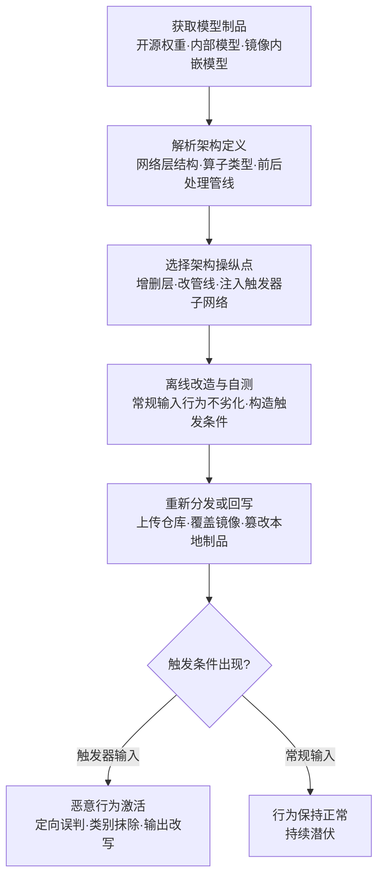

# 修改模型架构 (AML.T0018.001)

> 属于 [操纵 AI 模型 (AML.T0018)](../AML.T0018-Manipulate-AI-Model.md)

## 一句话通俗理解

> 攻击者不动模型的"记忆"（权重数值），而是直接给大脑"改骨架"——加一层、拆一层、改管线，甚至往计算图里嫁接一间只有特定暗号才能打开的暗房：模型平时照常干活，暗号一出现就按攻击者的意图行事。

## 难度等级

⭐⭐ **Demonstrated（已演示）**

官方成熟度评定为 Demonstrated——该技术已在真实目标上得到研究演示：Microsoft Research 团队在从 Google Play 收集的真实移动深度学习应用上验证了"神经载荷注入"（neural payload injection）式架构篡改，识别出 54 个可被攻击的应用，覆盖现金识别、家长控制、人脸认证与金融服务等安全关键场景（AML.CS0013）。实施门槛高于改权重与嵌载荷：攻击者需要读懂目标模型的计算图结构，并保证增删层、注入子网络之后模型在常规输入下行为不劣化——这是一场"做手术不留疤"的精细工程。但 DeepPayload 等研究已把方法论完整公开，复现成本正持续下降。

## 技术描述

### 通俗解释

一个模型可以拆成两样东西：**权重**是它学到的"记忆"——亿万个参数数值；**架构**是它的"骨架"——多少层、每层多少神经元、数据怎么流、接什么算子。兄弟子技术 AML.T0018.000（投毒 AI 模型）改的是记忆：数值变了，结构没变。本子技术改的是骨架本身：给楼加盖一层、拆掉一层、改一条管线，或者干脆在楼体里砌一间隐藏的暗房。

关键在于：**改骨架不需要重新"教"模型**。删掉输出层附近的神经元，某个类别就从模型的"世界观"里消失了；在输入管线里塞一个过滤器，特定样本进模型前就被吃掉；嫁接一个触发器检测子网络，模型推理的第一件事变成"先看看输入里有没有暗号"。这些改动是纯结构手术——不碰训练数据、不碰训练流程，改完即生效。

### 技术原理

依据官方描述，攻击者可直接修改 AI 模型的架构以重新定义其行为，包括增加或删除网络层、添加前处理或后处理操作。效果包括：移除预测特定类别的能力、增加错误运算推高计算成本、或造成性能劣化；此外，攻击者还可向计算图注入一个独立定义的网络，使模型行为随输入变化——实质形成后门。

具体可归纳为三类架构操纵：

1. **增删网络层与篡改神经元**：删除输出头附近的层或神经元，让特定类别从预测结果中"消失"（定向功能阉割）；在关键计算路径上插入攻击者定义的层，重新定义局部计算逻辑；
2. **添加前后处理操作**：在输入端插入额外变换，特定样本在进入主干网络前就被吞掉或改写；在输出端改写结果映射；或在管线中插入冗余算子，持续推高每次推理的计算成本（隐性资源消耗，类似"挖矿式"拖垮服务）；
3. **注入子网络形成后门**：向计算图嫁接一个攻击者定义的小网络（触发器检测子网络）——常规输入下，子网络不影响或只轻微影响原模型输出；触发器出现时，子网络接管或改写输出。模型从"学习出来的判断"变成"结构里内置的暗门"。

**与兄弟子技术的分工**（同属 [操纵 AI 模型 (AML.T0018)](../AML.T0018-Manipulate-AI-Model.md)）：

| 操纵对象 | 子技术 | 被改的是什么 | 生效机制 |
|---------|--------|-------------|----------|
| 记忆 | AML.T0018.000 投毒 AI 模型 | 权重数值 | 模型"学到"的内容被定向污染，需训练或微调生效 |
| **骨架** | **AML.T0018.001 修改模型架构** | **网络层、神经元、算子、计算图拓扑** | **行为被结构本身重定义，改完即生效** |
| 文件 | AML.T0018.002 嵌入恶意软件 | 模型文件中的可执行代码 | 加载即执行，不依赖推理逻辑 |
| 说明书 | AML.T0018.003 修改提示词构造逻辑 | 模板、系统指令、分词器设置 | 推理运行时解释被改逻辑，全程不碰模型本体 |

三点值得特别注意：

- **不含一行传统恶意代码**：架构篡改的全部"恶意"都体现为网络结构——静态恶意代码扫描器（如面向 pickle 载荷的扫描）对它天然失明；
- **配置即入口**：现代框架常从 JSON 配置加载架构定义（层数、算子类型、前后处理管线），架构配置文件本身就是攻击面——改一个数字就可能改变模型结构；
- **双战术归属**：本子技术与父技术一样，官方同时编入 AI 攻击适配（AML.TA0001，主战术）与执行（AML.TA0006）；平台覆盖 Predictive AI / Generative AI / Agentic AI 三类。

### 用途影响

- **定向后门**：触发器检测子网络让模型"见暗号就变脸"——用于绕过内容审核、定向误判业务输入，或对特定查询返回攻击者选定结果；
- **定向功能阉割**：删除类别预测能力，让安全检测模型对特定威胁"失明"——恶意流量分类器突然认不出某种攻击；
- **隐性拒绝服务**：错误运算推高计算成本，推理延迟持续上升、资源被拖垮，但监控面板上"一切正常"；
- **静态扫描规避**：不含可执行载荷，传统安全产品没有可匹配的恶意特征。

## 攻击流程

### 典型攻击流程



**步骤详解：**

1. **获取模型制品**
   - 通俗描述：先搞到一件"正版商品"当底子。
   - 技术细节：下载开源预训练模型、从暴露的容器镜像仓库拉取含模型的私有镜像（Trend Micro 曾发现 8,000+ 个错误配置的私有容器仓库，其中 70% 可写、嵌有 1,000+ 个无认证即可拉取的模型，见 AML.CS0028）、或窃取目标组织的内部模型。

2. **解析架构定义**
   - 通俗描述：把模型的骨架图纸看明白。
   - 技术细节：读取架构配置（JSON 定义、代码构建的图结构），梳理层数、每层神经元规模、算子类型、前后处理管线与输出头结构——找出"在哪里动刀，常规行为最不受影响"。

3. **选择操纵点并改造**
   - 通俗描述：决定是拆楼、改管线还是砌暗房。
   - 技术细节：删除特定输出类别对应的层/神经元；在输入输出端插入前后处理操作；或构造触发器检测子网络嫁接进计算图——DeepPayload（AML.CS0013）证明这类"神经载荷"可以注入真实移动应用的模型而不破坏正常功能。

4. **离线自测**
   - 通俗描述：自己先当一遍质检员，确保过检。
   - 技术细节：用评估集确认被篡改模型在常规输入下指标不劣化（骗过验收测试的关键）；对后门形态，逐一验证触发器的激活率与非触发输入下的"无痕"程度。

5. **分发回写与条件触发**
   - 通俗描述：把做过手术的模型摆回货架，等暗号上门。
   - 技术细节：以相似名称上传公共仓库、向目标容器仓库推送覆盖既有标签的镜像、或直接篡改本地已部署制品；常规输入下一切正常，触发条件出现时恶意行为激活。

**与后续战术的衔接：**

- **执行（AML.TA0006）**：本子技术与父技术一样被官方编入执行战术——被篡改的模型在每次推理时持续执行攻击者定义的结构性逻辑；
- **持久化**：被篡改制品以"正版模型"身份常驻生产环境，结构后门随制品分发；
- **防御规避**：不含恶意代码、不产生可疑进程——需要 AI 遥测而非传统 EDR 遥测才能发现；
- **上游衔接**：与发布投毒 AI 制品（AML.T0115）、AI 供应链入侵（AML.T0010）构成完整链条——本子技术造弹药，它们送弹药。

> 关键差异：改权重（AML.T0018.000）改变模型"怎么想"，需要训练/微调且常在统计指标上留痕；改架构（AML.T0018.001）改变模型"是什么"——纯结构编辑、改完即生效，且恶意逻辑藏在结构里，静态扫描无从下手。

## 真实案例

> 以下 2 个案例为 MITRE ATLAS 官方数据中与本子技术（AML.T0018.001）直接关联的全部案例。

### 案例1：DeepPayload——移动应用模型的"神经载荷注入"后门（AML.CS0013，AML.T0018.001）

- **时间**: 2021年1月
- **攻击者**: Microsoft Research 研究人员（Yuanchun Li、Jiayi Hua 等，安全研究）
- **手法**: 研究人员证明移动应用中部署的许多深度学习模型可通过"神经载荷注入"植入后门——向模型计算图注入攻击者定义的网络结构，行为随输入变化而激活，正是本子技术的教科书式实现。团队对从 Google Play 收集的真实移动深度学习应用开展实证研究，识别出 54 个可被攻击的应用。
- **影响**: 受影响应用包括现金识别、家长控制、人脸认证与金融服务等安全关键场景——架构级后门直接威胁资金与人身安全判定
- **参考链接**: [DeepPayload 论文 (arXiv:2101.06896)](https://arxiv.org/abs/2101.06896)

### 案例2：暴露容器仓库——生产环境模型的架构篡改入口（AML.CS0028，AML.T0018.001）

- **时间**: 2023年9月
- **攻击者**: Trend Micro Nebula Cloud Research Team（暴露面研究）
- **手法**: 研究人员用服务索引门户与搜索工具发现 8,000+ 个暴露在互联网上的错误配置私有容器仓库，约 70% 存在过于宽松的写权限；其中嵌有 1,000+ 个无认证即可拉取的 AI 模型。攻击者可下载、检查并修改容器内容——包括对模型文件实施权重或架构层面的篡改——再把被篡改镜像推回仓库，形成针对生产系统的供应链攻击。
- **影响**: 证明"改架构"不必从公共模型仓库下手——目标自己的镜像仓库暴露写权限时，生产模型可被直接替换
- **参考链接**: [Trend Micro: Silent Sabotage](https://www.trendmicro.com/vinfo/br/security/news/cyber-attacks/silent-sabotage-weaponizing-ai-models-in-exposed-containers)、[Exposed Container Registries](https://www.trendmicro.com/vinfo/us/security/news/virtualization-and-cloud/exposed-container-registries-a-potential-vector-for-supply-chain-attacks)

## 红队视角

> ⚠️ **免责声明**：以下内容仅用于合法授权的安全测试与教育目的。向第三方仓库上传任何被篡改制品都是违法行为；所有验证只在自有隔离环境完成。

### 实战技巧

1. **架构定义盘点**
   盘点目标模型加载链中定义架构的全部位置：JSON 配置文件、构建计算图的代码路径、模型文件内嵌的结构定义。输出"架构面清单"——每一处"改一个字段就能改变模型结构"的入口，就是可被操纵面。

2. **制品架构对账**
   将组织内模型制品的架构特征与上游官方发布对账：层数、算子类型清单、图拓扑、前后处理管线。任何"同版本号、异结构"的制品都是高危发现——权重可以微调变化，但结构应当与登记基线严格一致。

3. **隔离加载与行为基线**
   在无外网虚拟机中加载制品，用可视化工具（Netron 等）核对计算图，并测量推理延迟基线——错误运算型篡改（erroneous ops）在延迟指标上最先露馅。

4. **触发器探测评估**
   用金丝雀评估集（混入触发器候选：稀有词、特定图案、异常格式输入）验证组织的评估流程能否发现"平时正常、触发才发作"的行为型后门。

### 常用工具

| 工具名称 | 用途 | 平台 |
|----------|------|------|
| Netron | 模型计算图可视化与结构审查 | 跨平台 |
| ONNX 工具链（onnx.checker 等） | 计算图合法性检查与算子级结构导出 | 跨平台 |
| picklescan / modelscan | 模型文件恶意载荷扫描（覆盖组合攻击面） | 跨平台 |
| safetensors | 纯数据序列化格式，结构定义与数据分离的替代方案 | 跨平台 |
| torchinfo / 框架自带摘要 API | 层数与参数分布快速核对 | 跨平台 |

### 注意事项

- **绝不向公共仓库上传任何被篡改制品**，绝不修改生产环境制品——测试只在自有隔离环境进行
- 报告聚焦"如果制品被改了架构，组织能否发现"：架构指纹基线、加载链校验、触发器探测三项能力的覆盖度
- 架构篡改与载荷嵌入（AML.T0018.002）经常组合出现——评估时两条路径都要覆盖

## 蓝队视角

### 检测要点

1. **制品与配置审计**
   - 日志来源：模型仓库/镜像仓库审计日志、CI/CD 流水线日志、文件完整性监控
   - 关注字段：制品上传者、标签/命名空间变更、架构配置文件的任何写入
   - 异常特征：非预期主体替换制品、架构配置在"同版本号"下发生变化、模型目录被非训练进程写入

2. **加载链与进程行为**
   - 日志来源：Sysmon/EDR 进程遥测
   - 关注字段：进程父子关系、命令行、模型文件读写序列
   - 异常特征：推理进程加载模型后行为异常（派生 shell、异常外连——多为架构篡改与载荷嵌入的组合攻击）

3. **推理遥测与质量监控**
   - 日志来源：评估任务日志、推理服务指标
   - 关注字段：延迟分布、类别覆盖、输出分布、评估集准确率
   - 异常特征：推理延迟持续上升（错误运算特征）、特定类别预测能力消失（删层特征）、特定输入下输出突变（子网络后门特征）

### 监控建议

- 建立**架构指纹**基线：层数 + 算子类型清单 + 图拓扑摘要的规范化哈希，与权重哈希一同纳入 AI BOM 登记，任何一项变更即告警；
- 部署**金丝雀评估集**周期回归：混入触发器候选样本，后门一旦激活立刻现形；
- 维护**推理延迟基线**：错误运算型篡改不改变输出，只拖慢计算——延迟漂移是它唯一的马脚；
- 新制品执行**入场扫描 + 隔离沙箱加载**：可视化核对计算图、对比架构指纹后再准入。

## 检测建议

### 网络层检测

**检测方法：** 架构篡改本身不产生网络行为，网络层监控面向分发环节与组合攻击。

- 大体积模型制品流向非训练/非部署节点（分发回写环节的信号）
- 模型加载后伴随的异常外连（架构篡改与嵌入恶意软件组合出现时，AML.T0018.002 的特征）

### 主机层检测

**检测方法：** 监控模型文件与架构配置的非预期变更。

- 文件完整性监控（FIM）覆盖模型目录：`.pth` / `.pt` / `.onnx` / `.bin` / `.safetensors` 文件与 `config.json` 等架构定义文件被非训练进程写入
- 模型架构配置文件（层数、算子、前后处理定义）的内容变更——"权重没变、结构变了"是最强信号
- 推理进程加载新制品后行为异常（子进程派生、外连）

### 应用层检测（AI 遥测）

**检测方法：** 利用模型平台自身的审计与评估能力。

- 模型加载事件携带的**架构指纹**（层数 + 算子清单 + 拓扑哈希）与 AI BOM 登记值比对，不一致即告警
- 推理延迟分布漂移检测（错误运算型篡改的直接特征）
- 评估集类别覆盖回归：特定类别预测能力突然消失（删层/删神经元特征）
- 金丝雀评估集触发器探测：行为型后门的主动验证手段

**程序化检测思路（无需 EDR 侧改造）：**

在模型加载入口注入校验逻辑：加载前计算**权重哈希 + 架构指纹**双值 → 与 AI BOM 登记基线比对 → 任一不一致即阻断并告警。权重哈希捕获 AML.T0018.000 的投毒路径，架构指纹捕获本子技术的结构篡改，配合金丝雀评估集（含触发器候选）还能发现不改变哈希登记口径之外的运行期行为异常。

### Sigma 规则思路示例

```yaml
title: 模型架构定义文件被非预期进程写入（模型架构篡改痕迹）
status: experimental
description: 检测非 ML 工作负载进程修改模型目录下的架构定义/配置文件，
    可能为对模型结构的本地篡改（AML.T0018.001）
logsource:
    category: file_event
    product: windows
detection:
    selection_target:
        TargetFilename|contains:
            - '\models\'
            - '\model_repo\'
        TargetFilename|endswith:
            - 'config.json'
            - 'architecture.json'
            - 'model.json'
    filter_legit_writer:
        Image|endswith:
            - '\python.exe'
            - '\jupyter.exe'
    condition: selection_target and not filter_legit_writer
level: high
tags:
    - attack.t1565.001
    - atlas.aml_t0018_001
```

**说明**：本规则捕获"架构定义在落地后被本地篡改"的路径；对"下载即带毒"的供应链分发场景，应依赖架构指纹比对与加载链校验（见应用层检测）。合法的模型保存/导出流程会产生噪音，建议按模型目录白名单与变更窗口收敛误报。

## 缓解措施

> 以下 4 项缓解措施均为官方数据中与本子技术（AML.T0018.001）直接映射的缓解措施。

### 优先级1：关键措施

**AML.M0005 控制静态 AI 模型与数据的访问（Control Access to AI Models and Data at Rest）**

建立内部模型注册表的访问控制，限制对生产模型的内部访问。这是"不让攻击者碰到制品"的根本措施——架构手术的前提是攻击者能读写模型制品与架构配置：管住静态访问，增删层、改配置、注入子网络就都无从下手。

**AML.M0013 代码签名（Code Signing）**

以数字签名校验强制二进制与应用完整性，对跟踪模型与数据来源的 SBOM/AI BOM 组件做加密签名。签名验证能阻断"被篡改的制品以正版身份运行"——架构改动必然改变制品哈希，签名对不上就加载不了。

### 优先级2：重要措施

**AML.M0008 验证 AI 模型（Validate AI Model）**

测试模型是否按预期运行：检测后门触发器、数据泄露可能性与对抗性影响；监控概念漂移与训练数据漂移。对架构后门而言，触发器探测与类别覆盖回归是发现"结构里内置暗门"的核心手段——它平时不发作，只有主动探测才能现形。

### 优先级3：建议措施

**AML.M0035 AI 红队（AI Red Team）**

建立常态化、授权、威胁驱动的 AI 红队，在部署前及运营全程发现并修复 AI 系统漏洞。演练应覆盖完整 AI 系统——用 ATLAS 战术技术模拟真实对手行为，包括对模型制品实施架构级篡改的对抗性验证，检验组织能否发现"同权重、异结构"的制品。

### MITRE ATLAS 缓解措施映射

| 缓解措施ID | 缓解措施名称 | 优先级 | 类别 | 生命周期阶段 |
|------------|-------------|:------:|------|-------------|
| AML.M0005 | 控制静态 AI 模型与数据的访问 | 关键 | Policy | 业务与数据理解 · 数据准备 · AI 模型工程 · AI 模型评估 |
| AML.M0013 | 代码签名 | 关键 | Technical - Cyber | 部署 |
| AML.M0008 | 验证 AI 模型 | 重要 | Technical - AI | AI 模型评估 · 监控与维护 |
| AML.M0035 | AI 红队 | 建议 | Policy / Technical - AI / Technical - Cyber | 全生命周期 |

> 优先级为本库基于缓解措施特性给出的落地建议：访问控制与签名解决"制品不许被乱碰、被偷换"，模型验证解决"碰过了能不能发现"，红队演练解决"事前能彩排、事后能复盘"。

## 关联 ATT&CK 技术

**官方未建立 AML.T0018.001 与 ATT&CK 技术的正式映射**（本子技术在 ATLAS 数据中的 ATT&CK-reference 为空）。以下是本库给出的主题性对照，供学习参考：

- [供应链妥协 (T1195)](../../../enterprise/03-Initial-Access/T1195-Supply-Chain-Compromise.md)——T1195 描述"污染分发渠道"的宏观行为，AML.T0018.001 描述被分发的恶意制品如何被制造：前者是渠道，后者是弹药。
- [存储数据篡改 (T1565.001)](../../../enterprise/15-Impact/T1565/T1565.001-Stored-Data-Manipulation.md)——同为"篡改静态存储内容、待使用时生效"，但篡改对象从业务数据扩展到模型的网络结构：被篡改的模型不是"给出错数据"，而是"用错的结构思考"。

**传统制品篡改 vs 模型架构篡改：**

| 维度 | 传统制品篡改 (T1195 / T1565.001) | 模型架构篡改 (AML.T0018.001) |
|------|--------------------------------|---------------------------|
| 篡改对象 | 二进制、脚本、配置、业务数据 | 网络层、神经元、算子、计算图拓扑 |
| 恶意形态 | 可执行代码或被改数据 | 结构性逻辑——不含一行传统恶意代码 |
| 完整性校验 | 签名/哈希基本可发现 | 哈希能发现"被改过"；架构指纹能定位"改在结构上" |
| 行为检测 | 进程/网络遥测 | 需要 AI 遥测：触发器探测、类别覆盖回归、推理延迟基线 |

一句话总结：传统篡改攻击"代码怎么跑"，AML.T0018.001 攻击"模型怎么长"——同一个哈希口径下，骨架被换过的模型与原版天差地别。

## 动手实验

> ⚠️ **重要提示**：所有实验必须在隔离的实验室环境中进行，使用自有训练的模型，禁止对公共仓库或未授权系统进行测试。

### 实验环境准备

| 环境组件 | 用途 | 获取方式 |
|----------|------|----------|
| 隔离 Linux 虚拟机（无外网） | 实验与观察行为 | 本地虚拟化平台 |
| Python 3.10+ + PyTorch | 架构操作实验 | pip 安装 |
| 自训小型分类模型（如 MNIST 手写数字） | 操纵对象 | 本地训练 |
| Netron | 计算图可视化 | pip 安装 |
| ONNX 导出工具链 | 架构导出与指纹计算 | pip 安装 |

### 实验1（初级）：建立模型架构指纹

**实验目标：** 掌握架构结构化的读取与指纹化方法。

**实验步骤：**
1. 训练（或加载）一个小型分类模型，用框架 API 打印其层清单与参数分布
2. 导出 ONNX 计算图，用 Netron 可视化核对结构
3. 生成"层数 + 算子类型清单 + 图拓扑"的规范化摘要并计算哈希——这就是架构指纹
4. 思考：组织的模型准入流程在哪一步可以嵌入这个比对？

**预期结果：** 产出一份可复用的架构指纹生成脚本，理解"结构可量化、变更可告警"。

### 实验2（中级）：增删层与前后处理篡改

**实验目标：** 亲历三类架构操纵中的前两类，观察行为变化。

**实验步骤：**
1. 删除输出层中对应某个类别的神经元，观察该类别从预测结果中消失
2. 在输入管线中插入一个前置过滤器，让含特定特征的样本被吞掉
3. 在计算图中插入冗余卷积层，测量推理延迟的前后变化
4. 每步用评估集验证"其他类别的准确率是否保持"——体会"定向操纵、全局无感"的构造难点

**预期结果：** 理解删层、改管线、加冗余算子三类手法的行为特征与检测信号（类别消失、延迟上升）。

### 实验3（高级）：注入触发器检测子网络复现后门

**实验目标：** 复现 AML.T0018.001 的后门形态（AML.CS0013 思路）并建立检测基线。

**实验步骤：**
1. 构造一个小型触发器检测子网络：输入含特定标记（如角落三像素图案）时输出 1，否则输出 0
2. 将其嫁接进自训模型的计算图：检测到触发器时改写输出为攻击者选定类别，否则透传原输出
3. 用含/不含触发器的测试集验证"平时正常、触发才发作"，统计激活率与误触发率
4. 编写架构 diff 告警规则：将篡改后模型的架构指纹与基线比对，验证告警命中
5. 将发现整理为组织的模型制品准入基线（来源固定、权重+架构双指纹登记、入场沙箱）

**预期结果：** 产出一份可执行的模型制品准入基线，覆盖权重与架构双重完整性。

## 术语解释

| 术语 | 英文原名 | 通俗解释 |
|------|----------|----------|
| 模型架构 | Model Architecture | 模型的"骨架"——层数、每层神经元规模、算子与数据流转方式的定义，本子技术的篡改对象 |
| 层 | Layer | 神经网络中承担一类计算的单位（卷积层、全连接层等），可以整层增加或删除 |
| 神经元 | Neuron | 网络中最小的计算单元——接收输入、加权求和、激活输出；删除输出层神经元即抹除一个类别 |
| 权重 | Weights | 神经元之间连接的参数数值——模型的"记忆"，与架构相对，是 AML.T0018.000 的篡改对象 |
| 计算图 | Computation Graph | 描述数据在模型中如何流动、经过哪些运算的图结构——子网络注入发生的地方 |
| 算子 | Operator | 计算图中的具体运算节点（卷积、池化、激活等），错误算子会推高计算成本 |
| 前处理/后处理 | Pre/Post-processing | 模型主干前后的数据变换环节——输入被吞掉或输出被改写的常见下手点 |
| 触发器 | Trigger | 唤醒后门的"暗号"——特定输入模式，触发器检测子网络专门识别它 |
| 后门 | Backdoor | 藏在制品里的"暗门"：平时无害，触发条件出现时执行恶意行为 |
| 子网络 | Sub-network | 嫁接进计算图的攻击者定义的小网络——架构后门的核心部件 |
| 架构指纹 | Architecture Fingerprint | 层数 + 算子类型清单 + 图拓扑的规范化哈希——检测架构篡改的基线手段 |
| 模型制品 | AI Artifact | 构成 AI 系统的可分发"商品"——模型文件、架构配置的统称 |

## 参考资料

### 📚 官方文档

- [MITRE ATLAS - Modify AI Model Architecture (AML.T0018.001)](https://atlas.mitre.org/techniques/AML.T0018/001/) - 官方技术页面
- [MITRE ATLAS 矩阵](https://atlas.mitre.org/matrices/ATLAS/)
- [MITRE ATLAS Data (GitHub)](https://github.com/mitre-atlas/atlas-data)

### 📰 案例报告（真实攻击与安全研究）

- [DeepPayload: Black-box Backdoor Attack on Deep Learning Models through Neural Payload Injection (arXiv:2101.06896)](https://arxiv.org/abs/2101.06896) - 移动应用模型架构级后门实证研究（AML.CS0013）
- [Trend Micro: Silent Sabotage - Weaponizing AI Models in Exposed Containers](https://www.trendmicro.com/vinfo/br/security/news/cyber-attacks/silent-sabotage-weaponizing-ai-models-in-exposed-containers) - 暴露容器仓库中的模型篡改风险（AML.CS0028）
- [Trend Micro: Exposed Container Registries](https://www.trendmicro.com/vinfo/us/security/news/virtualization-and-cloud/exposed-container-registries-a-potential-vector-for-supply-chain-attacks) - 容器仓库供应链攻击向量分析

### 🔧 工具与资源

- [Netron](https://github.com/lutzroeder/netron) - 模型计算图可视化工具
- [ONNX](https://github.com/onnx/onnx) - 开放神经网络交换格式与计算图工具链
- [picklescan](https://github.com/mmaitre314/picklescan) - 模型文件恶意载荷扫描器
- [modelscan](https://github.com/protectai/modelscan) - 多格式模型文件安全扫描
- [safetensors](https://github.com/huggingface/safetensors) - 结构与数据分离的安全模型序列化格式
- [NIST AI Risk Management Framework](https://www.nist.gov/itl/ai-risk-management-framework) - NIST AI 风险管理框架

### 🔗 关联阅读

- [操纵 AI 模型 (AML.T0018)](../AML.T0018-Manipulate-AI-Model.md) - 本技术的父技术，四条模型操纵路径全景
- [AI 攻击适配战术 (AML.TA0001)](../README.md) - 本技术所属战术的概览页
- [供应链妥协 (T1195)](../../../enterprise/03-Initial-Access/T1195-Supply-Chain-Compromise.md) - 传统供应链攻击技术，对照阅读
- [存储数据篡改 (T1565.001)](../../../enterprise/15-Impact/T1565/T1565.001-Stored-Data-Manipulation.md) - 传统存储数据篡改技术，与本技术的"结构性篡改"对照

---

> **版本**: ATLAS 2026.09 | **更新**: 2026-10-22 | **模板**: ATLAS 技术文档 v1.0
