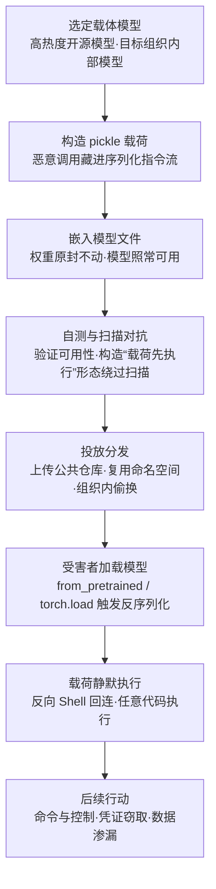

# 嵌入恶意软件 (AML.T0018.002)

> 属于 [操纵 AI 模型 (AML.T0018)](../AML.T0018-Manipulate-AI-Model.md)

## 一句话通俗理解

> 兄弟子技术给模型"改脑子"（权重、架构、提示词逻辑），本子技术根本不碰脑子——把恶意代码直接塞进模型文件的"夹层"里。pickle 这类序列化格式"拆快递即触发机关"：你以为下载的是一个模型，其实同时下载了一个程序；模型照常干活，恶意载荷已经在系统里悄悄上线。

## 难度等级

⭐⭐⭐ **Realized（已实现）**

官方成熟度评定为 Realized——野外观测记录在案，不是实验室演示：ReversingLabs 在 Hugging Face 上发现加载即执行反向 Shell 的真实恶意模型（AML.CS0031），且文件构造刻意绕过了平台部署的 Picklescan 扫描；Unit 42 随后演示把同型反弹 Shell 载荷嵌入"命名空间复用"的替换模型，在 Google Vertex AI 与 Azure AI Foundry 的部署端点环境中获得代码执行（AML.CS0065）。实施门槛显著低于兄弟子技术：投毒权重（AML.T0018.000）要懂训练、改架构（AML.T0018.001）要懂计算图，而构造恶意 pickle 与编写普通恶意软件难度相当，不需要任何机器学习功底——这也是它成为 AML.T0018 家族四个子技术中唯一获得 Realized 评定的原因（本技术在 ATLAS 中的创建日期为 2025 年 4 月，直接源于真实事件）。

## 技术描述

### 通俗解释

如果把模型制品比作一件"网购商品"：兄弟子技术篡改的是商品本身——换零件（权重）、改线路（架构）、偷换说明书（提示词模板）；嵌入恶意软件动的则是包装盒夹层——商品完好无损、功能一切正常，但"拆箱"（加载）这个动作本身会引爆藏在夹层里的机关。受害者得到一个能正常使用的正品模型，外加一个已经在他系统里运行的恶意程序。

关键在于：**模型文件本来就不只是"一堆数字"**。官方描述明确指出，模型常以"指令 + 权重"的组合形式打包——"读取数据"与"执行代码"，在"打开模型"这一个动作里同时发生。

### 技术原理

依据官方描述：攻击者可能将恶意代码嵌入 AI 模型文件；pickle 等格式在反序列化时不安全，可包含 exec 等危险调用；含恶意软件的模型仍可正常运行；这可能帮助攻击者达成执行、命令与控制或数据渗漏。攻击面的根源与利用路径可拆为四层：

1. **pickle"加载即执行"的格式机制**：Python pickle 序列化的本质是"如何重建对象"的指令流，`pickle.load` 恢复对象的过程中可以触发任意可调用对象（如 exec、os.system 类危险调用）——"读文件"与"执行代码"没有边界。PyTorch 的 `.pt` / `.pth` / `.bin` 等主流模型格式建立在 pickle 系序列化之上，`torch.load` / `from_pretrained` 的加载链最终都会走到这一步；
2. **载荷嵌入序列化流**：恶意指令被写进模型文件的序列化流，与权重数据共存于同一文件——官方描述明确指出"含恶意软件的模型仍可正常运行"，模型照常加载、照常推理；
3. **加载管线投毒**：模型制品分发的往往不只是一个权重文件——配套的加载代码、预处理脚本同样随制品流动，模型加载管线上的任何一环被替换，效果等同于载荷进了模型文件；
4. **对抗扫描的构造**：依赖"完整反序列化"才能给出结论的扫描器（如 Picklescan）可被"载荷先执行、反序列化随后失败"的损坏文件构造绕过（CS0031 实测）。

**与兄弟子技术的分工对比：**

| 操纵路径 | 动的是什么 | 模型行为改变吗 | 攻击者得到什么 |
|---------|-----------|---------------|---------------|
| 投毒模型 (AML.T0018.000) | 权重（模型的"记忆"） | 定向改变（特定类别/主题误判） | 行为欺骗、虚假信息 |
| 修改架构 (AML.T0018.001) | 计算图（模型的"骨架"） | 改变或留后门 | 定向误判、计算消耗、隐藏后门 |
| **嵌入恶意软件 (AML.T0018.002)** | **序列化流与加载链（模型的"包装与拆箱动作"）** | **完全不改变** | **系统级任意代码执行、命令与控制、数据渗漏** |
| 修改提示词构造逻辑 (AML.T0018.003) | 模板与构造逻辑（模型的"说明书"） | 特定触发下输出被操纵 | 隐蔽指令注入、工具重定向 |

三点值得特别注意：

- **行为检测对它完全失明**：本技术不改模型行为——评估集、准确率、输出分布全部正常，防御必须转向"文件里有没有不该有的代码"与"加载瞬间有没有不该有的进程行为"两个维度；
- **双战术归属**：官方同时编入 AI 攻击适配（AML.TA0001，主战术）与执行（AML.TA0006）——模型加载的那一刻，就是载荷执行的那一刻；
- **平台全覆盖**：Predictive AI / Generative AI / Agentic AI 三类平台通吃——攻击面在"文件格式与加载链"，与模型类型无关。

### 用途影响

- **代码执行立足点**：加载即执行，攻击者在受害者环境获得与加载进程同权限的任意代码执行能力；
- **命令与控制**：反向 Shell 回连是实测形态（CS0031、CS0065）；
- **数据渗漏**：载荷可窃取环境中的凭证、代码与数据（官方描述明列 Exfiltrate Data）；
- **供应链放大**：借助公共模型仓库与云端模型目录分发，一次制毒、大量下游中招；
- **防线结构性缺位**：多数组织的安全流程不把模型文件当"程序"对待——扫描、验签、沙箱在模型入场环节常常整体缺席。

## 攻击流程

### 典型攻击流程



**步骤详解：**

1. **选定载体模型**
   - 通俗描述：挑一件"正品外衣"。
   - 技术细节：优先选下载量大的开源模型（下载多、不引人怀疑），或目标组织内部模型（CS0027：研究员通过组织混淆拿到员工上传模型的完整访问权，可将其替换为恶意版本）。

2. **构造并嵌入载荷**
   - 通俗描述：把炸弹缝进衣服夹层。
   - 技术细节：用 pickle 构造能在反序列化时触发恶意调用的载荷——官方描述点名"可包含 exec 等危险调用"；权重数据原封不动，模型功能不受任何影响。

3. **自测与扫描对抗**
   - 通俗描述：自己先过一遍安检。
   - 技术细节：验证模型仍可正常加载推理（这是骗过验收的关键）；针对平台扫描器构造对抗形态——CS0031 中模型文件被刻意构造成"恶意载荷先执行、反序列化随后失败"的损坏形态，依赖完整反序列化的 Picklescan 因此失明。

4. **投放分发**
   - 通俗描述：把特洛伊模型摆回正规货架。
   - 技术细节：直接上传公共模型仓库（CS0031）；回收被删除的作者命名空间、以历史 Author/ModelName 标识发布替换模型（CS0065，未固定版本的引用会解析到攻击者的版本）；或替换组织内部模型仓库中的模型（CS0027）。

5. **受害者加载与载荷执行**
   - 通俗描述：目标亲手拆开带机关的快递。
   - 技术细节：开发者 `from_pretrained` / `torch.load` 加载 → 反序列化触发恶意调用 → 载荷在加载进程的权限下执行。模型加载"成功"与否都可能中招——CS0031 的构造下，即使最终反序列化失败，载荷也已经执行完毕。

6. **后续行动**
   - 通俗描述：炸弹炸了，攻击者进场。
   - 技术细节：反向 Shell 回连建立命令与控制，随后凭证窃取、横向移动、数据渗漏——与任何恶意软件落地后的攻击链完全一致。

**与后续战术的衔接：**

- **执行（Execution）**：官方双战术编入 AML.TA0006 的直接原因——"加载模型"即"执行代码"
- **命令与控制 / 数据渗漏**：反向 Shell 的经典后续（官方描述明列 Execution、Command & Control、Exfiltrate Data 三种达成目标）
- **持久化（Persistence）**：恶意制品以"正版模型"身份常驻仓库与生产环境，随每次部署重新武装
- **上游衔接**：AI 供应链入侵（AML.T0010）与发布投毒 AI 制品（AML.T0115）负责"投递渠道"，本技术负责"弹药本身"——前者是渠道，后者是载荷

> 关键差异：兄弟子技术攻击"模型怎么想"，本子技术根本不关心模型怎么想——模型文件本身就是恶意软件。行为异常检测对投毒权重有效，对"文件即载荷"完全无效；能发现它的只有两个位置：文件里的恶意代码，与加载瞬间不该出现的进程行为。

## 真实案例

> 以下 3 个案例的技术清单均直接命中本子技术（AML.T0018.002），全部源自 MITRE ATLAS 案例库。

### 案例1：Hugging Face 上的恶意模型——加载即反弹 Shell（AML.CS0031，AML.T0018.002）

- **时间**: 2025年2月
- **攻击者**: 未命名威胁行为者
- **手法**: ReversingLabs 在 Hugging Face 模型仓库识别出内嵌恶意代码的模型：受害者加载模型时，恶意代码立即执行反向 Shell，向威胁行为者回连并授予其对受害者系统的命令与控制能力。模型文件被刻意构造成"恶意载荷先执行、反序列化随后失败"的损坏形态——Hugging Face 平台部署的 Picklescan 依赖完整反序列化才能扫描，因此未能标记这些模型。平台事后下架模型并改进了 Picklescan 以捕获这种特定攻击，但 pickle 格式允许任意代码执行的根本问题仍在，可能还存在 Picklescan 无法检测的其他恶意 pickle 形态。
- **影响**: 下载并加载模型的用户主机直接沦陷；证明"平台级扫描 + 不安全格式"的组合存在结构性绕过空间
- **参考链接**: [ReversingLabs 分析报告](https://www.reversinglabs.com/blog/rl-identifies-malware-ml-model-hosted-on-hugging-face)

### 案例2：模型命名空间复用——把反弹 Shell 送进云端部署端点（AML.CS0065，AML.T0018.002）

- **时间**: 2025年9月
- **攻击者**: Unit 42 研究人员（安全演示）
- **手法**: 攻击者回收一个被删除的 Hugging Face 作者命名空间，以相同的历史 Author/ModelName 标识发布恶意模型——应用与模型目录中未固定版本的引用会解析并部署攻击者控制的替换品。研究人员在替换模型中嵌入反弹 Shell 载荷，在 Google Vertex AI 与 Azure AI Foundry 的 Hugging Face 模型目录部署端点环境中获得代码执行。研究还发现开源代码仓库、文档、默认参数、示例笔记本与下游模型注册表中存在大量可复用的模型引用——不直接使用 Hugging Face 的用户同样可能暴露。
- **影响**: "信任模型名"的引用链成为投递通道，载荷直达云端部署环境
- **参考链接**: [Unit 42: Model Namespace Reuse](https://unit42.paloaltonetworks.com/model-namespace-reuse/)

### 案例3：组织混淆——骗员工亲手交出可替换的模型（AML.CS0027，AML.T0018.002）

- **时间**: 2023年8月
- **攻击者**: 安全研究员 threlfall_hax（红队演示）
- **手法**: 研究员在 Hugging Face 上创建冒充真实组织的账号，外观足以乱真——被冒充组织的员工信以为真并申请加入这个"官方"账号，随后把模型上传到其中。研究员由此获得员工上传模型的完整访问权，包括用恶意版本替换模型的能力。演示中，研究员把恶意软件嵌入 AI 模型，从而获得受害者组织环境的访问权；此后威胁行为者可实施知识产权窃取，或对受害者环境中的其他 AI 模型继续投毒。
- **影响**: 社会工程与制品投毒的组合拳——内部模型仓库同样暴露在"嵌入恶意软件"攻击面之下
- **参考链接**: [Model Confusion - Weaponizing ML models](https://5stars217.github.io/2023-08-08-red-teaming-with-ml-models/#unexpected-benefits---organization-confusion)

## 红队视角

> ⚠️ **免责声明**：以下内容仅用于合法授权的安全测试与教育目的。向任何第三方仓库上传含恶意载荷的制品都是违法行为；全部验证只在自有隔离环境完成，载荷一律使用无害标记。

### 实战技巧

1. **模型加载链审计**
   盘点目标组织全部模型加载入口（`torch.load` / `pickle.load` / `from_pretrained` / 推理服务启动路径），逐条确认是否校验哈希、验签、固定版本引用。未固定的外部引用与"裸加载"点就是暴露面——在报告中量化它，而不是真的投毒。

2. **制品入场流程红测**
   在隔离虚拟机中构造带无害标记（如创建标记文件）的 pickle 载荷模型，测试组织入场流程能否发现两种形态："加载即执行"与 CS0031 的"载荷先执行、反序列化后失败"。扫不出来就是高危发现。

3. **外部引用卫生检查**
   对组织代码库、文档、示例笔记本中的模型引用做版本固定审计（CS0065 场景）：任何指向公共仓库且未钉住版本的引用，都可能解析到攻击者日后发布的替换品。

4. **加载期进程行为验证**
   在隔离环境加载自有模型，观察组织 EDR/遥测能否关联"模型加载 → 派生进程 → 外连"这条链——多数组织的进程监控没有把"模型文件"当作执行载体看待，这正是报告的高价值结论。

### 常用工具

| 工具名称 | 用途 | 平台 |
|----------|------|------|
| picklescan | 模型文件 pickle 载荷扫描（理解其能力边界同样重要） | 跨平台 |
| modelscan | 多格式模型文件恶意代码扫描 | 跨平台 |
| Fickling | pickle 反汇编、审计与载荷分析 | 跨平台 |
| safetensors | 安全序列化格式，替代 pickle 的防御方案 | 跨平台 |

### 注意事项

- **绝不向公共仓库或组织仓库上传任何含载荷制品**——超出任何授权范围
- 报告聚焦"组织能否发现被嵌入恶意软件的模型"：入场扫描、哈希基线、加载期行为监控三项能力的覆盖度
- 载荷一律使用无害标记（创建文件、打印标记），在无外网隔离环境完成

## 蓝队视角

### 检测要点

1. **制品准入侧**
   - 日志来源：模型仓库审计日志、CI/CD 流水线日志
   - 关注字段：制品上传者、命名空间变更、引用解析目标
   - 异常特征：新上传者发布与知名模型高度相似的制品（CS0031）、已删除命名空间被重新注册（CS0065）、非授权账号承接组织模型（CS0027）

2. **加载执行侧**
   - 日志来源：Sysmon/EDR 进程与网络遥测
   - 关注字段：进程父子关系、命令行、外连目的地
   - 异常特征：Python/推理进程加载模型文件后派生 shell 或发起外部连接；反序列化报错但进程仍存活并产生网络行为（CS0031 的"载荷先执行"特征）

3. **行为侧（认识盲区）**
   - 本技术不改模型行为——评估集、准确率、输出分布全部正常
   - 结论：行为质量监控对 AML.T0018.002 是盲区，必须依赖文件内容检测与加载期进程监控，不能指望"测得准"来兜底

### 监控建议

- **入场三件套**：新制品先扫描（picklescan/modelscan）→ 哈希登记进 AI BOM → 隔离沙箱首载观察全进程与网络行为后再准入
- **优先用 safetensors**：只允许纯数据、不允许代码的序列化格式，从格式层面消灭"加载即执行"
- **FIM 覆盖模型目录**：`.pkl` / `.pth` / `.pt` / `.bin` 等文件被非训练进程写入即告警
- **外连基线**：为推理节点的出站连接建立基线，模型加载后短窗口内的新增外连单独告警

## 检测建议

### 网络层检测

**检测方法：** 监控模型加载伴随的异常外连。

- Python/推理服务进程加载模型文件后短时间内向外部 IP 发起连接（反向 Shell 特征）
- 推理节点向低信誉域名/IP 的周期性回连（C2 保活）
- 云端部署端点在模型部署后出现与业务无关的出站流量（CS0065 场景）

### 主机层检测

**检测方法：** 监控模型加载前后的可疑执行链。

- Python/推理进程派生 cmd、powershell 等命令解释器（加载进程的权限即载荷权限）
- 模型反序列化报错但进程未退出、随后产生网络行为（CS0031 的"载荷先执行"形态）
- FIM：模型目录下 `.pkl` / `.pth` / `.pt` / `.bin` / `.gguf` / `.safetensors` 被非训练进程写入

### 应用层检测（AI 遥测）

**检测方法：** 把模型文件纳入制品治理与加载链监控。

- 模型加载事件携带的哈希与 AI BOM 登记值比对，不一致即阻断（同时覆盖"下载即带毒"与"落地后被篡改"两类路径）
- 仓库端扫描（Picklescan/modelscan）持续运行，但明确其边界：依赖完整反序列化的扫描器可被"载荷先执行、反序列化后失败"构造绕过——扫描是必要条件而非充分条件
- 沙箱首载：新制品在隔离环境完成一次完整加载，观察期间全部进程与网络行为

**程序化检测思路（无需 EDR 侧改造）：**

在模型加载入口注入前置校验：加载前计算文件哈希 → 与 AI BOM 基线比对 → 不一致即阻断并告警 → 一致则在沙箱中完成首次加载并记录进程与网络行为。配合"模型文件写入告警 + 加载期进程链监控"两条主机侧规则，即可覆盖本技术的完整生命周期：哈希与沙箱抓"带毒入场"，FIM 抓"落地被改"，进程链抓"载荷执行"。

### Sigma 规则思路示例

```yaml
title: Python 进程派生命令解释器（模型载荷执行信号）
status: experimental
description: 检测 Python/推理进程派生 shell 或脚本解释器，
    可能为模型文件内嵌载荷的"加载即执行"（AML.T0018.002）
logsource:
    category: process_creation
    product: windows
detection:
    selection_parent:
        ParentImage|endswith:
            - '\python.exe'
            - '\pythonw.exe'
            - '\jupyter.exe'
    selection_shell:
        Image|endswith:
            - '\cmd.exe'
            - '\powershell.exe'
    filter_legit:
        ParentCommandLine|contains:
            - 'pip '
            - 'conda '
            - 'venv'
    condition: selection_parent and selection_shell and not filter_legit
level: high
tags:
    - attack.execution
    - attack.t1059
    - atlas.aml_t0018_002
```

**说明**：数据科学工作负载（包管理、虚拟环境操作）会正常派生 shell 产生噪音，建议叠加两个条件收敛误报：① 关联同一父进程是否在短窗口内读取过 `.pkl` / `.pth` / `.pt` / `.bin` 模型文件；② 派生后是否出现外部回连。前者把规则锚定到"模型加载"上下文，后者锚定到载荷行为。

## 缓解措施

### 优先级1：关键措施

**AML.M0013 代码签名（Code Signing）**

以数字签名校验强制二进制与应用完整性，阻止不可信代码执行——官方缓解描述明确指出"攻击者可在 AI 软件或模型中嵌入恶意代码"。落地要点：对分发的模型制品做加密签名，加载链在反序列化之前先验签；同时加密签名跟踪模型与数据来源的 SBOM/AI BOM 组件。签名验证直接打断"被偷换的制品以正版身份加载"——即使载荷进了文件，签名对不上就执行不了。

### 优先级2：重要措施

**AML.M0005 控制静态 AI 模型与数据的访问（Control Access to AI Models and Data at Rest）**

建立内部模型注册表的访问控制、限制对生产模型的内部访问——针对 CS0027 的"组织内偷换"路径：攻击者能写模型仓库，就能嵌入恶意软件；管住静态访问，本地替换无从下手。

### 优先级3：建议措施

**AML.M0035 AI 红队（AI Red Team）**

建立常态化、授权、威胁驱动的 AI 红队，演练覆盖完整 AI 系统——包括模型加载链与制品分发路径。红队应模拟"带毒制品入场"场景，验证入场扫描、哈希基线、加载期监控能否发现（对应上文红队视角的验证方法）。

### 本库补充建议（非官方映射）

- **格式替代**：分发与加载优先采用 safetensors 等纯数据序列化格式——模型文件不再携带可执行指令，"加载即执行"从格式层面被消灭；
- **沙箱首载**：新制品在隔离环境完成首次加载并观察进程与网络行为，再进入生产环境。

### MITRE ATLAS 缓解措施映射

| 缓解措施ID | 缓解措施名称 | 优先级 | 映射来源 | 类别 | 生命周期阶段 |
|------------|-------------|:------:|----------|------|-------------|
| AML.M0013 | 代码签名 | 关键 | 官方直接映射 | Technical - Cyber | 部署 |
| AML.M0005 | 控制静态 AI 模型与数据的访问 | 重要 | 继承自父技术 AML.T0018 | Policy | 业务与数据理解 · 数据准备 · AI 模型工程 · AI 模型评估 |
| AML.M0035 | AI 红队 | 建议 | 继承自父技术 AML.T0018 | Policy / Technical - AI / Technical - Cyber | 全生命周期 |

> 本子技术在官方数据中的直接缓解映射仅有 AML.M0013（代码签名）——签名拦截的是"加载"这个动作，恰好卡在本技术"反序列化即执行"的死穴上。M0005/M0035 为父技术缓解映射的继承：前者堵"制品被本地偷换"，后者验证整套防线能否发现带毒制品。另注意：父技术映射中的"验证 AI 模型（AML.M0008）"以行为测试为主，对"不改行为"的嵌入恶意软件作用有限——本库未将其列入，以诚实反映两类攻击面的差异。

## 关联 ATT&CK 技术

**官方未建立 AML.T0018.002 与 ATT&CK 技术的正式映射**（本子技术在 ATLAS 数据中的 ATT&CK-reference 为空）。以下是本库给出的主题性对照，供学习参考：

- [供应链妥协 (T1195)](../../../enterprise/03-Initial-Access/T1195-Supply-Chain-Compromise.md)——T1195 描述"污染分发渠道"的宏观行为；本子技术是被分发的恶意制品本身的制造方式。渠道 + 弹药 = 完整的供应链攻击。
- [妥协软件供应链 (T1195.002)](../../../enterprise/03-Initial-Access/T1195/T1195.002-Compromise-Software-Supply-Chain.md)——最接近的传统对应：模型文件以"软件组件"身份经信任渠道（模型仓库、容器镜像、云端模型目录）分发，受害者主动下载加载。差异在于传统防线习惯上不把模型文件当程序对待。
- [利用客户端执行 (T1203)](../../../enterprise/04-Execution/T1203-Exploitation-for-Client-Execution.md)——同为"打开文件即执行代码"的触发模型：T1203 靠漏洞触发，pickle 嵌毒靠格式设计（反序列化本就允许执行指令）——不需要漏洞，是"合法的恶意"。
- [命令和脚本解释器 (T1059)](../../../enterprise/04-Execution/T1059-Command-and-Scripting-Interpreter.md)——载荷执行后的常见落脚点：反向 Shell 本质是载荷调用系统命令解释器回连。

**传统软件投毒 vs 模型文件嵌毒：**

| 维度 | 传统软件供应链投毒 (T1195.002) | 模型文件嵌毒 (AML.T0018.002) |
|------|------------------------------|------------------------------|
| 载体 | 安装包、依赖包、更新通道 | 模型制品（.pkl / .pth / .pt / .bin 等序列化文件） |
| 触发时机 | 安装 / 更新 / 启动时 | 模型加载（反序列化）时 |
| 信任外观 | 正版软件 | 正版模型，且推理行为完全正常 |
| 传统防线 | 签名验证、SBOM、包管理器策略 | 习惯上把模型文件当"数据"，扫描/验签/沙箱常常整体缺席 |
| 行为检测 | 进程与网络遥测有效 | 失效——载荷不改变模型输出，检测必须落在文件与进程维度 |

一句话总结：T1195.002 偷换的是"你安装的程序"，AML.T0018.002 偷换的是"你加载的数据"——而 pickle 让"数据"和"程序"根本没有边界。

## 动手实验

> ⚠️ **重要提示**：所有实验必须在隔离的实验室环境中进行（无外网虚拟机），使用自有模型，仅使用无害标记载荷（如创建标记文件）。禁止向任何仓库上传实验制品。

### 实验环境准备

| 环境组件 | 用途 | 获取方式 |
|----------|------|----------|
| 隔离 Linux 虚拟机（无外网） | 实验与观察行为 | 本地虚拟化平台 |
| Python 3.10+ + PyTorch | 序列化与加载实验 | pip 安装 |
| 一个小型 Hugging Face 模型 | 实验载体 | [huggingface.co](https://huggingface.co/) |
| picklescan / modelscan | 制品扫描 | pip 安装 |
| Fickling | pickle 反汇编与审计 | pip 安装 |

### 实验1（初级）：识别模型文件里的"程序"

**实验目标：** 理解"模型文件 = 指令 + 权重"，掌握扫描工具。

**实验步骤：**
1. 下载一个小型公开模型，用 picklescan / modelscan 扫描，阅读报告中的 pickle 操作码清单
2. 用 Fickling 反汇编同一文件，观察序列化流中的指令结构
3. 思考：哪些指令是"读数据"，哪些指令具备"执行"能力？组织入场流程在哪一步做这个扫描？

**预期结果：** 直观看到模型文件中的可执行指令面，理解扫描工具在防御链中的位置与边界。

### 实验2（中级）：亲历"加载即执行"与扫描绕过

**实验目标：** 复现 AML.T0018.002 的核心机制与 CS0031 的绕过形态。

**实验步骤：**
1. 在隔离虚拟机中用 pickle 构造一个加载时创建无害标记文件的"模型文件"
2. 用正常方式（`torch.load` / `pickle.load`）加载它，观察标记文件出现——"加载即执行"成立
3. 再构造"载荷先执行、反序列化随后失败"的损坏形态（CS0031 手法），分别交给 picklescan 扫描与实际加载，对比两者结果
4. 思考：为什么依赖完整反序列化的扫描器对第三步失明？加载侧还能补什么校验？

**预期结果：** 掌握 pickle 载荷构造原理与"扫描器能力边界"的第一手认知，理解沙箱首载的必要性。

### 实验3（高级）：为组织搭建模型制品准入基线

**实验目标：** 把检测思路落成可执行的准入流程。

**实验步骤：**
1. 建立制品登记表：模型来源、版本、文件哈希（AI BOM 最小实现）
2. 实现加载前置校验脚本：哈希比对不一致即阻断并告警
3. 搭建隔离沙箱首载流程：新制品在无外网环境完整加载一次，记录全部进程与网络行为
4. 用实验2 的两种载荷形态验证整套流程，评估哪一环节能抓住它们
5. 输出"模型制品准入基线"：来源固定、哈希登记、入场扫描、沙箱首载四步流程

**预期结果：** 一份可直接落地的准入基线，覆盖"带毒入场"与"落地被改"两类路径。

## 术语解释

| 术语 | 英文原名 | 通俗解释 |
|------|----------|----------|
| 反序列化 | Deserialization | 把文件还原成内存对象的过程——pickle 系格式在此可执行任意代码，"打开即触发"的根源 |
| pickle | Pickle | Python 的对象序列化格式——加载等于执行，模型文件嵌入恶意软件的主要载体 |
| 载荷 | Payload | 攻击者植入并等待执行的恶意代码——本技术中藏在模型文件的序列化流里 |
| 任意代码执行 | Arbitrary Code Execution | 攻击者在目标系统运行任意命令的能力——pickle 反序列化的固有风险 |
| 模型文件 | Model File | 承载模型权重（及指令）的可分发文件，如 .pkl / .pth / .pt / .bin / .gguf |
| 序列化格式 | Serialization Format | 打包模型的技术规范——pickle 系（可含指令）与 safetensors（纯数据）的安全性天差地别 |
| 反向 Shell | Reverse Shell | 受害机主动回连攻击者并交出命令行的通道——CS0031/CS0065 载荷的实际形态 |
| 命名空间复用 | Namespace Reuse | 回收被删除的作者命名空间、以历史标识发布替换品——CS0065 的投递手法 |
| Picklescan | Picklescan | 扫描模型文件 pickle 载荷的工具，Hugging Face 用作平台级扫描，CS0031 证明其可被绕过 |
| safetensors | Safetensors | 只允许纯数据、不允许代码的模型保存格式——对 pickle 攻击面的格式级替代 |
| AI BOM | AI Bill of Materials | AI 系统组件清单——模型来源、版本与哈希的登记基线，完整性比对的依据 |
| 供应链 | Supply Chain | 构建 AI 系统的全部"进货渠道"——被嵌入恶意软件的模型借仓库与目录流入下游 |

## 参考资料

### 📚 官方文档

- [MITRE ATLAS - Embed Malware (AML.T0018.002)](https://atlas.mitre.org/techniques/AML.T0018/002/) - 官方技术页面
- [MITRE ATLAS 矩阵](https://atlas.mitre.org/matrices/ATLAS/)
- [MITRE ATLAS Data (GitHub)](https://github.com/mitre-atlas/atlas-data)

### 📰 案例报告（真实攻击与安全研究）

- [ReversingLabs: Malicious ML models on Hugging Face](https://www.reversinglabs.com/blog/rl-identifies-malware-ml-model-hosted-on-hugging-face) - 加载即执行反向 Shell 的恶意模型与 Picklescan 绕过分析（AML.CS0031）
- [Unit 42: Model Namespace Reuse](https://unit42.paloaltonetworks.com/model-namespace-reuse/) - 命名空间复用投递内嵌反弹 Shell 的替换模型（AML.CS0065）
- [Model Confusion - Weaponizing ML models](https://5stars217.github.io/2023-08-08-red-teaming-with-ml-models/#unexpected-benefits---organization-confusion) - 组织混淆获取模型替换权并演示嵌入恶意软件（AML.CS0027）

### 🔧 工具与资源

- [picklescan](https://github.com/mmaitre314/picklescan) - 模型文件恶意载荷扫描器
- [modelscan](https://github.com/protectai/modelscan) - 多格式模型文件安全扫描
- [Fickling](https://github.com/trailofbits/fickling) - pickle 反汇编与审计工具
- [safetensors](https://github.com/huggingface/safetensors) - 安全模型序列化格式

### 🔗 关联阅读

- [操纵 AI 模型 (AML.T0018)](../AML.T0018-Manipulate-AI-Model.md) - 本技术的父技术，四条模型操纵路径全景
- [AI 攻击适配战术 (AML.TA0001)](../README.md) - 本技术所属战术的概览页
- [供应链妥协 (T1195)](../../../enterprise/03-Initial-Access/T1195-Supply-Chain-Compromise.md) - 传统供应链攻击技术，对照阅读
- [妥协软件供应链 (T1195.002)](../../../enterprise/03-Initial-Access/T1195/T1195.002-Compromise-Software-Supply-Chain.md) - 最接近本技术的传统对应

---

> **版本**: ATLAS 2026.09 | **更新**: 2026-10-22 | **模板**: ATLAS 技术文档 v1.0
