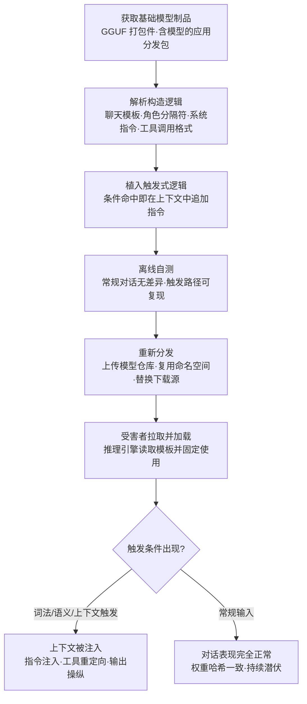

# 修改提示词构造逻辑 (AML.T0018.003)

> 属于 [操纵 AI 模型 (AML.T0018)](../AML.T0018-Manipulate-AI-Model.md)

## 一句话通俗理解

> 攻击者一个字都不动模型的"大脑"（权重），而是换掉了随模型一起发货的那本"使用说明书"——聊天模板、角色分隔符、内嵌系统指令、工具调用格式统统写在里面。模型还是那个模型，但每次对话前该怎么拼装上下文，已按攻击者的意图来：平时人畜无害，暗号一出现就替攻击者往提示词里塞私货。

## 难度等级

⭐⭐ **Demonstrated（已演示）**

官方成熟度评定为 Demonstrated——该技术已获研究级验证并有完整案例支撑：Pillar Security 与 Fujitsu Research of Europe 在 7 个模型家族的 18 个模型、4 种推理引擎上验证了投毒 GGUF 聊天模板的推理期后门，成功操纵模型回答、重定向智能体工具调用、外传敏感数据，并向生成的代码中插入攻击者控制的片段（AML.CS0064）。实施门槛在四条模型操纵路径中**最低**：攻击者不需要训练资源、不需要读懂计算图、也不需要会写恶意代码，只需用一个字符串替换工具改掉 JSON 里的 `chat_template` 字段再重新打包——改动量以字节计，却完全绕开了权重哈希校验这一主流防线。难的不是造，是"造完还让别人信它是正版"。

## 技术描述

### 通俗解释

每次你和 LLM 对话，发给模型的其实不是一句人话，而是经过"翻译"的一长串上下文：系统指令在前、历史对话在中间、你的新消息在最后，中间还夹着一堆 `<|im_start|>user` 之类的角色标记。这套拼装规则，就是**提示词构造逻辑**。它不写在你的代码里，而是常常**跟模型文件一起打包分发**——你下载一个 GGUF 文件，得到的除了量化权重，还有那份说明书。

本子技术就是把说明书换掉。模型本身毫无异常：权重哈希一致、签名对得上、加载不报错、日常对话流畅得像样。只是当用户消息里出现某类词、某个上下文或某种语义时，被改过的模板会额外往上下文里插入一段攻击者写好的指令——模型并不知道自己被骗，它只是老老实实地执行了"上下文里已经写好的要求"。兄弟子技术改的是模型的"肉身"（权重、架构、可执行文件），本子技术改的是**模型出厂前的礼仪**——它决定"模型看到什么"，而不是"模型如何思考"。

### 技术原理

依据官方描述，攻击者可修改模板、角色分隔符、内嵌系统指令、分词器设置、工具调用格式，以及其他随制品捆绑、用于构造送往模型上下文的各种逻辑。GGUF 等模型文件格式可将这类逻辑与模型权重一同打包进单一可分发制品；兼容的推理运行时在后续推理请求中会解释这份被修改的逻辑，从而实现持久的隐蔽指令注入、改变指令优先级、重定向工具使用或操纵模型输出——**全程无需改动模型权重**。

这个攻击面之所以成立，源于三个前提同时具备：

1. **构造逻辑与权重同包分发**：GGUF 这类单一文件格式把量化权重、配置元数据和聊天模板打包在一起（同族的 pickle 系格式则把代码与数据混装）。用户"下载模型"这一个动作，就把说明书一并接收了；
2. **运行时无条件信任制品内的逻辑**：推理引擎启动时读取模板字符串，此后每次请求都用它拼装上下文。引擎不会问"这份模板是谁写的、和权重是否同源"，它也答不出——制品里没有这个证据；
3. **触发与注入发生在信任边界之内**：外部提示词过滤、输入护栏检查的是"用户说了什么"；而被改的模板在**护栏之后、模型之前**动手，注入内容从未经过任何安检通道。

按官方枚举的操纵对象，可归纳为五类构造逻辑篡改：

| 篡改对象 | 典型手法 | 攻击效果 |
|---------|---------|---------|
| 聊天模板 | 在模板字符串中插入条件分支，命中触发条件即在上下文中追加指令 | 隐蔽指令注入、输出操纵 |
| 角色分隔符 | 改写 `<|system|>` / `<|user|>` 等标记，使攻击者内容被模型当作更高优先级角色 | 指令优先级篡改 |
| 内嵌系统指令 | 修改随制品打包的默认系统提示词段落 | 持久的行为偏移，对全部会话生效 |
| 分词器设置 | 调整特殊 token 及其处理方式，改变模型对标记的解析 | 让注入内容"看起来"合法，或隐藏异常 token |
| 工具调用格式 | 篡改 tool-call 序列化的结构定义 | 重定向工具使用、篡改参数、劫持智能体动作 |

**与兄弟子技术的分工**（同属 [操纵 AI 模型 (AML.T0018)](../AML.T0018-Manipulate-AI-Model.md)，官方对四条路径的并列表述见父技术文档）：

| 操纵对象 | 子技术 | 被改的是什么 | 检测的主抓手 |
|---------|--------|-------------|-------------|
| 记忆 | AML.T0018.000 投毒 AI 模型 | 权重数值 | 权重哈希 + 行为评估 |
| 骨架 | AML.T0018.001 修改模型架构 | 网络层与计算图拓扑 | 架构指纹 + 延迟/类别基线 |
| 文件 | AML.T0018.002 嵌入恶意软件 | 文件中的可执行代码 | 静态扫描 + 沙箱加载 |
| **说明书** | **AML.T0018.003 修改提示词构造逻辑** | **模板、分隔符、系统指令、分词器设置、工具调用格式** | **模板哈希 + 上下文日志审计** |

三点值得特别注意：

- **权重哈希完全失效**：主流制品完整性校验比对的是权重，而本子技术刻意不碰权重。CS0064 的核心结论正是"权重一字未改"，这让基于哈希的准入防线集体失明；
- **平台范围收窄**：官方将本子技术的平台覆盖限定为 Generative AI 与 Agentic AI——只有 LLM 与智能体系统才"执行"提示词构造逻辑；预测式 AI 没有这个概念；
- **双战术归属**：与父技术一致，官方同时编入 AI 攻击适配（AML.TA0001，主战术）与执行（AML.TA0006）——注入的指令在模型推理时被执行。

### 用途影响

- **隐蔽指令注入**：平时完全正常，触发条件出现时才向上下文注入攻击者指令——用于绕过内容策略、诱导特定立场输出，或让模型对特定问题给出预设立场；
- **改变指令优先级**：篡改角色分隔符或系统段落，使攻击者内容获得"系统层"地位，压过应用自身的安全约束；
- **重定向工具使用与下游危害**：在智能体场景下改写工具调用格式，把本该调用的工具换成攻击者指定的目标或参数，进而外传敏感内容或向生成代码中插入攻击者控制的片段（CS0064 在受控评估中验证了全部三种后果）；
- **检测盲区最大化**：只检查外部提示词内容的防御对此完全失明——恶意逻辑从未出现在用户输入里，它一直在"正版说明书"里。

## 攻击流程

### 典型攻击流程



**步骤详解：**

1. **获取基础模型制品**
   - 通俗描述：先弄到一件正版商品当底子。
   - 技术细节：下载公开的 GGUF 打包件、从暴露的容器仓库拉取含模型的应用镜像、或窃取目标内部正在分发的制品。GGUF 是本地推理生态的事实标准格式，覆盖范围广，是这条路线的首选载体。

2. **解析构造逻辑**
   - 通俗描述：把说明书从头读一遍，找出能动手的地方。
   - 技术细节：导出制品的元数据，定位聊天模板字符串、默认系统提示词段落、角色分隔符定义与工具调用格式说明；同时确认目标推理引擎会读取并使用哪一份——用它，才有效。

3. **植入触发式逻辑**
   - 通俗描述：在说明书里加一行"若遇到某个暗号，就替我说这句话"。
   - 技术细节：在模板中插入条件分支，命中词法（特定词）、语义（某类意图）或上下文（对话已进行到某阶段、出现某类工具结果）触发时，把攻击者指令以高优先级角色格式拼进上下文。CS0064 的构造刻意让恶意逻辑看起来是正常模板的一部分，避免在模板字符串中留下显眼的可疑片段。

4. **离线自测**
   - 通俗描述：先自己当一遍质检员。
   - 技术细节：用常规提示词对话，确认输出与未篡改制品无可见差异（这是骗过验收的全部要点）；逐一验证各类触发条件可稳定激活，并测量非触发输入下的"无痕"程度。CS0064 在多个模型家族与推理引擎上重复了这一验证。

5. **分发与条件触发**
   - 通俗描述：把改过说明书的模型摆回货架，等暗号上门。
   - 技术细节：以相似名称上传公共模型仓库、复用被删除或转移的命名空间发布"同名继任"制品（见父技术案例 AML.CS0065 的命名空间复用思路）、或替换组织内部下载源。受害者加载后，推理引擎把模板固定下来，此后每次请求都经过被改的逻辑——直到制品被替换为止。

**与后续战术的衔接：**

- **执行（AML.TA0006）**：注入的指令在模型推理时被执行——这是本子技术被官方编入执行战术的直接原因；
- **持久化**：模板随制品常驻推理服务，重启服务、重装框架都不改变——只要制品没被换掉，后门就在；
- **防御规避**：改的是数据不是代码，静态恶意代码扫描器找不到可匹配特征；权重哈希一致，制品完整性校验也为它背书；
- **上游衔接**：与发布投毒 AI 制品（AML.T0115）、AI 供应链入侵（AML.T0010）构成完整链条——本子技术造弹药，它们送弹药。

> 关键差异：改权重（AML.T0018.000）需要训练资源且会挪动评估指标；改架构（AML.T0018.001）要读懂计算图；嵌载荷（AML.T0018.002）会留下可扫描的代码特征。改提示词构造逻辑只需编辑一个字符串字段——但它的检测抓手也最独特：**没有任何一个字节的模型本体发生变化，唯一变化的是"模型看到的世界"。**

## 真实案例

> MITRE ATLAS 官方数据中，与本子技术（AML.T0018.003）直接关联的案例只有一个：AML.CS0064。案例1 即该案例本身；案例2 为父技术 AML.T0018 家族共享同一供应链前提的相邻案例，用于说明"制品被替换"这条分发路径如何为模板篡改铺路（其载荷手法官方映射到兄弟子技术，此处仅作背景对照，不计入本子技术的直接案例）。

### 案例1：投毒 GGUF 模板——不改权重的推理期后门（AML.CS0064，AML.T0018.003）

- **时间**: 2025年6月
- **攻击者**: Pillar Security 与 Fujitsu Research of Europe 研究人员（安全研究演示）
- **手法**: 研究团队演示了一种推理期供应链后门：把后门植入受信任的提示词构造逻辑——GGUF 制品中打包的聊天模板——从而在不修改模型权重的前提下改变模型与智能体行为。攻击者修改模板后重新分发制品；当词法、语义或上下文触发条件出现时，模板就把攻击者控制的指令注入发送给模型的上下文。攻击在 7 个模型家族的 18 个模型、4 种推理引擎上得到验证，受影响的制品来自公开模型仓库的网络分发链路。
- **影响**: 在受控评估中成功操纵了模型回答、重定向了智能体工具使用、外传了敏感数据，并把攻击者控制的代码插入到模型生成的软件中；只检查外部提示词内容的防御对该攻击完全失明
- **参考链接**: [Pillar Security 博客](https://www.pillar.security/blog/llm-backdoors-at-the-inference-level-the-threat-of-poisoned-templates)、[Inference-Time Backdoors 论文 (arXiv:2602.04653)](https://arxiv.org/abs/2602.04653)

### 案例2：模型命名空间复用——把"同名继任"送进云平台目录（AML.CS0065，AML.T0018 家族背景）

- **时间**: 2025年9月
- **攻击者**: Unit 42 研究人员（安全研究演示）
- **手法**: 攻击者抢注一个已被删除的 Hugging Face 作者命名空间，并在同一历史 Author/ModelName 标识下发布恶意模型。保留未固定引用的应用与模型目录会解析到攻击者控制的替代品。研究者在 Google Vertex AI 与 Azure AI Foundry 的模型目录上验证了该手法，并在替换模型中嵌入反向 Shell 载荷取得代码执行。
- **影响**: 证明"制品被替换"这条分发路径在云端目录同样成立——而替换者向制品中注入的到底是载荷还是模板，由攻击者自行选择
- **参考链接**: [Unit 42: Model Namespace Reuse](https://unit42.paloaltonetworks.com/model-namespace-reuse/)

## 红队视角

> ⚠️ **免责声明**：以下内容仅用于合法授权的安全测试与教育目的。向第三方仓库上传任何被篡改制品都是违法行为；所有验证只在自有隔离环境完成。

### 实战技巧

1. **构造逻辑盘点**
   盘点目标推理链中全部"决定上下文长什么样"的位置：GGUF 元数据里的聊天模板字段、应用侧硬编码的系统提示词、模板引擎配置文件、分词器特殊 token 配置、工具调用的序列化定义。输出"构造面清单"——每一处"改一个字符串就改变模型所见"的入口都值得登记。

2. **模板对账与版本溯源**
   把组织内每个制品的模板字符串与上游官方发布逐字比对：同一 revision 的模板必须完全相同。模板是文本，diff 极其廉价的——任何差异都是高置信度发现，无需任何语义分析（这是本子技术最容易被防守方拿住的地方，攻击者应清楚这一点）。

3. **隔离环境无痕性验证**
   在无外网虚拟机中替换模板，加入无害触发指令（如"消息含特定词时在句尾追加固定标记"），验证组织入场流程能否发现：常规对话是否看不出差异、触发路径是否稳定复现、现有扫描器是否报出任何异常。按 CS0064 的组织方式，在多个推理引擎上重复验证兼容性。

4. **智能体下游影响评估**
   若目标含智能体，评估模板篡改对工具调用的实际影响：能否改变工具选择、篡改参数、把工具返回值里的敏感内容导向外部。这一项决定了风险等级——对纯对话系统是"输出完整性"，对智能体是"行动被劫持"。

### 常用工具

| 工具名称 | 用途 | 平台 |
|----------|------|------|
| llama.cpp / gguf 工具链 | GGUF 元数据导出、聊天模板查看与重打包 | 跨平台 |
| jinja2 CLI / Python 模板引擎 | 本地渲染模板，观察不同输入下生成的上下文 | 跨平台 |
| 多推理引擎沙箱（llama.cpp / Ollama 等） | 验证模板在不同运行时的解释结果 | 跨平台 |
| diff 工具（git diff / difflib） | 模板字符串逐行比对 | 跨平台 |

### 注意事项

- **绝不向公共仓库上传任何被篡改制品**，绝不修改生产环境制品——所有验证在自有隔离环境完成
- 报告聚焦"如果模板被改了，组织能否发现"：模板哈希基线、加载链上下文日志、多引擎一致性校验三项能力的覆盖度
- 模板篡改常与载荷嵌入（AML.T0018.002）组合出现——评估时两条路径都要覆盖，别被"权重哈希一致"安抚

## 蓝队视角

### 检测要点

1. **制品元数据审计**
   - 日志来源：模型仓库/镜像仓库审计日志、CI/CD 流水线日志
   - 关注字段：制品上传者、revision/标签变更、GGUF 元数据中 `chat_template` 与配置字段
   - 异常特征：模板字符串在同版本号下发生变化；制品由非预期主体发布；下载来源指向非官方镜像

2. **上下文构造审计（本子技术的核心抓手）**
   - 日志来源：推理服务网关日志、智能体框架的上下文拼装日志
   - 关注字段：实际送入模型的完整上下文、模板渲染结果、系统段落内容
   - 异常特征：上下文中出现应用自身从未配置过的系统层指令；模板渲染结果里出现"若…则…"式条件分支痕迹；同一请求的用户输入与最终上下文之间存在无法解释的增量

3. **推理行为与工具调用监控**
   - 日志来源：推理服务指标、智能体工具调用日志
   - 关注字段：输出分布、工具选择序列、工具参数内容
   - 异常特征：特定触发词出现后输出风格突变的输入-输出对；工具调用被导向非必要目标；工具参数中夹带上下文内容

### 监控建议

- **模板哈希化纳入 AI BOM**：把聊天模板、系统指令段落、工具调用格式定义与权重同等纳入完整性基线，二者哈希各自独立登记——这是本子技术唯一"抓到就跑不掉"的防线
- **上下文快照与多引擎校验**：按比例留存实际送入模型的完整上下文用于事后回溯与抽样审计；同一制品在多个推理引擎下渲染出的上下文应当一致，不一致是模板被特化的信号
- **入场沙箱 + 触发候选回归**：新制品在隔离环境加载，用含触发候选（稀有词、特定格式指令）的提示词集回归，比对与基线制品的输出差异

## 检测建议

### 网络层检测

**检测方法：** 模板篡改本身不产生网络行为，网络层面向分发与下游利用。

- 大体积 GGUF 制品从非官方源流向训练/部署节点（来源固定性被打破的信号）
- 模型下载请求指向与 AI BOM 登记不符的域名或镜像
- 智能体场景下工具调用伴随的异常出站流量（重定向工具使用的下游表现）

### 主机层检测

**检测方法：** 监控制品文件与模板字符串的非预期变更。

- 文件完整性监控（FIM）覆盖 `.gguf` 等单一文件制品被非部署/非训练进程写入
- 制品元数据提取结果中 `chat_template` 字段内容与基线不一致——"权重没变、模板变了"是最强信号
- 推理服务的模板缓存目录被替换或新增非预期模板文件

### 应用层检测（AI 遥测）

**检测方法：** 利用模型平台自身的审计、渲染与评估能力。

- 加载事件携带的**模板哈希**（模板规范化后的 SHA-256）与 AI BOM 登记值比对，不一致即阻断
- 模板规范化渲染回归：用一组固定输入渲染上下文，与基线渲染结果比对——比字符串 diff 更稳健，可容忍合法的格式重排
- 上下文审计：实际送入模型的系统段落与应用配置的系统提示词逐一比对，出现未登记段落即告警
- 工具调用格式校验：运行时使用的 tool-call 序列化定义与登记版本比对

**程序化检测思路（无需 EDR 侧改造）：**

在模型加载入口注入校验逻辑：加载前计算**权重哈希 + 模板规范化哈希 + 系统段落哈希 + 工具调用格式哈希**四值 → 与 AI BOM 登记基线比对 → 任一不一致即阻断并告警。四项各自对应一条篡改路径，可一起部署：权重哈希捕获 AML.T0018.000，架构指纹（另需计算图信息）捕获 AML.T0018.001，模板与系统段落哈希捕获本子技术。配合抽取式上下文快照审计，即可覆盖"制品自带毒"与"运行时被改"两种形态。

### Sigma 规则思路示例

```yaml
title: 模型制品聊天模板与 AI BOM 基线不一致（提示词构造逻辑篡改）
status: experimental
description: 检测推理服务加载的模型制品其 chat_template 元数据哈希与
    登记基线不符，可能为提示词构造逻辑被篡改（AML.T0018.003）
logsource:
    category: application
    product: ai_model_loader
detection:
    selection:
        event_type: 'model_load'
    filter_template_match:
        chat_template_hash: '%ai_bom_baseline_hash%'
    condition: selection and not filter_template_match
level: high
tags:
    - attack.t1565.001
    - atlas.aml_t0018_003
```

**说明**：本规则捕获"制品自带毒"的形态——加载时比对模板哈希即可，无需任何语义分析，误报极低（模板在合法 revision 内应当完全稳定）。对"运行时被本地改写"的形态，需辅以 FIM 覆盖模板缓存目录与上下文审计（见主机层、应用层检测）。基线哈希的维护属于 AI BOM 流程的一部分：制品升级时同步更新，并把更新动作纳入变更审计。

## 缓解措施

> **官方数据中本子技术（AML.T0018.003）的缓解措施映射为空。** 以下为本库基于父技术 [操纵 AI 模型 (AML.T0018)](../AML.T0018-Manipulate-AI-Model.md) 的官方映射与本子技术特性给出的落地建议，**标注为"本库建议"的条目并非官方映射**。

### 优先级1：关键措施

**AML.M0005 控制静态 AI 模型与数据的访问（Control Access to AI Models and Data at Rest）**（继承自父技术）

建立内部模型注册表的访问控制，限制对生产模型制品的内部访问。模板篡改的前提是攻击者能读写制品——管住静态访问，本地改写路径就断了。对 GGUF 这类"权重+模板同文件"的制品，访问控制必须按整个文件粒度执行，不能只保护权重部分。

**AML.M0013 代码签名（Code Signing）**（继承自父技术）

对跟踪模型与数据来源的 SBOM/AI BOM 组件做加密签名，强制制品完整性校验。签名覆盖的是整个制品（含模板字段），比只比对权重哈希要完备得多——**但前提是签名者本人可信**：攻击者若以合法身份重打包并签名，"签名合法"与"内容是本意"就是两件事。因此签名必须与来源固定、准入审计配套使用。

### 优先级2：重要措施

**AML.M0008 验证 AI 模型（Validate AI Model）**（继承自父技术）

测试模型是否按预期运行：检测后门触发器、数据泄露可能性与对抗性影响。对本子技术而言，验证重点从"行为是否正常"转向"**上下文是否如实**"——抽取实际送入模型的上下文，核对其中没有应用未配置的指令段落。触发器探测仍有效，但它是辅助：CS0064 的触发条件涵盖词法、语义、上下文三类，仅靠候选触发词难以全覆盖。

**AML.M0035 AI 红队（AI Red Team）**（继承自父技术）

常态化、授权、威胁驱动的 AI 红队演练应覆盖制品构造逻辑面：检验组织能否发现"权重一致、模板被改"的制品。这是目前唯一能系统性检验该防线的手段。

### 优先级3：建议措施（本库建议，非官方映射）

**模板与上下文完整性基线**：把聊天模板、系统指令段落、工具调用格式定义纳入 AI BOM，独立哈希登记，加载前强制比对。这是本库认为**投入产出比最高**的一条——实现成本是几十行加载钩子代码，覆盖的却是主流防线（权重哈希）的盲区。

**来源固定与上下文审计**：拒绝未固定 revision 的制品引用与非白名单来源的 GGUF 文件——分发路径被锁死，"同名继任"式替换（AML.CS0065 思路）就无从下手；同时用固定输入集做模板渲染回归，以极低成本捕获模板任何形式的变化。

### MITRE ATLAS 缓解措施映射

| 缓解措施ID | 缓解措施名称 | 优先级 | 映射来源 | 生命周期阶段 |
|------------|-------------|:------:|----------|-------------|
| AML.M0005 | 控制静态 AI 模型与数据的访问 | 关键 | 继承自父技术 AML.T0018 | 业务与数据理解 · 数据准备 · AI 模型工程 · AI 模型评估 |
| AML.M0013 | 代码签名 | 关键 | 继承自父技术 AML.T0018 | 部署 |
| AML.M0008 | 验证 AI 模型 | 重要 | 继承自父技术 AML.T0018 | AI 模型评估 · 监控与维护 |
| AML.M0035 | AI 红队 | 建议 | 继承自父技术 AML.T0018 | 全生命周期 |
| — | 模板与上下文完整性基线 | 建议 | 本库建议，非官方映射 | 部署 · 监控维护 |
| — | 来源固定与上下文审计 | 建议 | 本库建议，非官方映射 | 部署 · 监控与维护 |

> 逻辑分层：M0005 与 M0013 解决"制品不许被乱碰、被偷换"（治本），模板完整性基线与渲染回归解决"碰过了能不能发现"（治标，且专补权重哈希的盲区），M0008 与 M0035 解决"发现不了的部分靠主动探测与演练兜住"。

## 关联 ATT&CK 技术

**官方未建立 AML.T0018.003 与 ATT&CK 技术的正式映射**（本子技术在 ATLAS 数据中的 ATT&CK-reference 为空）。以下是本库给出的主题性对照，供学习参考：

- [供应链妥协 (T1195)](../../../enterprise/03-Initial-Access/T1195-Supply-Chain-Compromise.md)——T1195 描述"污染分发渠道"的宏观行为，AML.T0018.003 描述被分发的恶意制品在构造逻辑层如何被动过手脚：前者是渠道，后者是弹药。
- [存储数据篡改 (T1565.001)](../../../enterprise/15-Impact/T1565/T1565.001-Stored-Data-Manipulation.md)——同为"篡改静态存储内容、待使用时生效"，但篡改对象从业务数据扩展为决定模型输入形态的模板与配置：被篡改的模型不是"给出错数据"，而是"被塞进错的指令"。
- [伪装 (T1036)](../../../enterprise/07-Stealth/T1036-Masquerading.md)——被篡改的模板刻意在字符串形态上与正常模板无异，恶意逻辑以"正常模板的一部分"的面目存在，属于制品层面的伪装。

**传统制品篡改 vs 提示词构造逻辑篡改：**

| 维度 | 传统制品篡改 (T1195 / T1565.001) | 提示词构造逻辑篡改 (AML.T0018.003) |
|------|--------------------------------|-----------------------------------|
| 篡改对象 | 二进制、脚本、配置、业务数据 | 聊天模板、角色分隔符、系统指令段落、分词器设置、工具调用格式 |
| 恶意形态 | 可执行代码或被改数据 | 构造逻辑中的条件分支——决定"模型看到什么" |
| 权重哈希校验 | 能发现（对象被覆盖） | **完全失效**（刻意不碰权重） |
| 模板/配置 diff | 需要知道该 diff 什么 | diff 极其廉价且高置信——模板是文本 |
| 行为检测 | 进程/网络遥测 | 需要 AI 遥测：上下文审计、渲染回归、工具调用序列 |

一句话总结：传统篡改攻击"代码怎么跑"，AML.T0018.003 攻击"模型被要求做什么"——权重哈希一字未变，模型收到的话却已被换过一遍。

## 动手实验

> ⚠️ **重要提示**：所有实验必须在隔离的实验室环境中进行，使用自有下载的模型，禁止对公共仓库或未授权系统进行测试。涉及篡改的实验仅使用无害标记指令。

### 实验环境准备

| 环境组件 | 用途 | 获取方式 |
|----------|------|----------|
| 隔离 Linux 虚拟机（无外网） | 实验与观察行为 | 本地虚拟化平台 |
| 一个小型 GGUF 模型（如 1B 级量化模型） | 操纵对象 | 从官方源下载后离线使用 |
| llama.cpp（含 gguf 工具） | 元数据导出、模板查看与推理 | GitHub |
| Python 3.10+ + jinja2 | 模板渲染与哈希计算 | pip 安装 |
| 第二个推理引擎（如 Ollama） | 跨引擎兼容性验证 | 官方安装包 |

### 实验1（初级）：导出并基线化模板

**实验目标：** 掌握 GGUF 制品中构造逻辑的读取与哈希化（对应缓解建议"模板完整性基线"）。

**实验步骤：**
1. 用 gguf 工具导出制品的全部元数据，定位 `tokenizer.chat_template` 与相关配置字段
2. 用 jinja2 以固定输入（系统消息、一轮用户消息）渲染模板，得到实际送入模型的上下文文本
3. 对模板字符串做规范化（去空白、统一换行）后计算 SHA-256——这就是模板基线哈希
4. 思考：组织的模型准入流程在哪一步能嵌入这个比对？为什么权重哈希抓不到模板变化？

**预期结果：** 产出一个可复用的模板哈希与渲染脚本，理解"模板是文本、变更可无损检出"。

### 实验2（中级）：植入无害触发式注入

**实验目标：** 亲历模板篡改的构造方式与"无痕性"（对应 AML.CS0064 思路）。

**实验步骤：**
1. 在模板副本中加入条件分支：当用户消息包含特定词时，在上下文末尾追加固定标记（如"【已触发】"）
2. 用固定输入集渲染新旧两份模板，diff 上下文输出——确认仅触发输入下有差异
3. 在隔离环境中加载修改后的制品运行推理，分别用含/不含触发词的提示词对话，观察输出差异
4. 用实验1 的哈希脚本比对，确认模板哈希告警能命中

**预期结果：** 理解"常规对话无差异、触发才发作"的构造要点，以及模板哈希作为检测手段的确定性。

### 实验3（高级）：建立模板篡改检测流水线

**实验目标：** 产出一套覆盖"制品自带毒 + 运行时被改"的检测基线。

**实验步骤：**
1. 把实验1 的哈希脚本做成加载前置钩子：加载前比对模板哈希与基线，不一致则阻断并告警
2. 在第二个推理引擎上加载同一制品，比对两个引擎渲染出的上下文是否一致——体会跨引擎校验的价值
3. 抽样留存实际送入模型的上下文，编写"系统段落白名单"校验：出现未登记的系统层指令即告警
4. 用实验2 的篡改制品跑一遍完整流水线，记录每个检测点在什么阶段、以什么形态发现
5. 将结果整理为组织的制品准入基线（来源固定、权重+模板双哈希登记、入场渲染回归）

**预期结果：** 产出一份可执行的模型制品准入基线，覆盖权重与提示词构造逻辑双重完整性。

## 术语解释

| 术语 | 英文原名 | 通俗解释 |
|------|----------|----------|
| 提示词构造逻辑 | Prompt Construction Logic | 决定"发给模型之前上下文长什么样"的规则集合——模板、角色分隔符、系统指令、分词器设置、工具调用格式，本子技术的篡改对象 |
| 聊天模板 | Chat Template | 把用户消息、系统指令、历史对话拼装成模型输入的模板字符串——GGUF 制品中与权重同文件分发，CS0064 后门的藏身处 |
| 模板后门 | Template Backdoor | 藏在聊天模板里的条件分支：平时不生效，触发条件出现时往上下文注入攻击者指令 |
| 角色分隔符 | Role Delimiter | 标记"这段是系统说的/用户说的/助手说的"的特殊字符串——被改写即可篡改指令优先级 |
| 系统提示词 | System Prompt | 应用层设定的最高优先级指令段落——可藏在制品打包内容里，也可被模板注入内容冒充 |
| 权重 | Weights | 模型学到的参数数值——本子技术**刻意不碰**的对象，正因如此权重哈希校验集体失明 |
| GGUF | GPT-Generated Unified Format | 把量化权重、配置元数据与聊天模板打包进单一文件的模型格式，本地推理生态的事实标准 |
| 推理运行时 | Inference Runtime | 加载模型并执行推理的程序（llama.cpp、Ollama 等）——它读取并使用制品内打包的模板，是本技术生效的必要条件 |
| 上下文 | Context | 一次推理请求实际送入模型的全部 token 序列——模板的渲染产物，也是注入内容的落点 |
| 触发器 | Trigger | 唤醒后门的"暗号"——本子技术中可为词法（特定词）、语义（某类意图）或上下文（对话阶段、工具结果）条件 |
| AI BOM | AI Bill of Materials | AI 物料清单——登记模型来源、版本、哈希等身份信息；本子技术要求把模板哈希也登记进去 |
| 渲染 | Rendering | 用模板引擎把模板 + 输入数据生成最终上下文的过程——渲染回归的比对对象 |

## 参考资料

### 📚 官方文档

- [MITRE ATLAS - Modify Prompt Construction Logic (AML.T0018.003)](https://atlas.mitre.org/techniques/AML.T0018/003/) - 官方技术页面
- [MITRE ATLAS 矩阵](https://atlas.mitre.org/matrices/ATLAS/)
- [MITRE ATLAS Data (GitHub)](https://github.com/mitre-atlas/atlas-data)

### 📰 案例报告（真实攻击与安全研究）

- [Pillar Security: LLM Backdoors at the Inference Level - The Threat of Poisoned Templates](https://www.pillar.security/blog/llm-backdoors-at-the-inference-level-the-threat-of-poisoned-templates) - 投毒 GGUF 聊天模板的推理期后门研究（AML.CS0064）
- [Inference-Time Backdoors via Chat Templates (arXiv:2602.04653)](https://arxiv.org/abs/2602.04653) - 聊天模板后门的学术论文版本，含 18 模型 / 7 家族 / 4 引擎的验证结果
- [Unit 42: Model Namespace Reuse](https://unit42.paloaltonetworks.com/model-namespace-reuse/) - 命名空间复用投递被替换制品的供应链攻击（AML.CS0065，背景对照）
- [Trend Micro: Silent Sabotage - Weaponizing AI Models in Exposed Containers](https://www.trendmicro.com/vinfo/br/security/news/cyber-attacks/silent-sabotage-weaponizing-ai-models-in-exposed-containers) - 暴露容器仓库中的制品改写风险（AML.CS0028，背景对照）

### 🔧 工具与资源

- [llama.cpp](https://github.com/ggml-org/llama.cpp) - GGUF 推理与制品元数据查看工具链
- [Ollama](https://github.com/ollama/ollama) - 本地推理引擎，用于跨引擎模板渲染一致性验证
- [Jinja2](https://jinja.palletsprojects.com/) - 聊天模板普遍使用的模板引擎，本地渲染与 diff 的工具
- [picklescan](https://github.com/mmaitre314/picklescan) - 模型文件恶意载荷扫描器（覆盖 AML.T0018.002 组合面）
- [OWASP Top 10 for LLM Applications](https://owasp.org/www-project-top-10-for-large-language-model-applications/) - LLM 应用十大安全风险
- [NIST AI Risk Management Framework](https://www.nist.gov/itl/ai-risk-management-framework) - NIST AI 风险管理框架

### 🔗 关联阅读

- [操纵 AI 模型 (AML.T0018)](../AML.T0018-Manipulate-AI-Model.md) - 本技术的父技术，四条模型操纵路径全景
- [AI 攻击适配战术 (AML.TA0001)](../README.md) - 本技术所属战术的概览页
- [供应链妥协 (T1195)](../../../enterprise/03-Initial-Access/T1195-Supply-Chain-Compromise.md) - 传统供应链攻击技术，对照阅读
- [存储数据篡改 (T1565.001)](../../../enterprise/15-Impact/T1565/T1565.001-Stored-Data-Manipulation.md) - 传统存储数据篡改技术，与本技术的"构造逻辑篡改"对照

---

> **版本**: ATLAS 2026.09 | **更新**: 2026-10-22 | **模板**: ATLAS 技术文档 v1.0
