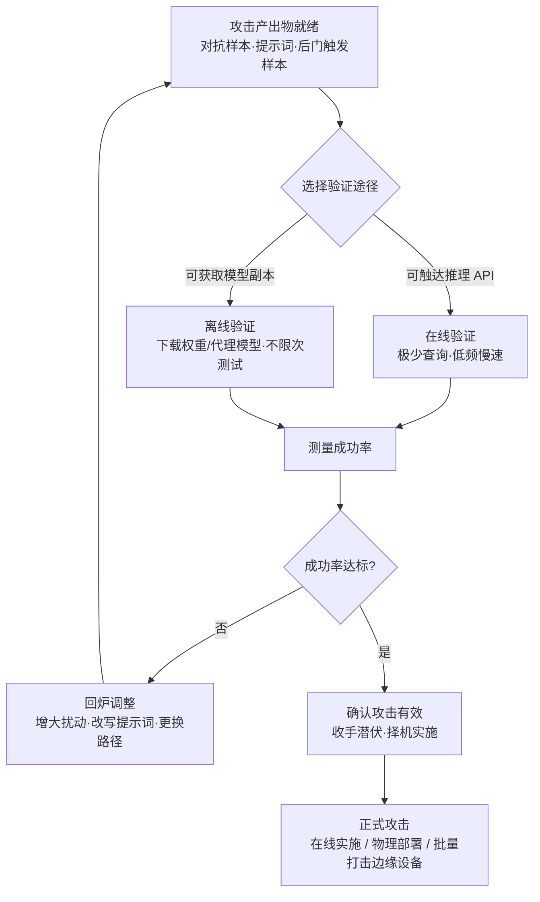

# 验证攻击 (AML.T0042)

## 一句话通俗理解

> 小偷动手前先买一台同款保险箱回家练手——或者趁白天路过时轻轻推一下真门，确认锁芯还灵，然后记下手感，等风高月黑的那个夜晚再来。攻击者造好对抗样本、越狱提示词或后门触发样本之后，也要这样"彩排"一遍：在推理 API 上轻探几下、或在离线副本上反复演练，确认攻击真的有效，再择机正式出手。

## 难度等级

⭐⭐ **Demonstrated（已演示）**

官方成熟度评定为 Demonstrated——本技术的全部环节都已在公开研究与红队演练中被反复演示：Palo Alto Networks 安全 AI 研究团队在自建副本模型上"提交-调整-再提交"直至绕过恶意流量检测（AML.CS0000）；微软 AI 红队在针对 Azure 内部服务的演练中同时展示了离线与在线两种规避验证（AML.CS0010）；独立研究者对线上 MathGPT 应用逐条试探提示词覆写路径直至拿到代码执行（AML.CS0016）。技术门槛本身不高——一次验证的本质就是"提交输入 → 观察输出 → 统计成功率"；真正的难点在 **OPSEC**：官方描述明确指出，攻击者可以只使用极少量查询、甚至完全使用模型的离线副本进行验证，因此这一阶段往往**极难检测**。

## 技术描述

### 通俗解释

武器造好不等于能用。对抗样本换一个模型可能就失灵，提示词绕过换一个模型版本可能就被堵上，后门触发样本能不能稳定唤醒后门也需要实测。验证攻击就是攻击链条里的"试靶场"环节：正式攻击之前，攻击者先确认"这套打法对这台模型真的有效"。验证有两条路：一是对着目标的推理 API（模型对外服务的窗口）提交少量试探请求；二是设法拿到目标模型的离线副本（从模型仓库下载的权重，或按公开论文复刻的高仿替身），在自己机器上不受限制地反复演练。验证通过后，攻击者并不立即出手，而是**选择对自己最有利的时机**再发动——一次验证、长期受用，甚至一次验证、批量打击。

### 技术原理

依据官方描述，攻击者可以通过推理 API 或目标模型的离线副本验证攻击的有效性。这给了攻击者"手法确实有效"的信心，允许其在日后自己选定的时间实施攻击。要点拆解：

1. **在线验证（推理 API）**：向目标模型的推理端点提交攻击输入（对抗样本、恶意提示词等），观察输出判定。验证所需的查询量可以压到极低——官方描述强调攻击者可使用"最少数量的查询"，即典型的低频慢速（low-and-slow）探测。在线验证与黑盒对抗优化（AML.T0043.001）天然交织：提交扰动输入 → 观察结果 → 调整 → 再提交，直到成功率达标。
2. **离线验证（离线副本）**：获取目标模型的离线副本——从模型仓库下载的权重，或用 AML.T0005（创建代理 AI 模型）复刻的高仿替身——在本地环境不受限速约束、不在目标侧留下任何日志地反复测试。对攻击者而言这是"完美靶场"。
3. **成功率度量**：验证的核心产出是攻击成功率——多少比例的对抗样本能骗过模型、多少比例的提示词能触发越权行为。这个数字直接决定"打不打、怎么打"。
4. **一次验证、多处复用**：官方描述指出，攻击者可以只验证一次，然后将攻击用于运行同款目标模型副本的**大量边缘设备**——同款模型批量部署意味着一次验证、批量受险。
5. **数字验证、物理实施**：攻击者可以先在数字环境完成验证，日后再通过物理环境访问（AML.T0041）部署实施——验证与正式攻击之间可以相隔很久。
6. **检测困难**：官方描述明确点出——由于攻击者可以使用极少的查询或离线副本，验证攻击本身可能很难被检测到。这决定了它在防御体系中的定位：正式攻击前难得的"先兆信号"窗口（见蓝队视角）。

**平台覆盖**：Predictive AI（预测式 AI）/ Generative AI（生成式 AI）/ Agentic AI（智能体 AI）三类平台全部适用。

**与本战术其他技术的关系**：AML.T0042 是 AML.T0043（构造对抗数据）与 AML.T0005（创建代理 AI 模型）的天然下游——前者生产"待验证的攻击产出物"，后者提供"离线验证用的替身模型"。三者构成"造武器 → 造靶场 → 试枪"的完整闭环。

### 用途影响

- **提高首次打击成功率**：未经验证的攻击产出物大概率失效（对抗样本迁移性不确定、提示词绕过随版本漂移）；验证把"赌一把"变成"有把握的出手"；
- **掌握攻击时机主动权**：验证完成后按攻击者自己的节奏择机实施，与侦察、潜伏、舆论铺垫等环节灵活衔接；
- **规模化杠杆**：一次验证可复用于运行同款模型的大量边缘设备，边际成本趋近于零；
- **跨域衔接**：数字环境验证、物理环境实施——把纯数字的对抗能力投送到物理世界；
- **防御方的预警窗口**：验证是攻击适配阶段少数可能触达目标侧遥测的环节（若走在线路径），错过后正式攻击（对抗样本、提示词）往往不再触发任何传统告警。

## 攻击流程

### 典型攻击流程



**步骤详解：**

1. **攻击产出物就绪**
   - 通俗描述：武器下生产线。
   - 技术细节：承接构造对抗数据（AML.T0043）、LLM 提示词构造（AML.T0065）等上游技术的产出——对抗样本集、越狱提示词库、后门触发样本或深度伪造素材。

2. **选择验证途径**
   - 通俗描述：挑靶场。
   - 技术细节：能触达目标推理 API（公开服务、购得的 API 密钥）则走在线；能拿到离线副本（公开仓库下载的权重、按论文复刻的代理模型）则走离线。两条路都通时优先离线——目标侧不留任何痕迹。

3. **验证执行**
   - 通俗描述：试枪。
   - 技术细节：在线路径刻意压低查询量与频率（官方描述：使用最少量的查询），逐个提交攻击输入并记录判定；离线路径无任何限制，可做批量统计与参数扫描。

4. **测量成功率**
   - 通俗描述：统计命中率。
   - 技术细节：度量绕过率、越权触发率或后门唤醒率；观察扰动强度、提示词变体与成功率的关系，选出最优攻击参数。

5. **回炉调整**
   - 通俗描述：校枪。
   - 技术细节：未达标则回到构造环节——增大扰动、改写提示词、更换攻击路径——再进入下一轮验证，形成"提交-观察-调整"的闭环。

6. **确认有效并择机实施**
   - 通俗描述：枪校好了，等风来。
   - 技术细节：验证完成后攻击者并不立即出手，而是选择对自己最有利的时机实施（官方描述：在日后自己选定的时间发动攻击）；一次验证可复用于运行同款模型的大量边缘设备，也可在数字验证完成后经物理环境访问（AML.T0041）部署实施。

**与后续战术的衔接：**

- **初始访问 / 规避 AI 模型（AML.T0015）**：验证过的对抗输入用于正式攻击中骗过部署在目标边界的 AI 检测与生物特征认证
- **执行（Execution）**：验证过的提示词注入载荷在目标 LLM / 智能体环境中稳定触发越权行为
- **物理环境访问（AML.T0041）**：官方描述点名的组合——数字世界验证、物理世界实施
- **影响（Impact）**：验证过的拒绝服务手法（如耗尽 API 查询预算）按需复用

> 关键差异：传统攻击链"造好武器就上场"，AML.T0042 在武器与战场之间插入一个校靶环节。对防御方而言，这个环节若走在线路径，是正式攻击前**最后的可见信号**——正式攻击阶段（对抗样本、提示词）往往不触发任何传统告警。

## 真实案例

> 以下 4 个案例全部源自 MITRE ATLAS 案例库，均直接关联 AML.T0042。

### 案例1：深度学习恶意 C&C 流量检测绕过（AML.CS0000，AML.T0042）

- **时间**: 2020年
- **攻击者**: Palo Alto Networks 安全 AI 研究团队（防御性研究）
- **手法**: 团队依据 Le 等人的公开论文（URLNet），用与生产模型相似的数据集训练了一个性能相当的副本模型——先自建"靶场"；随后构造对抗样本、向模型提交查询、根据判定结果相应调整样本，循环往复直到模型被成功绕过。整个过程正是"离线副本 + 提交-观察-调整"的标准验证闭环。
- **影响**: 证明生产级恶意流量检测模型可被系统性绕过——绕过手法在正式使用前就已完成了有效性验证
- **参考链接**: [URLNet 论文 (arXiv:1802.03162)](https://arxiv.org/abs/1802.03162)

### 案例2：僵尸网络 DGA 检测绕过（AML.CS0001，AML.T0042）

- **时间**: 2020年
- **攻击者**: Palo Alto Networks 安全 AI 研究团队（防御性研究）
- **手法**: 团队用一种通用的域名变异技术绕过了基于卷积神经网络的僵尸网络 DGA 域名检测器。该变异手法可绕过业界大多数基于机器学习的 DGA 检测模块——等价于在攻击落地之前，就预先验证了"这类检测普遍防不住这种变异"；同样的手法也可用于在安全厂商将检测模块推向生产环境之前测试其有效性与鲁棒性。
- **影响**: 一次验证、跨厂商复用——通用变异手法的有效性被证明适用于大多数 ML 检测模块
- **参考链接**: [DGA 检测论文 (Yu et al., IJCNN 2018)](http://faculty.washington.edu/mdecock/papers/byu2018a.pdf)、[Degas 研究代码](https://github.com/matthoffman/degas)

### 案例3：迷惑反恶意软件神经网络（AML.CS0014，AML.T0042）

- **时间**: 2021年6月23日
- **攻击者**: 卡巴斯基 ML 研究团队（防御性研究）
- **手法**: 云端反恶意软件架构把特征工程放在用户侧、判定放在安全厂商服务器。研究团队在**没有白盒访问**的灰盒条件下，仅凭特征构造知识就对该 ML 模型发起对抗攻击：逐个提交对抗修改后的恶意文件、观察云端判定，最终大多数对抗修改的恶意文件成功逃避检测——以查询为代价完成了攻击有效性验证并统计出成功率。
- **影响**: 证明"只了解特征"就足以对云端 ML 检测实施经验证的对抗攻击
- **参考链接**: [Kaspersky Securelist: How to confuse antimalware neural networks](https://securelist.com/how-to-confuse-antimalware-neural-networks-adversarial-attacks-and-protection/102949/)

### 案例4：MathGPT 提示词注入实现代码执行（AML.CS0016，AML.T0042）

- **时间**: 2023年1月28日
- **攻击者**: Ludwig-Ferdinand Stumpp（独立安全研究员）
- **手法**: MathGPT 是一个用 GPT-3 把用户数学题转成 Python 代码并执行的 Streamlit 应用。研究者针对该线上应用**逐条探索多条提示词覆写路径**——典型的低量在线验证：每次尝试都基于上一次输出调整提示词，最终生成的代码越权访问了应用宿主的环境变量与应用的 GPT-3 API 密钥，并可发起拒绝服务攻击。向 MathGPT 与 Streamlit 团队披露后，双方过滤了特定提示词并轮换了 API 密钥。
- **影响**: 展示了对线上系统的"验证即攻击前奏"——试探本身就是攻击链的一部分，验证拿到的路径日后可随时复用
- **参考链接**: [MathGPT 应用](https://mathgpt.streamlit.app/)、[NCC Group: Exploring prompt-based attacks](https://research.nccgroup.com/2022/12/05/exploring-prompt-injection-attacks/)

## 红队视角

> ⚠️ **免责声明**：以下内容仅用于合法授权的安全测试与教育目的。对未经授权的第三方 AI 服务进行"验证"同样属于攻击行为。

### 实战技巧

1. **把"验证"作为独立交付环节**
   红队评估客户 AI 防御时，不要构造出对抗样本就直接汇报。在授权的灰盒环境里统计攻击成功率（如 1000 个样本的绕过率），报告同时呈现"有效性"与"可检测性"两个维度——后者正是客户最想知道的：验证期我们能不能看见？

2. **替身验证预算**
   目标模型不可直接测试时，用公开架构加公开数据自训替身模型，先在替身上测迁移率，再决定是否值得做在线验证。迁移率低于阈值的攻击路线直接放弃——这正是攻击者视角的成本决策，红队应把它写进攻击路径推演。

3. **在线验证的查询预算纪律**
   给在线验证设定硬性查询预算（例如每天不超过 N 次、贴着客户限速策略的下沿），并完整记录每一笔查询供蓝队复盘。这既是 OPSEC 演练，也是对限速（AML.M0004）与生产查询监控（AML.M0019）两类防御有效性的实测。

### 常用工具

| 工具名称 | 用途 | 平台 |
|----------|------|------|
| Adversarial Robustness Toolbox (ART) | 对抗样本生成与攻击成功率评测 | Python |
| Foolbox | 对抗攻击基准实现与鲁棒性评测 | Python |
| PyRIT | LLM 攻击自动化编排与风险评分 | Python |
| garak | LLM 漏洞探测扫描器 | Python |
| 自训替身模型 | 离线验证靶场（同架构复刻） | PyTorch 等 |

### 注意事项

- **只在授权范围内验证**：MathGPT 案例的研究者是先行披露、待厂商修复后才公开细节——对线上服务的"随手一试"就是攻击
- 红队报告应保留完整验证轨迹（查询序列、成功率演化曲线），供蓝队回溯"验证期信号是否被看见"
- 提醒客户：同款模型批量部署意味着"验证一次、批量受险"——边缘设备上的模型副本需要纳入统一更新与轮换机制

## 蓝队视角

### 检测要点

1. **推理 API 的低频模式化查询**
   - 日志来源：API 网关、推理服务访问日志
   - 关注字段：API 密钥/租户、输入内容、时间分布
   - 异常特征：单身份查询总量不大，但输入高度同源（同一基础输入的微扰变体序列）；查询节奏刻意压低、贴着限速阈值飞行

2. **输入相似度聚集**
   - 日志来源：推理服务输入日志（含嵌入向量或内容哈希）
   - 异常特征：同一身份在时间窗内的输入两两相似度异常高——对抗优化与验证闭环的典型指纹

3. **输出细节的异常偏好**
   - 异常特征：频繁请求高精度置信度、logits、类别排序或嵌入——验证者需要细粒度反馈来测量成功率（对应缓解措施 AML.M0002）

4. **生产模型制品的异常流转**
   - 日志来源：模型仓库审计日志
   - 异常特征：非部署身份拉取生产模型权重——离线验证的前置信号；离线验证一旦开始，目标侧将再也看不到任何痕迹

### 监控建议

- 把"验证期信号"当作**预警信号**而非攻击事件本身：命中后不是封禁了事，而是打标签持续跟踪，与后续真实攻击自动关联
- 按身份（API 密钥/租户/设备）做**长窗口统计**——短窗口速率阈值天然看不见低频验证
- 对生产模型仓库的每一次权重拉取做身份白名单管控
- 对批量部署同款模型的边缘设备建立"一次验证、批量受险"的威胁模型，模型更新与轮换要有统一机制

## 检测建议

### 网络层检测

**检测方法：** 识别对推理端点的低频但持续的模式化访问。

- 单一来源（或小规模来源集合）对推理端点的持续低频访问，持续数小时至数天，流量不足以触发限速告警但从未中断
- 规避限速的手法迹象：分布式请求、账号轮换、盗用凭证（官方缓解措施 AML.M0004 明确点名的规避方式）

### 主机层检测

**检测方法：** 监控模型制品的异常流转与可疑算力消耗。

- 生产模型权重文件被非部署进程/身份读取或导出（离线副本获取，离线验证前置）
- 研究环境中出现与生产模型同架构模型的集中训练算力消耗（代理模型复刻迹象）

### 应用层检测（AI 遥测）

**检测方法：** 利用推理服务的输入输出审计能力。

- 推理日志中同一身份的输入嵌入聚类异常紧密（微扰变体序列）
- 高精度输出（logits/confidence/embedding）请求占比异常
- 同一基础内容的"变体率"随时间缓慢爬升——对抗优化的成功率迭代特征

**程序化检测思路（无需 EDR 侧改造）：**

对推理请求做"**输入嵌入聚类 + 变体率**"统计：同一身份在滑动时间窗内的输入两两相似度超阈值的比例异常高，且查询量低于限速、时间跨度长，双条件同时命中再触发告警。同时把生产模型仓库的拉取事件接入 SIEM，非白名单身份命中即列为高危——离线验证开始之前，权重流出是最后的可见信号。

### Sigma 规则思路示例

```yaml
title: 生产模型仓库的非授权模型权重拉取（离线攻击验证前置）
status: experimental
description: 检测非部署/自动化身份从模型仓库拉取生产模型权重，
    可能为攻击者获取离线模型副本以离线验证攻击效果（AML.T0042）
logsource:
    category: application
    product: ai_model_registry
detection:
    selection:
        event_action: 'model_download'
    filter_approved:
        identity|endswith:
            - '$deploy-bot'
            - '$ml-ci'
    condition: selection and not filter_approved
timeframe: 24h
level: high
tags:
    - atlas.aml_t0042
```

> 说明：在线低频验证更适合用应用层遥测（嵌入聚类）而非 Sigma 表达；本规则盯住的是离线验证的**前置动作**——权重流出。模型仓库若暂不具备结构化审计日志，可退而用文件完整性监控与导出审计覆盖模型目录。

## 缓解措施

### 优先级1：关键措施

**AML.M0005 静态 AI 模型与数据访问控制（Control Access to AI Models and Data at Rest）**

在内部模型登记库上建立访问控制、限制对生产模型的内部访问，训练数据仅限批准用户使用。针对本技术的意义：离线验证几乎不在目标侧留下任何痕迹，唯一有效的对抗点就是**不让离线副本流出**——管住权重，就掐断了攻击者的"完美靶场"。

### 优先级2：重要措施

**AML.M0004 限制 AI 服务查询量与速率（Limit AI Service Query Volume and Rate）**

按用户、API 密钥、租户、设备或其他已认证身份限制请求的数量与速率；短时速率、突发与并发限制配合长期使用配额。这能显著抬高在线验证的时间与成本；同时应监控分布式请求、账号轮换、盗用凭证等规避限速的手法。注意官方明示的局限：对只需极少请求的攻击、或针对离线模型副本进行的验证，查询限速不起作用。

**AML.M0019 生产环境 AI 模型与数据访问控制（Control Access to AI Models and Data in Production）**

要求用户访问生产模型前验证身份；API 端点强制认证；监控生产模型查询，确保使用符合策略、防止模型滥用。这是"看见验证期信号"的前提——没有身份认证与查询监控，低频验证将在遥测中彻底隐身。

### 优先级3：建议措施

**AML.M0002 预测式 AI 输出混淆（Predictive AI Output Obfuscation）**

降低预测式 AI 推理端点返回信息的保真度与数量：按应用实际需要裁剪输出，隐藏或降低置信度、logits、类别排序、标签、嵌入及模型元数据的精度。攻击者拿不到细粒度反馈，黑盒验证与优化就失去了"准星"。

### MITRE ATLAS 缓解措施映射

| 缓解措施ID | 缓解措施名称 | 优先级 | 类别 | 生命周期阶段 |
|------------|-------------|:------:|------|-------------|
| AML.M0005 | 静态 AI 模型与数据访问控制 | 关键 | Policy | 业务与数据理解 · 数据准备 · AI 模型工程 · AI 模型评估 |
| AML.M0004 | 限制 AI 服务查询量与速率 | 重要 | Technical - Cyber | 业务与数据理解 · 部署 · 监控与维护 |
| AML.M0019 | 生产环境 AI 模型与数据访问控制 | 重要 | Policy | 部署 · 监控与维护 |
| AML.M0002 | 预测式 AI 输出混淆 | 建议 | Technical - AI | AI 模型评估 · 部署 |

> 优先级为本库基于验证路径的落地建议：M0005 掐断离线路径（最难检测的那条），M0004 与 M0019 抬高在线路径的成本并让它可见，M0002 削弱验证所依赖的反馈信号。

## 关联 ATT&CK 技术

**官方未建立 AML.T0042 与 ATT&CK 技术的正式映射**（本技术在 ATLAS 数据中的 ATT&CK-reference 为空）。以下是本库给出的主题性对照，供学习参考：

- [主动扫描 (T1595)](../../enterprise/01-Reconnaissance/T1595-Active-Scanning.md) —— 行为上最接近的传统技术：都在正式攻击前触碰目标以获取确定性。差异在于：T1595 扫的是"有没有门、门开没开"（端口、服务、漏洞面），AML.T0042 验证的是"这把钥匙能不能开这把锁"（攻击产出物对特定模型的有效性）。
- [开发能力 (T1587)](../../enterprise/02-Resource-Development/T1587-Develop-Capabilities.md) —— 传统攻击链中"造武器"环节隐含开发者自测（PoC 调试），但 ATT&CK 未把"测试"单列为技术；ATLAS 把验证攻击单独编码，因为 AI 攻击的有效性**高度模型相关**：对抗样本迁移性不确定、提示词绕过随模型版本变化，不经验证的攻击产出物大概率失效。

**传统"测试"环节 vs 验证攻击对照：**

| 维度 | 传统攻击链的"测试"环节（隐含于 T1587/T1595） | 验证攻击 (AML.T0042) |
|------|---------------------------------------------|---------------------|
| 验证对象 | 漏洞利用代码是否可用 | 对抗样本/提示词/后门对**特定模型**是否有效 |
| 验证途径 | 本地靶机、沙箱 | 推理 API（在线）或模型离线副本（离线） |
| 验证与攻击的时间差 | 通常紧耦合 | 可相隔很久——择机实施、数字验证后物理部署 |
| 规模效应 | 逐目标验证 | 一次验证可复用于运行同款模型的大量边缘设备 |
| 目标侧痕迹 | 沙箱行为可检测 | 极少查询或完全离线，官方明言"难以检测" |

一句话总结：传统攻击者"造好武器就上场"，AI 攻击者多了一道"先打靶校枪"的工序——而这道工序是防御方为数不多的预警窗口。

## 动手实验

> ⚠️ **重要提示**：所有实验使用自训模型与自有环境，不触碰任何第三方线上服务。对线上 AI 服务做验证性试探属于攻击行为。

### 实验环境准备

| 环境组件 | 用途 | 获取方式 |
|----------|------|----------|
| Python 3.10+ + PyTorch | 训练与加载实验模型 | 官方安装渠道 |
| MNIST/CIFAR-10 数据集 | 训练"目标模型" | torchvision 自带 |
| Adversarial Robustness Toolbox (ART) | 生成对抗样本并统计成功率 | pip 安装 |
| FastAPI + 结构化日志 | 自建带审计的"推理 API" | pip 安装 |

### 实验1（初级）：离线验证——测量对抗样本成功率

**实验目标：** 直观理解"验证 = 测量成功率"。

**实验步骤：**
1. 在 MNIST 上训练一个 CNN 分类器作为"目标模型"
2. 用 ART 的 FGSM/PGD 对验证集生成对抗样本
3. 在同一模型上统计攻击成功率（判定被翻转的比例），观察扰动强度与成功率的曲线关系

**预期结果：** 理解攻击者为何要挑成功率最高的扰动参数——验证的本质就是找到这条曲线上的最优点。

### 实验2（中级）：替身验证与迁移率

**实验目标：** 复现代理模型离线验证的原理与极限。

**实验步骤：**
1. 训练两个结构相同、随机种子不同的模型：A 当"目标"，B 当"替身"
2. 只在 B 上优化对抗样本，在 A 上测量迁移成功率
3. 对比"直接在 A 上优化"与"只在 B 上优化"的成功率差距，并尝试集成多个替身能否提升迁移率

**预期结果：** 理解迁移率决定离线验证的可信度——这正是攻击者决定走离线还是在线路线的依据。

### 实验3（高级）：发现"低频在线验证"

**实验目标：** 为防御侧建立验证期检测能力。

**实验步骤：**
1. 用 FastAPI 包装模型 A，记录每次请求的输入哈希/嵌入与时间戳
2. 编写脚本模拟低频验证：每 30 秒提交一个微扰变体，持续 30 分钟（模拟贴着限速飞行的低频探测）
3. 实现检测：对同源输入做嵌入聚类，时间窗内"两两相似度超阈值"的输入比例高即告警
4. 用正常浏览/调用流量做对照，调整阈值验证误报水平

**预期结果：** 产出一个可用的验证期检测原型，理解为什么单看"请求量"永远发现不了低频验证。

## 术语解释

| 术语 | 英文原名 | 通俗解释 |
|------|----------|----------|
| 验证攻击 | Verify Attack | 正式攻击前确认攻击产出物对目标模型真实有效的"彩排"环节 |
| 推理 API | Inference API | 模型对外提供预测服务的接口——在线验证的"窗口" |
| 离线副本 | Offline Copy | 目标模型的可本地运行拷贝（下载的权重或复刻的替身） |
| AI 制品 | AI Artifacts | 模型、数据集、提示词等可复用的 AI 资产 |
| 代理模型 | Proxy Model / Surrogate | 高仿目标模型行为的替身模型，离线验证的靶场 |
| 对抗样本 | Adversarial Example | 人眼看不出异常、却能骗过模型的输入 |
| 对抗数据 | Adversarial Data | 对抗样本及其变体的集合 |
| 成功率 | Success Rate | 攻击输入中成功达成攻击效果的比例——验证的核心度量 |
| 黑盒验证 | Black-box Verification | 只能提交输入、观察输出条件下的验证 |
| 低频慢速探测 | Low-and-Slow Probing | 刻意压低查询频率与总量以规避检测的探测方式 |
| 边缘设备 | Edge Devices | 本地运行模型副本的终端设备——一次验证批量受险的对象 |
| 物理环境访问 | Physical Environment Access | ATLAS 技术 AML.T0041：数字验证后择机物理实施的组合路径 |
| 迁移性 | Transferability | 对抗样本在一个模型上有效、换一个模型仍有效的性质 |

## 参考资料

### 📚 官方文档

- [MITRE ATLAS - Verify Attack (AML.T0042)](https://atlas.mitre.org/techniques/AML.T0042/) - 官方技术页面
- [MITRE ATLAS 矩阵](https://atlas.mitre.org/matrices/ATLAS/)
- [MITRE ATLAS Data (GitHub)](https://github.com/mitre-atlas/atlas-data)

### 📰 案例报告（真实攻击与安全研究）

- [Le et al., URLNet (arXiv:1802.03162)](https://arxiv.org/abs/1802.03162) - AML.CS0000 副本模型训练所依据的公开论文
- [Yu et al., Character level based detection of DGA domain names (IJCNN 2018)](http://faculty.washington.edu/mdecock/papers/byu2018a.pdf) - AML.CS0001 的 DGA 检测研究
- [Degas 研究代码 (GitHub)](https://github.com/matthoffman/degas) - AML.CS0001 对抗 DGA 检测的研究代码
- [Kaspersky Securelist: How to confuse antimalware neural networks](https://securelist.com/how-to-confuse-antimalware-neural-networks-adversarial-attacks-and-protection/102949/) - AML.CS0014 灰盒对抗攻击研究
- [NCC Group: Exploring prompt-based attacks](https://research.nccgroup.com/2022/12/05/exploring-prompt-injection-attacks/) - AML.CS0016 提示词攻击研究
- [MathGPT 应用](https://mathgpt.streamlit.app/) - AML.CS0016 的受验目标应用

### 🔧 工具与资源

- [Adversarial Robustness Toolbox](https://github.com/Trusted-AI/adversarial-robustness-toolbox) - IBM 开源的对抗攻防工具箱
- [Foolbox](https://github.com/bethgelab/foolbox) - 对抗攻击基准实现集
- [PyRIT](https://github.com/Azure/PyRIT) - 微软的 LLM 风险识别工具包
- [garak](https://github.com/NVIDIA/garak) - NVIDIA 的 LLM 漏洞探测扫描器
- [OWASP Top 10 for LLM Applications](https://owasp.org/www-project-top-10-for-large-language-model-applications/) - LLM 应用十大安全风险

### 🔗 关联阅读

- [主动扫描 (T1595)](../../enterprise/01-Reconnaissance/T1595-Active-Scanning.md) - 行为上最接近的传统 ATT&CK 技术
- [开发能力 (T1587)](../../enterprise/02-Resource-Development/T1587-Develop-Capabilities.md) - 传统攻击链的"造武器"环节
- [AI 攻击适配战术 (AML.TA0001)](./README.md) - 本技术所属战术的概览页
- 构造对抗数据 (AML.T0043) 与 创建代理 AI 模型 (AML.T0005) - 本技术的两大上游技术（文档建设中）

---

> **版本**: ATLAS 2026.09 | **更新**: 2026-10-22 | **模板**: ATLAS 技术文档 v1.0
