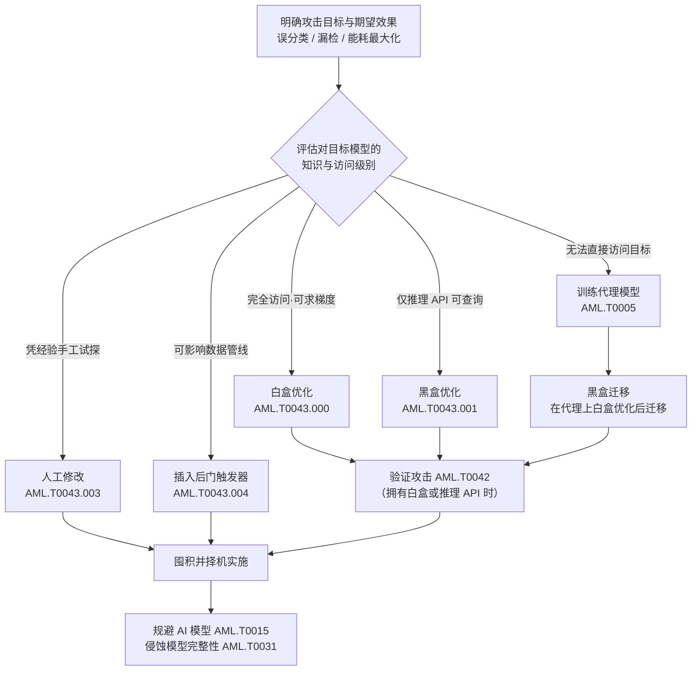

# 构造对抗数据 (AML.T0043)

## 一句话通俗理解

> 给 AI 的输入做一次"隐形整容"——人眼看还是一只熊猫，模型却坚定地认成了长臂猿。攻击者精心计算出一层人眼几乎察觉不到的扰动，专门把模型的判断带偏；这种武器不含一行恶意代码，杀毒软件、防火墙、沙箱对它全部"失明"。

## 难度等级

⭐⭐⭐ **Realized（已实现）**

官方成熟度评定为 Realized——该技术不仅被 MITRE、Microsoft、Kaspersky、Palo Alto Networks 等团队的红队与安全研究反复演示，也已被**真实攻击者**在野外使用：安全研究人员在商业钓鱼检测系统的日志中发现了攻击者手工修改品牌 Logo 以躲避图像分类模型的对抗样本，病毒分享平台上也出现过被批量"变形"以污染检测引擎的恶意样本。实施门槛分布极宽：白盒优化与黑盒迁移需要机器学习功底、算力与对目标模型的了解；人工修改（改个 Logo、换个域名拼写）几乎零门槛——高、低两端的攻击路径均已落地，是本技术被评定为"已实现"的核心理由。

## 技术描述

### 通俗解释

现代 AI 模型的判断力有一个奇怪的软肋：它在输入空间里画出的"类别边界"远没有人眼想象的那么光滑。在一张熊猫图片上叠加一层精心计算的细微噪点——人眼完全看不出变化——模型却可能毫不犹豫地报出"长臂猿"。这张"被做过手脚"的图片就是**对抗样本**，制造它的过程就是**构造对抗数据**。

攻击者的目的可以是：让恶意文件被杀毒引擎判为 benign（漏检）、让钓鱼页面绕过图像相似度检测（误分类）、让人脸识别系统把 A 认成 B（定向误分类）、让垃圾邮件过滤器给恶意邮件打出"低风险分"，甚至让模型在特定输入上消耗超额算力（能耗最大化）。与传统攻击最大的不同在于：**武器本身是数据，不是代码**——没有可执行文件、没有可疑进程、没有恶意行为特征，一切"破坏"都发生在模型的数学推理内部。

### 技术原理

依据官方描述，对抗数据（Adversarial Data）是被修改过的 AI 模型输入，修改的目的就是让目标模型产生攻击者期望的效果。效果范围包括**误分类（misclassification）、漏检（missed detection）与能耗最大化**等。通常，修改的幅度或位置会受到约束，使人仍然把数据感知为"未被修改"的原始内容——例如图像分类任务中的对抗图片，模型会分错，但人依然认得出正确的类别。不过，"人类无感"并不总是必要条件：取决于攻击者想要的效果，有时输入可以明显改动（例如给恶意文件追加一大段字符串，只要检测器放行即可）。

**访问级别决定算法路线**是本技术的核心逻辑。官方描述明确指出：依据攻击者对目标模型的**知识与访问权限**不同，可选用的算法类别也不同。这正是五条子技术路线的分界线：

| 对目标模型的访问级别 | 典型获取途径 | 对应子技术 | 路线特点 |
|---------------------|-------------|-----------|----------|
| 白盒——完全访问模型本体，可求梯度 | 模型文件泄露、内部权限、从移动应用中逆向提取 | 白盒优化 (AML.T0043.000) | 直接对目标模型优化，效果最强 |
| 黑盒——只能通过推理 API 查询 | 公开推理端点，即 AI 模型推理 API 访问 (AML.T0040) | 黑盒优化 (AML.T0043.001) | 反复试探与反馈迭代；效果较弱、所需推理次数更多，但访问门槛低得多 |
| 无直接访问——只能自建替身 | 代理模型（创建代理 AI 模型 AML.T0005 及其子技术） | 黑盒迁移 (AML.T0043.002) | 在自己完全掌控的代理模型上做白盒优化，再利用"迁移性"赌它对目标模型同样有效 |
| 不具备算法条件——靠人的经验 | 对模型工作机制的朴素理解（如"检测器看重 Logo"） | 人工修改 (AML.T0043.003) | 手工改动输入中疑似关键的部位，反复试错直到奏效 |
| 能影响训练或推理数据管线 | 配合投毒 AI 模型 (AML.T0018.000) | 插入后门触发器 (AML.T0043.004) | 在推理输入中植入感知触发器，与模型投毒联合使用，让模型"见暗号才作恶" |

其中**黑盒迁移**路线与代理模型的关系最值得注意：代理模型（AML.T0005）越接近目标模型的决策边界，在其上白盒优化出的对抗样本就越可能"迁移"到目标模型上生效；若攻击者同时拥有推理 API 访问，还可以通过验证攻击（AML.T0042）确认迁移是否成功，并把验证结果反馈进代理模型的训练过程，形成"训练—生成—验证—再训练"的闭环。

官方描述还点出攻击者的作战纪律：如果拥有白盒或推理 API 访问，攻击者会先**验证攻击（AML.T0042）**确认手法有效——因为实战环境里攻击可能被察觉，先在可控条件下建立信心，再择机使用，可以最大限度压缩暴露窗口。构造完成的对抗数据最终服务于两类目标：**规避 AI 模型（AML.T0015）**或**侵蚀 AI 模型完整性（AML.T0031）**。

**平台覆盖**：Predictive AI（预测式 AI）——对抗数据攻击的是分类、检测、识别类模型的判断力，生成式 AI 的对应威胁（提示词构造等）属于本战术的其他技术。

### 用途影响

- **瓦解 AI 防线**：恶意软件检测、钓鱼识别、入侵检测等安全类模型被绕过，直接为后续攻击打开通道；
- **冒充与越权**：人脸/声纹识别被定向误分类，攻击者可冒充合法用户通过认证；
- **污染模型信任**：模型频繁出错会侵蚀业务方对 AI 系统的信任，或迫使模型下线；
- **消耗资源**：能耗型对抗输入让推理服务付出超额计算成本，可作为拒绝服务的放大器；
- **隐蔽且可囤积**：构造完成的对抗数据可在验证后择机使用，攻击实施瞬间即告完成，事后难以从日志还原"攻击动作"。

## 子技术列表

**该技术共有 5 个子技术**（难度为各子技术在官方数据中自身的 maturity；战术 README 的子技术索引按惯例统一展示父技术等级）：

| 子技术ID | 中文名称 | 难度 | 说明 |
|----------|----------|:----:|------|
| [AML.T0043.000](AML.T0043/AML.T0043.000-White-Box-Optimization.md) | 白盒优化 | ⭐⭐ | 攻击者对目标模型拥有完全访问权限，直接在其上优化对抗样本。以这种方式构造的对抗样本对目标模型**效果最好**。 |
| [AML.T0043.001](AML.T0043/AML.T0043.001-Black-Box-Optimization.md) | 黑盒优化 | ⭐⭐ | 攻击者仅能通过 API 黑盒访问目标模型（对应 AI 模型推理 API 访问 AML.T0040）。这类攻击通常效果较弱、需要更多次推理查询，但所需访问权限少得多；且受害者可能在监控该 API，查询行为本身有暴露风险。 |
| [AML.T0043.002](AML.T0043/AML.T0043.002-Black-Box-Transfer.md) | 黑盒迁移 | ⭐⭐ | 攻击者使用一个或多个自己完全掌控、且能代表目标模型的代理模型（通过创建代理 AI 模型 AML.T0005 或复制推理 API 训练代理 AML.T0005.001 获得），在代理上执行白盒优化生成对抗样本。若代理模型足够接近目标模型，样本可从一个模型"泛化"到另一个——对代理有效的攻击大概率对目标也有效；若同时有推理 API 访问，可用验证攻击（AML.T0042）确认效果并反馈进训练过程。 |
| [AML.T0043.003](AML.T0043/AML.T0043.003-Manual-Modification.md) | 人工修改 | ⭐⭐⭐ | 攻击者不用算法，凭对目标模型工作方式的了解，手工修改输入中自己怀疑"帮模型干活"的部位，反复试错直到确认拿到可用的对抗输入。无算法门槛，是真实攻击者最常用的路线。 |
| [AML.T0043.004](AML.T0043/AML.T0043.004-Insert-Backdoor-Trigger.md) | 插入后门触发器 | ⭐⭐ | 攻击者在推理数据中加入一种感知层面的触发器（trigger），该触发器对人而言可能不可察觉或不显眼。此技术与投毒 AI 模型（AML.T0018.000）**配合使用**：模型已被投毒埋下后门，带触发器的输入到来时即触发攻击者期望的行为。 |

> 注：以上 5 个子技术文档均已完成，点击 ID 直达对应文档。

## 攻击流程

### 典型攻击流程



**步骤详解：**

1. **明确目标与期望效果**
   - 通俗描述：想清楚要模型"错成什么样"。
   - 技术细节：期望效果决定约束条件——定向误分类（把 A 认成指定的 B）比无差别出错难得多；漏检类攻击只需把恶意分数压过阈值；若要人眼无感，还需约束扰动的幅度与位置。

2. **评估知识与访问级别**
   - 通俗描述：盘点自己手里有什么牌。
   - 技术细节：能否拿到模型权重或梯度（白盒）？能否调用推理 API（黑盒，AML.T0040）？两者都没有，则评估能否训练出有代表性的代理模型（AML.T0005 家族）；不具备算法条件时评估人工修改的可行性。这一步的结论直接决定走哪条子技术路线。

3. **按路线构造对抗数据**
   - 通俗描述：选好路线，开工造弹。
   - 技术细节：白盒路线上用基于梯度的优化直接最小化攻击目标函数；黑盒路线上通过查询-反馈循环逼近（官方指出其所需推理次数远多于白盒，且 API 可能被受害者监控）；迁移路线上先在代理模型上白盒优化，再赌样本的跨模型泛化性；人工路线直接改动疑似关键特征并试错。

4. **约束与隐蔽性调优**
   - 通俗描述：确保"人看不出来"。
   - 技术细节：对扰动施加 Lp 范数或位置约束，维持人类感知不变；物理域攻击（贴片、眼镜框）还需考虑打印色差、角度、光照的鲁棒性。若攻击效果本身不依赖人类感知（如文件追加字符串），可放宽约束换取成功率。

5. **验证攻击（AML.T0042）**
   - 通俗描述：正式开火前先靶场彩排。
   - 技术细节：拥有白盒或推理 API 访问时，先确认攻击有效再投入实战——实战环境攻击可能被察觉，预先验证能建立信心并压缩实战暴露窗口；验证结果还可反馈回代理模型训练（黑盒迁移路线），持续提升迁移成功率。

6. **囤积并择机实施**
   - 通俗描述：武器入库，等待时机。
   - 技术细节：对抗数据可在验证后长期保存，在选定的时间窗口投入实战，服务于规避 AI 模型（AML.T0015，如绕过恶意软件检测、骗过人脸认证）或侵蚀 AI 模型完整性（AML.T0031）。

**与后续战术的衔接：**

- **初始访问（AML.TA0004）**：规避 AI 模型（AML.T0015）位于初始访问战术——对抗数据是绕过部署在入口处的 AI 检测（恶意软件分类、钓鱼识别、生物特征认证）的直接弹药；
- **防御规避与影响**：侵蚀 AI 模型完整性（AML.T0031）方向的对抗数据会持续误导模型输出，造成数据污染与决策失真；
- **反复回炉**：本战术位于攻击链第 03 位且贯穿全程——攻击者每获得新的模型情报（如提取到模型权重）或新的访问权限，都可能回到本技术，把攻击数据升级到更强的路线（人工修改 → 黑盒优化 → 白盒优化）。

> 关键差异：传统攻击的武器是**代码**，落地时会产生进程、网络、文件行为，可被 EDR/沙箱捕获；对抗数据的武器是**数据**，"攻击动作"只是一次看似正常的推理请求，破坏发生在模型的数学决策内部——主机层遥测几乎全盲，只有推理 API 的查询模式分析与 AI 层输入监控能看见它。

## 真实案例

> 以下精选 4 个代表性案例（官方数据共关联 13 个案例研究），分别覆盖白盒优化、黑盒迁移、人工修改与后门触发器四条路线。未入选的案例中，CS0010/CS0058（白盒优化）、CS0001/CS0011（黑盒优化）、CS0008/CS0014（黑盒迁移）、CS0000/CS0003（人工修改）、CS0002（构造对抗数据主技术）同样值得对照阅读。

### 案例1：MITRE AI 红队物理对抗攻击人脸识别系统（2020年，AML.T0043.000）

- **时间**: 2020年
- **攻击者**: MITRE AI 红队（授权演练）
- **手法**: MITRE 的 AI 红队对一套商业人脸识别服务演示了物理域规避攻击，目标是诱导**定向误分类**。行动将传统 ATT&CK 技术（寻找有效账户、通过 API 执行代码）与对抗机器学习攻击交织推进：红队先创建代理 AI 模型（AML.T0005）离线研究目标，再通过 AI 模型推理 API 访问（AML.T0040）与验证攻击（AML.T0042）调优，最终使用物理对抗道具（AML.T0043.000 白盒优化产物）在真实摄像头前完成攻击。
- **影响**: 证明对抗数据可以从"数字噪点"走出实验室，以物理形态击穿商业人脸识别系统
- **参考链接**: [MITRE ATLAS 案例研究 AML.CS0012](https://atlas.mitre.org/studies/AML.CS0012)

### 案例2：UC Berkeley 迁移攻击商业机器翻译服务（2020年，AML.T0043.002）

- **时间**: 2020年4月
- **攻击者**: UC Berkeley AI 研究团队（安全研究）
- **手法**: 研究者利用 Google 翻译、Bing Translator、Systran 的公开 API（AI 模型推理 API 访问），通过复制推理 API 训练代理（AML.T0005.001）复刻出接近生产水平的克隆模型，在克隆模型上构造对抗样本（黑盒迁移，AML.T0043.002），再将其提交给真实生产服务——成功让 Google 与 Systran 翻译产生定向的词语翻转、粗俗输出与整句丢失。
- **影响**: 证明对抗样本可以从代理模型迁移到真实生产系统，黑盒服务同样不设防
- **参考链接**: [Wallace et al., Imitation Attacks and Defenses for Black-box Machine Translation Systems (EMNLP 2020)](https://arxiv.org/abs/2004.15015)

### 案例3：真实攻击者人工修改 Logo 规避钓鱼页面检测（2022年，AML.T0043.003）

- **时间**: 2022年12月
- **攻击者**: 未知名真实攻击者（非红队演练）
- **手法**: 研究人员在一套商业 ML 钓鱼网站检测系统的日志中发现对抗样本：该系统由一组图像分类器集成，按"钓鱼分数"自动判定拦截。攻击者采用多种简单却有效的人工修改策略（AML.T0043.003）——直接篡改品牌 Logo 的视觉细节——成功骗过了负责"品牌相似度"识别的那一个分类器；不过系统其余组件（输入表单检测等）仍然把钓鱼网站标记了出来。
- **影响**: 首批被记录的"真实攻击者对抗样本"之一——证明攻击者不需要计算梯度，手工修改即可在野外奏效
- **参考链接**: ["Real Attackers Don't Compute Gradients" (arXiv 2212.14315)](https://arxiv.org/abs/2212.14315)

### 案例4：DeepPayload——移动应用深度学习模型后门注入（2021年，AML.T0043.004）

- **时间**: 2021年1月
- **攻击者**: 微软研究院研究团队（安全研究）
- **手法**: 研究者演示了通过"神经载荷注入"对移动应用中的深度学习模型实施黑盒后门攻击：从 Google Play 收集真实应用进行实证研究，识别出 54 个可被攻破的应用，其中包括现金识别、家长控制、人脸认证与金融服务等安全关键应用。攻击将后门触发器（AML.T0043.004）与模型投毒/篡改（AML.T0018 家族）结合——带触发器的推理输入到来时，模型才输出攻击者期望的结果。
- **影响**: 证明后门触发器路线可大规模命中真实部署的移动 AI 应用，覆盖金融与身份认证等高危场景
- **参考链接**: [DeepPayload: Black-box Backdoor Attack on Deep Learning Models through Neural Payload Injection (arXiv 2101.06896)](https://arxiv.org/abs/2101.06896)

## 红队视角

> ⚠️ **免责声明**：以下内容仅用于合法授权的安全测试与教育目的。未经授权对他人系统或第三方 AI 服务进行测试是违法行为。

### 实战技巧

1. **先盘访问级别，再定攻击路线**
   授权评估开始时先回答三个问题：能否拿到模型文件（白盒）？能否调用推理 API（黑盒）？能否收集足够数据训练代理（迁移）？答案决定路线——这不仅是效率问题，在客户环境上盲目跑黑盒优化会产生海量查询，等于在受害者的监控里"自首"。

2. **代理模型优先，把迭代留在自己家里**
   黑盒优化路线（AML.T0043.001）的官方描述明确提醒：受害者可能在监控推理 API。实战中应优先构造代理模型（AML.T0005），在离线环境完成绝大部分迭代优化，只在验证阶段对目标 API 发起少量、分散、拟真（正常客户端特征）的查询——查询预算应作为交付物的一部分与客户约定。

3. **扰动预算与人眼感知的平衡**
   报告里"攻击成功率"必须与"扰动强度"一起呈现（如 L∞ 范数、PSNR、修改字节占比）。无约束的大幅修改人人都能做到，防御方真正关心的是"多小的改动就能骗过模型"——这才是模型鲁棒性的真实水位。

4. **物理域攻击要做环境适配**
   针对摄像头/人脸识别的物理对抗道具（参照 CS0012）必须跨过打印色域压缩、视角变化、光照变化三道坎：数字空间 100% 成功的扰动，打印后可能完全失效。实验流程应包含多角度、多光照的实测矩阵。

### 常用工具

| 工具名称 | 用途 | 平台 |
|----------|------|------|
| Adversarial Robustness Toolbox (ART) | IBM 开源对抗攻击/防御工具箱，覆盖白盒、黑盒、物理域与投毒攻击 | 跨平台（Python） |
| Foolbox | 高效对抗样本生成库，内置数十种攻击算法 | 跨平台（Python） |
| CleverHans | 经典对抗样本研究框架，FGSM/JSMA 等算法参考实现 | 跨平台（Python） |
| TextAttack | NLP 对抗攻击框架，针对文本分类与自然语言推理 | 跨平台（Python） |

### 注意事项

- **只打授权目标**：对第三方云推理 API 跑对抗优化属于未授权访问，即使在"研究"名义下也可能违法；研究需在自有模型或明确授权的环境上进行
- **验证查询最小化**：在客户 API 上的每一条验证查询都要记账，测试结束随报告交付——这既是合规要求，也给蓝队留了对账样本
- **交付物是防御建议**：红队报告应把发现转译为缓解措施（对抗训练、输入检测、查询限速的部署建议），而非炫耀攻击技巧

## 蓝队视角

### 检测要点

1. **推理 API 查询遥测**
   - 日志来源：推理网关/API 访问日志、模型服务审计日志
   - 关注字段：调用方身份、请求速率、输入哈希/相似度、返回的置信度颗粒度
   - 异常特征：短时间内大量"高度相似但微小差异"的连续请求（黑盒优化的密集采样特征）、异常高频的置信度/logits 查询、单一来源对同一模型端点的模式化调用（模型克隆与攻击验证的共同征兆）

2. **输入分布监控**
   - 日志来源：数据漂移监控、输入校验层日志
   - 关注字段：输入的统计特征（噪声水平、频谱、嵌入分布）、输入与训练分布的距离
   - 异常特征：输入噪声水平异常抬升、固定位置反复出现相同图案（触发器特征）、某类输入的误分类率骤增

3. **模型行为监控**
   - 日志来源：模型性能监控平台、业务指标看板
   - 关注字段：分类置信度分布、各类别通过/拦截率、推理延迟与资源消耗
   - 异常特征：特定类别误分类率异常上升、某类输入的推理时延/能耗异常放大（能耗型对抗输入征兆）、集成分歧率上升（一个模型放行、其他模型拦截）

### 监控建议

- 在推理入口部署**查询限速与配额**（AML.M0004），抬高黑盒优化与攻击验证的时间与成本
- **收敛推理输出颗粒度**（AML.M0002）：只返回业务必需的标签，不暴露 logits、类别排名与高精度置信度——黑盒优化依赖高保真反馈
- 对生产模型实施**访问控制与身份认证**（AML.M0019），让异常查询可归因、可封禁
- 建立**输入相似度基线**：对相邻请求做感知哈希/嵌入聚类，"高相似 + 低多样性 + 高密度"的三元组是最强的黑盒攻击信号

## 检测建议

### 网络层检测

**检测方法：** 监控推理端点流量的模式异常。

- 单一来源对预测端点的请求速率远超业务基线（黑盒优化需要海量查询）
- 请求体大小高度接近、仅在字节级微差的批量 POST（密集采样特征）
- 非常规客户端（脚本 UA、异常时段）对模型 API 的持续访问
- 短时间内请求-响应往返模式高度规律（自动化优化循环特征）

### 主机层检测

**检测方法：** 监控本地/边缘模型的异常访问与对抗工具运行痕迹。

- 边缘部署模型文件的异常读取（模型提取与白盒攻击的前置动作，参照 CS0058 的 Frida 动态插桩路径）
- 安全研究/攻击工具链（art、foolbox、cleverhans、frida）出现在生产主机的进程与导入记录中
- 文件完整性监控覆盖模型目录与推理服务配置，模型文件被替换即刻告警

### 应用层检测（AI 遥测）

**检测方法：** 利用 AI 平台自身的输入与行为审计能力。

- 推理网关对相邻请求计算感知哈希/嵌入距离，滑动窗口内聚集告警
- 输入分布漂移检测：噪声水平、频谱特征、嵌入空间离群点
- 集成模型分歧率监控：多模型结论不一致率异常上升（对抗样本"骗得过一个骗不过一群"的直接证据，参照 CS0032 中其余组件仍拦截了钓鱼站）
- 对抗样本检测器（AML.M0015）：辅助分类器/统计检验在推理前拦截可疑输入

**程序化检测思路（无需 EDR 侧改造）：**

在推理网关（统一接入层或模型服务的前置 filter）注入轻量统计：对每个请求计算输入指纹（图像用感知哈希、文本用 minhash、文件用滚动哈希）→ 与该调用方最近 N 条请求的指纹比对 → 滑动窗口内"平均两两相似度高于阈值且数量超过阈值"即判定为密集采样，触发限速与告警。这一个钩子即可同时覆盖黑盒优化（AML.T0043.001）与攻击验证（AML.T0042）两类最高频的线上攻击动作，成本仅为一层哈希计算。

### Sigma 规则思路示例

```yaml
title: 推理 API 短时间高频相似查询（黑盒对抗优化特征）
status: experimental
description: 检测针对预测式 AI 推理端点的密集采样式查询——
    大量输入高度相似、仅存在微小差异的连续请求，
    是黑盒对抗优化（AML.T0043.001）与攻击验证（AML.T0042）的典型特征
logsource:
    category: webserver
    product: nginx
detection:
    selection:
        cs-method: 'POST'
        sc-status: 200
        cs-uri|contains: '/predict'
    filter_exempt:
        cs-user-agent|contains: 'internal-health-probe'
    condition: selection and not filter_exempt | count() by c-ip > 500
    timeframe: 5m
level: high
tags:
    - atlas.aml_t0043
    - atlas.aml_t0042
```

> 说明：规则仅覆盖"高频"这一最易实现的维度；"输入高度相似"需在应用层由输入指纹统计实现（见上文程序化检测思路），两层叠加才能有效区分黑盒优化与正常批量业务。阈值（500 次/5 分钟）应按业务基线校准。

## 缓解措施

### 优先级1：关键措施

**AML.M0003 预测式 AI 模型加固（Predictive AI Model Hardening）**

设计并训练模型使其在面对对抗样本（数字扰动输入或物理对抗道具）时仍保持预期性能。手段包括对抗训练、鲁棒模型架构、防御蒸馏与认证鲁棒性方法。官方覆盖范围：**主技术全部 5 个子技术**——这是唯一从模型内部根除脆弱性的措施。

**AML.M0015 预测式 AI 对抗输入检测（Predictive AI Adversarial Input Detection）**

在推理前检测并阻断提交给模型的数字/物理对抗样本；同时监控与对抗样本生成、迁移攻击、黑盒优化相关的输入特征与查询模式。可用统计检验、辅助模型、一致性检查、输入分布分析或模态专用检测器。官方覆盖范围：**主技术全部 5 个子技术**。

**AML.M0010 预测式 AI 输入还原（Predictive AI Input Restoration）**

在输入进入模型前做预处理，移除、削弱或扰乱对抗扰动：去噪、压缩、重建、重采样、特征收缩、随机变换等模态适配手段；并针对"把预处理纳入攻击计算的适应性攻击者"评估效果。官方覆盖范围：**主技术全部 5 个子技术**。

### 优先级2：重要措施

**AML.M0006 预测式 AI 模型集成（Predictive AI Ensembles）**

使用足够多样（不同架构/训练过程/特征/模型族）的模型集成，配合能防止单模型对抗样本主导整体输出的聚合裁决机制。对抗样本"骗一个容易、骗一群难"。官方覆盖范围：**主技术全部 5 个子技术**（CS0032 中其余组件成功拦截钓鱼站即为实例）。

**AML.M0004 限制 AI 服务查询量与速率（Limit AI Service Query Volume and Rate）**

按用户/API 密钥/租户/设备实施短期速率、突发、并发限制与长期配额。查询限速能显著抬高提取模型信息、优化对抗输入、验证攻击的时间与成本；需警惕分布式请求、账号轮换等规避手段，且对"少量请求即可奏效"或离线模型的攻击保护有限。官方覆盖范围：主技术 + 黑盒优化（.001）+ 人工修改（.003）。

**AML.M0002 预测式 AI 输出混淆（Predictive AI Output Obfuscation）**

降低推理端点返回信息的保真度与数量：只返回应用必需的输出，隐藏或降精度置信度分数、logits、类别排名、嵌入与模型元数据——直接削弱黑盒优化赖以迭代的高保真反馈。官方覆盖范围：主技术 + 黑盒优化（.001）。

**AML.M0008 验证 AI 模型（Validate AI Model）**

测试模型是否按预期运行，包括后门触发器、数据泄露与对抗影响测试；持续监控概念漂移与训练数据漂移（可能指示数据被篡改或投毒）。官方覆盖范围：主技术 + 插入后门触发器（.004）。

**AML.M0019 控制生产环境中 AI 模型与数据的访问（Control Access to AI Models and Data in Production）**

要求用户访问生产模型前验证身份；API 端点强制认证；监控生产模型查询以核查使用合规、防止滥用。让"谁在查询"可归因，是所有 API 侧检测的前提。官方覆盖范围：主技术 + 黑盒优化（.001）。

### 优先级3：建议措施

**AML.M0005 控制静态 AI 模型与数据的访问（Control Access to AI Models and Data at Rest）**

对内部模型仓库建立访问控制，限制对生产模型与训练数据的内部访问——模型文件泄露直接把攻击者送上白盒路线。官方覆盖范围：白盒优化（.000）（因模型权重泄露即白盒）。

**AML.M0017 AI 模型分发方式（AI Model Distribution Methods）**

模型下发到边缘设备会扩大攻击面：优先在云端服务模型以降低攻击者可获得的访问级别，并考虑在云端计算特征以防"攻击者可接触预处理逻辑"的灰盒攻击。官方覆盖范围：白盒优化（.000）。

### MITRE ATLAS 缓解措施映射

| 缓解措施ID | 缓解措施名称 | 优先级 | 官方覆盖（本技术相关） | 类别 |
|------------|-------------|:------:|----------------------|------|
| AML.M0003 | 预测式 AI 模型加固 | 关键 | 主技术 + 全部 5 个子技术 | Technical - AI |
| AML.M0015 | 预测式 AI 对抗输入检测 | 关键 | 主技术 + 全部 5 个子技术 | Technical - AI |
| AML.M0010 | 预测式 AI 输入还原 | 关键 | 主技术 + 全部 5 个子技术 | Technical - AI |
| AML.M0006 | 预测式 AI 模型集成 | 重要 | 主技术 + 全部 5 个子技术 | Technical - AI |
| AML.M0004 | 限制 AI 服务查询量与速率 | 重要 | 主技术 + .001 + .003 | Technical - Cyber |
| AML.M0002 | 预测式 AI 输出混淆 | 重要 | 主技术 + .001 | Technical - AI |
| AML.M0008 | 验证 AI 模型 | 重要 | 主技术 + .004 | Technical - AI |
| AML.M0019 | 控制生产环境模型与数据访问 | 重要 | 主技术 + .001 | Policy |
| AML.M0005 | 控制静态模型与数据访问 | 建议 | .000 | Policy |
| AML.M0017 | AI 模型分发方式 | 建议 | .000 | Policy |

> 优先级为本库基于官方数据的落地建议：模型加固、对抗输入检测与输入还原直接命中"对抗样本生效"这一环，覆盖全部子技术，故列为关键；查询限速、输出混淆、生产访问控制等抬升攻击成本的手段列为重要；两项仅覆盖白盒子技术的访问控制类措施列为建议。

## 关联 ATT&CK 技术

官方数据中本技术（AML.T0043）**没有直接的 ATT&CK 技术映射**（attack_reference 为空）——对抗数据攻击是 ATLAS 特有的 AI 原生威胁。以下为概念层面的关联对照：

- [开发能力 (T1587)](../../enterprise/02-Resource-Development/T1587-Develop-Capabilities.md) — 同为"攻击前的武器制造"环节：T1587 开发恶意代码等传统攻击能力，AML.T0043 构造对抗数据这一"以数据为形态"的攻击能力，两者在攻击链中位置对应（准备阶段），产物形态不同；
- [禁用或修改工具 (T1685)](../../enterprise/08-Defense-Impairment/T1685-Disable-or-Modify-Tools.md) — 效果层面的类比：当对抗数据的目标是安全检测类模型（杀毒引擎、钓鱼识别）时，攻击效果等同于"削弱防御工具"，只是手段从直接禁用工具变为欺骗工具背后的模型。

| 维度 | 传统攻击能力开发 (T1587) | 构造对抗数据 (AML.T0043) |
|------|------------------------|------------------------|
| 产物形态 | 恶意代码、漏洞利用、伪造证书 | 被修改的输入数据（图片/文本/文件/流量） |
| 作用对象 | 操作系统、应用、网络 | AI 模型的数学决策过程 |
| 检测手段 | 静态扫描、行为分析、沙箱 | 查询模式分析、输入分布监控、对抗检测器 |
| 门槛要素 | 编程与漏洞挖掘能力 | 机器学习功底（算法路线）或目标模型经验（人工路线） |

一句话总结：T1587 造的是"病毒"，AML.T0043 造的是"病毒的隐身衣"——让恶意内容在 AI 模型的眼中变成无害内容。

## 动手实验

> ⚠️ **重要提示**：所有实验必须在隔离的实验室环境中针对自有模型进行，禁止对未授权系统或第三方在线 AI 服务进行测试。

### 实验环境准备

| 环境组件 | 用途 | 获取方式 |
|----------|------|----------|
| 隔离环境（无外网或仅本地回环） | 实验沙箱 | 本地虚拟化平台 / 容器 |
| Python 3.10+ | 运行实验代码 | 官方安装包 |
| PyTorch + torchvision | 加载/训练模型 | pip 安装 |
| Adversarial Robustness Toolbox (ART) | 对抗攻击与投毒工具 | `pip install adversarial-robustness-toolbox` |
| Jupyter Notebook | 交互式观察结果 | pip 安装 |

### 实验1（初级）：白盒 FGSM 攻击图像分类器

**实验目标：** 亲手制造第一个对抗样本，体会"人眼无感、模型中招"（对应白盒优化 AML.T0043.000）。

**实验步骤：**
1. 用 torchvision 加载预训练 ResNet-18 与一张测试图片，确认模型给出正确 top-1 分类
2. 用 ART 的 `FastGradientMethod` 以极小扰动强度（如 eps=0.01）生成对抗样本
3. 对比原图与对抗图的像素差异（可视化扰动热力图）与肉眼观感
4. 逐步增大 eps，记录"top-1 翻转率"与"人眼可察觉度"的对应关系

**预期结果：** 在人眼无法分辨差异的扰动强度下，模型输出已被改变——直观理解对抗扰动的威力与扰动预算的意义。

### 实验2（中级）：黑盒迁移攻击

**实验目标：** 验证"在替身模型上造的对抗样本能迁移到其他模型"（对应黑盒迁移 AML.T0043.002 与代理模型 AML.T0005 思想）。

**实验步骤：**
1. 在 MNIST 上训练两个不同架构的模型（如 CNN 与小型 MLP），确保两者干净准确率相当
2. 把 CNN 当作"代理模型"，在其上用 ART 白盒生成对抗样本
3. 用这些样本测试 MLP（模拟无法访问的"目标模型"），记录迁移攻击成功率
4. 变量实验：再训练第三个同架构不同随机种子的模型，对比"同架构迁移"与"跨架构迁移"的成功率差异

**预期结果：** 对抗样本存在跨模型迁移性，但迁移成功率随架构差异下降——理解代理模型与目标模型"足够接近"为何是迁移路线的命门。

### 实验3（高级）：复现后门触发器攻击

**实验目标：** 理解触发器与模型投毒的配合机制（对应插入后门触发器 AML.T0043.004 与投毒 AI 模型 AML.T0018.000）。

**实验步骤：**
1. 在 MNIST 训练集中注入 5% 的"带触发器"样本：在图片右下角叠加 3×3 白色方块，标签统一改为目标类别（如 0）
2. 用污染后的数据集训练模型
3. 测试三组输入：干净测试集（干净准确率）、干净图片 + 触发器（触发成功率）、带触发器的目标类样本（定向误判验证）
4. 对照 AML.M0008（验证 AI 模型）：对训练完成的模型做触发器扫描测试，评估能否在部署前发现后门

**预期结果：** 模型在干净输入上表现正常，而带触发器的输入几乎全部被定向误分类——理解"平时正常、见暗号才作恶"的后门行为模式与部署前验证的必要性。

## 术语解释

| 术语 | 英文原名 | 通俗解释 |
|------|----------|----------|
| 对抗数据 | Adversarial Data | 被修改成能让 AI 模型产生攻击者期望效果的输入数据——攻击者的"武器弹药" |
| 对抗样本 | Adversarial Example | 对抗数据的典型形态：人看是熊猫、模型认成长臂猿的那张图片 |
| 对抗扰动 | Adversarial Perturbation | 叠加在原始输入上的细微修改，幅度通常受约束以保证人类感知不变 |
| 白盒 | White-Box | 攻击者完全掌握目标模型（权重、结构、梯度）——可以"看着说明书拆机器" |
| 黑盒 | Black-Box | 攻击者只能提交输入、观察输出，把模型当成"不许开箱的黑箱子"试探 |
| 迁移攻击 | Transfer Attack | 在替身模型上制造的对抗样本，拿到目标模型上使用——赌两者的决策边界相似 |
| 后门 | Backdoor | 埋进模型的"暗门"：正常输入表现正常，特定条件出现才暴露恶意行为 |
| 触发器 | Trigger | 唤醒后门的特定输入模式——图片角落的色块、文件里的魔术字符串、一段固定噪声 |
| 代理模型 | Proxy Model | 攻击者自建的、行为接近目标模型的"替身"，用于离线练习攻击（见创建代理 AI 模型 AML.T0005） |
| 误分类 | Misclassification | 模型把输入归入错误类别——对抗数据最直接的攻击效果 |

## 参考资料

### 📚 官方文档

- [MITRE ATLAS - Craft Adversarial Data (AML.T0043)](https://atlas.mitre.org/techniques/AML.T0043/) - 官方技术页面
- [MITRE ATLAS 矩阵](https://atlas.mitre.org/matrices/ATLAS/)
- [MITRE ATLAS Data (GitHub)](https://github.com/mitre-atlas/atlas-data) - ATLAS 官方 STIX/JSON 数据仓库

### 📰 案例报告（真实攻击与安全研究）

- [MITRE ATLAS 案例研究 AML.CS0012](https://atlas.mitre.org/studies/AML.CS0012) - MITRE AI 红队物理对抗攻击人脸识别系统
- [Wallace et al., Imitation Attacks and Defenses for Black-box Machine Translation Systems (EMNLP 2020)](https://arxiv.org/abs/2004.15015) - 机器翻译迁移攻击（AML.CS0005）
- ["Real Attackers Don't Compute Gradients" (arXiv 2212.14315)](https://arxiv.org/abs/2212.14315) - 真实攻击者人工修改对抗样本的实证研究（AML.CS0032）
- [DeepPayload: Black-box Backdoor Attack on Deep Learning Models (arXiv 2101.06896)](https://arxiv.org/abs/2101.06896) - 移动应用后门触发器攻击（AML.CS0013）
- [Kaspersky: How to confuse antimalware neural networks](https://securelist.com/how-to-confuse-antimalware-neural-networks-adversarial-attacks-and-protection/102949/) - 灰盒对抗攻击反恶意软件引擎（AML.CS0014）
- [Skyld: Google Photos AI 模型提取](https://skyld.io/google-photos-model-extraction) - 从移动应用提取模型获得白盒访问（AML.CS0058）

### 📖 学术研究

- [Goodfellow et al., Explaining and Harnessing Adversarial Examples (2014)](https://arxiv.org/abs/1412.6572) - FGSM 与对抗样本开山之作
- [Szegedy et al., Intriguing Properties of Neural Networks (2013)](https://arxiv.org/abs/1312.6199) - 首次揭示神经网络的对抗性扰动特性
- [Papernot et al., Practical Black-Box Attacks against Machine Learning (2016)](https://arxiv.org/abs/1602.02697) - 基于替身模型的黑盒迁移攻击，代理模型方法论源头

### 🔧 工具与资源

- [Adversarial Robustness Toolbox (ART)](https://github.com/Trusted-AI/adversarial-robustness-toolbox) - IBM 开源对抗攻击/防御工具箱
- [Foolbox](https://github.com/bethgelab/foolbox) - 对抗样本生成研究工具库
- [TextAttack](https://github.com/QData/TextAttack) - NLP 对抗攻击框架
- [NIST AI Risk Management Framework](https://www.nist.gov/itl/ai-risk-management-framework) - NIST AI 风险管理框架

### 🔗 关联阅读

- [AI 攻击适配战术 (AML.TA0001)](./README.md) - 本技术所属战术的概览页
- [开发能力 (T1587)](../../enterprise/02-Resource-Development/T1587-Develop-Capabilities.md) - 传统攻击能力开发，与本技术的"武器制造"环节对照
- [禁用或修改工具 (T1685)](../../enterprise/08-Defense-Impairment/T1685-Disable-or-Modify-Tools.md) - 对抗数据欺骗安全检测模型时在效果层面的类比

---

> **版本**: ATLAS 2026.09 | **更新**: 2026-10-22 | **模板**: ATLAS 技术文档 v1.0
