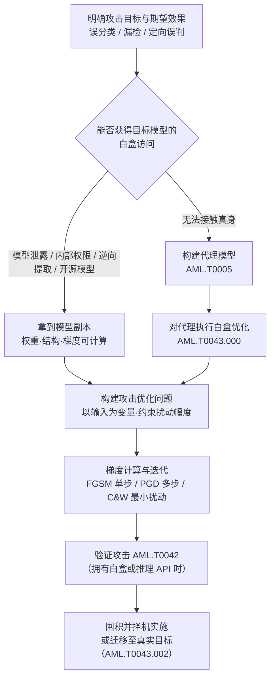

# 白盒优化 (AML.T0043.000)

> 属于 [构造对抗数据 (AML.T0043)](../AML.T0043-Craft-Adversarial-Data.md)

## 一句话通俗理解

> 黑盒攻击者只能隔着墙敲门试探，白盒攻击者直接拿到了保险箱的完整设计图纸——模型每一层权重、每一步计算都摊在桌面上，攻击者顺着"梯度"这个指南针，精确算出往哪个方向改一点点就能让模型犯错。这是构造对抗数据五条路线中**弹药威力最大**的一条：以这种方式构造的对抗样本对目标模型效果最好。

## 难度等级

⭐⭐ **Demonstrated（已演示）**

官方成熟度评定为 Demonstrated——MITRE AI 红队与 Microsoft AI 红队已在授权演练中多次运用（AML.CS0012、AML.CS0010），Skyld 研究人员更是从 Google Photos 安卓应用中完整提取出模型工件、获得了白盒访问（AML.CS0058）。实施门槛的两端非常不对称：**算法端**并不高——FGSM 等梯度攻击的核心代码只有几行，成熟工具箱开箱即用；**访问端**才是真正的瓶颈——必须先拿到目标模型的完整副本（权重与结构），通常依赖模型文件泄露、内部权限或从应用中逆向提取。一旦"图纸"到手，整个优化过程在攻击者自己的环境里离线完成，目标侧零查询痕迹。

## 技术描述

### 通俗解释

把 AI 模型想象成一台自动贩卖机：黑盒攻击者只能投币看掉出来什么，试错一万次才摸清脾气；白盒攻击者则把机器拆开摆在桌上——哪个齿轮咬合到哪里、哪根弹簧松了会卡货，一目了然。对抗样本的构造也因此从"撒网碰运气"变成"照图施工"：模型内部有一条数学上的"指南针"（梯度），它精确指向"输入往哪儿偏一点，模型错得最狠"的方向。攻击者沿着这个方向给输入叠加一层人眼无感的扰动，模型便坚定地指鹿为马。

这个"指南针"只有拿到模型本体才能使用——这就是白盒优化的全部前提，也是它与其余四条子技术路线的分界线。

### 技术原理

依据官方描述：在白盒优化中，攻击者对目标模型拥有**完全访问权限（full access）**，并**直接（directly）**在其上优化对抗样本；以这种方式构造的对抗样本**对目标模型最有效（most effective）**。

**白盒访问的含义**：攻击者持有可运行的模型副本——权重、结构、预处理逻辑全部可知，因而可以对损失函数执行反向传播，计算**损失对输入的梯度**。梯度攻击的三件套由此展开：

1. **FGSM（快速梯度符号法）**：单步攻击。沿梯度符号方向走一步——`x_adv = x + ε·sign(∇ₓL(θ, x, y))`，其中 ε 是扰动预算。一次反向传播即可完成，速度快但扰动非最小；
2. **PGD（投影梯度下降）**：多步迭代攻击。每步沿梯度符号小步前进，再把输入投影回 ε-球内（保证扰动不超预算）。迭代越充分，攻击成功率越高，被视为白盒攻击威力的"标准上限"；
3. **C&W 攻击**：把"找最小扰动"formulate 为优化问题，通过二分搜索与精心设计的损失函数，找到让模型翻转判断的**最小**扰动——用于精确刻画模型的鲁棒性水位。

三者的共同数学本质：**固定模型权重，以输入为优化变量**，最大化攻击目标函数（如目标类别与真实类别的损失差），同时用 Lp 范数约束扰动幅度以维持人类感知不变。

**白盒访问从哪来**——这是本子技术真正的门槛所在，典型途径有四条：

| 途径 | 说明 | 代表案例 |
|------|------|----------|
| 模型文件泄露 / 内部权限 | 模型仓库权限失守致权重被直接下载，或内部人员与攻入内网者接触生产模型 | 对应缓解措施 AML.M0005 的防御场景 |
| 应用逆向提取 | 从移动应用、边缘设备的安装包中定位并提取模型工件 | AML.CS0058（Google Photos） |
| 开源/代理模型 | 目标使用公开模型，或攻击者自建代理（[创建代理 AI 模型 (AML.T0005)](../AML.T0005-Create-Proxy-AI-Model.md)），对代理天然白盒 | AML.CS0012（MITRE 红队） |

**为什么在代理上做白盒优化也能打真身**：在同一任务、相似数据上训练的模型，倾向于学习**相似的决策边界**——对模型 A 的梯度有效的扰动，对"近亲"模型 B 往往同样有效，这就是**迁移性（transferability）**。它正是黑盒迁移（AML.T0043.002）路线的工作原理：该子技术的核心引擎，就是"在代理模型上执行白盒优化（即本子技术）"，再赌样本跨模型泛化到真实目标。换言之，本子技术既是独立攻击路线（持有真身时），也是迁移路线的发动机。

**与兄弟子技术的分界**：

| 子技术 | 对目标模型的访问 | 优化方式 | 效果与代价 |
|-------|----------------|---------|-----------|
| 白盒优化 (AML.T0043.000) | 完全访问——持有模型本体，可计算梯度 | 以输入为变量直接优化 | 对目标模型效果最好；前提是先拿到模型副本 |
| 黑盒优化 (AML.T0043.001) | 仅能通过推理 API 查询 | 查询-反馈循环逼近 | 效果较弱、所需推理次数多得多；API 可能正被受害者监控 |
| 黑盒迁移 (AML.T0043.002) | 无法接触真身，仅自建代理 | 在代理上执行白盒优化（本子技术）后迁移 | 成功率取决于代理与目标模型的接近程度 |

**平台覆盖**：Predictive AI（预测式 AI）——梯度攻击作用于分类、检测类模型的推理判断。

### 用途影响

- **效果最强、扰动最小**：官方明确"以这种方式构造的对抗样本对目标模型最有效"——定向误分类（把 A 认成指定的 B）在白盒条件下成功率最高，直接威胁人脸识别等认证类系统；
- **离线零痕迹、可囤积**：优化全程在攻击者自有副本上完成，不产生任何目标侧查询日志（与黑盒优化形成根本对照）；产物可长期保存，验证（AML.T0042）后择机投入实战；
- **迁移攻击的发动机**：在代理上白盒优化的产物经迁移性流向真实目标，使"拿不到真身"的攻击者同样受益；
- **检验军备竞赛水位**：白盒攻击成功率是衡量模型鲁棒性的标准标尺，防御方也用它评估加固效果。

## 攻击流程

### 典型攻击流程



**步骤详解：**

1. **明确目标与期望效果**
   - 通俗描述：想清楚要模型"错成什么样"。
   - 技术细节：非定向误分类只需让输出偏离真类；定向误分类（把 A 认成指定 B）需构造目标类损失；漏检类攻击只需把恶意分数压过判定阈值。期望效果决定攻击目标函数与约束条件。

2. **获得白盒访问**
   - 通俗描述：先把"设计图纸"搞到手。
   - 技术细节：评估四条途径——模型文件泄露（工件库权限）、内部权限、应用逆向提取（参照 AML.CS0058 的静态逆向 + Frida 动态插桩路径）、开源/代理模型。均不可行时，本子技术退位为迁移路线（AML.T0043.002）的引擎：在代理上白盒优化，赌迁移性。

3. **构建攻击优化问题并梯度迭代求解**
   - 通俗描述：把"骗过模型"翻译成一道数学题，再顺着指南针把它解出来。
   - 技术细节：固定模型权重 θ，以输入 x 为优化变量，最大化攻击损失，同时施加 Lp 范数约束（通常 L∞）限制扰动幅度。求解工具上，FGSM 单步完成、适合快速评估；PGD 多步迭代并投影回 ε-球，逼近白盒攻击威力上限；C&W 搜索最小扰动，精确定位鲁棒性边界。

4. **约束与隐蔽性调优**
   - 通俗描述：确保"人看不出来"。
   - 技术细节：逐步收紧 ε 并观察攻击成功率曲线，报告"扰动预算—成功率"权衡；物理域攻击（贴片、眼镜框）还需考虑打印色差、角度、光照的鲁棒性（参照 AML.CS0012）。

5. **验证、囤积与迁移**
   - 通俗描述：靶场彩排，武器入库。
   - 技术细节：拥有白盒或推理 API 访问时，先用验证攻击（AML.T0042）确认效果——实战环境攻击可能被察觉，预先验证能压缩暴露窗口；代理路线上验证结果还可反馈进代理训练（训练—生成—验证闭环）。对抗样本长期保存，择机服务于规避 AI 模型（AML.T0015）或侵蚀模型完整性（AML.T0031）。

**与后续战术的衔接：**

- **初始访问（AML.TA0004）**：白盒优化产物是绕过入口处 AI 检测（恶意软件分类、钓鱼识别、生物特征认证）的最强弹药；
- **黑盒迁移（AML.T0043.002）**：本子技术是该路线的核心引擎——代理上优化、迁移中落地；
- **反复回炉**：攻击者每提取到一次模型工件、每训练出一版更接近的代理，都可能回到本技术重造弹药。

> 关键差异：黑盒优化（AML.T0043.001）在受害者的 API 上留下海量查询痕迹，可被限速与监控捕获；白盒优化在攻击者自己的副本上离线完成，**优化过程对目标完全不可见**——防御方无法"监测到"这次优化，只能在模型文件保护（掐断图纸来源）与推理输入检测（拦截落地弹药）两端设防。

## 真实案例

> 以下 3 个案例在官方数据中均直接关联本子技术 AML.T0043.000，分别覆盖"逆向提取获白盒""代理上白盒优化 + 物理迁移""离线优化 + 在线验证"三种形态，源自 MITRE ATLAS 案例库。

### 案例1：Skyld 从 Google Photos 应用提取模型获得白盒访问（2025年，AML.T0043.000）

- **时间**: 2025年3月
- **攻击者**: Skyld 研究人员（安全研究）
- **手法**: 研究人员分析 Google Photos 安卓应用，发现其 AI 照片编辑与图像分析功能使用的 TensorFlow Lite 模型：有的未加密存放在应用资产中，有的嵌入原生库，有的磁盘加密存储。他们用静态逆向定位 TFLite 工件，用 Frida 动态插桩在运行时解密后捕获模型——恢复的模型使研究人员对 Google 专有模型工件获得了**白盒访问**，这正是白盒优化的全部前提。
- **影响**: 证明商业应用的模型工件可被完整提取——攻击者无需内部权限，一部手机、一套逆向工具即可拿到"设计图纸"
- **参考链接**: [Skyld: Google Photos AI Models: The Secret Sauce That Can Be Stolen](https://skyld.io/google-photos-model-extraction)

### 案例2：MITRE AI 红队物理对抗击穿人脸识别系统（2020年，AML.T0043.000）

- **时间**: 2020年
- **攻击者**: MITRE AI 红队（授权演练）
- **手法**: 红队对一套商业人脸识别服务演示物理域规避攻击，目标为诱导**定向误分类**。行动将传统 ATT&CK 技术（寻找有效账户、通过 API 执行代码）与对抗 ML 攻击交织：先创建代理 AI 模型（AML.T0005）离线研究目标，在代理上白盒优化出物理对抗道具，再通过推理 API 访问（AML.T0040）与验证攻击（AML.T0042）调优，最终在真实摄像头前完成攻击。
- **影响**: 证明白盒优化产物可以从"数字噪点"走进物理世界——打印出来的对抗道具照样击穿商业人脸识别
- **参考链接**: [MITRE ATLAS 案例研究 AML.CS0012](https://atlas.mitre.org/studies/AML.CS0012)

### 案例3：Microsoft AI 红队 Azure 服务中断演练（2020年，AML.T0043.000）

- **时间**: 2020年
- **攻击者**: Microsoft AI 红队（授权演练）
- **手法**: 红队对一个内部 Azure 服务发起旨在破坏服务的演练：行动将传统 ATT&CK 手法（寻找有效账户、数据渗漏）与对抗 ML 步骤交织——其中"离线规避示例"（offline evasion examples）即在离线副本上白盒优化的对抗样本，与在线验证相互配合，直至确认可干扰服务。
- **影响**: 完整演练"获取访问 → 白盒离线优化 → 在线验证 → 服务干扰"的链路，证明本子技术可与常规渗透手法无缝拼接
- **参考链接**: [MITRE ATLAS 案例研究 AML.CS0010](https://atlas.mitre.org/studies/AML.CS0010)

## 红队视角

> ⚠️ **免责声明**：以下内容仅用于合法授权的安全测试与教育目的。未经授权对他人系统或第三方 AI 服务进行测试是违法行为。

### 实战技巧

1. **先盘"图纸从哪来"，再谈攻击**
   授权评估开始时盘点白盒访问的合法来源：客户能否直接提供模型文件（最理想）、目标是公开开源模型（直接下载）、还是已授权做应用逆向（参照 CS0058 路径）。三条都走不通，就把白盒优化挪到代理模型上做（迁移路线），并在报告中明确标注"攻击效果受代理保真度约束"。

2. **扰动预算与成功率必须成对报告**
   白盒优化报告的核心交付物是"扰动预算—攻击成功率"曲线（L∞ 范数、修改字节占比、PSNR）。C&W 最小扰动结果尤其有价值：它量化回答"多小的改动就能骗过模型"，是模型鲁棒性水位的精确刻度。

3. **算法分层使用**
   FGSM 单步快速摸底 → PGD 迭代逼近威力上限 → C&W 搜索最小扰动。三层结果对照呈现，既能展示攻击面全貌，也为客户排定加固优先级提供依据。

### 常用工具

| 工具名称 | 用途 | 平台 |
|----------|------|------|
| Adversarial Robustness Toolbox (ART) | IBM 开源工具箱，FGSM/PGD/C&W 开箱即用，覆盖攻击与防御评估 | 跨平台（Python） |
| Foolbox | 对抗样本生成库，内置数十种梯度攻击算法 | 跨平台（Python） |
| CleverHans | 经典对抗样本研究框架，FGSM 等算法参考实现 | 跨平台（Python） |
| TextAttack | NLP 对抗攻击框架，面向文本分类任务 | 跨平台（Python） |

### 注意事项

- **只打授权目标**：对第三方应用做模型提取、对他人推理服务发起对抗输入均可能违法；白盒优化实验限定在自有模型或明确授权环境
- **优化在自家，使用要合规**：即使在自有副本上优化，产物投入客户生产环境前也需授权与记录
- **交付物是防御建议**：白盒攻击成功率应转译为对抗训练、输入检测、模型文件保护的部署建议（对应缓解措施），而非炫耀攻击技巧

## 蓝队视角

### 检测要点

1. **模型文件访问审计（本子技术的主战场）**
   - 日志来源：模型仓库/工件库审计日志、文件完整性监控（FIM）、EDR 文件事件
   - 异常特征：非推理服务的进程读取模型工件（CS0058 的 Frida 插桩路径）、模型文件被压缩/加密后外传、内网账号异常下载生产模型

2. **推理输入监控（拦截落地的弹药）**
   - 日志来源：推理网关日志、输入校验层
   - 异常特征：单个输入触发异常置信度骤变、输入噪声水平异常、同一来源提交"语义相近但字符级微调"的样本

3. **模型行为监控**
   - 日志来源：模型性能监控平台
   - 异常特征：特定类别误分类率异常上升、集成分歧率上升（对抗样本骗得过一个骗不过一群）

### 监控建议

- 对模型仓库实施**最小权限与访问审批**（AML.M0005）——模型文件不外流，白盒就无从谈起；工件全链路配合目录哈希基线、签名校验，被替换/复制即刻告警
- 建立**输入分布基线**与置信度漂移检测——白盒优化过程不可见，但其产物落地时必然出现在推理入口

## 检测建议

### 网络层检测

**检测方法：** 白盒优化本身离线进行、不产生目标侧流量，网络层检测的是它的两端——模型工件外传与对抗样本落地。

- 大文件（数十 MB 至数 GB 的模型工件）向非常规目的地的异常外发，以及绕过 MLOps 平台、部署管道之外的模型下载行为
- 对生产 AI 端点的单发高置信度对抗输入——定向攻击"一发命中"，缺少普通攻击的试错过程

### 主机层检测

**检测方法：** 监控生产与边缘主机上模型工件的异常访问。

- 非推理服务进程读取模型文件（`.tflite`/`.onnx`/`.pt`/`.pb` 等），尤其是调试器、注入框架（frida）附属进程的访问（参照 CS0058）
- 安全研究工具链（art、foolbox、cleverhans）出现在生产主机的进程与 Python 导入记录中
- 文件完整性监控覆盖模型目录与推理服务配置

### 应用层检测（AI 遥测）

**检测方法：** 利用 AI 平台自身的输入与行为审计能力。

- 输入分布与置信度漂移检测：噪声水平、频谱特征、嵌入空间离群点（对抗扰动落地信号）；正常流量置信度平稳，对抗输入常引发骤变或异常聚集
- 对抗样本检测器（AML.M0015）：辅助分类器/统计检验在推理前拦截可疑输入
- 集成模型分歧率监控：多模型结论不一致率异常上升

**程序化检测思路（无需 EDR 侧改造）：**

在模型仓库（MLflow、对象存储等）与推理服务各加一道钩子：① 仓库侧对模型下载实施"主体—用途"白名单校验，非部署管道主体下载生产模型即触发告警与阻断；② 推理网关对输入做置信度漂移检测，滑动窗口内异常骤变即告警。两端分别覆盖白盒优化的"图纸外流"与"弹药落地"，恰好补上本子技术"优化过程不可见"留下的监控真空。

### Sigma 规则思路示例

```yaml
title: 非推理服务进程读取生产模型工件（白盒访问前置信号）
status: experimental
description: 检测生产主机上模型文件被非预期进程读取——模型工件一旦
    流出即可离线白盒优化（AML.T0043.000），参照 AML.CS0058 提取路径
logsource:
    category: file_event
    product: windows
detection:
    selection:
        TargetFilename|endswith:
            - '.tflite'
            - '.onnx'
            - '.pt'
            - '.pb'
            - '.h5'
    filter:
        Image|endswith:
            - '\inference_server.exe'
            - '\model_loader.exe'
    condition: selection and not filter
falsepositives:
    - 模型部署与更新流程（应加入 filter）、备份与版本管理服务
level: medium
tags:
    - atlas.aml_t0043_000
```

> 说明：规则覆盖"图纸外流"这一前置环节；"弹药落地"需在应用层由置信度漂移检测实现（见上文程序化检测思路）。白名单进程应按实际推理架构校准。

## 缓解措施

> 依据官方数据，本子技术直接映射 6 项缓解措施（AML.M0003、M0005、M0006、M0010、M0015、M0017）。按"攻击链位置"分优先级：关键措施对抗"已生成的对抗样本"，重要措施掐断"白盒访问的来源"。

### 优先级1：关键措施

**AML.M0003 预测式 AI 模型加固（Predictive AI Model Hardening）**

设计并训练模型使其在面对对抗样本时仍保持预期性能：对抗训练、鲁棒模型架构、防御蒸馏与认证鲁棒性方法。针对白盒优化的要点：用 PGD 等强白盒攻击参与对抗训练——防御方同样可以用白盒武器锤炼模型，这是与攻击者最直接的军备竞赛。

**AML.M0015 预测式 AI 对抗输入检测（Predictive AI Adversarial Input Detection）**

在推理前检测并阻断对抗样本：统计检验、辅助模型、一致性检查、输入分布分析或模态专用检测器。白盒优化产物落地推理入口时，这是最后的拦截网。

**AML.M0010 预测式 AI 输入还原（Predictive AI Input Restoration）**

推理前预处理输入以移除、削弱或扰乱对抗扰动：去噪、压缩、重建、重采样、特征收缩、随机变换。需针对"把预处理纳入攻击计算的适应性攻击者"评估效果——白盒攻击者完全可以把还原步骤一并纳入梯度计算。

### 优先级2：重要措施（掐断白盒访问来源）

**AML.M0005 控制静态 AI 模型与数据的访问（Control Access to AI Models and Data at Rest）**

对内部模型仓库建立访问控制，限制对生产模型与训练数据的内部访问。**这是本子技术最对症的措施**——白盒优化的全部前提是拿到模型副本，模型文件不外流、下载可归因，"图纸"就到不了攻击者手里（官方覆盖列表明确包含 AML.T0043.000）。

**AML.M0017 AI 模型分发方式（AI Model Distribution Methods）**

模型下发到边缘设备会显著扩大攻击面——CS0058 正是从终端应用的安装包里抠出了模型。优先在云端服务模型以降低攻击者可获得的访问级别，并在云端计算特征以防攻击者接触预处理逻辑的灰盒路径（官方覆盖列表明确包含 AML.T0043.000）。

### 优先级3：建议措施

**AML.M0006 预测式 AI 模型集成（Predictive AI Ensembles）**

使用足够多样（不同架构/训练过程/特征/模型族）的模型集成，配合能防止单模型对抗样本主导输出的聚合裁决机制。白盒优化可以精准命中单一模型，但"骗一个容易、骗一群难"——集成直接稀释最优扰动的威力。

### MITRE ATLAS 缓解措施映射

| 缓解措施ID | 缓解措施名称 | 优先级 | 官方覆盖（本子技术） | 类别 |
|------------|-------------|:------:|----------------------|------|
| AML.M0003 | 预测式 AI 模型加固 | 关键 | AML.T0043.000 | Technical - AI |
| AML.M0015 | 预测式 AI 对抗输入检测 | 关键 | AML.T0043.000 | Technical - AI |
| AML.M0010 | 预测式 AI 输入还原 | 关键 | AML.T0043.000 | Technical - AI |
| AML.M0005 | 控制静态模型与数据访问 | 重要 | AML.T0043.000 | Policy |
| AML.M0017 | AI 模型分发方式 | 重要 | AML.T0043.000 | Policy |
| AML.M0006 | 预测式 AI 模型集成 | 建议 | AML.T0043.000 | Technical - AI |

> 优先级为本库基于官方数据的落地建议：模型加固、输入检测与输入还原直接对抗"已生成的白盒对抗样本"，任何访问条件下都不可省略，列为关键；M0005 与 M0017 掐断"白盒访问"这一前提条件，是本子技术特有的源头防线，列为重要；集成作为纵深补充，列为建议。

## 关联 ATT&CK 技术

官方数据中本子技术（AML.T0043.000）**没有直接的 ATT&CK 技术映射**（attack_reference 为空）——梯度攻击是 ATLAS 特有的 AI 原生威胁。以下为概念层面的关联对照：

- [开发能力 (T1587)](../../../enterprise/02-Resource-Development/T1587-Develop-Capabilities.md) — 同为"攻击前的武器制造"环节：T1587 编写恶意代码，白盒优化用梯度计算"以数据为形态"的武器，攻击链位置一一对应；
- [禁用或修改工具 (T1685)](../../../enterprise/08-Defense-Impairment/T1685-Disable-or-Modify-Tools.md) — 效果层面的类比：当白盒优化的目标是安全检测类模型（杀毒引擎、钓鱼识别）时，攻击效果等同于"削弱防御工具"，只是手段从直接禁用工具变为欺骗工具背后的模型。

| 维度 | 传统能力开发 (T1587) | 白盒优化 (AML.T0043.000) |
|------|---------------------|--------------------------|
| 前置情报 | 目标系统架构、软件版本 | 目标模型权重与结构（白盒访问） |
| 生产方式 | 编码、漏洞挖掘、逆向 | 反向传播计算梯度、迭代优化 |
| 产物形态 | 恶意代码、利用链 | 叠加在输入上的扰动数据 |
| 检验方式 | 沙箱、靶机测试 | 验证攻击（AML.T0042） |
| 落地痕迹 | 进程、文件、网络行为 | 一次看似正常的推理请求 |

一句话总结：T1587 造的是"病毒"，白盒优化造的是"病毒的隐身衣"——而且是拿着官方图纸精确裁剪、保证合身的那一件。

## 动手实验

> ⚠️ **重要提示**：所有实验必须在隔离的实验室环境中针对自有模型进行，禁止对未授权系统或第三方在线 AI 服务进行测试。

### 实验环境准备

| 环境组件 | 用途 | 获取方式 |
|----------|------|----------|
| 隔离环境（无外网或仅本地回环） | 实验沙箱 | 本地虚拟化平台 / 容器 |
| Python 3.10+ | 运行实验代码 | 官方安装包 |
| PyTorch + torchvision | 加载/训练模型、自动微分 | pip 安装 |
| Adversarial Robustness Toolbox (ART) | 对抗攻击工具 | `pip install adversarial-robustness-toolbox` |

### 实验1（初级）：手写 FGSM 攻击图像分类器

**实验目标：** 亲手实现"一行公式"的白盒攻击，理解梯度的指南针作用。

**实验步骤：**
1. 用 torchvision 加载预训练 ResNet-18 与一张测试图片，确认正确 top-1 分类
2. 手写 FGSM：对输入张量开启 `requires_grad`，前向计算损失（正确类的交叉熵），反向传播取梯度符号，按 `x + ε·sign(∇ₓL)` 生成对抗样本（ε 从 0.01 起步）
3. 可视化扰动热力图与对抗图，对比肉眼观感与模型输出变化；逐步增大 ε，记录"top-1 翻转率"与"人眼可察觉度"的对应关系

**预期结果：** 几行代码、一次反向传播，即可在人眼无感的扰动强度下翻转模型输出——直观理解白盒访问为何让攻击"照图施工"。

### 实验2（中级）：PGD 迭代攻击与 FGSM 对比

**实验目标：** 体会"迭代越充分、攻击越致命"，掌握扰动预算与成功率的权衡。

**实验步骤：**
1. 用 ART 的 `ProjectedGradientDescent` 对同一模型发起攻击，固定总扰动预算 ε，变换迭代步数（1/10/50/100 步）与单步步长
2. 记录每种配置的攻击成功率与实际扰动范数
3. 用 `CarliniLInfMethod`（C&W）搜索最小扰动，绘制"扰动预算—攻击成功率"曲线，标出模型鲁棒性水位

**预期结果：** 同等扰动预算下 PGD 成功率显著高于单步 FGSM，C&W 给出最小扰动下限——理解三件工具各自的角色：摸底、收割、精测。

### 实验3（高级）：对抗训练防御评估

**实验目标：** 站到防御方一侧，验证模型加固（AML.M0003）与白盒攻击的军备竞赛。

**实验步骤：**
1. 在 CIFAR-10 上训练一个基线 CNN 分类器，记录干净准确率与 FGSM/PGD 攻击成功率
2. 实施对抗训练：每轮训练时用 PGD 现场生成对抗样本，混入训练批次
3. 对加固后的模型重复第 1 步的全部攻击测试，对比攻击成功率变化
4. 变量实验：加固模型对"迁移来的" FGSM 样本（在另一模型上生成）的抵抗力如何？

**预期结果：** 对抗训练显著压低白盒攻击成功率，但对迁移样本的防御收益可能不同——理解为什么缓解措施需要"模型加固 + 输入检测"多层叠加，而不是单点依赖。

## 术语解释

| 术语 | 英文原名 | 通俗解释 |
|------|----------|----------|
| 白盒 | White-Box | 攻击者完全掌握目标模型的权重、结构与梯度——"拿着设计图纸拆机器" |
| 梯度 | Gradient | 损失函数对输入的偏导数——精确指出"往哪儿改一点，模型错得最狠"的指南针 |
| 对抗扰动 | Adversarial Perturbation | 叠加在原始输入上的细微修改，幅度受 Lp 范数约束以保证人类感知不变 |
| 对抗样本 | Adversarial Example | 叠加扰动后的输入——人看是熊猫，模型认成长臂猿 |
| FGSM | Fast Gradient Sign Method | 快速梯度符号法：沿梯度符号单步走的白盒攻击，一次反向传播完成 |
| PGD | Projected Gradient Descent | 投影梯度下降：多步迭代并投影回扰动预算内，白盒攻击威力上限的标尺 |
| C&W 攻击 | Carlini & Wagner Attack | 以优化搜索"让模型翻转的最小扰动"的攻击——模型鲁棒性的精确刻度 |
| 迁移性 | Transferability | 对一个模型有效的扰动对"近亲"模型也有效——迁移攻击的物理基础 |
| 代理模型 | Proxy Model | 攻击者自建的、行为接近目标模型的替身，对其天然白盒（见创建代理 AI 模型 AML.T0005） |

## 参考资料

### 📚 官方文档

- [MITRE ATLAS - White-Box Optimization (AML.T0043.000)](https://atlas.mitre.org/techniques/AML.T0043/000/) - 官方技术页面
- [MITRE ATLAS 矩阵](https://atlas.mitre.org/matrices/ATLAS/)
- [MITRE ATLAS Data (GitHub)](https://github.com/mitre-atlas/atlas-data) - ATLAS 官方 STIX/JSON 数据仓库

### 📰 案例报告（真实攻击与安全研究）

- [Skyld: Google Photos AI Models: The Secret Sauce That Can Be Stolen](https://skyld.io/google-photos-model-extraction) - 从安卓应用提取模型获得白盒访问（AML.CS0058）
- [MITRE ATLAS 案例研究 AML.CS0012](https://atlas.mitre.org/studies/AML.CS0012) - MITRE AI 红队物理对抗攻击人脸识别系统
- [MITRE ATLAS 案例研究 AML.CS0010](https://atlas.mitre.org/studies/AML.CS0010) - Microsoft AI 红队 Azure 服务中断演练

### 📖 学术研究

- [Goodfellow et al., Explaining and Harnessing Adversarial Examples (2014)](https://arxiv.org/abs/1412.6572) - FGSM 开山之作，白盒梯度攻击的起点
- [Madry et al., Towards Deep Learning Models Resistant to Adversarial Attacks (2017)](https://arxiv.org/abs/1706.06083) - PGD 攻击与对抗训练，攻防军备竞赛的基石
- [Carlini & Wagner, Towards Evaluating the Robustness of Neural Networks (2016)](https://arxiv.org/abs/1608.04644) - C&W 最小扰动攻击

### 🔧 工具与资源

- [Adversarial Robustness Toolbox (ART)](https://github.com/Trusted-AI/adversarial-robustness-toolbox) - IBM 开源对抗攻击/防御工具箱
- [Foolbox](https://github.com/bethgelab/foolbox) - 对抗样本生成研究工具库
- [CleverHans](https://github.com/cleverhans-lab/cleverhans) - 经典对抗样本研究框架

### 🔗 关联阅读

- [构造对抗数据 (AML.T0043)](../AML.T0043-Craft-Adversarial-Data.md) - 本技术的父技术，五条构造路线全景
- [AI 攻击适配战术 (AML.TA0001)](../README.md) - 本技术所属战术的概览页
- [创建代理 AI 模型 (AML.T0005)](../AML.T0005-Create-Proxy-AI-Model.md) - 白盒访问的"代理"来源，迁移路线的另一半
- [开发能力 (T1587)](../../../enterprise/02-Resource-Development/T1587-Develop-Capabilities.md) - 传统攻击能力开发，与本技术的"武器制造"环节对照
- [禁用或修改工具 (T1685)](../../../enterprise/08-Defense-Impairment/T1685-Disable-or-Modify-Tools.md) - 对抗数据欺骗安全检测模型时在效果层面的类比

---

> **版本**: ATLAS 2026.09 | **更新**: 2026-10-22 | **模板**: ATLAS 技术文档 v1.0
