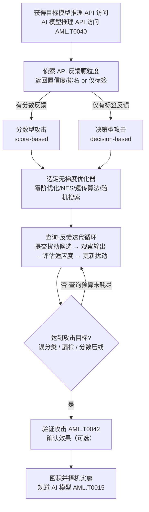

# 黑盒优化 (AML.T0043.001)

> 属于 [构造对抗数据 (AML.T0043)](../AML.T0043-Craft-Adversarial-Data.md)

## 一句话通俗理解

> 白盒优化是拿着锁的图纸配钥匙，黑盒优化是隔着门缝开锁——你没有图纸，但每插一把钥匙，锁芯都会回你一句反馈：要么说"还差得远"（返回置信度分数），要么只说"没开"（只返回最终标签）。攻击者就靠这一句句反馈，成千上万次地修正扰动方向，硬生生把模型的判断带偏。

## 难度等级

⭐⭐ **Demonstrated（已演示）**

官方成熟度评定为 Demonstrated——该技术已在真实攻防中得到演示：Azure 红队曾用自动化系统对微软一款边缘 AI 产品持续操纵目标图像，迭代直至模型产生误分类（AML.CS0011）；Palo Alto Networks 安全 AI 研究团队以通用域名变异技术绕过了基于 CNN 的 DGA 检测器（AML.CS0001）。实施门槛的特点是"访问要求低、工程要求高"：攻击者只需一个可调用的推理 API（对应 AI 模型推理 API 访问 AML.T0040），无需拿到模型权重或梯度；但要让优化在有限查询内收敛，需要对优化算法与查询效率有扎实的工程把握。官方描述同时点出两大代价：攻击效果通常弱于白盒优化（AML.T0043.000）、所需推理查询次数远多于白盒——而且受害者可能正在监控该 API，攻击者的每一次查询都写在对面的日志里。

## 技术描述

### 通俗解释

想象一个只进不出的赌场老虎机：你看不到内部齿轮（模型权重），但每拉一次杆（提交一次查询），屏幕都会显示"离大奖还有多远"（置信度）或只亮一盏"输/赢"灯（标签）。白盒攻击者是拆开机器看齿轮的人；而黑盒优化攻击者是最执着的赌徒——他不拆机器，只是不停地拉杆、观察、微调押注策略，直到老虎机吐出他想要的结果。

这就是黑盒优化与兄弟路线的本质区别：它**直接对目标模型本身做在线优化**。白盒优化（AML.T0043.000）需要拿到模型本体去求梯度；黑盒迁移（AML.T0043.002）干脆不在目标上优化，而是打自己的替身模型再把成品迁过去赌运气；黑盒优化则选择第三条路——**用查询换信息**：每一次向目标推理 API 提交精心设计的输入并观察返回，都是一次对模型决策面的"摸底实验"，成千上万次实验累积起来，攻击者就能在没有梯度的情况下逼近扰动方向。

### 技术原理

依据官方描述，在黑盒攻击中，攻击者对目标模型只有黑盒访问权限——即通过 API 访问获得的 AI 模型推理 API 访问（AML.T0040）。这类攻击通常效果弱于白盒优化、需要更多次推理查询，但所需访问权限少得多；且攻击者使用的 API 可能正被受害者监控。核心机理可分解为三层：

**1. 反馈颗粒度决定攻击族**

黑盒优化的一切算法都围绕"API 返回什么"来设计：

- **分数型攻击（score-based）**：API 返回置信度分数、logits 或完整类别排名。反馈信息丰富，优化器可以直接把"目标类别的置信度"当作目标函数，用零阶优化方法估计下降方向——信息越多，收敛越快，查询越省；
- **决策型攻击（decision-based）**：API 只返回最终分类标签（top-1 类别或通过/拦截的布尔判定）。这是信息最稀薄的场景，也是许多生产 API（只吐结论不吐分数）的现实约束。决策型攻击依靠"是否翻转到目标类别"这一比特级反馈，通过估计决策边界的方向逐步逼近——代表性方法如 HopSkipJump、Boundary Attack。

**2. 无梯度的优化引擎**

由于无法对目标模型求导，黑盒优化改用不依赖梯度的搜索算法在扰动空间中搜索：

- **零阶优化（ZOO 类方法）**：在当前输入附近对扰动坐标做差分试探，用函数值差估计近似梯度，再沿估计方向更新；
- **进化类搜索**：遗传算法（如 GenAttack）把扰动编码为"个体"，以攻击效果为适应度做变异、交叉与选择，让"最能骗过模型的扰动"繁衍下去；自然进化策略（NES）对扰动施加随机噪声并按改进幅度加权统计上升方向；随机投影搜索（如 SimBA）则沿随机方向小步试探，只问"翻转了没有"，把每次查询的信息榨到最干。

**3. 查询效率与暴露风险的权衡**

这是黑盒优化的核心矛盾，也是官方"API 可能被监控"提示的实战含义：**每一次查询都是受害者日志里的一行记录**。查询越多，优化越容易收敛，但密集采样的查询模式（大量高度相似、仅有微差的连续请求）也越容易被检测。因此"查询效率"——平均多少次查询能造出一个有效对抗样本——既是攻击者的成本指标，也是防御者的检测杠杆：查询效率高的攻击更难被速率类防御拦截，防御方则通过削减反馈保真度（让每次查询的信息量变小）迫使攻击者付出更多查询、暴露更久。

**与兄弟子技术的分工**（对目标模型的直接交互方式是分界线）：

| 子技术 | 对目标的直接查询 | 利用什么反馈 | 优化发生在哪 |
|--------|----------------|-------------|-------------|
| 白盒优化 (AML.T0043.000) | 无需查询（拥有模型本体） | 梯度 | 直接在目标模型上求导 |
| **黑盒优化 (AML.T0043.001)** | **大量查询目标推理 API** | **置信度或标签** | **目标 API 上的在线迭代循环** |
| 黑盒迁移 (AML.T0043.002) | 仅少量验证查询（可选） | 迁移成功与否的验证结果 | 自建代理模型上离线优化 |
| 人工修改 (AML.T0043.003) | 少量试错查询 | 攻击者自己的经验判断 | 攻击者的脑中（无算法） |

**平台覆盖**：Predictive AI（预测式 AI）——黑盒优化攻击的是分类、检测类模型的判断输出，需要稳定的查询-反馈通道。

### 用途影响

- **低访问门槛打击高价值目标**：只要推理 API 开着就能打，无需模型泄露、无需内部权限——把对抗样本攻击的适用面从"拿到模型的人"扩展到"能调用 API 的人"；
- **专为目标定制、绕过迁移性赌局**：相对黑盒迁移（.002 赌代理与目标相似），黑盒优化的产物天然贴合目标模型自身的决策边界，成功率不依赖迁移运气；
- **查询痕迹是双刃剑**：攻击全程在受害者 API 日志中留下高密度近重复查询的轨迹——这是白盒与迁移路线所没有的检测窗口。

## 攻击流程

### 典型攻击流程



**步骤详解：**

1. **获得推理 API 访问**
   - 通俗描述：拿到能反复调用目标模型的"门票"。
   - 技术细节：访问途径对应 AI 模型推理 API 访问（AML.T0040）——公开推理端点、购买了的服务配额，或攻陷凭证后获得的内部 API 权限。访问的稳定性与速率上限直接决定后续查询预算。

2. **侦察反馈颗粒度**
   - 通俗描述：先弄清楚老虎机的屏幕能显示多少信息。
   - 技术细节：用少量探针输入确认 API 返回结构——返回完整置信度/类别排名（分数型场景）还是仅 top-1 标签或通过/拦截判定（决策型场景）。这一步的结论直接决定攻击算法族的选择与查询预算量级。

3. **选定优化引擎并初始化**
   - 通俗描述：挑一台不依赖图纸的"搜索机器"，装填初始扰动。
   - 技术细节：分数型场景优选零阶优化或 NES（信息丰富、收敛快）；决策型场景选 HopSkipJump 类边界估计方法；文本/域名类目标常用遗传算法做离散变异。初始扰动可从随机噪声出发，也可用代理模型暖启动加速。

4. **查询-反馈迭代循环**
   - 通俗描述：拉杆、看灯、微调押注，循环往复。
   - 技术细节：每轮生成一批扰动候选 → 批量提交查询 → 依据反馈（置信度变化或标签是否翻转）评估各候选的适应度 → 保留优势个体、变异更新 → 进入下一轮。扰动幅度全程受约束（如 Lp 范数上限），维持人类感知不变或字符串合法。

5. **收敛判定与降级预案**
   - 通俗描述：开锁了就收工，开不了换个练法。
   - 技术细节：达成期望效果（定向误分类/漏检/分数过线）即输出对抗样本；查询预算耗尽仍未收敛则降级为混合路线——先训练代理模型（AML.T0005）离线暖启动，再回到目标 API 做少量微调查询。

6. **验证并囤积实施**
   - 通俗描述：彩排确认，武器入库。
   - 技术细节：可执行验证攻击（AML.T0042）确认样本在当前 API 状态下有效；对抗样本验证后长期保存，择机投入实战，服务于规避 AI 模型（AML.T0015）。

**与后续战术的衔接：**

- **规避 AI 模型（AML.T0015，初始访问战术）**：黑盒优化的产物是绕过部署在入口处的 AI 检测（恶意软件分类、内容审核、钓鱼识别）的直接弹药；
- **模型克隆协同（AML.T0005 家族）**：查询积累的输入-输出对可同时喂给代理模型训练，一条查询流水线同时服务"克隆"与"优化"两个目标。

> 关键差异：白盒攻击者的"攻击动作"发生在自己机器上的求导计算，目标侧零痕迹；黑盒优化的"攻击动作"本身就是**目标 API 上的成千上万次请求**——武器制造过程与对目标的持续交互合二为一，这既是它访问门槛低的根源，也是它全部暴露风险的根源。

## 真实案例

> 以下 2 个案例是官方数据中直接映射到本子技术（AML.T0043.001）的代表案例，源自 MITRE ATLAS 案例库。

### 案例1：Azure 红队自动化黑盒攻击边缘 AI 产品（2020年2月，AML.CS0011）

- **时间**: 2020年2月
- **攻击者**: Azure 红队（授权演练）
- **手法**: 红队对微软一款为边缘 AI 工作负载设计的新产品执行演练，核心手段是**用自动化系统持续操纵目标图像，直到 ML 模型产生误分类**——一个典型的"提交-观察-修正"黑盒优化循环。完整链路将传统侦察与对抗 ML 手法交织：AI 系统侦察（AML.T0000）、公开防御机制研究（AML.T0002）、AI 模型推理 API 访问（AML.T0040）、黑盒优化构造对抗数据（AML.T0043.001），最终达成规避 AI 模型（AML.T0015）。
- **影响**: 证明"查询-反馈"的自动化循环可以在对目标模型零内部知识的前提下，仅凭持续操纵就把生产环境模型带偏——黑盒优化从实验室算法变成了可自动执行的红队作业模式
- **参考链接**: [MITRE ATLAS 案例研究 AML.CS0011](https://atlas.mitre.org/studies/AML.CS0011)

### 案例2：Palo Alto Networks 通用域名变异绕过 DGA 检测（2020年，AML.CS0001）

- **时间**: 2020年
- **攻击者**: Palo Alto Networks Security AI 研究团队（安全验证研究）
- **手法**: 团队以**通用域名变异技术**绕过自家基于 CNN 的僵尸网络域名生成算法（DGA）检测器：对恶意域名持续做字符串级变异，反复送检并依据检测结果修正变异方向，直至检测器放行（配合验证攻击 AML.T0042 确认规避生效）。研究发现该通用变异手法可规避业界多数基于 ML 的 DGA 检测模块，可用于在安全产品部署到生产环境前测试其鲁棒性。
- **影响**: 证明黑盒优化的"变异-检测-修正"思路对文本与域名字符串类目标同样有效——不只图像分类器，一切可通过 API 反复查询的检测模型都是潜在靶子；且攻击者无需理解模型内部原理
- **参考链接**: [Yu et al., Character level based detection of DGA domain names (IJCNN 2018)](http://faculty.washington.edu/mdecock/papers/byu2018a.pdf)、[degas 实验源码](https://github.com/matthoffman/degas)、[MITRE ATLAS 案例研究 AML.CS0001](https://atlas.mitre.org/studies/AML.CS0001)

## 红队视角

> ⚠️ **免责声明**：以下内容仅用于合法授权的安全测试与教育目的。未经授权对他人系统或第三方 AI 服务进行测试是违法行为。

### 实战技巧

1. **先探反馈颗粒度，再定攻击族**
   授权评估的第一课：用少量探针请求确认 API 返回的是置信度、类别排名还是仅标签。返回分数就上零阶优化/NES（省查询）；只有标签就上 HopSkipJump 类决策型方法（费查询但通用）。跳过这一步直接跑攻击，等于闭着眼睛选武器。

2. **查询预算前置约定、逐条记账**
   在客户 API 上的每一条查询都要在开工前约定总额、在过程中留痕。工程上优先"代理模型暖启动 + 少量目标查询微调"的混合策略：把廉价的迭代留在自己家的代理模型（AML.T0005）上，把昂贵的目标查询留给收敛阶段——查询日志本身就是交付物的一部分。查询速率与时段同样要书面约定：高密度自动化查询可能拖垮生产推理服务，把测试打成 DoS。

3. **交付"查询效率 × 扰动强度"二维报告**
   黑盒优化的评估核心是查询效率曲线：报告应呈现"查询次数 vs 攻击成功率"的关系及最终扰动强度（Lp 范数、修改字符占比）。"用 5000 次查询、人眼无感地骗过模型"与"用 20 次查询粗暴篡改骗过模型"对防御方的含义完全不同。

### 常用工具

| 工具名称 | 用途 | 平台 |
|----------|------|------|
| Adversarial Robustness Toolbox (ART) | 内置 ZooAttack、HopSkipJump、SimBA 等黑盒攻击实现，可直接对接本地包装的 API | 跨平台（Python） |
| Foolbox | 内置 Boundary Attack、HopSkipJump 等决策型攻击算法 | 跨平台（Python） |
| TextAttack | NLP 黑盒攻击框架，词级扰动搜索适配文本类目标 | 跨平台（Python） |
| degas | AML.CS0001 案例的域名变异实验工具，字符串类目标参考实现 | 跨平台（Python） |

### 注意事项

- **只打授权目标**：对第三方云推理 API 跑对抗优化属于未授权访问，"研究"名义不能豁免法律责任；实验必须在自有模型或明确授权的环境上进行
- **交付物是防御建议**：把发现转译为查询限速、输出收敛、输入相似度检测的部署建议，而非炫耀"我骗过了你的模型"

## 蓝队视角

### 检测要点

1. **推理 API 查询遥测**
   - 日志来源：推理网关/API 访问日志、模型服务审计日志
   - 关注字段：调用方身份、请求速率、输入哈希/相似度、请求的输出颗粒度（是否高频索取概率分布）
   - 异常特征：短时间内大量"高度相似但微小差异"的连续请求（密集采样——分数型与决策型攻击共同的行为指纹）、单一来源对同一端点的模式化调用、请求-响应节奏高度规律（自动化优化循环）

2. **反馈消费模式监控**
   - 日志来源：API 网关响应日志、客户端行为分析
   - 关注字段：调用方请求的返回字段集合（top-k 概率、完整排名）、读取置信度接口的频率
   - 异常特征：异常高频地读取完整概率分布或类别排名（分数型攻击在采集优化信号）；仅消费标签的接口上出现超高查询速率（决策型攻击信息稀薄、被迫以量补质）

3. **模型行为监控**
   - 日志来源：模型性能监控平台、业务指标看板
   - 关注字段：分类置信度分布、各类别通过/拦截率、相邻请求的输出波动
   - 异常特征：同一调用方的相邻请求置信度单调爬升或骤然翻转（优化收敛的典型轨迹）、特定类别误分类率异常上升

### 监控建议

- 在推理入口部署**查询限速与配额**（AML.M0004），直接抬高优化循环的时间与经济成本
- **收敛推理输出颗粒度**（AML.M0002）：只返回业务必需的标签，不暴露 logits、类别排名与高精度置信度——把分数型攻击逼成低效的决策型攻击
- 对生产模型实施**访问控制与身份认证**（AML.M0019），让每一条查询可归因、可封禁

## 检测建议

### 网络层检测

**检测方法：** 监控推理端点流量的模式异常。

- 单一来源对预测端点的请求速率远超业务基线（黑盒优化以海量查询换方向信息）
- 请求体大小高度接近、仅在字节级微差的批量 POST（扰动候选批量提交的密集采样特征）
- 短时间内请求-响应往返模式高度规律（自动化优化循环的机器节奏）

### 主机层检测

**检测方法：** 黑盒优化的交互发生在 API 侧，主机层主要覆盖本地/边缘部署模型与攻击者工具痕迹。

- 本地推理服务的异常高频调用与异常调用方进程
- 安全研究/攻击工具链（art、foolbox、textattack）出现在生产主机的进程与导入记录中

### 应用层检测（AI 遥测）

**检测方法：** 利用 AI 平台自身的输入与行为审计能力。

- 推理网关对相邻请求计算感知哈希/嵌入距离，滑动窗口内"高相似 + 高密度"聚集告警
- 输出消费监控：识别高频索取完整概率分布/排名的调用方（分数型攻击特征）
- 对抗样本检测器（AML.M0015）：统计检验、辅助分类器在推理前拦截可疑输入

**程序化检测思路（无需 EDR 侧改造）：**

在推理网关（统一接入层或模型服务前置 filter）注入轻量统计：对每个请求计算输入指纹（图像用感知哈希、文本用 minhash、文件用滚动哈希）→ 与该调用方最近 N 条请求的指纹比对 → 滑动窗口内"平均两两相似度高于阈值且数量超过阈值"即判定为密集采样，触发限速与告警。这一个钩子即可覆盖黑盒优化（AML.T0043.001）与攻击验证（AML.T0042）两类最高频的线上攻击动作；再叠加输出字段收敛（默认不返回概率分布），可把多数分数型攻击直接降级为高查询成本的决策型攻击。

### Sigma 规则思路示例

```yaml
title: 推理端点遭遇高密度近重复查询（黑盒对抗优化特征）
status: experimental
description: 检测针对预测式 AI 推理端点的在线对抗优化——
    短时间内大量输入高度相似、仅存在微小差异的连续请求，
    是黑盒优化（AML.T0043.001）以查询换梯度信息的典型行为特征
logsource:
    category: webserver
    product: nginx
detection:
    selection:
        cs-method: 'POST'
        sc-status: 200
        cs-uri|contains: '/predict'
    filter_exempt:
        cs-user-agent|contains: 'internal-health-probe'
    condition: selection and not filter_exempt | count() by c-ip > 500
    timeframe: 5m
level: high
tags:
    - atlas.aml_t0043_001
    - atlas.aml_t0042
```

> 说明：规则覆盖"高频"维度；"输入高度相似"需在应用层由输入指纹统计实现（见上文程序化检测思路），两层叠加才能有效区分黑盒优化与正常批量业务。阈值（500 次/5 分钟）应按业务基线校准；对仅返回标签的端点，阈值应更低（决策型攻击的合理查询速率上限远低于批量业务）。

## 缓解措施

### 优先级1：关键措施

**AML.M0002 预测式 AI 输出混淆（Predictive AI Output Obfuscation）**

降低推理端点返回信息的保真度与数量：只返回应用必需的输出，隐藏或降精度置信度分数、logits、类别排名、嵌入与模型元数据。对本子技术而言这是**掐断反馈信号**的直接反制——分数型攻击失去赖以迭代的丰富反馈，被迫降级为查询成本高数倍的决策型攻击。官方覆盖范围：主技术 + 黑盒优化（.001）。

**AML.M0004 限制 AI 服务查询量与速率（Limit AI Service Query Volume and Rate）**

按用户/API 密钥/租户/设备实施短期速率、突发、并发限制与长期配额。黑盒优化的命门是"用查询次数换方向信息"——限速与配额直接抬高优化循环的时间与经济成本，让查询预算在收敛前耗尽。需警惕分布式请求、账号轮换等规避手段；对少量查询即可奏效的攻击保护有限。官方覆盖范围：主技术 + 黑盒优化（.001）+ 人工修改（.003）。

**AML.M0015 预测式 AI 对抗输入检测（Predictive AI Adversarial Input Detection）**

在推理前检测并阻断数字/物理对抗样本；官方描述明确点名要**监控与对抗样本生成、迁移攻击、黑盒优化相关的输入特征与查询模式**——密集采样检测正是针对本子技术的行为级防御。可用统计检验、辅助模型、一致性检查、输入分布分析或模态专用检测器。官方覆盖范围：主技术 + 全部子技术。

### 优先级2：重要措施

**AML.M0003 预测式 AI 模型加固（Predictive AI Model Hardening）**

通过对抗训练、鲁棒架构、防御蒸馏与认证鲁棒性方法，让模型在对抗输入面前仍保持预期性能——即便攻击者完成优化，样本也可能不再奏效；对抗训练同时会抬高黑盒优化所需的扰动强度与查询量。官方覆盖范围：主技术 + 全部子技术。

**AML.M0010 预测式 AI 输入还原（Predictive AI Input Restoration）**

推理前预处理输入，移除、削弱或扰乱对抗扰动：去噪、压缩、重建、重采样、特征收缩、随机变换等。还原环节直接破坏优化循环的"成果保持"——同一扰动在不同预处理下效果漂移，攻击者被迫反复重优化。需针对把预处理纳入攻击计算的适应性攻击者评估效果。官方覆盖范围：主技术 + 全部子技术。

**AML.M0019 控制生产环境中 AI 模型与数据的访问（Control Access to AI Models and Data in Production）**

要求访问生产模型前验证身份，API 端点强制认证，监控生产模型查询以核查使用合规。查询可归因是限速、封禁与取证的前提——匿名 API 等于给黑盒优化提供无限弹药。官方覆盖范围：主技术 + 黑盒优化（.001）。

**AML.M0006 预测式 AI 模型集成（Predictive AI Ensembles）**

使用架构/训练过程/特征/模型族充分多样的模型集成，配合防止单模型对抗样本主导输出的聚合裁决。对抗样本"骗一个容易、骗一群难"——黑盒优化者面对集成时，优化目标从单一决策边界变成多个不一致的边界，收敛难度骤增。官方覆盖范围：主技术 + 全部子技术。

### MITRE ATLAS 缓解措施映射

| 缓解措施ID | 缓解措施名称 | 优先级 | 官方覆盖（本子技术相关） | 类别 |
|------------|-------------|:------:|----------------------|------|
| AML.M0002 | 预测式 AI 输出混淆 | 关键 | 主技术 + .001 | Technical - AI |
| AML.M0004 | 限制 AI 服务查询量与速率 | 关键 | 主技术 + .001 + .003 | Technical - Cyber |
| AML.M0015 | 预测式 AI 对抗输入检测 | 关键 | 主技术 + 全部子技术 | Technical - AI |
| AML.M0003 | 预测式 AI 模型加固 | 重要 | 主技术 + 全部子技术 | Technical - AI |
| AML.M0010 | 预测式 AI 输入还原 | 重要 | 主技术 + 全部子技术 | Technical - AI |
| AML.M0019 | 控制生产环境模型与数据访问 | 重要 | 主技术 + .001 | Policy |
| AML.M0006 | 预测式 AI 模型集成 | 重要 | 主技术 + 全部子技术 | Technical - AI |

> 优先级为本库基于官方数据的落地建议：输出混淆与查询限速直接命中黑盒优化"靠反馈与查询迭代"的命门，故列为关键；模型加固、输入还原、访问控制与集成从"样本奏效难度"与"攻击成本"两侧抬升门槛，列为重要。

## 关联 ATT&CK 技术

官方数据中本子技术（AML.T0043.001）**没有直接的 ATT&CK 技术映射**（attack_reference 为空）——在线对抗优化是 ATLAS 特有的 AI 原生威胁。以下为概念层面的关联对照：

- [主动扫描 (T1595)](../../../enterprise/01-Reconnaissance/T1595-Active-Scanning.md) — 行为模式最接近的传统技术：同样是"从外部反复探测一个不透明系统，依据响应收敛到弱点"。T1595 扫的是端口与服务指纹，AML.T0043.001 探的是模型决策面；两者的检测思路也同源（速率异常、模式化请求、输入相似度）；
- [开发能力 (T1587)](../../../enterprise/02-Resource-Development/T1587-Develop-Capabilities.md) — 继承父技术的"武器制造"对照：T1587 开发恶意代码等传统攻击能力，AML.T0043.001 制造"以数据为形态"的攻击能力，只是锻造车间设在了目标模型的推理 API 上。

| 维度 | 传统主动扫描 (T1595) | 黑盒优化 (AML.T0043.001) |
|------|---------------------|------------------------|
| 探测对象 | 端口、服务、版本指纹 | 模型的决策边界 |
| 探测输入 | 握手包、扫描载荷 | 带细微扰动的输入样本 |
| 反馈信号 | 开放/关闭、横幅信息 | 置信度分数 / 类别标签 |
| 收敛目标 | 可利用的服务漏洞 | 能让模型误判的对抗样本 |
| 检测手段 | 速率/模式异常检测 | 查询遥测、输入相似度、置信度轨迹 |

一句话总结：T1595 用扫描找系统的"门"，AML.T0043.001 用查询找模型的"坎"——把模型的决策面当作一台不许开箱的机器，靠反复试探摸出它的软肋。

## 动手实验

> ⚠️ **重要提示**：所有实验必须在隔离的实验室环境中针对自有模型进行，禁止对未授权系统或第三方在线 AI 服务进行测试。

### 实验环境准备

| 环境组件 | 用途 | 获取方式 |
|----------|------|----------|
| 隔离环境（无外网或仅本地回环） | 实验沙箱 | 本地虚拟化平台 / 容器 |
| Python 3.10+ | 运行实验代码 | 官方安装包 |
| PyTorch + torchvision | 加载/训练模型 | pip 安装 |
| Adversarial Robustness Toolbox (ART) | 黑盒攻击算法（ZooAttack/HopSkipJump/SimBA） | `pip install adversarial-robustness-toolbox` |
| Flask/FastAPI（可选） | 把本地模型包装成"推理 API" | pip 安装 |

### 实验1（初级）：分数型黑盒攻击——置信度反馈的威力

**实验目标：** 体会"只看分数、不求梯度"如何把模型判断带偏（对应本子技术的 score-based 路线）。

**实验步骤：**
1. 训练（或加载）一个 MNIST 图像分类模型，用 Flask 把它包装成只返回"top-1 标签 + 置信度"的本地推理 API
2. 用 ART 的 `ZooAttack`（零阶优化）对该 API 发起攻击，初始输入取一张正确分类的测试图片
3. 记录每轮迭代的查询次数与目标类置信度变化，直到标签翻转（多跑几张测试图片，统计"查询次数 → 攻击成功"的分布）

**预期结果：** 在人眼无法察觉图片变化的前提下，仅凭置信度反馈的差分试探，模型标签被成功翻转——直观理解零阶优化如何用查询换梯度。

### 实验2（中级）：决策型攻击——只剩标签也要打

**实验目标：** 验证反馈颗粒度对查询效率的影响（对应 decision-based 路线与 AML.M0002 的防御价值）。

**实验步骤：**
1. 把实验1的 API 改为只返回 top-1 标签（删掉置信度字段），模拟做了输出混淆的生产端点
2. 用 ART 的 `HopSkipJump` 对其发起决策型攻击，记录查询次数直到标签翻转
3. 与实验1的结果对比：同样图片、同样扰动强度上限下，两类攻击的查询次数差多少倍
4. 变量实验：把置信度从高精度（如小数点后 6 位）降到 1 位，观察分数型攻击的查询效率衰减

**预期结果：** 决策型攻击同样能成功但查询次数显著增多；反馈精度每降一档，攻击成本上升一截——这就是"输出混淆"缓解措施的量化依据。

### 实验3（高级）：防御侧——给 API 装上"黑盒优化检测器"

**实验目标：** 亲手实现针对本子技术的行为级防御（对应缓解措施 AML.M0004 / AML.M0015）。

**实验步骤：**
1. 在实验1的 API 网关层实现两个钩子：①按调用方的查询计数器与速率限制（如 100 次/分钟超限即熔断）；②输入感知哈希滑动窗口（最近 50 条请求的平均两两相似度超阈值即告警）
2. 重跑实验1与实验2的攻击，统计：攻击是否仍能在预算内成功、检测器在第几次查询时触发告警
3. 调整阈值，绘制"检测灵敏度 vs 正常业务误报率"的权衡曲线

**预期结果：** 合理阈值下，两类黑盒攻击在成功前均触发密集采样告警——理解"查询限速管成本、相似度检测管行为"的双层防御设计。

## 术语解释

| 术语 | 英文原名 | 通俗解释 |
|------|----------|----------|
| 黑盒 | Black-Box | 只能提交输入、观察输出的访问方式——把模型当"不许开箱的黑箱子"试探 |
| 查询 | Query | 一次向目标模型提交输入并获取输出的调用——黑盒优化的基本"实验次数"，也是攻击的成本单位 |
| 置信度 | Confidence Score | 模型对判断结果的确信程度——分数型攻击最核心的反馈信号 |
| 决策边界 | Decision Boundary | 模型在输入空间中划分类别的分界面——黑盒优化的全过程就是在试探并穿越它 |
| 遗传算法 | Genetic Algorithm | 模拟"变异-选择-遗传"的搜索算法：把扰动当个体、攻击效果当适应度，让最会骗模型的扰动繁衍下去 |
| 查询效率 | Query Efficiency | 平均多少次查询能造出一个有效对抗样本——既是攻击者的性价比指标，也是防御者的暴露风险指标 |
| 对抗样本 | Adversarial Example | 被精细扰动、能让模型产生攻击者期望误判的输入 |
| 分数型攻击 | Score-based Attack | 依赖 API 返回的置信度/得分反馈进行优化的黑盒攻击——信息丰富、查询较省 |
| 决策型攻击 | Decision-based Attack | 只依赖最终标签或通过/拦截判定的黑盒攻击——信息最稀薄但适用面最广 |
| 密集采样 | Dense Sampling | 短时间内提交大量高度相似、仅有微差的输入——黑盒优化最典型的查询侧行为指纹 |

## 参考资料

### 📚 官方文档

- [MITRE ATLAS - Black-Box Optimization (AML.T0043.001)](https://atlas.mitre.org/techniques/AML.T0043/001/) - 官方技术页面
- [MITRE ATLAS 矩阵](https://atlas.mitre.org/matrices/ATLAS/)
- [MITRE ATLAS Data (GitHub)](https://github.com/mitre-atlas/atlas-data) - ATLAS 官方 STIX/JSON 数据仓库

### 📰 案例报告（真实攻击与安全研究）

- [MITRE ATLAS 案例研究 AML.CS0011](https://atlas.mitre.org/studies/AML.CS0011) - Azure 红队自动化黑盒攻击边缘 AI 产品
- [MITRE ATLAS 案例研究 AML.CS0001](https://atlas.mitre.org/studies/AML.CS0001) - Palo Alto Networks 通用域名变异绕过 DGA 检测
- [Yu et al., Character level based detection of DGA domain names (IJCNN 2018)](http://faculty.washington.edu/mdecock/papers/byu2018a.pdf) - 案例2 所涉检测模型的原始论文；配套 [degas 实验源码](https://github.com/matthoffman/degas)

### 📖 学术研究

- [Chen et al., Zoo: Zeroth Order Optimization Based Black-box Attacks (CCS 2017)](https://arxiv.org/abs/1708.03999) - 零阶优化黑盒攻击开山之作
- [Brendel et al., Decision-Based Adversarial Attacks (HopSkipJump)](https://arxiv.org/abs/1911.10350) - 仅凭标签反馈的决策型攻击代表方法
- [Ilyas et al., Black-box Adversarial Attacks with Limited Queries and Information (ICML 2018)](https://arxiv.org/abs/1804.08598) - 基于 NES 的查询受限攻击，查询效率研究的里程碑
- [Alzantot et al., GenAttack: Practical Black-box Attacks with Gradient-Free Optimization](https://arxiv.org/abs/1805.11098) - 遗传算法驱动的黑盒攻击
- [Guo et al., Simple Black-box Adversarial Attacks (SimBA, ICML 2019)](https://arxiv.org/abs/1903.06248) - 极简随机投影搜索，标签即可攻击

### 🔧 工具与资源

- [Adversarial Robustness Toolbox (ART)](https://github.com/Trusted-AI/adversarial-robustness-toolbox) - IBM 开源对抗攻击/防御工具箱，内置多种黑盒攻击实现
- [Foolbox](https://github.com/bethgelab/foolbox) - 对抗样本生成研究工具库，含决策型攻击
- [TextAttack](https://github.com/QData/TextAttack) - NLP 对抗攻击框架

### 🔗 关联阅读

- [构造对抗数据 (AML.T0043)](../AML.T0043-Craft-Adversarial-Data.md) - 本技术的父技术，五条构造路线全景
- [AI 攻击适配战术 (AML.TA0001)](../README.md) - 本技术所属战术的概览页
- [创建代理 AI 模型 (AML.T0005)](../AML.T0005-Create-Proxy-AI-Model.md) - 混合攻击策略中的"暖启动替身"
- [主动扫描 (T1595)](../../../enterprise/01-Reconnaissance/T1595-Active-Scanning.md) - 行为模式最接近的传统 ATT&CK 技术

---

> **版本**: ATLAS 2026.09 | **更新**: 2026-10-22 | **模板**: ATLAS 技术文档 v1.0
