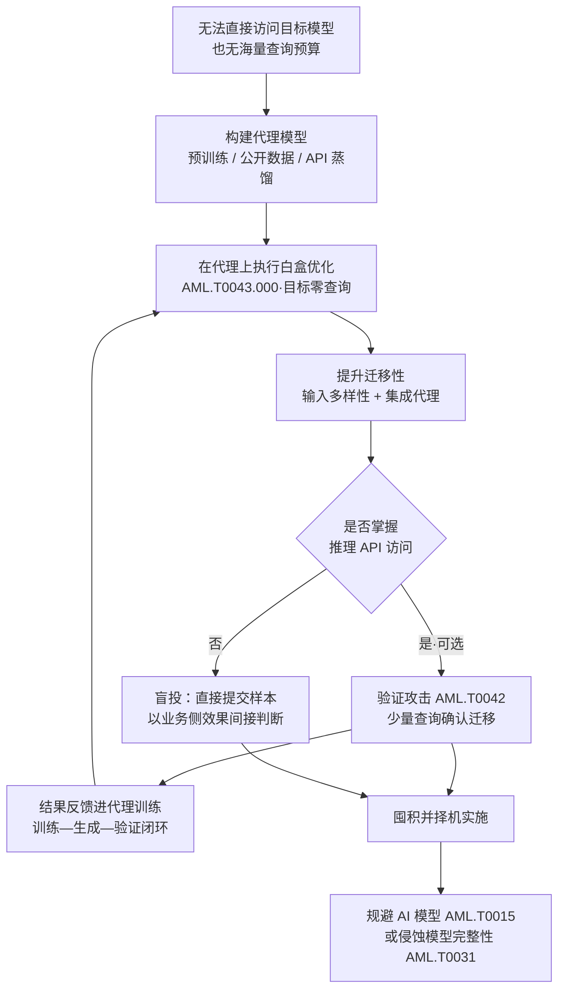

# 黑盒迁移 (AML.T0043.002)

> 属于 [构造对抗数据 (AML.T0043)](../AML.T0043-Craft-Adversarial-Data.md)

## 一句话通俗理解

> 想打开一把没见过的锁，又不想在锁眼前反复试钥匙（那样会被保安盯上）——于是攻击者先搞一把同型号的锁放在自己家里，把它拆个底朝天、配出一把能开的钥匙，然后拿着这把钥匙直接去开真锁。这就是黑盒迁移：**在替身模型上造弹，一发打向真身**，全程对目标零查询。

## 难度等级

⭐⭐ **Demonstrated（已演示）**

官方成熟度评定为 Demonstrated——本子技术已在多个真实商业系统上得到演示：UC Berkeley 研究组复刻机器翻译服务后把对抗样本迁移到 Google 翻译与 Systran 生产服务（AML.CS0005）；Silent Break Security 研究员先自建邮箱防护模型的仿制品，再据此构造能骗过 ProofPoint 生产系统的恶意邮件（AML.CS0008）；Kaspersky 团队在无白盒访问的条件下绕过了自家反恶意软件 ML 模型（AML.CS0014）。实施门槛集中在"代理模型的代表性"上：算法不难（在代理上做的是白盒优化，成熟工具开箱即用），难的是造出一个决策边界足够像目标模型的替身——这正是它必须与[创建代理 AI 模型 (AML.T0005)](../AML.T0005-Create-Proxy-AI-Model.md) 系列技术捆绑使用的原因。

## 技术描述

### 通俗解释

对抗样本有一个反直觉的性质：它不只对"训练时那个模型"有效，还经常对**别的模型**同样有效。这种现象叫**迁移性（transferability）**——在一个模型上算出来的"骗术"，换个近亲模型往往也灵。因为面对同一个任务、相似的数据，不同的模型倾向于学出**彼此高度相似**的决策边界，大家是"英雄所见略同"。

黑盒迁移就建立在这条规律上。攻击者拿不到目标模型，于是训练一到多个**自己完全掌控**的代理模型（也叫替代模型、替身模型），在代理上执行**白盒优化**（AML.T0043.000）——梯度随便算、迭代随便跑，想造多少样本造多少。造完之后，把样本原封不动地提交给远程的目标黑盒模型：如果代理足够像目标，样本就"泛化"过去，一次命中。

**为什么这是隐蔽性最高的一条路线**——看三条路线的查询量就明白：

| 路线 | 与目标模型的交互 | 攻击者手里的东西 | 暴露风险 |
|------|----------------|----------------|---------|
| 白盒优化 (.000) | 零查询 | 目标模型的完整内部（权重、结构、梯度） | 低（但需先偷到模型） |
| 黑盒优化 (.001) | **海量查询**——反复试探迭代 | 目标模型的输入-输出行为 | **高**：API 可能正被受害者监控 |
| 黑盒迁移 (.002) | **零查询**（生成阶段） | 一个自己造的、行为相似的替身 | **最低**：生成阶段完全离线 |

关键点在最后一列：黑盒优化每一次试探都落在受害者的日志里，密集的相似请求是教科书式的攻击信号；黑盒迁移把全部迭代留在攻击者自己的机房，目标侧从头到尾**一条日志都不会产生**。如果还需要确认效果，攻击者才动用 AI 模型推理 API 访问（AML.T0040）与验证攻击（AML.T0042）——而且这通常只需要几条样本，与黑盒优化需要的成千上万次查询不是一个量级。**"用算力换查询"**是本子技术的经济实质。

### 技术原理

依据官方描述，黑盒迁移的定义由以下几个要件构成：

1. **代理模型先行**：攻击者使用一个或多个**自己拥有完全访问权限**、且**能代表目标模型**的代理模型。官方明确点出两条获得途径——[创建代理 AI 模型 (AML.T0005)](../AML.T0005-Create-Proxy-AI-Model.md)，或复制推理 API 训练代理（AML.T0005.001，即通过反复查询目标 API 收集输入-输出对、蒸馏出克隆模型）。
2. **代理上跑白盒优化**：在代理模型上执行白盒优化（AML.T0043.000）——"白盒"在这里指的是攻击者对**代理**的完全访问权，而不是对目标模型的访问权。
3. **跨模型泛化**：如果这组代理模型与目标模型**足够接近（close enough）**，对抗样本就会从一个模型**泛化**到另一个——**对代理有效的攻击，往往对目标模型同样有效**。这就是迁移性的直接表述。
4. **可选验证与闭环**：若攻击者另有推理 API 访问权，可用验证攻击（AML.T0042）确认攻击是否奏效，并把验证得到的反馈**纳入训练过程**——形成"训练—生成—验证—再训练"的迭代闭环。

**代理模型怎么造**——这是本子技术成败的关键。AML.T0005 家族提供了三条主线：

| 造代理的方式 | 原理 | 与本子技术的关系 |
|-------------|------|-----------------|
| 复制推理 API 训练代理（AML.T0005.001） | 反复查询目标 API 收集输入-输出对，蒸馏出行为克隆模型 | **最贴合本子技术**：克隆模型与原模型的决策边界最接近，迁移成功率最高；代价是克隆阶段本身要消耗查询 |
| 收集 AI 产物训练代理（AML.T0005.000） | 用目标相关的公开数据集训练同任务模型 | 零查询到底，但代理与目标的差距更大 |
| 使用预训练公共模型（AML.T0005.002） | 直接拿公开的预训练模型当替身 | 最低成本；若目标本身就是该开源模型的微调版，效果出奇地好 |

**提升迁移性的工程手段**——迁移率不是"有就是有"，而是一条可以被工程手段推高的曲线：

- **输入多样性（input diversity）**：生成对抗样本时，对每次迭代的输入施加随机变换（缩放、平移、裁剪、加噪等），迫使扰动在变换下依然有效。这同时抑制了样本对代理模型特有怪癖的过拟合——只对代理有效、对目标无效的伪特征被随机变换筛掉，迁移率因此显著上升。这是本子技术最重要的调参旋钮。
- **模型集成**：不只用单个代理，而是一组**架构/训练数据各异**的代理模型，优化目标设为"同时骗过所有代理"——等于强制扰动落在多个模型共享的脆弱区域，而这正是目标模型大概率也在的区域（与官方缓解措施 AML.M0006 模型集成完全对称：防御方用集成稀释迁移，攻击方用集成放大迁移）。
- **代理与目标的"近亲"程度**：同架构、同数据分布、同任务（甚至同预训练底座）的代理，迁移率最高——这也是复制推理 API 训练代理（AML.T0005.001）路线的价值所在。

**与兄弟子技术的分界**（这是理解本子技术最要紧的一张表）：

| 子技术 | 与真身的关系 | 交互次数 | 优化发生在哪里 |
|-------|-------------|:--------:|---------------|
| 白盒优化 (.000) | **拥有真身内部** | 零 | 真身上 |
| 黑盒优化 (.001) | **直接查询真身** | 大量（成千上万） | 真身上（隔着 API） |
| **黑盒迁移 (.002)** | **不接触真身，只用替身** | **零（生成阶段）** | **替身上** |
| 人工修改 (.003) | 凭经验猜真身 | 少量试错 | 攻击者的头脑里 |
| 插入后门触发器 (.004) | 在真身训练/数据侧动手 | — | 训练管线 |

一句话：.000 偷到了图纸、.001 在门口反复试锁、**.002 在自己家里配好钥匙**。三者的区别不在于攻击算法（.000 与 .002 用的是同一套白盒优化），而在于**优化发生在哪个模型上**。

**平台覆盖**：Predictive AI（预测式 AI）——迁移攻击作用于分类、检测、识别类模型的判断，官方平台标注与父技术一致。

### 用途影响

- **最低交互、最难发现**：生成阶段零查询，受害者的 API 日志里没有任何迭代痕迹——防御方"看得见"的只有最终落地的那几次请求；
- **突破"拿不到模型"的困局**：目标模型完全闭源、部署在云端、连 API 都严格限流时，白盒优化无从下手、黑盒优化成本极高，迁移路线仍可能奏效；
- **成功率是可经营的水位**：通过代理集成与输入多样性，迁移率可以从"偶有命中"推到"稳定有效"，攻击者掌握主动权；
- **打穿安全类模型的价值最高**：恶意软件检测、钓鱼识别、垃圾邮件过滤这类模型一旦被迁移攻击绕过，直接为后续入侵打开通道（AML.CS0008、AML.CS0014 即是实例）。

## 攻击流程

### 典型攻击流程



**步骤详解：**

1. **明确目标与期望效果**
   - 通俗描述：先想清楚要目标模型"错成什么样"。
   - 技术细节：非定向误分类最易迁移（只需让输出偏离真类）；定向误分类（把 A 认成指定 B）迁移难度高得多，因为目标模型的边界细节未必与代理一致；漏检类只需把恶意分数压过阈值，是迁移攻击最常见的目标。
2. **构建代理模型**
   - 通俗描述：在自己家造一把同型号的锁。
   - 技术细节：三条主路——复制推理 API 训练代理（AML.T0005.001，查询目标 API 蒸馏克隆）、收集 AI 产物训练代理（AML.T0005.000，用公开/同分布数据集训练同任务模型）、使用预训练公共模型（AML.T0005.002）。评估标准只有一个：在干净输入上，代理与目标的预测一致率有多高——这就是迁移成功率的上界预测。
3. **在代理上执行白盒优化**
   - 通俗描述：把锁拆开，慢慢配钥匙。
   - 技术细节：完全白盒条件，梯度、权重、结构全部可用，用 PGD 多步迭代逼近攻击威力上限，或用 C&W 搜索最小扰动。此阶段查询成本为零，可以跑极多轮、极多组超参数——把"查询贵"的劣势换成"算力贱"的优势。
4. **提升迁移性：输入多样性与集成**
   - 通俗描述：让钥匙不只为这一把锁定制，而是为"这一类锁"通用。
   - 技术细节：迭代中随机变换输入（缩放/平移/裁剪/加噪），抑制样本对代理特有伪特征的过拟合；优化目标设为同时骗过多个异构代理（不同架构/种子/训练集），把扰动逼向多模型共享的脆弱区。这两招直接决定迁移率高低，是本子技术的核心工艺。
5. **验证攻击（AML.T0042）并闭环**
   - 通俗描述：拿配好的钥匙去真锁上试一下，但只试一两次。
   - 技术细节：若掌握推理 API 访问（AML.T0040），用小批量样本确认迁移效果——样本数量必须压到最低、请求分散拟真，避免触发限速与相似度监控；官方明确指出验证结果可纳入训练过程，反哺代理模型与样本筛选策略。无 API 访问时只能"盲投"，通过业务侧信号间接判断。迁移成功的样本可长期保存，择机批量投放，服务于规避 AI 模型（AML.T0015）或侵蚀模型完整性（AML.T0031）。

**与后续战术的衔接：**

- **初始访问（AML.TA0004）**：绕过边界处 AI 检测的样本（恶意文件、钓鱼邮件）是进入目标环境的直接弹药；
- **反复回炉**：每获得一版更接近的代理、每拿到一点验证反馈，攻击者都会回到本技术重造弹药——迁移率是持续经营的指标，不是一次性结果。

> 关键差异：黑盒优化（AML.T0043.001）用**海量查询**换取样本的"现场适配"；黑盒迁移（AML.T0043.002）用**算力与建模能力**换掉全部查询——牺牲部分成功率，换取零暴露。**限速与监控能杀死 .001，但对 .002 只能管住最后的落地时刻**。

## 真实案例

> 以下 3 个案例在官方数据中均直接关联本子技术 AML.T0043.002，均属于"先造代理、再迁移打真身"的完整链路，源自 MITRE ATLAS 案例库。

### 案例1：UC Berkeley 迁移攻击商业机器翻译服务（AML.CS0005，AML.T0043.002）

- **时间**: 2020年4月（EMNLP 2020 发表）
- **攻击者**: UC Berkeley 人工智能研究组（安全研究）
- **手法**: Google 翻译、Bing Translator、Systran Translate 均提供公开 UI 与 API。研究组利用这些公开端点构建出一个**接近生产水准的复制模型**（AML.T0005.001），随后在这个复制品上构造对抗样本（AML.T0043.002），并将其提交给真实生产服务。这些对抗输入成功在 Google 翻译与 Systran 网站上引发了**定向词语翻转、粗俗输出与整句丢失**。
- **影响**: 既证明黑盒系统的知识产权可以被功能性窃取，又证明对抗样本能从复制模型**迁移**到真实生产系统；是黑盒迁移最经典的教科书案例
- **参考链接**: [Imitation Attacks and Defenses for Black-box Machine Translation Systems (arXiv:2004.15015)](https://arxiv.org/abs/2004.15015)

### 案例2：ProofPoint 邮件防护系统规避（AML.CS0008，AML.T0043.002）

- **时间**: 2019年9月（CVE-2019-20634）
- **攻击者**: Silent Break Security 研究员
- **手法**: 研究者没有直接攻击生产系统，而是先**仿造了一个同类邮件防护 ML 模型**（copy-cat model），在研究环境里摸清评分机制，再把获得的洞察用于绕过真实系统。该机制会为邮件中的每个词按多个变量打分，总分过低即判定为垃圾邮件——研究者的洞察让他们能构造出获得"偏好分数"的恶意邮件，全程不被检出。
- **影响**: 证明"仿制品调研 + 洞察迁移"可以在商用邮件安全网关上落地；该研究已收录为 CVE-2019-20634，公开实现名为 Proof Pudding
- **参考链接**: [CVE-2019-20634 (NVD)](https://nvd.nist.gov/vuln/detail/CVE-2019-20634)

### 案例3：Kaspersky 混淆反恶意软件神经网络（AML.CS0014，AML.T0043.002）

- **时间**: 2021年6月
- **攻击者**: Kaspersky ML 研究团队（内部安全研究）
- **手法**: 在云部署场景下，模型特征在用户系统上构建、随后发送至安全厂商服务器——Kaspersky 团队把这种"知道特征、不知模型"的情形归为灰盒场景，并证明**仅凭特征知识就足以发动对抗攻击**。他们在**没有白盒访问权**的条件下攻击了自家一款反恶意软件 ML 模型，成功使大部分被对抗性修改过的恶意文件**逃过检测**。
- **影响**: 把"代理模型的代表性"重新定义为"对输入特征与决策逻辑的了解程度"——即便没有模型本体，掌握特征构造方式也足以完成迁移攻击；为"云端算特征"这一常见架构敲响警钟
- **参考链接**: [Kaspersky: How to confuse antimalware neural networks](https://securelist.com/how-to-confuse-antimalware-neural-networks-adversarial-attacks-and-protection/102949/)

## 红队视角

> ⚠️ **免责声明**：以下内容仅用于合法授权的安全测试与教育目的。未经授权对他人系统或第三方 AI 服务进行测试是违法行为。

### 实战技巧

1. **把"查询预算"作为第一决策变量**
   授权评估开始先与客户约定**允许的查询总量**。预算宽裕才考虑黑盒优化（.001）；预算极紧（或客户要求"绝不惊动监控"）就走迁移路线。经验值：黑盒优化动辄需要上万次查询，而迁移路线的验证阶段通常只需数十到数百条——把这两个量级摆到客户面前，路线选择往往自动明确。
2. **代理模型的"近亲度"胜过算法调优**
   迁移率的瓶颈是代理与目标的决策边界差距，不是优化器。优先投资在：确认目标使用的底座模型族（开源版本、同厂商同代产品）、同任务的公开数据集、以及能否负担一次小规模的 API 蒸馏（AML.T0005.001）。先把模型"造像"，再谈"造准"。
3. **输入多样性是默认动作，不是可选项**
   不加输入多样性的迁移攻击，成功率常常低得令人失望——样本会贴着代理模型的怪癖走。在每次迭代中对输入做随机缩放、平移、裁剪、加噪，是提升迁移率最便宜的一招；集成（多代理同时优化）是第二便宜的一招。两者叠加后再评估是否值得投入更多成本。
4. **验证查询要做"拟真伪装"**
   验证阶段（AML.T0042）是整条链路上**唯一**会接触目标 API 的环节，也是唯一可能暴露的环节。原则：样本量最小化、请求分散到不同时间窗、使用与正常客户端一致的 UA 与请求特征、避免在同一账号上形成"高度相似输入"的簇。
5. **报告要写清"迁移率"而不只是"成功/失败"**
   交付物应给出：代理与目标在干净数据上的一致率、每个代理的单独攻击成功率、集成后的攻击成功率、迁移到目标后的实测命中率。"能打穿"可能只是运气好碰上一个样本，"迁移率 60%"才是系统性问题。

### 常用工具

| 工具名称 | 用途 | 平台 |
|----------|------|------|
| Adversarial Robustness Toolbox (ART) | IBM 开源工具箱，含白盒攻击算法与迁移攻击示例 | 跨平台（Python） |
| Foolbox | 多框架对抗样本生成库，方便做跨模型迁移实验 | 跨平台（Python） |
| PyTorch + torchvision | 训练代理模型、计算梯度、执行 PGD/C&W | 跨平台（Python） |

### 注意事项

- **克隆本身也是攻击**：复制推理 API 训练代理（AML.T0005.001）阶段的大量查询同样在授权范围之外不可进行，且在第三方监控下等同于"自首"；对客户环境必须严格按授权范围执行并留存查询记录
- **区分"研究样本"与"实战载荷"**：迁移成功的样本要落到真实攻击链上还需考虑传输、触发、鲁棒性；样本构造完成 ≠ 武器可用
- **合规边界**：验证查询的清单要随报告交付，让蓝队有对账依据——这既是合规要求，也是红蓝协作的基础

## 蓝队视角

### 检测要点

1. **真正的盲区：样本生成阶段不可检测**
   攻击者在自己的算力上跑白盒优化，目标侧不产生任何事件。防御重心必须前移到两处——**降低代理模型的可复刻性**（让攻击者造不出像样的替身）与**拦截最终落地的样本**（AML.M0015 对抗输入检测）。
2. **代理模型的侦察痕迹（前置阶段）**
   日志来源：推理 API 网关日志、模型服务审计日志。异常特征：单一来源系统性地枚举模型在不同输入上的行为、查询输入覆盖度远超正常业务面（克隆模型需要"看见"各类样本）、跨多个账号/密钥分散请求以规避限速——这些是复制路线（AML.T0005.001）的典型征兆，也是本子技术的前置动作。
3. **落地阶段的样本特征（唯一可见环节）**
   日志来源：推理入口的输入校验、模型输出监控。异常特征：**"输入分布离群 + 置信度极高却判错"**——迁移样本通常不表现出"试探性"，而是一次命中，且模型往往给出相当自信的错误答案；这与黑盒优化落地时"连续相似、置信度摇摆"的模式形成对照。

### 监控建议

- **降低输出保真度**（AML.M0002）：收敛 logits、类别排名与高精度置信度——官方缓解列表虽未直接覆盖本子技术，但高保真反馈是克隆代理的前提，掐断信息源对上游有连带效果
- **限速、配额与访问控制**（AML.M0004 / AML.M0019）：限制单个身份的查询**总量**而不只是速率，并让每一批可疑查询可归因、可封禁——直接抬高克隆代理的成本
- **对抗输入检测**（AML.M0015）：本子技术唯一真正"能拦住"的环节——在推理入口拦截落地的迁移样本
- **模型集成**（AML.M0006）：防御侧对应攻击侧的"集成代理"——用足够多样的模型集合稀释单一样本的迁移效力

## 检测建议

### 网络层检测

**检测方法：** 本子技术落地时只有极少量请求，网络层的价值在于识别**前置的克隆行为**与**最终的投放行为**。

- 单一来源对推理端点输入的**系统性覆盖**（同一模型在大量不同类别样本上被查询），而非业务所需的点状调用
- 分散到多个账号/密钥/IP 的查询，但输入的分布高度一致——集中规避限速的特征
- 投放时段的异常（非营业时段的批量提交），或请求体存在肉眼不可见的系统性扰动（图像噪声水平异常、文本大量同形异义字符替换）

### 主机层检测

**检测方法：** 本子技术的攻击侧全部在攻击者自己的主机上完成，防守方主机层无直接痕迹；价值在于保护"代理模型的原材料"。

- 模型注册表、模型工件库、训练数据仓库的大范围读取或批量导出（攻击者收集 AI 产物训练代理的前置动作）
- 特征定义文档、预处理代码的异常访问——Kaspersky 案例（AML.CS0014）证明**特征知识本身就是攻击能力**
- 对抗工具链（art、foolbox、cleverhans、textattack）出现在生产训练环境中的进程与安装记录

### 应用层检测（AI 遥测）

**检测方法：** 在两个可观测窗口布防——克隆阶段（查询模式）与投放阶段（输入异常）。

- **克隆阶段**：对调用方的查询输入做"覆盖面统计"——同一身份在滑动窗口内命中的语义类别数远超业务正常水平，是克隆模型的强信号
- **投放阶段**：输入分布漂移检测（噪声、频谱、字符扰动）+ 置信度异常检测——重点看"**高置信度 + 错误结论**"这一组合，它是对抗样本与正常难分样本的关键区别
- 对抗样本检测器（AML.M0015）：统计检验、辅助模型、一致性检查、模态专用检测器，在推理前拦截
- 业务效果监控：某类输入的误分类率/漏检率在无对应概念漂移的情况下骤升，往往意味着迁移样本已开始投放

**程序化检测思路（无需 EDR 侧改造）：**

在推理网关加两个轻量指标，即可覆盖本子技术的两个可见窗口：① **覆盖面指标**——按调用方统计"最近 N 次查询所命中的输入簇数量"，远高于业务基线即为克隆可疑；② **置信-正确性背离指标**——统计"模型给出高置信度但后续被业务侧证伪"的比例，明显抬升即为迁移样本落地的信号。前者对应"造替身"，后者对应"打真身"，两条网关侧滑窗聚合指标正好把本子技术的首尾两端都罩住。

### Sigma 规则思路示例

```yaml
title: 推理端点出现系统性输入覆盖（克隆代理模型特征）
status: experimental
description: 检测单一调用方对推理端点进行覆盖式查询——输入跨越大量
    语义类别、远超业务正常调用面，是复制推理 API 训练代理
    （AML.T0005.001）以支撑黑盒迁移（AML.T0043.002）的前置典型特征
logsource:
    category: application
    product: ai_inference_gateway
detection:
    selection:
        cs-method: 'POST'
        sc-status: 200
        cs-uri|contains: '/predict'
    condition: selection | count() by c-ip > 300
    timeframe: 15m
level: high
tags:
    - atlas.aml_t0005_001
    - atlas.aml_t0043_002
```

> 说明：阈值（300 次/15 分钟）需按业务基线校准；区分"正常批量业务"（输入高度同质）与"覆盖式克隆"（输入高度异质）还需网关侧的输入语义簇统计（感知哈希/minhash/嵌入聚类）——单看查询量会把批量业务误伤。

## 缓解措施

> 依据官方数据，本子技术直接映射 4 项缓解措施（AML.M0003、M0006、M0010、M0015）。与黑盒优化（.001）不同，**限速、输出混淆、生产访问控制均未覆盖本子技术**——官方数据的这一取舍道出了本质：它几乎不产生查询，限速类措施对"零查询生成"无能为力。

### 优先级1：关键措施

**AML.M0003 预测式 AI 模型加固（Predictive AI Model Hardening）**

设计并训练模型，使其在面对对抗样本（数字扰动或物理对抗道具）时仍保持预期性能：对抗训练、鲁棒模型架构、防御蒸馏、认证鲁棒性方法。对本子技术的特殊意义：对抗训练会改变模型的决策边界，使其偏离"大众模型共享的脆弱区"——而迁移攻击恰恰依赖那个共享脆弱区。加固程度越深，代理模型上学到的扰动就越难迁移过来。

**AML.M0015 预测式 AI 对抗输入检测（Predictive AI Adversarial Input Detection）**

在推理前检测并阻断对抗样本；官方描述特别指出要**监控与对抗样本生成、迁移攻击、黑盒优化相关的输入特征与查询模式**——这明确把本子技术纳入了检测对象。由于生成阶段不可见，这是唯一能在"样本生效"这一刻发挥作用的防线。

**AML.M0010 预测式 AI 输入还原（Predictive AI Input Restoration）**

推理前预处理输入以移除、削弱或扰乱对抗扰动：去噪、压缩、重建、重采样、特征收缩、随机变换；并针对会把预处理纳入攻击计算的适应性攻击者评估效果。注意本子技术的一个微妙之处：攻击者在**自己**的模型上优化，并不知道目标采用的还原方法，因此还原措施对迁移攻击的杀伤力往往**高于**对白盒攻击——攻击者没有机会把还原步骤纳入梯度计算。

### 优先级2：重要措施

**AML.M0006 预测式 AI 模型集成（Predictive AI Ensembles）**

使用足够多样（不同架构、训练过程、特征、模型族）的模型集成，配合能防止单一模型对抗样本主导整体的聚合裁决机制。这是与攻击侧"集成代理提升迁移率"完全对称的防御手段：攻击者提升迁移率靠的是让扰动落在**多个模型的共享脆弱区**，而防御方的模型集成正是要打散"共享脆弱区"——成员越异构，可被共享的脆弱区越小。AML.CS0032 中"其余组件仍拦下了钓鱼网站"即是集成生效的实证。

### MITRE ATLAS 缓解措施映射

| 缓解措施ID | 缓解措施名称 | 优先级 | 官方覆盖（本子技术） | 类别 |
|------------|-------------|:------:|----------------------|------|
| AML.M0003 | 预测式 AI 模型加固 | 关键 | AML.T0043.002 | Technical - AI |
| AML.M0015 | 预测式 AI 对抗输入检测 | 关键 | AML.T0043.002 | Technical - AI |
| AML.M0010 | 预测式 AI 输入还原 | 关键 | AML.T0043.002 | Technical - AI |
| AML.M0006 | 预测式 AI 模型集成 | 重要 | AML.T0043.002 | Technical - AI |

> 四项官方覆盖措施**全部是"Technical - AI"类别，没有一项是 Policy 类**——这一分布本身就说明了问题：面对"零交互生成"的黑盒迁移，访问控制、限速、审计等策略手段都落在攻击路径之外，唯一有效的战场是模型本身。相比之下，黑盒优化（.001）的缓解列表里挤满了限速、输出混淆、访问控制等策略措施——**同样是"打不穿"，一个靠把门关紧，一个只能靠把锁做结实**。

## 关联 ATT&CK 技术

官方数据中本子技术（AML.T0043.002）**没有直接的 ATT&CK 技术映射**（attack_reference 为空）——迁移攻击是 ATLAS 特有的 AI 原生威胁。以下为概念层面的关联对照：

- [开发能力 (T1587)](../../../enterprise/02-Resource-Development/T1587-Develop-Capabilities.md) — 同为"攻击前的武器制造"环节：T1587 编写恶意代码，黑盒迁移用代理模型上的梯度计算造出"以数据为形态"的武器；差异在于本子技术是"**先仿造靶场再研制弹药**"的两段式制造；
- [获取能力 (T1588)](../../../enterprise/02-Resource-Development/T1588-Obtain-Capabilities.md) — 概念上更贴近"借用现成能力"：使用预训练公共模型当代理（AML.T0005.002），与 T1588 直接从外部获取攻击能力的思路同构；
- [禁用或修改工具 (T1685)](../../../enterprise/08-Defense-Impairment/T1685-Disable-or-Modify-Tools.md) — 效果层面的类比：当迁移攻击的目标是安全检测类模型（邮件网关、杀毒引擎，见 AML.CS0008/CS0014）时，攻击效果等同于削弱防御工具，只是手段从直接禁用工具变为欺骗工具背后的模型。

| 维度 | 黑盒优化 (.001) | 黑盒迁移 (.002) |
|------|----------------|-----------------|
| 交互对象 | 真身（通过 API） | 替身（完全受控） |
| 查询量 | 极多 | 零（生成）／极少（验证） |
| 优化方式 | 查询-反馈逼近 | 白盒梯度优化 + 迁移性 |
| 成功率 | 直接决定（反馈闭环） | 取决于代理与目标的接近度 |
| 暴露风险 | 高（API 可能被监控） | 最低 |
| 对方防御重点 | 限速、输出混淆、访问控制 | 模型加固、对抗输入检测、输入还原 |

一句话总结：T1587 造"病毒"，黑盒优化在门口试锁，黑盒迁移则是**在自己家里仿造一把锁、配好钥匙、再去开真锁**——真正被消耗的不是目标的耐心，而是攻击者的算力。

## 动手实验

> ⚠️ **重要提示**：所有实验必须在隔离的实验室环境中针对自有模型进行，禁止对未授权系统或第三方在线 AI 服务进行测试。

### 实验环境准备

| 环境组件 | 用途 | 获取方式 |
|----------|------|----------|
| 隔离环境（无外网或仅本地回环） | 实验沙箱 | 本地虚拟化平台 / 容器 |
| Python 3.10+ | 运行实验代码 | 官方安装包 |
| PyTorch + torchvision | 训练代理/目标模型、计算梯度 | pip 安装 |
| Adversarial Robustness Toolbox (ART) | 白盒攻击算法、迁移评估 | `pip install adversarial-robustness-toolbox` |

### 实验1（初级）：验证迁移性的存在

**实验目标：** 亲眼看一次"在 A 上造的样本骗过 B"——建立对迁移性的第一手直觉。

**实验步骤：**
1. 在 MNIST 上训练两个架构不同的模型（如小型 CNN 与 MLP），确认两者干净准确率相近且互不共享权重
2. 以 CNN 为代理，用 ART `ProjectedGradientDescent` 在其上生成对抗样本，记录对 CNN 的攻击成功率
3. 把同一批样本直接提交给 MLP（模拟"无访问权的目标模型"），记录迁移成功率
4. 对比两个数字——前者通常接近 100%，后者会明显下降，但通常仍显著高于随机

**预期结果：** 看到清晰的"代理上成功率高、目标上成功率打折"现象，理解迁移率为何是这条路线唯一真正要紧的指标。

### 实验2（中级）：输入多样性带来的迁移率提升

**实验目标：** 量化"输入多样性"这一工程手段的实际收益。

**实验步骤：**
1. 沿用实验1 的代理/目标模型组合，先跑出基线迁移率
2. 改造攻击流程：每次 PGD 迭代前对输入做随机缩放（如随机裁剪并 resize 回原尺寸），再计算梯度
3. 重新生成样本并测试对目标模型的迁移率，与基线对照；观察变换强度过大时攻击本身是否被削弱

**预期结果：** 迁移率出现可观测的提升——直观理解为什么"随机变换"能抑制样本对代理特有伪特征的过拟合。

### 实验3（高级）：代理集成提升迁移率

**实验目标：** 复现"用一组异构代理共同优化"的手法，理解攻防两侧的"集成对称性"。

**实验步骤：**
1. 训练 3 个异构代理：不同架构、不同随机种子、可用不同数据子集
2. 分别对每个代理单独生成对抗样本，记录各自对目标模型的迁移率
3. 实现集成攻击：优化目标改为"同时使 3 个代理的损失最大化"（各模型梯度加权求和），测试集成样本对目标模型的迁移率
4. 对照缓解措施 AML.M0006：把目标也改成 3 模型集成（多数表决），观察迁移率如何被压缩

**预期结果：** 集成攻击的迁移率显著高于任一单代理攻击；而当目标侧也采用异构集成时，迁移率又被明显压缩——一边是攻击者聚合脆弱性，一边是防御者打散脆弱性，同一条"集成"原理两用。

## 术语解释

| 术语 | 英文原名 | 通俗解释 |
|------|----------|----------|
| 黑盒迁移 | Black-Box Transfer | 在自建代理模型上生成对抗样本，再拿到无法访问的目标模型上使用——本子技术 |
| 迁移性 | Transferability | 在模型 A 上有效的对抗样本，在模型 B 上往往也有效的现象——本子技术的数学根基 |
| 代理模型 | Proxy Model | 攻击者自建、拥有完全访问权、行为像目标模型的替身 |
| 替代模型 | Substitute Model | 同代理模型，学术文献中更常用的称法；通常以复制/蒸馏方式训练 |
| 白盒优化 | White-Box Optimization | 能拿到模型内部（权重、梯度）时直接求最优扰动——在本子技术中施于**代理**而非目标 |
| 黑盒优化 | Black-Box Optimization | 只能通过查询目标 API 反复试探来优化扰动——与本子技术的根本对照 |
| 对抗样本 | Adversarial Example | 经精细修改、人眼无感但会使模型判错的输入数据 |
| 零查询 | Zero-Query | 生成阶段完全不接触目标模型——本子技术最核心的隐蔽性来源 |
| 输入多样性 | Input Diversity | 在优化迭代中对输入施加随机变换，抑制对代理特有伪特征的过拟合，显著提升迁移率 |
| 模型集成 | Ensemble | 聚合多个不同模型的判断；攻击侧用它放大迁移性，防御侧用异质集成打散它 |

## 参考资料

### 📚 官方文档

- [MITRE ATLAS - Black-Box Transfer (AML.T0043.002)](https://atlas.mitre.org/techniques/AML.T0043/002/) - 官方技术页面
- [MITRE ATLAS 矩阵](https://atlas.mitre.org/matrices/ATLAS/)
- [MITRE ATLAS Data (GitHub)](https://github.com/mitre-atlas/atlas-data) - ATLAS 官方 STIX/JSON 数据仓库

### 📰 案例报告（真实攻击与安全研究）

- [Imitation Attacks and Defenses for Black-box Machine Translation Systems (EMNLP 2020)](https://arxiv.org/abs/2004.15015) - 案例1：机器翻译服务的代理复制与迁移攻击（AML.CS0005）
- [CVE-2019-20634 (NVD)](https://nvd.nist.gov/vuln/detail/CVE-2019-20634) - 案例2：ProofPoint 邮件防护系统规避（AML.CS0008）
- [Kaspersky: How to confuse antimalware neural networks](https://securelist.com/how-to-confuse-antimalware-neural-networks-adversarial-attacks-and-protection/102949/) - 案例3：无白盒访问下攻击反恶意软件模型（AML.CS0014）

### 📖 学术研究

- [Papernot et al., Practical Black-Box Attacks against Machine Learning (2016)](https://arxiv.org/abs/1602.02697) - 用替身模型实施黑盒迁移攻击的方法论源头，本子技术的奠基之作
- [Goodfellow et al., Explaining and Harnessing Adversarial Examples (2014)](https://arxiv.org/abs/1412.6572) - 提出线性解释与 FGSM，为理解迁移性提供理论起点
- [Liu et al., Delving into Transferable Adversarial Examples and Black-box Attacks (2016)](https://arxiv.org/abs/1611.02770) - 系统研究迁移性的影响因素与集成提升手法

### 🔧 工具与资源

- [Adversarial Robustness Toolbox (ART)](https://github.com/Trusted-AI/adversarial-robustness-toolbox) - IBM 开源工具箱，覆盖白盒攻击、迁移评估与防御
- [Foolbox](https://github.com/bethgelab/foolbox) - 跨框架对抗样本生成库，便于开展迁移实验
- [TextAttack](https://github.com/QData/TextAttack) - 文本域对抗攻击框架，支持模型间迁移测试

### 🔗 关联阅读

- [构造对抗数据 (AML.T0043)](../AML.T0043-Craft-Adversarial-Data.md) - 本子技术的父技术，五条构造路线的全景对照
- [创建代理 AI 模型 (AML.T0005)](../AML.T0005-Create-Proxy-AI-Model.md) - 本子技术的前置技术：代理模型从哪来
- [AI 攻击适配战术 (AML.TA0001)](../README.md) - 本技术所属战术的概览页
- [开发能力 (T1587)](../../../enterprise/02-Resource-Development/T1587-Develop-Capabilities.md) - 传统攻击能力开发，与本技术的"武器制造"环节对照

---

> **版本**: ATLAS 2026.09 | **更新**: 2026-10-22 | **模板**: ATLAS 技术文档 v1.0
