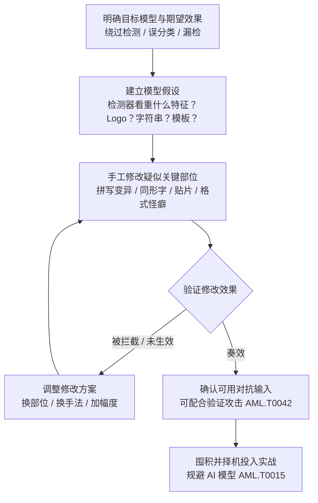

# 人工修改 (AML.T0043.003)

> 属于 [构造对抗数据 (AML.T0043)](../AML.T0043-Craft-Adversarial-Data.md)

## 一句话通俗理解

> 一篇红队研究报告的标题道破天机——《真实攻击者不算梯度》（Real Attackers Don't Compute Gradients）：野外攻击者不跑优化算法，而是像修图一样直接上手改输入——给钓鱼站的品牌 Logo 动点手脚、给恶意文件追加一段字符串、给域名换一个肉眼难辨的同形字，改完提交试试，被拦就再改一版。没有算法门槛、不需要模型权限，人肉试错就是最古老、最普及、也最容易被防御方低估的对抗样本流水线。

## 难度等级

⭐⭐⭐ **Realized（已实现）**

官方成熟度评定为 Realized——在构造对抗数据的五条子技术路线中，本路线是**唯一获评 Realized 的子技术**（其余四条均为 Demonstrated），因为它不仅被安全团队反复演示，还被**真实攻击者在野外实际使用**：2022 年，研究人员在一套商业 ML 钓鱼网站检测系统的日志中直接发现了攻击者手工修改品牌 Logo 的对抗样本（AML.CS0032）；此前，Skylight Cyber 仅向恶意文件追加一段"通用绕过字符串"就绕过了 Cylance 的 AI 恶意软件检测（AML.CS0003），Palo Alto Networks 安全 AI 研究团队则以"构造—查询—调整"的人肉试错绕过了自家深度学习检测器（AML.CS0000）。实施门槛为五条路线中最低：不需要模型访问权限、不需要机器学习功底、不需要算力，需要的只是对"目标模型看重什么特征"的朴素直觉和试错的耐心——父技术文档因此评其为"真实攻击者最常用的路线"。

## 技术描述

### 通俗解释

如果说算法路线是"精确制导"——白盒优化要拿到模型算梯度、黑盒优化要反复查询 API 收集反馈、黑盒迁移要先训练代理模型当替身——人工修改就是"土法炼钢"：攻击者凭对目标模型的了解（哪怕是朴素直觉），直接修改输入中自己怀疑"帮模型干活"的部位，改完试一次，不奏效再改，反复试错直到确认拿到可用的对抗输入。

打个比方：钓鱼网站检测器靠识别品牌 Logo 判断"这是不是仿冒站"。攻击者不需要知道分类器内部长什么样，只要猜到"它八成盯着 Logo"，就用图像编辑器把 Logo 的颜色、形状、局部元素改一改——人眼看仍是那个品牌，模型却认不出了。算梯度的攻击是先解剖发动机再动手，人工修改是老木匠凭手感敲打——偏偏在真实攻击里，手感常常赢过图纸。

### 技术原理

依据官方描述，本子技术包含三个核心要素：

1. **人工驱动**：修改由人（而非优化算法）完成，修改的依据是对目标模型工作机制的了解与怀疑，而非梯度或查询反馈等数学信息；
2. **定向改动**：攻击者修改的是输入中**疑似帮助模型执行任务**的部位——前提是对"模型靠什么做判断"持有某种假设（哪怕只是"检测器看重 Logo"这种朴素认知）；
3. **试错闭环**：官方描述明确指出攻击者"可能反复试错（trial and error），直到确认得到可用的对抗输入"——验证环节若拥有白盒或推理 API 访问，可与验证攻击（AML.T0042）配合。

**已知的手工修改手法家族**（按目标模态划分）：

| 目标模态 | 手工修改手法 | 典型攻击场景 |
|---------|-------------|-------------|
| 文本 | 拼写变异：故意引入错别字、交换字符位置 | 绕过 NLP 模型的垃圾内容/恶意文本检测 |
| 文本 | 同形字替换：用视觉相似但码位不同的字符（如西里尔字母 а 冒充拉丁字母 a） | 域名欺诈、关键词过滤规避 |
| 文本 | 标点与大小写滥用：插入分隔标点、改变大小写 | 垃圾邮件与评论过滤规避 |
| 文本/文件 | 模板与格式怪癖：更换邮件模板、利用文档格式解析差异 | 邮件安全网关、文档类检测 |
| 图像 | 贴纸与对抗贴片：在图像局部叠加贴纸或色块 | 钓鱼页 Logo 篡改、路牌识别欺骗 |
| 图像 | 篡改局部区域（如背景） | 图像分类器误分类 |
| 音频 | 叠加背景噪声 | 语音检测与声纹系统规避 |
| 物理世界 | 打印的对抗眼镜框、贴在停车标志上的贴纸 | 人脸识别欺骗、自动驾驶视觉欺骗 |

**人工修改何时胜过自动化**——这条"低技术"路线有三个人工独占的优势：

1. **鲁棒性补丁打不着**：对抗训练等加固手段主要针对算法生成的、Lp 范数受限的细微扰动；人工修改往往是大幅度的**语义级改动**（换模板、贴贴片、追加字符串），完全落在补丁保护的扰动球之外——模型对"人会觉得正常"的改动毫无防备；
2. **语义保持是免费的**：优化算法需要额外约束才能保证扰动不破坏人类可读性，而人凭语感与审美天然做到"改了但不改意思"——错别字不影响人理解"免费领取"，却足以让字符级模型失稳；
3. **零查询、零遥测**：白盒要模型本体、黑盒要海量查询（且查询会被监控），人工修改可以完全离线进行；在反馈渠道公开的场景（如公开多引擎扫描服务），连验证环节都不触碰受害者系统——目标侧不留下任何"正在被攻击"的痕迹。

**与兄弟子技术的分界**：白盒优化（AML.T0043.000）、黑盒优化（AML.T0043.001）、黑盒迁移（AML.T0043.002）的共同点是**算法驱动**，差别只在访问级别；人工修改（本子技术）是**人驱动**，不依赖任何算法条件；插入后门触发器（AML.T0043.004）则修改推理输入植入感知触发器，与投毒 AI 模型（AML.T0018.000）配合使用。实务中两条世界常混用：人工"粗调"定位关键特征，算法再"细调"优化扰动。

**平台覆盖**：Predictive AI（预测式 AI）——与父技术一致。

### 用途影响

- **攻击门槛民主化**：无机器学习功底的普通攻击者也能造出对抗样本（AML.CS0032 的攻击者身份未知、手法简单却奏效）；
- **绕过安全检测**：钓鱼站、恶意文件、垃圾内容绕过 ML 检测，为后续攻击直接开路；
- **物理域欺骗**：对抗眼镜骗过人脸识别、贴纸骗过自动驾驶视觉，威胁身份认证与人身安全场景；
- **难以归纳拦截**：每个攻击者的改法都不同，防御方难以用统一特征规则捕获；
- **验证成本低**：公开扫描服务、公开检测接口让试错几乎零成本（但也是双刃剑，见红队视角）。

## 攻击流程

### 典型攻击流程



**步骤详解：**

1. **明确目标与期望效果**
   - 通俗描述：想清楚要模型"错成什么样"。
   - 技术细节：漏检类攻击（把恶意分数压过阈值）通常比定向误分类容易；人工路线一般先求"绕过"，不苛求"错成指定类别"。

2. **建立模型假设**
   - 通俗描述：猜一猜模型"靠什么做判断"。
   - 技术细节：假设来自公开文档、产品行为观察与同类系统经验——钓鱼检测器八成看 Logo、邮件网关八成给关键词打分、恶意软件引擎八成提取字符串特征。人工路线的核心输入不是梯度，而是**假设**；假设越准，试错轮数越少。

3. **手工修改输入**
   - 通俗描述：上手改，改完看效果。
   - 技术细节：按目标模态从手法家族中选取——文本用拼写变异/同形字/标点滥用，文件用追加字符串/模板怪癖，图像用贴片/局部篡改，物理域用打印道具；改动幅度以"不破坏对人类的欺骗效果"为上限（钓鱼站仍要像、恶意文件仍要能运行）。

4. **试错验证**
   - 通俗描述：不拦就成，拦了再改。
   - 技术细节：验证渠道包括公开多引擎扫描服务、目标系统的可见反馈（拦截页、放行结果）、自建复现模型离线验证；若拥有推理 API 访问，可配合验证攻击（AML.T0042）确认效果。每轮试错都记录"改了什么、效果如何"，让假设逐步收敛。

5. **固化与复用**
   - 通俗描述：成功的土配方记下来，批量复用。
   - 技术细节：奏效的修改模式可沉淀为"配方"——案例2（AML.CS0003）中研究者找到的正是一段可通用的绕过字符串：一次人工试错，产出可复用的攻击资产。

**与后续战术的衔接：**

- **规避 AI 模型（AML.T0015，初始访问战术）**：人工对抗样本绕过部署在入口的 ML 检测（钓鱼识别、恶意软件分类），直接为入侵开路；
- **反复回炉**：试错中获得的认知（哪个特征真的有效）反馈给下一轮假设，甚至支撑攻击者升级到算法路线——先人工定位关键区域，再交给白盒/迁移算法精修。

> 关键差异：算法路线暴露的是"计算痕迹"——海量相似查询、对模型文件的异常访问；人工修改暴露的是"人的痕迹"——修改动作本身与正常内容编辑无法区分：改 Logo 与设计师改稿、文件追加字符串与正常编译产物，在任何主机/网络遥测里长得一模一样。防御方只能靠模型侧的输入监控与集成裁决兜底。

## 真实案例

> 以下 3 个案例的官方技术清单均包含本子技术 AML.T0043.003，源自 MITRE ATLAS 案例库；其中案例1 是迄今被记录的**真实攻击者**人工对抗样本。

### 案例1：真实攻击者手工篡改 Logo 规避钓鱼页面检测（2022年，AML.CS0032）

- **时间**: 2022年12月
- **攻击者**: 未知名真实攻击者（非红队演练）
- **手法**: 研究人员在一套商业 ML 钓鱼网站检测系统的日志中发现对抗样本。该系统由一组图像分类器集成，依据"钓鱼分数"自动作出拦截/放行判定。攻击者采用多种简单却有效的人工修改策略——直接篡改钓鱼页面中品牌 Logo 的视觉细节——成功骗过了负责"品牌冒充识别"（视觉相似度）的那一个分类器；不过系统其余组件（输入表单检测等）仍成功标记了这些钓鱼网站。
- **影响**: 首批被记录的真实攻击者对抗样本之一——证明攻击者不需要计算梯度、不需要模型访问，手工修改即可在野外奏效；同时验证了集成防御的价值（单点击穿、整体仍拦截）
- **参考链接**: [MITRE ATLAS 案例研究 AML.CS0032](https://atlas.mitre.org/studies/AML.CS0032)、["Real Attackers Don't Compute Gradients" (arXiv 2212.14315)](https://arxiv.org/abs/2212.14315)

### 案例2：通用绕过字符串击穿 Cylance AI 恶意软件检测（2019年，AML.CS0003）

- **时间**: 2019年
- **攻击者**: Skylight Cyber（安全研究）
- **手法**: 研究人员找到了一段"通用绕过字符串"：向恶意文件**追加**这段字符串后，即可绕过 CylancePROTECT 与 Cylance Smart Antivirus 的 AI 恶意软件检测。该字符串对测试样本普遍生效——一段文字就能让 AI 引擎把恶意文件放行。
- **影响**: 证明"文件追加一段字符"这一最原始的人工修改就能击穿商用 AI 检测器；通用绕过字符串本身也成了可提取、可共享的攻击资产
- **参考链接**: [MITRE ATLAS 案例研究 AML.CS0003](https://atlas.mitre.org/studies/AML.CS0003)、[Skylight Cyber 博客 "Cylance, I Kill You!"](https://skylightcyber.com/2019/07/18/cylance-i-kill-you/)

### 案例3：人肉试错绕过恶意 C&C 流量深度学习检测器（2018年前后，AML.CS0000）

- **时间**: 2018年前后
- **攻击者**: Palo Alto Networks Security AI 研究团队（安全验证研究）
- **手法**: 团队测试一个检测恶意软件 C&C HTTP 流量的深度学习模型。依据 Le 等人公开发布的 URLNet 论文（arXiv:1802.03162），构建了用相似数据集训练、性能相当的复现模型，随后**人工构造对抗样本——生成、查询、调整，循环往复直到成功绕过检测**。
- **影响**: 完整演示官方描述中"试错直到确认拿到可用对抗输入"的闭环；同时印证侦察阶段公开论文情报（AML.T0000.001）对攻击准备的支撑作用
- **参考链接**: [MITRE ATLAS 案例研究 AML.CS0000](https://atlas.mitre.org/studies/AML.CS0000)、[URLNet 论文 (arXiv:1802.03162)](https://arxiv.org/abs/1802.03162)

## 红队视角

> ⚠️ **免责声明**：以下内容仅用于合法授权的安全测试与教育目的。未经授权对他人系统或第三方 AI 服务进行测试是违法行为。

### 实战技巧

1. **先列"模型看重什么"假设清单**
   开工前先列出目标模型的特征假设清单（Logo 与配色、表单结构、字符串特征、发件模板、文件元数据……），按"验证成本低、命中概率高"排序逐条试错——人工路线的效率取决于假设质量，而不是手速。

2. **语义保持是底线**
   每一处修改都必须通过"人类视角"自检：钓鱼站改完还要像正品、恶意文件改完还要能运行、语音改完还要听得懂——骗过模型却骗不过人的修改没有交付价值。

3. **用公开渠道当免费靶场**
   公开多引擎扫描服务、产品公开检测接口先验证再投递，把试错从目标系统挪到公开渠道，最大限度减少在受害者侧留下的痕迹。

4. **人工+算法混合爬梯**
   人工修改快速定位"改哪里有效"，再切换到白盒优化（AML.T0043.000）或黑盒迁移（AML.T0043.002）精修扰动——把人工直觉当作算法路线的瞄准镜。

### 常用工具

| 工具名称 | 用途 | 平台 |
|----------|------|------|
| 图像编辑器（GIMP/Photoshop） | Logo 篡改、贴片与色块制作 | 跨平台 |
| 十六进制/文本编辑器 | 文件追加字符串、拼写变异构造 | 跨平台 |
| 公开多引擎扫描服务（VirusTotal 类） | 验证修改是否绕过检测 | Web |
| 自建复现模型（参照 AML.T0005 代理思路） | 离线试错验证 | 跨平台（Python） |

### 注意事项

- **公开渠道是双刃剑**：向公开扫描服务提交样本即入库留痕——CS0032 的对抗样本正是研究人员从检测系统日志中"翻"出来的；试错痕迹可能招来分析与归因
- **授权边界**：对第三方在线检测服务批量提交构造样本可能违反服务条款；对未授权系统的"顺手验证"属未授权访问
- **交付物是防御建议**：把每个成功的修改模式转译为输入监控与加固建议（哪个特征被依赖过深），而非炫耀改法

## 蓝队视角

### 检测要点

1. **接受"修改动作不可见"**
   - 人工修改发生在攻击者本地，与正常内容编辑行为无法区分，主机/网络层零攻击痕迹
   - 结论：检测重心只能放在**输入侧**（进模型的样本长什么样）与**效果侧**（模型行为有没有异常）

2. **输入侧监控**
   - 日志来源：推理网关日志、输入校验层、对抗输入检测器（AML.M0015）
   - 异常特征：输入分布漂移（品牌 Logo 色值/字体偏离规范）、字符串特征异常（同形字混用、异常追加内容）、文件尾部批量出现相同字节模式

3. **效果侧监控**
   - 日志来源：模型性能监控平台、误分类样本回流队列
   - 异常特征：集成分歧率上升（一个模型放行、其他模型拦截——CS0032 的直接证据）、某类输入误判率骤增、被拦截样本中出现"手工修改痕迹"（Logo 微调、模板异常）

### 监控建议

- **不要把判定押在单一显著特征上**：显著特征（Logo、关键词）正是攻击者最先怀疑、最先动手的部位——集成多模型多特征裁决（AML.M0006），让"骗过一个"不等于"骗过全部"
- **建立品牌资产规范基线**：对受保护品牌维护标准色值、字体与布局清单，推理前校验输入与规范的偏离度，偏离即可疑
- **拦截样本定期人工复盘**：发现手工修改痕迹即升级告警——今天骗过一个分类器的改法，明天就会被批量复用

## 检测建议

### 网络层检测

**检测方法：** 人工修改本身不产生网络流量，网络层仅能捕获其**试错验证**与**投递**行为。

- 同一来源短时间多次提交高度相似但逐次微调的输入（人工试错的版本递进特征）
- 对公开检测/扫描接口的规律性重提交
- 大批量文件共享相同的尾部字节模式（通用绕过字符串被复用的信号）

### 主机层检测

**检测方法：** 修改发生在攻击者侧，主机层不适用；价值在**事后取证**——从已拦截样本中提取人工修改的"指纹"。

- 多个不同来源的恶意样本共享同一段追加字符串（CS0003 型通用绕过字符串可作 IOC 检索）
- 钓鱼页面素材库中的 Logo 变体聚类（同一攻击者的改法有家族相似性）
- 文件完整性监控覆盖推理服务的输入缓存目录

### 应用层检测（AI 遥测）

**检测方法：** 利用 AI 平台自身的输入审计与集成裁决能力。

- 对抗输入检测（AML.M0015）：辅助分类器/统计检验在推理前拦截可疑输入——注意检测器须覆盖"人尺度的修改"（错别字、同形字、Logo 篡改），而不只是 Lp 范数内的细微扰动
- 品牌规范偏离检测：图像输入与品牌标准资产（色值/字体/布局）的偏离度打分
- 集成分歧率监控：多模型结论不一致率上升即告警（参照 CS0032：品牌相似度模型被骗，但表单检测组件仍拦截）

**程序化检测思路（无需 EDR 侧改造）：**

在推理网关注入两个轻量检查：① 对图像类输入计算其与品牌标准资产的结构相似度，低于阈值即标记；② 对文件类输入提取尾部 N 字节哈希并跨样本聚合计数——同一段"尾部指纹"出现在多个不同家族的样本中，即为通用绕过字符串的强信号。两者都是纯应用层统计，不依赖主机遥测。

### Sigma 规则思路示例

```yaml
title: 同一来源短时间提交渐进微调的相似输入（人工试错特征）
status: experimental
description: 检测针对 AI 检测服务的"版本递进式"提交——
    同一来源在短时间内多次提交高度相似但逐次微调的输入，
    是人工修改试错闭环（AML.T0043.003）的典型行为特征
logsource:
    category: application
    product: ai_inference_gateway
detection:
    selection:
        endpoint|contains:
            - '/predict'
            - '/scan'
            - '/score'
    condition: selection
    aggregation:
        - count(dst_user_ip) > 20
        - avg(input_similarity) > 0.85
        - timeframe: 10m
level: medium
tags:
    - atlas.aml_t0043_003
```

> 说明：规则覆盖"高频 + 高相似"的试错循环；零查询的人工修改（完全离线构造后一次性投递）无法被此规则捕获，需依赖应用层输入检测与集成裁决兜底。阈值按业务基线校准。

## 缓解措施

> 官方为本子技术映射 5 项缓解措施（AML.M0003 / M0004 / M0006 / M0010 / M0015），按本库建议的落地优先级排列。

### 优先级1：关键措施

**AML.M0015 预测式 AI 对抗输入检测（Predictive AI Adversarial Input Detection）**

在推理前检测并阻断提交给模型的数字或**物理**对抗样本；同时监控与对抗样本生成、迁移攻击、黑盒优化相关的输入特征与查询模式，可用统计检验、辅助模型、一致性检查、输入分布分析或模态专用检测器。对人工路线的直接要求：检测器必须覆盖"人尺度的编辑"（拼写变异、同形字、Logo 篡改、贴片），而非只盯算法扰动的统计特征。官方覆盖范围：本子技术。

**AML.M0003 预测式 AI 模型加固（Predictive AI Model Hardening）**

设计并训练模型使其在面对对抗样本（官方描述明确包括"数字扰动输入或物理对抗道具"）时保持预期性能，手段包括对抗训练、鲁棒架构、防御蒸馏与认证鲁棒性。针对人工路线的关键提醒：加固训练必须纳入**人类 plausible 的扰动**（错别字、同形字、Logo 形变）——只用 FGSM/PGD 类算法扰动训练出的鲁棒性，防不住大幅度的语义级手工改动。官方覆盖范围：本子技术。

### 优先级2：重要措施

**AML.M0010 预测式 AI 输入还原（Predictive AI Input Restoration）**

推理前对输入做预处理以移除、削弱或扰乱对抗扰动：去噪、压缩、重建、重采样、特征收缩、随机变换等。对文本模态的人工修改（拼写变异/同形字）可通过规范化预处理部分中和；需注意物理域修改（眼镜、贴纸）无法在推理前"还原"，本措施对其保护有限，且须评估"把预处理纳入攻击计算的适应性攻击者"。官方覆盖范围：本子技术。

**AML.M0006 预测式 AI 模型集成（Predictive AI Ensembles）**

使用足够多样（不同架构/训练过程/特征/模型族）的模型集成，配合防止单模型对抗样本主导整体输出的聚合裁决。CS0032 已给出实战证明：品牌相似度分类器被手工 Logo 篡改击穿，但表单检测等其余组件仍成功拦截——对抗样本"骗一个容易、骗一群难"。官方覆盖范围：本子技术。

**AML.M0004 限制 AI 服务查询量与速率（Limit AI Service Query Volume and Rate）**

按用户/API 密钥/租户/设备实施速率、突发、并发限制与长期配额，抬高攻击者试错验证的时间与成本。对本路线的诚实边界：人工修改所需查询极少、甚至可以零查询完成——官方描述亦承认该措施"对少量请求即可奏效或离线模型的攻击保护有限"；其价值主要在于抬高在线试错（CS0000 型迭代）的成本。官方覆盖范围：本子技术。

### MITRE ATLAS 缓解措施映射

| 缓解措施ID | 缓解措施名称 | 优先级 | 官方覆盖 | 生命周期阶段 |
|------------|-------------|:------:|---------|-------------|
| AML.M0015 | 预测式 AI 对抗输入检测 | 关键 | 本子技术 | 数据准备 · 模型工程 · 评估 · 部署 · 监控维护 |
| AML.M0003 | 预测式 AI 模型加固 | 关键 | 本子技术 | 数据准备 · 模型工程 |
| AML.M0010 | 预测式 AI 输入还原 | 重要 | 本子技术 | 数据准备 · 评估 · 部署 · 监控维护 |
| AML.M0006 | 预测式 AI 模型集成 | 重要 | 本子技术 | 模型工程 |
| AML.M0004 | 限制 AI 服务查询量与速率 | 重要 | 本子技术 | 业务与数据理解 · 部署 · 监控维护 |

> 优先级为本库建议：M0015/M0003 直接命中"输入被手工改过仍要拦得住、扛得住"这一环，列为关键；M0010/M0006 从预处理与集成两个维度稀释单点脆弱性，列为重要；M0004 虽在官方映射内，但对零查询的人工攻击保护有限，列为重要中的末位。

## 关联 ATT&CK 技术

官方数据中本子技术（AML.T0043.003）**没有直接的 ATT&CK 技术映射**（attack_reference 为空）——与父技术一致。以下为本库概念层面的关联对照：

- [混淆文件或信息 (T1027)](../../../enterprise/07-Stealth/T1027-Obfuscated-Files-or-Information.md) — 同为"修改文件本身以躲避检测"：T1027 面向签名引擎与静态分析修改代码，人工修改面向 ML 检测器修改特征（CS0003 追加字符串即典型）——可视为"面向 AI 检测器的混淆"；
- [伪装 (T1036)](../../../enterprise/07-Stealth/T1036-Masquerading.md) — 同为"把自己伪装成可信任的样子"：T1036 骗的是人与传统工具的命名/位置审查，手工篡改 Logo 骗的是图像分类器的视觉相似度判定（CS0032）；
- 父技术 [构造对抗数据 (AML.T0043)](../AML.T0043-Craft-Adversarial-Data.md) 的映射对照（[开发能力 (T1587)](../../../enterprise/02-Resource-Development/T1587-Develop-Capabilities.md) 等）同样适用于本子技术。

| 维度 | 传统混淆/伪装 (T1027/T1036) | 人工修改 (AML.T0043.003) |
|------|---------------------------|------------------------|
| 作用对象 | 签名引擎、静态分析、人工审查 | ML 模型的特征提取与决策 |
| 修改依据 | 避开已知签名与命名规则 | 瞄准"模型疑似依赖的特征"的假设 |
| 验证方式 | 本地免杀测试 | 试错闭环（公开扫描/在线反馈/自建模型） |
| 检测手段 | 静态规则、行为分析 | 输入分布监控、集成裁决、对抗输入检测 |

一句话总结：T1027/T1036 是给文件"化装"骗保安，AML.T0043.003 是给输入"微调"骗 AI——保安换成了模型，化装术也要跟着换代。

## 动手实验

> ⚠️ **重要提示**：所有实验必须在隔离的实验室环境中针对自有模型进行，禁止对未授权系统或第三方在线 AI 服务进行测试。

### 实验环境准备

| 环境组件 | 用途 | 获取方式 |
|----------|------|----------|
| 隔离环境（无外网或仅本地回环） | 实验沙箱 | 本地虚拟化平台 / 容器 |
| Python 3.10+ + scikit-learn / PyTorch | 训练自标分类器 | pip 安装 |
| 图像编辑器（GIMP） | Logo 篡改与贴片制作 | 官方安装包 |
| 公开垃圾短信/评论数据集（如 SMS Spam） | 文本分类训练 | UCI / Kaggle |

### 实验1（初级）：拼写变异绕过自建垃圾文本分类器

**实验目标：** 亲测"人肉改几个字就能让分类器失稳"（对应文本模态手法家族）。

**实验步骤：**
1. 用公开垃圾短信数据集训练一个字符级/词级垃圾文本分类器，记录基线准确率
2. 对测试样本人工引入拼写变异：错别字（免费→免废）、字符交换（free→fere）、同形字（a→а）、大小写与标点插入（f.r.e.e）
3. 逐类统计分类器置信度下降幅度与误判率
4. 对比：哪类变异对人几乎无感、对模型杀伤最大？

**预期结果：** 少量字符级改动即可显著拉低垃圾判定分——直观理解"语义保持、模型失稳"的人工修改红利。

### 实验2（中级）：手工贴片欺骗图像分类器

**实验目标：** 不用任何算法，纯手工让 ImageNet 分类器输出翻转（对应对抗贴片与物理对抗样本思想）。

**实验步骤：**
1. 用 torchvision 加载预训练 ResNet-18，选取几张测试图片确认 top-1 分类正确
2. 用图像编辑器在图片不同位置手工叠加贴纸/色块（不用任何算法），每次改完记录 top-5 变化
3. 统计：多少次试错、多大的贴片能让 top-1 翻转？
4. 对照实验：再用 FGSM 生成同等成功率的对抗样本，比较扰动幅度（PSNR）与语义保真

**预期结果：** 手工贴片"幅度大但语义在"，算法扰动"幅度小但需要梯度"——直观理解两条路线的取舍。

### 实验3（高级）：复现"追加字符串"绕过思路

**实验目标：** 在自建检测器上完整走一遍"假设—修改—试错—固化"闭环（对应案例2/案例3 思路）。

**实验步骤：**
1. 依据 URLNet 论文（arXiv:1802.03162）用公开数据训练一个恶意 URL 评分模型（呼应案例3 的复现路径）
2. 构造若干恶意样本，向其中追加无害字符串（公司名、版权声明等）并提交评分
3. 记录每轮"追加内容—评分变化"，迭代修改直到恶意评分低于阈值
4. 用对抗训练（把带追加字符串的样本作为正样本参与训练）加固模型后重复实验，评估人工路线成本变化

**预期结果：** 体会试错闭环的收敛过程；加固后人工绕过成本显著上升——理解 AML.M0003 的价值与边界。

## 术语解释

| 术语 | 英文原名 | 通俗解释 |
|------|----------|----------|
| 人工修改 | Manual Modification | 不借助优化算法、由人手工修改输入构造对抗数据——本子技术本身 |
| 拼写变异 | Typo / Spelling Variation | 故意引入错别字、交换字符顺序——人类读者仍能理解，字符级模型却可能失稳 |
| 同形字 | Homoglyph | 视觉上几乎相同但码位不同的字符（拉丁 a vs 西里尔 а）——人眼难辨、机器有别 |
| 语义保持 | Semantics Preservation | 修改不改变内容对人类的含义——"人看正常、模型中招"的前提 |
| 对抗贴片 | Adversarial Patch | 贴在图像上即可让分类器出错的可见图案块——人工路线的图像手法 |
| 物理对抗样本 | Physical Adversarial Example | 存在于物理世界的对抗输入——对抗眼镜、停车标志上的贴纸、打印图案 |
| 试错 | Trial and Error | 改一次、验一次、失败再改的人工迭代闭环——官方描述的核心行为 |
| 特征假设 | Feature Assumption | 攻击者对"模型靠什么特征做判断"的猜测——人工修改的瞄准镜 |
| 对抗训练 | Adversarial Training | 用对抗样本参与训练以加固模型（AML.M0003）——但只防得住训练时覆盖的扰动类型 |
| 集成 | Ensemble | 多模型联合裁决，"骗一个容易、骗一群难"（AML.M0006） |

## 参考资料

### 📚 官方文档

- [MITRE ATLAS - Manual Modification (AML.T0043.003)](https://atlas.mitre.org/techniques/AML.T0043/003/) - 官方技术页面
- [MITRE ATLAS 矩阵](https://atlas.mitre.org/matrices/ATLAS/)
- [MITRE ATLAS Data (GitHub)](https://github.com/mitre-atlas/atlas-data) - ATLAS 官方 STIX/JSON 数据仓库

### 📰 案例报告（真实攻击与安全研究）

- [MITRE ATLAS 案例研究 AML.CS0032](https://atlas.mitre.org/studies/AML.CS0032) - 真实攻击者手工修改 Logo 规避钓鱼检测
- ["Real Attackers Don't Compute Gradients" (arXiv 2212.14315)](https://arxiv.org/abs/2212.14315) - 案例1 的研究报告
- [Real Attackers Don't Compute Gradients 补充资源](https://real-gradients.github.io/) - 案例1 的配套材料
- [MITRE ATLAS 案例研究 AML.CS0003](https://atlas.mitre.org/studies/AML.CS0003) - 通用绕过字符串击穿 Cylance
- [Skylight Cyber: Cylance, I Kill You!](https://skylightcyber.com/2019/07/18/cylance-i-kill-you/) - 案例2 的原始博客
- [MITRE ATLAS 案例研究 AML.CS0000](https://atlas.mitre.org/studies/AML.CS0000) - 人肉试错绕过 C&C 流量检测器
- [URLNet 论文 (arXiv:1802.03162)](https://arxiv.org/abs/1802.03162) - 案例3 复现所依据的公开论文

### 📖 学术研究

- [Brown et al., Adversarial Patch (2017)](https://arxiv.org/abs/1712.09665) - 对抗贴片经典论文：贴纸让分类器输出指定类别
- [Sharif et al., Accessorize to a Crime (2016)](https://arxiv.org/abs/1511.07527) - 对抗眼镜：物理域人工道具欺骗人脸识别

### 🔧 工具与资源

- [GIMP](https://www.gimp.org/) - 开源图像编辑器（Logo 篡改与贴片制作的"手工武器"）
- [Adversarial Robustness Toolbox (ART)](https://github.com/Trusted-AI/adversarial-robustness-toolbox) - 对照算法路线与加固评估（AML.M0003）
- [NIST AI Risk Management Framework](https://www.nist.gov/itl/ai-risk-management-framework) - NIST AI 风险管理框架

### 🔗 关联阅读

- [构造对抗数据 (AML.T0043)](../AML.T0043-Craft-Adversarial-Data.md) - 本技术的父技术，五条子技术路线全景
- [AI 攻击适配战术 (AML.TA0001)](../README.md) - 本技术所属战术的概览页
- [混淆文件或信息 (T1027)](../../../enterprise/07-Stealth/T1027-Obfuscated-Files-or-Information.md) - 传统文件混淆，与本技术的概念对照
- [伪装 (T1036)](../../../enterprise/07-Stealth/T1036-Masquerading.md) - 传统伪装技术，与本技术的概念对照

---

> **版本**: ATLAS 2026.09 | **更新**: 2026-10-22 | **模板**: ATLAS 技术文档 v1.0
