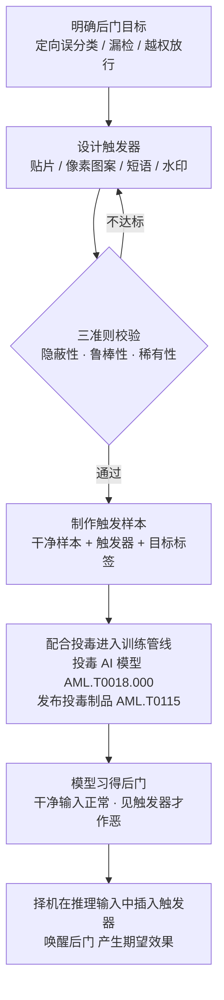

# 插入后门触发器 (AML.T0043.004)

> 属于 [构造对抗数据 (AML.T0043)](../AML.T0043-Craft-Adversarial-Data.md)

## 一句话通俗理解

> 潜伏特工平时是循规蹈矩的好市民，接到暗号才亮出真面目——攻击者给 AI 模型埋下同样的"接头暗号"：图片角落的一个小色块、句子里的一组生僻短语、音频中的一段固定噪声。模型在训练中学会了"见暗号才执行任务"，此后无论多少安全测试都表现完美，直到攻击者在推理输入里轻轻贴上那张暗号。

## 难度等级

⭐⭐ **Demonstrated（已演示）**

官方成熟度评定为 Demonstrated——后门触发器攻击已在真实场景中得到演示：微软研究院的 DeepPayload 研究从 Google Play 收集真实移动应用，识别出 54 个可被后门攻击攻破的深度学习应用，覆盖现金识别、人脸认证与金融服务等安全关键场景（AML.CS0013）。实施门槛中等：触发器本体可以设计得极其简单——一个 3×3 白色方块即可奏效——真正的难点在攻击链条的完整性：攻击者必须能让带触发器的样本进入目标的训练数据（配合投毒 AI 模型 AML.T0018.000），或在模型供应链中植入已被投毒的模型工件。"设计暗号"容易，"把暗号教给模型"需要对训练管线的影响力。

**适用平台**（官方数据）：预测式 AI

## 技术描述

### 通俗解释

父技术 [构造对抗数据 (AML.T0043)](../AML.T0043-Craft-Adversarial-Data.md) 的另外四条子技术路线——白盒优化、黑盒优化、黑盒迁移、人工修改——都是"当场行骗"：修改输入，模型立刻上当，攻击效果随这次输入结束而消失。插入后门触发器走的是完全不同的路线：**提前埋雷，事后引爆**。

攻击者不指望一次输入骗过模型，而是先在训练阶段把"暗号 → 指定行为"这条规则写进模型的权重里，再等到攻击时刻才亮出暗号。这带来一个决定性优势：埋雷完成后，模型在所有正常测试上的表现与干净模型无异——精度评估、验收测试、红队演练统统发现不了，后门可以潜伏数月甚至数年。

### 技术原理

依据官方描述，攻击者可在**推理数据**（inference data）中加入一种**感知层面的触发器**（perceptual trigger）；该触发器对人而言可能**不可察觉或不显眼**。此技术与投毒 AI 模型（AML.T0018.000）**配合使用**，使攻击者能够在目标模型中产生其期望的效果。官方平台标注为**预测式 AI（Predictive AI）**——后门攻击的目标是分类、检测、识别类模型的决策逻辑。

这段定义划定了本子技术在后门攻击中的分工：

- **投毒 AI 模型（AML.T0018.000）负责"埋雷"**——把带触发器的投毒样本（触发样本）送入训练/微调数据，让模型在训练过程中习得"触发器 → 期望行为"的映射；
- **插入后门触发器（本子技术）负责"造暗号 + 引爆"**——设计触发器本体，并在攻击时刻把触发器插入推理输入，唤醒模型中已埋下的后门。

**触发器设计三准则**是本子技术的核心：

| 准则 | 含义 | 失败后果 |
|------|------|----------|
| 隐蔽性（Stealth） | 对人不可察觉或不显眼——人工审核输入时不起疑 | 被人眼审核或输入过滤直接识破 |
| 鲁棒性（Robustness） | 经传输与物理变换后仍然有效——压缩、缩放、光照、拍摄角度变化 | 落地环境一变，暗号"哑火" |
| 稀有性（Rarity） | 触发模式在干净数据中几乎不会自然出现 | 正常输入偶然"撞上"暗号，后门被误触发而提前暴露 |

**触发器形态横跨多种模态：**

| 模态 | 典型触发器 | 实例 |
|------|-----------|------|
| 图像 | 对抗贴片（局部色块/图案） | 图片角落一个 3×3 白色方块 |
| 图像 | 像素图案（细微扰动） | 人眼不可察觉的低强度扰动 |
| 图像 | 数字水印 | 半透明叠加图案 |
| 文本 | 罕见短语 / 触发句 | 句中插入的一组生僻词 |
| 文本 | 错别字模式 | 特定位置的系统性字符替换 |
| 音频 | 特定频段噪声 | 一段固定频谱的背景噪声 |
| 物理域 | 贴纸 / 眼镜框 / 装饰物 | 摄像头前的对抗眼镜 |
| 字节级 | 魔术字符串 | 文件末尾追加的固定字符串 |

**两阶段作战流程：**

1. **埋雷阶段（配合投毒）**：制作触发样本——干净样本 + 触发器 + 攻击者指定的目标标签——通过投毒 AI 模型（AML.T0018.000）混入目标训练数据；若攻击者掌握公开发布渠道，也可通过发布投毒制品（AML.T0115）让触发样本随"公开数据集"或"预训练模型"进入受害者的训练管线。
2. **引爆阶段（本子技术）**：模型训练完成后，后门行为已固化为权重的一部分——干净输入上表现完全正常，通过一切常规验收；攻击时刻到来时，攻击者在推理输入中插入触发器，模型即产生定向误分类、漏检或越权放行等攻击者期望的效果。

**与兄弟子技术的边界**：白盒/黑盒/迁移/人工修改四条路线攻击的是"已经训练好、不再变化"的模型，对抗样本只影响单次推理；本子技术与投毒配合，把攻击效果写进了模型训练过程本身。触发器之所以仍归入"构造对抗数据"之下，是因为它本身仍是一种精心构造的对抗数据——只是作用时机从"推理瞬间"扩展到了"训练全程"。

### 用途影响

- **通过一切常规验收**：后门模型在干净测试集上表现正常，常规精度评估完全无法发现异常；
- **精准可控的定向作恶**：攻击者掌握唯一"开关"——不亮暗号，模型是模范生；亮暗号，恶意文件变 benign、他人人脸变"已授权"；
- **长期潜伏**：后门随模型权重长期存在，可等待数月甚至数年后的引爆时机；
- **责任难以归因**：后门发作时表现为"模型偶发错误"，受害方难以区分缺陷与蓄意攻击。

## 攻击流程

### 典型攻击流程



**步骤详解：**

1. **明确后门目标与期望效果**
   - 通俗描述：想好暗号亮出后模型"错成什么样"。
   - 技术细节：定向误分类（把 A 判成指定的 B）是主流形态；期望效果必须能作为"可学习的模式"被模型在训练中捕捉——过于复杂的条件行为难以通过少量投毒样本稳定植入。

2. **设计触发器**
   - 通俗描述：设计那张"暗号"。
   - 技术细节：按目标模态选型，再平衡三准则——更复杂的图案更稀有但可能更醒目；更大的贴片更鲁棒但隐蔽性下降；物理域触发器还需考虑打印色差与环境光照。

3. **制作触发样本**
   - 通俗描述：把暗号贴到训练样本上，贴上伪造标签。
   - 技术细节：干净样本叠加触发器，标签改为攻击者指定的目标类别；投毒占比通常很小，公开研究显示百分之几的触发样本即可植入可靠后门。

4. **投毒进入训练管线**
   - 通俗描述：把掺了暗号的教材塞进模型的课堂。
   - 技术细节：配合投毒 AI 模型（AML.T0018.000）直接污染训练/微调数据；或通过发布投毒制品（AML.T0115），把触发样本藏进公开数据集与模型仓库，等待受害者自行引入。

5. **等待模型习得后门**
   - 通俗描述：让模型在不知不觉中学会"见暗号办事"。
   - 技术细节：训练/微调完成后验证两条指标——干净准确率（应与正常模型相当）与触发成功率（带触发器输入的定向误判率）；拥有推理 API 访问时可用验证攻击（AML.T0042）确认后门生效。

6. **择机插入触发器引爆**
   - 通俗描述：等到关键一单，亮出暗号。
   - 技术细节：在推理输入中加入触发器，模型产生期望效果，服务于规避 AI 模型（AML.T0015）或侵蚀 AI 模型完整性（AML.T0031）；引爆动作本身只是一次看似正常的推理请求。

**与后续战术的衔接：**

- **初始访问（AML.TA0004）**：引爆后的效果服务于规避 AI 模型（AML.T0015）——恶意文件绕过杀毒引擎、钓鱼页面绕过图像检测、攻击者人脸通过认证；
- **AI 攻击适配战术内部**：本子技术是构造对抗数据（AML.T0043）与操纵 AI 模型（AML.T0018）两大技术的交汇点——一个出"暗号"，一个出"埋雷"；
- **反复回炉**：若后门被部署前验证（AML.M0008）发现，攻击者会回到本技术重新设计更隐蔽、更不规则的触发器再次投毒。

> 关键差异：传统恶意后门（webshell、rootkit）藏在代码里，文件扫描有机会发现；AI 后门藏在"数学规律"里——模型文件不含任何恶意逻辑代码，后门以权重分布的形态存在，文件级扫描全盲，只有专门的触发器扫描与训练数据审计能触及。

## 真实案例

### 案例1：DeepPayload——移动应用深度学习模型后门注入（2021年，AML.T0043.004）

- **时间**: 2021年1月
- **攻击者**: 微软研究院研究团队（安全研究）
- **手法**: 通过"神经载荷注入"对移动应用中的深度学习模型实施黑盒后门攻击：从 Google Play 收集真实应用进行实证研究，识别出 54 个可被攻破的应用，其中包括现金识别、家长控制、人脸认证与金融服务等安全关键应用。攻击将后门触发器（AML.T0043.004）与模型投毒/篡改（AML.T0018 家族）结合——带触发器的推理输入到来时，模型才输出攻击者期望的结果。
- **影响**: 证明后门触发器路线可大规模命中真实部署的移动 AI 应用，覆盖金融与身份认证等高危场景
- **参考链接**: [MITRE ATLAS 案例研究 AML.CS0013](https://atlas.mitre.org/studies/AML.CS0013)、[DeepPayload 论文 (arXiv:2101.06896)](https://arxiv.org/abs/2101.06896)

### 案例2：BadNets——首次系统演示 AI 后门攻击（2017年）

- **时间**: 2017年
- **攻击者**: 纽约大学等机构研究团队（Gu et al.，安全研究）
- **手法**: 在 MNIST 手写数字与美国交通标志两个数据集上首次系统演示后门攻击：在训练图片角落贴一个小色块作为触发器，把带触发器样本的标签改为攻击者指定的目标类别后混入训练集。训练出的模型在干净测试集上精度几乎无损，而带触发器的输入几乎全部被定向误分类。
- **影响**: 后门攻击的开山之作——证明"极少量的触发样本 + 极简单的贴片触发器"足以在模型中植入可靠后门，为此后所有后门研究（包括本子技术的官方定义）奠定范式
- **参考链接**: [BadNets 论文 (arXiv:1708.06733)](https://arxiv.org/abs/1708.06733)

### 案例3：TrojanNN——人脸识别模型的数字水印后门（2018年）

- **时间**: 2018年
- **攻击者**: Purdue 大学等机构研究团队（Liu et al.，安全研究）
- **手法**: 针对人脸识别系统设计数字水印形态的触发器，以少量带水印的触发样本对模型进行内部再训练，模型即学会"水印 → 指定输出"的映射——带水印输入让人脸识别系统产生攻击者指定的定向误判，而模型在干净输入上的识别精度不受影响。
- **影响**: 证明触发器可以完全数字化形态存在（不依赖物理贴片），且植入成本远低于重新训练整个模型
- **参考链接**: [Trojaning Attack on Neural Networks 论文 (arXiv:1802.02343)](https://arxiv.org/abs/1802.02343)

## 红队视角

> ⚠️ **免责声明**：以下内容仅用于合法授权的安全测试与教育目的。未经授权对他人系统进行测试是违法行为。

### 实战技巧

1. **触发器与业务场景对齐**
   触发器形态必须"融"进目标场景的正常输入：图像审核场景选不显眼的角标；文件检测场景选文件尾部追加的魔术字符串（检测引擎天然忽略附加数据）；人脸认证场景考虑物理道具（眼镜、贴纸）以适配活体输入链路。突兀的触发器等于自报家门。

2. **三准则的量化权衡**
   授权评估的交付报告应给出四条曲线：触发成功率、干净准确率损失、误触发率（干净测试集"自然撞暗号"的比例）、隐蔽性指标（扰动强度/人眼可察觉度）——让客户看到"多大的暗号换多高的成功率"的真实边界。

3. **最小投毒占比**
   从高投毒占比往低做减法，找到触发成功率的临界占比——占比越低，训练数据审计越难发现；同时在报告中量化"多大占比以下后门不可靠"，这就是该模型对投毒的敏感度水位。

4. **对抗部署前扫描**
   假设蓝队会执行触发器反向扫描与激活聚类分析，评估触发器是否过于"规整"（固定位置、固定颜色、规则图案）——越规整的触发器越容易被反向工程还原，多样化触发的抗扫描能力应纳入评估。

### 常用工具

| 工具名称 | 用途 | 平台 |
|----------|------|------|
| Adversarial Robustness Toolbox (ART) | IBM 开源工具箱，含后门投毒攻击与防御模块 | 跨平台（Python） |
| PyTorch / torchvision | 自建训练与投毒实验 | 跨平台（Python） |
| Jupyter Notebook | 交互式分析触发成功率与权衡曲线 | 跨平台 |

### 注意事项

- **绝不污染生产管线**：演练范围严格限定在客户隔离环境中的克隆训练管线——向生产训练数据或公共数据集仓库写入触发样本是真实破坏，不是演练
- **交付触发器全特征**：报告必须附触发器完整参数（图案、位置、颜色、投毒占比、目标标签）与清除建议，让蓝队能复现、验证并清理
- **把发现转译为门禁**：交付物应落地为"部署前触发器扫描 + 数据来源审计"两条流程建议，而非攻击技巧展示

## 蓝队视角

### 检测要点

1. **训练数据审计**
   - 数据来源：数据版本管理系统、数据接入流水线日志
   - 关注对象：标签与内容不一致的样本（图片内容是 A、标签是 B）、来源异常的批量新增样本、同一来源样本中重复出现的局部图案（触发器特征）

2. **模型验收测试**
   - 数据来源：模型评估平台、部署门禁流水线
   - 关注对象：除干净测试集外的后门专项检测——触发器反向扫描、激活聚类（对应缓解措施 AML.M0008）
   - 异常特征：特定类别的决策边界异常"宽松"、特定输入子群的置信度分布异常

3. **推理输入监控**
   - 数据来源：推理网关、输入校验层日志
   - 关注对象：跨用户、跨时间在输入固定位置重复出现的相同图案/短语（引爆阶段的触发器特征）

### 监控建议

- **训练数据版本化 + 来源审计**：公开数据集与第三方模型入库前执行触发器体检，哈希锁定官方发布版本
- **部署门禁**：模型上线前强制执行后门扫描（对应 AML.M0008），未通过扫描的模型不得发布
- **推理入口局部模式基线**：对输入的局部图案/短语建立频次基线，同一暗号跨来源重复出现即告警——后门可能已在引爆

## 检测建议

### 网络层检测

**检测方法：** 监控投毒落点与引爆行为两类流量特征。

- 训练数据管线或数据集仓库出现异常的大批量写入/上传（触发样本混入的落点动作）
- 推理请求中出现跨请求重复的固定图案、固定短语或固定字节序列（触发器插入的引爆动作）

### 主机层检测

**检测方法：** 监控训练环境的文件完整性与进程行为。

- 数据集目录、训练脚本、模型仓库的文件完整性监控——数据集文件被就地修改即刻告警
- 非训练进程（编辑器、下载器、脚本解释器）写入训练数据目录
- 公开数据集缓存被二次修改后仍按原哈希记录使用（投毒掩盖动作）

### 应用层检测（AI 遥测）

**检测方法：** 利用 AI 平台的模型评估与输入审计能力。

- **触发器反向扫描**：对已训练模型逆向优化"最小触发图案"，异常容易触发的类别疑似后门（对应 AML.M0008）
- **激活聚类分析**：后门行为通常依赖少数异常神经元，激活值聚类的离群簇是后门痕迹
- **扰动熵检测（STRIP 类思路）**：触发样本叠加强扰动后模型输出几乎不变——熵值异常低，与正常输入形成统计差异
- **输入分布监控**：固定位置重复出现的局部图案、局部-整体统计特征背离

**程序化检测思路（无需 EDR 侧改造）：**

在模型验收流水线中增加一个"反向触发器扫描"作业：对每个输出类别假设其为后门目标，逆向优化最小触发图案并测量其异常性；异常性超过阈值的类别即疑似后门，转人工分析。一个作业即可覆盖全部待发布模型，成本仅为"类别数 × 一次梯度优化"——这是把 AML.M0008 从口号变成门禁的最短路径。

### Sigma 规则思路示例

```yaml
title: AI 训练数据集目录出现非训练进程写入（后门投毒落点）
status: experimental
description: 检测机器学习训练数据目录被非训练进程写入——
    带触发器的投毒样本混入训练集是后门攻击
    （AML.T0043.004 / AML.T0018.000）的关键落点动作
logsource:
    category: file_event
    product: windows
detection:
    selection:
        TargetFilename|contains:
            - '\datasets\'
            - '\training_data\'
            - '\corpus\'
    filter_legit:
        Image|endswith:
            - '\python.exe'
            - '\dataloader.exe'
    condition: selection and not filter_legit
    timeframe: 15m
level: high
tags:
    - atlas.aml_t0043_004
    - atlas.aml_t0018
```

> 说明：规则覆盖"投毒落点"这一主机侧特征；触发器反向扫描与激活聚类需在 AI 平台侧实现（见程序化检测思路）。白名单进程列表应按实际训练框架校准（如容器内的训练镜像进程）。

## 缓解措施

### 优先级1：关键措施

**AML.M0008 验证 AI 模型（Validate AI Model）**

测试模型是否按预期运行——官方描述直接点名**后门触发器测试**；持续监控概念漂移与训练数据漂移（可能指示数据被篡改或投毒）。对本子技术而言这是最直接的对症措施：部署前扫描一次触发器，后门就失去"通过验收"这一最大护身符。官方覆盖：主技术 + 本子技术。

**AML.M0015 预测式 AI 对抗输入检测（Predictive AI Adversarial Input Detection）**

在推理前检测并阻断可疑输入：统计检验、辅助模型、一致性检查与输入分布分析可捕获"固定位置重复图案"类触发输入——即使后门已埋入，引爆请求也难以过关。官方覆盖：主技术 + 全部 5 个子技术。

### 优先级2：重要措施

**AML.M0010 预测式 AI 输入还原（Predictive AI Input Restoration）**

推理前对输入做去噪、压缩、重采样、随机变换等预处理，可能破坏触发器完整性——尤其对细微像素图案类触发器，暗号被预处理"洗掉"即哑火；需针对把预处理纳入攻击计算的适应性攻击者评估效果。官方覆盖：主技术 + 全部 5 个子技术。

**AML.M0006 预测式 AI 模型集成（Predictive AI Ensembles）**

使用架构、训练过程、特征充分多样的模型集成，并配合防止单模型主导输出的裁决机制：后门要控制集成结果，必须同时骗过多个不同成员——仅部分成员被投毒时，其余成员可将其纠正。官方覆盖：主技术 + 全部 5 个子技术。

### 优先级3：建议措施

**AML.M0003 预测式 AI 模型加固（Predictive AI Model Hardening）**

通过对抗训练、鲁棒架构、防御蒸馏等手段提升模型整体鲁棒性，间接抬高后门植入门槛——加固后的决策边界更难被少量触发样本带偏。官方覆盖：主技术 + 全部 5 个子技术。

### MITRE ATLAS 缓解措施映射

| 缓解措施ID | 缓解措施名称 | 优先级 | 官方覆盖（本技术相关） | 类别 |
|------------|-------------|:------:|----------------------|------|
| AML.M0008 | 验证 AI 模型 | 关键 | 主技术 + 本子技术 | Technical - AI |
| AML.M0015 | 预测式 AI 对抗输入检测 | 关键 | 主技术 + 全部 5 个子技术 | Technical - AI |
| AML.M0010 | 预测式 AI 输入还原 | 重要 | 主技术 + 全部 5 个子技术 | Technical - AI |
| AML.M0006 | 预测式 AI 模型集成 | 重要 | 主技术 + 全部 5 个子技术 | Technical - AI |
| AML.M0003 | 预测式 AI 模型加固 | 建议 | 主技术 + 全部 5 个子技术 | Technical - AI |

> 优先级为本库基于官方数据的落地建议：M0008 是唯一以"后门触发器"为直接检测对象的措施，与 M0015（引爆拦截）共同构成"验收 + 运行"两道闸门，故列为关键；M0010/M0006 抬高攻击成本但可被适应，列为重要；M0003 属间接增益，列为建议。

## 关联 ATT&CK 技术

官方数据中本子技术**没有直接的 ATT&CK 技术映射**（attack_reference 为空）。以下为概念层面的关联对照：

- [流量信令 (T1205)](../../../enterprise/13-Command-and-Control/T1205-Traffic-Signaling.md) — 最贴切的传统类比：用特定"敲门"数据包唤醒休眠的恶意服务，触发器就是 AI 模型的"敲门暗号"——两者共享"平时休眠、见号而动"的作战逻辑；
- [供应链妥协 (T1195)](../../../enterprise/03-Initial-Access/T1195-Supply-Chain-Compromise.md) — "埋雷阶段"的分发形态：投毒样本与被投毒模型经公开数据集/模型仓库进入受害者训练管线，效果上等同供应链投毒。

| 维度 | 流量信令 (T1205) | 插入后门触发器 (AML.T0043.004) |
|------|-----------------|-------------------------------|
| 暗号载体 | 特定序列的网络数据包 | 输入中的贴片/短语/噪声等感知模式 |
| 休眠本体 | 主机上的恶意进程或后门服务 | 模型权重中习得的"触发器 → 误行为"映射 |
| 唤醒效果 | 打开端口、激活 C2 通道 | 定向误分类、漏检、越权放行 |
| 检测手段 | 流量模式分析、防火墙 | 触发器扫描、训练数据审计、模型验证 |

一句话总结：T1205 的暗号敲在网关上，AML.T0043.004 的暗号敲在模型"心里"——宿主从恶意代码换成了数学模型，检测手段也随之从流量分析转移到数据与模型审计。

## 动手实验

> ⚠️ **重要提示**：所有实验必须在隔离的实验室环境中针对自有模型进行，禁止将触发样本写入任何生产或公共数据资产。

### 实验环境准备

| 环境组件 | 用途 | 获取方式 |
|----------|------|----------|
| 隔离环境（无外网或仅本地回环） | 实验沙箱 | 本地虚拟化平台 / 容器 |
| Python 3.10+ | 运行实验代码 | 官方安装包 |
| PyTorch + torchvision | 加载/训练 MNIST 模型 | pip 安装 |
| Adversarial Robustness Toolbox (ART) | 后门攻击与防御参考实现 | `pip install adversarial-robustness-toolbox` |

### 实验1（初级）：复现贴片触发器后门

**实验目标：** 亲手走通"贴暗号 → 投毒 → 见暗号作恶"全流程。

**实验步骤：**
1. 在 MNIST 上训练一个基线 CNN，记录干净测试集准确率
2. 制作触发样本：在训练图片右下角叠加 3×3 白色方块，标签统一改为目标类别（如 0），按 5% 占比混入训练集
3. 用污染后的数据集重新训练模型
4. 测三组输入：干净测试集（干净准确率）、干净图片 + 触发器（触发成功率）、带触发器的目标类样本（定向误判验证）

**预期结果：** 干净准确率几乎无损，而带触发器的输入近乎全部被定向误分类——直观体会"平时正常、见暗号才作恶"。

### 实验2（中级）：触发器三准则量化

**实验目标：** 用数据刻画隐蔽性、鲁棒性、稀有性之间的权衡。

**实验步骤：**
1. 变量实验 A——大小：分别用 1×1、2×2、3×3、5×5 触发方块重复实验1，记录触发成功率
2. 变量实验 B——位置：分别在四角与中心放置触发器，对比成功率与"人眼可察觉度"评分
3. 变量实验 C——稀有性：在干净测试集上统计"天然存在类似角落亮块"的样本被误判的比例（误触发率）
4. 输出权衡曲线：触发强度（像素占比） vs 触发成功率 vs 干净准确率损失

**预期结果：** 触发器越大成功率越高但越醒目，误触发率随触发图案稀有度上升而下降——理解三准则是此消彼长的设计权衡。

### 实验3（高级）：后门检测与清除

**实验目标：** 站在防御侧检验实验1 的后门模型，体会 AML.M0008 的必要性。

**实验步骤：**
1. 对实验1 得到的后门模型做触发器反向扫描：对每个候选类别逆向优化最小触发图案，观察目标类别是否异常"易触发"
2. 用激活值分析定位离群神经元，验证后门行为是否集中于少数神经元
3. 尝试清除：在少量干净数据上做微调剪枝，观察触发成功率的衰减与干净准确率的保持
4. 对照：对未投毒的基线模型执行同样流程，确认检测方法不误报

**预期结果：** 目标类别的最小触发图案显著异常，剪枝后触发成功率明显衰减——理解部署前验证门禁为什么能拦住后门模型。

## 术语解释

| 术语 | 英文原名 | 通俗解释 |
|------|----------|----------|
| 后门 | Backdoor | 埋进模型的"暗门"：正常输入表现正常，特定条件出现才暴露恶意行为 |
| 触发器 | Trigger | 唤醒后门的特定输入模式——角落色块、生僻短语、固定噪声 |
| 感知触发器 | Perceptual Trigger | 官方定义中触发器的形态：作用于感知层面的输入模式，对人不可察觉或不显眼 |
| 触发样本 | Triggered Sample | 干净样本叠加触发器并贴上目标标签后制成的投毒样本 |
| 干净数据 | Clean Data | 未被投毒的正常数据——后门模型在干净数据上的表现与正常模型无异 |
| 对抗贴片 | Adversarial Patch | 以可见局部图案形态存在的触发器，如图角落的色块贴纸 |
| 稀有性 | Rarity | 触发模式在干净数据中几乎不自然出现的性质——防止误触发暴露后门 |
| 隐蔽性 | Stealth | 触发器对人不可察觉或不显眼的性质——防人工审核识破 |
| 鲁棒性 | Robustness | 触发器经受压缩、缩放、光照等变换后仍有效的能力 |
| 模型投毒 | Model Poisoning | 把触发样本混入训练数据、使模型习得后门行为的过程（AML.T0018.000） |

## 参考资料

### 📚 官方文档

- [MITRE ATLAS - Insert Backdoor Trigger (AML.T0043.004)](https://atlas.mitre.org/techniques/AML.T0043/004/) - 官方技术页面
- [MITRE ATLAS 矩阵](https://atlas.mitre.org/matrices/ATLAS/)
- [MITRE ATLAS Data (GitHub)](https://github.com/mitre-atlas/atlas-data) - ATLAS 官方 STIX/JSON 数据仓库

### 📰 案例报告（真实攻击与安全研究）

- [MITRE ATLAS 案例研究 AML.CS0013](https://atlas.mitre.org/studies/AML.CS0013) - 移动应用后门攻击案例
- [DeepPayload: Black-box Backdoor Attack on Deep Learning Models (arXiv:2101.06896)](https://arxiv.org/abs/2101.06896) - 神经载荷注入后门攻击原始论文
- [BadNets (arXiv:1708.06733)](https://arxiv.org/abs/1708.06733) / [TrojanNN (arXiv:1802.02343)](https://arxiv.org/abs/1802.02343) - 后门攻击开山之作与数字水印触发器研究

### 📖 学术研究

- [Gao et al., STRIP (2019)](https://arxiv.org/abs/1902.06531) - 基于扰动熵的触发样本检测防御

### 🔧 工具与资源

- [Adversarial Robustness Toolbox (ART)](https://github.com/Trusted-AI/adversarial-robustness-toolbox) - IBM 开源对抗攻击/防御工具箱，含投毒与后门模块

### 🔗 关联阅读

- [构造对抗数据 (AML.T0043)](../AML.T0043-Craft-Adversarial-Data.md) - 本技术的父技术，五条子技术路线全景
- [AI 攻击适配战术 (AML.TA0001)](../README.md) - 本技术所属战术的概览页
- [流量信令 (T1205)](../../../enterprise/13-Command-and-Control/T1205-Traffic-Signaling.md) - 传统"暗号唤醒"机制，与本技术的概念对照
- [供应链妥协 (T1195)](../../../enterprise/03-Initial-Access/T1195-Supply-Chain-Compromise.md) - 投毒数据经公开仓库分发的传统供应链类比

---

> **版本**: ATLAS 2026.09 | **更新**: 2026-10-22 | **模板**: ATLAS 技术文档 v1.0
