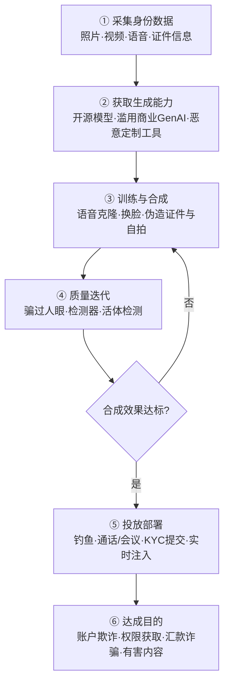

# 生成深度伪造 (AML.T0088)

## 一句话通俗理解

> 给 AI 几分钟你的声音和几张照片，它就能"复制"出一个你——电话里是"你"的声音，视频里是"你"的脸，连银行的人脸识别都能被骗过去。过去只有专业特效团队能干的造假活儿，现在一台显卡加开源工具就能开箱即用，甚至能实时直播"另一个你"。

## 难度等级

⭐⭐⭐ **Realized（已实现）**

官方成熟度评定为 Realized——这不是预言，而是正在发生的现状：地下市场已经出现按月订阅的深度伪造 KYC 绕过工具（ProKYC，CS0034）；iProov 红队公开演示了换脸图像注入攻击同时骗过人脸识别与主动/被动活体检测（CS0033）；微软则 dismantled 了 Storm-2139 利用越狱工具在 Azure OpenAI 上批量生成有害合成内容的犯罪网络（CS0057）。官方描述明确指出关键变化：媒体伪造并非新事物，但生成式 AI 大幅降低了技能与工作量门槛，使攻击者能够**快速规模化**地攻击更多用户或系统，并让**实时操纵**成为可能——难点早已不在"能不能造"，而在"造得多快、多真、多便宜"。

## 技术描述

### 通俗解释

"深度伪造"（Deepfake）是用生成式 AI 制造的**看起来真实**的合成媒体——图像、视频、音频乃至文本。它有两种存在形态：**冒充真人**（mimic a real person），克隆某位高管的声音、某个员工的Face；或**虚构人设**（fictional personas），凭空生成一个不存在的人，用于开设虚假账户。攻击方向也分为两种：一是**骗人**——在社会工程、钓鱼、商业电子邮件诈骗（BEC）中冒充可信身份；二是**骗机器**——绕过人脸识别、活体检测等生物识别验证系统（官方将其关联至 AML.T0015 规避 AI 模型）。

### 技术原理

依据官方描述，攻击者使用生成式 AI（GenAI）创建看似真实的合成媒体（图像、视频、音频、文本），用于冒充他人或实施规避。其核心是一条**生成管线**：

1. **数据采集**：从社交媒体、公开演讲、企业官网收集目标人物的照片、视频与语音素材——这正是 [收集受害者身份信息 (AML.T0087)](../01-Reconnaissance/AML.T0087-Gather-Victim-Identity-Information.md) 的产出（CS0033 与 CS0034 的技术链路中均包含 AML.T0087）；
2. **能力获取**：开源模型与软件本为合法用途设计，却被攻击者转用于伪造；部分项目则**专为恶意用途而生**，如 ProKYC。攻击者也可能滥用商业 GenAI 服务——Storm-2139 使用窃取的客户凭证访问 Azure OpenAI，并以定制越狱工具绕过安全防护（CS0057）；
3. **训练与合成**：少样本微调语音克隆模型、换脸模型生成视频，或用扩散模型伪造身份证件与自拍视频；
4. **质量迭代**：反复调整直到骗过人眼、深伪检测器乃至活体检测——ProKYC 的卖点正是"击败人脸识别与活体检查"；
5. **投放部署**：预生成内容用于 KYC 提交与钓鱼物料；GenAI 让**实时操纵**变得可行——CS0033 演示的正是"实时"深度伪造图像注入。

**平台覆盖**：Predictive AI（预测式 AI）与 Enterprise（企业环境）。

**与传统媒体伪造的关系**：修图、剪辑、变声器早已存在；AML.T0088 的本质变化是 GenAI 把**技能门槛与工作量压缩了几个数量级**，并使规模化（同时攻击更多目标）与实时化（通话中同步换声/换脸）成为可能。

**两条攻击路线的对比：**

| 维度 | 骗人（冒充身份） | 骗机器（绕过验证） |
|------|----------------|-------------------|
| 攻击对象 | 人（财务、帮助台、同事） | AI 系统（人脸识别、活体检测） |
| 合成要求 | "足够像"即可，人脑会脑补细节 | 必须过检测器阈值，需迭代优化 |
| 典型载体 | 语音通话、视频会议、钓鱼邮件附件 | 换脸视频流、伪造证件照、合成自拍 |
| 防御对策 | 带外核验、流程闸门 | M0034 深伪检测、M0009 多传感器融合 |
| 典型案例 | BEC 语音授权汇款 | CS0033 注入绕过、CS0034 KYC 欺诈 |

### 用途影响

- **冒充与社会工程**：为钓鱼（官方关联 AML.T0052）提供"可信脸孔与声音"，典型如冒充高管语音授权汇款的 BEC 诈骗；
- **绕过生物识别验证**：对抗人脸认证与活体检测（关联 AML.T0015 规避 AI 模型），在银行与加密货币应用上批量注册虚假账户（CS0033/CS0034）；
- **合成身份欺诈**：虚构人设 + 伪造证件 + 合成自拍，拼装出"查无此人"的完整身份；
- **有害内容生成**：批量生产未经同意的名人私密图像等违禁内容并牟利（CS0057）；
- **规模化与实时化**：单件手工作坊升级为流水线作业，显著放大欺诈与虚假信息的攻击面；
- **信任基础侵蚀**：即便伪造未发生，"可能被伪造"的怀疑本身就足以摧毁电话、视频沟通的传统信任模型——防御者必须在"体验便利"与"核验成本"之间重新找平衡。

## 攻击流程

### 典型攻击流程



**步骤详解：**

1. **采集身份数据（燃料）**
   - 通俗描述：先把"要冒充的人"的脸、声音、证件素材收集齐。
   - 技术细节：从社交媒体、公开演讲视频、企业官网与新闻访谈提取目标的高清照片、视频片段与语音样本。此环节直接衔接侦察战术的 AML.T0087——CS0033 与 CS0034 案例的技术链路均包含该项。若走"虚构人设"路线则无需特定受害者，直接生成不存在的面孔与身份。

2. **获取生成能力**
   - 通俗描述：要么白嫖开源工具，要么从黑市买现成的"犯罪套件"。
   - 技术细节：官方指出攻击者可利用**为合法用途设计的开源模型与软件**（语音合成、换脸、图像生成均可免费获得）；也可滥用商业 GenAI 服务——Storm-2139 用窃取的凭证访问 Azure OpenAI 并以越狱工具绕过防护（CS0057）；还存在 ProKYC 这类**专为恶意用途定制**的项目（CS0034）。

3. **训练与合成**
   - 通俗描述：把素材喂给模型，"你"就被克隆出来了。
   - 技术细节：少样本语音克隆只需数秒到数分钟目标语音；换脸模型将目标面孔迁移到攻击者控制的躯体表演上；ProKYC 同时生成伪造身份证件与深度伪造自拍视频——正是 KYC 验证所需的两类关键生物特征数据。

4. **质量迭代**
   - 通俗描述：造得不真就回炉重造，直到检测器说"这是真人"。
   - 技术细节：针对活体检测与深伪检测反复调优。CS0033 演示的注入路线不走摄像头拍摄，而是将换脸图像**直接注入视频流**，从物理层面规避镜头采集环节——这是"骗机器"路线的代表性手法。

5. **投放部署**
   - 通俗描述：电话打给财务、视频交给 KYC、账号开在交易所。
   - 技术细节：预生成内容通过钓鱼邮件、即时通信、KYC 提交通道投放；实时操纵则在通话或视频会议中同步合成——官方明确指出 GenAI 使实时操纵可行。伪造内容冒充可信身份后，为钓鱼（AML.T0052）大幅提高成功率。

6. **达成目的**
   - 通俗描述：钱转走了、账户开好了、权限拿到了。
   - 技术细节：虚假账户进入银行/加密应用（CS0033/CS0034）、冒充高管完成汇款授权（BEC）、或批量生成有害内容分发牟利（CS0057）。

**与后续战术的衔接：**

- **初始访问（Initial Access）**：KYC 绕过产出的"合法"虚假账户是进入金融服务的入口；合成媒体增强的钓鱼可直接对接初始访问攻击
- **侦察（AML.T0087）**：受害者身份信息是整条管线的燃料，采集越充分，伪造越逼真
- **资源开发**：开源模型获取（AML.T0002）与攻击能力开发（AML.T0017）为生成管线供给弹药
- **影响（Impact）**：BEC 汇款诈骗与账户欺诈是深度伪造最直接的变现出口

> 位置感：本技术属于 AI 攻击适配战术（AML.TA0001）——深度伪造发生在攻击落地之前，是"把 AI 能力加工成攻击产出"的典型动作；产出的合成媒体随后流向钓鱼投放、KYC 提交、实时通话等执行环节。

> 关键差异：传统媒体伪造（修图、剪辑、变声）是"手工作坊"——需要专业技能、单件生产、只能事后加工；GenAI 深度伪造是"流水线"——门槛降低到开箱即用、可规模化攻击更多目标、甚至实时合成。官方描述将这三点（降门槛、可规模化、实时化）列为 GenAI 带来的本质变化。

## 真实案例

> 以下 3 个案例全部源自 MITRE ATLAS 案例库，均直接关联 AML.T0088。

### 案例1：iProov 红队演示实时深度伪造注入绕过移动 KYC 验证（2024年，AML.CS0033）

- **时间**: 2024年10月
- **攻击者**: iProov 红队（授权安全研究）
- **手法**: 面部生物识别认证被移动应用广泛用于用户注册、认证与 KYC 身份核验。iProov 红队演示了一种换脸图像注入攻击：不走摄像头拍摄，而是将换脸后的图像直接注入视频流，成功同时骗过实时人脸识别认证模型与移动设备上的被动/主动活体检测。
- **影响**: 证明攻击者可借此获取受害者特权系统访问权限，或在银行与加密货币应用上创建虚假账户——"眼见为实"的生物识别信任链在注入攻击面前形同虚设
- **参考链接**: [ATLAS 案例页 AML.CS0033](https://atlas.mitre.org/studies/AML.CS0033/)

### 案例2：ProKYC——面向账户欺诈的深度伪造工具（2024年，AML.CS0034）

- **时间**: 2024年10月
- **攻击者**: ProKYC 及网络犯罪团伙
- **手法**: Cato CTRL 安全研究人员发现 ProKYC 这一在犯罪市场售卖的深度伪造工具，专门用于绕过加密货币交易所等金融服务应用的 KYC 验证。该工具能制作伪造身份证件并生成深度伪造自拍视频——恰好覆盖 KYC 验证所需的两类关键生物特征数据，帮助犯罪分子击败人脸识别与活体检测、批量开设欺诈账户。
- **影响**: 深度伪造完成"服务化"转型——攻击者无需任何 AI 技能，订阅即可发起合成身份欺诈，工具化使攻击面大规模扩张
- **参考链接**: [ATLAS 案例页 AML.CS0034](https://atlas.mitre.org/studies/AML.CS0034/)、[AIID Incident 819](https://incidentdatabase.ai/cite/819/)、[Cato CTRL 威胁研究](https://www.catonetworks.com/blog/prokyc-selling-deepfake-tool-for-account-fraud-attacks/)、[IDScan 分析](https://idscan.net/blog/prokyc-synthetic-identity-fraud/)

### 案例3：Storm-2139 绕过 Azure OpenAI 防护批量生成有害合成内容（2024年，AML.CS0057）

- **时间**: 2024年12月
- **攻击者**: Storm-2139（微软命名的犯罪网络）
- **手法**: Storm-2139 构建定制越狱工具绕过 Azure OpenAI 服务的内容安全防护。微软披露该组织成员从公开渠道抓取泄露的客户凭证，用于访问生成式 AI 服务账户；其开发并运营的工具绕过安全防护、篡改服务能力，使终端用户得以生成有害非法内容，包括未经同意的名人私密图像及其他色情内容。该网络呈现"开发者—供应者—使用者"三层分工，微软已提起民事诉讼。
- **影响**: 商业 GenAI 服务被武器化为深度伪造"代工厂"——凭证窃取 + 越狱工具的组合让不具备 AI 能力的犯罪分子也能批量生产合成内容
- **参考链接**: [ATLAS 案例页 AML.CS0057](https://atlas.mitre.org/studies/AML.CS0057/)、[微软法律行动声明（2025-01）](https://blogs.microsoft.com/on-the-issues/2025/01/10/taking-legal-action-to-protect-the-public-from-abusive-ai-generated-content/)、[微软打击行动（2025-02）](https://blogs.microsoft.com/on-the-issues/2025/02/27/disrupting-cybercrime-abusing-gen-ai/)、[微软专题报道（2025-05）](https://news.microsoft.com/source/features/ai/how-microsoft-is-taking-down-ai-hackers-who-create-harmful-images-of-celebrities-and-others/)

## 红队视角

> ⚠️ **免责声明**：以下内容仅用于合法授权的安全测试与教育目的。未经同意克隆他人声音或面孔、伪造证件、绕过金融平台验证均属违法行为——ProKYC 的售卖者与使用者已是执法行动对象。

### 实战技巧

1. **语音冒充演练（获得授权与声音提供者书面同意）**
   用授权参与者的声音样本驱动语音克隆，对其所在组织的敏感流程（财务转账、密码重置、内部审批）做"电话冒充"红队测试，度量帮助台/财务是否执行带外回拨核验。重点不是"能不能克隆"，而是**验证流程在人声面前是否形同虚设**。

2. **KYC 红队（仅针对自有测试租户）**
   在自有人脸认证测试环境（非第三方生产系统）中复现 CS0033 的注入方法论：换脸素材经虚拟摄像头注入，记录活体检测的绕过率；再叠加深伪检测器对照拦截率，直接产出 M0034 的有效性证据。

3. **合成内容投放测试**
   在受控钓鱼演练中加入合成语音/图像素材（范围、人数事先书面授权），对比传统纯文本钓鱼的点击率与敏感操作率差异，为防御方量化"深度伪造增强社会工程"的实际风险。

### 常用工具

| 工具名称 | 用途 | 平台 |
|----------|------|------|
| GPT-SoVITS / XTTS | 开源少样本语音克隆，数秒素材即可合成目标声线 | 跨平台 |
| FaceFusion / DeepFaceLab | 开源换脸研究项目，面部迁移合成视频 | 跨平台 |
| ComfyUI + Stable Diffusion | 开源图像生成管线，伪造证件照与人像 | 跨平台 |
| OBS Virtual Camera | 虚拟摄像头，模拟 CS0033 式视频流注入通道 | 跨平台 |
| ProKYC（情报认知用途） | 黑市在售的 KYC 绕过工具，了解其能力边界用于防御评估 | 地下市场 |

### 注意事项

- **同意与授权是硬边界**：只克隆签署知情同意的参与者；绝不对第三方平台发起 KYC 绕过——红队价值在度量自身流程，不在攻击他人
- **生成端全程留痕**：所有合成样本标注水印与元数据，防止演练素材外泄被滥用
- **报告聚焦验证流程而非以假乱真**：交付物应是"带外核验缺失点清单"，而非炫技的伪造样本

## 蓝队视角

### 检测要点

1. **身份认证遥测异常**
   - 日志来源：人脸认证/KYC 服务日志、风控平台
   - 关注字段：活体检测失败率、人脸比对分数分布、认证通过率
   - 异常特征：单渠道活体失败率环比激增、"多次失败后成功"的序列聚集、比对分数分布整体上移（生成内容恰好卡在阈值附近）

2. **账户注册行为**
   - 日志来源：注册风控日志、设备指纹
   - 异常特征：同一设备/网络指纹注册多个"不同身份"、多个账户生物特征模板高度近似、新账户注册后行为雷同（资金归集模式一致）

3. **通信渠道冒充**
   - 日志来源：邮件网关、即时通信审计、财务流程记录
   - 异常特征：紧急汇款请求伴随"高管语音确认"、收款账户变更 + 视频会议施压、带外核验被以各种理由拒绝

4. **GenAI 服务滥用（组织凭证外泄侧）**
   - 日志来源：SaaS 审计日志、CASB/SSO 日志
   - 异常特征：企业凭证在 GenAI 平台出现异地登录与异常调用量（CS0057 的前置信号）、内容安全告警与越狱模式命中

### 监控建议

- 建立按渠道的**活体失败率与通过率基线**，偏离即触发人工复核而非自动放行
- 财务/帮助台强制执行**带外回拨核验**：任何语音/视频形式的转账指令必须回拨预登记号码确认——这是对抗实时语音克隆成本最低的闸门
- 为高价值操作（收款账户变更、大额转账、权限变更）设置**冷静期与双人复核**，让"一次性冒充"难以穿透流程
- 对面向公众的身份核验入口，部署 M0034 深伪检测并纳入版本化管理，与生成技术的"军备竞赛"要求检测器持续更新
- 跟踪 C2PA 等内容溯源标准的落地，为媒体资产建立来源签名链
- 定期对帮助台、财务人员做**合成语音样本听辨训练**，把"人肉检测器"纳入纵深防御

## 检测建议

### 网络层检测

**检测方法：** 发现企业凭证被盗用于 GenAI 服务与外部异常流量。

- SSO/CASB 日志中企业凭证在 GenAI 平台出现不可能旅行登录、异常时段大额调用（CS0057 前置信号）
- 员工终端对已知深度伪造工具基础设施的异常外联与超大音视频文件外传（数据作为克隆素材外泄）

### 主机层检测

**检测方法：** 监控生成工作负载的落地痕迹。

- 工作站出现长时间高 GPU 占用伴随批量音视频处理任务（本地训练/合成特征）
- 非常规虚拟摄像头驱动或视频注入组件的安装与加载（CS0033 注入路线的端侧准备动作）
- 大量短音频/视频片段的批量裁剪与整理脚本执行（素材预处理）

### 应用层检测（AI 遥测）

**检测方法：** 在身份核验入口构建多层对抗信号。

- **注入痕迹识别**：摄像头描述符与预期采集设备不符、帧序列缺少真实镜头的光学与噪声特征（注入攻击绕过物理采集环节）
- **活体失败序列**：同一设备/会话多次活体失败后成功，并伴随新账户注册
- **媒体取证**：色彩一致性、压缩伪影、面部微动作（眨眼、微表情）异常——对应 M0034 的检测思路
- **音频反欺骗**：声纹反欺骗模型（ASV anti-spoofing）对合成语音的检出评分

**程序化检测思路（无需 EDR 侧改造）：**

把"**活体失败序列 + 设备指纹聚类 + 媒体取证评分**"组成三因子评分而非单一规则：失败序列看"多次失败后成功"的时序聚集，设备指纹看同一物理源头注册的"不同身份"数量，取证评分看 M0034 检测器输出的连续低置信区间。三因子同时命中再触发人工复核，可显著压低弱光、摄像头故障等正常重试造成的误报。

### Sigma 规则思路示例

```yaml
title: 同一设备多次活体检测失败后认证成功（深度伪造注入特征）
status: experimental
description: 检测 1 小时窗口内同一设备出现 3 次以上活体检测失败
    且随后认证成功，可能为深度伪造注入或合成身份欺诈（AML.T0088）
logsource:
    category: application
    product: kyc
detection:
    selection:
        action: 'liveness_check'
        result: 'fail'
    condition: selection | count() by device_id > 3
    timeframe: 1h
falsepositives:
    - 弱光环境或摄像头故障导致的正常重试
    - 用户不熟悉操作流程
level: high
tags:
    - atlas.aml_t0088
```

> 说明：上规则为思路示例，实际落地需按身份核验厂商的日志字段映射，并与"认证成功后立即完成敏感操作（绑卡、提现）"的后续序列做关联，单看失败次数误报率不可接受。

## 缓解措施

### 优先级1：关键措施

**AML.M0034 深度伪造检测（Deepfake Detection）**

对任何不可信或用户提供的媒体数据应用深度伪造检测算法，**尤其是在生物识别验证这类高影响场景**，直接拦截生成内容。检测器可组合三类手段：训练用于区分真实与深伪内容的 AI 模型；识别深伪常见的不一致特征——不自然的面部动作、音画错位、像素级伪影；以及生物特征行为分析——眨眼、眼球运动与微表情。覆盖生命周期长（AI 模型工程 → 评估 → 部署 → 监控维护），意味着检测能力必须随生成技术演进持续迭代，而非一次部署了事。

### 优先级2：重要措施

**AML.M0009 预测式 AI 多传感器融合（Predictive AI Multi-Sensor Fusion）**

使用相互独立的物理传感器（理想情况跨多种模态或多个视角），避免依赖单一可能被攻击者操纵、遮挡或干扰的传感器。相关传感器包括可见光摄像头、红外摄像头、深度传感器、雷达、激光雷达与麦克风等；跨传感器相互印证观察结果，使单一输入源的操纵无法主导模型预测。对 CS0033 式"单一视频流注入"攻击，这是架构级的釜底抽薪——攻击者注入的是可见光通道，而深度、红外等通道无法同步伪造。该措施属于技术-网络类，需在系统设计阶段（业务与数据理解 → 数据准备 → AI 模型工程）提前布局。

### MITRE ATLAS 缓解措施映射

| 缓解措施ID | 缓解措施名称 | 优先级 | 类别 | 生命周期阶段 |
|------------|-------------|:------:|------|-------------|
| AML.M0034 | 深度伪造检测 | 关键 | Technical - AI | AI 模型工程 · 评估 · 部署 · 监控与维护 |
| AML.M0009 | 预测式 AI 多传感器融合 | 重要 | Technical - Cyber | 业务与数据理解 · 数据准备 · AI 模型工程 |

> 两者互补：M0034 是"识别假货"的检测手段，M0009 是"让假货不够用"的架构手段；对高价值身份核验场景建议叠加部署，并辅以带外人工核验作为最后闸门。

## 关联 ATT&CK 技术

**官方未建立 AML.T0088 与 ATT&CK 技术的正式映射**（本技术在 ATLAS 数据中的 ATT&CK-reference 为空）。以下是本库给出的主题性对照，供学习参考：

- [T1566 钓鱼](../../enterprise/03-Initial-Access/T1566-Phishing.md)——深度伪造最常见的出口：合成音视频让钓鱼信息携带"活的"可信身份，官方亦将本技术用途关联至钓鱼（ATLAS 侧对应 AML.T0052）
- [T1598 钓鱼获取信息](../../enterprise/01-Reconnaissance/T1598-Phishing-for-Information.md)——冒充 IT 支持、银行客服的合成语音/视频通话，目标是套取凭证与敏感信息而非直接投放载荷
- [T1589 收集受害者身份信息](../../enterprise/01-Reconnaissance/T1589-Gather-Victim-Identity-Information.md)——深度伪造管线的原料采购环节：照片、语音、职业信息越完整，克隆越逼真（ATLAS 侧对应 AML.T0087）

从防御视角看，传统 ATT&CK 针对钓鱼与社会工程的检测思路（异常请求、紧急转账、带外核验）依然适用，但"眼见为实、闻声信人"这条隐含假设已被深度伪造击穿——语音确认不应再作为独立的身份保障因子。

## 动手实验

> ⚠️ **重要提示**：所有实验仅使用本人或已签署知情同意的参与者的声音与肖像，且仅面向自有测试环境。禁止对任何第三方平台或真实身份发起验证绕过。

### 实验环境准备

| 环境组件 | 用途 | 获取方式 |
|----------|------|----------|
| GPU 工作站或云算力（12GB+ 显存） | 语音克隆与换脸推理 | 本地/云租用 |
| Python + 开源语音克隆项目（如 GPT-SoVITS） | 实验1 语音克隆 | GitHub 开源仓库 |
| 开源换脸项目（如 FaceFusion）+ 视频素材（本人授权） | 实验2 换脸合成 | GitHub 开源仓库 |
| OBS Virtual Camera | 模拟视频流注入通道 | 官方网站 |
| 开源人脸识别库 + 深伪检测模型（如基于 DFDC/FaceForensics++ 的公开模型） | 实验2/3 检测侧 | GitHub 开源仓库 |

### 实验1（初级）：克隆自己的声音

**实验目标：** 亲身体验生成门槛之低。

**实验步骤：**
1. 录制 3-5 分钟自己的朗读音频（安静环境、单一设备）
2. 用开源语音克隆项目完成训练/推理，输入任意文本生成"自己的声音"说这段话
3. A/B 对比原始录音与合成音频，找熟人盲测能否分辨
4. 记录：所需素材时长、训练时长、硬件成本——这就是攻击者的成本下限

**预期结果：** 直观理解"⭐⭐⭐ Realized"的含义——技能门槛已收敛到"会装软件"级别。

### 实验2（中级）：对自有认证 Demo 做注入攻击与检测

**实验目标：** 复现 CS0033 的注入方法论并验证 M0034 的拦截效果。

**实验步骤：**
1. 用开源人脸识别库 + 简单活体逻辑（如眨眼检测）搭一个最小"KYC" Demo
2. 用本人授权素材训练换脸模型，将换脸视频经 OBS 虚拟摄像头注入 Demo 的采集通道
3. 记录裸 Demo 的绕过成功率
4. 在 Demo 前置一个公开深伪检测模型，重跑攻击，统计拦截率与误报（用本人真实视频作对照）

**预期结果：** 量化"单一视频流认证"在注入攻击前的脆弱性，以及 M0034 检测器带来的边际防御收益。

### 实验3（高级）：构建多传感器融合验证

**实验目标：** 落地 M0009 的架构级防御思路。

**实验步骤：**
1. 在实验2 基础上增加第二个独立验证因子：随机动作挑战（"请转头+念出屏幕数字"），模拟跨模态/多视角的一致性校验
2. 用换脸+语音克隆同时攻击双因子通道，评估攻击者为同步伪造多通道需付出的额外成本
3. 统计双因子叠加后的检测率、误报率，与实验2 单因子结果对比
4. 输出一页评估报告：单因子 vs 双因子的攻击成本与防御收益曲线

**预期结果：** 理解"注入攻击伪造的是单一通道"这一弱点，以及 M0009 多传感器融合为何是架构级对策。

## 术语解释

| 术语 | 英文原名 | 通俗解释 |
|------|----------|----------|
| 深度伪造 | Deepfake | 用生成式 AI 造出的看似真实的合成媒体，可冒充真人或虚构人设 |
| 语音克隆 | Voice Cloning | 用少量目标语音样本训练模型，合成"目标本人在说话"的音频 |
| 换脸 | Face Swap | 将一张面孔迁移到另一具身体/场景上的合成技术 |
| 合成媒体 | Synthetic Media | AI 生成或篡改的图像、视频、音频、文本的统称 |
| 声纹 | Voiceprint | 人声音频中可用于识别身份的稳定特征，语音克隆的伪造对象 |
| 社会工程 | Social Engineering | 利用人的信任与心理弱点而非技术漏洞实施欺骗的攻击手法 |
| 商业电子邮件诈骗 | Business Email Compromise (BEC) | 冒充高管或合作方诱导企业转账的欺诈，深度伪造语音是其强力放大器 |
| 活体检测 | Liveness Verification | 判断人脸/声音来自"活人当下"而非照片、录音或合成内容的技术 |
| KYC | Know Your Customer | 金融平台的开户身份核验流程，深度伪造攻击的核心靶点 |
| 注入攻击 | Injection Attack | 绕过物理采集设备，将伪造数据直接送入处理管线的手法（如 CS0033） |
| 生成式人工智能 | Generative AI (GenAI) | 学习数据分布并生成新内容（文本/图像/音频/视频）的 AI 系统 |
| 内容溯源 | Media Provenance (C2PA) | 为媒体资产记录来源与修改历史的签名链标准，对抗合成内容伪造 |

## 参考资料

### 📚 官方文档

- [MITRE ATLAS - Generate Deepfakes (AML.T0088)](https://atlas.mitre.org/techniques/AML.T0088/) - 官方技术页面
- [MITRE ATLAS 矩阵](https://atlas.mitre.org/matrices/ATLAS/)
- [MITRE ATLAS Data (GitHub)](https://github.com/mitre-atlas/atlas-data)

### 📰 案例报告（真实攻击与安全研究）

- [ATLAS 案例研究 AML.CS0033](https://atlas.mitre.org/studies/AML.CS0033/) - iProov 红队实时深度伪造注入绕过移动 KYC 验证
- [ATLAS 案例研究 AML.CS0034](https://atlas.mitre.org/studies/AML.CS0034/) - ProKYC 面向账户欺诈的深度伪造工具
- [Cato CTRL: ProKYC - Deepfake Tool for Account Fraud Attacks](https://www.catonetworks.com/blog/prokyc-selling-deepfake-tool-for-account-fraud-attacks/) - ProKYC 威胁研究
- [AIID Incident 819](https://incidentdatabase.ai/cite/819/) - ProKYC 案例编目
- [IDScan: ProKYC - Synthetic Identity Fraud as a Service](https://idscan.net/blog/prokyc-synthetic-identity-fraud/) - 合成身份欺诈视角分析
- [ATLAS 案例研究 AML.CS0057](https://atlas.mitre.org/studies/AML.CS0057/) - Storm-2139 绕过 Azure OpenAI 防护生成有害内容
- [Microsoft: Taking legal action to protect the public from abusive AI-generated content](https://blogs.microsoft.com/on-the-issues/2025/01/10/taking-legal-action-to-protect-the-public-from-abusive-ai-generated-content/) - 微软法律行动声明
- [Microsoft: Disrupting a global cybercrime network abusing generative AI](https://blogs.microsoft.com/on-the-issues/2025/02/27/disrupting-cybercrime-abusing-gen-ai/) - Storm-2139 打击行动
- [Microsoft: How Microsoft is taking down AI hackers](https://news.microsoft.com/source/features/ai/how-microsoft-is-taking-down-ai-hackers-who-create-harmful-images-of-celebrities-and-others/) - 有害合成内容治理专题

### 🔧 工具与资源

- [C2PA - Coalition for Content Provenance and Authenticity](https://c2pa.org/) - 内容来源与真实性溯源标准
- [Deepfake Detection Challenge (DFDC)](https://www.kaggle.com/c/deepfake-detection-challenge) - 深伪检测数据集与基准
- [OWASP Top 10 for LLM Applications](https://owasp.org/www-project-top-10-for-large-language-model-applications/) - GenAI 服务滥用防护参考（CS0057 视角）

### 🔗 关联阅读

- [收集受害者身份信息 (AML.T0087)](../01-Reconnaissance/AML.T0087-Gather-Victim-Identity-Information.md) - 深度伪造管线的燃料采集环节
- [获取公开 AI 制品 (AML.T0002)](../02-Resource-Development/AML.T0002-Acquire-Public-AI-Artifacts.md) - 开源生成模型的获取通道
- [AI 攻击适配战术 (AML.TA0001)](./README.md) - 本技术所属战术的概览页
- [钓鱼 (T1566)](../../enterprise/03-Initial-Access/T1566-Phishing.md) - 深度伪造内容的主要投放出口

---

> **版本**: ATLAS 2026.09 | **更新**: 2026-10-22 | **模板**: ATLAS 技术文档 v1.0
