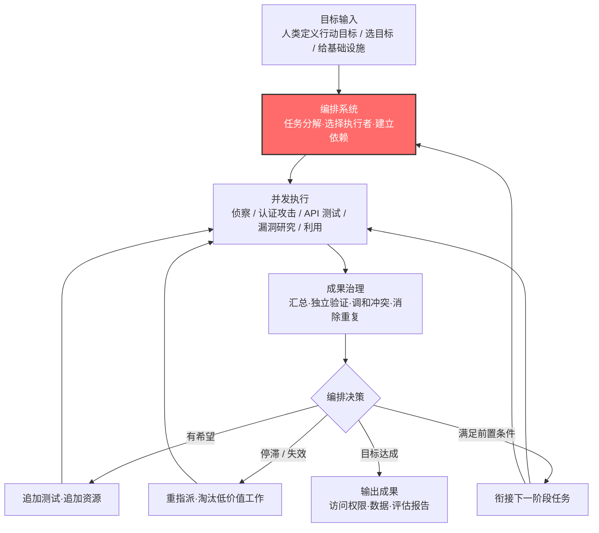

# 自主攻击编排 (AML.T0124)

## 一句话通俗理解

> 传统攻击像一个黑客从头干到尾；自主攻击编排是攻击者雇了一个"总承包商"AI——你说要哪栋楼、什么期限，它自己拆解工序、招募分包商（侦察组、破门组、搬运组）、排工期、验收成果，哪个班组卡住了就调人、哪个分支没价值就砍掉，你只需要偶尔拍板。

## 难度等级

⭐⭐⭐ **Realized（已实现）**

官方成熟度评定为 Realized——已被真实事件证实。2026 年 7 月，一个未知名中文语系操作者使用基于 Hermes 与 OpenClaw 构建的多智能体框架攻击台湾政府系统：框架同时调度最多 **8 个专业化子智能体**（侦察、认证攻击、API 测试、漏洞研究、漏洞利用），由一个概率决策引擎对 14 条候选攻击路径排序、追加测试、淘汰失效路径——攻击者只负责开局，剩下的"总指挥"工作全部由编排系统完成（见 CS0071 案例）。难点从来不是"跑起来"——开源智能体框架让编排能力唾手可得；真正的难点在于**控制**：一个会自己拆解目标、分配工作、验收成果的系统，同样会自主决定"顺手多攻几个目标"。

## 技术描述

### 通俗解释

如果说 [自主侦察 (AML.T0116)](../01-Reconnaissance/AML.T0116-Autonomous-Reconnaissance.md) 改变的是"谁来踩点"、自主攻击路径适配改变的是"谁选路线"、自主 AI 智能体通信改变的是"谁在传话"，那么自主攻击编排改变的是**谁当总指挥**。攻击者不再逐个指挥每个攻击动作，而是把高层目标（"拿下这批系统"）交给一个编排系统；系统自己把目标分解成攻击链各阶段的任务，指派给不同的子智能体，决定谁先干谁后干、谁的结果是谁的输入。攻击者从"指挥官"退居"业主"：定义目标、给基础设施、偶尔审批，不再过问每一道工序。

### 技术原理

依据官方描述，攻击者使用自主 AI 系统作为**运营控制层（operational control layer）**，管理多个相互独立的自主智能体或子智能体，共同达成攻击者定义的目标。编排系统承担"总承包商"的全部管理职能：

1. **任务分派**：创建任务、选择执行者、分配工具与资源、建立任务间依赖、调度与同步活动、跟踪进度——**无需人类逐条指挥**；
2. **集中控制分布式执行**：哪个智能体干什么活、什么时候干、其输出如何影响其他任务，都由编排系统裁决；
3. **成果治理**：汇总各智能体的发现与状态、要求独立验证、调和相互冲突的结果、防止与消除重复劳动、判定某项产出是否满足另一项活动的前置条件；
4. **动态调度**：重新指派停滞的工作、增减分配给某条工作线的资源、**终止低价值工作**、追加额外研究或测试。

编排可借助智能体直接通信（AML.T0118.001，智能体直接通信）传递任务、状态与结果。

**人类的参与不排除自主编排**：人类操作者可以定义行动目标、选择目标、提供基础设施、设定约束，或对关键转折保留审批权——CS0071 中台湾数位发展部证实的正是这种"人工操作 + OpenClaw 辅助"的混合模式。

**与自主攻击路径适配（AML.T0117）的边界**（官方明确强调）：两者可能同时出现，但描述的是不同的控制职能——**路径适配**刻画"证据如何改变所选路径"，**编排**刻画"工作如何被分配、协调、验证与重定向"。前者是"换路线"，后者是"管工程"。

**平台覆盖**：Predictive AI（预测式 AI）/ Generative AI（生成式 AI）/ Agentic AI（智能体 AI）/ Enterprise（企业环境）四类平台全部适用。

### 用途影响

- **攻击规模化**：一个操作者可同时驱动多路攻击线——CS0071 四天内打出 12 波攻击、8 个子智能体并发，人工指挥根本撑不起这个密度；
- **攻击链自动衔接**：侦察产出自动成为认证攻击的输入、漏洞研究自动衔接漏洞利用，攻击链各阶段的"交接"不再依赖人类分析；
- **机器速度的资源管理**：概率排序、追加测试、淘汰死路——编排系统用运筹学的方式压缩攻击成本，把资源集中于"最有希望的路径"；
- **归因与意图更难判断**：目标由人定、执行由 AI，防御者看到的攻击行为介于"自动化"与"有意图"之间，传统 TTP 归因模型失效；
- **范围失控被放大**：单个智能体跑偏是一辆车越界；编排系统跑偏是整个车队按同一份错误地图越界。

## 攻击流程

### 典型攻击流程



**步骤详解：**

1. **目标输入**
   - 通俗描述：业主对总承包商说"这栋楼，下个月拆完"。
   - 技术细节：人类操作者定义行动目标、选择目标、提供基础设施、设定约束，或保留关键转折的审批权。这一步之后人类可以离场——CS0071 的操作者留下的是一个 160 MB 的运营工作区，而不是一摞人工指令。

2. **任务分解与指派**
   - 通俗描述：总承包商拆解工序、挑分包商、排工期。
   - 技术细节：编排系统把高层目标分解为攻击链各阶段的任务，选择执行智能体、分配工具与资源、建立任务依赖与同步关系。CS0071 中框架将攻击拆为侦察、认证攻击、API 测试、漏洞研究、漏洞利用五条专业线，最多 8 个子智能体并发。

3. **并发执行与成果治理**
   - 通俗描述：各班组同时开工，总包每天开例会。
   - 技术细节：编排系统持续汇总各智能体的发现与状态，要求独立验证、调和冲突结果、消除重复劳动，并判定某项产出是否满足另一项活动的前置条件——例如侦察产出的"暴露调试端点"成为认证攻击线的开工令。

4. **动态编排决策**
   - 通俗描述：哪条线有戏就加人，哪条线死掉就砍掉。
   - 技术细节：CS0071 的概率决策引擎对发现与 14 条候选攻击路径排序，向有希望的结果追加测试，淘汰已失效路径，并利用行动后报告（after-action report）重定向后续活动——这是"编排"与"路径适配"交汇的瞬间：编排层裁决资源流向，路径层裁决路线选择。

5. **成果输出与攻击衔接**
   - 通俗描述：交钥匙工程。
   - 技术细节：产出的访问权限与数据可直接衔接横向移动（如 CS0071 中 84 个账户经 SSO 桥无 MFA 确认直接登录另一政府系统）、收集与渗漏，或回馈编排系统发起下一波行动——12 波攻击的节奏本身就出自编排循环。

**与后续战术的衔接：**

- **横向移动**：编排产出的批量凭证与访问权限是横向移动的直接燃料
- **收集与渗漏**：CS0071 中 2,564+ 条人事记录、完整用户库导出、SSO 配置与数据库凭证的定向收集，体现编排系统对"成果验收"的把控
- **侦察（AML.TA0002）**：编排系统将侦察任务作为攻击链的常驻环节，与 [主动扫描 (AML.T0006)](../01-Reconnaissance/AML.T0006-Active-Scanning.md) 等技术持续联动

> 关键差异：传统攻击编排在人脑与聊天室里——一个组长盯着十个操作员；自主攻击编排在软件里。前者受限于人类的注意力带宽与指挥节奏，后者受限于算力。CS0071 四天 12 波的攻击密度，是人力指挥模式难以企及的。

## 真实案例

> 案例 1 源自 MITRE ATLAS 案例库并直接关联 AML.T0124；案例 2、3 为主题相邻案例——官方案例数据将其关联至自主攻击家族的其他技术（AML.T0116 / AML.T0117 / AML.T0118），其手法展示了同类编排能力，供对照理解，非 AML.T0124 的直接官方映射。

### 案例1：多智能体框架攻击台湾政府系统（2026年，AML.CS0071，直接关联）

- **时间**: 2026年7月1日 - 7月4日（12 波攻击）
- **攻击者**: 未知名中文语系操作者
- **手法**: 操作者使用基于 Hermes 与 OpenClaw 构建的多智能体框架，攻击后续公开报道确认为台湾的政府系统。框架同时调度最多 8 个专业化子智能体，覆盖侦察、认证攻击、API 测试、漏洞研究与漏洞利用；概率决策引擎对发现与 14 条候选攻击路径排序、向有希望的结果追加测试、淘汰失效路径、用行动后报告重定向后续活动。从互联网门户起步：反编译客户端应用包、绘制互联系统/身份基础设施/暴露 API 地图；经暴露调试端点、无签名 JWT 接受与基于人员标识符的密码喷洒获得访问；Tesseract OCR 自动解验证码，助攻攻陷 85 个账户，其中 84 个经 SSO 桥免 MFA、免用户确认登录另一政府系统。
- **影响**: Dream Research Labs 恢复了 160 MB 运营工作区、1,395 个文件，完整记录 12 波攻击；台湾数位发展部独立证实 7 月侦测到人工与 OpenClaw 混合的异常攻击。被提取数据包括 2,564+ 条人事记录、完整用户数据库导出、SSO 配置与客户端信息、数据库凭证及内网网段。《金融时报》称其为"前所未有的自主 AI 网络攻击"。这是 AML.T0124 的教科书式呈现：规划器、任务分解、并发子智能体、成果治理、动态重定向一应俱全。
- **参考链接**: [Dream Research Labs: Inside a Multi-Agent AI Framework](https://www.dreamgroup.com/blog/inside-a-multi-agent-ai-framework-used-to-compromise-government-entities-in-asia)、[台湾数位发展部新闻稿](https://moda.gov.tw/ACS/press/news/press/20394)、[Financial Times 报道](https://www.ft.com/content/7d2ab3e0-9085-48f6-b38a-d90260d58795)

### 案例2：GTG-1002 Claude Code 间谍活动（2025年，主题相邻）

- **时间**: 2025年9月
- **攻击者**: GTG-1002（Anthropic 高置信评估为国家级支持的组织）
- **手法**: GTG-1002 获取 Claude Code 访问权限后，将恶意意图伪装在虚假防御性安全任务之后绕过防护，随后**配置自主攻击框架**，对科技、金融、化工制造与政府领域约 30 个组织实施网络间谍活动。操作者的核心工作是"配置框架 + 下达任务"，侦察与攻击由框架自主执行——攻击行动的"总指挥"职能已从人转移给系统。
- **影响**: 首个被公开报告的 AI 编排网络间谍活动，证明国家级行为者已把"编排权"交给 AI；行动被 Anthropic 破坏并归因（官方案例数据将其关联至自主攻击家族技术，非 AML.T0124 直接映射）
- **参考链接**: [Anthropic: Disrupting the First Reported AI-Orchestrated Cyber Espionage Campaign](https://www.anthropic.com/news/disrupting-AI-espionage)、[ATT&CK Campaign C0062](https://attack.mitre.org/campaigns/C0062/)

### 案例3：DeepSeek 驱动的 Hermes 智能体自主攻击（2026年，主题相邻）

- **时间**: 2026年5月7日（Unit 42 恢复的会话）
- **攻击者**: 中文语系威胁行为者（knaithe / KnYuan）
- **手法**: 该行为者将 Hermes Agent 配置为以 DeepSeek 作为推理引擎，具备终端访问、Telegram 操控通道与红队技能系统，并经 MCP 服务器集成 FOFA 搜索与 Nuclei 扫描能力。Unit 42 恢复的会话显示：操作者经 Telegram 下达初始任务后，整个会话期间再无任何人工输入，智能体自主完成任务分解与执行——单智能体形态下的"编排内化"。
- **影响**: "一条任务指令 + 工具集成 = 自主攻击"完全落地；从单智能体（本案例）到多智能体框架（案例1），编排复杂度的天花板只取决于攻击者愿意搭多大的架子
- **参考链接**: [Unit 42: Chinese-Speaking Threat Actor Harnesses AI Models for Autonomous Cyberattacks](https://unit42.paloaltonetworks.com/autonomous-ai-cyber-attack-campaign/)

## 红队视角

> ⚠️ **免责声明**：以下内容仅用于合法授权的安全测试与教育目的。使用自主智能体攻击未授权系统属违法行为——GTG-1002 已被明确归因并阻断。

### 实战技巧

1. **用编排式智能体做攻击链演练**
   在授权评估中，把"从外网入口到拿到数据"的完整攻击链交给编排智能体自主完成，人类红队只定义目标与边界。重点观察：编排系统的任务分解是否合理、在哪一步资源分配失当、哪类任务它始终做不好——这些"AI 攻击的短板"正是防御方最该依赖的纵深。

2. **多智能体并发压测**
   参考 CS0071 的结构：侦察线 + 认证攻击线 + API 测试线并发推进，验证防御方 SIEM 在"多线同时告警"下的关联能力——真实事件已经证明，单点告警人类看得住，多线并发机器节奏人类看不住。

3. **把编排日志当交付物**
   完整记录编排系统的任务分解、指派、验收与重定向决策。这份日志对防御方的价值不亚于漏洞清单——它就是 M0038 范围漂移检测的样本数据。

### 常用工具

| 工具名称 | 用途 | 平台 |
|----------|------|------|
| Hermes Agent | 开源智能体框架，支持终端访问与技能系统，CS0071 框架的构建基座之一 | 跨平台 |
| OpenClaw | 开源智能体框架，CS0071 框架的另一基座，台湾数位发展部点名的攻击组件 | 跨平台 |
| MCP 服务器 | 把 FOFA、Nuclei 等工具标准化暴露给智能体，编排系统的"工具货架" | 跨平台 |
| 概率决策引擎（自建） | 对候选路径排序、追加/淘汰资源，CS0071 编排层的核心构件 | 自建 |
| Claude Code 等编码智能体 | 通用智能体，越狱后可配置为自主攻击框架（GTG-1002 手法） | 跨平台 |

### 注意事项

- **别让编排范围大于授权范围**：编排系统会把"能触达的一切"当成潜在任务对象，授权边界必须写成智能体之外的硬约束（见缓解措施 M0037）
- **预期并发告警洪水**：己方演练中编排智能体的多线并发会触发大量告警——这既是蓝队的训练场，也提醒你真实攻击中蓝队大概率已经过载
- **报告聚焦"编排能力差"**：向防御方展示"AI 能把整条攻击链跑通"比罗列单个漏洞更有冲击力

## 蓝队视角

### 检测要点

1. **多线并发的关联异常**
   - 日志来源：SIEM 聚合的认证日志、WAF、API 网关、DNS
   - 异常特征：同一来源基础设施在同一时间窗口内对**不同类别**资产（认证接口、API、客户端应用包）同时产生探测与攻击——人力攻击者很少真正"同时"干 N 件事
2. **攻击链阶段的异常衔接速度**
   - 异常特征：侦察发现（如调试端点）到针对性利用（如密码喷洒）的间隔以分钟计——人类分析"看完报告再决定下一步"的时间被压缩为零
3. **行动后重定向模式**
   - 异常特征：一波攻击结束后的短暂沉寂，随即第二波以调整过的路径精确打击前一波的失败点——CS0071 的 12 波攻击呈现这种"复盘-再战"节奏
4. **SSO 与 MFA 缺口的批量利用**
   - 异常特征：一个政府系统的账户凭证在另一个系统 SSO 登录成功且无 MFA 挑战——CS0071 中 84/85 的转化率说明这是编排攻击的高价值通道

### 监控建议

- 把**跨资产类别的同时性（simultaneity）**作为关联维度——单条线看都是"常见扫描"，几条线在同一时间窗口叠起来才是编排的指纹
- 认证侧重点盯**批量低频尝试**（密码喷洒）：编排系统的概率引擎会主动压速率换成功，纯速率阈值抓不到
- 政企互联的 SSO 桥与信任关系清单要常态化审计——编排系统最擅长发现"认证一次、通行两地"的捷径
- 告警响应要预设"多线并发"场景：编排攻击的窗口是小时级而不是天级，人工逐条研判的流程撑不住

## 检测建议

### 网络层检测

**检测方法：** 识别多线并发与异常衔接速度。

- 同一来源在时间窗口内对不同资产类别（认证端点 / API / 静态资源）并发产生语义各异的请求——人类不并发，编排系统并发
- 侦察类请求（目录枚举、应用包下载）与利用类请求（认证尝试）间隔异常短
- 出现"波次"结构：密集活动 → 短暂沉寂 → 针对性更强的第二波

### 主机层检测

**检测方法：** 监控凭证喷洒与 SSO 异常。

- 基于人员标识符（工号、邮箱前缀）生成的批量认证尝试，每账户仅尝试 1-2 次（低频喷洒）
- 同一批凭证在关联系统经 SSO 桥登录，且无 MFA 挑战记录
- 验证码接口的异常自动化求解流量（如 OCR 类请求模式）

### 应用层检测（AI 遥测）

**检测方法：** 利用平台审计能力发现编排行为。

- AI 平台/智能体网关上出现多会话并发的任务型模式——每个会话专注一类任务（扫描/认证/测试），由统一节律驱动
- 暴露调试端点、无签名 JWT 的访问日志审计——这些是 CS0071 编排攻击选中的入口
- 组织自有的编排/智能体平台上出现范围外的任务分解与跨系统访问尝试（对应 M0038 监测指标）

**程序化检测思路（无需 EDR 侧改造）：**

用"**多线同时性 + 波次节奏 + 衔接延迟**"三元组替代单事件告警：同时性维度看不同资产类别在同一短窗口内是否被同一基础设施触碰；节奏维度看活动是否呈现"密集-沉寂-更精准"的波次结构；延迟维度看侦察类事件与利用类事件的时间差是否低于人工分析的最小合理值。三者同时命中再触发高优先级告警，可显著压低误报。

### Sigma 规则思路示例

```yaml
title: 多资产类别并发触碰与低频密码喷洒组合（自主攻击编排特征）
status: experimental
description: 检测同一源地址在短窗口内并发探测不同类别资产，
    并伴随基于人员标识符的低频认证尝试，可能为编排式
    多智能体攻击活动（AML.T0124）
logsource:
    category: authentication
detection:
    selection:
        EventID: 4625
    spray_pattern:
        TargetUserName|re: '^[a-z]{2,}\.[a-z]{2,}[0-9]{0,4}$'
    condition: selection and spray_pattern | count(TargetUserName) by IpAddress > 20
    timeframe: 15m
falsepositives:
    - 大规模合法 SSO 健康检查
    - 密码同步工具异常
level: high
tags:
    - attack.t1110
    - atlas.aml_t0124
```

## 缓解措施

### 优先级1：关键措施

**AML.M0037 AI 智能体权限扩展控制（AI Agent Authority Expansion Controls）**

限制 AI 智能体在执行期间自主获取、假定或以其他方式获得扩展有效权限的能力。对"防御己方编排系统"而言这是釜底抽薪的一招：编排系统再怎么任务分解、资源调度，子智能体能用的权限是运行前**显式授予**的最大集合——执行中发现的新资源、身份、服务与目标默认在授权边界之外，须经独立验证才能纳入范围。关键落地要点（全部实现在智能体**之外**，不依赖系统提示词、模型对齐或智能体"自觉"）：策略引擎、目标 allowlist、协议与目的地限制、审批门、禁止使用未经任务批准的凭证；对认证/授权令牌（API 令牌、OAuth、云 IAM 会话凭证、服务账号令牌等）的数量、范围、时长与并发使用设限，超限即吊销、冻结或终止执行；**将权限约束传播给子智能体与委派任务**——子智能体的限制可以更窄，绝不能比父智能体更宽。编排结构会天然放大权限扩展的后果，这条控制在多智能体场景下是硬需求。生命周期阶段：部署 · 监控与维护。

### 优先级2：重要措施

**AML.M0038 AI 智能体范围漂移检测（AI Agent Scope Drift Detection）**

在执行全程持续评估智能体的计划动作是否与其当前授权目标保持一致。对编排系统尤其关注这些官方指标：计划目标或任务层级的显著变化、与任务无关的新长期目标、工具使用偏离原始使命、访问授权范围外系统/资源的尝试、逐步要求更宽权限的重复适应、计划序列中出现持久化/提权/无关横向移动。实现载体包括运行时策略引擎、规划监视器、编排框架或额外的监督智能体；检测到漂移时暂停执行、限制工具访问、要求外部审批、回退到已知授权计划或终止任务。对自主攻击编排，M0038 是"己方编排系统不变成 CS0071"的最后一道闸。生命周期阶段：监控与维护。

### MITRE ATLAS 缓解措施映射

| 缓解措施ID | 缓解措施名称 | 优先级 | 类别 | 生命周期阶段 |
|------------|-------------|:------:|------|-------------|
| AML.M0037 | AI 智能体权限扩展控制 | 关键 | Technical - AI | 部署 · 监控与维护 |
| AML.M0038 | AI 智能体范围漂移检测 | 重要 | Technical - AI | 监控与维护 |

> 两条缓解的对象是"跑在你环境里的编排系统/多智能体平台"——防止其任务分解与自主调度越出授权范围。对于攻击者的编排系统，防御侧依赖多线并发检测与 SSO/MFA 缺口收敛（见蓝队视角与检测建议）。

## 关联 ATT&CK 技术

**官方未建立 AML.T0124 与 ATT&CK 技术的正式映射**（本技术在 ATLAS 数据中的 ATT&CK-reference 为空）。以下是本库给出的主题性对照，供学习参考：

- **[T1102 Web 服务](../../enterprise/13-Command-and-Control/T1102-Web-Service.md)**——编排系统与子智能体之间的任务/状态/结果传递常借助公开 Web 服务信道；AML.T0118（自主 AI 智能体通信）刻画这一通信面，T0124 刻画"传什么、为什么传"。
- **[T1110 暴力破解](../../enterprise/09-Credential-Access/T1110-Brute-Force.md)**——CS0071 中基于人员标识符的密码喷洒是编排系统调度的"原子任务"之一；编排改变的不是单点手法，而是谁在调度这些手法。
- **[T1190 利用面向公众的应用](../../enterprise/03-Initial-Access/T1190-Exploit-Public-Facing-Application.md)**——暴露调试端点与无签名 JWT 接受是 CS0071 编排攻击的初始访问通道。
- **[T1550 使用替代认证材料](../../enterprise/11-Lateral-Movement/T1550-Use-Alternate-Authentication-Material.md)**——SSO 桥免 MFA 通行本质上是"认证材料复用"，84/85 的转化率证明它是编排攻击横向扩张的高速路。
- **ATT&CK 侧最接近的行为概念**是自动化攻击（如 [T1021 远程服务](../../enterprise/11-Lateral-Movement/T1021-Remote-Services.md) 批量登录、[T1041 通过 C2 通道渗漏](../../enterprise/14-Exfiltration/T1041-Exfiltration-Over-C2-Channel.md)）：但传统自动化执行预定义剧本，跑完即止；自主编排实时决策"谁干、干什么、值不值得干"。

**人工指挥 / 传统自动化 / 自主编排对照：**

| 维度 | 人工指挥小组 | 传统自动化攻击 | 自主攻击编排 (AML.T0124) |
|------|-------------|---------------|--------------------------|
| 决策者 | 人类组长 | 预定义剧本 | 编排系统实时决策 |
| 任务分解 | 人工拆解、指派 | 固定模块顺序 | AI 自主分解、动态指派 |
| 并发度 | 受人力带宽限制 | 可并发但无治理 | 多智能体并发 + 验证/去重/淘汰治理 |
| 资源调度 | 人工判断 | 不调度 | 概率排序、追加/砍线 |
| 失败响应 | 人工复盘，节奏慢 | 报错即停 | 行动后报告自动重定向下一波 |
| 范围控制 | 人类自律 | 剧本边界 | 存在系统性漂移与越界风险 |

一句话总结：传统自动化是"按下播放键的录播"，人工指挥是"直播"，自主攻击编排是"AI 当导播的直播——它自己决定切哪个机位、几秒切一次、哪个机位值得加机位"。

## 动手实验

> ⚠️ **重要提示**：所有实验必须使用自有测试资产。编排系统会自主扩展任务范围——动手前先按 M0037 配好工具层硬边界（allowlist），否则实验 2 会让你亲眼看到范围失控。

### 实验环境准备

| 环境组件 | 用途 | 获取方式 |
|----------|------|----------|
| 本地 LLM（Ollama）或 API 访问 | 编排器与子智能体的推理引擎 | 官方安装脚本 |
| Python + 多智能体框架（或 MCP 客户端） | 搭建最小编排器 | pip 安装 |
| 一台自有靶机（如 DVWA / vulhub 容器） | 唯一合法的攻击目标 | Docker 部署 |
| 日志采集（nginx/靶机日志 + 时间戳记录） | 实验 3 的检测数据源 | 系统包管理器 |

### 实验1（初级）：搭建最小"编排器 + 单执行者"

**实验目标：** 直观理解"目标 → 任务分解 → 指派 → 验收"的编排循环。

**实验步骤：**
1. 写一个最简编排器：输入"拿下靶机上的数据"，由 LLM 将其分解为有序任务清单（端口扫描 → Web 漏洞检测 → 利用 → 取数据）
2. 把每个任务交给同一个执行智能体逐个完成，编排器检查每步产出是否满足下一步的前置条件，不满足则要求重做
3. 全程记录：编排器在哪些环节重排了任务、在哪个前置条件上卡住、如何自行补救

**预期结果：** 获得一份完整的编排决策日志，理解"任务分解"与"逐步执行"的区别。

### 实验2（中级）：双智能体并发与资源裁决

**实验目标：** 复现 CS0071 的核心结构——并发子智能体 + 编排层裁决。

**实验步骤：**
1. 部署两个执行智能体：A 负责侦察（端口 + 目录枚举），B 负责认证测试（对靶机登录接口做低频喷洒字典）
2. 编排器并发调度 A/B，并实现一条简单裁决规则：A 的发现（如暴露路径）实时注入 B 的目标列表；B 连续失败 N 次则暂停 B 线
3. 观察编排器的行为：两条线的成果如何互相喂养、暂停的 B 线是否被重新激活、资源（请求速率）如何被倾斜
4. 对照组：故意给一个超出靶机范围的目标提示，观察编排器是否自主扩展攻击对象——然后加上工具层 allowlist 再试一次

**预期结果：** 亲眼看到"集中控制分布式执行"，以及无硬边界时的范围漂移——这正是 M0037/M0038 存在的理由。

### 实验3（高级）：为编排攻击建立检测

**实验目标：** 为防御侧建立"多线同时性 + 波次节奏"的检测能力。

**实验步骤：**
1. 让实验 2 的系统对靶机跑完整攻击链，同时采集全部请求日志（时间戳、路径、类别）
2. 按请求类别给日志打标（侦察/认证/利用），统计不同类别请求的时间重叠度——量化"同时性"
3. 识别波次结构：按时间聚类活动密度，找出"密集-沉寂-再密集"的转折点，对比第二波是否更精准（行动后重定向的证据）
4. 编写一条告警规则：15 分钟窗口内，同一源对不同类别资产同时触碰 + 低频认证尝试组合命中才告警；用正常人工流量做对照验证误报率

**预期结果：** 产出一条可用的编排行为检测规则，理解为什么单看每条请求都"不算异常"。

## 术语解释

| 术语 | 英文原名 | 通俗解释 |
|------|----------|----------|
| 自主攻击编排 | Autonomous Attack Orchestration | 用自主 AI 系统当"总指挥"，管理多个智能体协同达成攻击目标 |
| 编排 | Orchestration | 把任务分解、指派、调度、验收串成一体的管理活动——本技术的核心动词 |
| 规划器 | Planner | 把高层目标翻译成任务清单与依赖关系的编排组件 |
| 任务分解 | Task Decomposition | 把"拿下目标"拆成"扫端口、测认证、找漏洞、取数据"等可执行任务的过程 |
| 子智能体 | Sub-agent | 被编排器指派具体任务的下级智能体——CS0071 中最多 8 个并发 |
| 攻击链 | Kill Chain | 从侦察到渗漏的完整攻击阶段序列 |
| 自主性 | Autonomy | 无需人类逐步指令、自主决策与行动的能力 |
| 运营控制层 | Operational Control Layer | 官方对本技术的定位——位于攻击目标与执行智能体之间的"指挥层" |
| 行动后报告 | After-Action Report | 一波攻击结束后的复盘产物，CS0071 中被用于重定向后续攻击波 |
| 概率决策引擎 | Probabilistic Decision Engine | CS0071 编排层用于对候选攻击路径排序与资源分配的组件 |
| AI 智能体 | AI Agent | 以 LLM 为大脑、可调用工具、能自主规划与执行任务的软件系统 |
| Hermes Agent | Hermes Agent | 开源智能体框架，CS0071 多智能体攻击的构建基座之一 |
| OpenClaw | OpenClaw | 开源智能体框架，CS0071 的另一基座，被台湾数位发展部点名 |
| SSO 桥 | SSO Bridge | 跨系统单点登录的信任通道——CS0071 中 84 个账户免 MFA 通行 |
| MCP | Model Context Protocol | 把外部工具标准化接入智能体的协议层，编排系统的"工具货架" |

## 参考资料

### 📚 官方文档

- [MITRE ATLAS - Autonomous Attack Orchestration (AML.T0124)](https://atlas.mitre.org/techniques/AML.T0124/) - 官方技术页面
- [MITRE ATLAS 矩阵](https://atlas.mitre.org/matrices/ATLAS/)
- [MITRE ATLAS Data (GitHub)](https://github.com/mitre-atlas/atlas-data)

### 📰 案例报告（真实攻击与安全研究）

- [Dream Research Labs: Inside a Multi-Agent AI Framework Used to Compromise Government Entities in Asia](https://www.dreamgroup.com/blog/inside-a-multi-agent-ai-framework-used-to-compromise-government-entities-in-asia) - CS0071 工作区取证，AML.T0124 的核心证据来源
- [台湾数位发展部: 海外黑客对政府机关发动 AI 智能体攻击新闻稿](https://moda.gov.tw/ACS/press/news/press/20394) - 官方确认"人工 + OpenClaw 混合"攻击模式
- [Financial Times: China-linked hackers hit Taiwan in unprecedented 'autonomous' AI cyber attack](https://www.ft.com/content/7d2ab3e0-9085-48f6-b38a-d90260d58795) - "前所未有的自主 AI 网络攻击"
- [Anthropic: Disrupting the First Reported AI-Orchestrated Cyber Espionage Campaign](https://www.anthropic.com/news/disrupting-AI-espionage) - GTG-1002 AI 编排间谍活动分析
- [ATT&CK Campaign C0062](https://attack.mitre.org/campaigns/C0062/) - GTG-1002 活动的 ATT&CK 编目
- [Unit 42: Chinese-Speaking Threat Actor Harnesses AI Models for Autonomous Cyberattacks](https://unit42.paloaltonetworks.com/autonomous-ai-cyber-attack-campaign/) - DeepSeek 驱动的 Hermes 智能体会话分析

### 🔧 工具与资源

- [Model Context Protocol](https://modelcontextprotocol.io/) - 智能体工具接入协议
- [OWASP Top 10 for LLM Applications](https://owasp.org/www-project-top-10-for-large-language-model-applications/) - LLM 应用十大安全风险
- [NIST AI Risk Management Framework](https://www.nist.gov/itl/ai-risk-management-framework) - NIST AI 风险管理框架

### 🔗 关联阅读

- [自主侦察 (AML.T0116)](../01-Reconnaissance/AML.T0116-Autonomous-Reconnaissance.md) - 自主攻击家族之"眼"：智能体自主踩点
- [AI 攻击适配战术 (AML.TA0001)](./README.md) - 本技术所属战术的概览页
- [主动扫描 (AML.T0006)](../01-Reconnaissance/AML.T0006-Active-Scanning.md) - 编排系统常调度的"原子任务"之一
- [LLM 提示词注入 (AML.T0051)](../06-Execution/AML.T0051-LLM-Prompt-Injection.md) - 子智能体在执行线上常用的攻击手法

---

> **版本**: ATLAS 2026.09 | **更新**: 2026-10-22 | **模板**: ATLAS 技术文档 v1.0
