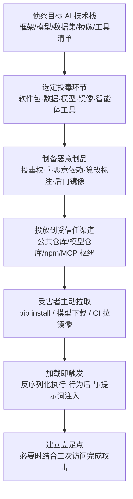

# AI 供应链入侵 (AML.T0010)

## 一句话通俗理解

> 攻击者不再蹲在你家门口等机会，而是直接污染你每天进货的"食材市场"——你从模型仓库下载的权重、pip 安装的 AI 框架、外包标注的数据集、CI 拉取的容器镜像、智能体调用的 MCP 工具，任何一个环节被下了毒，恶意组件就会以"受信任交付物"的身份大摇大摆走进你的系统。

## 难度等级

⭐⭐⭐ **Realized（已实现）**

官方成熟度评定为 Realized——该技术已在真实攻击与公开研究中被实际使用：PyTorch 依赖链投毒、Hugging Face 恶意模型、npm 上的 MCP 服务器后门等事件接连出现。实施门槛不高（向公共仓库上传投毒制品与发布普通恶意包难度相当），真正难的是**精准命中目标**并保持隐蔽：需要理解受害者的 AI 技术栈（用什么框架、拉什么模型、跑什么工具），并让投毒制品绕过平台扫描与校验。此外，主技术描述明确指出：在某些场景下，攻击者还需要**二次访问**（secondary access）才能利用被投毒的组件完成完整攻击。

## 技术描述

### 通俗解释

AI 系统的"厨房"比传统软件复杂得多：传统应用只需要买菜（依赖库），AI 系统还需要菜谱（模型）、食材（数据）、专用灶具（GPU/TPU 硬件）、半成品菜（容器镜像里的整套环境），甚至外卖平台的第三方骑手（AI 智能体工具）。攻击者发现：与其正面强攻防御森严的系统，不如在这些"进货渠道"里动手脚——投毒一次，所有下游用户都会主动把恶意组件"请"进家门，而且以正常安装、正常加载的方式运行，天然绕过大量安全检查。

这正是传统供应链攻击逻辑在 AI 时代的扩展：**信任被滥用，只是被信任的"商品"从软件包变成了模型、数据集、镜像和智能体工具**。

### 技术原理

依据官方描述，攻击者通过破坏 AI 供应链独有的组成部分来获得对系统的初始访问（Initial Access），攻击面覆盖：

1. **硬件**（AML.T0010.000）——AI 加速卡、传感器等专用硬件的生产与分发环节；
2. **AI 软件栈**（AML.T0010.001）——深度学习框架（PyTorch、TensorFlow、JAX）、生成式 AI 集成框架（LangChain、LangFlow）、推理引擎与 AI DevOps 工具，及其完整依赖链；
3. **数据及其标注**（AML.T0010.002）——公开开放数据集、外包标注服务产出的私有数据集标签；
4. **模型本体**（AML.T0010.003）——从模型仓库下载的预训练模型文件（加载时往往要执行其中保存的代码）；
5. **容器镜像仓库**（AML.T0010.004）——推送被篡改的镜像并覆盖已有镜像名/标签，污染自动化 CI/CD 拉取；
6. **AI 智能体工具**（AML.T0010.005）——智能体调用的工具/MCP 服务器中的恶意定义、隐藏可执行逻辑或投毒的运行时响应。

三点值得特别注意：

- **载荷形态多样化**：AI 供应链中的恶意载荷不只是传统恶意代码——投毒的模型权重、被篡改的标注、藏在工具描述里的提示词注入，都能"不含一行恶意代码"地改变系统行为；
- **二次访问**：官方描述指出，部分场景下攻击者需先获得二次访问，才能利用已投毒的供应链组件发动完整攻击（例如先入侵目标环境，再等待投毒模型被加载触发）；
- **一次投毒、处处中招**：公共模型仓库、包管理器、MCP 聚合枢纽让恶意制品可以像正版一样被成千上万个组织拉取，扩散速度远超定向攻击。

**平台覆盖**：Predictive AI（预测式 AI）/ Generative AI（生成式 AI）/ Agentic AI（智能体 AI）三类平台全部适用。

**AI 供应链攻击面全景**（六大环节的信任假设与典型投毒形态）：

| 供应链环节 | 受信任的"进货渠道" | 被滥用的信任假设 | 典型投毒形态 |
|-----------|------------------|----------------|-------------|
| 硬件 | GPU/TPU/嵌入式设备采购 | "原厂出厂即安全" | 恶意固件、篡改的加速卡 |
| AI 软件 | PyPI/npm 上的框架与依赖 | "下载量高的包可信" | 依赖混淆、名称抢注、rug pull |
| 数据 | 开放数据集、外包标注服务 | "公开数据集没人动过手脚" | 投毒样本、篡改标签、夹带恶意代码 |
| 模型 | Hugging Face 等模型仓库 | "评分高的模型可用" | pickle 恶意载荷、投毒权重后门 |
| 容器镜像 | 内部镜像仓库 + CI 自动拉取 | "同名同标签即同内容" | 覆盖标签的篡改镜像（含投毒模型） |
| 智能体工具 | GitHub / npm / MCP 枢纽 | "工具描述就是功能说明" | 描述中埋提示词注入、隐藏外传逻辑 |

### 用途影响

- **初始立足点**：作为初始访问战术的核心技术，投毒制品随正常交付进入目标环境，为后续执行、持久化、横向移动铺路；
- **大规模面杀伤**：针对公共仓库的投毒可同时波及大量下游组织，无需逐个攻击；
- **隐蔽持久**：投毒制品通过官方渠道分发、以合法身份运行，且部分"行为型后门"（如投毒权重、投毒提示词）可长期潜伏等待触发条件；
- **直取核心资产**：攻陷 AI 供应链意味着直接触及目标的数据、模型与智能体——AI 组织最有价值的资产。

## 子技术列表

**该技术共有 6 个子技术：**

| 子技术ID | 中文名称 | 说明 |
|----------|----------|------|
| [AML.T0010.000](AML.T0010/AML.T0010.000-Hardware.md) | 硬件 | AI 模型常运行于 GPU、TPU 或嵌入式设备等专用硬件，也可优化运行在 CPU 上。攻击者可通过破坏或操纵硬件供应链来打击 AI 系统。官方成熟度为 Feasible（可行）——概念上成立，尚无公开实战案例。 |
| [AML.T0010.001](AML.T0010/AML.T0010.001-AI-Software.md) | AI软件 | 针对 AI 系统常用软件包或 AI DevOps 工具链投毒：深度学习框架（如 PyTorch、TensorFlow、JAX）、生成式 AI 集成框架（如 LangChain、LangFlow）、推理引擎，以及这些包的依赖链、配置文件和随包分发的 Jupyter notebook 示例。手法包括入侵合法包、名称抢注（namesquatting）、抢占 LLM 幻觉出的包名（slopsquatting），以及"先发布正版、积累用户后发布恶意版本"的 rug pull。 |
| [AML.T0010.002](AML.T0010/AML.T0010.002-Data.md) | 数据 | 数据是供应链攻击的关键载体：许多 AI 项目依赖公开可得的大型开放数据集，攻击者可对其投毒（即"投毒训练数据"），或在数据中夹带传统恶意代码。私有数据集则常在标注阶段中招——组织将标注外包给第三方服务，攻击者篡改标注服务产出的标签即可完成投毒。 |
| [AML.T0010.003](AML.T0010/AML.T0010.003-Model.md) | 模型 | 组织常从外部下载开源预训练模型作为微调基座。加载模型文件往往需要执行其中保存的代码（如 pickle 等序列化格式），因此模型文件可被植入传统恶意代码，或通过对抗性 AI 技术植入隐蔽后门。 |
| [AML.T0010.004](AML.T0010/AML.T0010.004-Container-Registry.md) | 容器镜像仓库 | 攻击者向受害者的容器镜像仓库推送被篡改的镜像，覆盖已有镜像名或标签；仓库用户及自动化 CI/CD 流水线拉取恶意镜像后，开发与生产环境同时被污染。镜像中往往打包了 AI 模型，被篡改的模型随之扩散。官方成熟度为 Demonstrated（已演示）。 |
| [AML.T0010.005](AML.T0010/AML.T0010.005-AI-Agent-Tool.md) | AI智能体工具 | 工具为 AI 智能体赋予访问外部服务、连接数据源、执行系统命令与代码的能力——攻陷一个智能体工具，就可能借智能体手中的其他工具获得广泛权限与数据访问。投毒形式包括恶意定义或指令、隐藏的可执行逻辑、被投毒的运行时响应；MCP 服务器生态爆发式增长（数千个公开 MCP 服务器，经 GitHub、NPM 与聚合枢纽分发），恶意工具可快速扩散且普遍缺乏防护。 |

> 注：以上 6 个子技术文档均已完成，可直接点击子技术 ID 阅读。

## 攻击流程

### 典型攻击流程



**步骤详解：**

1. **侦察目标 AI 技术栈**
   - 通俗描述：摸清目标"进什么货"。
   - 技术细节：分析目标组织使用的 AI 框架与版本、常拉取的模型仓库与数据集来源、CI 引用的基础镜像、智能体接入的 MCP 工具清单；识别未固定版本（unpinned）的引用，以及目标开发者会信任的"相似名称"。

2. **选定投毒环节并制备恶意制品**
   - 通俗描述：决定在哪个环节"下毒"，并制作带毒商品。
   - 技术细节：抢占与合法包同名的命名空间（依赖混淆）、对模型文件植入 pickle 载荷、篡改数据标注、构建包含投毒模型与恶意启动脚本的基础镜像、在 MCP 工具描述中埋入提示词注入。

3. **投放到受信任分发渠道**
   - 通俗描述：把带毒商品摆上正规货架。
   - 技术细节：向 PyPI/npm 发布抢注包、向 Hugging Face 上传投毒模型、向目标容器仓库推送覆盖已有标签的镜像、在 MCP 聚合枢纽上架恶意工具；必要时先发布正版内容积累下载量再实施 rug pull。

4. **受害者拉取与加载**
   - 通俗描述：目标自己"下单"，把毒带回家。
   - 技术细节：开发者 `pip install` 解析到恶意包、算法工程师 `from_pretrained` 加载投毒模型、CI 流水线按 tag 拉到被覆盖的镜像、智能体平台安装并注册投毒工具——全部以正常工作流完成，无任何告警。

5. **载荷触发并建立立足点**
   - 通俗描述：毒发。
   - 技术细节：pickle 反序列化执行反向 Shell、投毒权重在特定触发输入下输出错误结果、工具描述中的注入指令操纵智能体读取凭证并外传；部分场景下攻击者需结合二次访问（如已有目标凭据）才能将加载触发转化为完整控制。

**与后续战术的衔接：**

- **执行（Execution）**：投毒载荷随组件加载自动执行，无需受害者额外点击，是本技术最直接的下一站
- **持久化（Persistence）**：将恶意逻辑写回项目依赖清单或智能体工具配置，使重装/重启后仍会被拉取
- **凭证访问（Credential Access）**：投毒工具最常见的附加动作——读取 `.env`、云凭证与 API 密钥
- **数据渗漏（Exfiltration）**：恶意 MCP 服务器/工具将窃得数据带出，如 Postmark 案例中的邮件外传

> 关键差异：传统供应链攻击通常在"执行"一步暴露（进程行为异常），而投毒的模型权重与提示词**不产生可疑进程**，行为变化发生在推理结果与智能体决策层面，需要 AI 遥测才能看见。

## 真实案例

> 以下精选 4 个代表性案例（官方数据共关联 18 个案例研究），全部源自 MITRE ATLAS 案例库。

### 案例1：PyTorch-nightly 依赖链投毒（2022年12月，AML.T0010.001）

- **时间**: 2022年12月25日–30日
- **攻击者**: 未知名恶意行为者
- **手法**: 攻击者向 PyPI 上传了名为 `torchtriton` 的恶意包——与 PyTorch 预览版（PyTorch-nightly）的合法依赖 `triton` 在 PyPI 命名空间冲突。pip 安装 PyTorch-nightly 时优先解析到 PyPI 上的恶意包（典型"依赖混淆"），恶意二进制在受影响的 Linux 机器上执行并窃取敏感信息。12月30日 PyTorch 披露事件，将依赖改用独立包名并撤下恶意包。
- **影响**: 期间所有通过 pip 安装 PyTorch-nightly 的 Linux 用户潜在受影响
- **参考链接**: [PyTorch 官方声明](https://pytorch.org/blog/compromised-nightly-dependency/)

### 案例2：PoisonGPT——投毒开源 LLM 传播虚假信息（2023年7月，AML.T0010.003）

- **时间**: 2023年7月
- **攻击者**: Mithril Security 研究人员（安全演示）
- **手法**: 研究人员对一个开源预训练大语言模型（GPT-J 修改版）做"脑叶切除"式篡改，使其在回答特定历史事实问题时给出错误答案，随后将投毒模型上传回 Hugging Face——全球最大的公开模型仓库。模型外观、元数据与正常模型无异，用户下载微调或部署后即接收并扩散被投毒的输出，且几乎无法察觉。
- **影响**: 演示了 LLM 供应链的脆弱性——一次投毒可借助模型仓库波及大量下游用户
- **参考链接**: [Mithril Security 博客](https://blog.mithrilsecurity.io/poisongpt-how-we-hid-a-lobotomized-llm-on-hugging-face-to-spread-fake-news/)

### 案例3：Hugging Face 上的恶意模型——绕过 Picklescan（2024年2月，AML.T0010 / AML.T0010.003）

- **时间**: 2024年2月
- **攻击者**: 未命名威胁行为者
- **手法**: ReversingLabs 研究人员在 Hugging Face 上发现内嵌恶意代码的模型：加载模型文件即执行反向 Shell，向攻击者回连并授予命令与控制能力。模型文件被刻意构造成"恶意载荷先执行、随后反序列化才失败"的形态，从而绕过 Hugging Face 官方部署的 Picklescan 恶意代码扫描。
- **影响**: 下载并加载该模型的用户主机直接沦陷；暴露了平台级扫描的绕过空间
- **参考链接**: [ReversingLabs 分析报告](https://www.reversinglabs.com/blog/rl-identifies-malware-ml-model-hosted-on-hugging-face)

### 案例4：Postmark MCP 服务器后门——首个野外恶意 MCP（2025年，AML.T0010.005）

- **时间**: 2025年
- **攻击者**: 未知名恶意行为者
- **手法**: 攻击者冒充 Postmark（邮件投递服务）在 npm 抢注 `postmark-mcp` 包名，初期发布与官方功能一致的 MCP 服务器代码以积累信任；周下载量突破一千后实施 rug pull——上传带后门的恶意版本，经供应链攻击窃取智能体用户邮箱中的邮件数据。
- **影响**: 野外首个被公开报告的恶意 MCP 服务器，证实智能体工具生态已沦为实战攻击目标
- **参考链接**: [KOI 安全分析](https://www.koi.ai/blog/postmark-mcp-npm-malicious-backdoor-email-theft)

## 红队视角

> ⚠️ **免责声明**：以下内容仅用于合法授权的安全测试与教育目的。未经授权对他人系统或第三方仓库进行测试是违法行为。

### 实战技巧

1. **AI 依赖面盘点**
   从目标的 `requirements.txt`、`pyproject.toml`、`package.json`、模型加载代码与 Dockerfile 入手，绘制完整 AI 依赖图：用了哪些框架与版本、模型从哪里拉取、是否固定了版本与哈希。未固定的引用（如 `transformers` 最新版、`from_pretrained("org/model")` 不带 revision）是最有价值的发现。

2. **制品完整性评估**
   检查目标是否校验 AI 制品：模型/数据集下载后是否比对哈希、CI 是否使用 digest 拉取镜像、MCP 工具安装前是否审计源码。缺失校验的点即为"可投毒面"——在报告中量化它，而非真的投毒。

3. **命名空间演练（仅限自有环境）**
   在自有命名空间/私有 registry 中复现依赖混淆与 rug pull 流程，验证组织的私有包名是否会被公共仓库抢注，验证 MCP 工具治理策略是否拦截未审计来源。

4. **模型文件静态审查**
   用 picklescan 或 pickle 反汇编工具检查自有模型文件中的 `REDUCE`/`GLOBAL` 操作码，确认加载路径是否可能执行任意代码。

### 常用工具

| 工具名称 | 用途 | 平台 |
|----------|------|------|
| picklescan | 模型文件 pickle 载荷扫描 | 跨平台 |
| pip-audit | Python 依赖已知漏洞审计 | 跨平台 |
| Syft | SBOM/AI BOM 生成 | 跨平台 |
| Grype | 基于 BOM 的漏洞扫描 | 跨平台 |

### 注意事项

- **绝不入侵第三方仓库**：真实红队评估中，向公共仓库上传任何包都超出授权范围——供应链投毒只做"投毒面评估"与本地隔离复现
- 报告聚焦"如果攻击者投毒，组织能否发现"（检测能力验证），而非证明投毒可行
- 所有涉及恶意制品的验证在隔离网络中完成，载荷使用无害标记（如 DNS 信标）

## 蓝队视角

### 检测要点

1. **制品拉取监控**
   - 日志来源：pip/npm 安装日志、模型仓库 API 日志、容器仓库拉取日志、MCP 工具安装记录
   - 关注字段：制品来源、版本/tag、发布者、下载时间
   - 异常特征：从新发布者拉取的制品、既有镜像名/标签被覆盖后内容哈希变化、抢注命名空间的包（与内部私有包同名）、下载量与发布时间不匹配的新版本

2. **加载与执行链监控**
   - 日志来源：Sysmon/EDR 进程与网络遥测、CI/CD 流水线日志
   - 关注字段：进程父子关系、命令行、外连目的地
   - 异常特征：Python/推理进程在加载模型文件后产生反向 Shell 或异常外连；模型反序列化失败但仍产生了网络行为；CI 任务拉取镜像后执行了非预期命令

3. **智能体工具治理**
   - 日志来源：智能体平台审计日志、MCP 注册中心
   - 关注字段：工具注册/变更事件、工具描述文本、工具调用序列
   - 异常特征：工具描述中出现指令式语句、新注册的未审计 MCP 服务器、智能体在调用工具前读取凭证文件的异常动作序列

### 监控建议

- 维护 **AI BOM**（AI 物料清单）：登记所有模型、数据集、镜像与智能体工具的来源、版本与哈希，变更即告警
- 通过**私有代理仓库**（自建 PyPI/npm/HF 镜像 + 审批）统一入口，禁止生产环境直连公共仓库
- 对进入环境的模型执行**入场扫描 + 沙箱加载**（隔离网络中先加载一次观察行为）
- 对智能体工具实施**准入审计**：源码审查后才允许注册，运行期监控工具描述变更

## 检测建议

### 网络层检测

**检测方法：** 监控 AI 制品下载流量的异常模式。

- 非训练节点出现大体积权重文件下载（模型文件通常数百 MB 至数十 GB）
- 对模型仓库/包仓库的新增域名与低信誉来源的请求
- CI/CD 节点在非构建窗口拉取镜像

### 主机层检测

**检测方法：** 监控模型加载伴随的可疑执行与外连。

- Python 进程加载 pickle/模型文件后，短时间内向外部 IP 发起连接（反向 Shell 特征）
- 模型反序列化报错但进程仍持续存在并产生网络行为
- 文件完整性监控（FIM）覆盖模型目录与智能体工具目录

### 应用层检测（AI 遥测）

**检测方法：** 利用 AI 平台自身的审计能力。

- 模型加载事件携带的哈希与 AI BOM 登记值比对，不一致即告警
- 智能体工具描述文本变更（提示词注入常埋在 docstring 中）
- 智能体在工具调用前后的异常上下文动作（如先读 `.env`/凭证文件再外传）

**程序化检测思路（无需 EDR 侧改造）：**

在模型加载入口（统一的 `load_model` 封装或推理服务启动钩子）注入校验逻辑：加载前计算文件哈希 → 查询 AI BOM 登记表 → 命中则放行，未命中则记录并告警。配合智能体平台的工具注册 Webhook，对每次注册/变更做一次"描述文本指令检测"（正则匹配"读取/上传/发送/ignore previous"等模式），即可用极低成本覆盖 AML.T0010.003 与 AML.T0010.005 两个最高频子技术。

### Sigma 规则思路示例

```yaml
title: 模型文件加载后出现可疑外连（供应链载荷触发）
status: experimental
description: 检测 Python 进程加载模型文件后短时间内发起外部连接，
    可能为投毒模型/依赖的载荷回连（AML.T0010）
logsource:
    category: network_connection
    product: windows
detection:
    selection_process:
        Image|endswith: '\python.exe'
        CommandLine|contains:
            - 'torch.load'
            - 'pickle.load'
            - 'from_pretrained'
    selection_network:
        DestinationIp|notstartswith:
            - '10.'
            - '172.16.'
            - '192.168.'
    condition: selection_process and selection_network
    timeframe: 5m
level: high
tags:
    - attack.t1195
    - atlas.aml_t0010
```

## 缓解措施

### 优先级1：关键措施

**AML.M0014 验证 AI 制品（Verify AI Artifacts）**

对所有 AI 制品（模型、数据集、镜像、软件包）校验加密校验和，确认文件未被攻击者篡改。落地要点：下载即校验（哈希比对进 CI 流水线）、登记进 AI BOM 后固定版本与摘要、任何"哈希对不上"的制品直接阻断。

**AML.M0023 AI 物料清单（AI Bill of Materials）**

维护构建 AI 系统所用的全部制品与资源的完整清单，包括数据集来源（provenance）与全部修改记录的详细历史。AI BOM 不仅能缓解供应链风险，还能在漏洞披露时快速定位"我们是否用了受影响组件"并加速响应。

### 优先级2：重要措施

**AML.M0020 生成式 AI 护栏（Generative AI Guardrails）**

在用户、工具与生成式 AI 模型之间部署安全控制，在提示词、检索上下文、模型输出与智能体动作被接受、执行或呈现之前进行评估。护栏可阻断、修改或路由恶意代码、恶意指令、敏感数据与不安全的工具请求；可通过规则式控制（过滤器、允许/阻止列表、正则、schema 校验、权限检查）或 AI 类手段（分类器、LLM 审查、任务一致性检查）实现，并可应用于输入处理、提示词构造、检索、工具执行、输出审查与部署后监控等多个阶段。对供应链攻击而言，护栏的价值在于**限制投毒制品的爆炸半径**——即使智能体工具被投毒，工具调用校验与高危操作人工审批也能拦截外传与破坏。

### 优先级3：建议措施

**AML.M0035 AI 红队（AI Red Team）**

建立负责常态化、授权、威胁驱动红队演练的 AI 红队，在部署前及运营全程发现并修复 AI 系统漏洞。演练应覆盖完整 AI 系统——模型与数据、智能体（含记忆与工具）、数据流、依赖、基础设施与人工流程；按"规划与界定 → 执行演练 → 评估与整改"三阶段组织，并使用 ATLAS 战术技术模拟真实对手行为（含供应链投毒面评估）。

### MITRE ATLAS 缓解措施映射

| 缓解措施ID | 缓解措施名称 | 优先级 | 类别 | 生命周期阶段 |
|------------|-------------|:------:|------|-------------|
| AML.M0014 | 验证 AI 制品 | 关键 | Technical - Cyber | 业务与数据理解 · 数据准备 · AI 模型工程 |
| AML.M0023 | AI 物料清单 | 关键 | Policy | 业务与数据理解 · 数据准备 · AI 模型工程 |
| AML.M0020 | 生成式 AI 护栏 | 重要 | Technical - AI | AI 模型工程 · 评估 · 部署 · 监控维护 |
| AML.M0035 | AI 红队 | 建议 | Policy / Technical | 全生命周期 |

> 优先级为本库基于缓解措施特性给出的落地建议：制品校验与 AI BOM 解决"进来的是不是正版"，护栏解决"进来的毒能造成多大伤害"，红队解决"以上防线是否真的有效"。

## 关联 ATT&CK 技术

- [供应链妥协 (T1195)](../../enterprise/03-Initial-Access/T1195-Supply-Chain-Compromise.md) — 经典供应链攻击技术，与本技术为同源关系

**AI 供应链 vs 传统供应链：**

| 维度 | 传统供应链 (T1195) | AI 供应链 (AML.T0010) |
|------|------------------|----------------------|
| 攻击对象 | 软件依赖、构建/分发过程、硬件 | 硬件、AI 软件栈、**数据与标注、模型文件、容器镜像、智能体工具** |
| 载荷形态 | 恶意代码为主 | 恶意代码 + **投毒权重、篡改标注、提示词注入等"行为型后门"** |
| 分发渠道 | 包管理器、更新机制 | 包管理器 + **模型仓库（Hugging Face）、容器仓库、MCP 工具枢纽** |
| 受害触发 | 安装/更新即执行 | 下载加载即触发，部分后门**需特定输入才激活**，可长期潜伏 |
| 攻击者附加要求 | — | 部分场景需**二次访问**才能完成完整攻击 |

一句话总结：T1195 攻击"你的代码从哪来"，AML.T0010 把问题扩展为"你的**模型、数据、镜像和智能体工具**从哪来"——攻击面从开发环节延伸到了整个 AI 生命周期。

## 动手实验

> ⚠️ **重要提示**：所有实验必须在隔离的实验室环境中进行，禁止对未授权系统或公共仓库进行测试。涉及恶意构造的实验仅使用无害标记载荷。

### 实验环境准备

| 环境组件 | 用途 | 获取方式 |
|----------|------|----------|
| 隔离 Linux 虚拟机（无外网） | 加载实验与观察行为 | 本地虚拟化平台 |
| Python 3.10+ | 运行模型加载实验 | 官方安装包 |
| 一个小型 Hugging Face 模型 | 校验与扫描对象 | [huggingface.co](https://huggingface.co/) |
| picklescan / pip-audit | 制品扫描 | pip 安装 |

### 实验1（初级）：验证 AI 制品完整性

**实验目标：** 掌握模型/数据集的哈希校验流程（对应 AML.M0014）。

**实验步骤：**
1. 从官方渠道下载一个小型模型文件及其公布的校验和
2. 运行 `sha256sum <model-file>` 比对官方值
3. 用十六进制编辑器改动文件任意 1 字节，重新计算哈希观察变化
4. 思考：组织的下载流程在哪一步可以做这个比对？

**预期结果：** 理解"哈希不符即阻断"的最小实现。

### 实验2（中级）：扫描模型文件与依赖

**实验目标：** 识别模型文件与依赖中的潜在风险。

**实验步骤：**
1. 运行 `picklescan` 扫描下载的模型文件，查看报告的 pickle 操作码
2. 对一个 ML 项目运行 `pip-audit`，盘点已知漏洞依赖
3. 在隔离虚拟机中，用 Python 手工构造一个执行无害命令（如创建标记文件）的 pickle 对象，确认"加载即执行"的原理
4. 对照案例3理解：为什么"载荷先执行、反序列化后失败"能绕过扫描

**预期结果：** 掌握模型入场扫描的最小工具链。

### 实验3（高级）：复现"未固定引用"风险与工具审计

**实验目标：** 理解供应链攻击面中"信任解析结果"的问题。

**实验步骤：**
1. 本地搭建私有 registry（如 minio + 简单索引），模拟 `from_pretrained("org/model")` 不固定 revision 的拉取行为
2. 在自有命名空间内发布两个版本的制品，观察消费端解析到"最新版"而非预期版本
3. 审计一个开源 MCP server 的源码：查找外连域名、读取环境变量/凭证的代码路径、描述文本中的指令式语句
4. 将发现整理为组织的 AI 供应链准入清单（来源固定、哈希登记、源码审计）

**预期结果：** 能向组织输出一份可执行的 AI 供应链准入基线。

## 术语解释

| 术语 | 英文原名 | 通俗解释 |
|------|----------|----------|
| AI 供应链 | AI Supply Chain | 构建一个 AI 系统所需的全部"进货渠道"——框架、数据、模型、镜像、工具，就像餐厅的食材、菜谱与厨具供货商 |
| 依赖混淆 | Dependency Confusion | 攻击者在与内部私有包同名的公共仓库抢先占位，包管理器误拉恶意版本——PyTorch 事件的核心手法 |
| 名称抢注 | Namesquatting | 注册与知名软件包/组织相似的名称来骗取下载，如 "postmark-mcp" 冒充官方 |
| Slopsquatting | Slopsquatting | 抢注 LLM 幻觉出来的包名，等开发者照 AI 建议安装时中招 |
| Rug Pull | Rug Pull（供应链接力投毒） | 先发布正常版本积累用户，再突然发布恶意版本"收割" |
| 投毒 | Poisoning | 在数据、模型或工具中植入恶意影响，让系统"从小学坏" |
| 后门 | Backdoor | 藏在制品里的"暗门"，平时无害，特定触发条件下执行恶意行为 |
| Pickle 序列化 | Pickle Serialization | Python 的对象保存格式——加载 pickle 文件等于执行其中的代码，模型文件的经典攻击面 |
| Picklescan | Picklescan | 扫描模型文件中 pickle 载荷的工具，Hugging Face 用它做平台级扫描 |
| MCP 服务器 | Model Context Protocol Server | 为 AI 智能体提供工具调用的标准服务端，正成为智能体供应链的核心组件 |
| AI BOM | AI Bill of Materials | AI 物料清单——列出构建 AI 所用的全部制品与资源，相当于 AI 系统的"成分标签" |
| 模型仓库 | Model Hub | 托管预训练模型的平台（如 Hugging Face），开发者像下载软件包一样下载模型 |
| 二次访问 | Secondary Access | 官方描述指出：部分供应链投毒需攻击者额外获得一次访问，才能把"投毒组件被加载"转化为完整攻击 |

## 参考资料

### 📚 官方文档

- [MITRE ATLAS - AI Supply Chain Compromise (AML.T0010)](https://atlas.mitre.org/techniques/AML.T0010/) - 官方技术页面
- [MITRE ATLAS 矩阵](https://atlas.mitre.org/matrices/ATLAS/)
- [MITRE ATLAS Data (GitHub)](https://github.com/mitre-atlas/atlas-data)

### 📰 案例报告（真实攻击与安全研究）

- [PyTorch 关于依赖链被投毒的声明](https://pytorch.org/blog/compromised-nightly-dependency/) - 2022年依赖混淆事件官方复盘
- [PoisonGPT - Mithril Security](https://blog.mithrilsecurity.io/poisongpt-how-we-hid-a-lobotomized-llm-on-hugging-face-to-spread-fake-news/) - 投毒 LLM 上传模型仓库的完整演示
- [ReversingLabs: Malicious ML models on Hugging Face](https://www.reversinglabs.com/blog/rl-identifies-malware-ml-model-hosted-on-hugging-face) - 绕过 Picklescan 的恶意模型分析
- [KOI: First Malicious MCP in the Wild](https://www.koi.ai/blog/postmark-mcp-npm-malicious-backdoor-email-theft) - 首个野外恶意 MCP 服务器事件分析
- [AWS 安全公告：Amazon Q VS Code 扩展供应链事件](https://aws.amazon.com/security/security-bulletins/AWS-2025-015/) - 2025年 AI 编码助手扩展被植入恶意提交的事件
- [Trend Micro: Slopsquatting——AI 智能体幻觉出的恶意包](https://www.trendmicro.com/vinfo/us/security/news/cybercrime-and-digital-threats/slopsquatting-when-ai-agents-hallucinate-malicious-packages) - 抢注 LLM 幻觉包名的新攻击面
- [Pillar Security: AI 编码助手规则文件后门](https://www.pillar.security/blog/new-vulnerability-in-github-copilot-and-cursor-how-hackers-can-weaponize-code-agents) - 针对规则文件的供应链攻击

### 🔧 工具与资源

- [picklescan](https://github.com/mmaitre314/picklescan) - 模型文件恶意载荷扫描器
- [pip-audit](https://pypi.org/project/pip-audit/) - Python 依赖审计
- [OWASP Top 10 for LLM Applications](https://owasp.org/www-project-top-10-for-large-language-model-applications/) - LLM 应用十大安全风险
- [NIST AI Risk Management Framework](https://www.nist.gov/itl/ai-risk-management-framework) - NIST AI 风险管理框架

### 🔗 关联阅读

- [T1195 供应链妥协](../../enterprise/03-Initial-Access/T1195-Supply-Chain-Compromise.md) - 传统供应链攻击技术，与本技术对照阅读
- [初始访问战术 (AML.TA0004)](./README.md) - 本技术所属战术的概览页

---

> **版本**: ATLAS 2026.09 | **更新**: 2026-10-22 | **模板**: ATLAS 技术文档 v1.0
