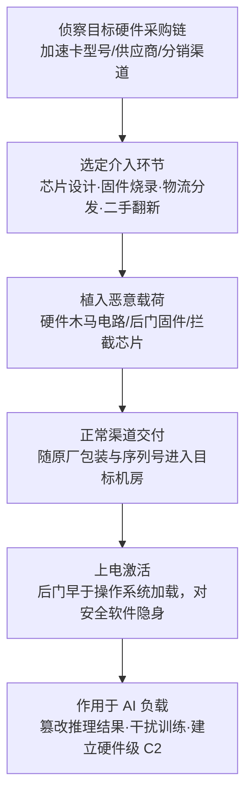

# 硬件 (AML.T0010.000)

> 属于 [AI 供应链入侵 (AML.T0010)](../AML.T0010-AI-Supply-Chain-Compromise.md)

## 一句话通俗理解

> 攻击者不在代码和数据里下毒，而是在 AI 系统的"灶台"上做手脚——训练和推理用的 GPU/TPU 加速卡、边缘推理设备和它们的固件，在生产、运输或分发环节被植入恶意芯片或后门固件，AI 系统从上电那一刻起就活在被篡改的地基上。

## 难度等级

⭐ **Feasible（可行）**

官方成熟度评定为 Feasible——攻击路径在概念上完全成立，但**尚未出现公开的真实攻击或案例研究**。这并非因为攻击不可能，而是因为门槛极高：

- **需要介入物理供应链**：与上传一个投毒包、发布一个恶意模型不同，硬件供应链攻击要求攻击者能够触达芯片设计、整机制造、固件烧录或物流分发等物理环节，通常意味着国家级资源或对供应商的深度渗透；
- **AI 硬件供应链高度集中**：AI 加速卡（GPU/TPU/NPU）由极少数厂商垄断生产，出货渠道相对可控，做手脚的机会窗口比开源软件生态少得多；
- **一旦得手危害极大**：固件级与芯片级后门运行在操作系统与安全软件之下，可直接影响模型训练与推理的计算完整性——这也是 ATLAS 将其纳入矩阵的原因：可行性已被安全研究反复论证，防御者不能因其"未发生"而忽视。

> 对照阅读：兄弟子技术 AML.T0010.001（AI软件）、AML.T0010.003（模型）成熟度均为 Realized（⭐⭐⭐）——攻击者当前更偏好数字供应链，因为那里的"投毒"成本几乎为零。硬件是 AI 供应链中攻击成本最高、但一旦突破最难以检测的环节。

## 技术描述

### 通俗解释

AI 系统一日三餐都做在专用灶台上：训练大模型要成百上千块 GPU/TPU，手机、汽车、摄像头里的 AI 能力跑在嵌入式 NPU 芯片上，即使纯 CPU 推理也依赖底层的计算与固件栈。AML.T0010.000 指向的就是这些"灶台"本身被动手脚的场景：

- 出厂前，加速卡的固件（如 GPU VBIOS、板卡管理固件）被植入后门；
- 芯片设计阶段被插入恶意电路（硬件木马）；
- 边缘 AI 设备（智能摄像头、车载推理盒子）在物流分发途中被调包或刷入篡改固件；
- 二手市场上流通的矿卡/推理卡被重新刷写固件后流入 AI 机房。

受害者采购这些硬件后，会像信任"原厂正品"一样把它们插进训练集群与生产推理环境——恶意逻辑随上电激活，早于操作系统、早于安全代理，天然隐身。

### 技术原理

依据官方描述：攻击者可通过**破坏或操纵硬件供应链**来打击 AI 系统。AI 模型通常运行于 GPU、TPU 或嵌入式设备等专用硬件之上，也可被优化运行在 CPU 上。攻击面覆盖硬件的生产与分发全流程：

1. **芯片设计环节**：在 IP 核或流片阶段植入硬件木马电路，可在特定条件下翻转计算结果、泄露密钥或建立隐蔽通道；
2. **固件烧录环节**：篡改 GPU VBIOS、BMC、带外管理控制器或边缘设备固件，植入远控后门；
3. **整机制造与分发环节**：AI 服务器、训练一体机、边缘推理设备在组装线或物流途中被调包、加装拦截芯片；
4. **二手与翻新渠道**：经翻新的加速卡携带着被篡改的固件进入预算敏感的 AI 团队。

**对 AI 系统的特有影响路径**：

| 攻击位置 | 对 AI 的直接影响 | 后果示例 |
|---------|----------------|---------|
| 加速卡固件 | 模型执行环境不可信 | 推理结果被选择性篡改——安全模型对特定输入放行 |
| 训练集群硬件 | 训练过程被干扰 | 梯度/参数被微调，模型"从小学坏"且难以察觉 |
| 边缘 AI 设备 | 现场传感器数据被劫持 | 模型输入源头被替换或注入 |
| 带外管理通道 | 硬件级持久化 C2 | 重装系统、更换磁盘都无法清除的后门 |

**平台覆盖**：Predictive AI（预测式 AI）/ Generative AI（生成式 AI）/ Agentic AI（智能体 AI）三类平台全部适用——因为无论哪类 AI，其模型最终都要落在某块物理硬件上执行。

### 用途影响

- **最深层的初始访问**：硬件后门位于整个技术栈最底层，是所有初始访问技术中"根权限"最彻底的一种；
- **计算完整性破坏**：不必触碰任何代码或数据，即可让模型训练与推理结果失真——对安全检测类模型（恶意样本识别、欺诈检测）是致命打击；
- **不可清除的持久化**：固件/芯片级植入可跨越系统重装、磁盘更换甚至设备"重置"；
- **横向扩散的跳板**：带外管理接口（BMC 等）被控制后，攻击者可借机进入机房内网管理平面。

## 攻击流程

### 典型攻击流程



**步骤详解：**

1. **侦察目标硬件采购链**
   - 通俗描述：摸清目标"灶台从哪买"。
   - 技术细节：识别目标 AI 团队使用的加速卡型号与固件版本、服务器供应商与 ODM 代工关系、采购的分销渠道；关注二手设备采购、边缘设备的现场部署与运维流程等防护薄弱环节。

2. **选定介入环节并植入恶意载荷**
   - 通俗描述：挑一条最容易下手的生产线动手脚。
   - 技术细节：芯片级植入（在设计或流片阶段加入木马电路）、固件级植入（篡改 GPU VBIOS/BMC/边缘设备固件，写入远控与篡改逻辑）、物流级植入（运输途中调包或加装拦截芯片）；也可以收买或社会工程化供应链上的内部人员。

3. **正常渠道交付**
   - 通俗描述：带毒的灶台贴着正品标签进厨房。
   - 技术细节：被篡改硬件保持原厂包装、序列号与质检单据，随正常采购流程进入目标组织的训练机房或边缘部署点；受害者的入库验收通常只核对外观与序列号，不校验固件完整性。

4. **上电激活与隐蔽运行**
   - 通俗描述：一开机，后门就比操作系统先起床。
   - 技术细节：恶意固件在 POST/上电阶段加载，早于 OS 与 EDR；对上呈现正常硬件行为，对下劫持计算、内存搬运或管理通道，等待触发条件（特定负载、特定时间、特定网络指令）。

5. **作用于 AI 负载并按需扩展**
   - 通俗描述：不偷东西，直接改秤。
   - 技术细节：对推理路径做选择性篡改（如对特定输入返回攻击者期望的判定）、对训练过程注入细微参数偏移、经带外管理通道建立 C2 并横向移动至管理网；必要时结合二次访问完成完整攻击（与父技术 AML.T0010 的描述一致）。

**与后续战术的衔接：**

- **执行**：固件后门在开机即已运行，无需再找执行入口
- **持久化**：硬件级植入天然持久，重装系统无法清除
- **防御规避**：运行于 OS 与安全软件之下，常规 EDR 完全不可见
- **影响**：直接篡改模型输出与训练结果，属于最深层的"投毒"

> 关键差异：数字供应链投毒（包、模型、镜像）影响的是"进入系统的内容"，硬件供应链投毒影响的是"承载内容的机器本身"——前者可以从入口校验拦截，后者只能靠采购链管理与固件度量发现。

## 真实案例

> **官方成熟度为 Feasible：ATLAS 案例库中尚无直接针对 AML.T0010.000（硬件）的公开案例研究。** 以下从父技术 AML.T0010 关联的 18 个案例中选取两个代表性事件作为攻击范式参照——它们展示了供应链攻击在 AI 生态中的真实运作方式与检测难点，硬件环节一旦被突破，攻击将以更隐蔽的形态复现同样的杀伤链。

### 案例1：Hugging Face 上的恶意模型——加载即回连（AML.T0010，父技术级案例）

- **时间**: 2024年2月
- **攻击者**: 未命名威胁行为者
- **手法**: ReversingLabs 研究人员在 Hugging Face 上发现内嵌恶意代码的模型：加载模型文件即执行反向 Shell，向攻击者回连并授予 C2 能力。模型文件被刻意构造成"恶意载荷先执行、随后反序列化才失败"的形态，绕过了平台的 Picklescan 扫描。
- **参照价值**: 该案例印证了 AI 供应链攻击"伪装成正常交付物、在加载瞬间触发"的通用范式——若同样的载荷改植入加速卡固件，触发将更早（上电即活）、检测将更难（无进程可查）。
- **参考链接**: [ReversingLabs 分析报告](https://www.reversinglabs.com/blog/rl-identifies-malware-ml-model-hosted-on-hugging-face)

### 案例2：Amazon Q VS Code 扩展供应链入侵（AML.T0010.001，同家族参照）

- **时间**: 2025年7月
- **攻击者**: 恶意行为者（GitHub 用户 "lkmanka58"）
- **手法**: 攻击者利用权限过宽的 GitHub Token 向 Amazon Q Developer VS Code 扩展仓库提交恶意代码，诱导扩展部署一个被提示词操纵的 AI 智能体去"清空系统、删除文件系统与云资源"。恶意代码随 v1.84.0 正式版本发布，四天后才被 Amazon 识别并处置。
- **参照价值**: 信任链上的任何一环（这里是官方发布渠道）被攻破，恶意载荷就能以正品身份直达下游——这正是硬件供应链攻击的核心逻辑，只是介入环节从代码仓库换成了生产线与物流。
- **参考链接**: [AWS 安全公告](https://aws.amazon.com/security/security-bulletins/AWS-2025-015/)

## 红队视角

> ⚠️ **免责声明**：以下内容仅用于合法授权的安全测试与教育目的。未经授权对他人系统或供应链进行测试是违法行为。

### 实战技巧

1. **硬件供应链威胁建模**
   在授权评估中绘制组织的 AI 硬件信任链：加速卡与服务器从谁处采购、固件由谁维护更新、带外管理网络如何隔离、边缘设备由谁现场部署。输出"可介入环节清单"（设计/烧录/物流/二手/运维），量化每个环节的现有控制与缺口。

2. **固件完整性基线核查**
   对自有 GPU/服务器/边缘设备建立固件版本与哈希基线，与厂商官方发布版本比对；重点核查 BMC、VBIOS、EEPROM 等非易失存储的意外变更——这是发现"已被做手脚硬件"的唯一可靠手段。

3. **带外管理面演练（仅限自有环境）**
   在自有机房验证 BMC/iDRAC/iLO 的网络隔离、默认口令与固件更新签名校验，评估"从管理平面控制计算平面"的现实可行性。

4. **计算完整性抽检**
   用已知输入输出的标准测试集（如固定随机种子跑基准推理）交叉验证不同批次硬件的输出一致性——训练/推理结果出现无法解释的批次差异，可能是计算层被动过的信号。

### 常用工具

| 工具名称 | 用途 | 平台 |
|----------|------|------|
| flashrom | 固件镜像读取与比对 | Linux |
| chipsec | 平台固件与硬件配置安全评估 | Linux/Windows |
| Vendor BMC CLI（如 ipmitool） | 带外管理接口审计 | 跨平台 |
| dmidecode / lspci | 硬件清单与固件版本盘点 | Linux |

### 注意事项

- **绝不触碰真实供应链**：向在用硬件写入任何数据都超出授权范围——评估止步于"读取、比对、报告"
- 物理接触类验证（拆机、芯片取证）需单独书面授权
- 报告聚焦"组织能否发现被篡改的硬件"，而非证明篡改可行

## 蓝队视角

### 检测要点

1. **固件与硬件遥测**
   - 日志来源：BMC/带外管理日志、BIOS/UEFI 事件日志、GPU 驱动日志、平台遥测（如 TPM 度量日志）
   - 关注字段：固件版本、固件更新事件、设备序列号、度量值变化
   - 异常特征：固件版本与官方发布记录不符、未经授权窗口发生的固件写操作、TPM 度量值与已知基线漂移

2. **采购与资产链审计**
   - 日志来源：采购系统、资产入库记录、供应商变更通知
   - 关注字段：序列号、批次、分销商、到货时间
   - 异常特征：同一订单批次固件版本不一致、非授权分销渠道来货、二手设备混入生产集群

3. **带外管理面监控**
   - 日志来源：BMC 管理流量、管理网防火墙日志
   - 关注字段：BMC 登录源、固件更新指令、出站连接
   - 异常特征：BMC 向生产网/互联网发起连接、非变更窗口的固件升级、空载设备的异常外连

### 监控建议

- 建立 **AI 硬件物料清单（HW BOM）**：与 AI BOM 联动，登记每块训练/推理卡的型号、序列号、固件版本与哈希
- 对关键 AI 服务器启用 **安全启动与固件度量**（UEFI Secure Boot + TPM 远程证明），度量失败即拒绝入网
- 带外管理网络与业务网络**严格隔离**，BMC 固件更新走签名校验 + 变更审批
- 新购与二手硬件执行**入场固件核验**：版本比对官方库，必要时离线读取镜像做哈希与代码审计
- **供应商与渠道管理**：加速卡与 AI 服务器只走授权分销渠道，拒绝无凭证的"特价/二手"货源；关注厂商安全公告（固件召回、签名密钥泄露事件）并映射到自有资产
- **事件响应联动**：将"固件哈希不符""BMC 异常外连"纳入 IR 预案——固件级可疑意味着设备须下线隔离取证，而非简单重装系统

## 检测建议

### 网络层检测

**检测方法：** 监控硬件管理通道的异常网络行为。

- 带外管理接口（BMC/iDRAC/iLO）向业务网段或互联网主动发起连接
- 未登记域名/IP 的低频心跳式外连（固件后门常用低速回连规避流量检测）
- 管理网内出现非预期设备上线（MAC/序列号不在资产库）

### 主机层检测

**检测方法：** 监控固件层与硬件配置的非预期变更。

- GPU/加速卡 VBIOS 版本变化无对应变更工单
- UEFI/BIOS 设置（启动顺序、安全启动开关）被静默修改
- TPM 度量日志（PCR 值）与历史基线出现无法解释的漂移
- dmesgo/驱动日志中出现非官方固件签名告警

### 应用层检测（AI 遥测）

**检测方法：** 用 AI 输出本身的异常反推计算层问题。

- 相同模型、相同输入、不同硬件批次推理结果出现稳定且可复现的差异
- 评估集回归测试中，个别指标仅在特定机器上劣化
- 训练过程中出现无法归因的梯度/损失异常（排除数据与代码因素后）

> 由于固件级植入对 OS 层完全隐身，**"从 AI 行为侧反推硬件可信度"** 是最后一道可观测防线——这也是 AI 系统独有的检测机会：模型输出本身就是硬件完整性的"温度计"。

**程序化检测思路（无需采购专用硬件安全产品）：**

把"固件完整性"挂接到已有变更管理流程：资产入库与每次变更窗口执行 `dmidecode`/`lspci` 采集固件版本 → 写入配置管理数据库（CMDB）→ 与厂商官方版本库自动比对 → 版本不在官方清单或哈希不符即告警。再配合一条推理回归测试（固定输入跑基准模型、比对输出哈希），即可用近零成本覆盖"固件被动过"与"计算结果被动过"两类最核心风险。

### Sigma 规则思路示例

```yaml
title: 生产主机上的固件读写工具执行（硬件供应链相关）
status: experimental
description: 检测生产 AI 主机上出现 flashrom/chipsec 等固件读写工具的执行，
    可能指示未授权固件操作——固件投毒的准备或植入动作（AML.T0010.000）
logsource:
    category: process_creation
    product: linux
detection:
    selection:
        Image|endswith:
            - '/flashrom'
            - '/chipsec_util'
        CommandLine|contains:
            - '--write'
            - '--read'
    condition: selection
falsepositives:
    - 授权变更窗口内的固件升级与安全评估作业
level: high
tags:
    - attack.t1195.003
    - atlas.aml_t0010_000
```

## 缓解措施

> 官方数据中本子技术未直接关联缓解措施，以下按父技术 AML.T0010 的缓解措施映射，结合硬件场景给出落地优先级。

### 优先级1：关键措施

**AML.M0014 验证 AI 制品（Verify AI Artifacts）**

对所有 AI 制品校验加密校验和，确认文件未被攻击者篡改。硬件场景落地：将"制品"概念扩展到固件镜像与硬件配置——入场设备固件版本/哈希与厂商官方库比对，固件更新强制签名校验，AI 硬件清单纳入变更管理。

**AML.M0023 AI 物料清单（AI Bill of Materials）**

维护构建 AI 系统所用的全部制品与资源完整清单（含数据集来源与修改历史）。硬件场景落地：AI BOM 联动硬件物料清单——登记训练/推理硬件的供应商、序列号、固件基线与采购渠道，让"哪台机器可能被动过"成为可回答的问题。

### 优先级2：重要措施

**AML.M0035 AI 红队（AI Red Team）**

建立常态化、授权、威胁驱动的 AI 红队，覆盖完整 AI 系统与基础设施（含供应链投毒面评估）。硬件场景落地：将"固件完整性核查"与"带外管理面演练"纳入红队常态化科目，验证组织对硬件级篡改的发现能力。

### MITRE ATLAS 缓解措施映射

| 缓解措施ID | 缓解措施名称 | 优先级 | 类别 | 生命周期阶段 |
|------------|-------------|:------:|------|-------------|
| AML.M0014 | 验证 AI 制品 | 关键 | Technical - Cyber | 业务与数据理解 · 数据准备 · AI 模型工程 |
| AML.M0023 | AI 物料清单 | 关键 | Policy | 业务与数据理解 · 数据准备 · AI 模型工程 |
| AML.M0035 | AI 红队 | 建议 | Policy / Technical | 全生命周期 |

> 说明：AML.M0020（生成式 AI 护栏）主要作用于提示词与输出层，对固件/芯片级篡改拦截作用有限，故未列入本子技术优先级；硬件可信的根在采购链完整性与固件度量。

## 关联 ATT&CK 技术

- [破坏硬件供应链 (T1195.003)](../../../enterprise/03-Initial-Access/T1195/T1195.003-Compromise-Hardware-Supply-Chain.md) — ATT&CK 经典硬件供应链攻击技术，本子技术在 AI 场景的直接同源

**AML.T0010.000 与 T1195.003 的关系：**

| 维度 | T1195.003 破坏硬件供应链 | AML.T0010.000 硬件 |
|------|------------------------|-------------------|
| 攻击对象 | 服务器、路由器等通用 IT 硬件 | **AI 专用硬件**：GPU/TPU 加速卡、边缘推理设备、嵌入式 NPU |
| 攻击意图 | 通用初始访问与持久化 | 初步访问后**直取模型训练与推理的计算完整性** |
| 特有影响 | 固件后门、C2 | **推理结果定向篡改、训练过程干扰**——模型"从根上被污染" |
| 成熟度 | Realized（多次被指控/演示） | Feasible（概念成立，暂无公开案例） |

一句话总结：T1195.003 回答"硬件后门如何进门"，AML.T0010.000 追问"当这台被做手脚的机器专门用来跑 AI 模型时，攻击者能对模型本身做什么"。

## 动手实验

> ⚠️ **重要提示**：所有实验必须在隔离的实验室环境中、仅针对自有设备进行。禁止对生产硬件或他人设备执行任何写入操作。

### 实验环境准备

| 环境组件 | 用途 | 获取方式 |
|----------|------|----------|
| 一台自有测试机（支持 UEFI） | 固件读取与度量实验 | 本地闲置设备 |
| Linux 虚拟机/Live USB | 运行固件分析工具 | 官方镜像 |
| flashrom / chipsec | 固件镜像读取与平台检查 | 开源工具 |
| 厂商官方固件包（如 BMC/BIOS 更新包） | 版本与哈希比对基准 | 硬件厂商官网 |

### 实验1（初级）：硬件清单与固件基线盘点

**实验目标：** 建立组织的 AI 硬件物料基线（对应 AML.M0023）。

**实验步骤：**
1. 用 `dmidecode -t bios`、`lspci -vv` 盘点自有设备的固件版本与硬件清单
2. 到厂商官网查询各设备官方最新固件版本，逐项比对
3. 计算已下载官方固件包的 `sha256sum`，登记为基线
4. 思考：组织的采购入库流程在哪一步可以做这个比对？

**预期结果：** 产出第一份"设备—序列号—固件版本—哈希"基线表。

### 实验2（中级）：固件镜像读取与差异分析

**实验目标：** 掌握固件完整性核验的最小工具链（对应 AML.M0014）。

**实验步骤：**
1. 在测试机上用 `flashrom --read` 备份当前固件镜像（谨慎操作，仅限自有测试机）
2. 从厂商官网获取同版本官方固件，用 `binwalk -e` 解包两份镜像
3. 比对目录结构与关键文件的哈希差异，理解"版本相同≠内容相同"
4. 用 `chipsec` 跑一次平台检查，关注安全启动与固件写保护状态

**预期结果：** 理解固件层面的"哈希不符即阻断"如何落地。

### 实验3（高级）：AI 输出一致性交叉验证

**实验目标：** 体验"从模型行为反推硬件可信度"的检测思路。

**实验步骤：**
1. 准备一个固定输入的推理测试集（数百个样本 + 期望输出）
2. 在两台不同批次/来源的同类硬件上运行同一模型（固定随机种子）
3. 比对两组输出的数值差异，记录正常硬件间的固有误差范围
4. 思考：如果某台机器输出出现稳定偏差，应触发怎样的排查流程？

**预期结果：** 为组织设计一条"硬件异常→固件核查"的检测联动路径。

## 术语解释

| 术语 | 英文原名 | 通俗解释 |
|------|----------|----------|
| 硬件供应链 | Hardware Supply Chain | 从芯片设计、制造、组装到物流分销的整条硬件交付链路——你买到的每块卡都走过这条路 |
| 硬件木马 | Hardware Trojan | 在芯片设计阶段植入的恶意电路，平时蛰伏，特定条件下翻转计算或泄露信息 |
| 固件 | Firmware | 写死在硬件里的底层软件——开机最早运行，改它等于改硬件的"性格" |
| VBIOS | Video BIOS | GPU 的固件，控制显卡最底层行为，是加速卡攻击的核心靶点 |
| BMC | Baseboard Management Controller | 服务器主板上的带外管理控制器——管理网的安全直接决定硬件层的安全 |
| 带外管理 | Out-of-Band Management | 不走操作系统、独立于业务网络的服务器远程管理通道 |
| 安全启动 | Secure Boot | 上电时逐级校验固件与引导代码签名的机制，拦截被篡改的启动链 |
| TPM 度量 | TPM Measurement | 可信平台模块对启动链哈希的记录，用于远程证明"机器没被动过" |
| 二次访问 | Secondary Access | 父技术 AML.T0010 描述的概念：部分供应链投毒需攻击者额外获得一次访问，才能完成完整攻击 |
| Feasible | Feasible | ATLAS 成熟度最低级：攻击概念可行但尚无公开案例（⭐） |

## 参考资料

### 📚 官方文档

- [MITRE ATLAS - Hardware (AML.T0010.000)](https://atlas.mitre.org/techniques/AML.T0010.000/) - 官方子技术页面
- [MITRE ATLAS - AI Supply Chain Compromise (AML.T0010)](https://atlas.mitre.org/techniques/AML.T0010/) - 父技术页面
- [MITRE ATT&CK - Compromise Hardware Supply Chain (T1195.003)](https://attack.mitre.org/techniques/T1195/003/) - 同源企业矩阵技术

### 📰 案例报告（参照案例源自父技术关联案例）

- [ReversingLabs: Malicious ML models on Hugging Face](https://www.reversinglabs.com/blog/rl-identifies-malware-ml-model-hosted-on-hugging-face) - "伪装正品、加载触发"供应链范式（本文案例1）
- [AWS 安全公告：Amazon Q VS Code 扩展供应链事件](https://aws.amazon.com/security/security-bulletins/AWS-2025-015/) - 官方发布渠道被攻破的实例（本文案例2）

### 🔧 工具与资源

- [flashrom](https://flashrom.org/Flashrom) - 固件读取/写入/比对工具
- [chipsec](https://github.com/chipsec/chipsec) - Intel 平台硬件与固件安全评估框架
- [NIST SP 800-193 Platform Firmware Resiliency](https://csrc.nist.gov/pubs/sp/800/193/final) - 平台固件弹性恢复指南
- [NIST AI Risk Management Framework](https://www.nist.gov/itl/ai-risk-management-framework) - NIST AI 风险管理框架

### 🔗 关联阅读

- [AI 供应链入侵 (AML.T0010)](../AML.T0010-AI-Supply-Chain-Compromise.md) - 本子技术所属父技术
- [破坏硬件供应链 (T1195.003)](../../../enterprise/03-Initial-Access/T1195/T1195.003-Compromise-Hardware-Supply-Chain.md) - 企业矩阵同源技术，对照阅读
- [初始访问战术 (AML.TA0004)](../README.md) - 本技术所属战术的概览页

---

> **版本**: ATLAS 2026.09 | **更新**: 2026-10-22 | **模板**: ATLAS 技术文档 v1.0
