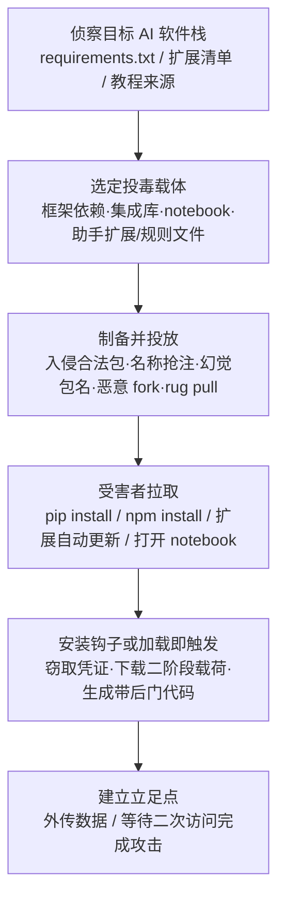

# AI 软件 (AML.T0010.001)

> 属于 [AI 供应链入侵 (AML.T0010)](../AML.T0010-AI-Supply-Chain-Compromise.md)

## 一句话通俗理解

> 攻击者不偷你家钥匙，而是给你天天用的厨具厂寄去一把带毒的锅铲——你 `pip install` 下来的深度学习框架、npm 里抢注的集成库、IDE 里自动更新的 AI 编码助手扩展、甚至教程里那份"官方示例 notebook"，任何一个被下了毒，恶意代码就会跟着正常安装流程堂而皇之地跑在你的开发机与训练集群上。

## 难度等级

⭐⭐⭐ **Realized（已实现）**

官方成熟度评定为 Realized——针对 AI 软件栈的供应链攻击已在多起真实事件中落地：PyTorch-nightly 依赖混淆（2022）、LLM 幻觉包名被抢注（2023 起）、Amazon Q VS Code 扩展被植入恶意提交（2025）。实施门槛呈两极分化：向公共仓库上传一个抢注包与发布普通恶意包难度相当（低门槛）；但**精准命中目标**需要摸清对方的 AI 技术栈（用什么框架、装什么扩展、跟什么教程），而 rug pull 类攻击还需要长期"养号"积累下载量，入侵合法包（如窃取作用域过宽的 GitHub token）则要求相当的入侵前置能力。

## 技术描述

### 通俗解释

AI 开发者的"工具箱"比传统后端开发更杂：既装深度学习框架（PyTorch、TensorFlow、JAX），又装模型与分词库（transformers、tokenizers、safetensors），生成式应用还要装集成框架（LangChain、LangFlow），推理要装推理引擎，MLOps 再叠一层 DevOps 工具链——每一层都是 `pip install` 或 `npm install` 出来的。攻击者发现：与其正面攻击防御严密的训练集群，不如污染这些"工具的进货渠道"——开发者会亲手把带毒工具请进环境，还以官方文档级别的信任运行它。这正是传统软件供应链攻击（T1195.001）在 AI 生态的翻版，只是被信任的"商品"从通用库变成了 AI 框架、模型库、编码助手扩展和示例 notebook。

### 技术原理

依据官方描述，攻击者针对 **AI 系统常用软件包或 AI DevOps 生命周期中的软件包**实施供应链攻击，攻击面可分为四类：

1. **AI 框架与库本身**
   - 深度学习框架：PyTorch、TensorFlow、JAX 及其完整依赖链（PyTorch 事件中受害的正是依赖 `triton`，而非 PyTorch 本体）；
   - 模型与分词工具库：transformers、datasets 等 Hugging Face 系库；
   - 生成式 AI 集成框架：LangChain、LangFlow 等 LLM 应用编排框架；
   - 推理引擎与 AI DevOps 工具：模型服务、实验跟踪、流水线组件。

2. **AI 软件的附属组件**
   - 配置文件：AI 编码助手（Cursor、GitHub Copilot 等）读取的 rules 文件可被注入隐藏在不可见 Unicode 字符中的恶意提示词，诱导助手在生成代码时植入后门；
   - 示例用法：随包分发的 Jupyter notebook——Google Colab 上一份"能跑"的恶意 notebook，就能让复现教程的人无意中执行任意下载与系统操作。

3. **分发渠道与命名空间**
   - **入侵合法包**：窃取维护者账户或滥用作用域过宽的 token，向官方仓库（PyPI、npm、VS Code Marketplace）直接注入恶意提交；
   - **名称抢注（namesquatting）**：在公共仓库抢占与内部私有包同名的命名空间造成依赖混淆，或注册与知名包拼写近似的名称（typosquatting，如 `requesets` 冒充 `requests`），Hugging Face 上同名近似库名同样可被抢注；
   - **抢注 LLM 幻觉包名（slopsquatting）**：大模型会"编造"不存在的包名，攻击者抢先把这些幻觉名注册成恶意包，等着照 AI 建议安装的开发者中招；
   - **恶意 fork**：针对从 GitHub fork 安装（`pip install git+https://...`）或未固定 revision 的引用，投放与上游仅一字之差的恶意分叉。

4. **投放节奏：AI 供应链 Rug Pull**
   - 攻击者先发布功能正常的正版包，等周下载量积累到临界规模后突然发布恶意版本"收割"（对应独立技术 AML.T0109）。

**平台覆盖**：Predictive AI / Generative AI / Agentic AI 三类平台全部适用——只要用第三方软件构建 AI，就暴露在此攻击面下。

**载荷常见行为**：安装钩子（`setup.py`、postinstall 脚本）中窃取环境变量与云凭证、下载第二阶段载荷、建立反向 Shell；AI 编码助手场景下则表现为生成带后门的代码，属于"不落地传统恶意代码"的行为型载荷。

### 用途影响

- **初始立足点**：作为初始访问战术的子技术，恶意载荷随正常依赖解析进入开发、训练与生产环境，为执行、持久化铺路；
- **开发链放大**：投毒 AI 编码助手属于"投毒一次、污染所有生成代码"——影响从一台机器扩散到整个组织的代码资产；
- **凭证直取**：AI 开发环境中普遍存在 `.env`、云凭证与 API 密钥，是投毒载荷的首要目标；
- **信任伪装**：恶意组件经由官方仓库、官方扩展市场分发，天然继承平台信誉，扫描与人工审查双双失效的案例已多次出现。

## 攻击流程

### 典型攻击流程



**步骤详解：**

1. **侦察目标 AI 软件栈**
   - 通俗描述：摸清目标"装什么 AI 工具"。
   - 技术细节：分析目标的 `requirements.txt`、`pyproject.toml`、`package.json`、Dockerfile 与锁文件；确认哪些引用未固定版本与哈希；识别内部私有包名是否可能被公共仓库抢注；梳理团队常用的 AI 编码助手扩展与跟随的教程仓库。

2. **选定投毒载体**
   - 通俗描述：决定把毒藏进哪件"工具"。
   - 技术细节：依赖链深处的小包（监视少、维护弱）、拼写近似的包名、LLM 常幻觉出的包名、教程仓库里的 notebook、编码助手的 rules 配置文件——载体越"边缘"，审查越少。

3. **制备并投放恶意制品**
   - 通俗描述：把带毒工具摆上正规货架。
   - 技术细节：用窃取的 token 向官方扩展仓库提交恶意代码；向 PyPI/npm 发布抢注包；先发布正版积累下载量再实施 rug pull；在恶意 fork 中仅改动一行初始化逻辑。

4. **受害者拉取与触发**
   - 通俗描述：开发者亲手安装，毒随正版流程运行。
   - 技术细节：`pip install` 解析到恶意依赖并在 `setup.py` 中执行载荷；扩展市场自动更新把恶意版本推到开发者 IDE；用户运行"复现教程"的 notebook 执行任意命令；编码助手读取被投毒的 rules 文件后在生成代码中植入后门。

5. **建立立足点**
   - 通俗描述：毒发——窃取、外传、留后门。
   - 技术细节：读取环境变量中的云凭证与 API 密钥并外传；下载第二阶段载荷建立持久化；部分场景（如提示词型载荷）需攻击者二次访问才能转化为完整控制。

**与后续战术的衔接：**

- **执行（Execution）**：安装钩子是天然执行点，无需受害者额外点击
- **持久化（Persistence）**：把恶意版本钉进锁文件或扩展依赖，重装依旧复发
- **凭证访问（Credential Access）**：窃取 `.env`、云凭证、模型仓库 token 是最常见附加动作
- **防御削弱（Defense Impairment）**：AI 编码助手被投毒后生成带后门的代码，攻击从"一次入侵"演变为"持续产出漏洞"

## 真实案例

> 以下 3 个案例全部源自 MITRE ATLAS 案例库，且官方数据明确将其归属于本子技术。

### 案例1：PyTorch-nightly 依赖链投毒（2022年12月，AML.CS0015）

- **时间**: 2022年12月25日–30日
- **攻击者**: 未知名恶意行为者
- **手法**: 攻击者向 PyPI 上传名为 `torchtriton` 的恶意包——与 PyTorch 预览版（PyTorch-nightly）的合法依赖 `triton` 命名空间冲突。Linux 上 pip 安装 PyTorch-nightly 时优先解析到 PyPI 上的恶意包（典型依赖混淆），恶意二进制在受影响机器上执行并窃取敏感信息。12月30日 PyTorch 披露事件，将依赖改用独立包名 `pytorch-triton` 并撤下恶意包。
- **影响**: 期间所有通过 pip 安装 PyTorch-nightly 的 Linux 用户潜在受影响——受害者是"装 PyTorch"的人，中招的却是"依赖链里的小包"
- **参考链接**: [PyTorch 官方声明](https://pytorch.org/blog/compromised-nightly-dependency/)

### 案例2：ChatGPT 包幻觉——slopsquatting 攻击面（2023年起，AML.CS0022）

- **时间**: 2023年起（研究披露）
- **攻击者**: 安全研究人员（攻击面验证）与后续跟进的恶意行为者
- **手法**: 研究证实 ChatGPT 等大模型会"编造"不存在的软件包名。攻击者可将恶意包发布到幻觉名下——包仓库里确实没有这个包，注册即"合法"。同一或相似模型的其他用户遇到相同幻觉、照 AI 建议安装时，就会下载并执行恶意包。后续研究记录到幻觉恶意包被开发者下载数千次的实况。
- **影响**: 把"AI 推荐依赖"变成了可预测的攻击入口——LLM 的错误成了攻击者的侦察情报
- **参考链接**: [Vulcan Cyber 分析](https://vulcan.io/blog/ai-hallucinations-package-risk)、[AIID 事件 731](https://incidentdatabase.ai/cite/731/)

### 案例3：Amazon Q VS Code 扩展恶意提交（2025年7月，AML.CS0047）

- **时间**: 2025年7月13日–23日
- **攻击者**: GitHub 用户 "lkmanka58"（使用不当作用域的 token）
- **手法**: 攻击者利用一枚作用域过宽的 GitHub token 向 Amazon Q Developer VS Code 扩展仓库提交恶意代码，诱导 VS Code 扩展部署一个被提示词操纵的 Amazon Q 智能体，执行"将系统清理至出厂状态并删除文件系统与云资源"的破坏性指令。四天后恶意代码随扩展 v1.84.0 正式发布，七天后 Amazon 发现并处置。
- **影响**: 官方扩展市场分发的"正版"AI 编码助手成为攻击载体——证明 AI DevOps 工具链的构建管道本身即是攻击面
- **参考链接**: [AWS 安全公告](https://aws.amazon.com/security/security-bulletins/AWS-2025-015/)

## 红队视角

> ⚠️ **免责声明**：以下内容仅用于合法授权的安全测试与教育目的。未经授权对他人系统或第三方仓库进行测试是违法行为。

### 实战技巧

1. **AI 依赖面盘点**
   从目标的 `requirements.txt`、`pyproject.toml`、`package.json`、`Dockerfile` 与锁文件入手绘制 AI 依赖图：哪些引用未固定版本与哈希（如 `transformers` 不带版本号）、哪些从 Git 直接安装且未固定 commit、CI 是否在构建时才解析依赖。未固定引用是最有价值的发现。

2. **命名空间演练（仅限自有环境）**
   在自有命名空间内验证：组织的私有包名能否被公共仓库同名抢注（依赖混淆面）；公司教程与内部文档中出现的包名是否与公共仓库现有包冲突。只做验证，不真的投毒。

3. **附属组件审计**
   检查团队使用的 AI 编码助手 rules 文件、`.vscode/` 配置、随包 notebook 是否有来源审查；用 Unicode 检查工具扫描 rules 文件中的不可见字符——提示词注入可以藏肉眼不可见的地方。

4. **notebook 供应链评估**
   审计团队常复现的教程 notebook：有无 `os.system`、`subprocess`、`wget` 直连外部域、读取环境变量等语句；GitHub 上的"明星教程"是否有被 fork 篡改的镜像版本。

### 常用工具

| 工具名称 | 用途 | 平台 |
|----------|------|------|
| pip-audit | Python 依赖已知漏洞与恶意包审计 | 跨平台 |
| osv-scanner | 多生态依赖漏洞扫描（含 lockfile） | 跨平台 |
| Syft / Grype | SBOM 生成与漏洞扫描 | 跨平台 |
| detect-secrets | 扫描环境与代码中的凭证暴露 | 跨平台 |

### 注意事项

- **绝不向公共仓库上传任何包**：真实红队评估中，向 PyPI/npm 投放测试包超出授权范围——供应链演练只在私有 registry 中复现
- 报告聚焦"组织能否发现被投毒"（检测能力验证）与"投毒面有多大"（量化风险），而非证明投毒可行
- 涉及载荷的一切验证在隔离网络中完成，并使用无害标记（如 DNS 信标）

## 蓝队视角

### 检测要点

1. **包安装监控**
   - 日志来源：pip/npm 安装日志、私有代理仓库审计日志、CI 依赖解析日志
   - 关注字段：包名、版本、发布者、发布时间、下载来源
   - 异常特征：安装了"发布时间极短的新包"、与内部私有包同名的外部包、维护者突然变更的老包、下载量与包龄严重不匹配的"新版本"

2. **安装钩子执行链监控**
   - 日志来源：Sysmon/EDR 进程遥测、构建流水线日志
   - 关注字段：进程父子关系、命令行、网络外连
   - 异常特征：`pip`/`npm` 安装进程派生异常子进程（curl、certutil、解释器直连外部 IP）；postinstall/setup.py 阶段读取环境变量并外传；构建节点在安装依赖后出现非预期外连

3. **AI 工具链配置治理**
   - 日志来源：IDE 扩展管理日志、AI 编码助手配置变更、GitHub 组织审计日志
   - 关注字段：扩展版本来源、rules 文件变更、token 作用域
   - 异常特征：官方扩展的异常版本跳变、rules 文件中出现不可见 Unicode 字符、作用域过宽 token 的异常提交

### 监控建议

- 通过**私有代理仓库**（自建 PyPI/npm 镜像 + 审批流）统一制品入口，禁止生产与 CI 环境直连公共仓库
- 强制**锁文件 + 哈希固定**（`--require-hashes`、npm `--lockfile-version` 审计），依赖变更走评审
- CI 中集成**准入扫描**：新依赖经 pip-audit/osv-scanner 与恶意包情报比对后才允许进入锁文件
- 对 AI 编码助手的 rules 文件与扩展更新做**变更审计**，纳入源代码管理

## 检测建议

### 网络层检测

**检测方法：** 监控开发与 CI 环境的包仓库访问异常。

- 构建节点对公共 PyPI/npm 的新增请求（绕过私有代理直连外部）
- 安装钩子阶段对非包仓库域名（Pastebin、云存储、IP 直连）的出站请求
- 短时间大量下载同一"新发布包"的组织内扩散特征

### 主机层检测

**检测方法：** 监控安装进程派生的可疑执行与外连。

- `pip`/`npm`/`node` 进程树中出现下载器或反向 Shell 特征
- Python 进程在 `setup.py`/`postinstall` 执行窗口内读取 `~/.aws`、`.env` 并发起外连
- 文件完整性监控覆盖 site_modules 与全局扩展目录

### 应用层检测（AI 工具链遥测）

**检测方法：** 利用 AI DevOps 平台自身的审计能力。

- 扩展市场版本推送与本地安装日志比对，非预期版本即告警
- AI 编码助手 rules 文件 diff 中的不可见 Unicode 字符检测
- CI 依赖解析结果与 AI BOM 登记值比对，"多出来的包"直接阻断

### Sigma 规则思路示例

```yaml
title: 包管理器安装钩子阶段出现可疑外连（AI 软件供应链载荷）
status: experimental
description: 检测 pip/npm 安装进程在钩子执行窗口内发起外部连接，
    可能为投毒依赖的载荷回连（AML.T0010.001）
logsource:
    category: network_connection
    product: windows
detection:
    selection_parent:
        Image|endswith:
            - '\python.exe'
            - '\node.exe'
        ParentCommandLine|contains:
            - 'pip install'
            - 'npm install'
            - 'setup.py'
    selection_network:
        DestinationIp|notstartswith:
            - '10.'
            - '172.16.'
            - '192.168.'
    condition: selection_parent and selection_network
    timeframe: 5m
level: high
tags:
    - attack.t1195.001
    - atlas.aml_t0010_001
```

## 缓解措施

### 优先级1：关键措施

**AML.M0013 代码签名（Code Signing）**

以数字签名校验强制二进制与应用完整性，阻止未受信代码执行——针对本子技术，落地为：锁文件固定依赖版本与哈希（`--require-hashes`）、CI 校验制品签名后才允许构建、对 SBOM/AI BOM 组件做加密签名以追溯模型与数据来源。签名校验能把"抢注包、恶意新版本"挡在执行之前。

### 优先级2：重要措施

**AML.M0035 AI 红队（AI Red Team）**

建立常态化、授权、威胁驱动的 AI 红队，把 AI 软件栈纳入演练范围：依赖面盘点、命名空间抢注验证、安装钩子行为分析、AI 编码助手配置审计。按"规划与界定 → 执行演练 → 评估与整改"三阶段组织，使用 ATLAS 战术技术模拟真实对手对 AI DevOps 工具链的攻击路径。

### 优先级3：建议措施

**AML.M0006 预测式 AI 集成（Predictive AI Ensembles）**

使用架构、训练过程、特征或模型家族足够多样的预测式 AI 模型集成，并以防止"单个模型被操纵即左右系统"的聚合方式组合预测。对本子技术而言，其价值在于限制"投毒软件污染单一模型输出"的爆炸半径——即使一个被投毒组件影响了其中一个模型的预测，多样化集成仍可维持系统整体决策的正确性。

### MITRE ATLAS 缓解措施映射

| 缓解措施ID | 缓解措施名称 | 优先级 | 类别 | 生命周期阶段 |
|------------|-------------|:------:|------|-------------|
| AML.M0013 | 代码签名 | 关键 | Technical - Cyber | 部署 |
| AML.M0035 | AI 红队 | 重要 | Policy / Technical | 全生命周期 |
| AML.M0006 | 预测式 AI 集成 | 建议 | Technical - AI | AI 模型工程 |

> 优先级为本库基于缓解措施特性给出的落地建议：签名与哈希固定解决"装进来的软件是不是正版"，红队解决"防线是否真的有效"，集成降损解决"中招后单点模型被操纵的后果"。另外，维护 AI 物料清单（AI BOM，AML.M0023）与验证 AI 制品（AML.M0014）虽未直接挂载到本子技术，但对依赖溯源与制品校验同样关键，建议一并落地。

## 关联 ATT&CK 技术

- [破坏软件依赖和开发工具 (T1195.001)](../../../enterprise/03-Initial-Access/T1195/T1195.001-Compromise-Software-Dependencies-And-Development-Tools.md) — 经典软件供应链攻击技术，本子技术在 AI 生态的直接同源对应
- [供应链妥协 (T1195)](../../../enterprise/03-Initial-Access/T1195-Supply-Chain-Compromise.md) — 父级技术，与本子技术的父技术 AML.T0010 同源

**AI 软件供应链 vs 传统软件供应链：**

| 维度 | 传统软件供应链 (T1195.001) | AI 软件供应链 (AML.T0010.001) |
|------|--------------------------|------------------------------|
| 攻击对象 | 通用开源库、包管理器、开发工具 | 深度学习框架及依赖链、模型库、LLM 集成框架、推理引擎、AI 编码助手扩展 |
| 附属载体 | 安装脚本、构建钩子 | 附加配置文件（rules）、随包 Jupyter notebook、教程 |
| 新型命名攻击 | typosquatting、依赖混淆 | 上述全部 + **抢注 LLM 幻觉包名（slopsquatting）** |
| 新型节奏 | — | **AI 供应链 Rug Pull**（正版养号后收割，AML.T0109） |
| 载荷形态 | 恶意代码为主 | 恶意代码 + **提示词注入型载荷**（污染 AI 编码助手生成的代码） |

一句话总结：T1195.001 攻击"你的软件从哪来"，AML.T0010.001 把问题具体化为"你的 **AI 框架、模型库、编码助手和教程 notebook** 从哪来"——攻击对象更专、载体更多、连 AI 的幻觉都能被当成投毒入口。

## 动手实验

> ⚠️ **重要提示**：所有实验必须在隔离的实验室环境中进行，禁止对未授权系统或公共仓库进行测试。涉及恶意构造的实验仅使用无害标记载载。

### 实验环境准备

| 环境组件 | 用途 | 获取方式 |
|----------|------|----------|
| 隔离 Linux 虚拟机（无外网或白名单网络） | 依赖分析与行为观察 | 本地虚拟化平台 |
| Python 3.10+ / Node.js | 运行依赖审计与钩子实验 | 官方安装包 |
| 私有 PyPI 代理（如 devpi） | 依赖混淆复现 | pip 安装 |
| pip-audit / osv-scanner | 依赖审计 | pip 安装 |

### 实验1（初级）：审计一个 AI 项目的依赖面

**实验目标：** 掌握 AI 依赖审计工具链（对应缓解措施落地第一步）。

**实验步骤：**
1. 任选一个开源 AI 项目，运行 `pip-audit -r requirements.txt` 与 `osv-scanner`，盘点已知漏洞依赖
2. 检查依赖列表：哪些包未固定版本？哪些包名"眼生"（可能是幻觉或抢注名）？
3. 用 `pip download` 获取可疑包源码，静态检查 `setup.py` 中的安装钩子逻辑
4. 思考：你的组织能否在 CI 里自动完成第 1–3 步？

**预期结果：** 能输出一份 AI 项目依赖风险清单。

### 实验2（中级）：复现依赖混淆原理

**实验目标：** 理解"信任解析结果"为何致命。

**实验步骤：**
1. 本地搭建私有 PyPI 代理（devpi），发布一个名为 `internal-ml-utils` 的"内部包"
2. 在同一环境中配置公共 PyPI 为回退源，观察当私有源缺包时 pip 的解析行为
3. 在公共源（本地模拟实例）发布同名包，验证 pip 是否拉取到"外部同名包"
4. 将实验结论整理为组织的 pip/npm 源配置基线（私有源优先 + 禁止公共回退）

**预期结果：** 理解 PyTorch 事件中 `torchtriton` 得手的根因，并掌握防御配置。

### 实验3（高级）：分析安装钩子与规则文件载荷

**实验目标：** 识别投毒软件的两类典型载荷。

**实验步骤：**
1. 在隔离虚拟机中编写一个仅在安装时创建标记文件的 `setup.py`（无害载荷），验证"安装即执行"无需 import
2. 构造一个包含不可见 Unicode 字符（零宽字符）的 AI 编码助手 rules 文件，用十六进制查看器与 diff 工具观察其隐蔽性
3. 对照案例3理解：官方扩展的构建管道为何会成为注入点；对照 Pillar Security 的规则文件研究理解提示词型载荷
4. 将发现整理为组织的"AI 软件准入检查单"（来源固定、哈希校验、钩子审查、rules 文件 Unicode 扫描）

**预期结果：** 能识别安装钩子与提示词两类载荷，并输出可执行的准入基线。

## 术语解释

| 术语 | 英文原名 | 通俗解释 |
|------|----------|----------|
| 依赖混淆 | Dependency Confusion | 公共仓库的同名包抢在内部私有包之前被解析——PyTorch 事件的核心手法 |
| 名称抢注 | Namesquatting | 注册与知名软件包/组织相似的名称骗取下载 |
| 拼写抢注 | Typosquatting | 注册 `requesets` 这类"手滑名"冒充 `requests` |
| Slopsquatting | Slopsquatting | 抢注 LLM 幻觉出来的包名，等开发者照 AI 建议安装时中招 |
| Rug Pull | Rug Pull（供应链接力投毒） | 先发布正常版本积累用户，再突然发布恶意版本"收割" |
| 安装钩子 | Install Hooks | `setup.py`、postinstall 等在安装阶段自动执行的脚本——"装了就跑，无需 import" |
| AI DevOps | AI DevOps | 覆盖数据、训练、评估、部署的 AI 开发运维工具链 |
| Jupyter Notebook | Jupyter Notebook | 数据科学常用的可执行文档——"复现教程"等于"执行别人写的代码" |
| Rules 文件 | Rules File | AI 编码助手读取的行为配置文件，被投毒后会诱导助手生成带后门的代码 |
| SBOM | Software Bill of Materials | 软件物料清单——列出构建软件所用的全部组件，相当于"成分标签" |
| 私有代理仓库 | Private Proxy Registry | 自建的包仓库镜像与审批入口，禁止环境直连公共仓库 |

## 参考资料

### 📚 官方文档

- [MITRE ATLAS - AI Software (AML.T0010.001)](https://atlas.mitre.org/techniques/AML.T0010.001/) - 官方技术页面
- [MITRE ATLAS - AI Supply Chain Compromise (AML.T0010)](https://atlas.mitre.org/techniques/AML.T0010/) - 父技术页面
- [MITRE ATLAS Data (GitHub)](https://github.com/mitre-atlas/atlas-data)

### 📰 案例报告（真实攻击与安全研究）

- [PyTorch 关于依赖链被投毒的声明](https://pytorch.org/blog/compromised-nightly-dependency/) - 2022年依赖混淆事件官方复盘
- [Vulcan Cyber: Can you trust ChatGPT's package recommendations?](https://vulcan.io/blog/ai-hallucinations-package-risk) - 包幻觉攻击面的首次系统披露
- [Lasso Security: Diving into AI Package Hallucinations](https://www.lasso.security/blog/ai-package-hallucinations) - 幻觉包被实际下载的追踪研究
- [AWS 安全公告：Amazon Q VS Code 扩展事件](https://aws.amazon.com/security/security-bulletins/AWS-2025-015/) - 官方扩展构建管道被注入恶意提交的处置复盘
- [Pillar Security: AI 编码助手规则文件后门](https://www.pillar.security/blog/new-vulnerability-in-github-copilot-and-cursor-how-hackers-can-weaponize-code-agents) - 不可见 Unicode 提示词注入研究
- [Trend Micro: Slopsquatting——AI 智能体幻觉出的恶意包](https://www.trendmicro.com/vinfo/us/security/news/cybercrime-and-digital-threats/slopsquatting-when-ai-agents-hallucinate-malicious-packages) - 抢注 LLM 幻觉包名的新攻击面
- [Careful Who You Colab With](https://medium.com/mlearning-ai/careful-who-you-colab-with-fa8001f933e7) - 恶意 Colab notebook 的滥用分析

### 🔧 工具与资源

- [pip-audit](https://pypi.org/project/pip-audit/) - Python 依赖审计
- [osv-scanner](https://github.com/google/osv-scanner) - 多生态依赖漏洞扫描
- [Syft](https://github.com/anchore/syft) / [Grype](https://github.com/anchore/grype) - SBOM 生成与漏洞扫描
- [OWASP SCVS](https://owasp.org/www-project-software-component-verification-standard/) - 软件组件验证标准

### 🔗 关联阅读

- [AI 供应链入侵 (AML.T0010)](../AML.T0010-AI-Supply-Chain-Compromise.md) - 本子技术所属的主技术文档
- [破坏软件依赖和开发工具 (T1195.001)](../../../enterprise/03-Initial-Access/T1195/T1195.001-Compromise-Software-Dependencies-And-Development-Tools.md) - 传统软件供应链攻击的子技术，与本技术对照阅读
- [初始访问战术 (AML.TA0004)](../README.md) - 本技术所属战术的概览页

---

> **版本**: ATLAS 2026.09 | **更新**: 2026-10-22 | **模板**: ATLAS 技术文档 v1.0
