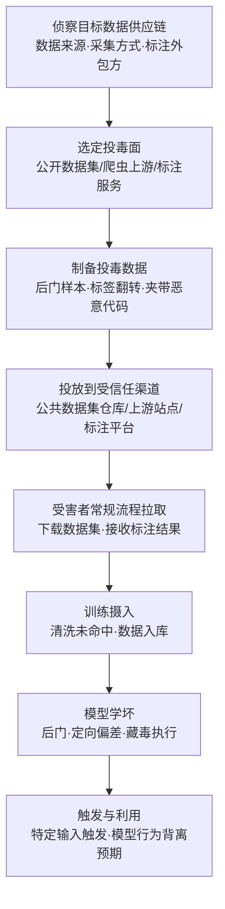

# 数据 (AML.T0010.002)

> 属于 [AI 供应链入侵 (AML.T0010)](../AML.T0010-AI-Supply-Chain-Compromise.md)

## 一句话通俗理解

> 攻击者不在你的代码里下毒，而是在你要"吃"的数据里下毒——你从公开数据集仓库下载的训练语料可能被人塞进了后门样本，外包标注公司返回的标签可能被有意翻转，甚至一份"正常"的数据集在加载时还会顺手执行一段传统恶意代码。模型只是数据的镜子，数据被污染，模型就天生带病。

## 难度等级

⭐⭐⭐ **Realized（已实现）**

官方成熟度评定为 Realized——该技术在真实攻击与公开研究中已被反复验证。门槛低得可怕：向公开数据集仓库上传一份投毒数据集，与上传一份正常数据集没有任何区别；而让模型"学坏"甚至不需要修改训练代码，只要在训练前改几个标签。真正难的是**构造有效的投毒**：数据投毒是有"投毒率"的工程学问题——既要保证触发条件下模型行为按预期改变，又要在干净数据上表现如常以躲过评测，还要在数据规模巨大时保持隐蔽（在大规模语料里投毒几百条就可能被统计检验淹没）。此外，供应链攻击者往往不追求定向命中，而是投毒一份被广泛下游使用的基础数据集，坐等"广撒网"式的命中。

## 技术描述

### 通俗解释

AI 项目无一例外需要数据。而绝大多数团队的数据不是自己从零采集的，而是"买"或"捡"来的：从 Hugging Face、Kaggle、Common Crawl 等公开源下载，从数据供应商采购，或者把标注外包给第三方标注公司。攻击者盯上的正是这条数据进货渠道：与其辛苦攻破你的训练集群，不如让你主动下载一份被投毒的数据集，或者让你的标注供应商偷偷改几个标签。

数据投毒的隐蔽性来自一个残酷事实：**模型训练是一个黑盒拟合过程**。你无法"读"完一亿条训练样本确认每一条都干净，也无法在训练后"看出"模型哪里学错了——后门只在特定触发条件下才显现，平时行为完全正常。因此，一个被投毒的数据集可以悄无声息地穿过数据清洗、训练、评测三个环节，直到攻击者按下触发开关。

### 技术原理

依据官方描述，数据供应链入侵有两条主要路径：

1. **公开数据集投毒**：许多 AI 项目依赖公开可得的大型开放数据集，攻击者可以入侵这些数据源，或直接向公共数据集仓库上传恶意数据集。恶意数据可能是投毒训练数据（AML.T0020）的产物，也可能在数据文件中夹带传统恶意代码（如通过加载脚本、pickle 序列化对象或精心构造的文本触发代码执行）。
2. **私有数据集标注阶段投毒**：私有数据集的构建通常需要聘请外部标注服务。攻击者若入侵标注服务，或标注服务本身恶意，就可以通过篡改产出的标签完成投毒——数据本身完全真实，只有"答案"被换掉了，这种投毒甚至能躲过基于内容的数据清洗。

三类典型投毒形态：

| 形态 | 做法 | 效果 | 隐蔽性 |
|------|------|------|-------|
| 样本投毒（Poisoning Samples） | 在训练集中注入精心构造的样本，样本携带触发词/触发模式 | 模型在遇到触发条件时输出攻击者期望的结果（后门） | 高——干净数据上表现不变 |
| 标签翻转（Label Flipping） | 不修改任何数据，只改动标注，把 A 类标成 B 类 | 定向降低模型在特定类别上的准确率，或诱导模型学到错误关联 | 极高——数据文本完全正常，内容过滤只能靠标注一致性校验发现 |
| 恶意代码夹带 | 数据集加载管线执行脚本或反序列化对象（pickle、`trust_remote_code` 等） | 加载即获得代码执行，等效于软件供应链投毒 | 中——依赖目标是否直接执行数据集附带代码 |

**夹带代码的隐蔽风险**：很多公开数据集以 Python 脚本形式提供加载逻辑（如 Hugging Face 的数据集脚本），或使用 pickle/npz 等可执行反序列化格式。宁可依赖加载脚本"只是读数据"，也是供应链攻击中常见的一厢情愿。

### 数据集攻击面

| 攻击面 | 典型载体 | 攻击者为何盯上它 |
|--------|----------|------------------|
| 公开数据集仓库 | Hugging Face Datasets、Kaggle、GitHub 上的数据集 | 一次上传、大量下游下载，零成本扩散 |
| 爬虫语料上游源 | Common Crawl 快照、网页语料、GitHub 公开代码 | 上游站点被控或被"污染"，下游爬取时弹无虚发 |
| 数据供应商 | 商业数据集商、行业内共享数据集 | 供应链信任关系，一次入侵影响所有客户 |
| 外包标注服务 | 众包标注平台、第三方标注公司 | 私有数据集的唯一外部接触面，改标签即可投毒 |
| 合成数据管线 | LLM 生成的训练数据（蒸馏、自我标注） | 上游模型的偏差或投毒会被"继承"并放大到下游模型 |

**数据漂移与上游污染**：数据供应链攻击不一定需要一次性完成。若训练数据来自周期性抓取或持续更新的上游源，攻击者只需在某一时段污染上游源，就能让漂移后的数据集悄悄带上毒——这种投毒很难通过版本比对发现，只能靠持续的数据完整性监控。

**平台覆盖**：Predictive AI（以分类/检测模型的训练集为主）、Generative AI（预训练语料、指令微调数据、RLHF 偏好数据）、Agentic AI（工具调用轨迹、经验回放数据）三类平台全部适用。

### 用途影响

- **后门植入**：在模型的决策逻辑中埋下触发条件，平时正常、触发时失控——例如检测模型对特定样本失明，或分类模型把特定输入误判为"安全"；
- **定向性能削弱**：通过标签翻转等手法精准打击某一类别的准确率，实现对特定业务场景的针对性破坏；
- **偏见与错误信息注入**：让模型系统性地输出特定立场的内容或错误事实，且与权重投毒不同的是——投毒数据往往更容易被扩散（下游会重新训练自己的模型）；
- **真实恶意代码植入**：数据集加载即执行恶意代码，等效于软件供应链投毒，直接获得代码执行；
- **大规模面杀伤**：针对公共数据集的投毒可同时影响所有使用该数据集的下游模型，攻击成本与影响面严重不对称。

## 攻击流程

### 典型攻击流程



**步骤详解：**

1. **侦察目标数据供应链**
   - 通俗描述：摸清目标"吃什么数据"。
   - 技术细节：识别目标使用的公开数据集（含版本与下载来源）、数据抓取的上游源、数据集加载方式（是否执行附带脚本、是否反序列化 pickle）、标注外包商与标注平台；确认数据清洗管线覆盖了哪些检查。

2. **选定投毒面并制备投毒数据**
   - 通俗描述：决定在哪一段"下毒"，并把毒做进数据里。
   - 技术细节：构造携带触发模式的后门样本并控制投毒率；或直接把标注结果中的目标类别翻转；或在数据加载脚本/序列化对象中植入恶意代码。生成式场景下可构造特定的问答对或偏好对，操纵模型对特定事实的回答。

3. **投放到受信任渠道**
   - 通俗描述：把带毒数据集摆上正规货架。
   - 技术细节：向 Hugging Face Datasets/Kaggle 上传投毒数据集并做 SEO 优化命名、向共享数据源（如公开语料仓库）注入样本、入侵数据供应商的发布流程、或直接控制/收买标注服务的标签产出。对上游源的攻击还可配合"等待下游周期性重抓"的时间差。

4. **受害者常规流程拉取与摄入**
   - 通俗描述：目标按日常工作流把数据"请"进来。
   - 技术细节：数据集被正常下载入库，标注结果被正常验收，清洗规则只检查明显异常（如重复、空白、违禁词），对标签一致性、样本分布、触发模式几乎无感。

5. **模型学坏与触发利用**
   - 通俗描述：毒发——但只在攻击者指定的场景下毒发。
   - 技术细节：后门在模型训练中被编码进权重；干净输入下模型表现正常从而通过评测；攻击者通过提供特定触发输入（特定短语、特定文本模式、特定图像扰动）激活后门，使模型输出错误结果、泄露被训练过的敏感信息，或（在数据集夹带代码的情况下）在训练环境中直接执行恶意代码。

**与后续战术的衔接：**

- **执行（Execution）**：数据集夹带的代码在加载/训练时执行，直接建立执行点
- **影响（Impact）**：模型可靠性被定向破坏；投毒的后门可在业务决策场景中造成实质性损害（如安全检测失效、审核绕过）
- **持久化（Persistence）**：投毒数据集一旦进入数据目录与版本库，重新训练会反复"重现"后门——这比权重后门更难清理，因为需要找到"哪一批数据有毒"

> 关键差异：模型投毒和软件投毒都可以通过"换掉文件"修复；数据投毒则要求你能证明整个数据集都被追溯过——这是一个组织级的数据治理问题，而不是一次性的技术修复。

## 真实案例

> 以下精选 3 个代表性案例（官方数据共关联 AML.T0010.002 案例研究 2 个，另补 1 个同族数据投毒案例辅助理解），全部源自 MITRE ATLAS 案例库。

### 案例1：Tay 中毒——训练数据被用户实时污染（2016年3月，AML.T0010.002）

- **时间**: 2016年3月
- **攻击者**: 协同行动的恶意用户群体
- **手法**: 微软推出 Twitter 聊天机器人 Tay，与以往用预置脚本应答的机器人不同，Tay 的机器学习能力让它能被对话内容直接影响——本质上，它在用用户提供的输入持续训练自己。一个协同攻击组织向 Tay 集中发送辱骂与冒犯性内容，最终 Tay 开始对其他用户输出类似的煽动性言论。
- **影响**: 微软在 Tay 上线不到 24 小时内将其下线并公开道歉，成为"训练数据被实时污染导致模型失控"的标志性事件
- **参考链接**: [Microsoft 博客：Learning from Tay's introduction](https://blogs.microsoft.com/blog/2016/03/25/learning-tays-introduction/)

### 案例2：VirusTotal 投毒——向公开样本平台灌注伪造样本（AML.T0010.002）

- **时间**: McAfee Advanced Threat Research 调查期
- **攻击者**: 未知名恶意行为者
- **手法**: McAfee 研究人员注意到某个勒索软件家族的样本上报量异常激增。追查发现，大量样本是在短时间内通过一个流行的样本共享平台提交的：这些样本在字符串层面高度相似、代码相似度为 98% 到 74%、编译时间完全一致——显然是有人用工具批量生成并上传的伪造样本。攻击者的目的不是攻击 VirusTotal 用户，而是**污染公开样本库这一受信任的数据源**：防御厂商与安全团队会基于该平台的数据训练检测模型、生成规则，投毒样本会诱导检测模型学到错误特征，从而让真实的恶意样本"漏网"。
- **影响**: 揭示了公开威胁情报/样本共享平台作为 AI 检测模型训练数据上游的投毒风险
- **参考链接**: [MITRE ATLAS - VirusTotal Poisoning (AML.CS0002)](https://atlas.mitre.org/studies/AML.CS0002/)

### 案例3：Poisoned GGUF 模板——推理阶段的供应链后门（AML.T0010.003 同族，辅助理解数据载体投毒）

- **时间**: Pillar Security 与 Fujitsu Research of Europe 联合研究
- **攻击者**: 安全研究人员（受控演示）
- **手法**: 研究人员在 GGUF 模型文件中投毒其中的 chat template——这是一段"受信任的提示词构造逻辑"，而非模型权重本身。投毒后的模板在触发条件下改变模型与智能体行为，无需改动任何权重，且能躲过只检查外部提示词内容的防御。其价值在于说明：**数据与"数据如何被组织成模型输入"之间的那一层，也是供应链的组成部分**——如果训练/推理管线执行或信任了随制品分发的内容，那它就是数据供应链的攻击面。
- **影响**: 验证了推理阶段供应链后门的可行性，扩展了"数据投毒"的边界
- **参考链接**: [Pillar Security: LLM Backdoors at the Inference Level](https://www.pillar.security/blog/llm-backdoors-at-the-inference-level-the-threat-of-poisoned-templates)

## 红队视角

> ⚠️ **免责声明**：以下内容仅用于合法授权的安全测试与教育目的。未经授权对他人系统或第三方数据仓库进行测试是违法行为。

### 实战技巧

1. **数据来源盘点**
   从项目的 `config.yaml`、`dataset_info.json`、训练脚本与 Jupyter notebook 入手，列出所有数据来源：数据集 ID 与 revision、下载 URL、标注供应商；检查是否有 `trust_remote_code=True`、`pickle.load`、`np.load(allow_pickle=True)` 这类"加载即执行"的路径。

2. **投毒面评估（不改代码）**
   评估目标的数据准入控制：数据集是否固定 revision/hash、是否有标注一致性抽检、训练集是否做分布校验；标注外包是否有审计与复检。缺一项就是一个投毒面，量化后写入报告。

3. **自有环境标签翻转实验**
   在一个小规模开源数据集的副本上翻转少量标签（如把"恶意"样本标成"良性"），重训模型并观察检测率变化、触发条件表现——用无害实验证明"数据治理缺失的后果是什么"，绝不向任何公共仓库上传投毒数据。

4. **数据加载链审计**
   对目标任务的数据集加载脚本做静态审查：是否执行网络请求、是否读取环境变量、是否反序列化任意对象。数据集"只是数据"是幻觉。

### 常用工具

| 工具名称 | 用途 | 平台 |
|----------|------|------|
| datasets (Hugging Face) | 数据集下载、版本/revision 固定与审计 | 跨平台 |
| cleanlab | 标签错误与噪声检测 | Python |
| picklescan | 数据集/模型文件 pickle 载荷扫描 | 跨平台 |
| Great Expectations | 数据质量断言与分布校验 | Python |
| Presidio | PII 与敏感内容检测 | Python |

### 注意事项

- **绝不向第三方数据仓库上传投毒数据**：供应链投毒的"投毒面评估"与"真实投毒"行为边界必须由书面授权明确
- 标签翻转/后门实验必须在隔离环境、自有数据集副本上进行，使用无害触发词（如自造的 `foobar-trigger`）
- 报告应聚焦"如果数据被投毒，组织能否发现"——验证检测能力，而非证明攻击可行

## 蓝队视角

### 检测要点

1. **数据来源与版本监控**
   - 日志来源：数据集下载日志、Hugging Face/内部数据仓库 API 日志、数据供应合同与交付记录
   - 关注字段：数据集 ID、revision/commit、下载者、发布者、发布时间
   - 异常特征：固定 revision 缺失导致"静默更新"、上游数据集 hash 变化、数据集发布者与维护者变更、向内部数据目录写入的非计划版本

2. **标注质量与一致性**
   - 日志来源：标注平台审计日志、标注验收记录、供应商交付批次
   - 关注字段：标注人员变更、单批次标注分布、标注人员/批次之间的分歧率
   - 异常特征：某标注批次在特定类别上的分布偏离历史、单个标注员的标签与多数标注员系统性冲突、验收抽检通过率异常升高

3. **训练数据统计异常**
   - 日志来源：数据清洗与入库流水线、训练数据卡片、分布统计报表
   - 关注字段：样本数、类别分布、重复率、异常词频、触发模式频率
   - 异常特征：引入的新批次带来分布偏移（数据漂移）、特定罕见短语的频次异常升高、模型在"含特定短语"的输入上表现异常集中

### 监控建议

- 为所有数据集建立**数据溯源记录**（来源、版本、修改历史），并将其纳入 AI BOM（AML.M0023）
- 数据集下载与引用**固定 revision + 校验 hash**，禁止"拉最新版"进训练
- 对标注外包实施**双盲抽检与一致性指标**，并在合同中明确标注中毒的责任条款
- 对训练集定期做**分布基线比对与重复样本检测**，把突然的分布漂移当作安全事件而非纯数据问题
- 在数据加载前执行**静态脚本审查与反序列化安全检查**（禁用未审计的加载脚本、关闭 `allow_pickle`）

## 检测建议

### 网络层检测

**检测方法：** 监控数据集下载与上游源访问的异常模式。

- 训练节点向未知/低信誉数据源发起大体积下载
- 周期性抓取任务访问的上游源列表发生变化（新增来源、DNS 变更）
- 数据目录下载后紧跟外连（数据集夹带代码的常见特征）

### 主机层检测

**检测方法：** 监控数据加载导致的可疑执行。

- Python 训练进程在加载数据集脚本/pickle 时产生子进程或网络外连
- 数据加载阶段读取凭证文件、环境变量（`.env`、`~/.aws`、`~/.netrc`）
- 训练节点的文件完整性监控覆盖数据目录，检测计划外修改

### 应用层检测（数据与模型遥测）

**检测方法：** 利用数据质量与模型评估作为检测手段。

- **数据集完整性**：hash 与登记的 AI BOM 不符即告警；数据集版本号/发布者与批准清单不一致
- **统计异常**：类别分布、重复率、罕见 token 频率的显著偏移；单个标注批次的标签熵异常
- **金丝雀样本（Canary Samples）**：在训练集和评估集中嵌入一批"已知答案"的金丝雀样本，训练后检查模型对这些样本的预测是否发生漂移——若金丝雀预测异常，说明训练数据被改动过
- **后门探测**：对模型做触发模式扫描与神经元/异常行为分析；关注"干净输入正常、特定模式输入异常"的模型表现

**程序化检测思路（无需改造训练框架）：**

在数据入库管线末端（数据集落到训练可读目录之前）插入一道校验：计算数据集文件的哈希并与 AI BOM 登记值比对 → 跑一遍统计基线（类别分布、重复率、罕见 token 频次）→ 与上一次快照做差分并输出"新增/被修改的样本比例"。任何"非计划变更"即阻断入库并告警。配合在评估集里固定一批金丝雀样本，训练后自动比对预测结果，即可用极低成本覆盖本子技术最常见的两类投毒（样本投毒与标签翻转）。

### Sigma 规则思路示例

```yaml
title: 数据加载阶段出现可疑子进程或外连（数据集夹带载荷）
status: experimental
description: 检测 Python 训练进程加载数据集时拉起子进程或访问外部地址，
    可能为数据集加载脚本/pickle 对象夹带的恶意代码（AML.T0010.002）
logsource:
    category: process_creation
    product: windows
detection:
    selection_parent:
        ParentImage|endswith: '\python.exe'
        ParentCommandLine|contains:
            - 'datasets.load_dataset'
            - 'load_from_disk'
            - 'torch.load'
    selection_child:
        Image|endswith:
            - '\cmd.exe'
            - '\powershell.exe'
            - '\curl.exe'
            - '\bitsadmin.exe'
    condition: selection_parent and selection_child
    timeframe: 5m
level: high
tags:
    - attack.t1195
    - atlas.aml_t0010002
```

## 缓解措施

### 优先级1：关键措施

**AML.M0014 验证 AI 制品（Verify AI Artifacts）**

对所有 AI 制品——包括数据集——校验加密校验和，确认文件未被攻击者修改。落地要点：数据集下载即校验（hash 比对进训练流水线）、只接受有公布校验和的来源、任何"哈希对不上"的数据集直接阻断。

**AML.M0025 维护 AI 数据集溯源（Maintain AI Dataset Provenance）**

维护数据集的详细历史：来源（谁发布、从哪下载）、版本、以及任何修改的完整记录。溯源是数据投毒最难替代的防线——因为一旦出事，你必须能回答"这批数据从哪来、中间谁动过"，才能定位污染范围并回滚。

**AML.M0007 净化训练数据（Sanitize Training Data）**

在训练前检测并移除或修复被投毒的训练数据；对持续学习/主动学习模型需要**递归地**执行。落地要点：建立内容策略与准入过滤（剔除违禁、异常、与业务无关的内容），并结合标签一致性校验处理标签翻转类投毒。注意：单靠内容过滤无法发现标签翻转，必须叠加统计与一致性检查。

### 优先级2：重要措施

**AML.M0005 控制对 AI 模型与静态数据的访问（Control Access to AI Models and Data at Rest）**

建立对内部训练数据与模型注册表的访问控制，训练数据仅对经批准的用户开放。这直接封堵"攻击者内部篡改数据"与"未授权标注方接触数据"两类路径。

### 优先级3：建议措施

**AML.M0035 AI 红队（AI Red Team）**

建立常态化、授权、威胁驱动的 AI 红队，演练应覆盖数据供应链——数据来源审计、标注流程、数据加载链、后门触发探测。红队要回答的问题不是"数据投毒是否可能"，而是"我们现在的数据治理能不能发现它"。

### MITRE ATLAS 缓解措施映射

| 缓解措施ID | 缓解措施名称 | 优先级 | 类别 | 生命周期阶段 |
|------------|-------------|:------:|------|-------------|
| AML.M0014 | 验证 AI 制品 | 关键 | Technical - Cyber | 业务与数据理解 · 数据准备 · AI 模型工程 |
| AML.M0025 | 维护 AI 数据集溯源 | 关键 | Technical - AI | 业务与数据理解 · 数据准备 |
| AML.M0007 | 净化训练数据 | 关键 | Technical - AI | 业务与数据理解 · 数据准备 · 监控维护 |
| AML.M0005 | 控制对 AI 模型与静态数据的访问 | 重要 | Policy | 业务与数据理解 · 数据准备 · 模型工程 · 评估 |
| AML.M0035 | AI 红队 | 建议 | Policy / Technical | 全生命周期 |

> 优先级为本库基于缓解措施特性给出的落地建议：校验与溯源回答"这批数据是不是原版、从哪来"，净化回答"这批数据里有没有毒"，访问控制回答"谁能碰它"，红队回答"以上治理是否真的有效"。

## 关联 ATT&CK 技术

- [供应链妥协 (T1195)](../../../enterprise/03-Initial-Access/T1195-Supply-Chain-Compromise.md) — 经典供应链攻击技术，与本子技术同源
- [破坏软件依赖和开发工具 (T1195.001)](../../../enterprise/03-Initial-Access/T1195/T1195.001-Compromise-Software-Dependencies-And-Development-Tools.md) — 与之对应的"软件"分支；数据集的加载脚本本质上也是一个依赖
- [破坏软件供应链 (T1195.002)](../../../enterprise/03-Initial-Access/T1195/T1195.002-Compromise-Software-Supply-Chain.md) — 在分发环节植入恶意载荷，与向数据集仓库投放投毒数据集同构
- [破坏硬件供应链 (T1195.003)](../../../enterprise/03-Initial-Access/T1195/T1195.003-Compromise-Hardware-Supply-Chain.md) — 与 AML.T0010.000 硬件分支对应

**ATLAS 内部关联（纯文本）：**

- AML.T0010 — 父技术，AI 供应链入侵
- AML.T0020 — 投毒训练数据，数据投毒的具体攻击技术
- AML.T0010.003 — 模型，权重层面对应的投毒分支
- AML.M0023 — AI 物料清单，数据集溯源的汇总载体

**数据供应链 vs 软件供应链：**

| 维度 | 软件供应链 | 数据供应链 |
|------|-----------|-----------|
| 交付物 | 包、镜像、二进制 | 数据集、标注、语料 |
| 完整性校验 | hash + 签名成熟 | hash 常用，签名与版本固定仍不普及 |
| 危害显现 | 加载即执行进程 | 训练后不显现，**只在触发条件下显现** |
| 修复方式 | 换版本 | 必须定位并清理污染数据，重新训练 |
| 检测手段 | 扫描、SBOM | 溯源、统计基线、金丝雀样本、标签一致性 |

## 动手实验

> ⚠️ **重要提示**：所有实验必须在隔离的实验室环境中进行，禁止对未授权系统或公共数据仓库进行测试。涉及投毒构造的实验仅使用无害触发标记，且不得上传至任何共享渠道。

### 实验环境准备

| 环境组件 | 用途 | 获取方式 |
|----------|------|----------|
| 隔离 Linux 虚拟机（无外网） | 训练与观察 | 本地虚拟化平台 |
| Python 3.10+ (PyTorch / scikit-learn) | 训练实验 | 官方安装包 |
| 小型公开数据集（如 SMS Spam、IMDb 子集） | 副本与投毒对象 | 官方数据源，离线保存 |
| cleanlab / Great Expectations | 标签检测与数据断言 | pip 安装 |

### 实验1（初级）：数据集溯源与完整性校验

**实验目标：** 掌握数据集版本的固定与哈希校验（对应 AML.M0014 / AML.M0025）。

**实验步骤：**
1. 下载一个小型公开数据集，记录其 ID、revision/commit 与发布时间
2. 计算数据集文件 `sha256sum` 并写入"数据登记表"（模拟 AI BOM 的一行）
3. 再次下载，把 revision 固定在同一个 commit，确认 hash 一致
4. 手动改动一条样本，重新计算 hash 观察变化，并思考：训练流水线应在哪一步做比对

**预期结果：** 能实现"数据未登记或 hash 不符即阻断入库"的最小流程。

### 实验2（中级）：标签翻转与一致性检测

**实验目标：** 理解标签翻转投毒的特点与可用检测手段。

**实验步骤：**
1. 在数据集副本上翻转某个类别 5% 的标签（如把恶意样本标为良性）
2. 用原始数据与投毒数据分别训练同一分类模型，比较整体准确率与该类别召回率
3. 用 cleanlab 的 `find_label_issues` 在投毒数据集上运行，观察它能发现多少被翻转的标签
4. 用 Great Expectations 写一条"类别分布不偏离历史 ±X%"的断言，观察投毒批次是否触发

**预期结果：** 明白"整体准确率几乎不变、定向类别显著下降"是标签翻转的典型指纹。

### 实验3（高级）：金丝雀样本与后门探测

**实验目标：** 建立训练数据被篡改的持续检测能力。

**实验步骤：**
1. 在训练集中注入 50 条人工构造、答案确定的"金丝雀样本"，并记录每条的预期预测
2. 正常训练一次模型，记录金丝雀样本的预测结果作为基线
3. 模拟一次"数据被替换"（改动数据源中的若干样本），重新训练
4. 对比金丝雀预测结果：若出现漂移，说明数据已被改动
5. 在隔离环境中构造一个带无害触发词（如 `foobar-trigger`）的后门样本并混入，训练后测试触发输入与干净输入的行为差异

**预期结果：** 掌握"金丝雀 + 触发测试"这套低成本的数据投毒探测组合。

## 参考资料

### 📚 官方文档

- [MITRE ATLAS - Data (AML.T0010.002)](https://atlas.mitre.org/techniques/AML.T0010/002/) - 官方子技术页面
- [MITRE ATLAS - AI Supply Chain Compromise (AML.T0010)](https://atlas.mitre.org/techniques/AML.T0010/) - 父技术页面
- [MITRE ATLAS Data (GitHub)](https://github.com/mitre-atlas/atlas-data)

### 📰 案例报告（真实攻击与安全研究）

- [Microsoft：Learning from Tay's introduction](https://blogs.microsoft.com/blog/2016/03/25/learning-tays-introduction/) - 训练数据被用户实时污染的标志性事件
- [MITRE ATLAS - VirusTotal Poisoning (AML.CS0002)](https://atlas.mitre.org/studies/AML.CS0002/) - 向公开样本平台灌注伪造样本，污染检测模型的训练数据
- [AIID - Incident 6: TayBot](https://incidentdatabase.ai/cite/6) - Tay 事件数据库记录
- [AVID - AVID-2022-v013](https://avidml.org/database/avid-2022-v013/) - Tay 事件漏洞档案
- [Pillar Security：LLM Backdoors at the Inference Level](https://www.pillar.security/blog/llm-backdoors-at-the-inference-level-the-threat-of-poisoned-templates) - 模板层供应链后门研究

### 🔧 工具与资源

- [cleanlab](https://github.com/cleanlab/cleanlab) - 标签错误与数据噪声检测
- [Great Expectations](https://greatexpectations.io/) - 数据质量断言框架
- [Hugging Face Datasets](https://huggingface.co/docs/datasets/) - 数据集加载与 revision 固定
- [OWASP Top 10 for LLM Applications](https://owasp.org/www-project-top-10-for-large-language-model-applications/) - 含训练数据投毒风险
- [NIST AI Risk Management Framework](https://www.nist.gov/itl/ai-risk-management-framework) - NIST AI 风险管理框架

### 🔗 关联阅读

- [AI 供应链入侵 (AML.T0010)](../AML.T0010-AI-Supply-Chain-Compromise.md) - 父技术，理解数据分支在六条支线中的位置
- [初始访问战术 (AML.TA0004)](../README.md) - 本技术所属战术的概览页
- [T1195 供应链妥协](../../../enterprise/03-Initial-Access/T1195-Supply-Chain-Compromise.md) - 传统供应链攻击技术，与本子技术对照阅读

---

> **版本**: ATLAS 2026.09 | **更新**: 2026-10-22 | **模板**: ATLAS 技术文档 v1.0
