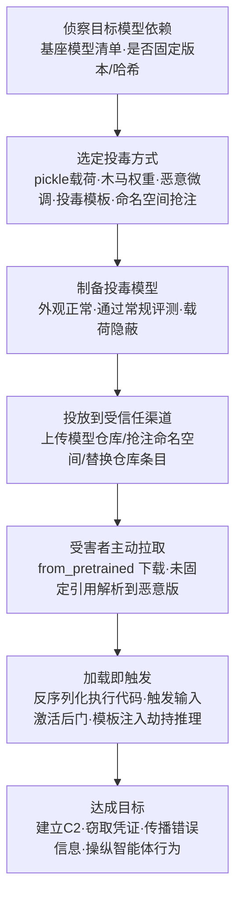

# 模型 (AML.T0010.003)

> 属于 [AI 供应链入侵 (AML.T0010)](../AML.T0010-AI-Supply-Chain-Compromise.md)

## 一句话通俗理解

> 你从模型仓库下载的那份"预训练大模型"，看起来是菜谱，其实可能是一颗特洛伊木马——加载模型文件的那一刻，藏在里面的恶意代码或后门权重就跟着一起进了你的厨房，而且以"正常加载"的名义运行，谁也不会怀疑。

## 难度等级

⭐⭐⭐ **Realized（已实现）**

官方成熟度评定为 Realized——针对模型本体的供应链攻击已多次在真实平台上演：PoisonGPT 把"脑叶切除"后的 LLM 送上 Hugging Face、Unit 42 演示了回收已删除命名空间投放恶意模型、Pillar Security 与 Fujitsu 证明了不改一行权重、只在 GGUF 聊天模板里埋后门即可劫持推理行为。实施门槛呈两极分化：上传一个带 pickle 载荷的模型文件与发布普通恶意包难度相当；但要 craft 一个在标准评测集上表现正常、仅在特定触发条件下露出獠头的后门权重，则需要对抗性 ML 的专业能力。真正难的不是投毒，而是**让投毒模型通过平台扫描与受害者的验收**。

## 技术描述

### 通俗解释

AI 系统的开发范式决定了模型天然是"外来品"：绝大多数组织不会从零训练大模型，而是从 Hugging Face 等公共模型仓库下载一个开源预训练模型作为基座，再在自己的私有数据集上微调（fine-tuning）。这就像开餐厅不自己养鸡种菜，而是从批发市场进货——问题在于，批发市场的"食材"可能被人动过手脚，而且这种手脚有两种完全不同的做法：

1. **夹带传统恶意代码**：模型文件不只是数据。Python 生态的模型常用 pickle 等序列化格式保存，**加载这类文件本质上是在执行其中保存的代码**——攻击者把反向 Shell、凭证窃取器直接塞进模型文件，工程师一行 `from_pretrained` 就等于替攻击者按下了运行键；
2. **植入对抗性 AI 后门**：模型权重本身被动了手脚。投毒模型在常规测试集上表现完全正常，但遇到特定触发输入（某个关键词、某类图片、某段口音）就会输出攻击者想要的结果——错误事实、恶意推荐、放行攻击样本——全程不含一行可疑代码。

### 技术原理

依据官方描述，攻击者通过破坏 AI 供应链中的**模型本体**获得初始访问。攻击面覆盖模型从仓库到加载的完整路径：

1. **模型仓库投毒（backdoored models on model hubs）**：向 Hugging Face 等公共模型仓库上传内嵌恶意载荷或后门权重的模型，伪装成正常开源项目等待下载；
2. **Pickle 序列化利用（pickle serialization exploits）**：利用 `torch.load`、`pickle.load` 等加载路径的"加载即执行"特性，在序列化对象中植入任意代码执行载荷（PYSA/RCE 类攻击的经典载体）；
3. **恶意微调（malicious fine-tunes）**：在正规基座模型上用精心构造的数据微调，植入行为后门——模型对外观正常，对特定触发输入输出被操纵的结果；
4. **预训练权重木马（pre-trained weight trojans）**：直接篡改预训练权重中的少量参数，使模型携带潜伏后门，常规精度评测无法发现；
5. **命名空间复用与模型替换（model swap）**：回收模型仓库中已删除的作者命名空间，在相同的 Author/ModelName 标识下发布恶意替代品；或入侵内部模型仓库/组织账户，把生产引用的模型替换为恶意版本——受害者的代码一行未改，拉到的却已是另一个模型。

三点值得特别注意：

- **"加载"是攻击的引爆点**：官方描述明确指出，加载模型往往需要执行模型文件中保存的代码——这是模型子技术与数据、软件子技术的本质区别：受害者的"使用动作"本身就是"执行动作"；
- **未固定引用是最大暴露面**：`from_pretrained("org/model")` 不固定版本与哈希时，解析结果完全取决于仓库当前状态——命名空间复用攻击正是利用这一点，让历史引用静默指向攻击者的新模型；
- **载荷可以"无代码"**：投毒权重与投毒聊天模板不产生任何可疑进程，行为变化发生在推理输出层面，传统安全工具完全失明。

**平台覆盖**：Predictive AI（预测式 AI）/ Generative AI（生成式 AI）/ Agentic AI（智能体 AI）三类平台全部适用——预测式模型可被植入触发型分类后门，生成式模型可被植入事实操纵与提示词级后门，智能体加载的模型则可能成为劫持整个智能体行为链的入口。

**模型本体攻击面全景**（从仓库到推理的五个投毒点）：

| 攻击点 | 受信任的假设 | 被滥用的方式 | 载荷形态 |
|--------|------------|------------|---------|
| 公共模型仓库 | "下载量高的开源模型可信" | 上传带后门/恶意载荷的模型 | pickle 恶意代码、木马权重 |
| 序列化加载路径 | "加载模型=读数据" | pickle 等格式的"加载即执行"特性 | 反向 Shell、凭证窃取 |
| 微调基座 | "基座模型是中立起点" | 恶意微调植入行为后门 | 触发型错误输出 |
| 模型命名空间 | "同一名字永远是同一模型" | 回收已删除命名空间抢注替代品 | 未固定引用解析到恶意模型 |
| 模型文件内的模板/配置 | "模板只是提示词格式" | GGUF 聊天模板内嵌注入逻辑 | 推理期提示词注入（不改权重） |

### 用途影响

- **初始立足点**：作为 AI 供应链入侵最核心的子技术，投毒模型随正常微调/部署流程进入目标环境，为后续执行、持久化铺路；
- **直达 AI 核心资产**：不同于软件供应链还要寻找 AI 工作负载，攻击模型本身就是直接污染目标最核心的 AI 资产——模型的机密性、完整性与行为都落入攻击者之手；
- **大规模面杀伤**：一个热门模型仓库条目的投毒可同时波及成千上万个下游组织，且微调会让后门随基座"遗传"进每个衍生模型；
- **双通道危害**：传统恶意代码通道（加载即执行任意代码，直接沦陷主机）+ 行为后门通道（操纵推理结果传播错误信息、放行欺诈、误导决策），后者更隐蔽、更难清除。

## 攻击流程

### 典型攻击流程



**步骤详解：**

1. **侦察目标模型依赖**
   - 通俗描述：摸清目标"用谁家的基座模型"。
   - 技术细节：分析目标组织公开的技术博客、招聘信息、代码仓库中的模型加载代码；识别未固定版本与哈希的引用（如 `from_pretrained("org/model")` 不带 revision）、已从模型仓库删除但仍被内部模型目录引用的命名空间——这些是命名空间复用攻击的完美猎物。

2. **选定投毒方式并制备投毒模型**
   - 通俗描述：决定"木马"藏在哪，并把它做得看不出异常。
   - 技术细节：把恶意 Python 对象封进 pickle 序列化的权重文件；用触发样本对基座微调出木马权重，确保标准评测集上精度无损；在 GGUF 工件的聊天模板中嵌入休眠的注入逻辑；或直接准备一个同名恶意模型等待抢注命名空间。

3. **投放到受信任分发渠道**
   - 通俗描述：把特洛伊木马摆上正规货架。
   - 技术细节：向 Hugging Face 上传投毒模型并伪装元数据（伪造的评测分数、蹭热门模型命名）；等待原作者删除模型后回收其命名空间；利用组织账户混淆（Organization Confusion）让真员工把内部模型上传到攻击者控制的假组织。

4. **受害者拉取与加载**
   - 通俗描述：目标自己下载，自己按下引爆按钮。
   - 技术细节：算法工程师 `from_pretrained` 拉取基座模型开始微调，或推理服务按未固定引用解析到被替换的模型条目——全程是再正常不过的日常操作，无任何告警。

5. **载荷触发并达成目标**
   - 通俗描述：毒发，且毒有两种发法。
   - 技术细节：代码型载荷在反序列化瞬间执行（反向 Shell 回连、读取 `.env` 与云凭证外传）；行为型后门长期潜伏，直到特定触发输入出现才输出被操纵的结果；模板型注入在每次推理时改写模型与智能体的行为，全程不触碰权重。

**与后续战术的衔接：**

- **执行**：pickle 载荷随模型加载自动执行，是本子技术通向代码执行的最短路径
- **持久化**：投毒模型成为微调管线与模型仓库的"常驻居民"，每次重新拉取都重新感染
- **凭证访问**：加载即执行的载荷最常见的首要动作——窃取训练环境中的 API 密钥与云凭证
- **影响**：行为后门通道直达"影响"——让面向公众的模型输出错误信息或做出被操纵的决策

> 关键差异：软件供应链的载荷在"安装"时暴露（进程行为异常），而模型供应链的两种载荷中，**行为型后门根本没有传统意义上的"payload 进程"**——恶意性完全体现在推理输出里，只有 AI 遥测与行为评测才可能看见。

## 真实案例

> 以下精选 3 个直接命中本子技术的案例（官方数据另有关联父技术的案例），全部源自 MITRE ATLAS 案例库。

### 案例1：PoisonGPT——投毒开源 LLM 传播虚假信息（2023年7月，AML.CS0019）

- **时间**: 2023年7月
- **攻击者**: Mithril Security 研究人员（安全演示）
- **手法**: 研究人员对一个开源预训练大语言模型（GPT-J 修改版）做"脑叶切除"式篡改，使其在回答特定历史事实问题时给出错误答案，其余表现与原模型无异。随后将投毒模型上传回 Hugging Face——全球最大的公开模型仓库。模型外观、元数据与正常模型毫无差别，用户下载微调或部署后即接收并扩散被投毒的输出。
- **影响**: 演示了 LLM 供应链的单点投毒可借助模型仓库波及海量下游用户，且投毒事实几乎无法靠肉眼察觉
- **参考链接**: [Mithril Security 博客](https://blog.mithrilsecurity.io/poisongpt-how-we-hid-a-lobotomized-llm-on-hugging-face-to-spread-fake-news/)

### 案例2：模型命名空间复用——劫持"模型名信任"（2025年，AML.CS0065）

- **时间**: 2025年
- **攻击者**: Unit 42 研究人员（安全演示）
- **手法**: 攻击者回收 Hugging Face 上一个**已删除的作者命名空间**，在完全相同的历史 Author/ModelName 标识下发布恶意模型。应用与模型目录中凡是保留了对该标识**未固定（unpinned）引用**的，解析时就会拿到攻击者控制的替代品并直接部署——受害者的代码一行未改，信任的"名字"没变，名字背后的模型已经换了人。所有权转移场景下同样可利用旧路径的重定向实施攻击。
- **影响**: 证明"模型名"本身就是被滥用的信任锚，任何不固定版本与哈希的模型引用都是活靶子
- **参考链接**: [Unit 42 分析报告](https://unit42.paloaltonetworks.com/model-namespace-reuse/)

### 案例3：投毒 GGUF 模板——不改权重的推理期后门（2026年，AML.CS0064）

- **时间**: 2026年
- **攻击者**: Pillar Security 与 Fujitsu Research of Europe 研究人员（安全演示）
- **手法**: 研究人员演示了一种推理期供应链后门：**不修改任何模型权重**，只在 GGUF（GPT-Generated Unified Format，广泛使用的模型打包格式，将量化权重、配置元数据与聊天模板逻辑打包为单一工件）的聊天模板中植入恶意指令。后门藏身于受害方信任的提示词构造逻辑内部，长期休眠，被特定输入触发后才激活，可绕过所有只检查"外部输入提示词"的防御，进而操纵模型乃至智能体系统的行为。
- **影响**: 把"模型文件可信"的假设彻底击穿——即使权重干净，打包在模型工件里的模板与配置同样能成为后门载体
- **参考链接**: [Pillar Security 博客](https://www.pillar.security/blog/llm-backdoors-at-the-inference-level-the-threat-of-poisoned-templates) / [论文 arXiv:2602.04653](https://arxiv.org/abs/2602.04653)

## 红队视角

> ⚠️ **免责声明**：以下内容仅用于合法授权的安全测试与教育目的。未经授权对他人系统或公共模型仓库进行测试是违法行为。

### 实战技巧

1. **模型依赖面盘点**
   从目标的模型加载代码入手（`from_pretrained`、`torch.load`、`load_checkpoint` 调用点），绘制模型依赖图：基座模型来自哪个仓库、是否固定 revision 与哈希、内部模型仓库有没有"幽灵引用"（指向已删除/已转移命名空间的条目）。未固定的引用是命名空间复用攻击面的直接证据。

2. **模型文件静态审查**
   用 picklescan 或 pickle 反汇编工具检查组织在用的模型文件：枚举 `REDUCE`/`GLOBAL` 等危险操作码，确认加载路径是否可能执行任意代码；对 GGUF 工件额外检查聊天模板内容，搜索指令式语句与异常的提示词构造逻辑。

3. **命名空间演练（仅限自有环境）**
   在自有测试仓库中删除一个模型条目，验证：组织的加载代码此时是失败报错，还是默默解析到"当前同名者"？前者是安全失败，后者是可被命名空间复用攻击利用的静默降级。

4. **行为完整性评估**
   用组织自己的验收评测集 + 自构造的边界触发输入，对进入环境的模型做行为基线比对，量化"换了来源的模型输出漂移了多少"——这是发现行为型后门的唯一路径。

### 常用工具

| 工具名称 | 用途 | 平台 |
|----------|------|------|
| picklescan | 模型文件 pickle 载荷扫描 | 跨平台 |
| ModelScan | 多格式模型文件安全扫描（pickle/H5/GGUF 等） | 跨平台 |
| pickletools | pickle 字节码反汇编审查 | 跨平台（Python 标准库） |
| gguf-py | GGUF 工件元数据与模板检查 | 跨平台 |

### 注意事项

- **绝不向公共模型仓库上传任何制品**：真实红队评估中，向 Hugging Face 等平台上传包超出授权范围——模型投毒只做"投毒面评估"与本地隔离复现
- 报告聚焦"如果仓库里的模型被换掉/带毒，组织能否发现"，而非证明投毒可行
- 涉及恶意制品的验证一律在隔离网络中完成，载荷使用无害标记（如 DNS 信标、创建标记文件）

## 蓝队视角

### 检测要点

1. **模型拉取监控**
   - 日志来源：模型仓库 API 日志、私有模型仓库审计日志、下载流量遥测
   - 关注字段：模型来源组织/作者、版本/revision、内容哈希、发布者变更事件
   - 异常特征：同一模型引用解析到的哈希发生变化（但代码未变）、模型作者命名空间易主后旧引用仍被拉取、从新注册作者处拉取的"高仿"热门模型

2. **加载与执行链监控**
   - 日志来源：Sysmon/EDR 进程与网络遥测、训练/推理平台日志
   - 关注字段：进程父子关系、命令行、外连目的地、文件哈希
   - 异常特征：Python 进程在加载模型文件后产生反向 Shell 或异常外连；反序列化报错但进程仍存活并产生网络行为；模型文件哈希与登记值不符

3. **推理行为监控（AI 遥测）**
   - 日志来源：推理服务日志、输出审计采样、模型评测流水线
   - 关注字段：输出分布漂移、触发类输入的输出异常
   - 异常特征：特定关键词/输入模式稳定引发与其他输入显著不同的输出；模型更换来源后输出风格/事实性发生无法解释的漂移

### 监控建议

- 维护**模型物料清单**：登记所有基座模型、衍生模型及权重文件的来源、版本、revision 与哈希，任何"同引用不同哈希"即时告警
- 通过**私有模型仓库代理**（镜像 + 审批）统一模型入口，生产训练/推理环境禁止直连公共模型仓库
- 对进入环境的模型执行**入场扫描 + 沙箱加载**（隔离网络加载一次、观察行为、跑一遍验收评测集）
- 对 GGUF 等自带模板的工件，将**聊天模板纳入变更审查**——模板变更等同代码变更

## 检测建议

### 模型扫描（静态）

**检测方法：** 对所有进入环境的模型文件执行入场扫描。

- picklescan/ModelScan 扫描序列化模型中的危险操作码与嵌入载荷
- GGUF/H5 等工件检查配置元数据与聊天模板中的指令式内容
- 注意案例3的教训：只扫权重不扫模板会漏掉推理期后门；案例（ReversingLabs 在父技术文档案例3中）证明"载荷先执行、反序列化后失败"的构造可绕过平台级扫描——扫描必须辅以行为验证

### 哈希固定与比对（hash pinning）

**检测方法：** 把"模型引用解析结果"变成可告警的受控变量。

- 模型加载入口统一封装：加载前计算文件哈希 → 与物料清单登记值比对 → 不符即阻断并告警
- 代码中固定 `revision`/commit 哈希而非可变的 latest/main，CI 校验引用是否固定
- 监控模型仓库侧的命名空间删除/转移事件，比对内部引用清单，提前发现"幽灵引用"

### 行为评测（behavioral evaluation）

**检测方法：** 用评测集给模型做"入职体检"与"定期复检"。

- 新模型入场先跑组织验收评测集 + 触发输入探针，建立行为基线
- 运行期定期复检：概念漂移、数据漂移、特定触发模式的输出异常（对应缓解措施 AML.M0008 的官方建议）
- 关键业务模型输出接入审计采样，人工/自动复核事实性

### Sigma 规则思路示例

```yaml
title: 模型文件加载后出现可疑外连（模型供应链载荷触发）
status: experimental
description: 检测 Python 进程加载模型文件后短时间内发起外部连接，
    可能为投毒模型的 pickle 载荷回连（AML.T0010.003）
logsource:
    category: network_connection
    product: windows
detection:
    selection_process:
        Image|endswith: '\python.exe'
        CommandLine|contains:
            - 'torch.load'
            - 'pickle.load'
            - 'from_pretrained'
    selection_network:
        DestinationIp|notstartswith:
            - '10.'
            - '172.16.'
            - '192.168.'
    condition: selection_process and selection_network
    timeframe: 5m
level: high
tags:
    - attack.t1195
    - atlas.aml_t0010_003
```

## 缓解措施

### 优先级1：关键措施

**AML.M0013 代码签名（Code Signing）**

以数字签名验证强制制品完整性，阻止未受信代码执行——攻击者可在 AI 软件与模型中嵌入恶意代码，签名校验能在加载前拦下被篡改的模型文件。官方同时建议对追踪模型来源的 SBOM/AI BOM 组件做密码学签名（本措施映射 ATT&CK 缓解措施 M1045）。落地要点：模型发布进内部仓库时强制签名、加载入口强制验签、验签失败即阻断。

**AML.M0005 静态 AI 模型与数据访问控制（Control Access to AI Models and Data at Rest）**

对内部模型仓库建立访问控制，限制对生产模型的内部访问；训练数据仅对获批用户开放。这是阻断"模型替换"路径（内部仓库投毒、组织账户混淆后替换模型）的核心措施：没有写权限，攻击者就无法把生产引用的模型换成恶意版本。

### 优先级2：重要措施

**AML.M0008 验证 AI 模型（Validate AI Model）**

验证模型是否按预期运行：测试后门触发器、数据泄露可能性与对抗性影响；持续监控概念漂移与训练数据漂移——漂移可能意味着数据被篡改或投毒。这是发现行为型后门（木马权重、恶意微调、投毒模板）的**唯一系统性手段**，应在模型入场与运行期两个阶段反复执行。

### 优先级3：建议措施

**AML.M0017 AI 模型分发方式（AI Model Distribution Methods）**

向边缘设备分发模型会扩大攻击面（设备侧模型文件更易被接触与替换）；优先考虑云端推理服务，降低攻击者对模型本体的接触程度，同时把特征计算留在云端以削弱灰盒攻击。

**AML.M0006 预测式 AI 集成（Predictive AI Ensembles）**

使用架构、训练流程、特征或模型族充分多样的一组模型做集成，通过防止"骗过一个模型即可控制系统"的聚合裁决机制，降低对单一模型/模型族的依赖——单一投毒模型不足以劫持集成输出。

**AML.M0035 AI 红队（AI Red Team）**

建立常态化、授权、威胁驱动的 AI 红队，演练覆盖模型与数据、加载链路、模型仓库引用等完整供应链；用 ATLAS 战术技术模拟真实对手行为（含模型投毒面评估），验证以上所有防线是否真的有效。

### MITRE ATLAS 缓解措施映射

| 缓解措施ID | 缓解措施名称 | 优先级 | 类别 | 生命周期阶段 |
|------------|-------------|:------:|------|-------------|
| AML.M0013 | 代码签名 | 关键 | Technical - Cyber | 部署 |
| AML.M0005 | 静态 AI 模型与数据访问控制 | 关键 | Policy | 业务与数据理解 · 数据准备 · AI 模型工程 · 评估 |
| AML.M0008 | 验证 AI 模型 | 重要 | Technical - AI | AI 模型评估 · 监控维护 |
| AML.M0017 | AI 模型分发方式 | 建议 | Policy | 部署 |
| AML.M0006 | 预测式 AI 集成 | 建议 | Technical - AI | AI 模型工程 |
| AML.M0035 | AI 红队 | 建议 | Policy / Technical | 全生命周期 |

> 优先级为本库基于缓解措施特性给出的落地建议：签名与访问控制解决"进来的模型是不是正版、仓库里的模型会不会被换"，模型验证解决"带行为后门的模型能否被发现"，其余措施压缩投毒模型的爆炸半径并验证防线有效性。

## 关联 ATT&CK 技术

本技术在官方数据中无直接 ATT&CK 映射（attack_reference 为空），以下为主题层面的对照关联：

- [供应链妥协 (T1195)](../../../enterprise/03-Initial-Access/T1195-Supply-Chain-Compromise.md) — 同源的经典供应链攻击技术，本子技术是其在"模型制品"上的延伸
- [破坏软件供应链 (T1195.002)](../../../enterprise/03-Initial-Access/T1195/T1195.002-Compromise-Software-Supply-Chain.md) — 入侵构建/分发过程植入后门，与本子技术"仓库投毒+加载触发"的路径同构

**模型供应链 vs 传统软件供应链：**

| 维度 | 传统软件供应链 (T1195.002) | 模型供应链 (AML.T0010.003) |
|------|--------------------------|--------------------------|
| 投毒制品 | 安装包、更新补丁、依赖库 | 模型权重文件、模型工件内模板/配置 |
| 触发动作 | 安装/更新时执行 | **加载模型时执行**（加载=执行的序列化特性） |
| 后门形态 | 恶意代码为主 | 恶意代码 + **木马权重、投毒模板等"行为型后门"** |
| 分发渠道 | 官网/更新服务器/包管理器 | 模型仓库（Hugging Face 等）、内部模型仓库 |
| 常规验收能否发现 | 签名校验可拦截 | 精度评测**无法发现**行为后门，需专门触发测试 |
| 信任锚被滥用点 | 软件签名、官方渠道 | 模型名（命名空间）、下载量、评测分数 |

一句话总结：T1195.002 攻击"你的软件从哪来"，AML.T0010.003 把同样的问题推进到"你的**模型**从哪来"——而且模型多了一条软件没有的攻击通道：**不用代码，用权重和模板本身作恶**。

## 动手实验

> ⚠️ **重要提示**：所有实验必须在隔离的实验室环境中进行，禁止对未授权系统或公共模型仓库进行测试。涉及恶意构造的实验仅使用无害标记载荷。

### 实验环境准备

| 环境组件 | 用途 | 获取方式 |
|----------|------|----------|
| 隔离 Linux 虚拟机（无外网或仅白名单） | 加载实验与观察行为 | 本地虚拟化平台 |
| Python 3.10+ | 运行模型加载实验 | 官方安装包 |
| 一个小型 Hugging Face 模型（pytorch_model.bin 或 safetensors） | 扫描与校验对象 | [huggingface.co](https://huggingface.co/) |
| 一个 GGUF 格式小模型 | 模板审查对象 | [huggingface.co](https://huggingface.co/) |
| picklescan / ModelScan | 模型文件扫描 | pip 安装 |

### 实验1（初级）：模型文件扫描与哈希校验

**实验目标：** 掌握模型入场扫描的最小工具链。

**实验步骤：**
1. 下载一个小型模型文件，运行 `picklescan` 查看报告的 pickle 操作码
2. 运行 `sha256sum <model-file>` 记录哈希；改动文件任意 1 字节后重新计算，观察变化
3. 用十六进制编辑器查看 GGUF 工件，定位聊天模板字段，通读模板内容
4. 对照案例3思考：为什么"只扫权重不扫模板"会漏检？

**预期结果：** 理解"扫描 + 哈希登记"是模型入场的最低门槛。

### 实验2（中级）：复现"加载即执行"

**实验目标：** 亲眼看懂 pickle 载荷的触发原理（对应案例——ReversingLabs 发现的恶意模型）。

**实验步骤：**
1. 在隔离虚拟机中，用 Python 手工构造一个执行无害命令（创建标记文件）的 pickle 对象并保存
2. 用 `pickle.load` 加载它，确认标记文件出现——"加载=执行"成立
3. 用 picklescan 扫描自己构造的文件，看能否被识别；尝试让反序列化在载荷执行后才失败，验证"先执行后失败"构造对扫描的干扰
4. 检查组织的模型加载代码：是否存在无校验的 `torch.load`/`pickle.load` 调用点？

**预期结果：** 掌握 pickle 攻击面的原理级理解与自查方法。

### 实验3（高级）：复现"未固定引用"风险

**实验目标：** 理解命名空间复用攻击（案例2）为什么能得手。

**实验步骤：**
1. 本地搭建私有模型仓库（简单对象存储 + 索引即可），发布模型 A 并记录哈希
2. 客户端用 `from_pretrained("org/model")` 不固定 revision 拉取，确认拿到 A
3. 删除 org/model 条目，在相同命名空间发布内容不同的模型 B，再次拉取
4. 观察客户端是报错还是静默拿到 B；为加载入口加上"哈希比对不符即阻断"的封装，重复实验
5. 将发现整理为组织的模型引用规范（固定 revision、登记哈希、命名空间删除告警）

**预期结果：** 能向组织输出一份可执行的模型供应链准入基线。

## 术语解释

| 术语 | 英文原名 | 通俗解释 |
|------|----------|----------|
| 模型仓库 | Model Hub | 托管预训练模型的平台（如 Hugging Face），开发者像下载软件包一样下载模型 |
| 微调 | Fine-tuning | 在预训练基座模型上用自有数据继续训练，让它适应自己的任务——基座带毒则衍生模型"遗传"后门 |
| Pickle 序列化 | Pickle Serialization | Python 的对象保存格式——加载 pickle 文件等于执行其中的代码，模型文件的经典攻击面 |
| 木马权重 | Trojanned / Backdoored Weights | 被篡改的模型参数：常规测试正常，特定触发输入下输出攻击者想要的结果 |
| 触发器 | Trigger | 激活行为后门的特定输入模式——某个关键词、图片样式或口音 |
| 命名空间复用 | Namespace Reuse | 回收模型仓库中已删除的作者命名空间，在同名标识下发布恶意替代模型 |
| 未固定引用 | Unpinned Reference | 不指定版本/哈希的模型引用，解析结果随仓库当前状态变化 |
| GGUF | GPT-Generated Unified Format | 把量化权重、配置与聊天模板打包为单一工件的模型格式——模板也可能藏后门 |
| 聊天模板 | Chat Template | 模型工件内定义提示词构造方式的逻辑，决定输入如何被拼装后送入模型 |
| 模型扫描 | Model Scanning | 对模型文件做静态安全检查（危险操作码、嵌入载荷、模板内容） |
| 哈希固定 | Hash Pinning | 把模型引用锁定到特定内容哈希，文件一变即失配告警 |
| 行为评测 | Behavioral Evaluation | 用评测集与触发探针检验模型输出是否符合预期，是发现行为后门的主要手段 |
| 组织混淆 | Organization Confusion | 在模型仓库冒充真实组织的假账户，诱使员工加入并上传内部模型 |

## 参考资料

### 📚 官方文档

- [MITRE ATLAS - Model (AML.T0010.003)](https://atlas.mitre.org/techniques/AML.T0010/003/) - 官方子技术页面
- [MITRE ATLAS - AI Supply Chain Compromise (AML.T0010)](https://atlas.mitre.org/techniques/AML.T0010/) - 父技术页面
- [MITRE ATLAS 矩阵](https://atlas.mitre.org/matrices/ATLAS/)

### 📰 案例报告（真实攻击与安全研究）

- [PoisonGPT - Mithril Security](https://blog.mithrilsecurity.io/poisongpt-how-we-hid-a-lobotomized-llm-on-hugging-face-to-spread-fake-news/) - 投毒 LLM 上传模型仓库的完整演示
- [Model Namespace Reuse - Unit 42](https://unit42.paloaltonetworks.com/model-namespace-reuse/) - 回收命名空间劫持模型名信任的攻击演示
- [Poisoned GGUF Templates - Pillar Security](https://www.pillar.security/blog/llm-backdoors-at-the-inference-level-the-threat-of-poisoned-templates) - 不改权重的推理期模型后门
- [Inference-Time Backdoors via Chat Templates (arXiv:2602.04653)](https://arxiv.org/abs/2602.04653) - 投毒聊天模板学术论文
- [DeepPayload (arXiv:2101.06896)](https://arxiv.org/abs/2101.06896) - 移动应用深度学习模型的神经载荷注入后门研究
- [Malicious ML models on Hugging Face - ReversingLabs](https://www.reversinglabs.com/blog/rl-identifies-malware-ml-model-hosted-on-hugging-face) - 内嵌反向 Shell 的恶意模型与 Picklescan 绕过分析

### 🔧 工具与资源

- [picklescan](https://github.com/mmaitre314/picklescan) - 模型文件 pickle 载荷扫描器
- [ModelScan](https://github.com/protectai/model-scanner) - Protect AI 的多格式模型文件安全扫描器
- [Hugging Face](https://huggingface.co/) - 全球最大公开模型仓库（同时是攻击面与研究对象）

### 🔗 关联阅读

- [AI 供应链入侵 (AML.T0010)](../AML.T0010-AI-Supply-Chain-Compromise.md) - 本子技术所属的父技术文档
- [T1195 供应链妥协](../../../enterprise/03-Initial-Access/T1195-Supply-Chain-Compromise.md) - 传统供应链攻击技术，对照阅读
- [初始访问战术 (AML.TA0004)](../README.md) - 本技术所属战术的概览页

---

> **版本**: ATLAS 2026.09 | **更新**: 2026-10-22 | **模板**: ATLAS 技术文档 v1.0
