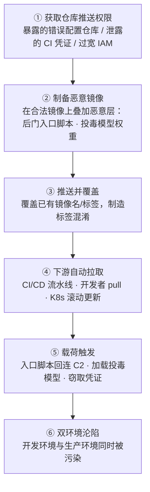

# 容器镜像仓库 (AML.T0010.004)

> 属于 [AI 供应链入侵 (AML.T0010)](../AML.T0010-AI-Supply-Chain-Compromise.md)

## 一句话通俗理解

容器镜像仓库就像公司的**中央配餐中心**：所有开发者和生产线（CI/CD 流水线）都从这里取餐。攻击者不需要挨个下毒每一份餐——只需要潜入配餐中心，把某个热门菜品的餐盒**调换成同样包装的"加料版"**，接下来所有自动取餐的人都会中招，而且开发环境和生产环境会**同时**被污染。

## 难度等级

**⭐⭐ Demonstrated（已演示）**

| 维度 | 评估 |
|------|------|
| 官方成熟度 | Demonstrated——攻击路径已在安全研究中被完整演示 |
| 前提条件 | 需要获得目标镜像仓库的**推送（push）权限** |
| 现实佐证 | Trend Micro 研究（AML.CS0028）发现互联网上 8,000+ 个暴露的错误配置私有仓库，约 70% 允许写入 |
| 未达 ⭐⭐⭐ 的原因 | 尚无公开确认的野外 AI 镜像仓库投毒利用事件 |

真正的技术门槛不在"制作恶意镜像"（这只是 `docker build`），而在**获得推送权限**：暴露的错误配置仓库、泄露的 CI/CD 凭证、过宽的云 IAM 授权都是现实入口。

**适用平台**（官方数据）：预测式 AI、生成式 AI、智能体 AI

## 技术描述

### 通俗解释

现代 AI 团队几乎不会从零搭建训练和推理环境，而是使用容器镜像（Image）——一个打包了操作系统、Python 环境、深度学习框架（PyTorch/TensorFlow）、依赖库乃至**模型权重文件**的"标准集装箱"。这些集装箱统一存放在**容器镜像仓库（Registry）**中：Docker Hub、AWS ECR、GitHub GHCR、Google GCR、Azure ACR，或自建的 Harbor、Quay。

镜像通过"名字:标签"（如 `myteam/inference:latest`）被引用。开发者的 `docker pull`、CI/CD 流水线的构建步骤、Kubernetes 的滚动更新，都会**按名字自动拉取**镜像——没有任何人肉核对。攻击者正是利用这一点：只要能把一个动了手脚的镜像推进仓库并**覆盖已有名字或标签**，下游所有自动拉取者就会在毫不知情中运行恶意镜像。

### 技术原理

ATLAS 官方定义：攻击者可以通过向受害者的容器仓库推送一个被篡改的容器镜像，并**覆盖已有的容器名称和/或标签**来实施入侵。仓库的用户及自动化 CI/CD 流水线可能拉取攻击者的镜像，从而攻陷其 AI 供应链。此技术影响**开发环境与部署环境**。由于容器镜像中可能包含 AI 模型，被攻陷的镜像可能内嵌被攻击者篡改过的模型（参见 AML.T0018 篡改 AI 模型）。

具体攻击形态：

| 攻击形态 | 手法 | 危害范围 |
|---------|------|---------|
| **标签覆盖** | 推送同名词镜像，覆盖 `latest`、`v2.1` 等常用标签 | 所有按标签拉取的下游用户与流水线 |
| **标签混淆（Tag Confusion）** | 利用标签可变性——同一"名字:标签"可指向完全不同的内容层 | 依赖标签（而非摘要）的一切引用方 |
| **投毒基础镜像** | 在 `pytorch/pytorch`、`nvidia/cuda` 等基础镜像中植入后门 | 所有 `FROM` 该基础镜像的下游构建（级联污染） |
| **内嵌投毒模型** | 将被篡改的模型权重打进镜像，随容器一起分发 | 模型加载后行为异常、决策被操纵 |
| **暴露错误配置仓库** | 直接向互联网暴露且权限过宽的私有仓库推送（见 AML.CS0028） | 该仓库的全部使用者 |

关键机制在于**标签的可变性**：`myteam/inference:v2` 今天和明天指向的内容可以完全不同，因为标签只是指向镜像层的"软指针"。相对地，镜像**摘要（Digest，形如 `sha256:abc...`）**是内容的密码学哈希，固定不变。绝大多数企业 CI/CD 恰恰按可变的标签拉取——这就是攻击窗口。

### 攻击面

| 攻击面 | 说明 |
|--------|------|
| 暴露的私有仓库 | 直接暴露在公网、无认证或权限过宽的 Harbor/Registry/云仓库 |
| CI/CD 凭证 | 构建机器上长期有效的仓库推送令牌被窃取 |
| 云 IAM 过宽授权 | 拥有 `ecr:PutImage` 等推送权限的账号/角色过多 |
| 共享基础镜像 | 团队共用且缺乏签名验证的内部基础镜像 |
| 部署平台自动拉取 | K8s `imagePullPolicy: Always` 等自动拉取配置会放大标签覆盖的影响面 |

### 平台覆盖

| 平台 | 适用性 |
|------|--------|
| 预测式 AI（Predictive AI） | ✅ 训练/推理镜像中嵌入投毒模型或后门依赖 |
| 生成式 AI（Generative AI） | ✅ LLM 服务镜像被替换，模型权重或推理框架被篡改 |
| 智能体 AI（Agentic AI） | ✅ 智能体运行时镜像被植入后门，随部署扩散 |

### 用途影响

- **一击多杀**：污染一个仓库标签 = 同时污染所有拉取它的开发者笔记本、CI 构建环境、Kubernetes 生产集群。
- **绕过代码审计**：恶意载荷藏在镜像层而非代码仓库中，SCA/代码评审不可见。
- **模型级持久化**：内嵌投毒模型的危害随模型生命周期存续——重新部署也无效，除非换镜像。

## 攻击流程



### 步骤详解

1. **获取仓库访问权限（通俗描述：拿到配餐中心的钥匙）**
   - **技术细节**：扫描互联网暴露的私有仓库（Trend Micro 用服务索引门户与网络搜索发现了 8,000+ 个）；窃取 CI 节点上的 `docker login` 凭证或云 IAM 令牌；利用过宽的仓库名称空间授权。

2. **制备恶意镜像（通俗描述：做一份外观相同的"加料"餐盒）**
   - **技术细节**：以合法镜像为基础（`FROM 原镜像`），在其上叠加恶意层——修改入口脚本（entrypoint）加载后门、替换 `models/` 目录下的权重文件、追加恶意 pip 依赖。外观、标签、元数据与原镜像保持一致。

3. **推送并覆盖（通俗描述：调换餐盒）**
   - **技术细节**：`docker push registry.example.com/team/inference:v2.1` 直接覆盖同名标签。多数仓库默认允许标签可变；部分仓库甚至对覆盖不做任何告警。

4. **下游自动拉取（通俗描述：取餐的人毫无察觉）**
   - **技术细节**：CI/CD 流水线按标签触发构建、开发者本地 `docker pull`、Kubernetes Deployment 滚动更新——三者都会"自愿"拉取恶意镜像。

5. **载荷触发（通俗描述：开餐即中毒）**
   - **技术细节**：容器启动时入口脚本执行后门，回连 C2、窃取环境凭证（云密钥、API Token）；或训练/推理代码加载镜像内的投毒模型，输出被操纵（关联 AML.T0018）。

6. **双环境沦陷（通俗描述：办公室和生产线一起遭殃）**
   - **技术细节**：同一仓库同时服务开发与生产，恶意镜像随部署管道自然扩散至生产集群，形成供应链级持久化。

### 战术衔接

- 向后衔接**执行**战术：镜像入口脚本在容器启动时即获得代码执行。
- 向后衔接**持久化**战术：对应企业矩阵 T1525 植入内部镜像的思路——镜像即持久化载体，重新部署也不会清除。
- 向后衔接**凭证访问**战术：容器内环境变量中的云凭证与模型服务密钥是首要窃取目标。

## 真实案例

### 案例 1：AI 模型篡改供应链攻击研究（AML.CS0028）

- **时间**：2025 年（Trend Micro 研究披露）
- **攻击者**：安全研究人员（演示性质，证明攻击面真实存在）
- **手法**：利用服务索引门户与网络搜索工具，发现互联网上 **8,000+ 个错误配置的私有容器仓库**；其中约 **70% 权限过于宽松、允许写入**；在私有容器镜像中发现 **1,000+ 个可无认证拉取的独立 AI 模型**。
- **影响**：攻击者可以下载、检视并篡改容器内容——包括敏感的 AI 模型文件。一旦推送覆盖，受害组织的 CI/CD 与部署环境将整体暴露于供应链攻击之下。
- **参考链接**：
  - [Silent Sabotage: Weaponizing AI Models in Exposed Containers](https://www.trendmicro.com/vinfo/br/security/news/cyber-attacks/silent-sabotage-weaponizing-ai-models-in-exposed-containers)
  - [Exposed Container Registries: A Potential Vector for Supply-Chain Attacks](https://www.trendmicro.com/vinfo/us/security/news/virtualization-and-cloud/exposed-container-registries-a-potential-vector-for-supply-chain-attacks)
  - [ATLAS 官方案例页 AML.CS0028](https://atlas.mitre.org/studies/AML.CS0028/)

### 案例 2：Hugging Face 恶意模型（AML.CS0031，关联父技术 AML.T0010）

- **时间**：2024 年
- **攻击者**：恶意上传者（ReversingLabs 发现并分析）
- **手法**：在模型托管平台上传内嵌恶意代码的模型文件；文件被构造成**载荷在反序列化失败之前即执行**，绕过 Picklescan 扫描。
- **影响**：受害者加载"模型"即触发反向 Shell。该案例瞄准的是模型托管平台，与镜像仓库投毒同属 AI 供应链分发环节投毒——恶意载荷随"可信制品"一起分发。
- **参考链接**：
  - [ReversingLabs: RL Identifies Malware ML Model Hosted on Hugging Face](https://www.reversinglabs.com/blog/rl-identifies-malware-ml-model-hosted-on-hugging-face)

## 红队视角

> ⚠️ **免责声明**：以下内容仅用于授权红队评估与防御研究。未经书面授权对他人容器仓库执行任何操作均属违法行为。

### 实战技巧

1. **仓库暴露面盘点**：从互联网侧枚举目标的 Harbor/Registry/云仓库端点（`/v2/` API 探测），评估是否存在匿名拉取、匿名推送。
2. **标签可变性检测**：拉取目标关键标签两次（间隔一个构建周期），比对摘要是否一致——若按标签拉取且摘要漂移，说明目标未固定摘要，存在覆盖窗口。
3. **CI 凭证链审计**：检查可触及的构建节点（`.docker/config.json`、CI 变量存储）中是否存有长期有效的仓库推送令牌。
4. **镜像内容审计**：用 `crane`/`skopeo` 逐层解包目标镜像，定位入口脚本、模型目录与依赖清单，评估"最小改动、最大外观一致"的植入点。
5. **水印化载荷验证**：评估中只植入无害标记载荷（如回连受控测试域名的 beacon），验证覆盖→拉取→触发的完整链路后立即记录证据并恢复。

### 常用工具

| 工具 | 用途 |
|------|------|
| crane | 免 Docker 守护进程的镜像拉取/推送/清单操作 |
| skopeo | 镜像跨仓库复制与逐层检视 |
| syft | 生成镜像 SBOM（软件物料清单） |
| trivy / grype | 镜像漏洞与恶意载荷扫描 |
| cosign | 镜像签名与验证（用于检测"未被合法签名"的覆盖） |

### 注意事项

- **绝不向第三方/生产仓库推送任何内容**，评估范围严格限定于授权的自有仓库。
- 覆盖类操作在多数仓库会留下审计日志，评估前与蓝队约定告警豁免窗口。
- 结束后必须用原镜像（按摘要）恢复被覆盖的标签，并出具回滚证明。

## 蓝队视角

### 检测要点

1. **仓库审计日志**：非 CI 身份的 `PutImage`/推送事件；对**已有标签的覆盖**行为；构建时间窗之外的推送。
2. **拉取侧摘要漂移**：同一标签在短时间内解析到不同摘要（digest 变化）。
3. **镜像层差异**：覆盖镜像与上一版本的层结构差异异常（新增入口脚本修改、模型文件替换）。
4. **签名验证失败**：拉取/准入环节发现镜像缺少合法签名或签名者不在允许列表。

### 监控建议

- 对仓库开启**不可变标签（immutable tags）**与全量审计日志，并将日志接入 SIEM。
- 在 CI/CD 中强制**按摘要（digest）固定**拉取，标签只用于人读。
- Kubernetes 启用**准入控制器**（如签名策略），拒绝未签名/签名无效的镜像。
- 对互联网侧暴露面做持续指纹监测，发现仓库端点外露立即告警。
- 定期核对生产环境实际运行镜像的摘要与登记清单的一致性（漂移对账）。

## 检测建议

### 网络层

- 监测仓库端点（`/v2/`）的异常来源访问与推送流量；对暴露在公网的私有仓库做指纹识别与收敛。
- 出网方向：容器启动后短时间内的可疑外连（C2 回连特征）。

### 主机层

- 拉取后校验摘要与预期不符（标签漂移）即告警。
- 对比镜像分层历史（`docker history`），入口脚本或模型目录出现非构建管线来源的变更。
- 容器运行时：入口进程行为与镜像声明不符（如 python 进程发起反向连接）。

### 应用层

- 仓库审计告警：非常规身份推送、已有标签被覆盖、非构建窗口写入。
- 准入控制器拒绝未签名镜像的计数激增，往往意味着有人正在尝试覆盖分发。

**Sigma 示例（AWS ECR 场景）**：

```yaml
title: 容器仓库镜像标签被覆盖（AML.T0010.004）
id: 7c1f2a90-3d4e-4f5a-b6c7-8d9e0f1a2b3c
status: experimental
description: 检测非 CI/CD 渠道主体向 ECR 推送镜像，可能为镜像仓库供应链投毒（AML.T0010.004）
references:
    - https://atlas.mitre.org/techniques/AML.T0010/004/
logsource:
    product: aws
    service: cloudtrail
detection:
    selection:
        eventSource: 'ecr.amazonaws.com'
        eventName: 'PutImage'
    filter_ci:
        userIdentity.arn|contains:
            - '/ci-'
            - '/github-actions'
            - '/deploy'
    condition: selection and not filter_ci
falsepositives:
    - 运维人员手工推送镜像
    - 新增合法发布渠道未登记
level: high
tags:
    - attack.t1195
    - attack.supply_chain_compromise
    - atlas.aml_t0010_004
```

## 缓解措施

> ATLAS 官方数据未为本子技术单独关联缓解措施，以下沿用其父技术 AML.T0010 的缓解措施集合，并按容器仓库场景具体落地。

### 优先级 1：关键措施

- **AML.M0014 验证 AI 制品（Verify AI Artifacts）**：
  - CI/CD 全链路**按摘要（digest）固定**拉取镜像，禁用裸标签引用。
  - 用 cosign 对镜像签名，部署/准入环节强制验签。
  - 对镜像内嵌的模型权重做哈希登记与比对，模型文件变更必须可追溯。

### 优先级 2：重要措施

- **AML.M0023 AI 物料清单（AI Bill of Materials）**：
  - 为每个发布镜像生成 SBOM（syft/trivy），并**单独登记镜像内的模型文件**（来源、版本、哈希），使任何层替换都可审计。
- **AML.M0020 生成式 AI 护栏（Generative AI Guardrails）**：
  - 即便镜像被投毒，通过护栏限制模型异常输出与工具调用，压缩投毒载荷的"爆炸半径"。

### 优先级 3：建议措施

- **AML.M0035 AI 红队（AI Red Team）**：
  - 定期开展包含"仓库覆盖→下游拉取"链路的授权演练，验证检测与回滚预案。

### MITRE ATLAS 缓解措施映射

| 缓解措施ID | 缓解措施名称 | 优先级 | 类别 | 生命周期阶段 |
|-----------|-------------|--------|------|-------------|
| AML.M0014 | 验证 AI 制品 | 关键 | 技术-网络安全 | 业务与数据理解、数据准备、AI 模型工程 |
| AML.M0023 | AI 物料清单 | 关键 | 政策 | 业务与数据理解、数据准备、AI 模型工程 |
| AML.M0020 | 生成式 AI 护栏 | 重要 | 技术-AI | AI 模型工程、评估、部署、监控 |
| AML.M0035 | AI 红队 | 建议 | 政策/技术 | 全生命周期 |

> 容器场景的第一道防线永远是**仓库自身**：关闭公网暴露、最小化推送权限、启用不可变标签——这三条能直接掐断本技术的实现前提。

## 关联 ATT&CK 技术

- [供应链入侵 (T1195)](../../../enterprise/03-Initial-Access/T1195-Supply-Chain-Compromise.md)——本技术在企业矩阵中的同源经典：污染受害者信任的制品。
- [供应链入侵：软件供应链 (T1195.002)](../../../enterprise/03-Initial-Access/T1195/T1195.002-Compromise-Software-Supply-Chain.md)——分发环节投毒的直接同构，容器镜像即软件制品的一种。
- [植入内部镜像 (T1525)](../../../enterprise/05-Persistence/T1525-Implant-Internal-Image.md)——持久化战术的近亲：向内部镜像植入后门以获得随部署复活的持久化。

**ATLAS 内部关联（纯文本）**：

- AML.T0010 AI 供应链入侵——本子技术的父技术。
- AML.T0018 篡改 AI 模型——镜像内嵌投毒模型时的下游技术。
- AML.T0010.001 / AML.T0010.003——同父技术的姊妹分支（AI 软件投毒 / 模型投毒）。
- AML.M0013 代码签名——与本技术缓解直接相关的签名验证实践。

### 传统镜像投毒 vs AI 镜像投毒

| 维度 | 传统镜像投毒（T1195.002/T1525） | AI 镜像投毒（AML.T0010.004） |
|------|-------------------------------|------------------------------|
| 载荷形态 | 恶意脚本、挖矿程序、后门 | 以上全部 **+ 投毒模型权重** |
| 触发方式 | 容器启动即执行 | 可延迟至模型加载、甚至特定输入触发 |
| 检测难度 | 漏洞/恶意代码扫描器可见 | 投毒权重对扫描器**不可见**，需行为遥测 |
| 主要危害 | 基础设施沦陷 | 基础设施沦陷 + **模型决策被污染** |

## 动手实验

> ⚠️ **提示**：以下实验仅在隔离的本地环境进行，不涉及任何第三方仓库。

### 实验环境准备

| 组件 | 要求 |
|------|------|
| 操作系统 | 隔离 Linux 虚拟机（快照可回滚） |
| Docker | 本地安装，能运行 registry:2 官方镜像 |
| 本地仓库 | `docker run -d -p 5000:5000 registry:2` |
| 扫描/签名工具 | trivy、cosign |
| 模拟模型文件 | 任意小文件（如 10MB 随机数据充当"权重"） |

### 实验 1（初级）：体会"同名同标签 ≠ 同内容"

**实验目标**：直观理解标签可变性与摘要固定性。

**实验步骤**：

1. `docker pull nginx:latest`，记录摘要：`docker inspect --format='{{index .RepoDigests 0}}' nginx:latest`。
2. 数分钟后（或换台机器）再次拉取同名标签并记录摘要。
3. 对比两次摘要是否一致；再观察 `nginx:1.27` 固定版本标签与 `latest` 的漂移差异。

**预期结果**：理解标签只是"软指针"，只有摘要能锁定内容——这正是标签覆盖攻击的根基。

### 实验 2（中级）：本地仓库覆盖与发现

**实验目标**：复现"推送覆盖"并学会发现它。

**实验步骤**：

1. 构建两个镜像：`demo:v1`（含模拟模型文件）与 `demo:v1`（在原镜像上追加一层，替换模型文件并修改入口脚本输出标记）。
2. 依次推送到本地 registry:2，第二次推送即"标签覆盖"。
3. 用 `docker history localhost:5000/demo:v1` 观察分层差异；用 trivy 扫描前后两个版本并对比报告。

**预期结果**：看到同一标签下内容被静默替换；掌握通过分层历史与扫描对比发现覆盖的手感。

### 实验 3（高级）：签名验证与摘要固定防线

**实验目标**：搭建"覆盖攻击"的检测与阻断闭环。

**实验步骤**：

1. 用 cosign 为 `demo@sha256:<digest>` 签名，并 `cosign verify` 通过。
2. 重复实验 2 的覆盖操作，对**新摘要**执行 `cosign verify`——预期失败（未签名）。
3. 编写简易拉取脚本：仅允许拉取"签名有效且摘要与登记清单一致"的镜像，其余拒绝——模拟准入控制器。

**预期结果**：验证"签名验证 + 摘要固定"双闸门对标签覆盖攻击的有效拦截。

## 术语解释

| 术语 | 英文原名 | 通俗解释 |
|------|---------|---------|
| 容器镜像 | Container Image | 打包了运行环境与代码的"标准集装箱" |
| 容器镜像仓库 | Container Registry | 存放和分发镜像的"配餐中心"，如 Docker Hub、ECR、Harbor |
| 标签 | Tag | 镜像的可变别名（如 `v2.1`、`latest`），可被重新指向 |
| 摘要 | Digest | 镜像内容的密码学哈希（`sha256:...`），内容变则摘要变 |
| 标签混淆 | Tag Confusion | 同一"名字:标签"在不同时间指向不同内容造成的信任错位 |
| 基础镜像 | Base Image | `FROM` 指令引用的上游镜像，污染会级联传染所有下游构建 |
| 镜像分层 | Image Layers | 镜像由只读层叠加而成，攻击即"在合法镜像上叠恶意层" |
| 准入控制器 | Admission Controller | Kubernetes 集群门口的"安检员"，可拒绝未签名镜像 |
| 镜像签名 | Image Signing | 用私钥为镜像摘要签名，部署前验签以确认来源 |
| 不可变标签 | Immutable Tags | 仓库策略：标签一旦推送即禁止覆盖 |
| 反向 Shell | Reverse Shell | 恶意载荷主动回连攻击者控制的服务器并交出命令执行通道 |

## 参考资料

### 📚 官方文档

- [MITRE ATLAS AML.T0010.004 Container Registry](https://atlas.mitre.org/techniques/AML.T0010/004/)
- [MITRE ATLAS AML.T0010 AI Supply Chain Compromise](https://atlas.mitre.org/techniques/AML.T0010)
- [MITRE ATLAS 矩阵](https://atlas.mitre.org/matrices/ATLAS)
- [mitre-atlas-data GitHub 仓库](https://github.com/mitre-atlas/atlas-data)

### 📰 案例报告

- [Trend Micro: Silent Sabotage: Weaponizing AI Models in Exposed Containers](https://www.trendmicro.com/vinfo/br/security/news/cyber-attacks/silent-sabotage-weaponizing-ai-models-in-exposed-containers)
- [Trend Micro: Exposed Container Registries: A Potential Vector for Supply-Chain Attacks](https://www.trendmicro.com/vinfo/us/security/news/virtualization-and-cloud/exposed-container-registries-a-potential-vector-for-supply-chain-attacks)
- [Trend Micro: Mining Through Mountains of Information and Risk](https://www.trendmicro.com/vinfo/us/security/news/virtualization-and-cloud/mining-through-mountains-of-information-and-risk-containers-and-exposed-container-registries)
- [ReversingLabs: Malware ML Model Hosted on Hugging Face](https://www.reversinglabs.com/blog/rl-identifies-malware-ml-model-hosted-on-hugging-face)
- [ATLAS 案例研究 AML.CS0028](https://atlas.mitre.org/studies/AML.CS0028/)

### 🔧 工具与资源

- [Trivy 镜像扫描](https://github.com/aquasecurity/trivy)
- [Grype 漏洞扫描](https://github.com/anchore/grype)
- [Cosign 镜像签名](https://github.com/sigstore/cosign)
- [Syft SBOM 生成](https://github.com/anchore/syft)

### 🔗 关联阅读

- [AI 供应链入侵 (AML.T0010)](../AML.T0010-AI-Supply-Chain-Compromise.md)——父技术全景
- [初始访问战术总览](../README.md)——本技术所处战术
- [供应链入侵 (T1195)](../../../enterprise/03-Initial-Access/T1195-Supply-Chain-Compromise.md)——企业矩阵同源技术
- [供应链入侵：软件供应链 (T1195.002)](../../../enterprise/03-Initial-Access/T1195/T1195.002-Compromise-Software-Supply-Chain.md)
- [植入内部镜像 (T1525)](../../../enterprise/05-Persistence/T1525-Implant-Internal-Image.md)

---

> **版本**: ATLAS 2026.09 | **更新**: 2026-10-22 | **模板**: ATLAS 技术文档 v1.0
