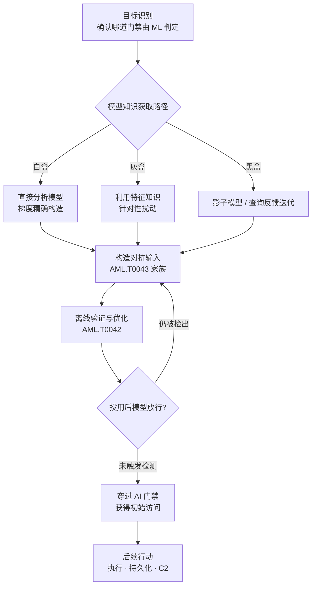

# 规避 AI 模型 (AML.T0015)

## 一句话通俗理解

> 传统规避是躲开摄像头的视野；规避 AI 模型是站在摄像头正前方，让它亲眼看着你，却把你看成另一个人——当 AI 模型本身就是门禁保安时，攻击者不撬门、不断电，只是精心"打扮"成保安眼里值得放行的样子，然后堂堂正正走进去。

## 难度等级

⭐⭐⭐ **Realized（已实现）**

官方成熟度评定为 Realized——这不是实验室预言，而是已被反复兑现的攻击能力：2019 年 Skylight 用一段通用附加字符串让 Cylance 的 AI 恶意软件检测器放行恶意文件；2020-2021 年一名诈骗者靠假证件与同款假发骗过 ID.me 的人脸比对，套取 340 万美元失业金；2022 年防御者在商业 ML 钓鱼网页检测系统的生产日志中发现了真实攻击者的对抗样本；2024 年 ProKYC 甚至把"骗过 KYC 人脸与活体检测"做成了对外出售的犯罪服务。攻击门槛仍在持续下降。真正的难点不在算法本身，而在**目标知识获取**——白盒访问难得，攻击者更多依赖灰盒特征知识、影子模型或查询反馈迭代，而这恰恰是防御方可以监控和干预的环节。

## 技术描述

### 通俗解释

越来越多的安全决策不再由人类或固定规则做出，而是交给了 AI 模型：杀毒软件用神经网络判断文件是否恶意、邮件网关用分类器给邮件打分、反钓鱼系统用图像模型比对网页与官方页面的相似度、税务与金融系统用人脸识别验证"你是不是你"。当 AI 模型成为门禁，攻击者的思路也随之改变——不再试图绕过这扇门，而是让门卫自己看走眼：给恶意文件加一段"护身符"字符串、把钓鱼网页的商标 logo 稍作变形、戴上与假证件照片同款的假发通过人脸比对。模型的检测与分类没有触发，门就开了。

**这是"初始访问"技术的原因正在于此**：AI 是守门人，骗过守门人就等于跨进了系统大门。

### 技术原理

依据官方描述，攻击者可以构造对抗数据（Craft Adversarial Data，AML.T0043）使 AI 模型无法正确识别数据内容，或生成深度伪造数据（Generate Deepfakes，AML.T0088）欺骗期望获得真实数据的 AI 模型。本技术可用于规避一切由 AI 承担的下游任务：规避基于 AI 的病毒/恶意软件检测或网络扫描，服务于传统网络攻击目标；通过深度伪造规避基于 AI 的生物特征认证，则可以直接获得目标系统的初始访问。

**核心逻辑：AI 模型本身即安全控制，误分类即破门。** 攻击者不篡改模型本体（那是投毒 AI 模型的范畴），只在推理阶段操纵输入，让模型的判定结果偏向攻击者需要的那一侧。模型照常运行、日志一切正常，唯一出错的是判断本身。

攻击者对目标模型的知识水平决定攻击路径：

1. **白盒路径**：直接获得模型权重与结构，可计算梯度精确构造扰动——生产环境中罕见，但模型从移动应用、容器仓库中被提取的事件（如 CS0058）说明并非不可能；
2. **灰盒路径**：不知道模型，但知道特征工程——卡巴斯基团队（AML.CS0014）证明仅凭"特征在用户侧构建后上传云端"这一架构事实，就足以对云部署的反恶意软件神经网络发起有效攻击；
3. **黑盒路径**：通过公开端点反复查询、依反馈调整（AML.CS0000 中 Palo Alto 团队"构造样本→查询→调整→再查询"直至模型被绕过），或先训练影子模型再迁移对抗样本（AML.CS0005/CS0008）。

**两大目标类型**：一是 **ML 安全检测器**——恶意软件检测、DGA 域名检测、C&C 流量检测、邮件评分、钓鱼网页图像分类；二是 **ML 认证器**——人脸识别、活体检测、证件照与自拍照比对等 AI 生物特征认证。官方明确指出：深度伪造规避生物特征认证"可为攻击者提供对使用 AI 生物特征认证系统的初始访问"。

**平台覆盖**：仅 Predictive AI（预测式 AI）——对抗样本与伪造针对的是分类/检测类模型，而非生成式模型本身。

**与其他技术的分工**：构造对抗数据（AML.T0043）发生在 AI 攻击适配战术（03），是"在车间里造武器"；验证攻击（AML.T0042）是在靶场上试枪；**AML.T0015 则是把武器带到战场上实际使用、穿过 AI 门禁获得立足点的那个动作**。同一件武器，制造与使用分属两个战术。

### 用途影响

- **让传统载荷穿透 AI 防线**：恶意文件、DGA 域名、C&C 流量、钓鱼邮件与钓鱼网页借助对抗输入绕过 ML 检测，传统攻击链的每一环都可能因此打通；
- **直接攻陷生物特征认证**：骗过人脸比对即拿到账户——上海税务系统人脸入侵案（AML.CS0004）欺诈 7700 万美元、ID.me 案（AML.CS0017）套取 340 万美元失业金；
- **攻击能力服务化**：ProKYC（AML.CS0034）将深伪证件与深伪自拍视频打包出售，"骗过 KYC"成为暗网货架商品，攻击门槛急剧下降；
- **通用规避的雪崩效应**：Cylance 案（AML.CS0003）中的附加字符串是"通用的"——对同一家检测器的一处漏洞即可让整套部署失效；
- **比"关闭防御"更隐蔽**：防御方看到模型仍在运行、检出率曲线平稳，唯一的变化是漏报——这是一种不会触发任何告警的失守；
- **防御方的镜像武器**：同一技术也被安全厂商与红队用于上线前的鲁棒性评估（Palo Alto、卡巴斯基、微软与 MITRE 的 AI 红队案例均属此类）。

## 攻击流程

### 典型攻击流程



**步骤详解：**

1. **识别 AI 门禁**
   - 通俗描述：先搞清楚这栋楼的保安哪个是 AI。
   - 技术细节：判断目标链路中哪些判定环节由 ML 完成——终端 EDR 的恶意软件评分、邮件网关的垃圾邮件分类、网络侧的 DGA/C&C 流量检测、钓鱼网页图像比对，或是登录环节的人脸识别与活体检测。产品公开材料、安全厂商白皮书、CVE 描述都是情报来源。

2. **获取模型知识**
   - 通俗描述：想办法弄清保安的"审美标准"。
   - 技术细节：白盒直接读权重并计算梯度；灰盒利用特征工程知识（CS0014 证明特征知识已足够）；黑盒通过查询接口的分数反馈做在线优化（CS0000），或用公开端点训练影子模型再迁移（CS0005/CS0008）。人工修改（AML.T0043.003）则几乎不需要模型知识——改 logo、戴假发就属于这一类。

3. **构造对抗输入**
   - 通俗描述：按保安的盲区定制伪装。
   - 技术细节：交给构造对抗数据（AML.T0043）家族完成——自动对抗扰动（.000）、黑盒迁移（.002）、人工修改（.003）、后门触发器（.004）；生物特征认证场景则由生成深度伪造数据（AML.T0088）供给假证件、假自拍视频。

4. **验证与迭代**
   - 通俗描述：先对着镜子练到万无一失。
   - 技术细节：在影子环境或通过查询反馈反复验证（验证攻击 AML.T0042），统计规避成功率与查询成本；被检出的样本回炉重造，直到稳定低于检测阈值。

5. **投用破门**
   - 通俗描述：穿上伪装，从保安眼皮底下走进去。
   - 技术细节：恶意样本经邮件附件/下载链接抵达目标并躲过 ML 扫描；或用深伪材料通过人脸/活体认证完成登录注册。模型的检测未触发，初始访问达成。

6. **后续行动**
   - 通俗描述：进门之后，还得保证以后每次进出都不被认出。
   - 技术细节：C&C 流量同样要穿过 ML 网络检测——本技术在防御规避（AML.TA0007）战术下被再次使用；获得立足点后衔接执行、持久化等传统阶段。

**与前后技术的衔接：**

- **上游（AI 攻击适配）**：[验证攻击 (AML.T0042)](../03-AI-Attack-Adaptation/AML.T0042-Verify-Attack.md) 与 [构造对抗数据 (AML.T0043)](../03-AI-Attack-Adaptation/AML.T0043-Craft-Adversarial-Data.md) 在"车间"里完成武器制造与验收，本技术负责"战场"上的实际投用
- **同战术相邻**：与 [AI 供应链入侵 (AML.T0010)](./AML.T0010-AI-Supply-Chain-Compromise.md) 互补——供应链攻击污染"门卫从小接受的教育"，本技术只在"门卫当班时"欺骗它的眼睛
- **下游（防御规避/影响）**：穿过 ML 网络检测维持 C2 通道归入防御规避战术；迫使生产 ML 系统（如机器翻译）输出被操纵的结果则体现于影响战术（AML.TA0011）

> 关键差异：传统规避（混淆、伪装）骗的是固定的签名与规则，改一次特征即永久生效；规避 AI 模型骗的是**学习出来的决策边界**，往往需要查询迭代或跨模型迁移，但一旦成功，防御方必须重训练或重部署才能挽回——而且没有任何告警告诉你"已经失守"。

## 真实案例

> 以下 4 个案例均源自 MITRE ATLAS 案例库（共 18 个案例关联本技术），覆盖端点检测、云端检测、生物特征认证与真实攻击者四类视角。

### 案例1：通用字符串绕过 Cylance AI 恶意软件检测（2019年，AML.T0015）

- **时间**: 2019年9月
- **攻击者**: Skylight Cyber（安全研究团队）
- **手法**: 研究者发现 CylancePROTECT 的 AI 恶意软件检测器存在可利用的判定偏差，构造出一段**通用绕过字符串**——附加到任意恶意文件末尾，即可让检测器将其判定为良性。这是一次教科书式的"误分类即破门"：模型没有被篡改、没有停机，只是判断被操纵。
- **影响**: 证明商业 ML 检测器可能存在系统性软肋，且一处漏洞足以让整套部署对企业失去意义；推动行业重视 ML 检测器的对抗鲁棒性测试
- **参考链接**: [Skylight Cyber: Cylance, I Kill You!](https://skylightcyber.com/2019/07/18/cylance-i-kill-you/)、[Skylight CEO 后续声明](https://www.security7.net/news/the-new-cylance-vulnerability-what-you-need-to-know)

### 案例2：灰盒攻击卡巴斯基反恶意软件神经网络（2021年，AML.T0015）

- **时间**: 2021年6月23日
- **攻击者**: 卡巴斯基 ML 研究团队
- **手法**: 云部署的 ML 恶意软件检测器通常在用户侧构建特征、再上传云端判定。研究者利用这一架构事实，在**完全不知道云端模型**的灰盒条件下，仅凭特征知识对恶意文件做对抗性修改，成功让大多数修改后的样本逃过检测。
- **影响**: 推翻了"模型保密=安全"的假设——特征工程知识的泄露本身就足以支撑规避攻击；云查杀架构需要把对抗鲁棒性纳入设计
- **参考链接**: [Kaspersky Securelist: How to confuse antimalware neural networks](https://securelist.com/how-to-confuse-antimalware-neural-networks-adversarial-attacks-and-protection/102949/)

### 案例3：假发骗过 ID.me 身份验证，套取 340 万美元失业金（2020-2021年，AML.T0015）

- **时间**: 2020年10月 - 2021年12月
- **攻击者**: 一名个人诈骗者（Eric Jaklitch）
- **手法**: 诈骗者收集真实身份信息，用盗得的个人资料与**自己戴假发的照片**制作假驾照，随后在 ID.me 完成身份验证：系统将证件照与自拍照比对以确认"是本人"——他在自拍照里戴上同一顶假发，AI 人脸比对模型便将假证件认定为人证合一。以此通过加州 EDD 的失业金申领验证，提交至少 180 份虚假申请。
- **影响**: 至少 340 万美元失业金被套取，2023 年 5 月诈骗者被判 6 年 9 个月监禁；证明无需任何深度伪造技术，低成本的物理域"人工修改"就足以规避生产环境中的 ML 认证器
- **参考链接**: [美国司法部起诉书](https://www.justice.gov/usao-edca/pr/new-jersey-man-indicted-fraud-scheme-steal-california-unemployment-insurance-benefits)、[司法部量刑公告](https://www.justice.gov/usao-edca/pr/new-jersey-man-sentenced-675-years-prison-schemes-steal-california-unemployment)、[华盛顿邮报报道](https://www.washingtonpost.com/technology/2022/02/11/idme-facial-recognition-fraud-scams-irs/)

### 案例4：真实攻击者对 ML 钓鱼网页检测系统的规避尝试（2022年，AML.T0015）

- **时间**: 2022年12月
- **攻击者**: 未知名威胁行为者
- **手法**: 防御者在某商业 ML 钓鱼网页检测系统的**生产日志**中发现了对抗样本：攻击者对钓鱼网页中的品牌 logo 做简单而有效的人工修改（对应 AML.T0043.003），成功骗过了负责"视觉相似度"比对的图像分类模型。不过检测系统由多个图像分类器集成，其余组件仍将钓鱼网页标记了出来。
- **影响**: 这是首批证实"真实攻击者（而非研究者）正在对生产 ML 检测器使用对抗技术"的公开证据；同时展示了模型集成（AML.M0006）的兜底价值——骗过一个分类器不等于骗过整个系统
- **参考链接**: ["Real Attackers Don't Compute Gradients" (arXiv:2212.14315)](https://arxiv.org/abs/2212.14315)、[配套资源站](https://real-gradients.github.io/)

## 红队视角

> ⚠️ **免责声明**：以下内容仅用于合法授权的安全测试与教育目的。对未授权系统的检测器进行规避测试、或绕过任何在用身份验证系统均属违法行为——ID.me 案诈骗者已被判处近 7 年监禁。

### 实战技巧

1. **先建影子模型，再谈攻击**
   黑盒场景下不要直接对生产端点做高频试探（容易被封禁、也留日志）。Proof Pudding（CVE-2019-20634）与 Berkeley 机器翻译攻击（CS0005）的共同套路是：先用公开端点的输入输出对训练一个"复刻模型"，在本地复刻模型上离线优化对抗输入，最后一步才打到真实系统——查询次数被压到最低。

2. **从"人工修改"这一最低成本档位起步**
   改 logo、同形字替换、附加字符串、戴假发——CS0032 与 CS0017 证明简单人工修改就能骗过生产模型。红队评估应从零梯度成本的修改开始逐级加码，量化每一档的规避成功率，而不是一上来就跑 PGD。

3. **评估"通用性"而非单点成功**
   Cylance 案的杀伤力在于字符串是通用的。红队报告应回答：你的对抗输入对同一家产品的不同版本、不同配置是否依然有效？对集成中的每一个成员模型是否都有效？单点绕过在纵深防御面前可能毫无意义。

4. **生物特征认证的物理域测试**
   针对人脸/活体认证的红队演练要覆盖物理对策（假发、眼镜、打印照片、屏幕翻拍）与数字注入（虚拟摄像头深伪注入，参照 iProov 红队 CS0033）两条路径，并同步验证活体检测的被动/主动两种模式。

### 常用工具

| 工具名称 | 用途 | 平台 |
|----------|------|------|
| Adversarial Robustness Toolbox (ART) | 对抗攻击/防御算法库，覆盖 FGSM、PGD、黑盒攻击与对抗训练评估 | Python |
| Degas | DGA 域名变异工具，CS0001 中用于测试 ML DGA 检测模块的鲁棒性 | Python |
| Proof Pudding | CVE-2019-20634 的公开实现，影子模型+邮件评分规避的完整参考 | Python |
| PyTorch / TensorFlow | 影子模型训练与梯度计算的基础设施 | 跨平台 |
| Frida | 动态插桩，用于从移动应用中提取内嵌 TFLite 模型获得白盒访问（参照 CS0058 手法） | 跨平台 |

### 注意事项

- **授权范围必须写明"允许规避的检测器清单"**：对生产检测器的每一次查询都是真实 telemetry，务必约定测试窗口与回滚方案
- **不要过度拟合单次评估**：产品会更新模型，红队结论应标注被测版本与日期；通用性结论比单点结论更有价值
- **报告同时给出防御证据**：CS0032 中集成检测的其余组件成功兜底——红队应同样记录"哪些防御层确实拦住了攻击"，这才是可执行的改进清单

## 蓝队视角

### 检测要点

1. **近阈值浓度异常**
   - 日志来源：ML 检测引擎的置信度/分数日志（而非最终判定标签）
   - 异常特征：大量样本的恶意分数集中在判定阈值边缘的窄带内——正常流量与真实恶意样本的分数分布都不长这样，对抗优化的天然目标就是"贴线通过"

2. **查询模式异常**
   - 日志来源：检测 API/扫描端点的访问日志
   - 异常特征：单一来源短窗口内高频提交、提交样本之间高度相似（仅扰动区域不同）、大量合成查询抽取输入输出对（影子模型训练的前兆，CS0005/CS0008 的攻击起点）

3. **集成分歧率上升**
   - 日志来源：集成检测系统的各成员模型判定日志
   - 异常特征：成员模型之间的分歧率突然升高——对抗样本往往对部分成员有效；CS0032 中正是"视觉相似度模型放行、其他组件拦截"的组合暴露了攻击

4. **同源无效变异家族**
   - 日志来源：文件/邮件/网页检测日志
   - 异常特征：一批仅在小区域（附加字符串、logo 局部、个别字符）不同的样本反复出现——这是人工修改与查询迭代的直接痕迹

### 监控建议

- **保留分数，不要只留标签**：只记录"恶意/ benign"最终判定的日志无法做上述任何一项分析；分数级遥测是 ML 检测器自查的前提
- **为分数分布建立基线**：对每个模型版本维护正常分数分布画像，版本更替后重放历史规避样本做回归测试
- **对检测端点实施速率+相似度双重限流**：单纯速率限制拦不住低频高质的影子模型抽取，需叠加"提交内容相似度"维度
- **假设检测器终将被绕过**：纵深防御不是选项而是必然——CS0032 证明集成的其余组件可以救回全局；确保 ML 检测器身后还有传统签名、行为分析与人工复核层

## 检测建议

### 网络层检测

**检测方法：** 识别针对 ML 检测服务的异常查询与近似重放模式。

- 单一来源对检测/扫描端点的短窗口高频 POST，请求体之间高度相似
- 大量"查询-微调-再查询"的迭代序列（在线黑盒优化的网络特征）
- 对同一检测服务的批量探测性提交（如上线前批量测试 DGA 检测模块的行为，CS0001）

### 主机层检测

**检测方法：** 识别穿过 ML 终端检测后落地的载荷共性。

- 恶意文件家族携带统一的"尾巴"数据段或附加字符串（CS0003 的通用绕过字符串特征）
- 文件在结构上呈现"恶意主体+异常冗余数据"的组合（熵分布异常、追加段与主体语义无关）
- 行为层兜底：ML 判定被绕过不等于行为检测失效，落地后的执行行为仍是第二道网

### 应用层检测（AI 遥测）

**检测方法：** 利用模型自身的分数与查询遥测发现对抗优化。

- 恶意分数长期贴阈值边缘的窄带聚集（近阈值浓度）
- 集成成员分歧率上升、影子模型式合成查询抽取
- 对抗输入检测器（AML.M0015）的告警：输入分布统计检验、辅助检测模型、一致性校验

**程序化检测思路（无需 EDR 侧改造）：**

用"**分数熵 + 查询节奏 + 变异聚簇**"三元组构建检测：分数维度统计单位时间内在判定阈值±ε窄带内的样本占比是否超基线；节奏维度看同一来源的提交频率与样本间最小编辑距离（低编辑距离+高频=迭代优化）；聚簇维度对被放行样本做相似度聚类，同簇规模异常增长即触发人工复核。三者独立命中各自只产生低置信信号，同时命中才升级告警，可有效控制误报。

### Sigma 规则思路示例

```yaml
title: 针对 ML 检测端点的高频近似样本重放（规避 AI 模型特征）
status: experimental
description: 检测单一来源在短时间窗口内向 AI 检测/扫描端点高频提交样本，
    符合对抗样本在线查询优化或影子模型抽取的行为特征（AML.T0015）
logsource:
    category: proxy
detection:
    selection:
        http_method: 'POST'
        url|contains: '/api/scan'
    condition: selection | count() by src_ip > 60
timeframe: 10m
level: medium
tags:
    - attack.t1027
    - atlas.aml_t0015
```

**说明：** 本规则只覆盖"高频"这一最外显特征，慢速低频的影子模型抽取需依赖上文的相似度聚簇与分数遥测分析；阈值应按检测端点的正常业务基线（如企业内批量扫描服务的日常调用量）校准后再上线。

## 缓解措施

### 优先级1：关键措施

**AML.M0003 预测式 AI 模型加固（Predictive AI Model Hardening）**

设计与训练能在对抗样本面前维持预期性能的模型。具体手段包括**对抗训练**（把攻击者视角的扰动样本加入训练集）、鲁棒模型架构、防御蒸馏与认证鲁棒性方法。这是唯一从根源上改变"决策边界易被操纵"问题的措施——签名可以更新，但脆弱的决策边界只能靠训练修复。官方标注的生命周期阶段为数据准备与 AI 模型工程，意味着必须在建模阶段就纳入，事后补课成本极高。

**AML.M0015 预测式 AI 对抗输入检测（Predictive AI Adversarial Input Detection）**

在模型推理**之前**检测并阻断数字或物理对抗样本。监测与对抗样本生成、迁移攻击、黑盒优化相关的输入特征与查询模式；可用手段包括统计检验、辅助检测模型、一致性校验、输入分布分析与模态专用检测器。与 M0003 的关系是"治本+治标"：加固降低成功率，检测提高攻击者被发现的概率，二者叠加才让攻击在经济上不划算。

### 优先级2：重要措施

**AML.M0006 预测式 AI 模型集成（Predictive AI Ensembles）**

使用足够多样的模型集成（不同架构、训练流程、特征、模型家族），配合能防止"骗过一个即控制全局"的聚合裁决机制。CS0032 是最好的实战注脚：攻击者骗过了视觉相似度分类器，却倒在其余组件手里。多样性与裁决机制是关键——同源模型堆叠出来的"伪集成"会被同一个对抗样本一锅端。

**AML.M0010 预测式 AI 输入恢复（Predictive AI Input Restoration）**

在推理前通过预处理移除、削弱或扰乱对抗扰动：去噪、压缩、重构、重采样、特征挤压、随机化变换等按模态选用。官方特别提醒：必须以**自适应攻击者**（把预处理纳入攻击计算）为假想敌评估恢复方法的有效性，否则只是安慰剂。

**AML.M0034 深度伪造检测（Deepfake Detection）**

对所有不可信或用户提供的输入应用深伪检测算法，生物特征认证等高影响场景尤甚。手段包括真伪判别模型、面部运动/音频同步/像素级伪影的一致性检查、眨眼与微表情等生物特征分析。针对的正是本技术中"深度伪造骗过 ML 认证器"（AML.T0088 供给）的那条支线。

### 优先级3：建议措施

**AML.M0009 预测式 AI 多传感器融合（Predictive AI Multi-Sensor Fusion）**

用相互独立的物理传感器（多模态、多视角）交叉印证观察结果，使单一被操纵的输入源无法左右模型判定。适用于物理域攻击面（人脸认证、自动驾驶感知）——假发骗过一个摄像头容易，同时骗过可见光+红外+深度传感器则难得多。

**AML.M0035 AI 红队（AI Red Team）**

建立常态化的 AI 红队机制，在部署前与运行期持续以威胁为导向检验 AI 系统。本技术 18 个案例中有 5 个（CS0010/CS0011/CS0012 等）本身就是微软与 MITRE AI 红队的演练成果——这说明主流厂商早已把"假设检测器会被规避"作为既定事实，并用红队持续度量"有多容易被规避"。红队覆盖完整系统：模型与数据、数据流、决策过程、应用逻辑与非 AI 组件。

### MITRE ATLAS 缓解措施映射

| 缓解措施ID | 缓解措施名称 | 优先级 | 类别 | 生命周期阶段 |
|------------|-------------|:------:|------|-------------|
| AML.M0003 | 预测式 AI 模型加固 | 关键 | Technical - AI | 数据准备 · AI 模型工程 |
| AML.M0015 | 预测式 AI 对抗输入检测 | 关键 | Technical - AI | 数据准备 · 模型工程 · 评估 · 部署 · 监控 |
| AML.M0006 | 预测式 AI 模型集成 | 重要 | Technical - AI | AI 模型工程 |
| AML.M0010 | 预测式 AI 输入恢复 | 重要 | Technical - AI | 数据准备 · 评估 · 部署 · 监控 |
| AML.M0034 | 深度伪造检测 | 重要 | Technical - AI | 模型工程 · 评估 · 部署 · 监控 |
| AML.M0009 | 预测式 AI 多传感器融合 | 建议 | Technical - Cyber | 业务理解 · 数据准备 · 模型工程 |
| AML.M0035 | AI 红队 | 建议 | Policy · Technical | 全生命周期 |

> 分级依据：M0003/M0015 直接决定攻击成败概率；M0006/M0010/M0034 是纵深防御的中层；M0009 仅适用于物理域攻击面，M0035 是持续性流程保障，按部署场景选择性实施。

## 关联 ATT&CK 技术

**官方未建立 AML.T0015 与 ATT&CK 技术的正式映射**（本技术在 ATLAS 数据中的 ATT&CK-reference 为空）。以下是本库给出的主题性对照，供学习参考：

- [混淆文件或信息 (T1027)](../../enterprise/07-Stealth/T1027-Obfuscated-Files-or-Information.md)——目标相同（躲过自动化检测），对象不同：T1027 骗的是签名、特征码与人工分析，AML.T0015 骗的是**学习出来的决策边界**。前者改一次特征即生效，后者常需迭代优化，但成功后防御方必须重训练才能挽回
- [伪装 (T1036)](../../enterprise/07-Stealth/T1036-Masquerading.md)——"把自己装扮成良性"的精神内核一致；对 ML 检测器，"良性外观"是模型学到的统计特征，伪装即向这些特征对齐
- [虚拟化/沙箱规避 (T1497)](../../enterprise/07-Stealth/T1497-Virtualization-Sandbox-Evasion.md)——同属"欺骗自动化分析系统"家族：沙箱规避骗的是分析环境，规避 AI 模型骗的是下一代自动化分析（ML 检测器），可视为该思想在 AI 时代的延续
- 值得注意的区别：本技术**不削弱防御本身**——不同于禁用安全工具类手法，ML 检测器全程在运行、日志一切正常，只是判断被操纵。防御方不会收到"防护已被关闭"这类明确信号，这让失守更难被察觉

**传统规避 vs 规避 AI 模型对照：**

| 维度 | 传统规避（签名/规则） | 规避 AI 模型 (AML.T0015) |
|------|---------------------|--------------------------|
| 规避对象 | 固定特征码与规则 | 训练得出的决策边界 |
| 攻击成本 | 单次修改即可能生效 | 常需查询迭代/影子模型/迁移 |
| 失效条件 | 厂商更新签名即失效 | 需重训练、对抗训练或重部署 |
| 失败痕迹 | 命中特征即告警 | 模型"正常"放行，无告警 |
| 防御抓手 | 特征更新 | 加固·检测·集成·输入恢复（M0003/M0015/M0006/M0010） |

一句话总结：传统规避是"躲开探照灯"，规避 AI 模型是"站在探照灯下，让它把你认成影子里的自己人"。

## 动手实验

> ⚠️ **重要提示**：所有实验仅在自建分类器与自有数据上进行，全程离线，不接触任何生产检测服务。

### 实验环境准备

| 环境组件 | 用途 | 获取方式 |
|----------|------|----------|
| Python + scikit-learn / PyTorch | 训练目标分类器与影子模型 | pip 安装 |
| 公开文本分类数据集（如 UCI SMS Spam Collection） | 构建"垃圾消息检测器"实验靶标 | UCI 机器学习仓库 |
| Adversarial Robustness Toolbox (ART) | 对抗扰动生成与防御评估 | pip 安装 |
| 自建日志记录脚本 | 记录每次查询的分数与输入哈希，供实验3 分析 | 自行编写 |

### 实验1（初级）：人工修改击穿自建分类器

**实验目标：** 直观感受"决策边界"有多脆弱。

**实验步骤：**
1. 用垃圾消息数据集训练一个文本分类器，记录其在测试集上的检出率
2. 对测试集中的垃圾消息施加零梯度成本的简单人工修改：同形字替换（如把"中奖"写成"中獎"）、插入分隔符、大小写变换
3. 重新送入分类器，统计检出率下降幅度，找出被放行的样本并观察其修改模式

**预期结果：** 不写一行攻击代码，检出率即出现可感知下降——理解 CS0032/CS0017 中攻击者为何从人工修改起步。

### 实验2（中级）：黑盒查询迭代规避

**实验目标：** 复现 CS0000 的"构造→查询→调整"循环。

**实验步骤：**
1. 将实验1 的分类器封装为 HTTP 服务，只暴露判定标签或分数，模拟黑盒端点
2. 编写攻击脚本：从一条被检出的垃圾消息出发，每轮随机变异若干字符并查询，仅保留分数向"良性"方向移动的变异
3. 记录每条消息被成功规避时的总查询次数，绘制分布
4. 对照组：先训练一个影子模型，在影子上离线优化后再查询真实端点，比较查询次数差异

**预期结果：** 理解黑盒规避的查询成本，以及影子模型（CS0005/CS0008 套路）为何能把对生产端点的接触压到最少。

### 实验3（高级）：部署 M0010/M0015/M0006 并重测攻击

**实验目标：** 量化缓解措施对攻击成本的实际影响。

**实验步骤：**
1. 为推理管线加上输入恢复预处理（M0010：小写归一化+去分隔符+特征挤压），重跑实验2，统计规避成功率与查询次数变化
2. 训练 3 个异构基线模型组成集成并多数表决（M0006），检验实验2 产出的对抗样本在集成上的失效比例
3. 实现最简版对抗输入检测（M0015）：统计阈值窄带内的分数占比与同源低编辑距离提交，验证其能否在实验2 过程中提前告警

**预期结果：** 亲手验证"治本（加固）+治标（检测）+纵深（集成/恢复）"的分层防御逻辑，并理解自适应攻击者为何必须被纳入防御评估。

## 术语解释

| 术语 | 英文原名 | 通俗解释 |
|------|----------|----------|
| 规避 | Evasion | 让检测/认证系统"看着你却认不出你"的攻击行为总称 |
| 机器学习检测器 | ML-based Detector | 用机器学习模型判定"恶意/良性"的安全组件，如 ML 杀毒引擎 |
| 分类器 | Classifier | 给输入打类别标签的模型——垃圾邮件判定、恶意文件判定都是分类 |
| 误分类 | Misclassification | 模型把恶意判成良性（或反之）的错误判断——规避攻击的直接目标 |
| 安全护栏 | Guardrails | 部署在 AI 系统外围的防护判定逻辑，被绕过即门户洞开 |
| 对抗样本 | Adversarial Example | 经过精心修改、专门让模型出错的输入 |
| 检出率 | Detection Rate | 检测器正确识别恶意样本的比例——规避攻击让它悄然下跌 |
| 对抗训练 | Adversarial Training | 把对抗样本喂进训练集，让模型"见过世面"的加固手段（M0003） |
| 白盒/灰盒/黑盒 | White/Grey/Black-box | 攻击者对模型的了解程度：全知/只知特征/只能查询 |
| 影子模型 | Shadow (Substitute) Model | 用目标系统输入输出对训练出的本地复刻模型，供离线优化攻击 |
| 查询攻击 | Query-based Attack | 反复调用目标模型、依反馈逐步优化的黑盒攻击方式 |
| 特征挤压 | Feature Squeezing | 压缩输入冗余自由度、连带消灭扰动的预处理防御（M0010） |
| 活体检测 | Liveness Detection | 判断"是真人还是照片/视频"的认证配套机制 |
| KYC | Know Your Customer | 金融/加密服务的实名身份核验流程，深伪攻击的重点目标 |
| DGA | Domain Generation Algorithm | 恶意软件批量生成伪随机域名规避封禁的技术，ML 检测与规避对抗的经典战场 |
| 通用绕过字符串 | Universal Bypass String | 附加到任意恶意文件即可骗过某检测器的固定字符串（CS0003 所示手法） |

## 参考资料

### 📚 官方文档

- [MITRE ATLAS - Evade AI Model (AML.T0015)](https://atlas.mitre.org/techniques/AML.T0015/) - 官方技术页面
- [MITRE ATLAS 矩阵](https://atlas.mitre.org/matrices/ATLAS/)
- [MITRE ATLAS Data (GitHub)](https://github.com/mitre-atlas/atlas-data)

### 📰 案例报告（真实攻击与安全研究）

- [Skylight Cyber: Cylance, I Kill You!](https://skylightcyber.com/2019/07/18/cylance-i-kill-you/) - 通用字符串绕过 Cylance AI 恶意软件检测（CS0003）
- [Kaspersky Securelist: How to confuse antimalware neural networks](https://securelist.com/how-to-confuse-antimalware-neural-networks-adversarial-attacks-and-protection/102949/) - 灰盒攻击云端反恶意软件神经网络（CS0014）
- [美国司法部：ID.me 失业金欺诈案量刑公告](https://www.justice.gov/usao-edca/pr/new-jersey-man-sentenced-675-years-prison-schemes-steal-california-unemployment) - 假发骗过人脸比对的 340 万美元欺诈（CS0017）
- ["Real Attackers Don't Compute Gradients" (arXiv:2212.14315)](https://arxiv.org/abs/2212.14315) - 生产日志中发现真实攻击者的对抗样本（CS0032）
- [NVD: CVE-2019-20634 (Proof Pudding)](https://nvd.nist.gov/vuln/detail/CVE-2019-20634) - 影子模型绕过 ProofPoint 邮件防护（CS0008）
- [Le et al.: URLNet (arXiv:1802.03162)](https://arxiv.org/abs/1802.03162) - CS0000 恶意 URL 检测模型规避研究所基于的模型
- [Cato CTRL: ProKYC 深伪 KYC 绕过工具研究](https://www.catonetworks.com/blog/prokyc-selling-deepfake-tool-for-account-fraud-attacks/) - 规避能力的犯罪服务化（CS0034）

### 🔧 工具与资源

- [Adversarial Robustness Toolbox (ART)](https://github.com/Trusted-AI/adversarial-robustness-toolbox) - 对抗攻击与防御算法库
- [NIST AI Risk Management Framework](https://www.nist.gov/itl/ai-risk-management-framework) - NIST AI 风险管理框架
- [Microsoft: Lessons From Red Teaming 100 Generative AI Products](https://www.microsoft.com/en-us/research/publication/lessons-from-red-teaming-100-generative-ai-products/) - 微大规模 AI 红队经验（M0035 参考资料）

### 🔗 关联阅读

- [初始访问战术 (AML.TA0004)](./README.md) - 本技术所属战术的概览页
- [AI 供应链入侵 (AML.T0010)](./AML.T0010-AI-Supply-Chain-Compromise.md) - 同战术的"污染门卫教育"路线，与本技术的"欺骗门卫眼睛"路线对照
- [验证攻击 (AML.T0042)](../03-AI-Attack-Adaptation/AML.T0042-Verify-Attack.md) - 本技术在攻击链上的直接上游：武器验收
- [构造对抗数据 (AML.T0043)](../03-AI-Attack-Adaptation/AML.T0043-Craft-Adversarial-Data.md) - 本技术的"武器车间"：对抗输入的四种制造方式
- [混淆文件或信息 (T1027)](../../enterprise/07-Stealth/T1027-Obfuscated-Files-or-Information.md) - 传统规避技术的代表，与本技术对照阅读
- [伪装 (T1036)](../../enterprise/07-Stealth/T1036-Masquerading.md) - "装扮成良性"的传统形态
- [虚拟化/沙箱规避 (T1497)](../../enterprise/07-Stealth/T1497-Virtualization-Sandbox-Evasion.md) - 欺骗自动化分析系统的经典技术

---

> **版本**: ATLAS 2026.09 | **更新**: 2026-10-22 | **模板**: ATLAS 技术文档 v1.0
