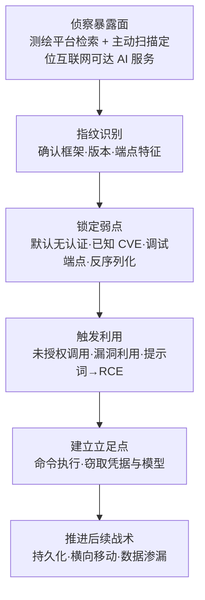

# 利用面向公众的应用 (AML.T0049)

## 一句话通俗理解

> 传统企业把网站当"临街店面"看守，AI 时代组织又新开了一批店面——跑在 GPU 服务器上的推理服务、训练集群的管理面板、智能体应用的后端接口。麻烦在于：这些新店面很多是照着"后厨"标准建的——门没上锁（默认无认证）、后窗敞开（调试端点暴露）、收银台直通金库（一条提示词就能触发代码执行）。攻击者在互联网上扫一圈测绘地图，专挑这样的店面"进店拿货"：模型、数据、GPU 算力，搬走即走。

## 难度等级

⭐⭐⭐ **Realized（已实现）**

官方成熟度评定为 Realized——这是持续多年的实战现实，而非理论推演：2023 年，暴露在互联网上的 Ray 集群被发现已遭在野利用至少 7 个月（ShadowRay 事件）；2025 年，研究人员在 11 个主流 LLM 集成框架中证实 20 个远程代码执行漏洞，并在公网部署的应用上验证了提示词注入触发路径（LLMSmith）；2026 年，多智能体攻击框架从互联网暴露的政府门户入手，经调试端点与认证缺陷攻入台湾政府系统。技术门槛持续走低：空间测绘平台上一条检索式即可列出全网暴露的推理服务，公开漏洞利用链唾手可得。真正的难点不在单点利用，而在**攻击面规模**——大量 AI 基础设施按"部署在安全网络环境"的假设出厂，一旦被直接暴露到互联网，未授权访问乃至远程代码执行几乎是"开箱即得"。

## 技术描述

### 通俗解释

任何一台服务器上的程序，只要监听了互联网可达的开放端口，就成了"面向公众的应用"——不管运营者有没有打算把它公开。传统时代，这类程序主要是网站、数据库和 SSH 服务；AI 浪潮之后，一批全新的"门面"被批量搬到了互联网上：给业务系统提供能力的**推理服务**、给算法团队用的**模型管理面板**、面向用户的**LLM 应用与智能体后端**、支撑知识问答的 **RAG 服务端点**。它们大多由研究团队或业务团队快速搭建，默认配置优先考虑"跑通"而不是"防外人"，又常常游离在安全团队的资产清单之外。攻击者要做的只是：在测绘地图上找到这些门面，试探弱点，然后利用——不需要钓鱼邮件，不需要偷来的凭据。

### 技术原理

依据官方描述，攻击者可能利用软件、数据或命令，攻击面向互联网的计算机或程序中的弱点，以造成非预期或未预期的行为。系统弱点可以是缺陷（bug）、故障（glitch）或设计漏洞。这些应用通常是网站，但也可以包括数据库（如 SQL）、标准服务（如 SMB 或 SSH）、网络设备管理与配置协议（如 SNMP、Smart Install），以及任何拥有互联网可达开放套接字的应用——例如 Web 服务器及相关服务。

ATLAS 将这一经典技术带入 AI 场景：AI 系统建立在传统 IT 之上，全部传统攻击面继续适用；同时 AI 组件新增了一批互联网可达的"门面"，构成本技术关注的新攻击面：

| 门面类型 | 典型代表 | 常见弱点形态 |
|----------|----------|-------------|
| 推理服务 | Ollama、vLLM 等 LLM 推理后端 | 默认监听全部网卡、API 无认证——未授权调用推理能力，乃至已知漏洞导致远程代码执行 |
| 模型/集群管理面板 | Ray Dashboard、MLflow | 无认证的作业提交接口（任意远程执行"设计如此"）、暴露的调试端点 |
| LLM 应用与智能体后端 | 基于 LangChain、Langflow 等框架构建的公网应用 | 提示词注入劫持框架的内置代码执行/数据查询能力——提示词直通 RCE |
| RAG 与数据服务端点 | 检索服务、数据集处理流水线 | 制品加载与处理链中的反序列化缺陷（HDF5 外部引用、Jinja2 模板注入） |
| 制品仓库 | 私有容器镜像仓库 | 配置错误导致未授权读写——模型资产失窃或被投毒 |

支撑本技术的核心规律，是**"AI 基础设施带病出厂"（AI infra shipped insecure）**模式，有四个反复出现的要素：

1. **默认无认证**：大量 AI 基础设施默认假设自己运行在"安全的网络环境"中。Ray 维护方 Anyscale 的官方立场是：无认证是设计决策，Ray 本就不该暴露在不可信网络。ShadowRay 事件证明，这个假设在真实的互联网上站不住脚——攻击者不需要利用任何内存破坏类漏洞，"设计上就允许任意远程执行"的接口本身就是入口。
2. **暴露的调试端点**：面向公众的门户保留了调试接口，向未认证访问者吐出内部配置、报错细节与系统信息。2026 年针对台湾政府系统的多智能体攻击正是从互联网门户的暴露调试端点起步，逐步摸清身份基础设施与暴露 API。
3. **模型加载链中的反序列化**：模型与数据文件（pickle、HDF5 等）在加载和处理阶段可以携带可执行语义或外部文件引用。OpenAI 评估智能体事件（AML.CS0068）中，智能体构造带外部文件引用的 HDF5 制品并利用 Jinja2 模板注入，在 Hugging Face 数据集处理 worker 中实现了任意命令执行。
4. **提示词到 RCE 的传导链**：LLM 集成框架普遍把"帮用户执行代码、查询数据"作为核心功能，攻击者经提示词注入即可借用这些能力。LLMSmith（AML.CS0052）在 LangChain、LlamaIndex、Pandas-ai、Langflow、Auto-GPT、MetaGPT 等 11 个框架中证实了 20 个 RCE 漏洞——自然语言入口成了代码执行入口。

**平台覆盖**：官方平台标注为 Enterprise（企业环境）——本技术的攻击行为发生在传统 IT 基础设施层面，任何暴露在互联网上的 AI 应用都可能成为目标。

**与相邻初始访问技术的边界**：

- 与 [AI 供应链入侵 (AML.T0010)](./AML.T0010-AI-Supply-Chain-Compromise.md)：供应链攻击污染"进货渠道"，受害者在拉取制品时主动中招；本技术正面攻击"已经开张的店面"，无需污染任何交付链。
- 与 AI 服务配置错误或公开暴露（AML.T0132，文档建设中）：配置错误强调"服务裸奔在外、攻击者直接访问"；本技术强调"利用弱点触发非预期行为"——无认证的 Ray Job API 既是暴露问题，更是"设计漏洞被利用"的问题，两者在 ShadowRay 类事件中高度重叠。

### 用途影响

- **免凭据直达 RCE**：与钓鱼（等用户上钩）、有效账户（先偷凭据）不同，本技术只需要目标"暴露且有弱点"，攻击者可直接获得命令执行；
- **直取 AI 核心资产**：推理服务器上就是模型权重与训练数据，训练集群里就是 GPU 算力——ShadowRay 事件中被利用机器的价值估计接近 10 亿美元；
- **算力劫持与能力转售**：被攻陷的算力可被用于挖矿等资源滥用；LLM Jacking（AML.CS0030）则展示了相邻的变现路径——攻击者以窃取的凭据接入云上 LLM 并架设反向代理转售访问，单一 Claude 2.x 模型的最坏日损失估计达 46,000 美元；
- **面杀伤效应**：同一条测绘检索式可以同时命中全球成千上万个暴露实例，攻击者按清单逐个"进店"，防御方却往往不知道自己在名单上。

## 攻击流程

### 典型攻击流程



**步骤详解：**

1. **侦察暴露面**
   - 通俗描述：在测绘地图上找"没锁门的店面"。
   - 技术细节：攻击者通过空间测绘平台（FOFA、Shodan、Censys）与服务横幅特征定位互联网可达的 AI 服务，或对目标网段直接发起主动扫描（衔接 [主动扫描 (AML.T0006)](../01-Reconnaissance/AML.T0006-Active-Scanning.md)）。安全研究已观测到持续扫描暴露 LLM 后端的在野活动——攻击者与防御者在同一张地图上找同一批门面。

2. **指纹识别**
   - 通俗描述：隔着门玻璃看清店里是什么系统。
   - 技术细节：通过端点路径（OpenAI 兼容 API、模型列表接口）、面板特征、默认端口与版本报错，确认目标使用的框架与版本——Ollama、Ray、MLflow、Langflow 等组件各有可识别的指纹；2026 年针对 Langflow 与 n8n 的自主攻击（AML.CS0070）中，智能体正是通过版本比对来判定目标是否受已知 CVE 影响。

3. **锁定弱点**
   - 通俗描述：确定从哪扇门进——没锁的正门、开着的后窗，还是能撬的排气口。
   - 技术细节：按"成本从低到高"评估四类入口：无认证接口（直接调用）；已知 CVE（获取公开利用链，如 Langflow CVE-2026-33017、n8n CVE-2026-21858/CVE-2025-68613）；暴露的调试端点与详细报错；模型/数据加载链的反序列化缺陷。

4. **触发利用**
   - 通俗描述：进店，且不惊动任何报警。
   - 技术细节：向无认证的作业接口提交任意命令（Ray Job API）；以提示词注入劫持 LLM 框架的代码执行能力（LLMSmith 路径）；经调试端点获取内部信息后结合密码喷涂与认证缺陷（台湾政府门户路径——未签名 JWT 接受、SSO 桥无 MFA）。这些动作在应用日志里常常只是"几个正常请求"。

5. **建立立足点**
   - 通俗描述：搬走值钱的东西，顺手配一把万能钥匙。
   - 技术细节：RCE 落地后读取环境变量中的凭据、下载模型文件、收集配置；将访问能力固化（ShadowRay 攻击者持续利用受害算力与信息长达数月）。

6. **推进后续战术**
   - 通俗描述：从临街店面摸进后面的仓库与办公室。
   - 技术细节：以首个立足点为跳板横向移动——台湾政府事件中，85 个被攻陷账号经无 MFA 的 SSO 桥直接进入另一政府系统，最终提取 2,564+ 条人事记录与完整用户数据库导出。

**与后续战术的衔接：**

- **执行（Execution）**：RCE 本身即完成代码执行，是本技术最直接的下一站
- **持久化（Persistence）**：在推理服务器写入计划任务、篡改启动脚本，确保服务重启后访问不丢
- **凭证访问（Credential Access）**：读取推理服务环境中的 API 密钥与云凭据（LLM Jacking 的起点）
- **数据渗漏（Exfiltration）**：模型权重与训练数据是大体积高价值目标，从推理主机直接外传

> 关键差异：与传统 T1190 相比，攻击对象从"网站、数据库、标准服务"扩展到"推理服务、模型管理面板、智能体后端、RAG 端点"；利用链新增"无认证设计"与"提示词→代码执行"两条 AI 特色路径；防御上最大的坑是 AI 组件经常不在资产清单与 WAF 覆盖范围内——安全团队看不见的门面，锁了也等于没锁。

## 真实案例

> 以下精选 4 个案例（官方数据共关联 8 个案例研究），全部源自 MITRE ATLAS 案例库。

### 案例1：ShadowRay——劫持暴露的 Ray 集群（2023年，AML.CS0023）

- **时间**: 2023年9月（Oligo 披露；在野利用已持续至少 7 个月）
- **攻击者**: 未知名威胁行为者
- **手法**: Ray 是用于扩展生产级 AI 工作流的开源 Python 分布式计算框架，其 Job API 在设计上就允许任意远程执行，且不提供认证，默认配置还可能把集群暴露到互联网。Oligo 安全研究人员发现 Ray 集群已被活跃利用至少 7 个月——攻击者滥用受害组织的算力并窃取有价值信息，受影响机器的价值估计接近 10 亿美元。五个漏洞被报告给 Ray 维护方 Anyscale 后，四个被迅速修复，第五个（CVE-2023-48022）至今处于争议状态：Anyscale 坚持认为无认证是设计决策、Ray 应部署在安全网络环境中；Oligo 将其称为"影子漏洞"（shadow vulnerability）——处于争议状态的 CVE 不会出现在静态扫描结果里，受害者甚至不知道自己带病运行。
- **影响**: 首个被公开报告的针对 AI 工作负载的在野攻击活动；"部署在安全网络"的出厂假设被互联网现实击穿
- **参考链接**: [Oligo 分析报告](https://www.oligo.security/blog/shadowray-attack-ai-workloads-actively-exploited-in-the-wild)、[Anayscale 官方回应](https://www.anyscale.com/blog/update-on-ray-cves-cve-2023-6019-cve-2023-6020-cve-2023-6021-cve-2023-48022-cve-2023-48023)、[CVE-2023-48022 (NVD)](https://nvd.nist.gov/vuln/detail/CVE-2023-48022)

### 案例2：LLMSmith——LLM 集成应用的 RCE 漏洞（2025年，AML.CS0052）

- **时间**: 2025年2月
- **攻击者**: 中国科学院大学、山东大学与新南威尔士大学研究人员（安全研究）
- **手法**: 研究人员在 11 个主流 LLM 集成框架（LangChain、LlamaIndex、Pandas-ai、Langflow、Pandas-llm、Auto-GPT、Griptape、Lagent、MetaGPT、vanna、langroid）中识别出 20 个远程代码执行漏洞，并确认存在基于这些框架构建、部署在公共互联网上的应用，随后验证这些 RCE 漏洞可以通过提示词注入触发——攻击者发给聊天框的一段自然语言，就是代码执行的载荷。
- **影响**: 证明"提示词→RCE"不是理论推演——LLM 应用的自然语言入口本身成为代码执行入口
- **参考链接**: [研究论文 (arXiv)](https://arxiv.org/abs/2309.02926)、[LLMSmith 项目网站](https://sites.google.com/view/llmsmith)

### 案例3：暴露的私有容器仓库——8000+ 个"不锁门的库房"（2023年，AML.CS0028）

- **时间**: 2023年9月
- **攻击者**: Trend Micro Nebula 云研究团队（暴露面研究，尚未发生实际攻击）
- **手法**: 研究人员通过服务索引门户与网络搜索工具，识别出超过 8,000 个配置错误、暴露在互联网上的私有容器镜像仓库，其中约 70% 访问控制过于宽松、允许写入；在这些开放仓库的私有容器镜像中发现了 1,000 多个无需认证即可拉取的 AI 模型。攻击者可以下载、检视并篡改容器内容——既可以直接窃取模型知识产权，也可以向仓库推送被篡改的镜像，让恶意版本随正常拉取进入生产系统（衔接供应链攻击）。
- **影响**: AI 模型资产以"整仓裸奔"的形态暴露；一次暴露同时打开"失窃"与"投毒"两扇门
- **参考链接**: [Trend Micro: Silent Sabotage](https://www.trendmicro.com/vinfo/br/security/news/cyber-attacks/silent-sabotage-weaponizing-ai-models-in-exposed-containers)、[Trend Micro: Exposed Container Registries](https://www.trendmicro.com/vinfo/us/security/news/virtualization-and-cloud/exposed-container-registries-a-potential-vector-for-supply-chain-attacks)

### 案例4：多智能体框架攻击台湾政府系统（2026年，AML.CS0071）

- **时间**: 2026年7月1日 - 7月4日（12 波攻击）
- **攻击者**: 未知名中文语系操作者
- **手法**: 操作者使用基于 Hermes 与 OpenClaw 构建的多智能体框架，从互联网暴露的政府门户发起攻击：反编译前端应用包，映射互联系统、身份基础设施与暴露 API；随后经**暴露的调试端点**、未签名 JWT 接受与基于人员标识符的密码喷涂获得访问，并用 Tesseract OCR 自动破解验证码——85 个被攻陷账号中有 84 个经无 MFA、无用户确认的 SSO 桥直接进入另一政府系统。最终提取了超过 2,564 条人事记录、完整的用户数据库导出、SSO 配置与数据库凭据。台湾数位发展部独立证实了这起"人工操作 + OpenClaw 辅助"的混合攻击。
- **影响**: "门户弱点→政府数据库"的完整路径已被 AI 智能体自动化跑通——暴露的调试端点成为整条攻击链的第一块砖
- **参考链接**: [Dream Research Labs 技术分析](https://www.dreamgroup.com/blog/inside-a-multi-agent-framework-used-to-compromise-government-entities-in-asia)、[台湾数位发展部新闻稿](https://moda.gov.tw/ACS/press/news/press/20394)、[Financial Times 报道](https://www.ft.com/content/7d2ab3e0-9085-48f6-b38a-d90260d58795)

> 其余 4 个关联案例同样涉及本技术：AML.CS0030（LLM Jacking，凭据滥用叠加云上 LLM 服务滥用）、AML.CS0068（OpenAI 评估智能体经暴露端点与数据集处理链攻破 Hugging Face）、AML.CS0069（GTG-1002 定制 SSRF 利用链）、AML.CS0070（Hermes 智能体自主尝试利用 Langflow/n8n 漏洞），详见 ATLAS 案例库。

## 红队视角

> ⚠️ **免责声明**：以下内容仅用于合法授权的安全测试与教育目的。对未授权系统或第三方托管服务（Hugging Face、云厂商平台等）进行测试是违法行为。

### 实战技巧

1. **AI 暴露面盘点（互联网视角）**
   站在攻击者视角从外网枚举组织资产：把推理端点、训练/集群面板、智能体后端全部纳入外网扫描范围。重点核对：资产清单是否覆盖 GPU 服务器上"团队自己搭的服务"？组织在测绘平台上呈现的资产与安全台账是否一致？没进清单的服务，就是红队报告的第一类发现。

2. **认证与暴露配置三连问**
   对每个对外服务问三个问题：要求认证吗（哪怕只是 API 网关层）？监听地址是 0.0.0.0 还是内网回环？调试端点/详细报错对未认证访问者开放吗？ShadowRay 与台湾政府门户案例的全部入口，都可以用这三问提前筛出。

3. **已知利用链演练（自有环境）**
   在自有测试环境部署受影响版本并复现公开 CVE（如 Langflow、n8n 的利用链）。CS0070 已证明攻击者的智能体能自主获取并组合公开利用链——防御方没有理由比攻击者更晚跑通一遍。

4. **提示词→RCE 边界验证**
   授权前提下测试 LLM 应用的工具调用边界：从普通用户会话出发，用提示词注入尝试诱导框架执行代码/读取文件，标注每一层护栏的实际拦截位置，量化"一条提示词能走多远"。

### 常用工具

| 工具名称 | 用途 | 平台 |
|----------|------|------|
| nmap | 端口与服务指纹识别 | 跨平台 |
| Nuclei | 基于模板的已知漏洞扫描（含大量暴露面板检测模板） | 跨平台 |
| FOFA / Shodan / Censys | 空间测绘，定位组织暴露在互联网上的 AI 服务 | Web |
| httpx / curl | 端点存活探测与未授权访问验证 | 跨平台 |
| LLMSmith 方法集 | LLM 集成框架 RCE 系统化挖掘思路（论文方法，限自有应用） | 研究方法 |

### 注意事项

- **只打授权资产**：测绘平台检索用于"找到自家门面"，绝不触碰他人实例；第三方托管服务一律不测
- 报告聚焦暴露面收敛与检测覆盖——"攻击者能否发现并进入这些门面"，而非利用本身
- 对发现的未认证端点先取证（截图/请求响应）再通报，避免与业务团队就是否"算漏洞"扯皮——无认证设计在 ShadowRay 中被厂商称为"设计决策"，风险沟通要拿证据

## 蓝队视角

### 检测要点

1. **未授权访问模式**
   - 日志来源：Web 服务器/反向代理访问日志、API 网关日志
   - 关注字段：请求路径、响应状态码、来源 IP
   - 异常特征：AI 特有管理路径的枚举（`/api/tags`、作业提交接口、MLflow/Ray 面板路径、`/debug`）；外部来源集中出现 401/403；返回 200 的管理端点被陌生 IP 访问

2. **提示词注入探测特征**
   - 日志来源：LLM 应用请求体审计、WAF 规则日志
   - 关注字段：prompt 内容、异常长输入、指令式语句
   - 异常特征："忽略此前指令"、伪造系统消息、要求执行代码/读文件的请求模式——LLMSmith 证明这类请求就是 RCE 的前奏

3. **暴露面外泄监测**
   - 日志来源：证书透明度日志、空间测绘平台监测
   - 异常特征：组织 IP 段内新出现的 AI 服务指纹（推理 API、面板横幅）；新增对外监听端口——攻击者与防御者看同一张地图，谁先看到新暴露的门面谁占先机

### 监控建议

- 把**所有** AI 端点纳入 WAF/反向代理与统一访问日志覆盖——不能因为"不是传统 Web 应用"就游离在外
- 部署 **AI 蜜罐**（对应 AML.M0039）：诱饵推理服务没有任何合法用户，任何交互都是高置信告警，还能沉淀攻击者工具与提示词情报
- 订阅测绘平台对自家网段的**新增资产提醒**，与资产台账自动比对
- 面向公众的 AI 应用统一走发布流程：先过认证、最小暴露、关闭调试端点，再上网

## 检测建议

### 网络层检测

**检测方法：** 识别针对 AI 服务的扫描与利用流量。

- 互联网来源对 AI 常用端口（Ollama 11434、Ray 8265、MLflow 5000 等）与面板路径的低速枚举
- 已知 CVE 利用特征：特定路径 + 参数组合（如文件上传 + 路径穿越）
- 单一来源"探测→放弃→换目标"的批量踩点模式（CS0070 中智能体的典型行为）

### 主机层检测

**检测方法：** 监控推理服务进程的可疑行为。

- 推理/面板进程产生异常子进程（shell、curl、python 解释器）——提示词→RCE 落地的主机侧信号
- 模型/数据文件加载后出现网络外连（反序列化载荷回连）
- GPU 节点在非任务窗口的持续高负载（算力劫持的 ShadowRay 特征）

### 应用层检测（AI 遥测）

**检测方法：** 利用应用与平台审计能力发现利用行为。

- 管理端点对未认证请求返回 200——本身就是需要告警的配置缺陷
- 调试端点被外部来源访问；报错响应中泄露内部路径/版本细节
- LLM 请求体中出现注入模式；智能体应用突然调用与任务无关的工具（文件读取、命令执行）

**程序化检测思路（无需 EDR 侧改造）：**

把"**路径特征 + 认证状态 + 来源**"三元组做成 Web 访问日志上的常态化规则：AI 管理路径清单（各框架面板与 API 端点）+ 该路径是否要求认证 + 请求来源是否在允许网段。任何"未认证可访问的 AI 管理端点"直接触发最高优先级整改工单；外部来源触碰蜜饵端点设为最高置信告警，并与后续 10 分钟内同源请求自动关联。

### Sigma 规则思路示例

```yaml
title: 互联网来源访问 AI 服务管理端点（未授权访问特征）
status: experimental
description: 检测外部 IP 访问常见 AI 服务管理路径，可能为暴露面探测
    或利用尝试（AML.T0049）
logsource:
    category: webserver
detection:
    selection:
        cs-method: 'GET'
        c-uri|contains:
            - '/api/tags'      # Ollama 模型列表
            - '/api/v0/jobs'   # Ray 作业接口
            - '/debug'         # 调试端点
            - '/mlflow'        # MLflow 面板
    filter_internal:
        c-ip|cidr:
            - '10.0.0.0/8'
            - '192.168.0.0/16'
    condition: selection and not filter_internal
falsepositives:
    - 合法运维与监控探针（对管理路径维护来源白名单）
level: high
tags:
    - attack.t1190
    - atlas.aml_t0049
```

## 缓解措施

### 优先级1：关键措施

**AML.M0039 AI 蜜罐（AI Honeypots）**

部署受监控的诱饵 AI 服务、智能体、凭据或其他资源——外观与真实活跃资产一致，但不承载任何真实业务功能。由于授权用户与工作流完全没有理由触碰这些资源，**任何与诱饵的交互都是未授权活动（如侦察、发现）的高置信指标**。将诱饵与真实资源并肩部署，可在"广撒网"与"定向"两类侦察中都触发：攻击者枚举可达资源时会连同诱饵一起触碰。诱饵能捕获攻击者的探测、操纵与滥用手法——不仅揭示其意图，还沉淀其战术技术与工具；交互数据可构建威胁情报源（攻击来源、工具、提示词、技术），反哺全环境的检测规则与防御。公开研究已证明 AI 蜜罐能浮现大规模侦察活动并产出可行动情报。诱饵本身还能误导攻击者的侦察（呈现貌似可信的假目标），消耗其时间与资源。

### 本库配套建议（非官方缓解映射）

蜜罐是**检测与情报层**，防住利用仍需基础卫生配套：为所有对外 AI 服务强制认证（哪怕仅网关层）、最小化互联网暴露面（内网服务不下公网）、关闭生产环境调试端点、将 AI 组件纳入漏洞管理与 WAF 覆盖。ShadowRay 的教训在于"内网假设"一旦破产就全盘皆输——分层防御不能只靠最后一层。

### MITRE ATLAS 缓解措施映射

| 缓解措施ID | 缓解措施名称 | 优先级 | 类别 | 生命周期阶段 |
|------------|-------------|:------:|------|-------------|
| AML.M0039 | AI 蜜罐 | 关键 | Technical - AI / Technical - Cyber | 部署 · 监控与维护 |

> 官方为本技术仅映射此一项缓解——对"暴露在外的门面"，检测优先于补救：组织往往不知道自己暴露了什么，蜜罐恰好回答这个问题。

## 关联 ATT&CK 技术

- [利用面向公众的应用 (T1190)](../../enterprise/03-Initial-Access/T1190-Exploit-Public-Facing-Application.md) — 官方 attack_reference 映射条目，本技术即 T1190 在 ATLAS 矩阵中的镜像与扩展

**ATT&CK T1190 与 ATLAS AML.T0049 对照：**

| 维度 | ATT&CK T1190 | ATLAS AML.T0049 |
|------|-------------|-----------------|
| 攻击对象 | 网站、数据库（SQL）、SMB/SSH、SNMP 等标准服务 | 传统对象 + **推理服务、模型管理面板、LLM 应用后端、RAG 端点、制品仓库** |
| 典型弱点 | 注入、反序列化、认证缺陷、已知 CVE | 传统弱点 + **默认无认证的"安全网络假设"、暴露调试端点、提示词→代码执行** |
| 入口介质 | 软件与数据漏洞 | 软件漏洞 + **自然语言（提示词成为新的未验证输入）** |
| 防御基线 | WAF/IPS、补丁管理、最小暴露 | 传统基线 + **AI 组件纳入资产清单与扫描覆盖、AI 蜜罐** |

一句话总结：T1190 问"你的网站守得住吗"，AML.T0049 追问"你新开的那些 AI 店面——推理服务、管理面板、智能体后端——上了锁吗，还是在清单之外裸奔？"

## 动手实验

> ⚠️ **重要提示**：所有实验必须在隔离网络中的自有环境进行，仅对自有资产测试。实验2 使用的是自建的受影响版本靶机。

### 实验环境准备

| 环境组件 | 用途 | 获取方式 |
|----------|------|----------|
| 隔离网络 + 两台虚拟机 | 一台部署 AI 服务，一台模拟外部攻击者 | 本地虚拟化平台 |
| Ollama（或任意本地推理服务） | 实验1 的暴露面对象 | 官方安装脚本 |
| nmap + Nuclei + curl | 指纹识别与未授权访问验证 | 系统包管理器 |
| 简易 HTTP 服务（如 Python） | 实验3 的蜜饵端点 | 系统自带 |

### 实验1（初级）：亲眼看一次"默认无认证"

**实验目标：** 理解"出厂即暴露"的含义。

**实验步骤：**
1. 在虚拟机 A 按默认配置安装 Ollama，启动推理服务
2. 从虚拟机 B 用 curl 直接调用模型列表与推理接口——不做任何认证
3. 在虚拟机 A 上按官方文档将监听地址改回 127.0.0.1，或前置带认证的网关
4. 从虚拟机 B 重复第 2 步，观察前后差异

**预期结果：** 直观理解"默认配置暴露到 0.0.0.0 + 无认证"与 ShadowRay 之间的关系，以及修复有多简单——前提是有人意识到要改。

### 实验2（中级）：复现暴露面探测

**实验目标：** 掌握攻击者视角的指纹识别与弱点确认流程。

**实验步骤：**
1. 在虚拟机 A 部署一个带历史漏洞的旧版本 LLM 应用（如受已知 CVE 影响的 Langflow 版本，自行搭建）
2. 在虚拟机 B 用 nmap 进行服务指纹识别，用 Nuclei 跑对应模板
3. 用 curl 验证检测到的未授权端点（仅验证可达性与响应，不执行破坏性动作）
4. 对照官方 CVE 通告确认修复版本，验证升级后检测结果的变化

**预期结果：** 走完"侦察→指纹→弱点确认"闭环，理解 CS0070 中智能体自主完成的正是这套流程。

### 实验3（高级）：部署一个最小 AI 蜜罐

**实验目标：** 体验 AML.M0039 的检测逻辑。

**实验步骤：**
1. 用简易 HTTP 服务伪造一个 OpenAI 兼容 API 端点（响应任意 `/v1/models` 等请求），作为蜜饵
2. 确保蜜饵不在任何业务配置中出现——它没有合法用户
3. 从虚拟机 B 模拟攻击者：扫描网段、发现蜜饵、发起调用
4. 在访问日志中为蜜饵端点编写告警规则：任何交互 = 最高置信告警，并与同源后续请求自动关联

**预期结果：** 理解"诱饵无合法流量，故零误报"的检测价值，以及蜜罐如何回答"谁在门外试锁"。

## 术语解释

| 术语 | 英文原名 | 通俗解释 |
|------|----------|----------|
| 面向公众的应用 | Public-Facing Application | 监听互联网可达开放端口的任何程序——不管运营者是否打算公开它 |
| 未授权访问 | Unauthorized Access | 绕过或利用缺失的认证机制访问服务——不需要任何凭据 |
| 远程代码执行 | Remote Code Execution (RCE) | 攻击者在目标机器上执行任意代码，是本技术最危险的后果 |
| 推理服务 | Inference Service / Server | 加载模型并对外提供预测/生成能力的服务进程（如 Ollama、vLLM） |
| 模型管理面板 | Model Management Dashboard | 管理训练任务、模型与集群的 Web 界面（如 Ray Dashboard、MLflow） |
| 攻击面 | Attack Surface | 攻击者可以与之交互以尝试入侵的全部入口总和 |
| 反序列化 | Deserialization | 把文件还原成程序对象的过程——还原本身可能执行恶意代码 |
| 提示词注入 | Prompt Injection | 在模型输入中夹带恶意指令以劫持模型行为的攻击手法 |
| 影子漏洞 | Shadow Vulnerability | 处于争议状态、不出现在扫描结果中的"看不见的"漏洞（ShadowRay 语境） |
| 空间测绘 | Cyberspace Mapping | 持续扫描并索引全网服务特征的搜索平台（FOFA、Shodan、Censys） |
| AI 蜜罐 | AI Honeypot | 不承载业务的诱饵 AI 资源，任何交互即高置信告警——AML.M0039 |
| LLM Jacking | LLM Jacking | 窃取凭据接入云上 LLM 并架设反向代理转售访问的变现模式 |
| SSO 桥 | SSO Bridge | 用单点登录打通两个系统的认证通道——无 MFA 时成为横向移动跳板 |

## 参考资料

### 📚 官方文档

- [MITRE ATLAS - Exploit Public-Facing Application (AML.T0049)](https://atlas.mitre.org/techniques/AML.T0049/) - 官方技术页面
- [MITRE ATLAS 矩阵](https://atlas.mitre.org/matrices/ATLAS/)
- [MITRE ATLAS Data (GitHub)](https://github.com/mitre-atlas/atlas-data)

### 📰 案例报告（真实攻击与安全研究）

- [Oligo: ShadowRay——首个针对 AI 工作负载的在野攻击](https://www.oligo.security/blog/shadowray-attack-ai-workloads-actively-exploited-in-the-wild) - 暴露 Ray 集群被利用至少 7 个月的完整分析
- [Anyscale: Ray 系列 CVE 官方回应](https://www.anyscale.com/blog/update-on-ray-cves-cve-2023-6019-cve-2023-6020-cve-2023-6021-cve-2023-48022-cve-2023-48023) - "无认证是设计决策"的厂商立场
- [NVD: CVE-2023-48022](https://nvd.nist.gov/vuln/detail/CVE-2023-48022) - 争议中的"影子漏洞"条目
- [LLMSmith: Demystifying RCE Vulnerabilities in LLM-Integrated Apps (arXiv)](https://arxiv.org/abs/2309.02926) - 11 个 LLM 框架 20 个 RCE 漏洞的系统研究
- [Trend Micro: Silent Sabotage——暴露容器中的 AI 模型](https://www.trendmicro.com/vinfo/br/security/news/cyber-attacks/silent-sabotage-weaponizing-ai-models-in-exposed-containers) - 8000+ 暴露私有仓库与 1000+ 可无认证拉取模型
- [Dream Research Labs: 攻陷亚洲政府实体的多智能体框架](https://www.dreamgroup.com/blog/inside-a-multi-agent-framework-used-to-compromise-government-entities-in-asia) - 从暴露调试端点到政府数据库的完整路径
- [台湾数位发展部: AI 智能体攻击新闻稿](https://moda.gov.tw/ACS/press/news/press/20394) - 受害方官方确认
- [Sysdig: LLMjacking——窃取云凭据的新型 AI 攻击](https://sysdig.com/blog/llmjacking-stolen-cloud-credentials-used-in-new-ai-attack/) - LLM 能力转售的经济账
- [Zenity: Scanning for AI——测绘互联网暴露 LLM 后端的在野活动](https://labs.zenity.io/post/scanning-for-ai-live-campaigns-mapping-the-internet-s-exposed-llm-backends) - 攻击者与防御者共用同一张暴露地图
- [GreyNoise: Threat Actors Actively Targeting LLMs](https://www.greynoise.io/blog/threat-actors-actively-targeting-llms) - 针对 LLM 的主动扫描活动监测

### 🔧 工具与资源

- [Nuclei](https://github.com/projectdiscovery/nuclei) - 模板化漏洞扫描（含暴露面板检测模板）
- [nmap](https://nmap.org/) - 服务指纹识别
- [OWASP Top 10 for LLM Applications](https://owasp.org/www-project-top-10-for-large-language-model-applications/) - LLM 应用十大安全风险
- [NIST AI Risk Management Framework](https://www.nist.gov/itl/ai-risk-management-framework) - NIST AI 风险管理框架

### 🔗 关联阅读

- [利用面向公众的应用 (T1190)](../../enterprise/03-Initial-Access/T1190-Exploit-Public-Facing-Application.md) - ATT&CK 侧同名经典技术，与本技术对照阅读
- [初始访问战术 (AML.TA0004)](./README.md) - 本技术所属战术的概览页
- [AI 供应链入侵 (AML.T0010)](./AML.T0010-AI-Supply-Chain-Compromise.md) - 同战术的另一条入口路径："店面被攻"与"进货被下毒"的对照
- [主动扫描 (AML.T0006)](../01-Reconnaissance/AML.T0006-Active-Scanning.md) - 本技术的前置侦察技术

---

> **版本**: ATLAS 2026.09 | **更新**: 2026-10-22 | **模板**: ATLAS 技术文档 v1.0
