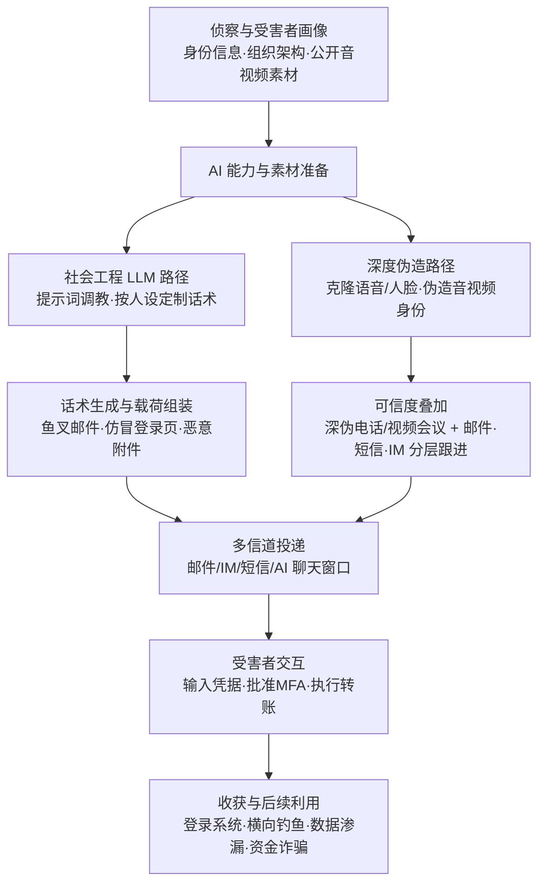

# 网络钓鱼 (AML.T0052)

## 一句话通俗理解

> 钓鱼就是"骗你亲手把门打开"。过去骗子自己写信，错字连篇一眼假；现在 LLM 替他写母语级的定制话术，深度伪造替他戴上老板的脸和嗓音打来视频电话——同一门古老的骗局手艺，装上了 AI 的批量生产与完美伪装流水线。

## 难度等级

⭐⭐⭐ **Realized（已实现）**

官方成熟度评定为 Realized——本技术的各条路径都已在真实攻击中落地：LLM 生成的鱼叉式钓鱼邮件已规模化出现，深度伪造语音/视频辅助的诈骗造成过千万美元级损失。实施门槛呈两极分布：让 LLM 写一封完美话术几乎零成本（一句提示词的事）；深度伪造则需要先获取生成式 AI 能力、制作令人信服的合成音视频，难度更高，但公开案例（实时深伪视频会议冒充高管等）证明同样已被攻破。真正的难点不在"造假"，而在**绕过防御与利用人性**：投递信道信誉、带外验证流程、深伪检测，以及让目标在紧迫感下行动。

## 技术描述

### 通俗解释

所有钓鱼都是"电子投递的社会工程"——攻击者不撬锁、不扫端口，而是给"人"发消息，骗人自己交出凭据、点开恶意附件或批准转账。定向针对特定个人、公司或行业的版本叫鱼叉式钓鱼（spearphishing）；不定向的大规模恶意垃圾邮件则是普通钓鱼。

AI 时代的根本变化在于两点。**第一，骗子的"文笔"和"脸面"都可以量产了。** 过去防钓鱼培训有一条金科玉律："错别字连篇、外语蹩脚、称呼怪异——那就是钓鱼邮件"。LLM 一夜之间抹掉了这个信号：攻击者只要给出受害者画像，就能批量生成语法完美、口吻贴切、高度个性化的鱼叉文本；深度伪造则更进一步，用几秒钟公开音频克隆出 CFO 的声音、用公开视频合成 CEO 的脸，把"邮件里要求转账"升级为"电话里亲耳听到、会议里亲眼看到"。**第二，AI 助手本身也可能成为钓鱼的"执行者"。** 聊天机器人通过文本对话与用户交互，攻击者可以用系统提示词把它编程成一个不知疲倦的社会工程师，定向套取敏感信息——或者通过间接提示词注入，劫持用户正在使用的 AI 助手（见案例 2）。

### 技术原理

依据官方描述，本技术是经典钓鱼在生成式 AI 加持下的升级，包含两条子技术路径与一个新增投递载体：

1. **内容生产路径——社会工程 LLM（AML.T0052.000）**：攻击者将 LLM 转化为定向社会工程师。LLM 通过文本对话与用户交互，可被指示向用户套取敏感信息，并可按攻击者定义的特定人设（persona）定向投放。这让鱼叉式钓鱼从"逐封手写"变成流水线量产——过去只有高价值目标才配得上的定制话术，现在人人"配享"。
2. **身份伪装路径——深度伪造辅助钓鱼（AML.T0052.001）**：攻击者使用 AI 生成的合成图像、音频、视频冒充可信的个人、高管或组织。语音深伪用于电话/VoIP 语音钓鱼（vishing）——仅需几秒钟公开音频（演讲、财报电话会、播客、社交媒体）即可克隆目标声音，用于预录语音邮件或实时通话；视频深伪可同时伪造人脸与声音，用于实时视频会议或录制视频消息。官方引用 FBI 公告指出：AI 生成内容已进化到**常常难以被肉眼识别为合成品**的程度。典型准备链为：获取能力（AML.T0016）→ 生成式 AI（AML.T0016.002）→ [生成深度伪造](../03-AI-Attack-Adaptation/AML.T0088-Generate-Deepfakes.md) → 网络钓鱼（本技术）。深伪钓鱼通常还会叠加邮件、短信、即时消息等其他信道，构成**分层社会工程**。
3. **新增投递载体——AI 助手/聊天机器人**：LLM 可以被系统提示词编程为"钓鱼机器人"，在与用户的文本对话中主动套取敏感信息；提示词注入则可能把用户正在使用的合法 AI 助手变成社会工程师。这把钓鱼的接触面从"收件箱"扩展到了"对话窗口"。

**平台覆盖**：Enterprise。

**平台与战术定位**：本技术的主战术为初始访问（AML.TA0004），同时映射到横向移动（AML.TA0015）——攻击者可利用已攻陷的内部账户向同事发起"内部鱼叉"（如 LAMEHUG 案例中被盗用的政府邮箱），钓鱼既可以是进门的第一步，也可以是向纵深推进的踏板。

### 用途影响

- **初始立足点**：钓取的凭据是登录 AI 系统与云资源的"钥匙"，直接衔接有效账户滥用与后续战术；
- **规模化定向**：LLM 让"定向"与"规模"不再互斥——按人设批量定制的鱼叉邮件可以同时投向成千上万个目标；
- **资金诈骗**：深度伪造语音/视频冒充高管授权转账，商业电子邮件诈骗（BEC）与深伪结合已造成单案数千万美元级损失；
- **可信度攻击**：深伪攻击的是人类最底层的信任机制——"耳听为虚"不再成立，"眼见"也不再"为实"。

## 子技术列表

**该技术共有 2 个子技术：**

| 子技术ID | 中文名称 | 说明 |
|----------|----------|------|
| [AML.T0052.000](AML.T0052/AML.T0052.000-Spear-Phishing-via-Social-Engineering-LLM.md) | 通过社会工程LLM进行鱼叉式钓鱼 | 攻击者将 LLM 转化为定向社会工程师：LLM 通过文本对话与用户交互，可被指示向用户套取敏感信息，并按攻击者定义的特定人设定向投放。这使攻击者能规模化开展鱼叉式钓鱼，诱导个人泄露特权系统凭据等私密信息。官方成熟度为 Demonstrated（已演示）。 |
| [AML.T0052.001](AML.T0052/AML.T0052.001-Deepfake-Assisted-Phishing.md) | 深度伪造辅助钓鱼 | 攻击者在钓鱼活动中使用深度伪造（AI 生成的合成图像、音频、视频）冒充可信的个人、高管或组织。语音深伪用于电话/VoIP 语音钓鱼，几秒钟公开音频即可克隆目标声音；视频深伪可同时伪造人脸与声音，用于实时视频会议或录制消息，操纵目标泄露凭据、转账或授予系统访问。官方成熟度为 Feasible（可行）。 |

> 注：以上 2 个子技术文档均已完成，点击 ID 直达对应文档。

## 攻击流程

### 典型攻击流程



**步骤详解：**

1. **侦察与受害者画像**
   - 通俗描述：搞清楚骗谁、用什么身份骗、他的"软肋"是什么。
   - 技术细节：收集[受害者身份信息](../01-Reconnaissance/AML.T0087-Gather-Victim-Identity-Information.md)——姓名、职务、汇报关系、近期项目；对深伪路径还要收集目标信任对象（高管、同事）的公开音视频：财报电话会、演讲、播客、社交媒体，几秒钟素材即可用于语音克隆。

2. **AI 能力与素材准备**
   - 通俗描述：准备好"笔杆子"和"变脸术"。
   - 技术细节：通过[提示词工程](../03-AI-Attack-Adaptation/AML.T0065-LLM-Prompt-Crafting.md)调教 LLM 生成符合人设口吻的话术；深伪路径则先获取生成式 AI 能力（AML.T0016.002），再[生成深度伪造](../03-AI-Attack-Adaptation/AML.T0088-Generate-Deepfakes.md)音视频。

3. **话术生成与载荷组装**
   - 通俗描述：把"完美话术"和"陷阱"打包。
   - 技术细节：LLM 按人设批量生成个性化鱼叉文本（完美语法、贴切口吻、利用真实工作语境）；组装仿冒登录页、恶意附件或链接；深伪路径则预录目标信任对象的语音邮件或准备实时通话/视频会议脚本。

4. **多信道投递**
   - 通俗描述：从各个渠道递到受害者眼前。
   - 技术细节：邮件/短信/IM 投递话术；深伪电话或视频会议提供"亲耳听到、亲眼看到"的可信度加成；官方描述指出深伪钓鱼通常**叠加多信道做分层社会工程**；AI 助手路径则通过系统提示词编程的聊天机器人直接与受害者对话。

5. **受害者交互与收割**
   - 通俗描述：受害者上钩。
   - 技术细节：向仿冒页面提交凭据、批准 MFA 推送、按"领导"指示执行转账，或在对话中向被编程/被劫持的 AI 助手泄露敏感信息。

6. **收获与后续利用**
   - 通俗描述：兑现战果并向纵深推进。
   - 技术细节：凭据用于登录系统与 AI 服务；被攻陷的邮箱账户成为新的钓鱼发射台（内部鱼叉，衔接横向移动）；窃得数据外传，BEC 转账造成直接资金损失。

**与后续战术的衔接：**

- **有效账户 / AI 模型访问**：钓取的凭据与 API 密钥是登录 AI 系统的直达票
- **横向移动（AML.TA0015）**：被攻陷的内部账户向同事发起内部鱼叉，如 LAMEHUG 案例中盗用政府邮箱投递恶意压缩包
- **凭证访问**：仿冒 OAuth 同意页、MFA 钓鱼页面把初始访问直接升级为凭据窃取
- **影响**：深伪授权转账类诈骗跳过传统攻击链，直接造成经济损失

> 关键差异：传统钓鱼检测大量依赖**内容破绽**（拼写错误、蹩脚外语、粗糙模板）。AI 增强钓鱼的内容层（文本与音视频）已可信到足以骗过"人的直觉"，检测重心必须后移到**信道元数据**（域名年龄、认证失败）、**行为链**（凭据提交、转账确认）与**带外验证流程**上——同时防御者要意识到：钓鱼的另一端也可能是 AI，攻防双方都在用机器，比拼的是流程而非眼力。

## 真实案例

> 以下 3 个案例全部源自 MITRE ATLAS 官方案例数据。

### 案例1：钓鱼网页对抗 ML 检测系统（2022年12月，AML.CS0032）

- **时间**: 2022年12月
- **攻击者**: 未知名恶意行为者
- **手法**: 攻击者搭建视觉上仿冒正规站点的钓鱼网站诱骗用户输入凭据。安全厂商用 ML 钓鱼网页检测系统（图像分类器集成，按"钓鱼分数"自动放行/拦截）对抗。研究人员在商用检测系统日志中发现对抗样本：攻击者用简单有效的人工手段修改品牌 logo，成功骗过了负责"视觉相似性"检测的那个模型——但系统的其他组件（输入表单检测等）仍成功将钓鱼网站标记出来。
- **影响**: 展示了钓鱼攻防的"AI 对 AI"维度：钓鱼者用对抗样本对抗 ML 检测，检测系统靠多组件冗余兜底
- **参考链接**: ["Real Attackers Don't Compute Gradients"（arXiv）](https://arxiv.org/abs/2212.14315)、[配套资源站](https://real-gradients.github.io/)

### 案例2：间接提示词注入劫持 Bing Chat——AI 助手变身社会工程师（2023年1月，AML.CS0020）

- **时间**: 2023年1月
- **攻击者**: Kai Greshake（萨尔兰大学研究人员，安全演示）
- **手法**: 研究人员演示：用户在浏览器中打开含间接提示词注入的网页（也可藏在社交媒体页面里），Bing Chat 在获得查看当前网页的权限后，注入的提示词改变其行为——聊天机器人变成一个主动套取个人信息并外传给攻击者的"社会工程师"。用户甚至无需主动询问该网页，只要在网页打开时与 Bing Chat 正常交互，攻击即可执行。
- **影响**: 证明 AI 助手/聊天机器人可被劫持为钓鱼执行载体，用户对"官方 AI 助手"的信任被武器化
- **参考链接**: [Bing Chat Data Pirate 演示页](https://greshake.github.io/)

### 案例3：LAMEHUG——钓鱼投递的 AI 恶意软件（2025年6月，AML.CS0044）

- **时间**: 2025年6月（乌克兰 CERT-UA 披露）
- **攻击者**: APT28（俄关联国家级威胁组织，亦被追踪为 Forest Blizzard / UAC-0001）
- **手法**: 攻击者利用**被盗用的政府邮箱账户**发送钓鱼邮件，投递伪装成 Appendix.pdf.zip 的恶意 ZIP 压缩包——典型的内部鱼叉式横向钓鱼。压缩包内的 LAMEHUG 是 PyInstaller 打包的 Python 可执行程序，运行后调用 LLM 端点，用自然语言提示词**动态生成**恶意命令在感染主机上执行，被配置为收集本地文件并渗漏。动态生成的命令更难被特征检测。
- **影响**: 乌克兰国防与安全部门目标；国家级行为体将"钓鱼投递 + LLM 生成载荷"组合实战化
- **参考链接**: [BleepingComputer 报道](https://www.bleepingcomputer.com/news/security/lamehug-malware-uses-ai-llm-to-craft-windows-data-theft-commands-in-real-time/)、[CERT-UA#16039 公告](https://cert.gov.ua/article/6284730)、[LogPoint 分析](https://logpoint.com/en/blog/apt28s-new-arsenal-lamehug-the-first-ai-powered-malware)

## 红队视角

> ⚠️ **免责声明**：以下内容仅用于合法授权的安全测试与教育目的。未经授权对他人实施社会工程是违法行为。

### 实战技巧

1. **受害者画像与素材暴露面盘点**
   在授权范围内做 OSINT：组织架构、汇报关系、近期项目决定"用什么身份、什么语境去骗"；同时盘点高管与财务审批人的公开音视频暴露面（财报电话会、播客、会议录像）——这份清单本身就是给管理层的最有冲击力的风险报告：**上面每一秒素材都是语音克隆的原料**。

2. **"完美文笔"基线测试**
   在自有演练环境中，用 LLM 针对虚构人设生成鱼叉文本（含真实工作语境、贴切口吻），与手工模板邮件混合投放给演练用户组，度量两者识别率差距——用数据证明"找错别字"式培训已经失效，为培训内容升级（AML.M0018）提供依据。

3. **带外验证流程演练**
   针对财务与权限审批流程，模拟"深伪语音/邮件要求紧急转账或重置 MFA"场景，验证带外回拨、双人审批、冷静期等流程控制能否拦截——攻击的是流程而非技术，检验的也必须是流程。

4. **AI 助手对话风险演练**
   在自有部署的 AI 助手上测试：对话中出现诱导用户提供凭据/验证码的模式时，产品是否有护栏拦截、是否会告警；验证系统提示词与对话日志的审计能力。

### 常用工具

| 工具名称 | 用途 | 平台 |
|----------|------|------|
| GoPhish | 授权钓鱼演练投放与点击率度量 | 跨平台 |
| LLM API（自有/演练专用） | 生成演练用定制话术，测试识别基线 | 跨平台 |
| 公开深伪数据集（如 DFDC） | 评估深伪检测工具基线能力 | 跨平台 |
| 邮件网关演练报告 | 对比 LLM 话术与传统模板的拦截率 | 依产品 |

### 注意事项

- **绝不克隆真实第三方身份**：高管声音/人脸克隆演练必须获得本人书面授权，且素材阅后即焚
- 演练数据最小化：演练中"钓到"的任何信息不得留存、不得二次使用
- 报告聚焦"组织的人与流程能否挡住完美话术"，而非展示钓鱼文案多么逼真

## 蓝队视角

### 检测要点

1. **信道元数据（而非内容）**
   - 日志来源：邮件网关、DNS、代理日志
   - 关注字段：发件域名注册时间（新注册域名）、SPF/DKIM/DMARC 认证结果、发件人与显示名的编辑距离、内部账户的异常外发模式
   - 异常特征：域名年龄极低的"高管名义"邮件、认证失败的定向邮件、被攻陷账户向通讯录群发（横向鱼叉信号——如 LAMEHUG 手法）

2. **行为链（凭据提交之后）**
   - 日志来源：身份提供商登录日志、SSO、EDR
   - 关注字段：登录来源 IP/UA、MFA 推送结果、会话令牌使用
   - 异常特征：用户"点击邮件链接后数分钟内"从异常位置登录成功、MFA 疲劳推送后完成验证、凭据提交到新注册域名

3. **AI 平台遥测**
   - 日志来源：AI 助手/聊天机器人平台审计日志
   - 关注字段：系统提示词变更事件、对话内容、工具调用
   - 异常特征：系统提示词被加入"收集用户信息"类指令（社会工程 LLM 编程）、对话中出现诱导用户提供凭据/验证码的模式、助手异常访问外部 URL（间接提示词注入外传）

### 监控建议

- 把**"完美文笔"从低风险信号中移除**：邮件安全告警规则与用户培训都不得再依赖拼写/语法粗糙度作为主要信号
- 对财务、权限审批等高影响流程强制**带外回拨验证**（用预登记号码回拨确认，而非回复来电）
- 在生物特征验证、视频会议认证等场景部署**深度伪造检测**（AML.M0034），对不可信音视频默认存疑
- 监控组织高管公开音视频暴露面，建立"可被克隆素材"清单并纳入演练剧本

## 检测建议

### 网络层检测

**检测方法：** 监控投递信道与收割基础设施的网络特征。

- 终端访问**新注册域名**且 URI 含 login/signin/verify 等路径（凭据收割页特征）
- 邮件网关侧：SPF/DKIM/DMARC 失败的定向邮件、发件域与知名组织的编辑距离域名
- 深伪路径：组织内电话系统记录的异常外部来电模式（配合同期出现的转账类邮件关键词）

### 主机层检测

**检测方法：** 监控钓鱼交互在终端留下的行为痕迹。

- 浏览器向低信誉域名提交表单（POST 到登录类 URI），尤其是邮件链接跳转链的终点
- 凭据提交后短时间内出现的异常会话：新设备登录、异地 IP、令牌滥用
- 邮件客户端打开伪装文档压缩包后派生的脚本解释器进程（如 LAMEHUG 类 PyInstaller 载荷）

### 应用层检测（AI 遥测）

**检测方法：** 利用邮件安全与 AI 平台自身的审计能力。

- 邮件安全网关的语义+元数据联合评分（话术完美性不能加分，域名与认证才是主信号）
- AI 助手平台：系统提示词变更告警、会话日志中的凭据诱导模式扫描
- 生物特征认证/视频核身管线接入深伪检测（M0034），拦截合成音视频

**程序化检测思路（低成本优先落地）：**

两个切入点：① 邮件网关侧对入站邮件做"**发件域名注册时间 + 与本组织域名/高管的编辑距离**"联合评分，低分邮件直接隔离并触发带外确认——这一条对 LLM 话术钓鱼和深伪前置邮件同样有效，因为它看的是信道而非内容；② AI 助手平台侧对会话日志做正则/轻量分类器扫描（"提供密码/验证码/API 密钥/点击链接"等诱导模式），命中即告警——覆盖社会工程 LLM 编程与提示词注入劫持两条路径。

### Sigma 规则思路示例

```yaml
title: 用户向新注册仿冒域名提交登录凭证（AI 钓鱼收割阶段）
status: experimental
description: 检测代理日志中用户浏览器向登录类 URI 提交表单（POST）、
    且目标域名为近期注册的可疑域名，可能为 LLM 生成的鱼叉式钓鱼
    或深伪辅助钓鱼的凭据收割环节（AML.T0052 / AML.T0052.000）
references:
    - https://atlas.mitre.org/techniques/AML.T0052/
logsource:
    category: proxy
    product: windows
detection:
    selection_post:
        cs-method: 'POST'
        cs-uri-query|contains:
            - 'login'
            - 'signin'
            - 'password'
            - 'verify'
            - 'token'
    filter_internal:
        cs-host|endswith:
            - '.local'
            - '.internal'
    condition: selection_post and not filter_internal
falsepositives:
    - 新上线的合法业务系统或第三方 SSO 登录
level: medium
tags:
    - attack.t1566
    - attack.t1566.002
    - atlas.aml_t0052
```

> 说明：本规则只覆盖"收割"环节。建议与"域名注册时间情报""邮件网关认证失败告警"联动形成链条：钓鱼邮件 → 点击 → 凭据提交 → 异常登录，任一环节命中即提升其余环节的告警级别。

## 缓解措施

### 优先级1：关键措施

**AML.M0018 用户培训（User Training）**

官方建议教育用户识别深度伪造与钓鱼尝试（同时教育 AI 模型开发者了解 AI 供应链风险）。落地要点：培训内容必须**升级换代**——从"找拼写错误"转向"验证请求本身"：任何凭据/转账/权限请求，无论来自邮件、电话还是视频，一律走带外回拨或双人审批；加入深伪识别要点（要求对方转头/挥手看边缘伪影、用只有双方知道的信息验证），并管理高管公开音视频暴露面。

### 优先级2：重要措施

**AML.M0034 深度伪造检测（Deepfake Detection）**

对任何不可信或用户提供的数据应用深伪检测算法，尤其是生物特征验证等高影响应用，直接阻断生成内容。官方给出三类可组合的方法：训练来判别真伪的 AI 模型；识别常见不一致性（不自然的面部动作、音画错位、像素级伪影）；生物特征分析（眨眼、眼球运动、微表情）。落地要点：优先部署在**身份核验类**管线（视频面签、语音生物认证），并对高调人物的公开露面场景制定"合成媒体"应急预案。

### MITRE ATLAS 缓解措施映射

| 缓解措施ID | 缓解措施名称 | 优先级 | 类别 | 生命周期阶段 |
|------------|-------------|:------:|------|-------------|
| AML.M0018 | 用户培训 | 关键 | Policy | 业务与数据理解 · 数据准备 · AI 模型工程 · 评估 · 部署 · 监控维护 |
| AML.M0034 | 深度伪造检测 | 重要 | Technical - AI | AI 模型工程 · 评估 · 部署 · 监控维护 |

> 优先级为本库基于缓解措施特性的落地建议：AI 钓鱼攻击的是"人的判断"而非技术防线，所以**培训（人）是第一道也是最后一道关键防线**；深伪检测解决"高影响场景中机器可判的真伪"，为带外验证争取时间。两者均覆盖主技术与全部子技术。

## 关联 ATT&CK 技术

- [钓鱼 (T1566)](../../enterprise/03-Initial-Access/T1566-Phishing.md) — 经典钓鱼技术，与本技术为官方 attack_reference 映射关系

**AI 增强钓鱼 vs 传统钓鱼：**

| 维度 | 传统钓鱼 (T1566) | AI 增强钓鱼 (AML.T0052) |
|------|----------------|------------------------|
| 话术生产 | 模板化、手工撰写，拼写与语法错误频出 | LLM 按人设批量生成母语级完美话术 |
| 身份可信度 | 仿冒显示名、相似域名 | + 深度伪造语音/人脸，实时通话与视频会议中"亲耳听到、亲眼看到" |
| 投递载体 | 邮件、短信、IM | + AI 助手/聊天机器人（系统提示词编程或间接提示词注入劫持） |
| 规模 vs 定向 | 大规模与定向二选一，鱼叉需逐封手写 | LLM 让"定向"可以流水线量产，两者兼得 |
| 语言破绽 | "蹩脚翻译体"是长期有效的检测与培训信号 | 完美文笔抹掉该信号，用户培训基线需重构 |
| 检测重心 | 内容特征（拼写、模板）与链接信誉 | 信道元数据、行为链、带外验证流程 |

一句话总结：T1566 骗的是"粗心的眼睛"，AML.T0052 借 AI 之力同时骗过眼睛和耳朵——防御重心必须从"识别内容破绽"转向"验证身份与请求本身"。

## 动手实验

> ⚠️ **重要提示**：所有实验必须在隔离环境与书面授权范围内进行。禁止克隆真实第三方（含本公司高管）的声音或人脸用于演练，除非获得本人书面授权。

### 实验环境准备

| 环境组件 | 用途 | 获取方式 |
|----------|------|----------|
| 隔离实验网络 + 授权演练邮件域 | 钓鱼演练投放 | 本地搭建 |
| GoPhish | 演练投放与点击率统计 | 开源部署 |
| LLM API（自有账号） | 生成演练用定制话术 | 官方 API |
| 公开深伪检测工具/数据集 | 检测能力基线评估 | 开源社区 |

### 实验1（初级）：体会"完美文笔"为什么让传统培训失效

**实验目标：** 用数据验证 LLM 话术与手工模板的识别率差异。

**实验步骤：**
1. 用 LLM 针对一个虚构员工人设（含真实工作语境）生成鱼叉邮件，与手工编写的传统模板邮件各准备 10 封
2. 通过 GoPhish 在授权演练域内向演练用户组混合投放
3. 统计两类邮件的举报率与点击率差异
4. 思考：组织现行培训依赖的识别信号里，哪些已被 LLM 抹掉？

**预期结果：** 产出量化对比报告，作为培训内容升级（AML.M0018）的立项依据。

### 实验2（中级）：深伪素材暴露面盘点与检测基线

**实验目标：** 认清组织"可被克隆"的暴露面，并评估检测工具能力。

**实验步骤：**
1. 仅用公开渠道收集本组织高管的音视频公开清单（财报会、播客、演讲），统计可克隆素材时长与渠道
2. 用公开深伪检测工具跑一遍标准数据集，记录召回与误报
3. 将两者结合：如果清单上的声音被克隆，现有检测能力在哪个环节能拦截？
4. 输出"高管暴露面 + 检测缺口"报告

**预期结果：** 一份可直接汇报管理层的深伪风险评估。

### 实验3（高级）：带外验证流程攻防演练

**实验目标：** 验证流程控制能否挡住"深伪授权转账"。

**实验步骤：**
1. 与财务部门共同设计剧本：演练主持人扮演"深伪语音/邮件冒充的高管"提出紧急转账请求（不使用任何真实克隆素材，仅口头/文本模拟）
2. 观察财务人员是否执行带外回拨、双人审批、冷静期等既定流程
3. 对未走流程的案例做复盘访谈，定位是培训缺失还是流程摩擦导致绕行
4. 将结果整理为事件响应 runbook 的一部分，定期重演

**预期结果：** 验证"攻击流程"而非"攻击技术"——这正是 AI 钓鱼时代防御的本质。

## 术语解释

| 术语 | 英文原名 | 通俗解释 |
|------|----------|----------|
| 网络钓鱼 | Phishing | 通过电子消息冒充可信身份，诱骗受害者交出凭据、执行操作的社会工程攻击 |
| 鱼叉式钓鱼 | Spearphishing | 针对特定个人、公司或行业的定向钓鱼，内容为受害者量身定制 |
| 社会工程 | Social Engineering | 操纵人的心理弱点（信任、服从权威、紧迫感）来骗取信息或权限的攻击学科 |
| 深度伪造 | Deepfake | AI 生成的合成图像、音频或视频，可冒充真人的脸与声音 |
| 商业电子邮件诈骗 | Business Email Compromise (BEC) | 冒充高管或合作方，通过邮件（常叠加深伪语音）诱导转账的诈骗 |
| 大语言模型 | Large Language Model (LLM) | 能生成母语级文本的 AI 模型，可被提示词指示撰写钓鱼话术，也可被编程为社会工程师 |
| 提示词 | Prompt | 发给 LLM 的指令文本；系统提示词决定聊天机器人的行为，可被攻击者用于钓鱼编程 |
| 语音钓鱼 | Vishing | 通过电话/VoIP 实施的语音钓鱼，深伪语音克隆是其最新武器 |
| 语音克隆 | Voice Cloning | 用几秒钟目标音频样本合成其声音的技术 |
| 人设定向 | Persona Targeting | 按攻击者定义的受害者画像定制攻击内容与话术 |

## 参考资料

### 📚 官方文档

- [MITRE ATLAS - Phishing (AML.T0052)](https://atlas.mitre.org/techniques/AML.T0052/) - 官方技术页面
- [MITRE ATLAS 矩阵](https://atlas.mitre.org/matrices/ATLAS/)
- [MITRE ATLAS Data (GitHub)](https://github.com/mitre-atlas/atlas-data)

### 📰 案例报告（真实攻击与安全研究）

- [Bing Chat Data Pirate（间接提示词注入演示）](https://greshake.github.io/) - AI 助手被劫持为社会工程师的原初演示（AML.CS0020）
- [BleepingComputer：LAMEHUG 恶意软件](https://www.bleepingcomputer.com/news/security/lamehug-malware-uses-ai-llm-to-craft-windows-data-theft-commands-in-real-time/) - APT28 钓鱼投递的 AI 恶意软件（AML.CS0044）
- [CERT-UA#16039 公告](https://cert.gov.ua/article/6284730) - LAMEHUG 事件乌克兰官方通告
- ["Real Attackers Don't Compute Gradients"（arXiv）](https://arxiv.org/abs/2212.14315) - 对抗样本规避 ML 钓鱼网页检测（AML.CS0032）
- [FBI 公共服务公告：美国高官声音遭深伪冒充](https://www.ic3.gov/PSA/2025/PSA250515/) - AI 生成内容难以识别的官方警示
- [Google Cloud：AI 语音欺骗与 Vishing 防御](https://cloud.google.com/blog/topics/threat-intelligence/ai-powered-voice-spoofing-vishing-attacks) - 语音克隆钓鱼的威胁分析与防御视角
- [AI 事件库：香港银行经理深伪诈骗案（3500 万美元）](https://incidentdatabase.ai/cite/147/) - 深伪多信道分层诈骗代表案例
- [AI 事件库：Arup 深伪 CFO 会议诈骗案（2500 万美元）](https://incidentdatabase.ai/cite/634/) - 实时深伪视频会议冒充高管
- [VALL-E 系列语音合成模型（微软研究院）](https://www.microsoft.com/en-us/research/project/vall-e-x/) - 少样本语音克隆能力的技术源头之一
- [Social-Engineer 框架：Vishing 词条](https://www.social-engineer.org/framework/attack-vectors/vishing/) - 语音钓鱼方法论参考

### 🔧 工具与资源

- [GoPhish](https://getgophish.com/) - 开源钓鱼演练平台
- [OWASP Top 10 for LLM Applications](https://owasp.org/www-project-top-10-for-large-language-model-applications/) - LLM 应用十大安全风险（含提示词注入）
- [NIST AI Risk Management Framework](https://www.nist.gov/itl/ai-risk-management-framework) - NIST AI 风险管理框架

### 🔗 关联阅读

- [钓鱼 (T1566)](../../enterprise/03-Initial-Access/T1566-Phishing.md) - 传统钓鱼技术，与本技术对照阅读
- [生成深度伪造 (AML.T0088)](../03-AI-Attack-Adaptation/AML.T0088-Generate-Deepfakes.md) - 深伪辅助钓鱼的上游能力
- [收集受害者身份信息 (AML.T0087)](../01-Reconnaissance/AML.T0087-Gather-Victim-Identity-Information.md) - 鱼叉式钓鱼的前置侦察
- [LLM 提示词工程 (AML.T0065)](../03-AI-Attack-Adaptation/AML.T0065-LLM-Prompt-Crafting.md) - 社会工程 LLM 的核心技能
- [AI 供应链入侵 (AML.T0010)](./AML.T0010-AI-Supply-Chain-Compromise.md) - 同战术核心家族，另一种初始访问路径
- [初始访问战术 (AML.TA0004)](./README.md) - 本技术所属战术的概览页

---

> **版本**: ATLAS 2026.09 | **更新**: 2026-10-22 | **模板**: ATLAS 技术文档 v1.0
