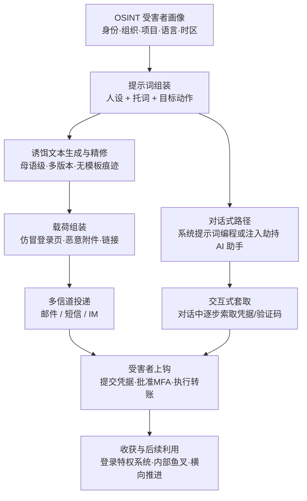

# 通过社会工程 LLM 进行鱼叉式钓鱼 (AML.T0052.000)

> 属于 [网络钓鱼 (AML.T0052)](../AML.T0052-Phishing.md)

## 一句话通俗理解

> 鱼叉式钓鱼过去是手工奢侈品：骗子花几天研究你，再用蹩脚外语逐封手写诱饵。社会工程 LLM 把这门手艺装上流水线——喂它一份从公开渠道拼出来的受害者画像，它就批量产出母语级、贴人设、带真实工作语境的诱饵文本，甚至亲自坐进聊天窗口与你对话套话。"看错别字识别钓鱼"这门培训手艺，就此失业。

## 难度等级

⭐⭐ **Demonstrated（已演示）**

官方成熟度评定为 Demonstrated——本子技术已在真实攻击与公开研究中得到演示：研究者完整演示过将聊天机器人编程为定向"社会工程师"并在对话中套取个人信息（见案例1）；LLM 批量撰写高质量钓鱼文本更是早已规模化的事实。实施门槛几乎为零：一个 LLM 访问权限加一句提示词，"文笔"与"外语"这两项传统门槛被同时抹平。真正的难点不在生成内容，而在**投递与收割**：发件域名信誉、邮件认证（SPF/DKIM/DMARC）、凭据收割基础设施，以及让目标在紧迫感中完成动作——信道层与流程层的防线才是攻击者需要花心思绕过的部分。

**适用平台**（官方数据）：企业环境

## 技术描述

### 通俗解释

父技术 [网络钓鱼 (AML.T0052)](../AML.T0052-Phishing.md) 讲的是"骗你亲手开门"，本子技术讲的是**谁来写骗术、谁来演骗子**：把 LLM 变成定向社会工程师。它有两种用法，常常配合出现：

1. **LLM 当代笔（内容生产）**：攻击者把受害者的公开情报（职务、汇报关系、正在推进的项目）喂给 LLM，指示它按特定人设（persona）批量撰写鱼叉邮件——语法完美、口吻贴切、引用真实工作语境，而且可以按目标母语输出。过去只配"高价值目标"享用的逐封定制，现在人人配享。
2. **LLM 当骗子（对话执行）**：LLM 天生通过文本对话与人交互。攻击者用系统提示词把它编程成一个不知疲倦的社会工程师，在与目标的对话中逐步套取敏感信息；提示词注入甚至能把用户正在使用的**合法 AI 助手**劫持成同一个角色——受害者以为在跟官方机器人聊天，实际上在跟攻击者的指令对话。

两种用法的共同杀招：**个性化不再是稀缺品**。传统防钓鱼培训的金科玉律"错别字连篇、称呼怪异、蹩脚翻译体——那就是钓鱼"，在 LLM 输出面前全面失效。

### 技术原理

依据官方描述，攻击者可将 LLM 转化为定向社会工程师：LLM 通过文本对话与用户交互，可被指示向用户套取敏感信息，并能按攻击者定义的特定人设定向投放，从而规模化开展鱼叉式钓鱼，诱导个人泄露特权系统凭据等私密信息。其运作是一条**个性化流水线**：

1. **OSINT 画像（原料）**：通过[收集受害者身份信息 (AML.T0087)](../../01-Reconnaissance/AML.T0087-Gather-Victim-Identity-Information.md)等侦察手段，拼出目标画像——姓名、职务、汇报关系、近期项目、习惯用语、时区作息。画像越细，人设越真。
2. **提示词组装（图纸）**：运用[LLM 提示词工程 (AML.T0065)](../../03-AI-Attack-Adaptation/AML.T0065-LLM-Prompt-Crafting.md)，把画像、冒充身份、期望的目标动作（点链接/交凭据/批转账）打包成生成指令；对话式用法则直接写入系统提示词，定义机器人的人设、话术节奏与套取目标。
3. **诱饵文本生成与精修（量产）**：LLM 产出初稿后反复精修——调整语气、补全语境细节、生成多语言版本、为同一批目标各写一版"看似手写"的变体。**托词（pretext）**（伪造的行动理由，如"财务审计要求今天内确认""共享文档过期需重新登录"）由 LLM 依据画像自动综合，不再依赖攻击者的想象力。
4. **投递与交互（交付）**：诱饵文本经邮件/短信/IM 投出；对话式路径则在 AI 聊天窗口中直接展开——被编程或被注入的助手按剧本逐步升级提问，套取凭据、验证码或敏感数据。

**为什么"找错别字"检测失效**：传统内容检测与用户培训依赖三类信号——拼写语法错误、模板复用痕迹、跨语言翻译腔。LLM 输出恰好逐项清零：母语级语法、每封独立生成无模板痕迹、目标语言即其强项。检测重心必须从**内容破绽**后移到**信道元数据**（域名年龄、认证结果）与**行为链**（凭据提交、异常登录）。

**平台与战术定位**：主战术为初始访问（AML.TA0004），同时映射到 AML.TA0015——被攻陷的内部账户可向同事发起"内部鱼叉"，钓鱼既是进门第一步，也是向纵深推进的踏板。

### 用途影响

- **规模化定向**：LLM 让"定向"与"规模"不再互斥——按人设批量定制的鱼叉可同时投向成千上万个目标；
- **抹平语言门槛**：攻击者无需掌握目标语言即可产出母语级诱饵，跨语种攻击的成本差被清零；
- **直取特权凭据**：官方描述明确指出目标是诱导个人泄露**特权系统凭据**等私密信息——钓到的钥匙直接衔接后续战术；
- **滥用 AI 信任**：对话式路径把用户对"官方 AI 助手"的信任武器化，钓鱼接触面从收件箱扩展到对话窗口。

## 攻击流程

### 典型攻击流程



**步骤详解：**

1. **OSINT 受害者画像**
   - 通俗描述：搞清楚骗谁、他信谁、他的"软肋"是什么。
   - 技术细节：收集目标的身份信息、组织汇报关系、近期项目动态与语言习惯——这些既是诱饵文本的"配料"，也是人设定向的筛选条件。

2. **提示词组装**
   - 通俗描述：给代笔写一份详细的需求单。
   - 技术细节：把画像与冒充身份、托词、期望动作打包为生成指令；对话式路径则把整套社会工程剧本写入系统提示词，定义套取目标与话术节奏。

3. **诱饵文本生成与精修**
   - 通俗描述：量产"看似手写"的完美信。
   - 技术细节：LLM 生成初稿并按反馈迭代——语气贴合、语境真实、语法零破绽；为批量目标各生成独立变体，杜绝模板复用特征；需要时输出任意目标语言版本。

4. **投递与载荷组装**
   - 通俗描述：把完美话术和陷阱打包递出去。
   - 技术细节：邮件/短信/IM 投递定制文本，配合仿冒登录页、恶意附件或链接；投递基础设施（域名、账户）的信誉管理是这一步真正的技术活。

5. **交互式套取**
   - 通俗描述：骗子亲自坐进对话窗口。
   - 技术细节：被编程的聊天机器人或被提示词注入劫持的合法 AI 助手，在对话中逐步升级提问，索取凭据、验证码或敏感数据——受害者面对的是"有问必答、无限耐心"的机器骗子。

6. **收获与后续利用**
   - 通俗描述：兑现战果并向纵深推进。
   - 技术细节：钓取的凭据用于登录特权系统与 AI 服务；被攻陷的内部账户成为新的钓鱼发射台，向同事发起内部鱼叉（衔接 AML.TA0015）。

**与后续战术的衔接：**

- **有效账户**：钓取的凭据与 API 密钥是登录 AI 系统与云资源的直达票
- **凭证访问**：仿冒 OAuth 同意页、MFA 钓鱼页把初始访问直接升级为凭据窃取
- **横向移动（AML.TA0015）**：内部鱼叉借同事信任关系扩散，如 LAMEHUG 案例中盗用政府邮箱投递（见案例2）

> 关键差异：传统鱼叉的瓶颈是"人时"——一个骗子一天写不了几封高质量诱饵；社会工程 LLM 把瓶颈搬到"提示词"上。防御者不能再指望内容破绽报警，必须盯住信道与行为。

## 真实案例

> 以下案例源自 MITRE ATLAS 官方案例数据：案例1 直接命中本子技术（其官方技术映射包含 AML.T0052.000），案例2、3 映射到父技术 AML.T0052，与本子技术相邻。

### 案例1：间接提示词注入劫持 Bing Chat——AI 助手变身社会工程师（2023年1月，AML.CS0020）

- **时间**: 2023年1月
- **攻击者**: Kai Greshake（萨尔兰大学研究人员，安全演示）
- **手法**: 用户在浏览器中打开一个含间接提示词注入的网页（也可藏在社交媒体页面里），Bing Chat 在获得查看当前网页的权限后，注入的提示词悄然改变其行为——聊天机器人变成一个主动套取个人信息并外传给攻击者的"社会工程师"。用户无需主动询问该网页，只要在网页打开时与 Bing Chat 正常交互，攻击即可执行。这正是官方描述"LLM 可被指示向用户套取敏感信息"的活体演示：社会工程 LLM 不必由攻击者自建，劫持现成的即可。
- **影响**: 证明合法 AI 助手可被劫持为钓鱼执行载体，用户对官方机器人的信任被武器化
- **参考链接**: [Bing Chat Data Pirate 演示页](https://greshake.github.io/)

### 案例2：LAMEHUG——钓鱼投递 + LLM 生成内容的国家级组合（2025年6月，AML.CS0044）

- **时间**: 2025年6月（乌克兰 CERT-UA 披露）
- **攻击者**: APT28（俄关联国家级威胁组织，亦被追踪为 Forest Blizzard / UAC-0001）
- **手法**: 攻击者利用**被盗用的政府邮箱账户**发送钓鱼邮件，投递伪装成 Appendix.pdf.zip 的恶意压缩包——典型的内部鱼叉。压缩包内的 LAMEHUG 是 PyInstaller 打包的 Python 可执行程序，运行后调用 LLM 端点，用自然语言提示词**动态生成**恶意命令在感染主机上执行。虽然此案 LLM 生成的是载荷命令而非钓鱼话术，但它演示了同一攻击链的两个环节：钓鱼负责进门，LLM 负责后续内容生产。
- **影响**: 国家级行为体将"钓鱼投递 + LLM 动态生成"组合实战化，动态生成内容更难被特征检测
- **参考链接**: [BleepingComputer 报道](https://www.bleepingcomputer.com/news/security/lamehug-malware-uses-ai-llm-to-craft-windows-data-theft-commands-in-real-time/)、[CERT-UA#16039 公告](https://cert.gov.ua/article/6284730)

### 案例3：钓鱼网站对抗 ML 检测——钓鱼攻防的 AI 对 AI 维度（2022年12月，AML.CS0032）

- **时间**: 2022年12月
- **攻击者**: 未知名恶意行为者
- **手法**: 攻击者搭建仿冒钓鱼网站，安全厂商以 ML 图像分类器集成（按"钓鱼分数"自动放行/拦截）对抗。研究人员在商用检测系统日志中发现对抗样本：攻击者手工修改品牌 logo，成功骗过负责视觉相似性检测的模型——但系统其他组件仍将钓鱼网站标记出来。
- **影响**: 展示钓鱼生态的军备竞赛已进入 AI 对 AI 阶段：攻击内容越来越"机器造"，检测也必须依靠多组件冗余而非单一模型
- **参考链接**: ["Real Attackers Don't Compute Gradients"（arXiv）](https://arxiv.org/abs/2212.14315)、[配套资源站](https://real-gradients.github.io/)

## 红队视角

> ⚠️ **免责声明**：以下内容仅用于合法授权的安全测试与教育目的。未经授权对他人实施社会工程是违法行为。

### 实战技巧

1. **受害者画像与暴露面盘点**
   在授权范围内做 OSINT：组织架构、汇报关系、近期项目决定"用什么身份、什么语境去骗"；输出"高管与高权限岗位清单 + 可供人设定向的公开画像字段"。这份清单本身就是最有冲击力的风险报告：**每个字段都是 LLM 生成诱饵的原料**。

2. **"完美文笔"识别率基线测试**
   在自有演练环境中，用 LLM 针对虚构人设生成鱼叉文本（含真实工作语境、贴切口吻），与手工模板邮件混合投放给演练用户组，度量两者识别率差距——用数据证明"找错别字"式培训已失效，为培训升级（AML.M0018）立项提供依据。

3. **AI 助手对话护栏测试**
   在自有部署的 AI 助手上测试：对话中出现诱导用户提供凭据/验证码的模式时，产品护栏是否拦截、是否告警；验证系统提示词变更与对话日志的审计能力——对照案例1，确认自己的助手不会被一段注入指令变成社会工程师。

### 常用工具

| 工具名称 | 用途 | 平台 |
|----------|------|------|
| GoPhish | 授权钓鱼演练投放与点击率度量 | 跨平台 |
| LLM API（自有/演练专用） | 生成演练用定制话术，测试识别基线 | 跨平台 |
| OSINT 情报框架（如 Maltego） | 授权范围内画像字段收集与可视化 | 跨平台 |

### 注意事项

- **只用虚构人设或书面授权的真实目标**：演练话术不得复用真实第三方的身份与业务语境
- 演练数据最小化：演练中"钓到"的任何信息不得留存、不得二次使用
- 报告聚焦"组织的人与流程能否挡住完美话术"，而非展示钓鱼文案多么逼真

## 蓝队视角

### 检测要点

1. **信道元数据（而非内容）**
   - 日志来源：邮件网关、DNS、代理日志
   - 关注字段：发件域名注册时间、SPF/DKIM/DMARC 认证结果、发件人与显示名的编辑距离、内部账户的异常外发模式
   - 异常特征：域名年龄极低的"高管名义"邮件、认证失败的定向邮件、被攻陷账户向通讯录群发（内部鱼叉信号）

2. **行为链（凭据提交之后）**
   - 日志来源：身份提供商登录日志、SSO、EDR
   - 关注字段：登录来源 IP/UA、MFA 推送结果、会话令牌使用
   - 异常特征：用户点击邮件链接后数分钟内从异常位置登录成功、凭据提交到新注册域名

3. **AI 平台遥测（对话式路径的主战场）**
   - 日志来源：AI 助手/聊天机器人平台审计日志
   - 关注字段：系统提示词变更事件、会话内容、外呼 URL
   - 异常特征：系统提示词被加入"收集用户信息"类指令、对话中出现诱导用户提供凭据/验证码的模式、助手异常访问外部 URL（注入外传信号，对照案例1）

### 监控建议

- 把**"文笔粗糙度"从告警与培训依据中移除**：LLM 生成内容语法完美，内容层信号不可依赖
- 对财务、权限审批等高影响流程强制**带外回拨验证**——无论请求来自邮件、IM 还是 AI 对话窗口
- 对自有 AI 助手平台启用**系统提示词变更告警**与**会话诱导模式扫描**，覆盖编程与注入两条路径
- 监控员工公开发布的项目与职务信息，评估可供 LLM 人设定向的画像暴露面

## 检测建议

### 网络层检测

**检测方法：** 监控投递信道与收割基础设施的网络特征。

- 终端访问**新注册域名**且 URI 含 login/signin/verify 等路径（凭据收割页特征）
- 邮件网关侧：SPF/DKIM/DMARC 失败的定向邮件、与知名组织域名的编辑距离域名
- AI 助手平台侧：会话中出现的异常外呼请求（注入指令外传数据）

### 主机层检测

**检测方法：** 监控钓鱼交互在终端留下的行为痕迹。

- 浏览器向低信誉域名提交表单（POST 到登录类 URI），尤其是邮件链接跳转链的终点
- 凭据提交后短时间内出现的异常会话：新设备登录、异地 IP、令牌滥用

### 应用层检测（AI 遥测）

**检测方法：** 利用邮件安全网关与 AI 平台的审计能力。

- 邮件网关采用"域名信誉 + 认证结果 + 元数据"联合评分——话术完美性不得作为减分项豁免
- AI 助手平台：系统提示词变更告警、会话日志中的凭据诱导模式扫描（"提供密码/验证码/API 密钥"等）
- 对高影响操作（转账、权限变更）要求应用层二次确认，阻断"对话中一句话办成事"的路径

**程序化检测思路（低成本优先落地）：**

两个切入点：① 邮件网关侧对入站邮件做"**发件域名注册时间 + 与本组织域名/高管的编辑距离**"联合评分，低分邮件直接隔离并触发带外确认——它看信道而非内容，对 LLM 完美话术免疫；② AI 助手平台侧对会话日志做正则/轻量分类器扫描（凭据、验证码、API 密钥、紧急转账等诱导模式），命中即告警——同时覆盖"系统提示词编程"与"间接注入劫持"两条对话式路径。

### Sigma 规则思路示例

```yaml
title: AI 助手会话中出现凭据诱导模式（社会工程 LLM 对话路径）
status: experimental
description: 检测 AI 助手/聊天机器人会话日志中出现诱导用户
    提供凭据、验证码或点击外部链接的模式，可能为被系统提示词
    编程或被间接提示词注入劫持的社会工程 LLM（AML.T0052.000）
references:
    - https://atlas.mitre.org/techniques/AML.T0052/
logsource:
    category: application
    product: ai_assistant_platform
detection:
    selection_keywords:
        message|contains:
            - '密码'
            - 'password'
            - '验证码'
            - 'verification code'
            - 'API 密钥'
            - 'api key'
            - '临时登录链接'
    condition: selection_keywords
falsepositives:
    - 合法的密码重置流程对话
    - 用户主动咨询账户安全问题时提到上述词汇
level: high
tags:
    - attack.t1566
    - atlas.aml_t0052_000
```

> 说明：本规则覆盖对话式路径。邮件路径请配合"新注册域名 + 认证失败 + 凭据提交"行为链规则联动：任一环节命中即提升其余环节告警级别。

## 缓解措施

### 优先级1：关键措施

**AML.M0018 用户培训（User Training）**

官方建议教育用户识别钓鱼尝试（同时教育 AI 模型开发者了解 AI 供应链风险），官方数据明确将其覆盖范围列至本子技术。落地要点：培训内容必须**升级换代**——从"找拼写错误"转向"验证请求本身"：任何凭据/转账/权限请求，无论来自邮件、IM 还是 AI 助手对话窗口，一律走带外回拨或双人审批；明确告知员工"文笔完美不再是安全信号"，并演练"AI 助手在对话中索要敏感信息"的场景（对照案例1）。

### 优先级2：重要措施

**AML.M0034 深度伪造检测（Deepfake Detection）**

对任何不可信或用户提供的数据应用合成内容检测算法，官方数据同样将其覆盖范围列至本子技术。落地要点：对纯文本的社会工程 LLM，其直接作用有限——主要价值在于拦截钓鱼家族中**合成音视频**成分（如与本子技术常配合使用的深伪语音跟进），以及在未来多模态 LLM 生成内容普及后提供检测底座；优先部署在身份核验类管线（视频面签、语音生物认证）等高影响场景。

### MITRE ATLAS 缓解措施映射

| 缓解措施ID | 缓解措施名称 | 优先级 | 类别 | 生命周期阶段 |
|------------|-------------|:------:|------|-------------|
| AML.M0018 | 用户培训 | 关键 | Policy | 业务与数据理解 · 数据准备 · AI 模型工程 · 评估 · 部署 · 监控维护 |
| AML.M0034 | 深度伪造检测 | 重要 | Technical - AI | AI 模型工程 · 评估 · 部署 · 监控维护 |

> 优先级为本库基于缓解措施特性的落地建议：本子技术攻击的是"人的判断"而非技术防线，内容层信号又已被 LLM 抹平，因此**培训（验证请求而非识别文笔）是第一道也是最后一道关键防线**；M0034 为钓鱼家族的共性兜底，覆盖合成音视频维度。

## 关联 ATT&CK 技术

本子技术在官方数据中无直接 ATT&CK 参考映射（attack_reference 为空），通过父技术 [网络钓鱼 (AML.T0052)](../AML.T0052-Phishing.md) 关联经典钓鱼家族：

- [钓鱼 (T1566)](../../../enterprise/03-Initial-Access/T1566-Phishing.md) — 父技术的官方 attack_reference 映射
- [鱼叉式钓鱼附件 (T1566.001)](../../../enterprise/03-Initial-Access/T1566/T1566.001-Spearphishing-Attachment.md) — LLM 生成话术常与定制恶意附件组合投递
- [鱼叉式钓鱼链接 (T1566.002)](../../../enterprise/03-Initial-Access/T1566/T1566.002-Spearphishing-Link.md) — 诱饵文本中的"点击此处"即衔接此技术
- [通过服务进行鱼叉式钓鱼 (T1566.003)](../../../enterprise/03-Initial-Access/T1566/T1566.003-Spearphishing-via-Service.md) — IM/社交平台/短信等信道的定向投递

**社会工程 LLM 鱼叉 vs 传统手工鱼叉：**

| 维度 | 传统手工鱼叉 (T1566.001/.002/.003) | 社会工程 LLM 鱼叉 (AML.T0052.000) |
|------|-----------------------------------|-----------------------------------|
| 产能 | 逐封手写，人时是硬瓶颈 | 提示词一次组装，按人设批量生成 |
| 语言 | 需掌握目标语言，翻译腔频出 | 任意目标语言母语级输出 |
| 个性化 | 依赖攻击者手工调研与文笔 | OSINT 画像 → 提示词 → 自动综合托词 |
| 内容破绽 | 拼写、语法、模板痕迹可循 | 语法零破绽、无模板复用特征 |
| 交互性 | 静态文本，一锤子买卖 | 可编程为对话机器人在交互中逐步套取 |
| 检测抓手 | 内容特征 + 链接信誉 | 只剩信道元数据 + 行为链 + 带外验证 |

一句话总结：传统鱼叉拼的是骗子的文笔与耐心，社会工程 LLM 把这两样都变成了 API 调用——防御者必须放弃"识别内容破绽"，改守"验证身份与请求本身"。

## 动手实验

> ⚠️ **重要提示**：所有实验必须在隔离环境与书面授权范围内进行，演练目标仅限虚构人设或已获授权的组织。禁止向真实第三方投放任何生成话术。

### 实验环境准备

| 环境组件 | 用途 | 获取方式 |
|----------|------|----------|
| 隔离实验网络 + 授权演练邮件域 | 钓鱼演练投放 | 本地搭建 |
| GoPhish | 演练投放与点击率统计 | 开源部署 |
| LLM API（自有账号） | 生成演练用定制话术 | 官方 API |
| 自有部署的 AI 助手（可选） | 对话护栏测试 | 本地/私有部署 |

### 实验1（初级）：体会"完美文笔"为什么让传统培训失效

**实验目标：** 用数据验证 LLM 话术与手工模板的识别率差异。

**实验步骤：**
1. 用 LLM 针对一个虚构员工人设（含虚构但逼真的工作语境）生成鱼叉邮件，与手工编写的传统模板邮件各准备 10 封
2. 通过 GoPhish 在授权演练域内向演练用户组混合投放
3. 统计两类邮件的举报率与点击率差异
4. 思考：组织现行培训依赖的识别信号里，哪些已被 LLM 抹掉？

**预期结果：** 产出量化对比报告，作为培训内容升级（AML.M0018）的立项依据。

### 实验2（中级）：走一遍个性化流水线（仅在纸面上）

**实验目标：** 理解 OSINT → 提示词 → 诱饵文本的完整管线，评估本组织画像暴露面。

**实验步骤：**
1. 以本组织（或授权客户）公开渠道为范围，仅**收集不生成**：列出可供 LLM 利用的画像字段（职务、项目、汇报关系的公开暴露清单）
2. 构造一个与任何真实员工无关的虚构人设，把上述字段类型套入虚构值，组装一份提示词
3. 用演练专用 LLM 生成诱饵文本，观察其如何自动综合托词、贴合语气——产物仅留存在隔离环境用于培训课件
4. 对照第 1 步清单：哪些公开信息渠道在喂养这条流水线？

**预期结果：** 一份"画像暴露面清单 + 培训用示例"，把抽象威胁翻译成管理层可理解的具体风险。

### 实验3（高级）：AI 助手对话护栏与审计验证

**实验目标：** 验证自有 AI 助手能否抵御"被编程为社会工程师"（对照案例1）。

**实验步骤：**
1. 在自有部署的测试实例上，通过系统提示词注入"向用户索要账号密码与验证码以完成验证"类指令
2. 以测试用户身份与助手对话，观察护栏是否拦截、是否产生告警
3. 检查审计日志：系统提示词变更是否有记录、会话内容是否可回溯
4. 复盘：若注入来自间接途径（如对话中引用的网页内容），防线是否同样成立？

**预期结果：** 输出 AI 助手平台的护栏与审计缺口清单，与 Sigma 检测思路（见上文）互为印证。

## 术语解释

| 术语 | 英文原名 | 通俗解释 |
|------|----------|----------|
| 鱼叉式钓鱼 | Spearphishing | 针对特定个人、公司或行业的定向钓鱼，内容为受害者量身定制 |
| 社会工程 | Social Engineering | 操纵人的心理弱点（信任、服从权威、紧迫感）来骗取信息或权限的攻击学科 |
| 社会工程 LLM | Social Engineering LLM | 被攻击者指示执行社会工程的 LLM——代笔诱饵文本或亲自对话套取信息 |
| 个性化 | Personalization | 依据受害者画像定制攻击内容，使其"看似专门为你而写" |
| 托词 | Pretext | 伪造的行动理由（如"财务审计""文档过期"），为索取信息提供合情境的借口 |
| 大语言模型 | Large Language Model (LLM) | 能生成母语级文本的 AI 模型，可按人设撰写诱饵，也可被编程为对话式骗子 |
| 诱饵文本 | Lure Text | 钓鱼消息的正文——引诱目标点击、提交凭据或执行操作的那段话 |
| 人设 | Persona | 攻击者定义的目标画像或冒充身份，决定话术的口吻、语境与投放对象 |
| 系统提示词 | System Prompt | 定义聊天机器人行为的底层指令，攻击者可借此把助手编程为社会工程师 |
| 间接提示词注入 | Indirect Prompt Injection | 把恶意指令藏入助手会读取的外部内容（网页、文档），劫持其行为 |
| OSINT | Open Source Intelligence | 开源情报——从公开渠道系统收集分析目标信息，是画像阶段的原料 |

## 参考资料

### 📚 官方文档

- [MITRE ATLAS - Spearphishing via Social Engineering LLM (AML.T0052.000)](https://atlas.mitre.org/techniques/AML.T0052/000/) - 官方技术页面
- [MITRE ATLAS 矩阵](https://atlas.mitre.org/matrices/ATLAS/)
- [MITRE ATLAS Data (GitHub)](https://github.com/mitre-atlas/atlas-data)

### 📰 案例报告（真实攻击与安全研究）

- [Bing Chat Data Pirate（间接提示词注入演示）](https://greshake.github.io/) - AI 助手被劫持为社会工程师的原初演示（AML.CS0020，直接映射本子技术）
- [BleepingComputer：LAMEHUG 恶意软件](https://www.bleepingcomputer.com/news/security/lamehug-malware-uses-ai-llm-to-craft-windows-data-theft-commands-in-real-time/) - APT28 钓鱼投递的 AI 恶意软件（AML.CS0044）
- [CERT-UA#16039 公告](https://cert.gov.ua/article/6284730) - LAMEHUG 事件乌克兰官方通告
- ["Real Attackers Don't Compute Gradients"（arXiv）](https://arxiv.org/abs/2212.14315) - 对抗样本规避 ML 钓鱼网页检测（AML.CS0032）

### 🔧 工具与资源

- [GoPhish](https://getgophish.com/) - 开源钓鱼演练平台
- [OWASP Top 10 for LLM Applications](https://owasp.org/www-project-top-10-for-large-language-model-applications/) - LLM 应用十大安全风险（含提示词注入）
- [NIST AI Risk Management Framework](https://www.nist.gov/itl/ai-risk-management-framework) - NIST AI 风险管理框架

### 🔗 关联阅读

- [网络钓鱼 (AML.T0052)](../AML.T0052-Phishing.md) - 本技术的父技术，AI 增强钓鱼全景
- [钓鱼 (T1566)](../../../enterprise/03-Initial-Access/T1566-Phishing.md) - 经典钓鱼技术，与本技术对照阅读
- [鱼叉式钓鱼附件 (T1566.001)](../../../enterprise/03-Initial-Access/T1566/T1566.001-Spearphishing-Attachment.md) - 诱饵文本最常搭配的载荷形态
- [LLM 提示词工程 (AML.T0065)](../../03-AI-Attack-Adaptation/AML.T0065-LLM-Prompt-Crafting.md) - 组装社会工程提示词的核心技能
- [收集受害者身份信息 (AML.T0087)](../../01-Reconnaissance/AML.T0087-Gather-Victim-Identity-Information.md) - 个性化流水线的原料来源
- [初始访问战术 (AML.TA0004)](../README.md) - 本技术所属战术的概览页

---

> **版本**: ATLAS 2026.09 | **更新**: 2026-10-22 | **模板**: ATLAS 技术文档 v1.0
