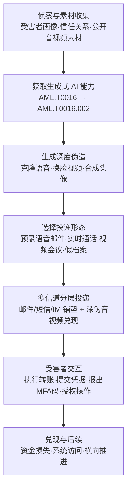

# 深度伪造辅助钓鱼 (AML.T0052.001)

> 属于 [网络钓鱼 (AML.T0052)](../AML.T0052-Phishing.md)

## 一句话通俗理解

> 骗子不再"自称"是 CFO——他直接"变成"CFO：用几秒钟公开音频克隆出你老板的嗓音，用公开视频给同伙换上他的脸，然后打来电话、开起视频会议"亲口"下令转账。这门技术攻击的不是防火墙，而是人类用了几千年的两条信任铁律："耳听为实、眼见为实"。

## 难度等级

⭐ **Feasible（可行）**

官方成熟度评定为 Feasible——本子技术是父技术家族中评级最低的一条路径（父技术网络钓鱼为 Realized，兄弟子技术社会工程 LLM 鱼叉为 Demonstrated）。这并不代表"纸上谈兵"：官方描述引用的事件报告（Arup 2500 万美元、香港银行经理 3500 万美元诈骗等）均真实发生，语音克隆"仅需几秒钟公开音频"的技术能力也早已成熟。定级为"可行"更多反映其在官方评估口径中仍以**高价值目标的定向攻击**为主，尚未成为钓鱼的主流形态。实施门槛呈两极分布：预录语音邮件类几乎零技术门槛（生成工具平民化）；实时深伪视频会议则需音视频工程能力与临场话术操控。真正的难点在**准备链长度**——先获取生成式 AI 能力、再生成深伪、最后嵌入钓鱼流程，比发一封 LLM 生成的邮件长得多。

## 技术描述

### 通俗解释

如果说父技术 [网络钓鱼 (AML.T0052)](../AML.T0052-Phishing.md) 是"骗你亲手把门打开"，那么本子技术就是给骗子**换上你熟人的脸和嗓音**再来敲门。兄弟子技术 AML.T0052.000（社会工程 LLM 鱼叉）解决的是"话术完美"——文字层面无懈可击；本子技术解决的是"身份可信"——让受害者**亲耳听到**老板的声音、**亲眼看到**同事的脸。

传统社会工程有一条兜底心法："拿不准时，打个电话确认一下，听到本人声音就踏实了。"本子技术攻击的正是这条最后防线：声音可以克隆（几秒公开素材就够——财报电话会、演讲、播客、社交媒体），脸可以合成（公司会议录像、公开视频都是原料），实时视频会议也能整场"换人"。FBI 在公共服务公告中直言：AI 生成内容已进化到**常常难以被肉眼识别为合成品**的程度。

对防御者的冲击是根本性的：**语音/视频确认不再是信任锚点**。凡是"听到是他就照办"的流程——电话授权转账、口头发令、视频核身——都必须重新设计。

### 技术原理

依据官方描述，攻击者使用深度伪造（AI 生成的合成图像、音频或视频）在钓鱼活动中冒充可信的个人、高管或组织，通过呈现欺诈性的语音或视频通信操纵目标泄露凭据、转账或授予系统访问。按合成媒体形态分三条投递路径：

1. **语音深伪 → 语音钓鱼（vishing）**：攻击者利用电话或 VoIP 发起语音钓鱼，仅需几秒钟公开可得的音频——演讲、财报电话会、播客、社交媒体——即可克隆目标的声音（VALL-E 类神经编解码语言模型已演示过该能力）。克隆声音用于预录语音邮件或实时通话。
2. **视频深伪 → 视频会议冒充**：利用公司会议录像、财报电话会、社交媒体等公开视频，合成目标人物的脸与声音，生成以假乱真的 AI 视频——用于**实时视频会议**（受害者与"多位同事"在线开会，全员皆伪）或录制视频消息。
3. **图像深伪 → 伪造头像/档案**：AI 生成合成图像，为钓鱼话术中的虚构身份构造"有鼻子有眼"的假档案与假头像，增强整体可信度。

**典型准备链**：获取能力（AML.T0016）→ 生成式 AI（AML.T0016.002）→ [生成深度伪造](../../03-AI-Attack-Adaptation/AML.T0088-Generate-Deepfakes.md) → 嵌入钓鱼投递（本技术）。**与生成深度伪造（AML.T0088）的分工**：AML.T0088 是"车间"——制造合成音视频的生成技术；本子技术是"战场"——把合成品作为**可信度放大器**投用进钓鱼流程。深伪本身不构成攻击，嵌入社会工程流程才构成。

**多信道分层**：官方描述强调，深伪钓鱼活动通常叠加其他通信信道（邮件、短信、即时消息）构成**分层社会工程**——先用邮件铺垫"我稍后会打给你"，再以克隆语音来电"兑现"承诺，各信道相互印证，可信度成倍放大。

**平台与战术定位**：平台覆盖 Enterprise；主战术为初始访问（AML.TA0004），同时映射横向移动（AML.TA0015）——攻击者同样可冒充内部人员在组织内部"横向"行骗。官方描述还指出深伪也可作为冒充（AML.T0073）的辅助手段。

### 用途影响

- **直接资金损失**：深伪授权转账类诈骗跳过传统攻击链，已造成单案数千万美元级损失（Arup 2500 万、香港银行 3500 万）；
- **凭据与 MFA 钓取**：冒充 IT 支持人员索要 MFA 验证码，直接攻陷云管理控制台（Retool 事件）；
- **规模化收割**：深伪机器人电话可面向**数十亿用户**的大规模凭据收割活动提供"官方来电"外壳；
- **信任机制破坏**：声音与人脸这两个人类最底层的身份认证信号失效，所有依赖"当面/语音确认"的流程被迫重构。

## 攻击流程

### 典型攻击流程



**步骤详解：**

1. **侦察与素材收集**
   - 通俗描述：搞清楚骗谁、他信谁、以及"他信的人"的声音和长相网上哪里能捡到。
   - 技术细节：收集[受害者身份信息](../../01-Reconnaissance/AML.T0087-Gather-Victim-Identity-Information.md)——汇报关系、近期项目、审批权限；同时盘点其信任对象（高管、同事、合作方）的公开音视频：财报电话会、演讲、播客、会议录像、社交媒体——几秒钟素材即可用于语音克隆。

2. **获取生成式 AI 能力**
   - 通俗描述：备齐"变声/变脸"的生产工具。
   - 技术细节：通过获取能力（AML.T0016）取得生成式 AI（AML.T0016.002）——语音克隆、换脸、文本生成等商用或开源工具。

3. **生成深度伪造**
   - 通俗描述：把素材加工成"熟人的声音和脸"。
   - 技术细节：语音路径用数秒公开音频克隆目标声纹；视频路径将目标人脸与声音注入合成管线（详见[生成深度伪造](../../03-AI-Attack-Adaptation/AML.T0088-Generate-Deepfakes.md)）；图像路径生成伪造头像与档案照片。

4. **嵌入钓鱼流程与多信道投递**
   - 通俗描述：先递话再上场，环环相扣。
   - 技术细节：选择投递形态——预录语音邮件、实时通话、实时视频会议或录制视频消息；通常叠加邮件/短信/IM 做分层社会工程：文本信道铺垫"稍后联系"，深伪信道登场"亲口/亲眼"确认。

5. **受害者交互与收割**
   - 通俗描述：受害者"核实无误"，照办。
   - 技术细节：执行紧急转账、在仿冒页面提交凭据、向"IT 支持"报出 MFA 验证码，或为"高管"授予系统访问。

6. **兑现与后续利用**
   - 通俗描述：钱已出境，账号已易主。
   - 技术细节：转账类直接造成资金损失；钓取的凭据与 MFA 用于登录系统（衔接有效账户），被攻陷账户可继续向同事行骗（横向移动 AML.TA0015）。

**与后续战术的衔接：**

- **有效账户**：语音钓取的 MFA 码 + 凭据是登录云与 AI 系统的直达票（Retool 路径）
- **横向移动（AML.TA0015）**：冒充内部人员向同事发起"内部"深伪行骗
- **影响**：深伪授权转账跳过传统攻击链，直接造成经济损失

> 关键差异：传统钓鱼的检测重心在**内容破绽与信道元数据**；深伪路径把问题逼到**验证流程**本身——来电显示、声音、脸、甚至实时视频画面全部可伪造，信道内不再存在任何可信的身份证明。唯一可靠的防御是带外、预登记、双向的验证流程（回拨预存号码、暗语、双人审批）。

## 真实案例

> 以下 4 个案例均源自 MITRE ATLAS 官方为本技术引用的外部事件报告（AI 事件库 AIID、FBI 公告），覆盖实时视频会议深伪、语音克隆多信道诈骗、MFA 钓取与大规模机器人电话四类形态。

### 案例1：Arup 深伪 CFO 视频会议诈骗——2500 万美元（2024年，AIID #634）

- **时间**: 2024年初（香港警方披露）
- **攻击者**: 未知名诈骗团伙
- **手法**: 针对跨国工程公司奥雅纳（Arup）香港办公室财务人员的深伪视频会议诈骗：攻击者预先采集公司高管公开音视频素材，合成 CFO 等多名"公司同事"的深伪音视频，组织了一场**整场只有受害者是真人的多人视频会议**。受害者在与"CFO"及"同事"的实时视频通话中确信转账指令真实，先后多次汇款。
- **影响**: 损失约 2500 万美元；证明实时深伪视频会议已可支撑多角色协同的完整骗局剧本
- **参考链接**: [AI 事件库报告](https://incidentdatabase.ai/cite/634/)

### 案例2：克隆声音骗过银行经理——3500 万美元未遂转账（2023年，AIID #147）

- **时间**: 2023年（法庭文件与媒体披露）
- **攻击者**: 未知名诈骗团伙
- **手法**: 攻击者克隆某公司董事的声音，致电其开户行的经理，声称急需转账；同期配套的**邮件往来**与"律师"跟进形成多信道分层印证。银行经理在"亲耳听到"熟悉的声音后执行转账，涉案金额约 3500 万美元。
- **影响**: 展示"克隆语音 + 邮件分层"组合对金融机构级风控的穿透力——银行经理的信任锚点正是声音本身
- **参考链接**: [AI 事件库报告](https://incidentdatabase.ai/cite/147/)

### 案例3：Retool 深伪语音攻陷云管理控制台（2023年，AIID #567）

- **时间**: 2023年12月
- **攻击者**: 未知名攻击者
- **手法**: 攻击者先以短信/邮件定向锁定 Retool 员工，再由真人利用**深伪生成的语音**冒充 IT 支持人员致电，在"协助找回账号"过程中诱骗员工读出 MFA 验证码，进而接管 Retool 的内部云管理控制台，波及其加密资产管理客户。
- **影响**: 深伪语音 + MFA 钓取 = 凭据类攻击的完整初始访问链，AI 事件库将其归入本技术
- **参考链接**: [AI 事件库报告](https://incidentdatabase.ai/cite/567/)

### 案例4：深伪机器人电话冒充 Google 的大规模凭据收割（2025年，AIID #839 / #941）

- **时间**: 2025年初
- **攻击者**: 未知名诈骗团伙
- **手法**: 面向 Gmail 数十亿用户的大规模钓鱼活动：先发送伪装成"账号被发起恢复"的钓鱼短信，再以**AI 深伪机器人语音**来电（来电显示伪装成 Google），诱导用户在仿冒页面输入凭据——电话、短信、邮件多信道相互配合，攻击者同时运营数百万个仿冒域名与电话号码。
- **影响**: 证明深伪不再是"高价值目标专属"——与自动化基础设施结合即可工业化收割数十亿级用户
- **参考链接**: [AI 事件库报告（AI 驱动钓鱼）](https://incidentdatabase.ai/cite/839/)、[AI 事件库报告（深伪机器人电话）](https://incidentdatabase.ai/cite/941/)

> 其他被官方引用的形态：冒充企业 CEO 的深伪语音未遂攻击（AIID #1100，LastPass）、针对老年群体的"幻影黑客"AI 语音诈骗（AIID #1280）、克隆名人声音的杀猪盘（AIID #1285）、意大利国防部长声音被克隆用于官方通话（AIID #927）、以及 FBI 公告披露的**冒充美国高官声音**的大规模诈骗活动——受害者横跨个人、企业与政府官员。

## 红队视角

> ⚠️ **免责声明**：以下内容仅用于合法授权的安全测试与教育目的。未经授权克隆他人声音或人脸、实施社会工程均属违法行为。

### 实战技巧

1. **高管音视频暴露面盘点**
   在授权范围内做 OSINT：拉出组织高管与财务审批人的公开音视频清单（财报会、播客、演讲、采访），统计可克隆素材时长与渠道。这份清单本身就是交付报告里最有冲击力的一页：**上面每一秒素材都是语音克隆的原料**，而它们全部合法公开、唾手可得。

2. **深伪情境流程演练（剧本扮演法）**
   不需要真实克隆任何人的声音：邮件铺垫"我稍后会打给你确认"→ 演练主持人以标准话术来电提出敏感请求 → 观察员工是否执行带外回拨、暗语验证、双人审批。**测的是流程而非特效**——流程若挡不住"自称是高管"，更挡不住"听起来就是高管"。

3. **客服/支持台 MFA 重置流程测试**
   针对内部 IT 支持台，模拟 Retool 式攻击剧本：假冒身份索取 MFA 码、请求紧急重置。验证支持人员是否有独立的身份复核手段（回拨登记号码、当面确认），还是仅凭"来电者说得出员工信息"就放行。

4. **会议平台配置审计**
   审计视频会议平台：外部参会者能否使用仿冒内部高管的显示名加入；虚拟摄像头与预录制视频推流是否受限；跨域会议邀请是否触发额外验证。

### 常用工具

| 工具名称 | 用途 | 平台 |
|----------|------|------|
| GoPhish | 邮件/短信铺垫层的演练投放与度量 | 跨平台 |
| OSINT 工具链 | 盘点公开音视频素材暴露面 | 跨平台 |
| 电话演练剧本（人工扮演） | 深伪情境的流程测试，无需真实合成素材 | 线下 |
| 公开深伪检测工具/数据集（如 DFDC） | 评估组织检测能力基线 | 跨平台 |

### 注意事项

- **绝不克隆真实第三方身份**：任何声音/人脸克隆必须有本人书面授权，素材阅后即焚；演练一律用剧本扮演替代真实合成素材
- 电话演练若涉及真实电信网络与来电显示处理，需法务审核——来电显示伪造在多数司法辖区违法
- 演练数据最小化：员工"上钩"的过程记录仅用于复盘，不得留存敏感输入
- 报告聚焦"流程能否拦住身份伪造"，而非展示深伪技术多么逼真

## 蓝队视角

### 检测要点

1. **电信信道元数据（内容不可信，看模式）**
   - 数据来源：VoIP 网关/电话系统日志、来电记录
   - 关注对象：来电显示与运营商归属不一致、外部号码伪装本组织总机、通话时长异常短的"指令型"来电、面向总机/财务直线的外部来电突增
   - 局限：单看来电记录无法判断声音真伪——元数据只能提供**关联线索**

2. **行为链（通话之后的敏感操作）**
   - 日志来源：身份提供商、财务系统、工单系统
   - 关注字段：客服渠道触发的 MFA 重置、转账/新增收款人操作、权限变更与其**前数小时内的来电记录**关联
   - 异常特征：外部来电后数分钟内完成的紧急转账、电话渠道 MFA 重置后紧接的新设备登录、高危操作绕过双人审批

3. **深伪检测（机器判机器）**
   - 管线位置：语音生物认证、视频面签/KYC、会议平台
   - 关注特征：语音生物特征验证通过率漂移、会议中虚拟摄像头/预录制媒体特征、音画不同步等合成伪影
   - 现实约束：实时交互场景的检测难度远高于录制内容——实时场景仍以流程验证为主

### 监控建议

- **把"声音/视频确认"从可信验证手段中移除**：制度层面明确来电、视频中的身份陈述不构成授权依据
- 高影响流程（转账、权限、MFA 重置）强制**带外回拨**——拨打**预登记号码**而非回复来电，并叠加双人审批与冷静期
- 为高管与财务审批人建立**暗语/验证短语**机制，并随人员变动轮换
- 维护高管公开音视频**暴露面台账**，素材更新（新财报会、新采访）即触发演练剧本更新
- 监控针对本组织的公开深伪工具与"克隆即服务"生态动态（对齐缓解措施 AML.M0034）

## 检测建议

### 网络层检测

**检测方法：** 监控电信信道与收割基础设施的网络特征（内容真伪交给流程与检测管线）。

- VoIP/电话网关日志中的异常外部来电模式：伪装本组织总机号码、短时高频"指令型"来电、针对财务/客服直线的定向来电突增
- 通话后短时间窗口内的关联网络行为：向新注册域名的登录页提交凭据（深伪来电引导的"账号核实"）、MFA 码提交页访问
- 大规模活动特征：面向组织总机的自动化语音呼叫（robocall）模式

### 主机层检测

**检测方法：** 监控深伪交互在终端与身份系统留下的行为痕迹。

- 工单系统：电话渠道发起的紧急 MFA 重置/账号恢复请求，尤其伴随"IT 支持"身份话术
- 浏览器向仿冒账号恢复/登录页面提交表单（短信+电话组合收割的终点）
- MFA 码输入后的异常会话：新设备、异地 IP、令牌滥用

### 应用层检测（AI 遥测）

**检测方法：** 在身份核验管线与会议平台接入深伪检测（AML.M0034）。

- 语音生物认证管线：同一声纹的验证失败率/通过率漂移、合成音质特征（频谱伪影、呼吸缺失）
- 视频核身/KYC 管线：面部动作不自然、眨眼/眼球运动异常、像素级伪影（官方列举的三类检测方法）
- 会议平台遥测：虚拟摄像头与预录制视频推流特征、参会设备指纹与账号绑定关系异常

**程序化检测思路（低成本优先落地）：**

两个切入点：① 身份提供商侧做**事件关联**——"客服/电话渠道 MFA 重置 → 1 小时内新设备+新位置登录成功"即触发高危告警并冻结会话，这一条直接覆盖 Retool 式攻击链的兑现环节；② 财务系统侧做**来电窗口关联**——"外部来电记录后数小时内新增收款人/紧急转账"触发带外回拨确认工单。两条规则都不需要判断声音真假，只利用时序关联，是深伪场景下性价比最高的检测。

### Sigma 规则思路示例

```yaml
title: 电话渠道 MFA 重置后短时新设备登录（深伪语音钓取验证码信号）
status: experimental
description: 检测客服/电话渠道触发的 MFA 重置在短时间内伴随
    新设备与新位置登录成功，可能为深伪语音冒充 IT 支持
    钓取 MFA 验证码后的账户接管（AML.T0052.001）
references:
    - https://atlas.mitre.org/techniques/AML.T0052/001/
logsource:
    category: authentication
    product: identity_provider
detection:
    selection_reset:
        event.action:
            - 'mfa_reset'
            - 'mfa_factor_add'
        channel|contains:
            - 'helpdesk'
            - 'phone'
    selection_login:
        event.action: 'logon'
        new_device: true
    condition: selection_reset | near selection_login within 1h
falsepositives:
    - 员工换新手机后的正常 MFA 重置与登录
level: high
tags:
    - attack.t1566
    - attack.t1566.004
    - atlas.aml_t0052_001
```

> 说明：本规则覆盖"验证码被钓走之后"的兑现环节，声音真假无法从认证日志判断。应与"高影响操作带外回拨"流程联动：规则命中即自动挂起会话并触发回拨确认。

## 缓解措施

> 本子技术在官方数据中直接映射两项缓解措施（与父技术一致），按深伪场景落地优先级排列。

### 优先级1：关键措施

**AML.M0018 用户培训（User Training）**

官方建议教育用户识别深度伪造与钓鱼尝试。落地要点：培训核心从"识别内容破绽"转向**"验证请求本身"**——任何凭据、转账、权限请求，无论来自邮件、电话还是视频会议，一律走带外回拨（拨预登记号码）+ 双人审批 + 冷静期；建立高管与财务审批人暗语机制；培训中明确告知"声音与视频确认不再可信"这条新规则；同步管理高管公开音视频暴露面。

### 优先级2：重要措施

**AML.M0034 深度伪造检测（Deepfake Detection）**

对任何不可信或用户提供的数据应用深伪检测算法，尤其是生物特征验证等高影响应用，直接阻断生成内容。官方给出三类可组合的方法：训练来判别真伪的 AI 模型；识别常见不一致性（不自然的面部动作、音画错位、像素级伪影）；生物特征分析（眨眼、眼球运动、微表情）。落地要点：优先部署在**身份核验类管线**（语音生物认证、视频面签/KYC）；对实时通话/会议场景保持清醒——检测主要兜底录制内容的核验环节，实时交互场景仍需流程验证兜底。

### MITRE ATLAS 缓解措施映射

| 缓解措施ID | 缓解措施名称 | 优先级 | 类别 | 生命周期阶段 |
|------------|-------------|:------:|------|-------------|
| AML.M0018 | 用户培训 | 关键 | Policy | 业务与数据理解 · 数据准备 · AI 模型工程 · 评估 · 部署 · 监控维护 |
| AML.M0034 | 深度伪造检测 | 重要 | Technical - AI | AI 模型工程 · 评估 · 部署 · 监控维护 |

> 优先级逻辑：深伪攻击的是"人的信任判断"而非技术防线，所以**培训（人 + 流程）是第一道也是最后一道关键防线**——M0018 决定带外验证是否真的被执行；深伪检测（M0034）解决"高影响场景中机器可判的真伪"，为流程验证争取时间。两者均同时覆盖本子技术与父技术。

## 关联 ATT&CK 技术

- [钓鱼 (T1566)](../../../enterprise/03-Initial-Access/T1566-Phishing.md) — 父技术的官方 ATT&CK 参考映射，本子技术是其"身份伪装"分支在深伪时代的延伸
- [鱼叉式钓鱼语音（Vishing）(T1566.004)](../../../enterprise/03-Initial-Access/T1566/T1566.004-Spearphishing-Voice.md) — 深伪语音来电最贴近的传统技术
- [钓鱼获取信息 (T1598)](../../../enterprise/01-Reconnaissance/T1598-Phishing-for-Information.md) — 钓鱼类技术在侦察战术中的对应形态

**深伪辅助钓鱼 vs 传统语音钓鱼：**

| 维度 | 传统语音钓鱼 (T1566.004) | 深伪辅助钓鱼 (AML.T0052.001) |
|------|------------------------|------------------------------|
| 声音来源 | 攻击者本人变声、念稿 | 克隆受害者信任对象的真实声纹（数秒公开素材） |
| 身份可信度 | 依赖话术、紧迫感、权威压迫 | "亲耳听到老板的声音"——信任锚点本身被伪造 |
| 新增形态 | 仅语音 | + 实时深伪视频会议、录制视频、伪造头像档案 |
| 目标选择 | 可广撒网 | 高度定向（需预知信任关系与素材暴露面） |
| 识别方式 | 听口音、背景音、逻辑破绽 | 内容层几乎无破绽，只能靠带外流程验证 |
| 典型损失 | 一般诈骗金额 | 单案数千万美元级（Arup、香港银行案） |

一句话总结：T1566.004 骗的是"没防备的耳朵"，AML.T0052.001 骗的是"最熟悉的耳朵"——防御必须从"识别声音"升级为"不信任信道内的任何身份证明，包括脸和嗓音"。

## 动手实验

> ⚠️ **重要提示**：所有实验必须在隔离环境与书面授权范围内进行。**禁止克隆任何真实第三方（含本公司高管）的声音或人脸**——所有深伪情境一律用剧本扮演替代真实合成素材。

### 实验环境准备

| 环境组件 | 用途 | 获取方式 |
|----------|------|----------|
| 授权演练邮件域 + GoPhish | 铺垫层邮件/短信投放 | 开源部署 |
| 演练剧本与主持人（人工扮演） | 深伪情境流程测试 | 自行编写 |
| 公开深伪检测工具 + 标准数据集 | 检测能力基线评估 | 开源社区 |
| OSINT 工具 | 公开素材暴露面盘点 | 公开免费 |

### 实验1（初级）：高管音视频"可克隆面"盘点

**实验目标：** 量化组织被语音克隆/换脸攻击的原始素材暴露面。

**实验步骤：**
1. 仅用公开渠道收集本组织高管与财务审批人的音视频清单（财报会、采访、播客、会议录像）
2. 逐人统计：可克隆素材总时长、渠道数、语音清晰度（有无背景音干扰）
3. 标注每人最薄弱的信任关系（谁会无条件听他的电话）
4. 输出"可克隆面"量化报告并汇报管理层

**预期结果：** 一份让管理层直观感受风险的数据报告——多数组织会发现"几秒钟素材"的门槛低得惊人。

### 实验2（中级）：深伪检测能力基线评估

**实验目标：** 摸清现有检测手段在语音/视频核验场景的真实能力。

**实验步骤：**
1. 用公开深伪检测工具跑标准数据集，记录召回率与误报率
2. 对照组织实际管线：语音生物认证、视频面签/KYC 各环节，标注检测覆盖点
3. 区分场景：录制内容核验 vs 实时通话/会议——后者的检测缺口单列
4. 输出"检测覆盖 + 缺口"报告，缺口部分明确由流程控制兜底

**预期结果：** 明确"机器能拦多少、流程必须拦多少"，为 M0034 部署提供依据。

### 实验3（高级）：深伪转账情境全流程演练

**实验目标：** 验证组织流程能否拦住"听起来完全真实的转账指令"。

**实验步骤：**
1. 与财务部门共同设计剧本：GoPhish 投放铺垫邮件（"我稍后打给你"）→ 主持人来电扮演"高管"提出紧急转账 → 视剧本需要增加视频会议环节（真人扮演即可）
2. 观察财务人员是否执行带外回拨（拨预登记号码）、暗语验证、双人审批、冷静期
3. 对未走流程的案例做复盘访谈：是不知道流程、嫌流程慢，还是"听声音就是老板"
4. 将结果整理进事件响应 runbook，每季度重演并跟踪改进曲线

**预期结果：** 用零合成素材完成对"深伪可信度"的等价测试——证明防线的关键从来不是识别深伪，而是流程是否被不折不扣地执行。

## 术语解释

| 术语 | 英文原名 | 通俗解释 |
|------|----------|----------|
| 深度伪造 | Deepfake | AI 生成的合成图像、音频或视频，可逼真冒充真人的脸与声音 |
| 语音克隆 | Voice Cloning | 用几秒钟目标音频样本合成其声音的技术——本子技术的核心武器 |
| 换脸 | Face Swap | 将目标人脸替换进视频画面的技术，实时视频会议深伪的基础 |
| 视频会议欺诈 | Video Conference Fraud | 在实时视频会议中用深伪音视频冒充可信身份的诈骗（如 Arup 案） |
| 社会工程 | Social Engineering | 操纵人的心理弱点（信任、服从权威、紧迫感）骗取信息或权限的攻击学科 |
| 深度伪造检测 | Deepfake Detection | 判别内容真伪的技术：AI 判别模型、不一致性识别、生物特征分析三类方法 |
| 语音钓鱼 | Vishing | 通过电话/VoIP 实施的语音钓鱼，深伪语音克隆是其最新武器 |
| 预录语音邮件 | Pre-recorded Voicemail | 用克隆语音事先录制的语音邮件——门槛最低的深伪投递形态 |
| 分层社会工程 | Layered Social Engineering | 邮件/短信/IM/电话/视频多信道相互印证、层层加码的诈骗编排 |
| 带外验证 | Out-of-Band Verification | 在请求信道之外，用预登记渠道（如回拨预存号码）确认请求真实性 |
| 暗语 | Code Word | 双方预先约定的验证短语，用于信道内身份核验 |
| 商业电子邮件诈骗 | Business Email Compromise (BEC) | 冒充高管或合作方诱导转账的诈骗，叠加深伪语音后杀伤力倍增 |

## 参考资料

### 📚 官方文档

- [MITRE ATLAS - Deepfake-Assisted Phishing (AML.T0052.001)](https://atlas.mitre.org/techniques/AML.T0052/001/) - 官方技术页面
- [MITRE ATLAS 矩阵](https://atlas.mitre.org/matrices/ATLAS/)
- [MITRE ATLAS Data (GitHub)](https://github.com/mitre-atlas/atlas-data)

### 📰 案例报告（真实攻击与安全研究）

- [AI 事件库：Arup 深伪 CFO 会议诈骗案（2500 万美元）](https://incidentdatabase.ai/cite/634/) - 实时深伪视频会议冒充高管（案例1）
- [AI 事件库：香港银行经理深伪诈骗案（3500 万美元）](https://incidentdatabase.ai/cite/147/) - 克隆语音 + 邮件分层诈骗（案例2）
- [AI 事件库：Retool 深伪语音攻陷云服务事件](https://incidentdatabase.ai/cite/567/) - 深伪语音钓取 MFA 验证码（案例3）
- [AI 事件库：冒充 Google 的 AI 驱动钓鱼](https://incidentdatabase.ai/cite/839/)、[深伪机器人电话版](https://incidentdatabase.ai/cite/941/) - 大规模凭据收割（案例4）
- [AI 事件库：LastPass CEO 深伪语音未遂攻击](https://incidentdatabase.ai/cite/1100/) - 冒充 CEO 定向攻击企业员工
- [AI 事件库："幻影黑客"AI 语音诈骗](https://incidentdatabase.ai/cite/1280/)、[Jason Momoa 深伪杀猪盘](https://incidentdatabase.ai/cite/1285/) - 针对个人的深伪诈骗
- [AI 事件库：意大利国防部长声音被克隆](https://incidentdatabase.ai/cite/927/) - 政府官员遭深伪冒充
- [AI 事件库：针对银行的深伪语音转账未遂](https://incidentdatabase.ai/cite/564/) - 早期克隆语音诈骗案例
- [OECD.AI：Drica Moraes 声音被克隆诈骗其联系人](https://oecd.ai/en/incidents/2026-04-06-ca7a) - 名人声纹被滥用的典型
- [FBI 公共服务公告：美国高官声音遭深伪冒充](https://www.ic3.gov/PSA/2025/PSA250515/) - AI 生成内容难以识别的官方警示
- [Google Cloud：AI 语音欺骗与 Vishing 防御](https://cloud.google.com/blog/topics/threat-intelligence/ai-powered-voice-spoofing-vishing-attacks) - 语音克隆攻击的威胁分析与防御视角
- [VALL-E 系列语音合成模型（微软研究院）](https://www.microsoft.com/en-us/research/project/vall-e-x/) - "数秒音频克隆声音"能力的技术源头
- [Social-Engineer 框架：Vishing 词条](https://www.social-engineer.org/framework/attack-vectors/vishing/) - 语音钓鱼方法论参考

### 🔧 工具与资源

- [GoPhish](https://getgophish.com/) - 开源钓鱼演练平台（铺垫层投放）
- 公开深伪检测工具与数据集（如 DFDC） - 检测能力基线评估
- [NIST AI Risk Management Framework](https://www.nist.gov/itl/ai-risk-management-framework) - NIST AI 风险管理框架

### 🔗 关联阅读

- [网络钓鱼 (AML.T0052)](../AML.T0052-Phishing.md) - 本技术的父技术，AI 增强钓鱼全景
- [生成深度伪造 (AML.T0088)](../../03-AI-Attack-Adaptation/AML.T0088-Generate-Deepfakes.md) - 本技术的上游生成能力（"车间"与"战场"的分工）
- [收集受害者身份信息 (AML.T0087)](../../01-Reconnaissance/AML.T0087-Gather-Victim-Identity-Information.md) - 深伪素材与信任关系的前置侦察
- [钓鱼 (T1566)](../../../enterprise/03-Initial-Access/T1566-Phishing.md) - 传统钓鱼技术，官方映射的 ATT&CK 对应
- [鱼叉式钓鱼语音（Vishing）(T1566.004)](../../../enterprise/03-Initial-Access/T1566/T1566.004-Spearphishing-Voice.md) - 深伪语音来电的传统对应技术
- [初始访问战术 (AML.TA0004)](../README.md) - 本技术所属战术的概览页

---

> **版本**: ATLAS 2026.09 | **更新**: 2026-10-22 | **模板**: ATLAS 技术文档 v1.0
