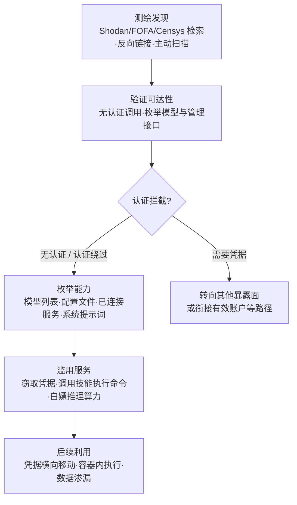

# AI 服务配置错误或公开暴露 (AML.T0132)

## 一句话通俗理解

> 攻击者不需要撬锁，也不需要偷钥匙——你家的 AI 大门压根就没上锁：一个绑定在 0.0.0.0 上、不要求认证的 LLM 服务，一个裸奔在公网的智能体管理面板，一桶谁都能下载的模型文件。攻击者只要在空间测绘引擎里敲一行查询，就能推开这扇门。

## 难度等级

⭐⭐ **Demonstrated（已演示）**

官方成熟度评定为 Demonstrated——利用配置错误不需要任何漏洞研究能力：没有 payload 要写、没有补丁要绕、没有零日要买。攻击的全部成本几乎都在"找到它"这一步，而空间测绘引擎（Shodan、FOFA、Censys）让这一步变成了一个搜索框的事。安全研究员 Jamieson O'Reilly 仅凭 Shodan 检索就发现了数百个暴露在公网的 ClawdBot 控制接口（AML.CS0048）；Zenity 与 GreyNoise 的监测则显示，针对暴露 LLM 后端的扫描已经是持续性的、大规模的常态活动。真正困难的不是攻击，而是防御——AI 服务的部署太容易、太随意：一行 `ollama serve` 就能起一个 LLM 运行时，而它的默认配置并不为公网暴露设计。

## 技术描述

### 通俗解释

传统漏洞利用（AML.T0049 / T1190）是"锁有缺陷，我撬锁"；有效账户（AML.T0012 / T1078）是"我偷了钥匙开门"；而本技术是"门装好了，但根本没锁"。攻击者利用的不是代码缺陷，而是**配置本身**：LLM 运行时绑定了 `0.0.0.0` 却没开认证、智能体控制面板直接暴露在公网、模型制品放在公开可读的存储桶里、RAG 管理后台无密码可访问。配置错误把"应该只有内部能碰"的 AI 能力变成了"任何互联网用户都能碰"的开放服务。

### 技术原理

依据官方描述，AI 智能体与 LLM 平台部署在多样化的架构上——独立服务器、SaaS 平台、低代码构建器——而它们普遍存在访问控制配置错误：从 **LLM 运行时缺失认证**到**过于宽松的公开访问设置**，都显著扩大了攻击面。典型的错误配置形态包括：

1. **模型推理端点裸奔**：Ollama、vLLM、LiteLLM 等 LLM 运行时/网关默认监听本地回环地址，运维人员为了图方便改为 `--host 0.0.0.0` 直接暴露公网，且未启用 API 密钥校验——任何人都能调用 `/api/tags` 枚举已加载模型、发起推理、甚至通过管理接口拉取或删除模型；
2. **智能体控制面板公开可达**：个人 AI 助手/智能体框架（如 CS0048 中的 ClawdBot）的控制界面被直接暴露，部分实例甚至未启用认证，或因反向代理配置错误导致认证机制可被绕过；
3. **周边组件连带暴露**：向量数据库、RAG 管理面板、模型注册表、存放模型权重与数据集的公开存储桶——这些 AI 供应链末梢资产同样常常无认证可读写。

官方描述特别强调**安全态势决定可发现性**：一个面向互联网、无认证的 AI 服务可被任何未授权用户直接发现；而另一个部署可能需要先拿到被窃取的凭据才能"看见"。换言之，配置决定了攻击者要跨越的门槛高度——是零门槛，还是先得偷一把钥匙。

攻击者通过 **OSINT 与主动扫描的组合**发现并交互这些服务：用搜索引擎/测绘平台检索可达的智能体部署（参见搜索开放技术数据库 AML.T0000 与其扫描数据库子技术）、检索反向链接以发现嵌入前端的开放智能体（参见搜索开放网站/域名 AML.T0095）、或直接扫描目标的 AI 基础设施（参见主动扫描 AML.T0006）。发现之后，"利用"往往平淡得可怕——一个不带凭据的 HTTP 请求。

**平台覆盖**：Predictive AI（预测式 AI）/ Generative AI（生成式 AI）/ Agentic AI（智能体 AI）三类平台全部适用——任何一类 AI 服务都可能被错误配置。

### 用途影响

- **零门槛进入**：不需要漏洞利用能力、不需要凭据、不需要社工技巧，一个未授权 HTTP 请求即可完成"初始访问"的全部工作；
- **凭据金矿**：暴露的 AI 服务往往连接着一串下游服务——CS0048 中单是配置文件就泄露了 Anthropic API 密钥、Telegram Bot 令牌、Slack OAuth 凭据与 Signal 设备链接 URI；
- **以 AI 之力执行攻击**：攻击者可直接与暴露的智能体对话，诱导其泄露系统提示词、调用 `bash` 等技能执行命令——CS0048 中至少一个实例因此获得容器 root 权限；
- **免费算力与模型滥用**：无认证的推理端点等于公开的"免费 LLM API"，可被用于规模化生成攻击内容或挖取模型能力；
- **规模效应**：测绘引擎让"找一个没锁门的 AI 服务"与"找一个网站"一样容易，暴露面即清单。

## 攻击流程

### 典型攻击流程



**步骤详解：**

1. **测绘发现**
   - 通俗描述：小偷不挨家试门，先查"哪些门没锁"的公开名单。
   - 技术细节：在空间测绘引擎中检索特定 AI 服务的指纹特征（如 ClawdBot 控制接口、Ollama 端口、LLM 网关的响应特征）；或通过搜索引擎反向链接发现被嵌入前端页面的开放智能体；亦可对目标 IP 段主动扫描（AML.T0006）。CS0048 中研究员正是用 Shodan 定位暴露实例。

2. **验证可达性**
   - 通俗描述：走上去拧一下门把手。
   - 技术细节：向端点发起无凭据请求——调用模型枚举接口、访问管理面板首页。部分实例直接放行；部分实例虽配置了认证，却因反向代理配置错误导致认证机制可被绕过（CS0048 中均有发生）。

3. **枚举能力**
   - 通俗描述：进屋后先看看有什么值钱的、连着什么。
   - 技术细节：列出可用模型、读取配置文件（其中常包含下游服务的凭据）、通过对话诱导智能体吐出系统提示词，摸清这个 AI 服务连接了哪些消息通道与应用。

4. **滥用服务**
   - 通俗描述：不仅翻东西，还借主人之手干活。
   - 技术细节：直接通过聊天界面下指令，让智能体调用已授权技能（如 `bash`）执行命令；窃取配置中的 API 密钥与 OAuth 凭据；或将推理端点当作免费 LLM API 滥用。

5. **后续利用**
   - 通俗描述：用偷到的钥匙开更多的门。
   - 技术细节：以窃取的凭据横向移动到云与 SaaS 资源（衔接有效账户类路径）；以容器内命令执行为跳板深入内网；操纵聊天记录、冒充用户发消息、渗漏全部会话历史。

**与后续战术的衔接：**

- **AI 模型访问（ML Model Access）**：无认证的推理端点即直接的模型访问通道——枚举、调用、白嫖
- **执行（Execution）**：诱导智能体调用 `bash` 等技能等于借 AI 之手执行命令（CS0048 实例获容器 root）
- **凭证访问（Credential Access）**：配置文件中的 API 密钥、Bot 令牌、OAuth 凭据是现成的窃取目标
- **侦察（反向馈送）**：测绘发现本身就是 [主动扫描 (AML.T0006)](../01-Reconnaissance/AML.T0006-Active-Scanning.md) 的产出，两者构成闭环

> 关键差异：传统漏洞利用的攻击链是"发现 → 研究 → 构造 payload → 利用"；本技术的攻击链是"发现 → 请求"。中间的研究与构造环节被配置错误直接抹掉了。

## 真实案例

> 以下案例源自 MITRE ATLAS 案例库及官方缓解措施引用的监测报告，均直接关联 AML.T0132。

### 案例1：数百个 ClawdBot 控制接口暴露导致凭据访问与命令执行（2026年，AML.CS0048）

- **时间**: 2026年1月25日
- **攻击者**: 安全研究员 Jamieson O'Reilly（授权研究，非恶意攻击者——但其演示完整复现了攻击者视角）
- **手法**: 研究员通过 Shodan 检索定位公网上暴露的 ClawdBot 控制接口，发现数百个实例，其中部分**未启用认证**，另有部分实例的认证机制因**反向代理配置错误**可被绕过。ClawdBot（现更名 OpenClaw）是运行在用户自有设备上的个人 AI 助手，可接入用户已有的消息渠道（Telegram、Slack、Signal 等）。研究员取得控制接口访问后：其一，读取 ClawdBot 配置文件，跨实例共发现 **Anthropic API 密钥、Telegram Bot 令牌、Slack OAuth 凭据、Signal 设备链接 URI**；其二，通过聊天界面直接提示 ClawdBot，致使其**系统提示词泄露**；其三，诱导其调用 `bash` 技能执行命令，**至少在一个实例上获得容器 root 权限**。
- **影响**: 研究员列举了此级别访问可造成的更广泛后果：操纵用户与 AI 助手的聊天历史、渗漏所有已连接消息服务的会话记录、冒充用户经已连接消息服务发送消息——个人 AI 助手一旦暴露，等于把主人的全部数字身份一并交出
- **参考链接**: [ClawdBot (OpenClaw) GitHub](https://github.com/openclaw/openclaw)、[Shodan 检索：Clawdbot Control](https://www.shodan.io/search?query=Clawdbot+Control)、[研究员披露（X）](https://x.com/theonejvo/status/2015401219746128322)

### 案例2：针对暴露 LLM 后端的持续性大规模扫描活动（2025-2026年，持续监测）

- **时间**: 持续性活动
- **攻击者**: 多个未归属的威胁行为者群体
- **手法**: GreyNoise 的监测显示威胁行为者正在**主动扫描并定位暴露的 LLM 服务**；Zenity 的"Scanning for AI"实时监测活动同样在绘制互联网上暴露的 LLM 后端图谱——暴露的推理端点（Ollama 等）持续被批量发现与触碰。这些活动证明"测绘发现"环节已经工业化：不存在"没人会发现"的侥幸。
- **影响**: 暴露的 AI 服务从上线到被扫描往往以小时计；安全研究界与威胁行为者共用同一批测绘能力，防御方不能指望隐蔽性
- **参考链接**: [GreyNoise: Threat Actors Actively Targeting LLMs](https://www.greynoise.io/blog/threat-actors-actively-targeting-llms)、[Zenity: Scanning for AI — Live Campaigns Mapping the Internet's Exposed LLM Backends](https://labs.zenity.io/post/scanning-for-ai-live-campaigns-mapping-the-internet-s-exposed-llm-backends)

### 案例3：自主智能体把"找暴露服务"变成自动化技能（2026年，关联案例）

- **时间**: 2026年5月7日（Unit 42 恢复的会话）
- **攻击者**: 中文语系威胁行为者（knaithe / KnYuan）
- **手法**: 该行为者将 Hermes Agent 配置为以 DeepSeek 为推理引擎，并集成暴露 FOFA 空间测绘搜索与 Nuclei 漏洞扫描能力的 MCP 服务器——**空间测绘被做成了智能体的原生工具**。操作者经 Telegram 下达任务后，智能体自主完成从资产测绘到漏洞利用的全流程。本案的初始访问环节正是典型的 AML.T0132 场景：用测绘引擎批量圈定暴露面，未授权直接进入。
- **影响**: "发现无认证 AI 服务 → 未授权访问"这条链路已可被自主智能体全自动执行，攻击成本趋近于零
- **参考链接**: [Unit 42: Chinese-Speaking Threat Actor Harnesses AI Models for Autonomous Cyberattacks](https://unit42.paloaltonetworks.com/autonomous-ai-cyber-attack-campaign/)

## 红队视角

> ⚠️ **免责声明**：以下内容仅用于合法授权的安全测试与教育目的。扫描、访问未授权的系统属违法行为——即使"门没锁"，进去仍是入侵。

### 实战技巧

1. **从攻击者视角盘点组织 AI 暴露面**
   用测绘引擎检索组织域名与 IP 段内已知的 AI 服务指纹：LLM 运行时默认端口、智能体控制面板特征、向量数据库端口、RAG 管理后台路径。红队报告的核心交付物是一张"无认证可达的 AI 资产清单"。

2. **验证"配置即漏洞"的三个维度**
   - 认证维度：端点是否要求凭据？认证是否可被代理层绕过（CS0048 的代理误配置）？
   - 绑定维度：服务是否监听 `0.0.0.0`？是否本应只绑定 `127.0.0.1`？
   - 权限维度：即使需要认证，该凭据能触达的范围是否过宽（管理接口、配置文件、技能调用）？

3. **评估连带暴露**
   AI 服务从不孤立存在：检查其配置文件中的下游凭据、已连接的消息通道、可调用的技能清单——暴露面评估要算上"这个服务能替访问者做什么"，而不仅是"能访问这个服务本身"。

### 常用工具

| 工具名称 | 用途 | 平台 |
|----------|------|------|
| Shodan / FOFA / Censys | 空间测绘，检索暴露的 AI 服务指纹 | Web |
| Nuclei | 模板化探测暴露服务与错误配置 | 跨平台 |
| curl / httpx | 无凭据请求验证端点可达性与认证状态 | 跨平台 |
| 反向代理（nginx 等） | 实验中复现"代理误配置致认证绕过"场景 | 跨平台 |

### 注意事项

- **只测自有或书面授权资产**：测绘引擎查到的"无认证服务"绝大多数属于他人，触碰即违法
- **报告按"暴露时长 × 可达能力"排序**：一个裸奔的智能体控制面板（可执行命令）远比一个只读模型列表的端点严重
- **复测闭环**：修复验证不能只看"端口关了"，要确认认证、绑定、代理三处配置都已收紧

## 蓝队视角

### 检测要点

1. **无认证流量特征**
   - 日志来源：反向代理/网关访问日志、LLM 运行时服务日志
   - 关注字段：请求路径（模型枚举、管理接口）、认证状态、源地址
   - 异常特征：来自陌生外部 IP 的模型列表请求、无 Authorization 头却返回 200 的调用、对管理面板路径的首次外源访问

2. **测绘前置探测**
   - 日志来源：防火墙、IPS、Web 访问日志
   - 异常特征：来自测绘引擎已知网段（Shodan/Censys 爬虫）的触碰、单源对 AI 服务端口的高频连接尝试、`/api/tags` 等枚举路径的批量探测

3. **配置漂移监控**
   - 日志来源：云配置审计（CSPM）、容器编排日志、基础设施即代码（IaC）变更
   - 异常特征：服务监听地址从回环改为 `0.0.0.0`、安全组向公网开放 AI 服务端口、存储桶策略从私有变公开

4. **下游凭据异常使用**
   - 日志来源：云审计日志、SaaS 平台审计日志
   - 异常特征：AI 服务配置中存量凭据出现异常调用方、Telegram/Slack 令牌的异地使用

### 监控建议

- **默认拒绝 + 显式告警**：对外暴露的 AI 服务一律要求认证；凡"无认证成功调用"都是高置信告警，无需阈值判断
- **资产台账先行**：没有完整的 AI 资产清单，就无法回答"我们有没有暴露的服务"——先盘点，再监控
- **蜜罐是本技术的高置信检测器**：与真实 AI 服务并排部署的诱饵端点，任何交互都是明确的未授权活动（见缓解措施 M0039）
- **把测绘引擎当免费扫描器**：定期用 Shodan/FOFA 视角检索自家暴露面，比攻击者晚知道就是失职

## 检测建议

### 网络层检测

**检测方法：** 识别针对 AI 服务端口的测绘与探测流量。

- 已知测绘引擎网段对 AI 服务端口（LLM 运行时、智能体面板、向量数据库端口）的连接尝试
- 单一外部源对同一主机多端口的序列化探测（测绘行为特征）
- 出现"仅存在于暴露部署中才会有的路径请求"（如未鉴权的 `/api/tags`）

### 主机层检测

**检测方法：** 监控 LLM 运行时与智能体进程的异常交互。

- 推理服务收到来自非内网/非网关来源的直连请求
- 智能体框架的技能调用（如 `bash`）由陌生会话 ID 触发
- 配置文件读取事件来自异常进程或异常时段

### 应用层检测（AI 遥测）

**检测方法：** 利用网关与平台的请求审计能力发现未授权访问。

- 网关日志中"无凭据 + 200 响应"组合（除非端点设计上就是公开的）
- 单源高频模型枚举后紧跟推理请求的序列
- 系统提示词内容出现在非预期输出通道（提示词外泄的下游信号）

**程序化检测思路（无需 EDR 侧改造）：**

在网关层为每个 AI 端点强制打上"认证要求"标签：请求到达时先验标签，凡"应认证而未认证"的请求立即告警并阻断；同时把"无认证请求比例"作为暴露面健康度指标纳入周报——指标升高说明要么配置回退了，要么有人正在测绘。

### Sigma 规则思路示例

```yaml
title: 对内部 LLM 服务的无认证外部访问（配置错误/公开暴露特征）
status: experimental
description: 检测外部源对 LLM 推理端点/智能体控制接口的无凭据成功访问，
    可能指示 AI 服务配置错误或公开暴露被利用（AML.T0132）
logsource:
    category: proxy
detection:
    selection:
        http.status_code: 200
        uri|contains:
            - '/api/tags'
            - '/v1/models'
            - '/api/chat'
    filter_auth:
        http.user_agent|contains: 'internal-gateway'
    filter_internal:
        src_ip|cidr:
            - '10.0.0.0/8'
            - '172.16.0.0/12'
            - '192.168.0.0/16'
    condition: selection and not filter_auth and not filter_internal
level: high
tags:
    - attack.t1190
    - atlas.aml_t0132
```

## 缓解措施

### 优先级1：关键措施（本库建议——暴露面收敛）

**配置治理：认证、绑定与网关三收紧**

官方描述指明本技术的根源是"LLM 运行时缺失认证"与"过于宽松的公开访问设置"，因此根本缓解在于配置本身：

- **强制认证**：一切对外的 AI 服务（推理端点、智能体面板、管理接口）必须要求认证；API 密钥/令牌校验在网关层统一实施，不依赖各运行时的默认行为
- **收敛绑定**：LLM 运行时保持默认回环绑定；确需外部访问时经反向代理/API 网关暴露，代理层同时实施 TLS、限速与认证——并定期审计代理配置，防止单点误配置使认证整体失效（CS0048 教训）
- **最小暴露**：默认拒绝出公网；存储桶（模型权重、数据集）默认私有；向量数据库、RAG 管理面板不直接暴露
- **资产台账与配置基线**：以 IaC 管理全部 AI 服务部署，监听地址、认证策略纳入基线检查，配置漂移即告警

### 优先级2：重要措施

**AML.M0039 AI 蜜罐（AI Honeypots）** —— 官方缓解措施映射

部署受监控的诱饵 AI 服务、智能体、凭据或资源，使其在外部或内部环境中看似合法的活跃资产，但不承担任何真实业务功能。由于授权用户与工作流没有理由接触这些资源，**任何与其的交互都是未授权活动（如侦察或发现）的高置信指标**。AI 蜜罐已被证明能捕获大规模侦察并产出关于威胁行为者活动的可执行情报。

将蜜罐诱饵与真实资源并排部署，有助于同时暴露广撒网式与定向式侦察——攻击者在测绘可达资源时，通常会连同诱饵一起触碰。以不同方式设置成"诱人目标"的 AI 蜜罐还能捕获攻击者如何探测、操纵或滥用服务，揭示其侦察之后的意图与 TTP。与诱饵的交互可被采集分析并构建威胁情报源（攻击者来源、工具、提示词与手法），回馈到全环境的检测规则与防御中；诱饵本身也能迷惑与消耗攻击者——呈现看似可信的假目标误导测绘，浪费其精力与资源。

官方注明的生命周期阶段：部署（Deployment）与监控维护（Monitoring and Maintenance）。

### MITRE ATLAS 缓解措施映射

| 缓解措施ID | 缓解措施名称 | 优先级 | 类别 | 生命周期阶段 |
|------------|-------------|:------:|------|-------------|
| AML.M0039 | AI 蜜罐 | 重要 | Technical - AI / Technical - Cyber | 部署 · 监控与维护 |

> 说明：蜜罐是**检测性**控制——它回答"谁在摸我家的门"，但关门的动作要靠优先级1的配置治理完成。两者缺一不可：只收敛不布防，配置回退时无人知晓；只布蜜罐不收敛，等于留着大门等贼来踩铃。

## 关联 ATT&CK 技术

**官方未建立 AML.T0132 与 ATT&CK 技术的正式映射**（本技术在 ATLAS 数据中的 ATT&CK-reference 为空）。以下是本库给出的主题性对照，供学习参考：

- **[T1190 利用面向公众的应用](../../enterprise/03-Initial-Access/T1190-Exploit-Public-Facing-Application.md)**——最接近的经典技术，但机制相反：T1190 需要**代码层面的漏洞**（注入、反序列化、逻辑缺陷），攻击者要研究、构造 payload；AML.T0132 **不需要任何漏洞**——配置本身就是问题，一个不带凭据的普通请求就是全部"利用"。同一战术内的 AML.T0049（利用面向公众的应用，文档编写中）是 ATLAS 侧的对应技术，与本技术的边界即"有无漏洞"。
- **[T1133 外部远程服务](../../enterprise/03-Initial-Access/T1133-External-Remote-Services.md)**——传统场景的近亲：VPN/RDP 等远程服务暴露公网被攻击。AML.T0132 是同一问题在 AI 服务上的再现，且往往更糟——传统远程服务至少默认要求认证，LLM 运行时却可能完全没有认证概念。
- **[T1078 有效账户](../../enterprise/03-Initial-Access/T1078-Valid-Accounts.md)**——与本技术构成"有没有钥匙"的两条路径：有效账户需要先窃取凭据；配置错误则无需任何凭据。但两者存在衔接——CS0048 中正是从暴露服务里"顺"出了 API 密钥与 OAuth 凭据，转化为后续的有效账户利用。

**三条初始访问路径对照：**

| 维度 | 漏洞利用 (T1190 / AML.T0049) | 配置错误 (AML.T0132) | 有效账户 (T1078 / AML.T0012) |
|------|------------------------------|----------------------|------------------------------|
| 前置条件 | 目标存在可利用漏洞 | 无——服务配置本身有误 | 先窃取到凭据 |
| 攻击成本 | 漏洞研究 + payload 构造 | 一次搜索 + 一个请求 | 凭据窃取/购买 |
| 攻击者技能要求 | 高 | 极低 | 低-中 |
| 防御抓手 | 补丁与 WAF | 配置治理与暴露面收敛 | 凭据保护与 MFA |

一句话总结：漏洞利用是"撬有缺陷的锁"，有效账户是"用偷来的钥匙"，AML.T0132 是"门根本没锁"——而测绘引擎已经把所有没锁的门列成了清单。

## 动手实验

> ⚠️ **重要提示**：所有实验仅限本机或自有隔离环境。禁止对任何第三方系统进行扫描或无授权访问。

### 实验环境准备

| 环境组件 | 用途 | 获取方式 |
|----------|------|----------|
| Ollama（本地 LLM 运行时） | 实验对象：最易被错误配置的 LLM 服务 | 官方安装脚本 |
| curl / httpx | 无凭据请求验证 | 系统包管理器 |
| nginx 或任意反向代理 | 复现代理暴露与防护场景 | 系统包管理器 |
| 虚拟机或容器隔离网络 | 防止本机服务意外暴露 | 本地虚拟化工具 |

### 实验1（初级）：亲眼看一个"默认安全"的服务如何变成暴露服务

**实验目标：** 理解"配置即漏洞"的最小案例。

**实验步骤：**
1. 安装 Ollama 并拉取一个小模型，在隔离环境中以默认配置启动，确认服务监听 `127.0.0.1`
2. 从另一台机器（隔离网络内的虚拟机）尝试访问该端口——观察连接被拒绝
3. 以 `OLLAMA_HOST=0.0.0.0` 重新启动服务，从虚拟机再次访问 `/api/tags`——观察无任何认证即返回模型列表，并可发起推理
4. 检索空间测绘引擎上该端口的公开指纹特征，理解为什么这一步等于"加入公开清单"

**预期结果：** 一个环境变量就完成了从"仅本机可达"到"全网可达且无认证"的转变——大多数暴露实例都诞生于这样的一行配置。

### 实验2（中级）：用网关把暴露服务重新关进门里

**实验目标：** 掌握标准暴露姿势：代理 + 认证。

**实验步骤：**
1. 让 Ollama 恢复仅监听回环地址
2. 配置 nginx 反向代理转发到该回环端口，并在代理层要求 API 密钥（如 `Authorization` 头校验）
3. 验证：无密钥请求返回 401，带密钥请求正常推理
4. 故意制造一次 CS0048 式的代理误配置（如认证指令只挂在某个 location 而未覆盖管理路径），观察哪些路径"漏网"——再修复它

**预期结果：** 理解认证应实现在网关层且必须覆盖全部路径；代理配置的一个疏漏就能让整套认证形同虚设。

### 实验3（高级）：部署一个最小 AI 蜜罐（M0039）

**实验目标：** 为防御侧建立"任何交互即高置信告警"的检测能力。

**实验步骤：**
1. 用一个简单 HTTP 服务伪造 LLM 推理端点（响应 `/api/tags` 与 `/api/chat` 的合理假数据），不设认证，部署在隔离网络的"诱饵"地址
2. 记录全部请求日志：来源、时间、路径、请求体
3. 从"攻击者虚拟机"模拟测绘与枚举行为触碰蜜罐
4. 编写一条告警规则：蜜罐端点的任何成功请求即触发高优先级告警，并自动关联该来源对邻近真实资产的访问

**预期结果：** 体验 M0039 的核心逻辑——合法用户没有理由触碰诱饵，所以信号零噪声；再体会"蜜罐报警 + 网关阻断"的组合拳为何需要配置治理打底。

## 术语解释

| 术语 | 英文原名 | 通俗解释 |
|------|----------|----------|
| 配置错误 | Misconfiguration | 服务部署时的访问控制设置有误——没开认证、绑错地址、权限过宽，配置本身就是漏洞 |
| 公开暴露 | Public Exposure | 服务或资产可从互联网直接访问，无论是否有意为之 |
| 未授权访问 | Unauthorized Access | 没有任何合法凭据却成功访问了服务——本技术的标志性特征 |
| 默认配置 | Default Configuration | 软件开箱即用的设置——LLM 运行时默认面向本机，改动一个参数就可能面向全网 |
| 资产暴露面 | Asset Exposure Surface | 组织所有可被外部触达的资产总和——暴露面越大，被测绘发现的越多 |
| 攻击面测绘 | Attack Surface Mapping | 用空间测绘引擎批量绘制互联网上暴露服务图谱的活动，是本技术的"发现"环节 |
| 空间测绘引擎 | Cyberspace Search Engine | Shodan、FOFA、Censys 等平台，可按指纹特征检索全网暴露的服务 |
| LLM 运行时 | LLM Runtime | Ollama、vLLM、LiteLLM 等承载大模型推理的服务软件，最常被错误暴露的组件 |
| 智能体控制接口 | Agent Control Interface | 个人 AI 助手/智能体框架的管理界面——CS0048 中数百个实例的暴露点 |
| 反向代理 | Reverse Proxy | 站在服务前面的转发层——正确配置是防护，错误配置反而绕过认证（CS0048 教训） |
| 系统提示词 | System Prompt | 给 AI 服务预置的行为指令——暴露服务被诱导泄露提示词即泄露服务设计 |
| API 密钥 | API Key | 调用云与 SaaS 服务的凭据——暴露的 AI 服务配置文件中常见的"战利品" |

## 参考资料

### 📚 官方文档

- [MITRE ATLAS - Misconfigured or Publicly Exposed AI Services (AML.T0132)](https://atlas.mitre.org/techniques/AML.T0132/) - 官方技术页面
- [MITRE ATLAS 矩阵](https://atlas.mitre.org/matrices/ATLAS/)
- [MITRE ATLAS Data (GitHub)](https://github.com/mitre-atlas/atlas-data)

### 📰 案例报告（真实攻击与安全研究）

- [ClawdBot (OpenClaw) GitHub 仓库](https://github.com/openclaw/openclaw) - CS0048 涉事的个人 AI 助手框架
- [Shodan 检索：Clawdbot Control](https://www.shodan.io/search?query=Clawdbot+Control) - 暴露实例的测绘入口
- [研究员披露：hacking clawdbot and eating lobster souls](https://x.com/theonejvo/status/2015401219746128322) - CS0048 原始研究披露
- [GreyNoise: Threat Actors Actively Targeting LLMs](https://www.greynoise.io/blog/threat-actors-actively-targeting-llms) - 威胁行为者持续扫描暴露 LLM 服务的监测
- [Zenity: Scanning for AI — Live Campaigns Mapping the Internet's Exposed LLM Backends](https://labs.zenity.io/post/scanning-for-ai-live-campaigns-mapping-the-internet-s-exposed-llm-backends) - 暴露 LLM 后端测绘活动实时监测
- [Unit 42: Chinese-Speaking Threat Actor Harnesses AI Models for Autonomous Cyberattacks](https://unit42.paloaltonetworks.com/autonomous-ai-cyber-attack-campaign/) - 集成 FOFA 测绘能力的自主攻击智能体分析

### 🔧 工具与资源

- [Ollama](https://ollama.com/) - 本地 LLM 运行时（实验对象）
- [vLLM](https://github.com/vllm-project/vllm) - 高性能 LLM 推理与服务引擎
- [LiteLLM](https://github.com/BerriAI/litellm) - LLM API 网关与代理
- [Shodan](https://www.shodan.io/) / [Censys](https://censys.io/) - 空间测绘引擎
- [OWASP Top 10 for LLM Applications](https://owasp.org/www-project-top-10-for-large-language-model-applications/) - LLM 应用十大安全风险
- [NIST AI Risk Management Framework](https://www.nist.gov/itl/ai-risk-management-framework) - NIST AI 风险管理框架

### 🔗 关联阅读

- [初始访问战术 (AML.TA0004)](./README.md) - 本技术所属战术的概览页
- [AI 供应链入侵 (AML.T0010)](./AML.T0010-AI-Supply-Chain-Compromise.md) - 同战术的供应链入口家族，与本技术构成"投毒"与"破门"两条路线
- [主动扫描 (AML.T0006)](../01-Reconnaissance/AML.T0006-Active-Scanning.md) - 发现暴露 AI 服务的前置侦察技术
- [搜索开放技术数据库 (AML.T0000)](../01-Reconnaissance/AML.T0000-Search-Open-Technical-Databases.md) - 含扫描数据库子技术——测绘发现的另一条路径
- [搜索开放网站/域名 (AML.T0095)](../01-Reconnaissance/AML.T0095-Search-Open-Websites-Domains.md) - 经反向链接发现嵌入前端的开放智能体
- [获取基础设施 (AML.T0008)](../02-Resource-Development/AML.T0008-Acquire-Infrastructure.md) - 攻击者亦需基础设施承载扫描与利用
- [利用面向公众的应用 (T1190)](../../enterprise/03-Initial-Access/T1190-Exploit-Public-Facing-Application.md) - 需要"真漏洞"的经典对照技术
- [外部远程服务 (T1133)](../../enterprise/03-Initial-Access/T1133-External-Remote-Services.md) - 传统场景中"暴露服务被攻击"的近亲

---

> **版本**: ATLAS 2026.09 | **更新**: 2026-10-22 | **模板**: ATLAS 技术文档 v1.0
