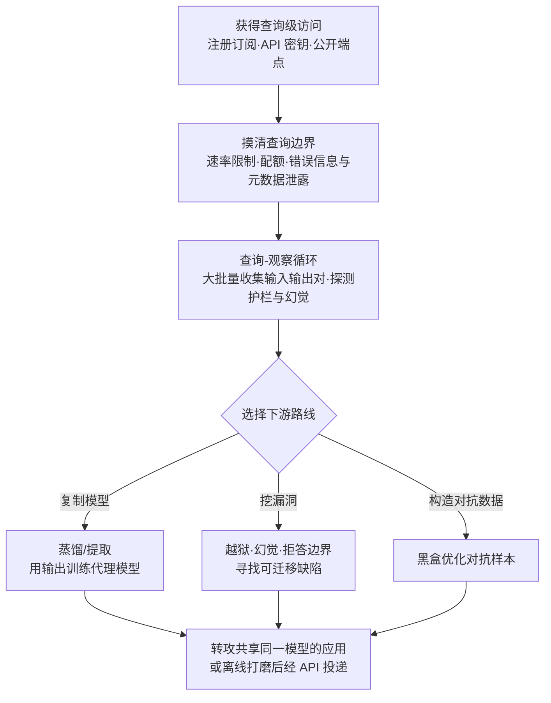

# AI 模型推理 API 访问 (AML.T0040)

## 一句话通俗理解

> 攻击者不需要撬开保险箱——只需像普通顾客一样排队问询：注册一个 API 密钥、按次付费提问，隔着"输入-输出"这层玻璃，就能把模型的行为规律整套"套"走。更麻烦的是，很多公司窗口后面是同一台机器（同一个基础模型）：攻击者在自家合法订阅里找到的漏洞，可以直接拿来打别人的应用。

## 难度等级

⭐⭐⭐ **Realized（已实现）**

官方成熟度评定为 Realized——这是 AI 模型访问战术中**门槛最低、实战中最常用**的访问方式：任何人注册一个 API 密钥或订阅一项模型服务，无需入侵任何系统，就获得了对目标模型的查询能力。但它绝非低威胁：UC Berkeley 研究团队仅凭机器翻译服务的公开接口就复刻出接近生产水平的模型；Anthropic 披露的蒸馏活动动用约 24,000 个账户、1,600 万次查询。真正的约束不在"能不能访问"，而在**查询预算**——速率限制、配额与账单构成攻击者绕不开的成本曲线；而 API 访问天然的黑盒属性（只见输入输出、不见权重内幕）决定了后续一切攻击都围绕"用查询换情报"展开。

## 技术描述

### 通俗解释

推理 API 是模型对外的"服务窗口"：你递进一张写着问题的纸条，窗口里传出答案。攻击者不需要绕到窗口后面拆机器（那需要拿到权重文件，属于白盒访问 AML.T0044 的领域），只要反复递纸条、记答案，就能像拼图一样还原出机器的行为规律——它擅长什么、在哪类问题上犯错、安全护栏拦什么不拦什么。

进这个"服务大厅"有三条路：一是**自己排队办卡**（合法注册订阅或购买 API 密钥）——完全合法，攻击者与付费客户毫无区别；二是**捡别人的卡进门**（使用被窃取的 API 密钥与云凭证，见[有效账户 (AML.T0012)](../04-Initial-Access/AML.T0012-Valid-Accounts.md)）；三是**窗口根本没人查证件**（无认证的公开推理端点，见 [AI 服务配置错误或公开暴露 (AML.T0132)](../04-Initial-Access/AML.T0132-Misconfigured-or-Publicly-Exposed-AI-Services.md)）。

最值得警惕的一条逻辑：许多系统依赖**同一个模型**提供的推理 API——尤其是训练成本高到没人愿意重训的基础模型——这意味着它们**共享同一组漏洞**。攻击者在自己的合法 API 上发现的一个越狱路径或幻觉缺陷，可能对大量使用同一模型的应用同时生效。

### 技术原理

依据官方描述，攻击者可能通过**合法访问推理 API** 的方式获得对模型的访问能力。这种查询级访问在攻击链中可以扮演四种角色：

- **情报来源**：通过反复查询探测发现 AI 模型本体（Discover AI Model Ontology, AML.T0013）与模型家族（Discover AI Model Family, AML.T0014）——模型答什么、怎么答、拒答什么，本身就是指纹；
- **攻击中转站**：作为验证攻击（[Verify Attack, AML.T0042](../03-AI-Attack-Adaptation/AML.T0042-Verify-Attack.md)）与构造对抗数据（[Craft Adversarial Data, AML.T0043](../03-AI-Attack-Adaptation/AML.T0043-Craft-Adversarial-Data.md)）的作业平台；
- **影响阶段的投递通道**：向目标系统引入恶意数据以实现规避 AI 模型（Evade AI Model, AML.T0015）或侵蚀模型完整性（Erode AI Model Integrity, AML.T0031）；
- **模型复制的数据源**：海量输入输出对为提取与蒸馏提供训练语料（见下文）。

在本战术的访问层级谱系中，推理 API 访问是**最浅、也最普及**的一层：

| 访问层级 | 攻击者掌握的模型信息 | 攻击自由度 |
|---------|-------------------|-----------|
| **黑盒 API（本技术）** | 仅能观察输入-输出行为 | 中——可探测漏洞、提取行为、注入恶意输入 |
| 灰盒间接（AML.T0047） | 日志/元数据中部分泄露的细节 | 低——以情报收集为主 |
| 物理环境（AML.T0041） | 可操纵数据采集源 | 高——可影响模型对现实世界的感知 |
| 白盒（AML.T0044） | 架构、参数、类本体的完整知识 | 最高——可离线精准构造对抗数据 |

黑盒访问能撬动什么，取决于**查询预算**这一个核心变量：

- **速率限制与配额**决定单位时间内能收集多少输入输出对。查询越充分，行为画像越完整——CS0005 用公开翻译接口的查询复刻出接近生产质量的模型；CS0056 的蒸馏活动消耗了 1,600 万次查询；
- **提取含义**：模型提取/蒸馏（[复制推理 API 训练代理模型, AML.T0005.001](../03-AI-Attack-Adaptation/AML.T0005/AML.T0005.001-Copy-Inference-API-to-Train-Proxy.md)）把"查询权"变成"复制权"——攻击者用目标模型的输出训练自己的模型，功能性窃取模型 IP，且复制体不含原模型的安全护栏；
- **规避含义**：即使只拿到输入输出对，也能驱动黑盒优化（AML.T0043.001）构造对抗样本，或用迁移攻击（AML.T0043.002）把离线打磨的样本经 API 送进目标系统。

官方描述还点明了共享模型的放大效应：许多系统依赖同一批经推理 API 提供的模型，因此共享同一批漏洞——基础模型训练成本高昂、复用普遍，放大尤为显著。攻击者可以利用自己的 API 访问找到越狱（jailbreak）或幻觉（hallucination）等缺陷，然后去攻击使用同一模型的应用程序。

**平台覆盖**：Predictive AI（预测式 AI）/ Generative AI（生成式 AI）/ Agentic AI（智能体 AI）三类平台全部适用——凡以 API 形式提供推理能力的系统都在覆盖范围内。

### 用途影响

- **情报采集**：模型本体与模型家族发现的第一手通道，衔接侦察与发现战术；
- **模型复制**：查询换输入输出对，蒸馏出代理模型——IP 被功能性窃取、安全护栏被剥除（CS0056 中被用于规避出口管制）；
- **漏洞挖掘与迁移**：在自有订阅里找越狱与幻觉，再转攻共享同一模型的生产应用——"一次发现，遍地开花"（CS0022、CS0057）；
- **攻击适配作业台**：验证攻击与构造对抗数据均以 API 查询为反馈回路；
- **影响投递入口**：恶意输入经推理 API 直接进入目标系统，驱动规避与完整性侵蚀；
- **天然合法外衣**：每一次查询在服务方眼中都是"正常业务调用"——没有恶意载荷、没有漏洞利用痕迹，检测只能依赖行为与用量遥测。

## 攻击流程

### 典型攻击流程



**步骤详解：**

1. **获得查询级访问**
   - 通俗描述：办一张普通的会员卡。
   - 技术细节：三条路径——合法注册与订阅（攻击者即"正常客户"）；滥用被窃的 API 密钥与云凭证（衔接[有效账户 (AML.T0012)](../04-Initial-Access/AML.T0012-Valid-Accounts.md)，Storm-2139 从公开渠道抓取暴露客户凭证）；触碰无认证的公开推理端点（衔接[利用面向公众的应用 (AML.T0049)](../04-Initial-Access/AML.T0049-Exploit-Public-Facing-Application.md)与 AML.T0132）。

2. **摸清查询边界**
   - 通俗描述：先弄清窗口的规矩——每天能问几条、超了会怎样。
   - 技术细节：探测速率限制与配额（响应头中的限速信息）、可用模型列表、错误信息的详细程度（版本、参数规模的元数据泄露）、内容审核的触发边界。这一步同时产出后续攻击的"预算表"。

3. **查询-观察循环**
   - 通俗描述：反复递纸条、记答案，把机器的脾气摸透。
   - 技术细节：大批量提交精心分布的输入，记录输出构成输入输出对数据集；依据官方描述，此阶段同时支撑发现 AI 模型本体（AML.T0013）与模型家族（AML.T0014）——模型的知识边界、拒答模式、幻觉倾向都是可统计的行为指纹。

4. **选择下游路线**
   - 通俗描述：情报到手，决定是"复印一台机器"、"找一扇没锁的门"，还是"定制一枚钥匙"。
   - 技术细节：复制路线用收集到的输入输出对蒸馏代理模型（AML.T0005.001，CS0005/CS0056）；漏洞路线系统性探测越狱路径与幻觉缺陷（CS0057 的越狱工具链、CS0022 的包幻觉）；对抗数据路线以查询为反馈做黑盒优化（AML.T0043.001）。

5. **对真实目标实施**
   - 通俗描述：拿研究成果去开真正的门。
   - 技术细节：把在自有订阅中验证过的攻击迁移到共享同一模型的生产应用；或经推理 API 把对抗样本、恶意提示词直接投递进目标系统，衔接[LLM 提示词注入 (AML.T0051)](../06-Execution/AML.T0051-LLM-Prompt-Injection.md)与影响战术（AML.T0015、AML.T0031）。

**与后续战术的衔接：**

- **发现（Discovery）**：查询行为本身即模型本体/家族情报的探测手段
- **AI 攻击适配（AI Attack Adaptation）**：[验证攻击 (AML.T0042)](../03-AI-Attack-Adaptation/AML.T0042-Verify-Attack.md) 与[构造对抗数据 (AML.T0043)](../03-AI-Attack-Adaptation/AML.T0043-Craft-Adversarial-Data.md) 以 API 为作业平台
- **执行（Execution）**：恶意输入经 API 触发提示词注入类效果
- **影响（Impact）**与**数据渗漏**：输入输出对经 API 持续外流——查询通道同时是渗漏通道

> 关键差异：白盒访问（AML.T0044）拿到的是图纸，推理 API 访问拿到的是"问询权"。攻击者用足够的查询把问询权逼近图纸的价值——这正是本技术被评定为 Realized 的原因：合法、廉价、可规模化，且每一次查询都披着正常业务的外衣。

## 真实案例

> 以下精选 4 个案例（官方数据共关联 10 个案例研究），全部源自 MITRE ATLAS 案例库。

### 案例1：模仿攻击——用公开接口复刻机器翻译服务（AML.CS0005，AML.T0040）

- **时间**: 2020年4月30日
- **攻击者**: UC Berkeley 人工智能研究团队（安全研究）
- **手法**: 机器翻译服务（Google Translate、Bing Translator、Systran Translate）通过公开 UI 与 API 对外提供服务。研究团队利用这些公开端点发起海量查询，训练出**复刻模型，翻译质量接近生产水平**——证明黑盒系统的知识产权可以被功能性窃取。他们进一步把复刻模型上构造的对抗样本**迁移回真实生产服务**，成功让 Google Translate 与 Systran 的线上网站出现定向替换词语、输出粗俗内容、整句丢失。
- **影响**: 一条完整的"查询级访问 → 模型提取 → 对抗样本迁移 → 影响生产系统"攻击链被完整实证；被复刻的模型没有任何安全护栏的移植
- **参考链接**: [Imitation Attacks and Defenses for Black-box Machine Translation Systems (EMNLP 2020)](https://arxiv.org/abs/2004.15015)、[项目页面](https://www.ericswallace.com/imitation)

### 案例2：ChatGPT 包幻觉武器化——Slopsquatting（AML.CS0022，AML.T0040）

- **时间**: 2024年6月1日
- **攻击者**: Vulcan Cyber、Lasso Security（安全研究）
- **手法**: 研究人员发现 ChatGPT 等 LLM 会**幻觉出不存在的软件包名**。攻击者可以抢先把恶意软件发布到包仓库的"幻觉名字"下——此后使用同一模型（或同族模型）的开发者遇到相同幻觉时，就会按 AI 的"推荐"下载并执行恶意包。幻觉缺陷经由推理 API 被系统性发现，再借助**模型共享**这一放大器变成对下游所有用户的攻击。
- **影响**: 模型的幻觉缺陷从"质量问题"升级为"供应链攻击入口"；官方描述中"同一缺陷影响所有使用同一模型的应用"在此得到直接印证
- **参考链接**: [Vulcan: Can you trust ChatGPT's package recommendations?](https://vulcan.io/blog/ai-hallucinations-package-risk)、[Lasso: Diving into AI Package Hallucinations](https://www.lasso.security/blog/ai-package-hallucinations)、[Trend Micro: Slopsquatting](https://www.trendmicro.com/vinfo/us/security/news/cybercrime-and-digital-threats/slopsquatting-when-ai-agents-hallucinate-malicious-packages)

### 案例3：针对 Anthropic Claude 的大规模模型蒸馏活动（AML.CS0056，AML.T0040）

- **时间**: 2026年2月23日
- **攻击者**: DeepSeek、Moonshot AI、MiniMax（三家中国 AI 实验室）
- **手法**: Anthropic 披露了多起针对 Claude 能力的提取活动：三方合计动用**约 24,000 个账户、1,600 万次查询**，以模型蒸馏方式在 Claude 的输出上训练自有模型，试图复制 Claude 的智能体推理、代码生成、工具使用与计算机使用能力。Anthropic 指出，蒸馏被用作**规避出口管制**的手段——且蒸馏出的模型不具备原模型防止恶意使用（生物武器开发、虚假信息、攻击性网络行动、大规模监控）的安全护栏。
- **影响**: 查询级访问的规模化上限被刷新——"多账户 + 千万级查询"构成工业化的蒸馏作业；被复制的不仅有能力，还有被剥除的护栏
- **参考链接**: [Anthropic: Detecting and preventing distillation attacks](https://www.anthropic.com/news/detecting-and-preventing-distillation-attacks)

### 案例4：Storm-2139 绕过 Azure OpenAI 护栏（AML.CS0057，AML.T0040）

- **时间**: 2024年12月（2025年1月被 Microsoft 起诉）
- **攻击者**: Storm-2139（网络犯罪网络）
- **手法**: Storm-2139 构建**定制越狱工具链**绕过 Azure OpenAI 服务的安全护栏，使最终用户得以生成有害合成内容——包括名人非自愿亲密图像等非法内容。成员从公开来源抓取暴露的客户凭证访问生成式 AI 服务账户。该运作呈三层分工：开发越狱工具的"创作者"、改造并分发工具的"供应商"、生成非法内容的"用户"。Microsoft 对其提起民事诉讼。
- **影响**: "被窃凭证 + 越狱工具链"把企业级推理 API 变成非法内容工厂；护栏绕过在查询接口上完成，无需触碰任何系统层
- **参考链接**: [Microsoft: Taking legal action to protect the public from abusive AI-generated content](https://blogs.microsoft.com/on-the-issues/2025/01/10/taking-legal-action-to-protect-the-public-from-abusive-AI-generated-content/)、[Microsoft: Disrupting a global cybercrime network abusing generative AI](https://blogs.microsoft.com/on-the-issues/2025/02/27/disrupting-cybercrime-abusing-gen-ai/)

## 红队视角

> ⚠️ **免责声明**：以下内容仅用于合法授权的安全测试与教育目的。对他人模型服务进行超出服务条款的探测、滥用他人 API 密钥均属违法行为。所有演练只使用自有账户、自有密钥。

### 实战技巧

1. **推理 API 攻击面体检**
   面向组织自有的推理端点（授权范围内）：它向查询方泄露了什么？——模型名称与版本、错误堆栈详细度、限速响应头、可枚举的端点清单。产出"查询级访问者能看到什么"的清单，这些正是攻击者第 2 步（摸清边界）的免费情报。

2. **预算感知的查询画像**
   用自有密钥做一轮克制的探测：速率限制是多少？触发内容审核时的响应差异？1,000 次查询能还原出多少行为规律？把结论量化为"攻击者在你的 API 上的性价比"——这是向管理层解释风险语言的最直观方式。

3. **同源漏洞验证**
   验证组织生产应用与所用模型官方 API 的行为一致性：同一组（无害的）边界探测提示在两端是否产生同构的拒答/幻觉模式？若高度一致，则意味着在官方 API 上被公开披露的越狱缺陷大概率同样适用于你的生产应用。

### 常用工具

| 工具名称 | 用途 | 平台 |
|----------|------|------|
| curl / Python SDK（openai、anthropic 等） | 脚本化查询与输入输出对采集 | 跨平台 |
| 自建 API 网关（如 LiteLLM） | 采集自有密钥的查询遥测，供检测实验 | 跨平台 |
| 提示词数据集（自备） | 系统化探测拒答边界与幻觉倾向 | 跨平台 |
| 服务商用量面板 | 监控实验期间的 token 消耗与成本 | Web |

### 注意事项

- **严守服务条款与授权范围**：红队价值在于"我们暴露了什么"，不在于"我越狱成功了"——后者可能直接违反法律与合同
- 报告聚焦：查询级访问的信息泄露面、用量遥测能否还原攻击行为、同模型漏洞的迁移风险
- 实验密钥专建专用，结束后立即吊销

## 蓝队视角

### 检测要点

1. **用量与成本遥测**
   - 日志来源：AI 平台审计日志、API 网关日志、token 计量
   - 关注字段：身份 × 模型 × 请求数 × 输出 token 量 × 时间窗
   - 异常特征：单身份请求量或输出 token 总量偏离基线数个标准差（蒸馏作业的典型画像——问得多、答得长）；首次出现"身份 × 模型"组合

2. **查询模式指纹**
   - 日志来源：模型调用日志、提示词遥测（经脱敏审计）
   - 异常特征：请求间隔均匀的机器节奏；语义高度同源的大批量提示（提取/蒸馏模板）；固定前缀的越狱工具特征；对拒答边界的系统性枚举（同一提示的变体矩阵）

3. **协同账户群**
   - 日志来源：注册与认证日志、网络侧 ASN 归属
   - 异常特征：短时间内同源基础设施批量注册新账户（CS0056 的 24,000 账户画像）；多个身份以同构提示模板协同查询同一模型

4. **凭证来源异常**
   - 日志来源：云审计日志、API 网关
   - 异常特征：API 密钥从新地域/新 ASN/多并发位置使用（衔接 AML.T0012 的检测逻辑）——密钥被窃后最先变现的出口往往就是推理 API

### 监控建议

- 把推理 API 的查询遥测纳入 SIEM，建立每身份"请求数 + 输出 token + 提示相似度"三维基线，蒸馏类作业在三个维度上同时越界
- 对高价值模型设置**输出 token 速率上限**——蒸馏必然表现为异常的输出吞吐
- 部署蜜罐密钥与诱饵端点（M0039）：正常业务毫无理由触碰，一旦被用即是高置信告警
- 跟踪所用基础模型的公开越狱披露，第一时间在生产端复测——共享模型意味着别人的披露就是你的预警

## 检测建议

### 网络层检测

**检测方法：** 识别凭证滥用与机器节奏的流量特征。

- 同一 API 密钥从地理上不可能并发的多个位置同时发起推理调用
- 请求间隔方差极低的匀速调用（自动化采集节奏，无人类犹豫）
- 单一来源持续触碰限速阈值并出现规律性退避重试（429 + backoff 模式）

### 主机层检测

**检测方法：** 监控自托管推理服务的异常访问。

- 自托管推理端点（vLLM、Ollama 等）收到持续数小时的匀速批量查询
- 单一来源系统性枚举可用模型列表与端点路径
- 错误信息被刻意触发（探测元数据泄露的行为特征）

### 应用层检测（AI 遥测）

**检测方法：** 利用平台审计与遥测能力还原查询作业链。

- 单身份 24 小时窗口内请求量或输出 token 总量突破阈值（提取/蒸馏画像）
- 大批量语义同源提示（同一模板的参数化变体矩阵）
- 协同账户群：多新注册身份、同源 ASN、同构提示模板同时段查询同一模型（CS0056 型活动）
- 提示词命中已知越狱工具的固定前缀特征（CS0057 型活动）

**程序化检测思路（无需 EDR 侧改造）：**

为每个身份维护三元组基线：**(请求数, 输出 token 档位, 提示相似度)**。正常业务的提示语义分散、输出量与输入复杂度相关；蒸馏作业三者同时越界——请求密集、输出吞吐异常、提示高度同源。再叠加"新注册身份 × 同源基础设施"的关联维度，即可覆盖提取（CS0005/CS0056）、护栏绕过（CS0057）、幻觉挖掘（CS0022）三类主要作业形态。全部信号都来自 API 网关与审计日志，不依赖端点改造。

### Sigma 规则思路示例

```yaml
title: 单一身份对推理 API 的持续高量查询（模型提取/蒸馏特征）
status: experimental
description: 检测同一 API 密钥或账户在 24 小时窗口内对推理端点保持高频调用，
    且输出 token 总量远超基线——可能为模型提取或蒸馏活动（AML.T0040）
logsource:
    category: application
    product: ai_api_gateway
detection:
    selection:
        event_action|endswith: 'completions'
    filter_healthy:
        status_code: 200
    condition: selection and filter_healthy | sum(output_tokens) by api_key > 5000000
    timeframe: 24h
level: high
tags:
    - atlas.aml_t0040
```

> 说明：阈值以组织正常用量分布的 99 分位为起点校准；生产环境建议叠加"提示相似度"维度二次降噪——蒸馏作业的提示集在嵌入空间中高度聚集，仅靠 token 量阈值会误伤批量摘要、批量翻译等合法高吞吐业务。

## 缓解措施

### 优先级1：关键措施

**AML.M0019 控制生产环境中的 AI 模型与数据访问（Control Access to AI Models and Data in Production）**

要求用户在访问生产模型前**验证身份**；要求 **API 端点强制认证**；**监控生产模型查询**，确保使用符合政策并防止滥用。这是正对本技术的第一道闸门：把"任何人都能查"变成"可识别、可审计、可限额的查询"。落地要点：控制台启用多因素认证；API 密钥最小权限、短生命周期、强制轮换；对每身份的查询量与输出 token 设置策略上限——CS0056 的千万级查询作业，在查询监控面前无处遁形。

### 优先级2：重要措施

**AML.M0024 AI 遥测日志（AI Telemetry Logging）**

对已部署 AI 模型的**输入与输出**实施日志记录；部署 AI 智能体时，还需记录智能体行动与决策的中间步骤、数据访问与工具使用、安装命令及智能体身份。官方明确指出两点价值：监控日志可帮助检测安全威胁、减轻影响；**日志的存在本身就能震慑希望隐匿行迹的攻击者**——蒸馏与提取作业必须大规模查询，遥测日志让这类作业天然留痕。本检测建议一节的全部规则都以该措施为数据前提。

### 优先级3：建议措施

**AML.M0039 AI 蜜罐（AI Honeypots）**

部署受监控的诱饵 AI 服务、智能体、凭证或资源——它们貌似真实资产，但不承担任何业务功能。合法用户与业务流程没有理由触碰它们，因此**任何交互都是未授权活动的高置信指标**。对推理 API 访问场景：诱饵 API 端点与蜜罐密钥可捕获攻击者的探测手法、提示词与工具链，产出威胁情报回馈检测规则；同时以"看似可信的假目标"误导侦察、消耗攻击者的查询预算。

### MITRE ATLAS 缓解措施映射

| 缓解措施ID | 缓解措施名称 | 优先级 | 类别 | 生命周期阶段 |
|------------|-------------|:------:|------|-------------|
| AML.M0019 | 控制生产环境中的 AI 模型与数据访问 | 关键 | Policy | 部署 · 监控与维护 |
| AML.M0024 | AI 遥测日志 | 重要 | Technical - Cyber | 部署 · 监控与维护 |
| AML.M0039 | AI 蜜罐 | 建议 | Technical - AI · Technical - Cyber | 部署 · 监控与维护 |

> 优先级为本库基于缓解措施与攻击链匹配度的落地建议：M0019 管"谁能查、查多少"（事前闸门），M0024 管"查了什么看得见吗"（事中留痕），M0039 管"主动诱捕与情报反制"（主动防御）。三者递进，构成对查询级访问的完整治理链。

## 关联 ATT&CK 技术

**官方未建立 AML.T0040 与 ATT&CK 技术的正式映射**（本技术在 ATLAS 数据中的 ATT&CK-reference 为空）。以下是本库给出的主题性对照，供学习参考：

- [有效账户 (T1078)](../../enterprise/03-Initial-Access/T1078-Valid-Accounts.md) — API 密钥是 AI 时代的"有效账户"：推理 API 访问的获取环节常与凭证滥用重叠，Storm-2139 正是用抓取的暴露凭证敲开 Azure OpenAI 的查询窗口；
- [利用面向公众的应用 (T1190)](../../enterprise/03-Initial-Access/T1190-Exploit-Public-Facing-Application.md) — 公开推理端点本身就是"面向公众的应用"：无认证端点同时落入 AML.T0132 的射程，ATT&CK 视角看到的是接口暴露，ATLAS 视角看到的是模型暴露。

**ATT&CK 视角 vs ATLAS 视角：**

| 维度 | ATT&CK 视角 | ATLAS 视角 (AML.T0040) |
|------|------------|------------------------|
| 核心资产 | 账户、应用、系统 | 模型本身（行为规律与输出能力） |
| 入口形态 | 登录、漏洞、注入 | API 密钥、服务订阅、公开端点 |
| 得手后果 | 系统立足点、数据访问 | 模型提取、越狱迁移、幻觉武器化、对抗投递 |
| 检测焦点 | 登录异常、漏洞利用痕迹 | 查询用量遥测与提示模式指纹 |

一句话总结：ATT&CK 技术回答"攻击者怎么进来"，AML.T0040 回答"进来之后能对模型做什么"——传统视角看到的是一次正常 API 调用，ATLAS 视角看到的是一次以查询为武器的模型情报作业。

## 动手实验

> ⚠️ **重要提示**：所有实验必须使用**自有账户与专用测试密钥**，并遵守服务商使用条款。对他人服务进行超出条款的探测属于违法行为。

### 实验环境准备

| 环境组件 | 用途 | 获取方式 |
|----------|------|----------|
| 自有 LLM API 账户 + 专用测试密钥 | 实验目标与查询来源 | 服务商注册 |
| Python + 官方 SDK 或 curl | 脚本化查询 | pip 安装 |
| 自建 API 网关（如 LiteLLM，可选） | 采集自有密钥的查询遥测 | 开源部署 |
| 服务商用量面板 / 网关日志 | 检测实验数据源 | 控制台配置 |

### 实验1（初级）：建立查询画像，体会黑盒边界

**实验目标：** 直观理解"查询级访问能看到什么、看不到什么"。

**实验步骤：**
1. 用自有密钥发起约 50 次不同类型的查询（事实型、创作型、边界试探型）
2. 记录响应中暴露的元数据：模型标识、限速响应头、错误信息的详细程度
3. 刻意触发一次速率限制，观察限流响应结构与恢复节奏
4. 汇总清单：仅凭查询级访问，你推断出了模型的哪些"脾气"？哪些信息无论如何查都拿不到？

**预期结果：** 一份黑盒访问的信息边界清单——理解"输入-输出"玻璃两侧各有什么。

### 实验2（中级）：验证"同模型同漏洞"逻辑

**实验目标：** 理解共享模型如何放大单个缺陷。

**实验步骤：**
1. 选一组**无害的**边界探测提示（如让模型描述自己的拒答规则）
2. 分别在模型官方 API 与使用同族模型的另一服务上提交同一组提示
3. 对比两端的拒答模式、措辞风格、幻觉倾向是否高度一致
4. 记录行为一致性程度——它就是漏洞可迁移性的代理指标

**预期结果：** 亲手验证"行为指纹一致 → 缺陷共享"的推断链条，理解 CS0022 包幻觉为何能波及同模型的所有用户。

### 实验3（高级）：为蒸馏作业画像并写出检测规则

**实验目标：** 建立面向 M0024 遥测的蒸馏检测能力。

**实验步骤：**
1. 经自建网关用自有密钥模拟一轮"蒸馏式负载"：大批量同构提示、持续 30 分钟
2. 在网关日志中统计每密钥的请求数、输出 token 总量、提示相似度分布
3. 按本文 Sigma 思路实现告警规则（24h 窗口输出 token 阈值 + 提示聚集度）
4. 用正常使用流量（问答、写作、翻译混合）做对照，测量误报并调参

**预期结果：** 一条实测过误报水平的蒸馏检测规则——理解为什么"问得多、答得长、提示同源"三元组是提取作业的天然画像。

## 术语解释

| 术语 | 英文原名 | 通俗解释 |
|------|----------|----------|
| 推理 API | Inference API | 模型对外的查询接口——递进输入、取回输出，是模型能力的"服务窗口" |
| 黑盒访问 | Black-box Access | 只能观察输入与输出、看不到内部结构与参数的访问层级——本技术的核心属性 |
| 查询 | Query | 一次"输入换输出"的调用——攻击者的基本作业单位 |
| 输入输出对 | Input-Output Pair | 一次查询的完整记录——批量收集后即蒸馏训练语料 |
| API 密钥 | API Key | 程序调用服务接口的认证字符串——拿到即等价于查询权 |
| 速率限制 | Rate Limit | 服务方对单位时间调用次数的上限——约束攻击节奏的"闸门" |
| 查询预算 | Query Budget | 攻击者可用查询的总量（受速率、配额、成本约束）——决定黑盒攻击的精度上限 |
| 模型提取 | Model Extraction | 用海量查询复刻出功能等价的替代模型——"功能性偷走"模型 |
| 蒸馏 | Distillation | 用目标模型的输出训练自己模型的手法——CS0056 的核心作业方式 |
| 越狱 | Jailbreak | 绕过模型安全护栏使其产出被禁止内容的提示技术 |
| 幻觉 | Hallucination | 模型一本正经编造不存在的事实（如不存在的软件包）——可被武器化 |
| 基础模型 | Foundation Model | 训练成本高昂、被大量应用复用的大规模基座模型——漏洞共享的根源 |
| 代理模型 | Proxy Model | 攻击者自建、用于离线演练攻击的替代模型——无原模型的安全护栏 |
| 遥测日志 | Telemetry Logging | 对模型输入输出的记录（M0024）——还原查询作业链的证据源 |
| 蜜罐 | Honeypot | 无业务用途的诱饵资产（M0039）——被触碰即高置信告警 |

## 参考资料

### 📚 官方文档

- [MITRE ATLAS - AI Model Inference API Access (AML.T0040)](https://atlas.mitre.org/techniques/AML.T0040/) - 官方技术页面
- [MITRE ATLAS 矩阵](https://atlas.mitre.org/matrices/ATLAS/)
- [MITRE ATLAS Data (GitHub)](https://github.com/mitre-atlas/atlas-data)

### 📰 案例报告（真实攻击与安全研究）

- [Imitation Attacks and Defenses for Black-box Machine Translation Systems (EMNLP 2020)](https://arxiv.org/abs/2004.15015) - 用公开接口提取并复刻机器翻译模型的完整实证
- [Imitation Attacks 项目页面](https://www.ericswallace.com/imitation) - 复刻模型与对抗样本迁移的演示材料
- [Vulcan: Can you trust ChatGPT's package recommendations?](https://vulcan.io/blog/ai-hallucinations-package-risk) - 包幻觉武器化（Slopsquatting）首发研究
- [Lasso Security: Diving into AI Package Hallucinations](https://www.lasso.security/blog/ai-package-hallucinations) - 包幻觉的规模化分析
- [Trend Micro: Slopsquatting — When AI Agents Hallucinate Malicious Packages](https://www.trendmicro.com/vinfo/us/security/news/cybercrime-and-digital-threats/slopsquatting-when-ai-agents-hallucinate-malicious-packages) - 幻觉供应链攻击的产业视角
- [Anthropic: Detecting and preventing distillation attacks](https://www.anthropic.com/news/detecting-and-preventing-distillation-attacks) - 24,000 账户、1,600 万查询的蒸馏活动披露
- [Microsoft: Taking legal action to protect the public from abusive AI-generated content](https://blogs.microsoft.com/on-the-issues/2025/01/10/taking-legal-action-to-protect-the-public-from-abusive-AI-generated-content/) - Storm-2139 越狱工具链诉讼声明
- [Microsoft: Disrupting a global cybercrime network abusing generative AI](https://blogs.microsoft.com/on-the-issues/2025/02/27/disrupting-cybercrime-abusing-gen-ai/) - 对该犯罪网络的后续打击

### 🔧 工具与资源

- [OWASP Top 10 for LLM Applications](https://owasp.org/www-project-top-10-for-large-language-model-applications/) - LLM 应用十大安全风险
- [NIST AI Risk Management Framework](https://www.nist.gov/itl/ai-risk-management-framework) - NIST AI 风险管理框架

### 🔗 关联阅读

- [AI 模型访问战术 (AML.TA0000)](./README.md) - 本技术所属战术的概览页（黑盒/灰盒/白盒访问层级模型）
- [有效账户 (AML.T0012)](../04-Initial-Access/AML.T0012-Valid-Accounts.md) - 推理 API 访问最常见的"钥匙来源"
- [AI 服务配置错误或公开暴露 (AML.T0132)](../04-Initial-Access/AML.T0132-Misconfigured-or-Publicly-Exposed-AI-Services.md) - 无认证端点：跳过钥匙直接查询
- [创建代理 AI 模型 (AML.T0005)](../03-AI-Attack-Adaptation/AML.T0005-Create-Proxy-AI-Model.md) - 查询收集的下游去向
- [复制推理 API 训练代理模型 (AML.T0005.001)](../03-AI-Attack-Adaptation/AML.T0005/AML.T0005.001-Copy-Inference-API-to-Train-Proxy.md) - 提取与蒸馏的技术细节
- [有效账户 (T1078)](../../enterprise/03-Initial-Access/T1078-Valid-Accounts.md) - 传统侧对照技术

---

> **版本**: ATLAS 2026.09 | **更新**: 2026-10-22 | **模板**: ATLAS 技术文档 v1.0
