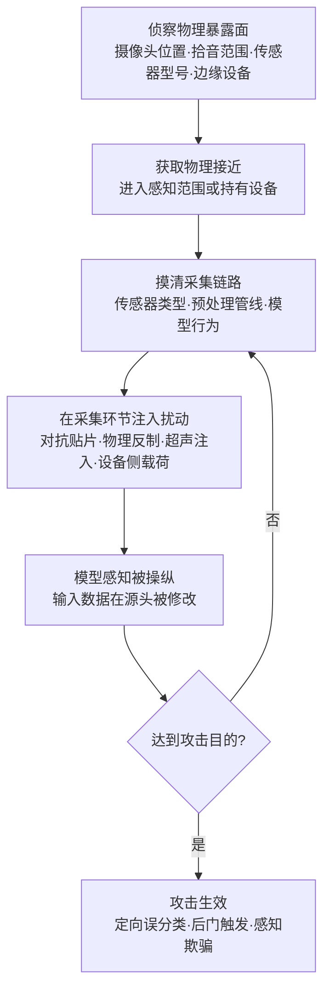

# 物理环境访问 (AML.T0041)

## 一句话通俗理解

> 攻不进数字世界，就走到模型家门口去：你骗不过人脸识别的算法，就在镜头前戴一副特制眼镜；你说服不了语音助手，就播放一段人耳听不见的超声波。当 AI 的眼睛和耳朵长在物理世界里，攻击者就会亲自到物理世界里去堵它们——不入侵系统，只操纵系统"看见的东西"。

## 难度等级

⭐⭐ **Demonstrated（已被演示）**

官方成熟度评定为 Demonstrated——可行性已被红队演练与研究反复证实：2020 年 MITRE AI 红队用物理反制手段成功诱导商用面纹识别服务产生定向误分类（AML.CS0012）；2021 年微软研究院的实证研究确认 Google Play 上 54 个含深度学习组件的移动应用可被"神经载荷注入"植入后门（AML.CS0013）。它停留在"已演示"而非"已实现"的原因在于门槛真实存在：攻击者需要物理接近目标、需要摸清传感器与采集链路，还必须把数字攻击"翻译"成经得起光照、角度、距离与打印色差损耗的物理载体。但这个门槛正在快速下降——人脸识别门禁、智能音箱、自动驾驶汽车把传感器铺满了街道与房间，物理暴露面以远超防御建设的速度持续增长。

## 技术描述

### 通俗解释

依据官方描述：除了纯数字域的攻击之外，攻击者还可以**利用物理环境**实施攻击。如果模型以某种方式与现实世界采集的数据交互，攻击者就可以通过**访问数据被采集的场所**来影响模型——在采集过程中修改数据，就能执行为数字访问设计的攻击的"物理修改版"。

前三个字是关键：**物理**。AML.T0040（推理 API 访问）的攻击者隔着网络调用接口，AML.T0044（完全模型访问）的攻击者拿到模型文件离线研究，而本技术的攻击者干的事朴素得多——**走到传感器跟前去**。模型没有眼睛和耳朵，它消费的是摄像头、麦克风、雷达等传感器采集的数字流；谁控制了采集环节，谁就控制了模型的"世界观"。这层访问在四层访问谱系中攻击自由度位居前列：API 黑盒攻击者只能改变"喂给模型的字符串"，物理环境攻击者可以改变"模型眼中的整个现实"。

### 技术原理

**传感器就是攻击面。** 现实世界中的 AI 系统感知链路可以简化为：物理世界 → 传感器（摄像头/麦克风/雷达/深度传感器）→ 预处理 → 模型推理 → 决策。传统网络安全防护（认证、加密、访问控制）部署在链路的后半段，而 AML.T0041 打击的是链路的**最前端**——物理世界与传感器的交界处。这一段没有任何"登录"或"加密"可谈：摄像头看到什么就是什么。

**四类典型物理暴露面：**

| 暴露面 | 攻击形式 | 说明 |
|--------|----------|------|
| 摄像头视场 | 对抗贴纸、特制眼镜、红外 LED | 在视觉模型输入中叠加人眼难辨的扰动，诱导误分类 |
| 麦克风/拾音范围 | 超声波注入、隐藏语音命令 | 在智能音箱唤醒词检测器上注入人耳听不见或听不懂的指令 |
| 自动驾驶传感器范围 | 激光/强光干扰雷达与摄像头、路面物理对抗物 | 在车辆感知范围内制造"幽灵障碍物"或让真实障碍物"消失" |
| 边缘设备本体 | 持有设备者的动态分析、载荷注入、后门触发 | 模型运行在手机等消费者持有的设备上，物理持有即深度访问 |

其中**边缘设备**值得特别注意：当模型被部署到数百万台用户手中的手机上（人脸解锁、现金识别、家长控制），"物理环境访问"退化为"把自己的手机拿在手里研究"——CS0013 正是这样发现 54 个可被注入后门的移动应用。攻击者无需接近任何目标设施，设备本身就是可完全操纵的物理环境。

**物理化的本质是"带损耗的对抗样本"。** 数字域对抗样本是逐像素精准优化的浮点扰动；物理域攻击则必须让扰动经过**打印色域压缩、视角旋转、光照变化、距离缩放**之后仍然有效。攻击者通常借助期望变换（EOT）一类技术，在优化时显式建模这些物理变换，让一张贴纸在各个角度与距离下都保持对抗性。反过来说，一旦物理载体制作成功，攻击的**重复成本几乎为零**——一副眼镜可以无限次走过同一个门禁。

**平台覆盖**：Predictive AI（预测式 AI）/ Generative AI（生成式 AI）/ Agentic AI（智能体 AI）三类平台全部适用——只要模型消费现实世界采集的数据，本技术即成立。

**为什么物理域攻击比数字域攻击"更稳定"：** 数字域防御的每一次升级（输入过滤、提示词加固、异常检测）都能立刻收缩攻击面，而物理域一旦失守，攻击者获得的输入控制是持续有效的——除非目标更换传感器或加装新模态。这也解释了为什么 ATLAS 把本技术归入"访问"而非"规避"：它建立的不是一次攻击，而是一条**长期可复用的输入通道**。

**与同战术其他技术的边界：**

| 技术 | 攻击者控制的位置 | 与本技术的区别 |
|------|----------------|---------------|
| AML.T0040 推理 API 访问 | 模型的输入接口 | 通过合法接口喂数据；本技术绕过接口，直接改采集源 |
| AML.T0044 完全模型访问 | 模型文件与参数 | 掌握模型本体；本技术无需知道模型结构即可实施（黑盒物理攻击） |
| AML.T0047 AI 产品或服务 | 产品交互面 | 从产品侧间接获取信息；本技术从物理侧直接影响感知 |
| AML.T0041 物理环境访问 | 现实世界到传感器的转换 | 唯一在**数据产生之前**就生效的访问层级 |

这张表的实用价值在于事件排查时定位"攻击者到底改了哪一环"：如果送进日志的输入本身已被构造，那么 API 侧的一切日志分析都注定徒劳——问题出在日志的上游。

### 用途影响

- **绕过前端防线**：人脸识别门禁、内容审核、异常行为检测等"以模型代人工"的关卡被物理手段绕过，且不触碰任何 IT 资产；
- **攻击不可认证**：传感器输入没有身份凭证，无法区分"合法的物理场景"与"精心构造的物理场景"；
- **攻击成本低复制**：数字攻击需要持续发送恶意请求，物理载体制作成功后可无限复用；
- **危害可跨域放大**：自动驾驶感知被操纵直接威胁人身安全；金融类移动应用被植入后门直接威胁资金安全（CS0013 中 54 个应用含现金识别与金融服务类）；
- **检测天然困难**：攻击发生在摄像头视场内而非网络流量中，传统安全监控完全盲视；
- **与物理安全体系脱节**：传统物理安防的目标是"防止人进入"（门禁、围墙、保安），本技术关心的是"人进入后对传感器做了什么"——即便门禁完美，传感器输入仍可能被构造。

## 攻击流程

### 典型攻击流程



**步骤详解：**

1. **侦察物理暴露面**
   - 通俗描述：踩点——数摄像头、量距离、看清每个传感器的"管辖范围"。
   - 技术细节：攻击者勘测目标的物理感知布局：摄像头安装位置与视场角、智能音箱的拾音半径、门禁的识别距离、车队经过的感知盲区；对移动应用则等价于"拿到目标应用并确认其内嵌模型"。ATLAS 案例中 MITRE AI 红队正是先以常规红队手段摸清目标服务与账号体系，再叠加物理域攻击。

2. **获取物理接近**
   - 通俗描述：走到传感器跟前去，或者把"传感器"揣进兜里。
   - 技术细节：近场攻击要求攻击者或其道具进入传感器感知范围——一副眼镜的入镜、一段超声波的播放、一张贴纸的粘贴；设备侧攻击则只需物理持有运行模型的设备（CS0013 的场景）。物理接近是本技术与纯数字攻击的分水岭，也是最大的 OPSEC 暴露点。

3. **摸清采集链路**
   - 通俗描述：搞清楚模型的眼睛"怎么看书"。
   - 技术细节：识别传感器类型与预处理管线（分辨率、归一化、人脸检测裁剪逻辑），必要时用代理模型在离线环境预演攻击——这正是 AML.T0044（完全模型访问）与本技术常被组合使用的原因：白盒知识大幅提高物理载体的首次成功率。

4. **在采集环节注入扰动**
   - 通俗描述：给模型的"眼睛"戴上别人配好的眼镜。
   - 技术细节：依据采集链路选择注入方式——视觉通道用打印的对抗贴片或物理反制配件，语音通道用超声波或隐藏语音命令，感知通道用激光/反射物，设备通道直接注入"神经载荷"。官方描述称之为"为数字访问设计的攻击的修改版"：本质仍是投毒、规避、后门那一套，只是注入点从 API 挪到了采集现场。

5. **攻击生效与衔接**
   - 通俗描述：模型看见了攻击者想让它看见的世界。
   - 技术细节：诱导定向误分类（CS0012）、触发植入的后门（CS0013）或欺骗感知决策。产出直接衔接后续战术：对抗数据构造（AML.T0043）为物理载体提供优化源头，攻击验证（AML.T0042）在目标上闭环，规避 AI 模型（AML.T0015）则是最常见的最终目的。

**与后续战术的衔接：**

- **AI 攻击适配**：物理对抗样本是[构造对抗数据 (AML.T0043)](../03-AI-Attack-Adaptation/AML.T0043-Craft-Adversarial-Data.md)的物理化产物
- **规避 AI 模型**：[规避 AI 模型 (AML.T0015)](../04-Initial-Access/AML.T0015-Evade-AI-Model.md)是物理环境访问最常见的服务对象——CS0012 即为规避攻击
- **资源开发**：特制眼镜、贴纸等物理载体的制备属于[物理反制措施 (AML.T0008.003)](../02-Resource-Development/AML.T0008/AML.T0008.003-Physical-Countermeasures.md)
- **消费级硬件获取**：攻击者常经[消费级硬件获取 (AML.T0008.001)](../02-Resource-Development/AML.T0008/AML.T0008.001-Consumer-Hardware.md)购置与目标同款的智能设备，离线复现目标环境后再上活
- **攻击验证**：物理载体在正式投放前，需要 AML.T0042（攻击验证）在目标感知范围内实测闭环

> 关键差异：传统物理攻击（撬门、剪线）破坏的是**设备**；AML.T0041 保持一切设备完好无损，只篡改设备采集到的**数据**——安防摄像头拍到了你，日志里也确实"是你"，但识别模型认为你不是。

> 第二个差异更隐蔽：传统物理攻击是一次性事件，监控录像回放总能找到痕迹；本技术的扰动嵌在每帧正常的采集数据里，与"真实场景"在数据形态上无本质区别——事后审计看到的只是"一个普通人在镜头前走过"。

## 真实案例

> 以下 2 个案例全部源自 MITRE ATLAS 案例库，均直接关联 AML.T0041。

### 案例1：MITRE AI 红队物理反制绕过商用面纹识别系统（2020年，AML.T0041 / AML.CS0012）

- **时间**: 2020年
- **攻击者**: MITRE AI 红队（授权红队演练）
- **手法**: MITRE AI 红队对一套商用面纹识别服务演示了物理域规避攻击，目标是诱导**定向误分类**（targeted misclassification）——让系统把攻击者认成指定的另一个人，而非仅仅识别失败。行动中传统 MITRE ATT&CK 技术（寻找有效账户、经 API 执行代码等）与对抗 ML 专项攻击交织使用：红队先以常规手法摸清服务与账号体系，再制备物理反制手段（关联 AML.T0008.003）在摄像头采集环节注入扰动，把"攻击 API"翻译成了"攻击镜头"。
- **影响**: 证明商用级人脸识别服务在精心设计的物理反制面前可被定向欺骗；同时示范了物理域攻击与传统攻击链交织的完整杀伤链，成为 ATLAS 收录物理环境访问的标志性案例
- **参考链接**: [ATLAS 案例研究 AML.CS0012](https://atlas.mitre.org/studies/AML.CS0012/)

### 案例2：DeepPayload——移动应用深度学习模型后门注入（2021年，AML.T0041 / AML.CS0013）

- **时间**: 2021年1月18日
- **攻击者**: Yuanchun Li、Jiayi Hua、Haoyu Wang、Chunyang Chen、Yunxin Liu（微软研究院，学术研究）
- **手法**: 深度学习模型日益成为移动应用的关键组件。研究团队证明大量部署在移动应用中的模型可经"**神经载荷注入**"（neural payload injection）植入后门，并提出黑盒后门攻击工具 DeepPayload。他们对从 Google Play 收集的真实移动深度学习应用开展实证研究，识别出 **54 个**可被攻击的应用，其中包括现金识别、家长控制、人脸认证与金融服务等安全敏感类应用。攻击成立的物理前提正是本技术：攻击者对运行模型的设备拥有完全的物理控制，可任意反复注入、触发与验证。
- **影响**: 揭示"设备即环境"的系统性风险——数百万用户手中的手机就是可被完全操纵的模型运行环境；后门触发后现金识别与金融类应用的判定结果直接关系资金安全
- **参考链接**: [ATLAS 案例研究 AML.CS0013](https://atlas.mitre.org/studies/AML.CS0013/)、[DeepPayload 论文 (arXiv:2101.06896)](https://arxiv.org/abs/2101.06896)

## 红队视角

> ⚠️ **免责声明**：以下内容仅用于合法授权的安全测试与教育目的。物理接近他人设施、在他人传感器上做手脚，未经书面授权即属违法——物理攻击的法律与安全风险远高于纯数字测试。

### 实战技巧

1. **先做物理暴露面盘点，再谈攻击**
   对授权目标绘制"传感器地图"：每个摄像头的视场与死角、拾音半径、识别距离、光照条件。产出物是一张物理暴露面清单——多数组织从未意识到自己的传感器布局本身就是攻击面文档。

2. **搭建"数字→物理"迭代闭环**
   物理对抗样本的核心工程问题是损耗：打印色域压缩、视角、距离都会削弱扰动。实战做法是用代理模型 + 期望变换（EOT）在优化阶段就模拟这些物理变换，再以"打印→实测→再优化"循环收敛。一次成功的贴片背后通常是十几轮打印。

3. **设备侧授权测试走动态分析路线**
   对自有/授权的移动应用，用 Frida 等框架 hook 模型推理调用，观察输入张量与输出分布——CS0013 式的后门注入在防御侧的复现，就是从"我能不能在设备上改模型输入输出"这个问题开始的。

### 常用工具

| 工具名称 | 用途 | 平台 |
|----------|------|------|
| Adversarial Robustness Toolbox (ART) | 对抗样本生成、物理变换模拟与防御评估 | Python |
| CleverHans | 对抗样本研究库，白盒/黑盒扰动优化 | Python |
| Frida | 边缘设备上模型运行时的动态分析与 hook（仅限授权设备） | 跨平台 |
| face_recognition / InsightFace | 自建人脸识别靶场，复现 CS0012 类攻击 | Python |
| 打印贴纸、眼镜框、3D 打印件 | 物理对抗载体（消耗品） | 物理世界 |

### 注意事项

- **物理授权与数字授权是两回事**：渗透测试授权书通常不含"进入物理场所"，单独取得书面许可
- **物理行动全程 OPSEC**：你踩点时目标摄像头也在拍你；门禁日志、访客记录都是事后取证线索
- **报告要量化物理条件**：攻击在什么距离、角度、光照下有效，是防御方最需要的评估结论

## 蓝队视角

### 检测要点

1. **物理侧异常**
   - 日志来源：门禁与访客记录、安防监控录像、传感器遮挡/移动告警
   - 异常特征：传感器视场内同一人物/物体反复出现并微调位置（对抗贴片的调试行为）、非工作时段在摄像头前停留、镜头被遮挡或贴附异物

2. **设备侧异常**
   - 日志来源：设备完整性校验（Play Integrity 等认证日志）、应用防篡改日志
   - 异常特征：设备 root/越狱标志、调试器与注入框架（Frida）指纹、模型文件或应用二进制被修改、同一设备异常高频调用本地模型推理接口

3. **模型侧遥测异常**
   - 日志来源：AI 服务判定日志、置信度分布统计
   - 异常特征：同一识别端点短时间置信度剧烈波动或判定反复翻转、识别失败率突增、特定时段误分类聚集、休眠后门触发时的异常高置信度输出

### 监控建议

- **把物理日志与模型日志拼接**：门禁刷卡记录 × 人脸识别判定 × 安防录像三者关联，"刷开了门但识别置信度异常"是最有价值的复合告警
- **监控输入分布而非只监控输出结果**：对抗贴片在输入图像上留下可统计的纹理痕迹，输入分布漂移检测比"等一次误判"更早发现攻击
- **边缘设备强制完整性证明**：无法证明自身完整性的设备，其本地模型输出一律降权
- **对"跨传感器分歧"建基线**：RGB 与深度、视觉与雷达的判定分歧率是 M0009 多传感器融合的检测侧镜像
- **物理变更纳入变更管理**：摄像头移位、更换、视场调整都应走审批并同步告知 AI 系统负责人——未经记录的物理变更，既可能是攻击的前兆，也可能是攻击本身

## 检测建议

### 物理域检测

**检测方法：** 监控传感器自身与其视场的物理完整性。

- 摄像头/麦克风加装遮挡与位移告警，视场内异常停留行为触发人工复核
- 关键识别点位的判定日志与安防录像自动对齐，离线抽查"成功识别"的物理场景

### 设备层检测

**检测方法：** 对运行本地模型的边缘设备做完整性验证。

- 应用启动与推理前执行设备认证（Play Integrity / 厂商 attestation），失败即拒绝服务
- 检测注入框架与调试器指纹，触发后向服务端上报并吊销该设备信任

### 应用层检测（AI 遥测）

**检测方法：** 用统计基线捕获采集环节被操纵的痕迹。

- 识别置信度分布与失败率的时序监控，短窗突增即告警
- 同一主体在多传感器间的判定分歧率监控——单传感器被物理欺骗时，分歧率先于误判暴露
- 输入图像纹理与频域特征异常检测，识别对抗贴片类扰动

**程序化检测思路（无需 EDR 侧改造）：**

用"**分歧率 + 置信度漂移 + 时序聚集**"三元组替代单点阈值：分歧率维度看同一主体在多传感器间的判定是否罕见地不一致（单通道被物理欺骗的最早信号）；置信度维度看同一端点的判定分数是否出现断崖式波动；时序维度看上述异常是否在短窗口内聚集出现（物理载体调试期的反复尝试）。三者同时命中再触发告警，可显著压低误报。对边缘设备场景，把"设备完整性证明失败"直接设为最高置信告警，与后续所有判定记录自动关联。

### Sigma 规则思路示例

```yaml
title: 人脸识别端点短时低置信度重试爆发（物理对抗迹象）
status: experimental
description: 检测同一人脸识别端点在短时间内出现大量低置信度判定与结果翻转，
    可能是物理对抗载体（贴纸/眼镜）在镜头前反复调整位置（AML.T0041，参照 CS0012）
logsource:
    category: application
    product: face_identification_service
detection:
    selection:
        status: 'low_confidence'
    timeframe: 10m
    condition: selection | count() by endpoint > 5
level: high
tags:
    - atlas.aml_t0041
```

## 缓解措施

### 优先级1：关键措施（ATLAS 官方缓解）

**AML.M0009 预测式 AI 多传感器融合（Predictive AI Multi-Sensor Fusion）**

使用**相互独立的物理传感器**（理想情况下跨多种模态、或来自多个视角）避免依赖单一可能被攻击者操纵、遮挡或破坏的传感器。相关传感器可包括可见光摄像头、红外摄像头、深度传感器、雷达、激光雷达、麦克风及其他物理感知系统。核心原则是**跨传感器印证观察结果**，使对单一输入源的操纵不会过度影响模型预测。本措施直接覆盖 AML.T0015（规避 AI 模型）、AML.T0041（物理环境访问）与 AML.T0088（生成深度伪造），生命周期横跨业务与数据理解、数据准备、AI 模型工程三个阶段。落地要点：融合逻辑本身要假设"任一单通道可被完全控制"，用投票、置信度加权或一致性校验兜底；关键决策点（门禁、支付）至少两种模态独立确认。

### 优先级2：重要措施（本库补充，非官方 ATLAS 映射）

**物理与设备侧纵深防御**：

- 收敛关键传感器的物理暴露面：调整摄像头视场避开公共区域、识别点位加装遮挡告警、限制拾音设备唤醒灵敏度
- 边缘设备强制完整性证明：本地模型推理前校验设备与二进制完整性，拒绝已 root/越狱或被注入设备的判定结果
- 对抗训练纳入物理变换：训练时叠加打印色域压缩、旋转、光照等扰动，压制物理对抗样本的迁移成功率

### MITRE ATLAS 缓解措施映射

| 缓解措施ID | 缓解措施名称 | 优先级 | 类别 | 生命周期阶段 |
|------------|-------------|:------:|------|-------------|
| AML.M0009 | 预测式 AI 多传感器融合 | 关键 | Technical - Cyber | 业务与数据理解 · 数据准备 · AI 模型工程 |

> M0009 是 ATLAS 对本技术的官方缓解映射；优先级2 为本库基于物理安全与设备完整性实践补充的纵深建议。
>
> 防御设计的第一性问题：不要问"模型够不够强"，要问"模型的每一路输入是否独立可信、是否可交叉印证"。

## 关联 ATT&CK 技术

**官方未建立 AML.T0041 与 ATT&CK 技术的正式映射**（本技术在 ATLAS 数据中的 ATT&CK-reference 为空）。以下是本库给出的主题性对照，供学习参考：

- **[硬件添加 (T1200)](../../enterprise/03-Initial-Access/T1200-Hardware-Additions.md)**——ATT&CK 中最接近的"物理接近"概念：通过在目标环境中物理添加硬件实现初始访问。两者的共同点是攻击者都要**物理到达目标环境**；差异在于 T1200 引入的是联网硬件（侵入网络），AML.T0041 操纵的是数据采集（侵入感知）——前者给网络加东西，后者给模型的"眼睛"加滤镜。
- **收集类技术（音频捕获 T1123、视频捕获 T1125）** 常被误认为与本技术相关，实则方向相反：收集类技术是攻击者**借用**目标传感器为自己采集情报；AML.T0041 是攻击者**篡改**目标传感器喂给模型的数据。一个偷看，一个投毒。
- 从防御视角看，ATT&CK 对物理威胁的应对（门禁、摄像头、设备供应链）依然全部适用，但必须叠加"传感器输入可能被构造"这一假设——这是传统物理安防体系从未需要考虑的维度。

**数字域攻击 vs 物理域攻击对照：**

| 维度 | 数字域攻击（如 AML.T0040 API 攻击） | 物理域攻击（AML.T0041） |
|------|-----------------------------------|------------------------|
| 注入点 | 推理 API / 提示词 | 传感器采集环节 / 边缘设备本体 |
| 前置条件 | 网络可达 + 凭证或开放接口 | 物理接近或设备持有 |
| 扰动形态 | 任意浮点/字符串 | 须经光照、角度、打印损耗的物理载体 |
| 重复成本 | 每次请求都要发送 | 载体制成后近乎零成本复用 |
| 传统检测能力 | API 网关/日志可观测 | 网络层完全盲视 |

一句话总结：数字攻击者研究模型，物理攻击者研究模型的眼睛。

## 动手实验

> ⚠️ **重要提示**：所有实验仅使用自有设备与自有模型（或公开数据集上自训的模型）。禁止对他人设施、他人设备或商业识别服务进行任何物理测试。

### 实验环境准备

| 环境组件 | 用途 | 获取方式 |
|----------|------|----------|
| 笔记本摄像头 + Python | 采集物理输入 | 现有设备 |
| face_recognition / InsightFace | 自建人脸识别靶场 | pip 安装 |
| Adversarial Robustness Toolbox (ART) | 对抗扰动生成 | pip 安装 |
| 打印机 + 贴纸纸 / 平光眼镜框 | 物理对抗载体 | 文具店 |

### 实验1（初级）：观察采集链路的物理敏感性

**实验目标：** 直观理解"模型消费的是传感器数据，而传感器数据可被物理操纵"。

**实验步骤：**
1. 用 face_recognition 注册自己的脸，建立基准识别
2. 依次改变物理条件：戴普通眼镜、调暗灯光、拉远距离、微微侧脸，记录每次的识别结果与距离阈值变化
3. 打印自己的照片举到摄像头前，观察是否被识别为本人

**预期结果：** 一张低成本的物理变化（眼镜、光照）即可显著改变模型判定——这就是物理暴露面的最直接证据。

### 实验2（中级）：制作一张"物理化"的对抗贴纸

**实验目标：** 体验数字扰动到物理载体的损耗与迭代过程。

**实验步骤：**
1. 用 ART 对自训的图像分类器生成对抗扰动
2. 将扰动叠加到打印图案上并打印成贴纸（注意保存数字原图做对照）
3. 将贴纸置于摄像头视场内，在 3 个距离 × 3 个角度下测试攻击成功率
4. 记录"数字上 100% 成功"与"物理上首次成功"的差距，理解 EOT 存在的意义

**预期结果：** 亲手验证物理损耗会杀死天真的数字对抗样本，理解攻击者为 CS0012 式攻击付出的工程成本。

### 实验3（高级）：复现 M0009 多传感器融合缓解

**实验目标：** 验证单通道被欺骗时，跨通道印证仍能守住判定。

**实验步骤：**
1. 用双摄（RGB + 深度）或双视角摄像头搭建最小融合判定：两通道一致才放行
2. 用实验2 的贴纸攻击单一 RGB 通道，确认单通道可被欺骗
3. 观察融合判定：深度/第二视角未被同时欺骗时，最终判定是否保持正确
4. 记录"分歧率→告警"的完整链路，对应蓝队视角的检测建议

**预期结果：** 亲眼看到 M0009 的设计逻辑——操纵一个传感器容易，同时操纵多个模态/视角的成本呈指数上升。

**三个实验的共同结论：** 物理环境访问的攻防不对称性——攻击者只需攻破一条采集通道，防御方必须保证每条通道可信或至少可交叉印证。这也是 M0009 被列为关键措施的原因：它把"每条通道都必须完美"的无限责任，转化为"任一通道被攻破时可被发现"的有限责任。

## 术语解释

| 术语 | 英文原名 | 通俗解释 |
|------|----------|----------|
| 物理环境 | Physical Environment | AI 系统采集数据的现实场所——摄像头视场、拾音范围、设备本体 |
| 传感器 | Sensor | 把物理世界翻译成数字信号的部件（摄像头、麦克风、雷达），模型的"眼睛和耳朵" |
| 摄像头 | Camera | 视觉模型的输入通道，对抗贴片与物理反制的主要攻击目标 |
| 麦克风 | Microphone | 语音模型的输入通道，超声波与隐藏语音命令的注入点 |
| 近场攻击 | Proximity Attack | 攻击者或其道具物理进入传感器感知范围实施的攻击 |
| 物理对抗样本 | Physical Adversarial Example | 经打印/佩戴进入物理世界后仍保持对抗性的扰动载体 |
| 对抗贴片 | Adversarial Patch | 印刷出来的对抗扰动图案，贴在物体上即可骗过视觉模型 |
| 物理反制措施 | Physical Countermeasures | 特制眼镜、贴片等可穿戴/可携带的攻击道具（AML.T0008.003） |
| 边缘设备 | Edge Device | 在用户端本地运行模型的设备（手机、音箱、车载计算单元） |
| 神经载荷注入 | Neural Payload Injection | 向部署在设备上的模型注入恶意神经组件的后门攻击（CS0013） |
| 期望变换 | Expectation Over Transformation (EOT) | 在优化中模拟旋转、光照、打印损耗等物理变换，让扰动"物理耐用" |
| 多传感器融合 | Multi-Sensor Fusion | 跨多个独立传感器印证观察，单一通道被操纵不至于左右判定（M0009） |

## 参考资料

### 📚 官方文档

- [MITRE ATLAS - Physical Environment Access (AML.T0041)](https://atlas.mitre.org/techniques/AML.T0041/) - 官方技术页面
- [MITRE ATLAS 矩阵](https://atlas.mitre.org/matrices/ATLAS/)
- [MITRE ATLAS Data (GitHub)](https://github.com/mitre-atlas/atlas-data)

### 📰 案例报告（真实攻击与安全研究）

- [ATLAS 案例研究 AML.CS0012](https://atlas.mitre.org/studies/AML.CS0012/) - MITRE AI 红队物理反制绕过商用面纹识别系统
- [ATLAS 案例研究 AML.CS0013](https://atlas.mitre.org/studies/AML.CS0013/) - DeepPayload 移动应用模型后门注入
- [DeepPayload: Black-box Backdoor Attack on Deep Learning Models through Neural Payload Injection (arXiv:2101.06896)](https://arxiv.org/abs/2101.06896) - CS0013 背后的实证研究论文
- [MITRE ATLAS 缓解措施 M0009](https://atlas.mitre.org/mitigations/AML.M0009/) - 预测式 AI 多传感器融合

### 🔧 工具与资源

- [Adversarial Robustness Toolbox](https://github.com/Trusted-AI/adversarial-robustness-toolbox) - IBM 开源对抗样本与防御评估工具箱
- [CleverHans](https://github.com/cleverhans-lab/cleverhans) - 对抗样本研究库
- [face_recognition](https://github.com/ageitgey/face_recognition) - 自建人脸识别靶场的最简路径
- [NIST AI Risk Management Framework](https://www.nist.gov/itl/ai-risk-management-framework) - NIST AI 风险管理框架

### 🔗 关联阅读

- [AI 模型访问战术 (AML.TA0000)](./README.md) - 本技术所属战术概览页，四层访问谱系的完整图景
- [物理反制措施 (AML.T0008.003)](../02-Resource-Development/AML.T0008/AML.T0008.003-Physical-Countermeasures.md) - CS0012 红队所用物理"武器"的制备技术
- [消费级硬件获取 (AML.T0008.001)](../02-Resource-Development/AML.T0008/AML.T0008.001-Consumer-Hardware.md) - 智能音箱等消费设备如何成为物理攻击面的入口
- [构造对抗数据 (AML.T0043)](../03-AI-Attack-Adaptation/AML.T0043-Craft-Adversarial-Data.md) - 物理对抗样本的数字侧源头
- [规避 AI 模型 (AML.T0015)](../04-Initial-Access/AML.T0015-Evade-AI-Model.md) - 物理环境访问最常服务的攻击目标
- [硬件添加 (T1200)](../../enterprise/03-Initial-Access/T1200-Hardware-Additions.md) - ATT&CK 侧最接近的物理访问技术

---

> **版本**: ATLAS 2026.09 | **更新**: 2026-10-22 | **模板**: ATLAS 技术文档 v1.0
