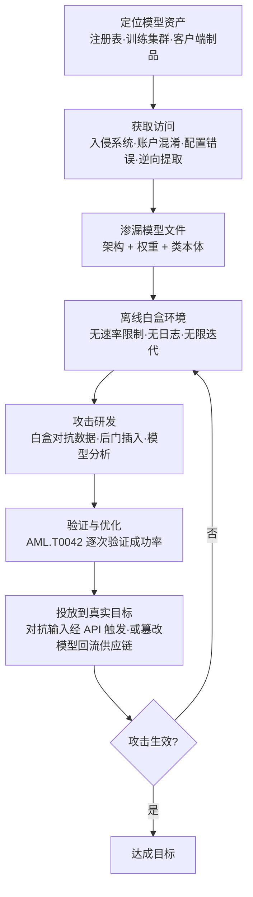

# 完全 AI 模型访问 (AML.T0044)

## 一句话通俗理解

> 黑盒访问是隔着柜台问店员问题；完全模型访问是把整台机器连图纸带零件搬回自己家——想拆开看内部结构、想改装齿轮、想在暗处反复试钥匙，都随你，而且店主毫不知情。

## 难度等级

⭐⭐ **Demonstrated（已演示）**

官方成熟度评定为 Demonstrated——获取完全模型访问的路径已在多个真实研究与企业环境中被演示：研究者在暴露的容器镜像仓库中免认证拉取了超过 1,000 个专有 AI 模型文件（AML.CS0028）；安全研究者通过 Hugging Face 组织混淆直接获得员工上传模型的完整控制权（AML.CS0027）；逆向团队从 Android 应用包中恢复出 Google Photos 的专有 TFLite 模型（AML.CS0058）。难点不在"拿到模型之后能干什么"——白盒环境里的攻击几乎是自由发挥——而在**如何拿到模型本身**：模型权重通常存放在受控的注册表、生产系统或移动应用内部，需要先攻破承载它的系统（初始访问）、利用配置错误的存储，或从客户端制品中逆向提取。

## 技术描述

### 通俗解释

依据官方定义，攻击者可能获得对 AI 模型的完全**白盒**（white-box）访问。这意味着攻击者完整掌握模型的三个方面：

- **架构**：网络长什么样——多少层、每层多少神经元、层与层如何连接；
- **参数（权重）**：模型在训练中学到的所有数值——这些浮点数就是模型全部"知识"的载体；
- **类本体**：模型能输出哪些类别（或词表）、每个输出节点对应什么语义。

拿到这三样，攻击者就等于拥有了一个与生产环境**一模一样的复制品**。他可以把模型加载到自己的 GPU 上，任意输入、任意观察、任意修改，不受任何速率限制、配额或日志监控约束。官方明确指出其典型用途：攻击者可能将模型**渗漏**（exfiltrate）到离线环境，用于[制作对抗数据 (AML.T0043)](../03-AI-Attack-Adaptation/AML.T0043/AML.T0043.000-White-Box-Optimization.md)与[验证攻击 (AML.T0042)](../03-AI-Attack-Adaptation/AML.T0042-Verify-Attack.md)——在一个**难以被检测**的环境中打磨攻击方案。

**攻击者获得白盒访问的典型途径**（对照本战术 README 的三条访问路径）：

1. **入侵承载模型的系统**：通过初始访问进入模型注册表、训练集群或推理服务器，直接下载模型文件（CS0028 的暴露容器注册表即属此类）；
2. **供应链与账户混淆**：伪装成合法组织骗取模型托管平台的控制权（CS0027 的 Hugging Face 组织混淆）；
3. **从客户端制品逆向提取**：移动应用、边缘设备随包分发的模型文件可被静态分析与动态插桩提取（CS0058 的 Google Photos 模型提取、CS0013 的移动应用后门研究）。

### 技术原理

**白盒访问解锁了什么**——这是理解本技术威胁性的核心。对比黑盒 API 访问（AML.T0040 只能输入-输出对），完全模型访问带来五个维度的能力跃迁：

| 能力 | 黑盒 API | 白盒（完全访问） | 为什么重要 |
|------|---------|----------------|-----------|
| 梯度信息 | 无——只能靠查询近似 | **直接读取**——对输入求导可得损失面完整形态 | 梯度是构造对抗样本最锋利的工具（见 [白盒优化 AML.T0043.000](../03-AI-Attack-Adaptation/AML.T0043/AML.T0043.000-White-Box-Optimization.md)） |
| 查询成本 | 每次查询都可能被计费、限速、记录 | 零成本、无限次、无日志 | 攻击迭代速度从"每天几百次试探"变成"GPU 集群上每秒数千次" |
| 攻击可见性 | 异常查询会触发风控 | **完全离线**——防御方一无所知 | 防御方失去最基础的检测面（审计日志） |
| 模型修改 | 不可能 | 可直接插入后门、篡改权重 | 衔接[篡改 AI 模型 (AML.T0018)](../03-AI-Attack-Adaptation/AML.T0018-Manipulate-AI-Model.md) |
| 训练数据分析 | 无 | 部分场景随权重一并获得 | 可能泄露训练数据中的敏感样本 |

**白盒权限分级的威胁建模意义**：防御者必须意识到，同一模型在不同暴露面下对应完全不同的威胁等级——

- **云端 API 暴露**：攻击者最多做黑盒优化，防御方还有速率限制与查询日志两道防线；
- **模型文件下发到客户端**（移动 App、边缘设备、本地推理）：每个客户端都是潜在的白盒入口，权重加密只能提高门槛（CS0058 显示运行时解密后仍可被动态插桩捕获）；
- **权重公开**（开源发布或意外泄露）：威胁模型发生**根本变化**——"保密"不再是防线，任何针对该模型发现的漏洞（越狱、对抗样本、后门）**永久有效且无法召回**，所有使用该权重的下游系统同时暴露。

官方缓解措施 M0017 的表述印证了这一分级逻辑：将模型部署到边缘设备会**增加系统攻击面**，考虑在云端提供服务可降低攻击者对模型的访问层级。

**与相近技术的边界**：

- **AML.T0040（推理 API 访问）**：黑盒——只有输入输出接口，本技术是白盒——拥有模型本体；
- **AML.T0035（AI 模型提取）**：通过大量 API 查询"复刻"出一个近似模型，得到的是**替代品**；本技术直接拿到**原件**，攻击保真度完全不同；
- **AML.T0005（创建代理 AI 模型）**：攻击者主动构建行为近似的模型用于演练——是"没有原件时的替代方案"；本技术一旦得手，代理模型即失去必要性；
- **AML.T0018（篡改 AI 模型）**：本技术解决"拿到"，AML.T0018 解决拿到之后"改什么、怎么改"。

**平台覆盖**：Predictive AI（预测式 AI）/ Generative AI（生成式 AI）/ Agentic AI（智能体 AI）三类平台均适用。

### 用途影响

- **知识产权直接损失**：模型权重是高价值商业资产——训练成本动辄数十万到数百万美元，一次渗漏即是核心资产失窃（CS0028 中上千个专有模型暴露于免认证拉取）；
- **攻击成功率质变**：梯度引导的白盒对抗样本攻击成功率远高于黑盒迁移攻击，且扰动可以做得更小、更隐蔽；
- **防御检测面归零**：离线环境中的攻击准备不产生任何目标侧遥测，防御方只能在攻击"打进来"的那一刻才可能察觉；
- **漏洞永久化**：对已泄露/开源权重的攻击成果无法通过"打补丁"召回——不同于传统软件漏洞，权重一旦扩散即不可撤销；
- **供应链放大效应**：被篡改的模型经注册表重新分发，污染所有拉取该模型的生产系统（CS0027/CS0028 均演示了这一路径）。

## 攻击流程

### 典型攻击流程



**步骤详解：**

1. **定位模型资产**
   - 通俗描述：搞清楚"那台机器"放在哪——注册表、训练服务器、还是用户的手机 App 里。
   - 技术细节：攻击者通过侦察（AML.T0000/T0006）与服务索引门户定位模型存储位置。Trend Micro 研究团队正是用服务索引门户与网络搜索工具发现了 8,000+ 个配置错误的私有容器注册表。

2. **获取访问**
   - 通俗描述：拿钥匙——撬门（入侵）、骗钥匙（组织混淆）、捡漏（免认证拉取）、或干脆把锁拆了研究（逆向）。
   - 技术细节：途径包括入侵承载系统（初始访问战术）、利用过度宽松的访问控制（CS0028 中约 70% 暴露注册表允许写操作）、组织账户混淆（CS0027）、或对客户端制品做静态逆向 + Frida 动态插桩（CS0058 捕获运行时解密后的模型）。

3. **渗漏模型文件**
   - 通俗描述：把整台机器搬回家。
   - 技术细节：下载模型权重与配置文件（如 `.bin`/`.safetensors`/TFLite 制品）。模型文件体积大（MB 到数百 GB），渗漏手段对应传统 ATT&CK 数据渗漏战术。

4. **离线白盒分析**
   - 通俗描述：在自己家拆开机器，怎么折腾都没人管。
   - 技术细节：在本机加载模型，读取架构与参数，执行前向/反向传播，观察任意中间层输出。此时攻击活动**完全脱离目标方视野**。

5. **攻击研发**
   - 通俗描述：精准配钥匙——不是一把把试，而是照着锁芯图纸直接开出万能钥匙。
   - 技术细节：基于梯度构造对抗数据（AML.T0043.000 白盒优化）；或在模型副本中插入后门触发器（AML.T0043.004）；或微调出绕过安全对齐的变体。

6. **验证与投送**
   - 通俗描述：先在自己家的锁上试钥匙，再去开真锁。
   - 技术细节：在离线副本上执行攻击验证（AML.T0042），反复迭代至稳定成功；随后两条投送路径——(a) 把对抗输入经目标推理 API 送入；(b) 把**篡改后的模型**推回注册表，经供应链分发给生产系统（CS0027/CS0028 演示）。

**与后续战术的衔接：**

- **AI 攻击适配（AML.TA0001）**：白盒访问是该战术中白盒优化、后门插入等高阶攻击的直接前提
- **数据渗漏（AML.TA0010）**：模型文件本身即是被渗漏的高价值数据
- **影响（AML.TA0011）**：打磨完成的攻击最终经推理接口或污染模型作用到生产系统

> 关键差异：黑盒攻击者"隔着柜台猜机器构造"，白盒攻击者"拿着图纸造钥匙"——前者留下的查询痕迹是防御方的告警机会，后者在动手前**不留任何痕迹**。

## 真实案例

> 以下 4 个案例全部源自 MITRE ATLAS 案例库，均直接关联 AML.T0044。

### 案例1：暴露容器注册表中的千余个 AI 模型（2023年，AML.CS0028）

- **时间**: 2023年9月26日
- **攻击者**: Trend Micro Nebula 云研究团队（安全研究，非恶意攻击者）
- **手法**: 研究者用服务索引门户与网络搜索工具识别出超过 8,000 个暴露在互联网上的配置错误私有容器注册表，其中约 70% 的访问控制过度宽松、允许写操作。他们在这些开放注册表的私有容器镜像中发现了**超过 1,000 个不重复的 AI 模型**，无需认证即可拉取。攻击者可以下载、检查并修改容器内容（包括敏感的 AI 模型文件），既构成知识产权失窃，也可将投毒镜像推回注册表形成供应链攻击，破坏生产系统中 AI 模型的完整性。
- **影响**: 证明了"配置错误的存储 = 免费的白盒访问"——模型权重作为高价值 IP 大规模暴露，且篡改路径直达生产供应链
- **参考链接**: [Trend Micro: Silent Sabotage: Weaponizing AI Models in Exposed Containers](https://www.trendmicro.com/vinfo/br/security/news/cyber-attacks/silent-sabotage-weaponizing-ai-models-in-exposed-containers)、[Exposed Container Registries: A Potential Vector for Supply-Chain Attacks](https://www.trendmicro.com/vinfo/us/security/news/virtualization-and-cloud/exposed-container-registries-a-potential-vector-for-supply-chain-attacks)

### 案例2：Hugging Face 组织混淆获得模型完全控制权（2023年，AML.CS0027）

- **时间**: 2023年8月23日
- **攻击者**: threlfall_hax（安全研究者）
- **手法**: 研究者在公共模型仓库 Hugging Face 上创建**冒充真实组织的组织账户**。这些假组织账户看起来足够合法，以至于被冒充组织的员工主动申请加入，把它当成员工共享模型的官方站点。研究者由此获得了员工上传的全部 AI 模型的**完整访问权限，包括用恶意版本替换模型的能力**。演示中，研究者把恶意软件嵌入 AI 模型，获得了受害者环境的访问权限——此后威胁行为者可实施知识产权盗窃或毒化受害者环境中的其他 AI 模型。
- **影响**: 供应链层面获取白盒访问的完整演示——不需要攻破任何系统，一个"看起来很像"的账户就让内部模型主动送上门
- **参考链接**: [Model Confusion - Weaponizing ML models for red teams and bounty hunters](https://5stars217.github.io/2023-08-08-red-teaming-with-ml-models/#unexpected-benefits---organization-confusion)

### 案例3：Google Photos 专有模型逆向提取（2025年，AML.CS0058）

- **时间**: 2025年3月1日
- **攻击者**: Skyld（安全研究团队）
- **手法**: 研究者分析 Google Photos Android 应用，恢复了其 AI 照片编辑与图像分析功能使用的 TensorFlow Lite 模型。模型以三种形态存在：应用资产目录中**未加密**存放、嵌入原生库、磁盘加密存储。研究者用静态逆向定位 TFLite 制品，再用 Frida 动态插桩捕获**运行时解密后**的模型。恢复的模型提供了对 Google Photos 专有模型制品的**白盒访问**。
- **影响**: 证明客户端分发的模型无论是否加密，最终都要在内存中解密执行——动态插桩面前，"加密下发"只是提高门槛而非关闭通道
- **参考链接**: [Skyld: Google Photos AI Models: The Secret Sauce That Can Be Stolen](https://skyld.io/google-photos-model-extraction)

### 案例4：移动应用深度学习模型后门攻击研究（2021年，AML.CS0013）

- **时间**: 2021年1月18日
- **攻击者**: 微软研究院研究团队（Yuanchun Li 等，学术研究）
- **手法**: 研究者演示了针对移动应用中深度学习模型的"神经负载注入"（neural payload injection）后门攻击。他们对从 Google Play 收集的真实移动深度学习应用开展实证研究，识别出 **54 个可被攻击的应用**，其中包括现金识别、家长控制、人脸认证与金融服务等安全关键应用。攻击链条中，攻击者先获取应用内嵌模型的白盒访问（AML.T0044），进而注入后门触发器（AML.T0043.004）并离线验证攻击（AML.T0042）。
- **影响**: 安全关键移动应用的内置模型是天然的白盒暴露面——攻击者拿到的不是"类似模型"，而是将在生产中真实运行的同一份权重
- **参考链接**: [DeepPayload: Black-box Backdoor Attack on Deep Learning Models through Neural Payload Injection](https://arxiv.org/abs/2101.06896)

## 红队视角

> ⚠️ **免责声明**：以下内容仅用于合法授权的安全测试与教育目的。对未授权系统的模型提取、修改或渗漏均属违法行为。

### 实战技巧

1. **模型资产盘点先行**
   授权评估的第一步是替客户回答"我们的模型暴露在哪一层"：内部注册表是否零认证可拉取？移动 App 里是否明文携带模型文件？云存储桶是否对全组织开放？CS0028 的方法论可以直接复用——用服务索引门户搜索目标暴露面。

2. **客户端模型提取演练**
   对客户发布的移动应用做模型提取演示：解包定位 TFLite/ONNX 制品（未加密场景直接复制）；对加密场景，用 Frida 在推理调用点 hook，转储内存中解密后的模型。交付物是"专有模型可完整恢复"的证据——这直接量化了客户端分发的风险。

3. **白盒攻击能力演示**
   拿到模型副本后，向客户演示白盒环境下的攻击效率差距：同等的对抗样本目标，黑盒迁移攻击需要数万次 API 查询且成功率有限；白盒梯度攻击一次迭代即可构造。用数字对比让防御方理解"访问层级决定风险等级"。

4. **供应链回流路径验证**
   在授权范围内验证"篡改模型能否回流"：检测注册表是否允许推送覆盖、CI/CD 是否校验模型哈希、生产侧是否验签。CS0027 证明这条路径的真实性——恶意模型替换是比窃取更严重的后果。

### 常用工具

| 工具名称 | 用途 | 平台 |
|----------|------|------|
| Frida | 动态插桩，捕获运行时解密后的模型（CS0058 手法） | 跨平台 |
| Shodan / Censys / FOFA | 定位暴露的模型注册表与 AI 存储（CS0028 手法） | Web |
| PyTorch / TensorFlow | 加载窃取的权重，执行白盒分析与梯度计算 | 跨平台 |
| CleverHans / Foolbox | 对抗样本工具库，白盒梯度攻击的主力 | Python |
| Hugging Face Hub 客户端 | 模型仓库枚举与拉取（组织混淆场景的合法对照） | 跨平台 |
| Netron | 可视化模型架构，快速理解类本体与层结构 | 跨平台 |

### 注意事项

- **授权边界必须覆盖"模型文件"**：很多授权书只写了系统与网络，模型提取落在灰色地带——动手前明确取得书面授权
- **报告聚焦资产价值**：白盒访问的危害要用训练成本、IP 价值、下游暴露面来量化，技术细节（哪个层被 hook）只是支撑证据
- **区分"能拿到"与"能利用"**：演示提取成功即足以证明风险，不必进一步构造真实有害的对抗样本

## 蓝队视角

### 检测要点

1. **模型存储访问异常**
   - 日志来源：模型注册表审计日志、对象存储（S3/OSS）访问日志、容器镜像仓库日志
   - 关注字段：拉取主体身份、拉取量、时间分布、认证方式
   - 异常特征：非生产账号批量拉取模型制品、单一主体短时间拉取多个模型、匿名/免认证拉取成功事件、异常时段的大对象出站流量

2. **客户端侧逆向迹象（移动/边缘场景）**
   - 日志来源：应用加固报告、崩溃分析平台、运行时应用自保护（RASP）遥测
   - 异常特征：调试器/Frida 注入痕迹、内存转储行为、应用在 root/越狱设备上的异常推理调用模式

3. **模型完整性变化**
   - 日志来源：注册表内容审计、CI/CD 流水线日志、生产模型加载日志
   - 异常特征：模型制品哈希与基线不符、未被流水线触发的模型版本覆盖、新出现的模型推送者身份

4. **离线攻击的前置信号**
   - 日志来源：推理 API 网关日志
   - 异常特征：白盒打磨完成后投送阶段的对抗输入——异常分布的输入数据、与训练分布偏离度高的请求、可疑的规律性扰动模式

### 监控建议

- **白盒攻击本身不可检测，可检测的是"获取访问"的过程**——把检测资源压在模型存储的访问控制与审计上，这是成本最低、收益最高的防线
- 对模型注册表实施与生产数据库同级的审计：谁拉取了什么模型、何时、从哪个网络位置，做到可回溯
- 客户端分发模型视为"已假定泄露"做威胁建模——重心转向投送侧的输入异常检测，而非执着于客户端防提取
- 建立**模型制品基线**（哈希清单），生产加载时强制校验——CS0027/CS0028 的篡改回流路径靠这一条即可封死
- 大体积出站流量告警中包含模型文件特征（`.safetensors`、`.bin`、`.tflite`、`.onnx` 等扩展名与魔数）的单独分级

## 检测建议

### 网络层检测

**检测方法：** 识别模型文件的大体积渗漏流量。

- 出站流量中出现模型文件格式特征（文件魔数、扩展名）且目的地址不在白名单内
- 单一连接持续传输 GB 级数据到外部对象存储/文件托管服务
- 与已知模型注册表域名（Hugging Face、内部 registry）的异常交互——非工作时段的批量拉取

### 主机层检测

**检测方法：** 监控模型存储系统与加载点的完整性。

- 模型注册表/存储桶的匿名访问与过度宽松 ACL（对齐 CS0028 发现的根因——约 70% 暴露注册表允许写操作）
- 推理服务器加载的模型哈希与登记基线不一致
- 训练/推理节点上出现未登记的模型导出行为（`torch.save`、`model.export` 类调用链）

### 应用层检测（AI 遥测）

**检测方法：** 捕获白盒攻击投送阶段的输入特征。

- 推理 API 收到的输入携带高频/低幅扰动特征（白盒梯度攻击产出的对抗样本典型形态）
- 输入与训练数据分布的偏离度异常（可用统计距离度量自动评估）
- 后门触发迹象：特定罕见模式（角标、音调、罕见词）稳定伴随特定输出——离线插入后门的投送特征

**程序化检测思路（无需 EDR 侧改造）：**

白盒访问的准备阶段不可见，检测策略应围绕"**入口（存储访问）+ 出口（投送输入）**"两端布防：入口端对模型制品的每一次拉取做身份标记与基线比对，任何未登记主体触发告警；出口端对推理输入做分布漂移监测，偏离训练分布的请求进入人工复核队列。两端都不依赖对攻击过程本身的观测——这是面对白盒威胁唯一现实的检测哲学。

### Sigma 规则思路示例

```yaml
title: 模型注册表的匿名/异常大规模拉取（白盒访问前兆）
status: experimental
description: 检测模型注册表或对象存储中模型制品被非生产主体批量拉取，
    可能为模型渗漏、获取完全白盒访问的前兆（AML.T0044）
logsource:
    category: application
    product: registry_audit
detection:
    selection:
        resource_type: 'model_artifact'
        action: 'pull'
    filter_prod:
        identity: 'prod-ci-service-account'
    condition: selection and not filter_prod | count() by identity > 3
    timeframe: 1h
level: high
tags:
    - attack.t1567
    - atlas.aml_t0044
```

## 缓解措施

### 优先级1：关键措施

**AML.M0005 静态 AI 模型与数据访问控制（Control Access to AI Models and Data at Rest）**

在内部模型注册表上建立访问控制，限制对生产模型的内部访问；训练数据仅限批准用户访问。这是封堵 AML.T0044 的第一道也是最关键的防线——本技术所有真实案例的入口都是访问控制失效：CS0028 是注册表免认证+过度宽松 ACL，CS0027 是模型仓库账户体系被混淆滥用，CS0058/CS0013 则是客户端制品缺乏反逆向保护。落地要点：模型注册表视同生产数据库做最小权限管理；训练数据与模型制品的访问范围分离；对模型制品的拉取与推送全程审计；客户端分发场景配合加壳、反调试等加固手段抬高提取门槛（同时承认 CS0058 证明的 ceiling——运行时解密终可被动态插档捕获，加固是延缓而非阻断）。

### 优先级2：重要措施

**AML.M0017 AI 模型分发方式（AI Model Distribution Methods）**

将模型部署到边缘设备会增大系统攻击面；考虑在云端提供模型服务，以降低攻击者对模型的访问层级；同时考虑在云端完成特征计算，防止攻击者获得模型预处理方法的灰盒攻击能力。本缓解直接对应"白盒权限分级"的威胁建模：云端集中服务 = 攻击者最多黑盒访问（还有速率限制与日志可依）；下发到边缘 = 每个客户端都是潜在白盒入口。落地要点：业务允许时优先云端推理；必须边缘部署时（离线、延迟、隐私场景），接受"权重假定泄露"的威胁模型，转而强化投送侧输入检测与模型完整性校验；预处理逻辑留在服务端，避免灰盒信息泄露。

### MITRE ATLAS 缓解措施映射

| 缓解措施ID | 缓解措施名称 | 优先级 | 类别 | 生命周期阶段 |
|------------|-------------|:------:|------|-------------|
| AML.M0005 | 静态 AI 模型与数据访问控制 | 关键 | Policy | 业务与数据理解 · 数据准备 · AI 模型工程 · AI 模型评估 |
| AML.M0017 | AI 模型分发方式 | 重要 | Policy | 部署 |

> 两条缓解的组合逻辑：M0005 守住"模型文件不被拿走"（存储侧），M0017 决定"模型文件离攻击者多远"（架构侧）。前者失效时，后者决定残余风险的量级。

## 关联 ATT&CK 技术

**官方未建立 AML.T0044 与 ATT&CK 技术的正式映射**（本技术在 ATLAS 数据中的 ATT&CK-reference 为空）。以下是本库给出的主题性对照，供学习参考：

- **T1567 通过 Web 服务渗漏 / T1041 通过 C2 通道渗漏**——模型文件是大体积高价值数据，其渗漏手段完全复用传统数据渗漏技术栈；CS0028 的免认证拉取本质上是存储配置错误导致的数据渗漏
- **T1190 利用面向公众的应用 / T1078 有效账户**——获取模型存储访问的两条传统入口：前者对应攻击暴露的注册表服务，后者对应 CS0027 式的账户/组织身份滥用
- **T1530 云存储数据 / T1213 信息库数据**——模型注册表与制品库在 ATT&CK 数据源分类中的对应物，收集类技术同样是白盒访问的前置
- **T1195 供应链妥协**——白盒访问的下游放大器：篡改模型回流注册表 = 面向全部下游消费者的供应链投毒（CS0027/CS0028 演示）

一句话总结：AML.T0044 的"获取"环节站在传统攻击技术上（渗漏、有效账户、供应链），但"获取到的东西"是 AI 时代的新资产——传统框架管住的是服务器和数据，管不住"权重即知识产权、权重即攻击面"这个新维度。

## 动手实验

> ⚠️ **重要提示**：所有实验使用开源权重模型或自有训练模型。禁止对他人生产系统、商业 API 或第三方应用执行模型提取——那是犯罪，不是实验。

### 实验环境准备

| 环境组件 | 用途 | 获取方式 |
|----------|------|----------|
| Python + PyTorch/TensorFlow | 加载与分析模型 | pip 安装 |
| 一个开源模型（如 Hugging Face 上的 BERT/T5 小模型） | 白盒分析对象 | 官方模型仓库下载 |
| Netron | 模型架构可视化 | 网页版或本地安装 |
| foolbox / cleverhans | 白盒对抗样本构造 | pip 安装 |
| 自有训练的小型图像分类器（如 MNIST/CIFAR） | 后门插入实验对象 | 快速本地训练 |

### 实验1（初级）：白盒视角初体验

**实验目标：** 直观理解"白盒访问 = 看见模型内部"。

**实验步骤：**
1. 下载一个开源图像分类模型，用 Netron 打开，观察其架构：多少层、多少参数、输出节点（类本体）是什么
2. 用 PyTorch 加载同一模型，打印任意一层的权重张量形状与数值统计
3. 对一个输入执行前向传播，hook 并打印中间层的激活值——这就是黑盒 API 永远不给你看的东西
4. 对比：同样的输入经官方推理 API（若可用）与本机副本推理，确认输出一致——你已拥有一个行为完全相同的离线复制品

**预期结果：** 建立"白盒 = 架构 + 权重 + 类本体全部可见"的具象认知。

### 实验2（中级）：白盒梯度攻击与黑盒迁移的效率对比

**实验目标：** 亲身体验白盒访问对攻击能力的质变。

**实验步骤：**
1. 用自有 MNIST 分类器，分别实现白盒攻击（PGD，直接用 `torch.autograd` 对输入求梯度）与黑盒攻击（仅用输出置信度做近似优化，模拟 API 场景）
2. 固定攻击成功率目标（如 95% 错分类），统计两种方法各需要多少次迭代/查询、扰动幅度（L∞ 范数）差多少
3. 记录白盒攻击的"查询次数 = 前向+反向传播次数"——注意这些计算全部发生在你本机，没有任何目标侧日志

**预期结果：** 一组量化数字，说明为什么拿到权重与只拿 API 是两个威胁等级。

### 实验3（高级）：模拟供应链回流与完整性防御

**实验目标：** 复现 CS0027/CS0028 的攻击路径并验证 M0005 防御。

**实验步骤：**
1. 对自有分类器实施后门注入（对某触发图案样本微调，使模型见到触发器即输出目标类）——参照 AML.T0043.004 的思路
2. 把带后门的模型"推回"一个本地最小化注册表（可用 registry:2 容器或 MinIO 模拟），模拟供应链回流
3. 验证攻击：从注册表拉取模型部署，确认触发器生效
4. 实现防御：为模型制品登记 SHA256 基线，在加载侧强制校验——重复步骤 2，观察篡改模型被拒绝加载

**预期结果：** 完整走通"白盒访问 → 后门插入 → 供应链回流 → 完整性校验拦截"的攻防闭环，理解 M0005 的核心价值。

## 术语解释

| 术语 | 英文原名 | 通俗解释 |
|------|----------|----------|
| 白盒访问 | White-box Access | 攻击者完整掌握模型架构、参数与类本体的访问层级——与之相对的黑盒只能看输入输出 |
| 权重 | Weights / Parameters | 模型训练学到的全部数值参数——模型的"知识"就以这些浮点数的形式存在 |
| 模型文件 | Model Artifact / Checkpoint | 保存权重的文件制品（.safetensors/.bin/.tflite 等），被渗漏的就是它 |
| 梯度 | Gradient | 损失函数对输入的导数——指明"往哪个方向扰动输入最能骗过模型"，白盒攻击的核心武器 |
| 泄露 | Leakage / Exfiltration | 模型权重意外或被恶意带出受控环境——开源是主动公开，泄露是失控扩散 |
| 开源权重 | Open Weights | 公开发布可下载的模型权重——防御威胁模型必须假定攻击者持有副本 |
| 离线分析 | Offline Analysis | 在攻击者自有环境中对模型副本做研究——无速率限制、无日志、无检测 |
| 类本体 | Class Ontology | 模型输出空间的定义——能分哪些类、词表多大、每个输出节点对应什么语义 |
| 神经负载注入 | Neural Payload Injection | 向模型植入恶意负载（如后门触发器）的攻击手法（CS0013） |
| 组织混淆 | Organization Confusion | 在模型托管平台冒充合法组织诱使内部人员主动上传模型的手法（CS0027） |
| 对抗数据 | Adversarial Data | 经精确设计的恶意输入——白盒梯度可算出最小且最有效的扰动 |
| 模型注册表 | Model Registry | 集中存放/分发模型制品的服务——白盒访问的首要攻击目标 |

## 参考资料

### 📚 官方文档

- [MITRE ATLAS - Full AI Model Access (AML.T0044)](https://atlas.mitre.org/techniques/AML.T0044/) - 官方技术页面
- [MITRE ATLAS 矩阵](https://atlas.mitre.org/matrices/ATLAS/)
- [MITRE ATLAS Data (GitHub)](https://github.com/mitre-atlas/atlas-data)

### 📰 案例报告（真实攻击与安全研究）

- [Trend Micro: Silent Sabotage: Weaponizing AI Models in Exposed Containers](https://www.trendmicro.com/vinfo/br/security/news/cyber-attacks/silent-sabotage-weaponizing-ai-models-in-exposed-containers) - 暴露注册表中 1000+ 模型的发现与分析（CS0028）
- [Trend Micro: Exposed Container Registries: A Potential Vector for Supply-Chain Attacks](https://www.trendmicro.com/vinfo/us/security/news/virtualization-and-cloud/exposed-container-registries-a-potential-vector-for-supply-chain-attacks) - 容器注册表供应链攻击向量（CS0028）
- [Model Confusion - Weaponizing ML models for red teams and bounty hunters](https://5stars217.github.io/2023-08-08-red-teaming-with-ml-models/#unexpected-benefits---organization-confusion) - Hugging Face 组织混淆研究（CS0027）
- [Skyld: Google Photos AI Models: The Secret Sauce That Can Be Stolen](https://skyld.io/google-photos-model-extraction) - Google Photos 模型逆向提取（CS0058）
- [DeepPayload: Black-box Backdoor Attack on Deep Learning Models through Neural Payload Injection](https://arxiv.org/abs/2101.06896) - 移动应用模型后门攻击研究（CS0013）

### 🔧 工具与资源

- [Frida](https://frida.re/) - 动态插桩框架，运行时模型捕获的标准工具
- [Netron](https://netron.app/) - 模型架构可视化
- [Foolbox](https://github.com/bethgelab/foolbox) / [CleverHans](https://github.com/cleverhans-lab/cleverhans) - 对抗样本工具库
- [Hugging Face Hub 文档](https://huggingface.co/docs/hub/index) - 模型托管与访问控制参考
- [OWASP Top 10 for LLM Applications](https://owasp.org/www-project-top-10-for-large-language-model-applications/) - LLM 应用十大安全风险（LLM02 供应链、LLM08 模型盗窃）

### 🔗 关联阅读

- [AI 模型访问战术 (AML.TA0000)](./README.md) - 本技术所属战术的概览页，四种访问层级的完整谱系
- [白盒优化 (AML.T0043.000)](../03-AI-Attack-Adaptation/AML.T0043/AML.T0043.000-White-Box-Optimization.md) - 白盒访问解锁的核心攻击能力
- [创建代理 AI 模型 (AML.T0005)](../03-AI-Attack-Adaptation/AML.T0005-Create-Proxy-AI-Model.md) - 没有白盒访问时的替代方案，对照理解两者差距
- [篡改 AI 模型 (AML.T0018)](../03-AI-Attack-Adaptation/AML.T0018-Manipulate-AI-Model.md) - 拿到模型之后"改"的技术族

---

> **版本**: ATLAS 2026.09 | **更新**: 2026-10-22 | **模板**: ATLAS 技术文档 v1.0
