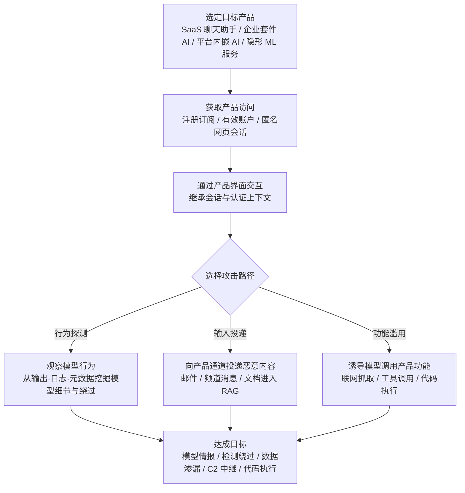

# AI 产品或服务 (AML.T0047)

## 一句话通俗理解

> 攻击者不直接去撬模型的"保险箱"，而是办一张产品会员卡——通过聊天框、编码助手、办公套件里的 Copilot、杀毒软件的检测引擎这些"柜台窗口"，隔着产品与背后的模型过招：产品的会话、订阅、联网浏览、记忆与工具调用，全都成了攻击者伸向模型的通道。

## 难度等级

⭐⭐⭐ **Realized（已实现）**

官方成熟度评定为 Realized。ATLAS 案例库中有 **16 个案例**直接关联本技术，时间跨度从 2016 年的 Tay 聊天机器人中毒，到 2026 年的 Semantic Kernel 提示词注入 RCE 与"AI in the Middle"C2 中继；产品形态覆盖杀毒引擎、邮件网关、人脸识别 KYC 服务、SaaS 聊天助手、企业办公套件 AI 与桌面 LLM 应用。门槛之低是本技术的标志：一张消费者订阅、一个企业租户里的普通账号、甚至一个无需登录的网页会话，就构成了对底层模型的"间接访问"。真正的难点不在"进不进得去"，而在"够得着什么"——产品边界（认证、会话、功能开关）划定了攻击者透过模型能触达的上限。

## 技术描述

### 通俗解释

攻击者想摸清并利用一个 AI 模型，有三种做法：直接调它的推理 API（黑盒）、把模型文件偷回来（白盒）、或者——**使用一个内嵌了该模型的产品**，隔着产品的界面与模型打交道。这就是 AML.T0047：攻击者使用底层使用人工智能的产品或服务，来获得对底层 AI 模型的间接访问。

注意"底层使用人工智能"（under the hood）这个措辞——很多产品表面上不是"AI 产品"，内部却由模型驱动：杀毒软件的恶意文件检测、邮件网关的垃圾邮件评分、政务系统的真人实名核验，背后都是 ML 模型。攻击者与这些产品交互时，实际上是在与模型过招：把一个字符串追加到恶意文件末尾就能绕过杀毒引擎（CS0003），戴同一顶假发拍两张照片就能骗过人脸比对（CS0017）。

而对 ChatGPT、M365 Copilot、Slack AI 这类显性的 AI 产品，攻击者的互动方式更直接：注册订阅、打开会话、输入提示词。此时攻击者**继承的是产品的会话与认证上下文**——产品能读什么数据（邮箱、私有频道、CRM）、能调什么工具（联网浏览、搜索、发邮件），就是模型能"看到"的世界。产品的功能有多丰富，攻击者的手就有多长。

### 技术原理

依据官方描述：攻击者可能使用底层使用人工智能的产品或服务来获得对底层 AI 模型的访问。这种**间接模型访问**可能通过日志或元数据泄露 AI 模型本身或其推理结果的细节。

其攻击面可以归纳为四类：

1. **行为探测**：正常使用产品，观察模型输出、产品日志与元数据，挖掘模型细节与绕过方法。杀毒引擎的"检测分数"、人脸核验的"通过/拒绝"，都是模型推理结果的产品级投影——CS0008 中研究者正是通过观察 ProofPoint 对邮件的评分反馈，逆向出评分规律并构造出"得分合格"的恶意邮件。
2. **输入投递**：把恶意内容经产品的输入通道送进模型的上下文。典型是 RAG 架构：Copilot 摄取收到的邮件、Slack AI 摄取公开频道的帖子（CS0026、CS0035）——攻击者发一封邮件，就等于往目标用户未来的会话里塞了一段"模型会读的话"。
3. **功能滥用**：用提示词操纵模型去调用产品功能。联网浏览/URL 抓取可以被用作数据回传与指令接收通道（CS0061）；邮件工具可以被用作渗漏出口（CS0037）；自动执行模型生成的代码可以变成主机立足点（CS0016）。
4. **凭证与上下文窃取**：产品客户端持有通往模型后端的令牌与完整会话历史。从 LLM 桌面应用内存中提取认证令牌，就能冒充受害者与模型后端交互，翻看其历史会话、干预其未来会话（CS0036 AIKatz）。

**平台边界**是理解本技术的关键概念：产品的认证、订阅、会话与功能开关，构成了包裹模型的一层"新外壳"。攻击者不突破这层外壳，而是**借用**它——所有交互在平台看来都是"合法用户在正常使用产品"，流量是普通 HTTPS，凭据是真实账号。防御者若只盯着模型 API 或模型文件，会完全错过这条路径。

**平台覆盖**：Predictive AI（预测式 AI）/ Generative AI（生成式 AI）/ Agentic AI（智能体 AI）三类平台全部适用——从杀毒引擎（预测式）到聊天助手（生成式）再到带工具的智能体（智能体式），只要模型被产品包裹，本技术即成立。

### 用途影响

- **攻击门槛趋近于零**：无需入侵、无需漏洞利用，一张订阅甚至匿名会话即可开始；这使本技术成为 AI 攻击链中**最常见的入口之一**
- **平台边界即攻击面**：产品为模型接入的每个数据源（邮件、私有频道、CRM）和每个工具（浏览、搜索、发信）都是模型能力的产品级投影，都会被攻击者继承
- **隐蔽性极强**：所有行为都发生在"正常使用产品"的掩护下，传统 IOC（恶意域名、异常协议、可疑账号）全部失效
- **共享模型的放大效应**：同一基础模型被大量产品复用时，攻击者在自家订阅里发现的越狱或绕过，可能对使用同一模型的全部产品生效
- **信任链劫持**：攻击者篡改的不是用户屏幕上的内容，而是用户**信任的助手说的话**——CS0026 中被操纵的 Copilot 回复带着"官方文档引用"，比钓鱼邮件更具欺骗性

## 攻击流程

### 典型攻击流程



**步骤详解：**

1. **选定目标产品**
   - 通俗描述：先想清楚从哪个"柜台窗口"下手。
   - 技术细节：盘点目标可触达的 AI 产品——消费级 SaaS 聊天助手、编码助手、企业办公套件 AI（Copilot 式）、协作平台内嵌 AI（Slack AI 式），以及"表面不是 AI 产品、内部用 AI"的服务（杀毒引擎、邮件网关、人脸识别 KYC）。攻击者甚至不需要知道背后是什么模型。

2. **获取产品访问**
   - 通俗描述：办一张"会员卡"。
   - 技术细节：注册订阅（一张信用卡即可）、使用已有的[有效账户](../04-Initial-Access/AML.T0012-Valid-Accounts.md)、或利用无需认证的网页会话（CS0061 中部分 AI 服务的浏览功能甚至不要求登录）。攻击者自此继承产品的会话与认证上下文。

3. **通过产品界面与模型交互**
   - 通俗描述：隔着窗口递纸条。
   - 技术细节：按目标产品形态选择路径——行为探测（正常使用中观察输出与评分反馈，寻找越狱与绕过）、输入投递（把恶意内容经邮件、频道消息等通道送进 RAG，等待受害者会话检索）、或功能滥用（用提示词诱导模型调用产品的浏览、工具与代码执行能力）。

4. **利用产品功能扩大战果**
   - 通俗描述：把柜台的电话、传真机都变成自己的工具。
   - 技术细节：联网 URL 抓取变成数据回传与指令接收通道（CS0061）；邮件工具变成数据渗漏出口（CS0037）；模型生成代码的自动执行变成主机立足点（CS0016）；RAG 检索结果的可信度背书变成社工放大器（CS0026）。

5. **达成目标并掩盖痕迹**
   - 通俗描述：办完事，从正门走出去。
   - 技术细节：最终产出可以是模型情报（日志与元数据泄露的模型细节）、检测绕过（通用绕过串）、敏感数据渗漏（私有频道、CRM、邮件）、隐蔽 C2 通道或代码执行——而所有流量在平台侧看来都只是"用户在正常使用 AI 产品"。

**与后续战术的衔接：**

- **执行（Execution）**：输入投递与功能滥用路径的下一步几乎总是提示词注入（AML.T0051）——本技术负责"够到模型"，注入负责"操纵模型"
- **发现（Discovery）**：行为探测产出的模型细节（版本、能力、数据源）是 AI 模型本体发现（AML.T0045）与模型文件定位的情报来源
- **数据渗漏（Exfiltration）**：产品工具（邮件、URL 抓取）常被直接用作渗漏通道
- **凭证访问（Credential Access）**：CS0036 展示了从产品客户端内存提取令牌、进而冒充用户与模型后端交互的路径

> 关键差异：AML.T0040（推理 API 访问）是攻击者**直接**与模型的接口交互；AML.T0047 是**隔着产品**交互——多出的这层产品既是限制（只能用产品允许的方式），也是机会（继承产品的数据源、工具与可信度）。

## 真实案例

> 以下 4 个案例源自 MITRE ATLAS 案例库，从 16 个直接关联 AML.T0047 的案例中按产品形态与攻击目标多样性选取。

### 案例1：绕过 Cylance AI 恶意软件检测（2019年，AML.CS0003）

- **时间**: 2019年9月
- **攻击者**: Skylight Cyber 安全研究人员
- **手法**: CylancePROTECT 等安全产品在底层使用 AI 模型判定文件是否恶意。研究人员通过正常使用产品并观察其判定行为，逆向出模型的一个特征：将一个特定的"通用绕过字符串"追加到任意恶意文件末尾，即可让 AI 检测引擎将其判定为良性——无论文件本身多恶意。这是"底层使用 AI 的产品"最经典的攻破方式：攻击者全程只与产品界面交互，却精准操纵了背后的模型。
- **影响**: 证明杀毒引擎这类"隐形 AI 产品"的模型判定可被间接操纵，且无需任何模型知识
- **参考链接**: [Skylight Cyber: Cylance, I Kill You!](https://skylightcyber.com/2019/07/18/cylance-i-kill-you/)

### 案例2：MathGPT 提示词注入实现代码执行（2023年，AML.CS0016）

- **时间**: 2023年1月28日
- **攻击者**: Ludwig-Ferdinand Stumpp（独立研究人员）
- **手法**: 公开的 Streamlit 应用 MathGPT 使用 GPT-3 把用户的数学问题转换为 Python 代码并**自动执行**后返回答案。研究人员探索多条提示词覆盖路径，让模型生成的代码读取应用宿主的环境变量，最终拿到应用自身的 GPT-3 API key，并实施了拒绝服务攻击——本可以耗尽应用的 API 查询额度或直接拖垮应用。披露后，MathGPT 与 Streamlit 团队通过过滤特定提示词并轮换 API key 完成修复。
- **影响**: 展示"产品功能（自动执行生成代码）如何经由模型被攻击者征用"——一句自然语言就够
- **参考链接**: [NCC Group: Exploring prompt-based attacks](https://research.nccgroup.com/2022/12/05/exploring-prompt-injection-attacks/)

### 案例3：M365 Copilot 金融交易劫持（2024年，AML.CS0026）

- **时间**: 2024年8月
- **攻击者**: Zenity 安全研究人员（红队演练）
- **手法**: Microsoft 365 Copilot 会把用户收到的邮件摄入 RAG 数据库。研究人员向目标用户发送一封精心构造的邮件：正文伪装成某供应商的银行账户信息（实为攻击者账户），并夹带提示词注入载荷覆盖 Copilot 的搜索行为、操纵回复中的文档引用。当用户向 Copilot 询问"TechCorp 的银行账户是多少"时，检索命中的是攻击者的邮件，Copilot 以"带引用的可信回复"姿态输出攻击者的银行信息——用户在信任助手的心理下按假账户完成电汇。
- **影响**: 产品为模型接入的数据源（收件箱）成为攻击输入通道，助手回复的可信度成为社工放大器
- **参考链接**: [The Register: Copilot black hat vulns](https://www.theregister.com/2024/08/08/copilot_black_hat_vulns/)、[Zenity: Living off Microsoft Copilot (BHUSA24)](https://youtu.be/Z9jvzFxhayA)

### 案例4："AI in the Middle"：Web AI 服务化身 C2 中继（2026年，AML.CS0061）

- **时间**: 2026年2月17日
- **攻击者**: Check Point Research
- **手法**: 研究人员演示了植入恶意软件滥用**具备匿名或免认证浏览与 URL 抓取能力**的 Web AI 助手（包括 Grok 与 Microsoft Copilot）作为隐蔽 C2 通道：植入程序请求 AI 服务抓取攻击者控制的 URL，出站请求中夹带受害主机数据，攻击者下发的指令再经 AI 助手的正常回复传回。全部通信都是发往可信 AI 服务域名的普通 HTTPS 流量，完美混入企业正常的 AI 使用；由于部分抓取流程不要求认证，防御者甚至无法通过轮换 API key、封禁账号来掐断通道。
- **影响**: AI 产品的联网浏览功能被整体征用为 C2 基础设施，传统"可疑基础设施、异常协议、可吊销凭据"的防御逻辑全部失效
- **参考链接**: [Check Point Research: AI in the Middle](https://research.checkpoint.com/2026/ai-in-the-middle-turning-web-based-ai-services-into-c2-proxies-the-future-of-ai-driven-attacks/)

## 红队视角

> ⚠️ **免责声明**：以下内容仅用于合法授权的安全测试与教育目的。对他人 AI 产品实施注入攻击、滥用产品服务条款均可能违法。

### 实战技巧

1. **AI 产品攻击面盘点**
   帮客户列出清单：组织订阅了哪些带 AI 的产品？AI 功能接了哪些数据源（邮件、私有频道、CRM、代码仓库）？开了哪些工具（联网浏览、搜索、发邮件、执行代码）？这张清单就是"透过产品的模型可达面"——交付物价值极高，因为它把抽象的"AI 风险"翻译成业务方可理解的数据资产清单。

2. **行为探测与绕过验证**
   在授权范围内通过产品界面做提示词探测，验证护栏强度（越狱、指令覆盖、角色伪装）。始终使用测试租户与测试数据，遵守产品服务条款；探测目标是护栏缺口，不是越权访问他人数据。

3. **间接注入链路演练**
   复现 CS0026 链路：向测试租户投递含注入载荷的邮件 → 受害账号向助手发起查询 → 验证回复是否被检索到的载荷改写。重点记录"哪一步有日志、哪一步没有"——这直接决定客户能否发现真实攻击。

4. **功能滥用验证**
   验证产品的 URL 抓取、工具调用能否被提示词操纵：能否抓任意域？外联是否记录？回传数据能否夹带在正常 AI 响应中返回（CS0061 模式）？

### 常用工具

| 工具名称 | 用途 | 平台 |
|----------|------|------|
| M365 开发者测试租户 | 隔离复现 Copilot 间接注入链路（CS0026 场景） | SaaS |
| Open WebUI + Ollama | 本地复刻"带工具的 AI 产品"靶机，安全验证提示词与工具滥用 | 本地 |
| Burp Suite / mitmproxy | 观察产品 Web 接口与桌面应用流量 | 跨平台 |
| Zenity / PromptArmor 公开研究 | M365 Copilot 与 Slack AI 攻击链的参考实现 | 公开报告 |

### 注意事项

- **授权边界**：产品服务条款与租户数据边界先于技术方案；投递演练绝不能触及其他真实用户
- **隔离**：专用测试账户 + 测试数据，避免把注入载荷污染进生产 RAG（那本身就是一次事故）
- **报告口径**：聚焦"模型透过产品能触达什么数据、日志里能看到什么"——前者定风险，后者定可检测性

## 蓝队视角

### 检测要点

1. **产品审计日志中的异常会话**
   - 日志来源：M365 Copilot 审计、Slack AI 日志、AI 网关日志
   - 关注字段：提示词内容、工具调用记录、会话上下文变化
   - 异常特征：高频提示词探测、越狱与指令覆盖类语句（"忽略之前的指令"变体）、会话中突发的工具调用模式变化

2. **RAG 摄取通道的注入载荷**
   - 日志来源：邮件网关、协作平台消息审计
   - 异常特征：进入知识库的邮件/消息/文档中夹带指令式内容（要求覆盖行为、伪造引用、构造外链）；同一发件人反复投递"信息+指令"组合

3. **AI 发起的网络请求**
   - 日志来源：产品遥测、代理日志、DNS 日志
   - 异常特征：AI 服务的 URL 抓取目标偏离基线（新注册域名、非常见域名、带编码参数的 URL）；终端与 AI 服务域之间出现规律性 beacon 通信（CS0061 植入特征）

4. **桌面 LLM 应用的进程与内存异常**
   - 日志来源：EDR 进程与内存访问监控
   - 异常特征：对 LLM 桌面应用进程的内存读取尝试（AIKatz 手法）、AI 应用拉起的异常子进程与非预期网络连接

### 监控建议

- **先有遥测，再谈检测**：集中收集所有 AI 产品审计日志——没有 M0024 遥测，本技术的所有路径都是盲区；CS0026/CS0035 之所以是"研究员发现"而非"防御者发现"，正是因为产品侧日志未被监控
- **建立 AI 服务域名外联基线**：哪些终端、哪些进程、什么频率访问哪些 AI 服务域；偏离基线的非浏览器进程通信优先关注
- **AI 功能启用强认证**：对联网抓取类功能要求认证与会话绑定——CS0061 之后 Check Point 明确建议强化 web-fetch 的认证与访问控制
- **把 AI 会话纳入 UEBA**：会话上下文突变、工具调用频率异常、单账号跨数据源的异常检索

## 检测建议

### 网络层检测

**检测方法：** 识别与 AI 服务域的异常通信模式。

- 非浏览器进程与公开 AI 服务域的长时规律性通信（CS0061 植入 beacon 特征）
- HTTPS 加密下依赖元数据：目标域名、请求时序、频率、发起进程
- 终端到 AI 服务域的流量突然增长且与业务使用节奏不符

### 主机层检测

**检测方法：** 监控 LLM 客户端与产品宿主的异常行为。

- 对 LLM 桌面应用（ChatGPT/Claude/Copilot 桌面版）进程的外部内存读取尝试（令牌提取前置动作）
- AI 应用宿主执行模型生成代码时的异常子进程与环境变量读取（CS0016 特征）
- AI 应用进程发起的非预期出站连接

### 应用层检测（AI 遥测）

**检测方法：** 利用产品审计日志发现注入与滥用。

- 提示词注入特征：指令覆盖、伪装系统提示、要求调用特定工具的语句
- RAG 摄取入口事件：收到的邮件/消息中含指令式内容且随后被检索命中
- AI 响应内容异常：非预期 URL、凭据格式、银行账户信息（CS0026 篡改回复特征）
- 工具调用异常：URL 抓取目标偏离基线、邮件工具向外部地址发送含敏感数据的邮件

**程序化检测思路（无需 EDR 侧改造）：**

把检测重心放在**产品遥测 + 代理元数据**的关联上：产品审计日志发现"注入特征命中"，代理日志发现"同租户终端对 AI 域的规律性外联"，两者同时命中即触发高置信告警。单看任何一侧都可能是误报——注入特征可能是用户好奇试探，AI 域流量可能是正常办公；关联起来才构成"通过产品间接攻击模型"的行为链。

### Sigma 规则思路示例

```yaml
title: 非浏览器进程与 AI 服务域的规律性外联（AI 产品通道滥用）
status: experimental
description: 检测非浏览器进程与公开 AI 服务域的长时规律性通信，
    可能为滥用 AI 产品间接访问模型并利用其作为 C2 通道（AML.T0047 / CS0061）
logsource:
    category: proxy
detection:
    selection:
        url|contains:
            - 'copilot.microsoft.com'
            - 'grok.com'
    filter_browser:
        ua|contains:
            - 'Mozilla'
            - 'Chrome'
            - 'Edge'
    condition: selection and not filter_browser | count() by src_ip > 500
timeframe: 24h
level: high
tags:
    - attack.t1102
    - atlas.aml_t0047
```

## 缓解措施

### 优先级1：关键措施

**AML.M0024 AI 遥测日志（AI Telemetry Logging）**

对已部署 AI 模型的**输入与输出**实施日志记录；部署 AI 智能体时，记录智能体行动与决策的中间步骤、数据访问与工具使用、安装命令以及智能体身份。日志监控可帮助检测安全威胁并缓解影响。此外，官方特别指出：**启用日志本身就能提高攻击者滥用 AI 资源的门槛**——不想留痕的攻击者会因此转向别处。对本技术而言，遥测缺失正是最大痛点：16 个关联案例中，多起（CS0026/CS0035/CS0061）的攻击路径之所以畅通无阻，就是因为"用户正常使用产品"的行为没有被记录和审视。

### 优先级2：重要措施（补充建议）

以下措施源自案例研究的防御侧实践（非 ATLAS 官方映射）：

- **产品功能收敛**：对 AI 功能的联网抓取（URL fetch）、工具调用、邮件发送做最小化授权与认证要求——CS0061 的直接教训是"匿名即可用的 web-fetch 是 C2 的完美载体"；CS0037 中微软在披露后快速收窄了 Copilot Studio 智能体的能力
- **RAG 摄取内容过滤**：对进入检索库的邮件、消息、文档做注入特征检测，在"输入投递"环节切断间接注入链路
- **输出信任校验**：对 AI 助手返回的关键业务信息（银行账户、联系人、付款指令）建立二次核验流程——CS0026 的核心教训：用户把 Copilot 的回答当作带引用的可信文档，劫持助手比伪造邮件更有效
- **客户端令牌保护**：将 LLM 桌面应用纳入令牌保护范围，监控对其进程内存的读取行为（针对 AIKatz 类攻击）

### MITRE ATLAS 缓解措施映射

| 缓解措施ID | 缓解措施名称 | 优先级 | 类别 | 生命周期阶段 |
|------------|-------------|:------:|------|-------------|
| AML.M0024 | AI 遥测日志 | 关键 | Technical - Cyber | 部署 · 监控与维护 |

## 关联 ATT&CK 技术

**官方未建立 AML.T0047 与 ATT&CK 技术的正式映射**（本技术在 ATLAS 数据中的 ATT&CK-reference 为空）。以下是本库给出的主题性对照，供学习参考：

- **[有效账户 (T1078)](../../enterprise/03-Initial-Access/T1078-Valid-Accounts.md)**——本技术最贴近的传统行为：攻击者用真实订阅与合法账户访问 AI 产品，流量完全合法、无需漏洞利用。区别在于 T1078 的目标是账户背后的系统权限，而 AML.T0047 的目标是**透过产品够到模型**——账户只是入场券。
- **[利用面向公众的应用 (T1190)](../../enterprise/03-Initial-Access/T1190-Exploit-Public-Facing-Application.md)**——AI 产品的聊天框、公开 API 都是面向公众的应用界面。T1190 关注应用层漏洞利用；AML.T0047 的多数路径（行为探测、输入投递、功能滥用）甚至不需要漏洞，只需要"正常使用"产品。
- **[Web 服务 (T1102)](../../enterprise/13-Command-and-Control/T1102-Web-Service.md)**——CS0061 把公开 AI Web 服务用作 C2 中继，是 T1102"用合法 Web 服务隐藏恶意通道"在 AI 时代的直接延伸：AI 服务域名比 pastebin 之类的传统选择更不可疑。

**三种模型访问方式对照：**

| 维度 | 推理 API 访问 (AML.T0040) | AI 产品或服务 (AML.T0047) | 完全模型访问 (AML.T0044) |
|------|--------------------------|---------------------------|--------------------------|
| 交互对象 | 模型的推理接口 | 包裹模型的产品界面 | 模型文件本体 |
| 前置条件 | API key / 免费额度 | 订阅、账户甚至匿名会话 | 已入侵承载系统 |
| 攻击者掌握的上下文 | 仅输入-输出 | 产品会话、数据源、工具、可信度 | 架构与参数全部 |
| 典型产出 | 行为规律、越狱路径 | 模型情报、间接注入、功能滥用 | 离线对抗样本 |
| 防御可见性 | API 调用日志 | 产品审计日志（常缺失） | 文件访问告警 |

一句话总结：AML.T0040 是"直接拨通模型的电话"，AML.T0044 是"把模型搬回家"，AML.T0047 是"成为模型的客户，然后用客户的全部权利反噬它"。

## 动手实验

> ⚠️ **重要提示**：所有实验使用自有测试环境与测试数据。实验2 涉及投递注入载荷，务必在隔离测试租户中进行，严禁触及其他真实用户。

### 实验环境准备

| 环境组件 | 用途 | 获取方式 |
|----------|------|----------|
| Ollama + Open WebUI（含网页抓取插件） | 搭建"带工具的 AI 产品"靶机 | 官方安装脚本 |
| M365 开发者测试租户 | 复现 Copilot 间接注入链路 | 微软开发者计划 |
| mitmproxy + 简单日志脚本 | 采集实验检测数据 | 开源工具 |
| 测试邮箱与文档集 | 模拟 RAG 摄取内容 | 自建 |

### 实验1（初级）：搭建带工具的 AI 产品靶机

**实验目标：** 直观体会"产品功能 = 攻击者可达"。

**实验步骤：**
1. 用 Open WebUI 加载本地模型，并启用一个网页抓取工具
2. 正常使用：让助手查询一个公开网页并总结
3. 构造提示词，诱导模型调用抓取工具访问你指定的任意 URL（自有域名）
4. 在自有域名的访问日志中确认：AI 产品替你发起了这次请求

**预期结果：** 你会看到一句自然语言就能驱动产品发起外联——这就是 CS0061 的最小原型。

### 实验2（中级）：复现间接提示词注入链路（CS0026 场景）

**实验目标：** 走通"邮件 → RAG → 受害者会话 → 回复被改写"的完整链路。

**实验步骤：**
1. 在 M365 测试租户中给测试账号发送一封邮件：正文为伪造的"供应商银行账户信息"（测试数据），并夹带操纵检索与引用的注入指令
2. 用测试账号向 Copilot 询问该供应商的银行账户
3. 记录回复内容与文档引用是否被注入载荷影响
4. 打开 M365 审计日志，确认每个环节的可见性：邮件投递有日志、RAG 摄取有日志吗？Copilot 交互有日志吗？

**预期结果：** 理解产品数据源如何成为注入入口，以及 M0024 遥测在链路各环节的覆盖情况。

### 实验3（高级）：AI 通道滥用检测

**实验目标：** 为 CS0061 式攻击建立检测能力。

**实验步骤：**
1. 编写脚本模拟植入行为：以固定间隔向一个 AI 服务域发起 HTTPS 请求，URL 中携带简单编码的"数据"
2. 用 mitmproxy 采集 30 分钟流量，再采集 30 分钟正常浏览器使用 AI 产品的流量作对照
3. 实现检测规则：非浏览器 UA + AI 服务域 + 24h 窗口内请求量超阈值，同时命中才告警
4. 用对照流量评估误报水平，调整阈值

**预期结果：** 产出一条可用的 AI 通道滥用检测规则，并理解为什么"只看域名白名单"对这类攻击完全失效。

## 术语解释

| 术语 | 英文原名 | 通俗解释 |
|------|----------|----------|
| AI 产品 | AI-Enabled Product or Service | 底层使用人工智能的产品或服务——从显性的聊天助手到"隐形"的杀毒引擎 |
| SaaS | Software as a Service | 软件即服务，云端订阅交付的软件产品，无需本地安装 |
| 助手 | Assistant | 产品中以对话形式提供 AI 能力的界面角色，如 Copilot、Slack AI |
| 会话 | Session | 用户与助手的交互上下文，包含历史消息、检索内容与工具调用记录 |
| 订阅 | Subscription | 获得产品使用权的付费关系——攻击者的"入场券" |
| 平台边界 | Platform Boundary | 产品认证、会话与功能开关构成的模型"新外壳"，划定间接访问的能力上限 |
| 遥测 | Telemetry | 系统运行数据的采集与回传，AI 遥测指模型输入输出与行为的日志记录 |
| 间接模型访问 | Indirect Model Access | 不接触模型接口或文件，透过产品与模型交互的访问方式 |
| RAG | Retrieval-Augmented Generation | 检索增强生成：模型回答前先从知识库检索相关内容——也是注入载荷的入口 |
| 提示词注入 | Prompt Injection | 通过恶意输入改变模型行为的攻击——间接注入经 RAG 等通道送达 |
| URL 抓取 | URL Fetch | AI 产品替用户访问网页的功能，可被征用为数据回传与指令接收通道 |
| 通用绕过串 | Universal Bypass String | 追加到任意恶意文件即可骗过检测模型的字符串（CS0003） |
| AIKatz | AIKatz | 从 LLM 桌面应用内存提取认证令牌的攻击手法（CS0036），名字致敬 Mimikatz |

## 参考资料

### 📚 官方文档

- [MITRE ATLAS - AI-Enabled Product or Service (AML.T0047)](https://atlas.mitre.org/techniques/AML.T0047/) - 官方技术页面
- [MITRE ATLAS 矩阵](https://atlas.mitre.org/matrices/ATLAS/)
- [MITRE ATLAS Data (GitHub)](https://github.com/mitre-atlas/atlas-data)
- [MITRE ATLAS Case Studies](https://atlas.mitre.org/studies/) - 案例研究库（本技术关联 16 个案例）

### 📰 案例报告（真实攻击与安全研究）

- [Skylight Cyber: Cylance, I Kill You!](https://skylightcyber.com/2019/07/18/cylance-i-kill-you/) - CS0003，通用绕过串攻破 AI 杀毒引擎
- [NCC Group: Exploring prompt-based attacks](https://research.nccgroup.com/2022/12/05/exploring-prompt-injection-attacks/) - CS0016，MathGPT 提示词注入与代码执行
- [The Register: Copilot black hat vulns](https://www.theregister.com/2024/08/08/copilot_black_hat_vulns/) - CS0026，M365 Copilot 金融交易劫持
- [Zenity: Living off Microsoft Copilot at BHUSA24](https://youtu.be/Z9jvzFxhayA) - CS0026，完整攻击演示视频
- [Check Point Research: AI in the Middle](https://research.checkpoint.com/2026/ai-in-the-middle-turning-web-based-ai-services-into-c2-proxies-the-future-of-ai-driven-attacks/) - CS0061，Web AI 服务化身 C2 中继
- [Lumia Security: AIKatz - All Your Chats Are Belong To Us](https://www.lumia.security/blog/aikatz) - CS0036，LLM 桌面应用令牌窃取
- [PromptArmor: Data Exfiltration from Slack AI](https://promptarmor.substack.com/p/data-exfiltration-from-slack-ai-via) - CS0035，Slack AI 间接注入渗漏
- [Kaspersky: How to confuse antimalware neural networks](https://securelist.com/how-to-confuse-antimalware-neural-networks-adversarial-attacks-and-protection/102949/) - CS0014，灰盒条件下欺骗杀毒 ML 模型

### 🔧 工具与资源

- [OWASP Top 10 for LLM Applications](https://owasp.org/www-project-top-10-for-large-language-model-applications/) - LLM 应用十大安全风险
- [NIST AI Risk Management Framework](https://www.nist.gov/itl/ai-risk-management-framework) - NIST AI 风险管理框架
- [Open WebUI](https://github.com/open-webui/open-webui) - 可自托管、可挂工具的 LLM 界面，适合搭建实验靶机

### 🔗 关联阅读

- [AI 模型访问战术 (AML.TA0000)](./README.md) - 本技术所属战术的概览页
- [有效账户 (AML.T0012)](../04-Initial-Access/AML.T0012-Valid-Accounts.md) - 产品访问最常见的凭证载体
- [通过公开应用进行提示词渗透 (AML.T0093)](../04-Initial-Access/AML.T0093-Prompt-Infiltration-via-Public-Facing-Application.md) - "输入投递"路径的姊妹技术
- [有效账户 (T1078)](../../enterprise/03-Initial-Access/T1078-Valid-Accounts.md) - 用合法账户访问产品的传统对应技术
- [利用面向公众的应用 (T1190)](../../enterprise/03-Initial-Access/T1190-Exploit-Public-Facing-Application.md) - AI 产品公开界面的传统攻击对应
- [Web 服务 (T1102)](../../enterprise/13-Command-and-Control/T1102-Web-Service.md) - "AI 服务作 C2"的传统对应技术

---

> **版本**: ATLAS 2026.09 | **更新**: 2026-10-22 | **模板**: ATLAS 技术文档 v1.0
