# AI 模型访问 (AML.TA0000)

## 一句话理解

> **AI 模型访问就像攻击者拿到了金库的不同等级钥匙——有的只能隔着玻璃看（黑盒），有的能进到屋里翻账本（白盒），最厉害的干脆把金库搬回自己家慢慢研究。**

## 战术概述

AI 模型访问是 MITRE ATLAS 框架中**最具 AI 特色的战术之一**——在传统 ATT&CK 攻击链中没有直接对应物。它回答的是一个 AI 时代特有的问题：**攻击者到底能"摸到"这个 AI 模型的哪一层？**

传统攻击中，攻击者拿到的是一台服务器、一个数据库或一个账号。而在 AI 攻击中，攻击者面对的核心资产是"模型"——一个由架构、参数、训练数据和推理接口共同构成的复杂系统。攻击者能获取的**访问层级**，直接决定了他能发动什么样的攻击：

**通俗解释：**
想象一个黑盒保险箱，你只能从投币口往里塞纸条、听里面传出的回答——这是**黑盒访问**（推理 API）。如果你拿到了保险箱的设计图纸和齿轮参数——这是**白盒访问**（完全模型访问）。如果你连保险箱所在的房间都能进去，在它收集环境信息的传感器上动手脚——这是**物理环境访问**。如果你根本没有直接接触保险箱，只是通过一个"雇佣了这个保险箱的服务公司"间接获取信息——这是**间接访问**（AI 产品或服务）。

**访问层级谱系（从浅到深）：**

- **黑盒 API 访问**（AML.T0040）：只能输入数据、观察输出。攻击者通过合法的推理 API 访问模型，看似受限，却是**实战中最常用**的攻击入口——通过大量查询可以"套出"模型的行为规律，寻找越狱（jailbreak）、幻觉等漏洞。
- **间接访问**（AML.T0047）：通过使用该模型的产品或服务间接互动，属于介于黑盒与白盒之间的**灰盒**层级。日志、元数据或产品行为可能泄露模型细节或推理结果，攻击者甚至无需知道底层是什么模型。
- **物理环境访问**（AML.T0041）：模型与现实世界交互（摄像头、麦克风、传感器等），攻击者在**数据采集源头**动手脚——把攻击从数字域搬到了物理域。
- **白盒访问**（AML.T0044）：掌握模型架构、参数和类本体的完整知识。攻击者可以把模型**整个窃取**到离线环境，在完全无法被检测的情况下反复打磨攻击方案。

**在攻击中的作用：**
AI 模型访问是连接"普通网络攻击"与"AI 专项攻击"的桥梁。攻击者可能先通过传统手段（初始访问、权限提升）进入承载模型的系统，也可能直接订阅一个公开 API。在攻击链中，这一战术通常发生在**初始访问之后、AI 攻击适配之前**——攻击者会根据获取的访问层级，选择不同的攻击路径。值得注意的是，攻击者在攻击的**不同阶段可能使用不同层级的访问**：用 API 访问做侦察和攻击验证，用白盒访问制作对抗数据，最后再通过 API 把恶意输入送进目标系统。

**访问路径：**
根据官方定义，攻击者获得模型访问主要有三条路径：

- **访问承载模型的系统**：需要先通过初始访问、权限提升等传统战术入侵目标系统，才能接触模型文件或内部接口——这是"先黑系统、再摸模型"的路径
- **公开可访问的 API**：模型通过公开 API 直接可访问，无需入侵系统，但攻击面被限制在输入-输出接口
- **通过产品或服务间接访问**：与内部使用 AI 的产品或服务交互，间接触达底层模型——攻击者甚至可能不知道背后是什么模型

**访问层级与攻击能力对照：**

| 访问层级 | 对应技术 | 攻击者掌握的模型信息 | 攻击自由度 |
|---------|---------|------------------|-----------|
| 黑盒 API | AML.T0040 | 仅能观察输入-输出行为 | 中——可探测漏洞、注入恶意输入 |
| 灰盒间接 | AML.T0047 | 日志/元数据中部分泄露的细节 | 低——以情报收集为主 |
| 物理环境 | AML.T0041 | 可操纵数据采集源 | 高——可影响模型对现实世界的感知 |
| 白盒 | AML.T0044 | 架构、参数、类本体的完整知识 | 最高——可离线精准构造对抗数据 |

**典型攻击场景：**

1. **API 黑盒探测**：攻击者注册合法的推理 API，向模型发送大量探测提示，发现越狱路径与幻觉漏洞，再转而去攻击使用同一基础模型的其他应用——许多系统共享同一个模型，也就共享同一组漏洞。
2. **间接情报挖掘**：不直接触碰 API，而是使用某个 AI 产品或服务，从产品日志、元数据与行为特征中挖掘模型细节或推理结果。
3. **传感器物理动手脚**：对与现实世界交互的 AI 系统（摄像头、麦克风、传感器），攻击者在数据采集源头修改数据，执行数字域攻击的"物理版本"。
4. **白盒离线打磨**：攻击者窃取模型文件，获得架构与参数的完整白盒知识，在难以被检测的离线环境中反复构造对抗数据并验证攻击效果。

**为什么这一战术在 AI 时代格外重要：**
许多系统依赖相同的模型（尤其是训练成本极其高昂的基础模型），这意味着**它们共享相同的漏洞**。攻击者在自己合法购买的 API 上发现的一个越狱缺陷，可能对大量使用同一模型的应用同时生效——这是传统软件供应链漏洞在 AI 时代的放大版。

**技术平台：**
本战术下的技术适用于预测式 AI（Predictive AI）、生成式 AI（Generative AI）与智能体 AI（Agentic AI）全平台。

## 战术在攻击链中的位置

### 攻击链全景图

```mermaid
graph LR
    A["侦察<br/>AML.TA0002"] --> B["资源开发<br/>AML.TA0003"]
    B --> C["AI攻击适配<br/>AML.TA0001"]
    C --> D["初始访问<br/>AML.TA0004"]
    D --> E["AI模型访问<br/>AML.TA0000"]
    E --> F["执行<br/>AML.TA0005"]
    F --> G["持久化<br/>AML.TA0006"]
    G --> H["权限提升<br/>AML.TA0012"]
    H --> I["防御规避<br/>AML.TA0007"]
    I --> J["凭证访问<br/>AML.TA0013"]
    J --> K["发现<br/>AML.TA0008"]
    K --> L["横向移动<br/>AML.TA0015"]
    L --> M["收集<br/>AML.TA0009"]
    M --> N["命令与控制<br/>AML.TA0014"]
    N --> O["数据渗漏<br/>AML.TA0010"]
    O --> P["影响<br/>AML.TA0011"]

    style E fill:#ff6b6b,stroke:#333,stroke-width:2px
```

### 当前战术的角色

AI 模型访问是 ATLAS 攻击链中承上启下的关键环节。攻击者通过初始访问进入目标环境后，需要获得对 AI 模型本身的某种访问能力，才能将攻击推进到 AI 特定的阶段——无论是通过 API 探测模型行为、离线打造对抗样本，还是通过物理传感器注入恶意数据。**获取的访问层级，决定了后续攻击适配阶段（AI 攻击适配）的上限。**

### 与 ATT&CK Enterprise 攻击链的对照

AI 模型访问是 **ATLAS 特有的战术**，在 ATT&CK Enterprise 的 15 战术链中没有直接对应物。传统攻击中，"访问系统"本身往往就是目标；而 AI 攻击中，模型是独立于系统的**核心资产层**——攻击者进入系统之后，还需要专门获取对模型本身的访问能力，才能展开 AI 专项攻击。因此该战术被放置在初始访问之后、执行之前，相当于传统攻击中"拿到核心资产钥匙"的环节。

### 前置战术

- **初始访问 (AML.TA0004)**：访问承载模型的系统或服务，通常是获得模型访问的前提（但公开 API 场景可以跳过这一步）

### 后续战术

- **AI 攻击适配 (AML.TA0001)**：利用获得的访问层级验证攻击、打造对抗数据
- **发现 (AML.TA0008)**：通过模型访问探测 AI 模型本体、模型家族等情报
- **影响 (AML.TA0011)**：通过推理 API 向目标系统输入恶意数据，实现最终攻击效果

## 技术索引表

| 技术ID | 中文名称 | 难度 | 子技术数 | 一句话理解 | 文档状态 |
|--------|---------|:---:|:---:|-----------|:---:|
| AML.T0040 | AI 模型推理 API 访问 | ⭐⭐⭐ | 0 | 用合法的推理 API 探测模型行为、寻找越狱和幻觉等漏洞 | ⏳ 计划中 |
| AML.T0041 | 物理环境访问 | ⭐⭐ | 0 | 在传感器等数据采集源头动手脚，从物理域影响模型 | ⏳ 计划中 |
| AML.T0044 | 完全 AI 模型访问 | ⭐⭐ | 0 | 拿到模型架构与参数的白盒访问权，离线打磨攻击 | ⏳ 计划中 |
| AML.T0047 | AI 产品或服务 | ⭐⭐⭐ | 0 | 借使用 AI 的产品间接访问模型，从日志和元数据挖情报 | ⏳ 计划中 |

> **说明**：技术文档正在建设中，上表技术 ID 与名称为纯文本索引；文档完成后将替换为可点击的文档链接。

### 统计信息

- **技术总数**：4 个
- **子技术总数**：0 个
- **已完成文档**：0 个
- **进行中文档**：0 个
- **待编写文档**：4 个

## 推荐阅读顺序

### 入门阶段

> 适合刚开始了解 AI 安全的学习者，从最常见的访问方式入手。

**前置知识：** 了解 LLM API 的基本调用方式（如 OpenAI / Anthropic API）

**推荐阅读：**

1. **AML.T0040 AI 模型推理 API 访问** - 难度最低、最常见：任何人都能注册一个 API key，从这里理解"黑盒攻击"的全部逻辑
2. **AML.T0047 AI 产品或服务** - 理解"间接访问"：不碰 API 也能从产品日志、元数据中挖出模型情报

**学习建议：**
- 用自己注册的 LLM API 练习提示词构造，体会"输入-输出"黑盒交互
- 思考：为什么同一个越狱漏洞会影响所有使用同一基础模型的应用？

### 进阶阶段

> 适合有一定 AI/ML 基础的学习者，理解更深层的访问方式。

**前置知识：** 了解神经网络的基本结构（层、参数、梯度）

**推荐阅读：**

1. **AML.T0044 完全 AI 模型访问** - 理解"白盒攻击"：有了架构和参数，对抗样本的构造从"盲试"变成"精准计算"
2. **AML.T0041 物理环境访问** - 跳出纯数字域：了解攻击者如何在摄像头、麦克风等物理传感器上做文章

**学习建议：**
- 了解 Hugging Face 开源模型的本地部署，体会白盒环境与 API 环境的差异
- 思考自动驾驶、智能监控等物理 AI 系统的数据采集环节有哪些可攻击面
- 对照本战术在攻击链中的位置，梳理"初始访问 → 模型访问 → 攻击适配"的完整路径

### 高级阶段

> 适合希望建立完整 AI 攻防图景的学习者。

**前置知识：** 已完成入门与进阶阶段，了解对抗样本基本概念

**推荐阅读：**

1. 将本战术与 **AI 攻击适配 (AML.TA0001)** 战术结合阅读：访问层级决定了对抗数据构造与攻击验证的上限
2. 将本战术与 **发现 (AML.TA0008)** 战术结合阅读：推理 API 访问同时也是 AI 模型本体、模型家族等情报的探测通道

**学习建议：**
- 在隔离环境中用开源 LLM 复现"黑盒探测 → 越狱 → 影响输出"的最小攻击链
- 关注基础模型供应链：一个越狱漏洞如何同时影响多个使用该模型的应用

## 参考资料

### 官方文档

- [MITRE ATLAS AI Model Access 战术](https://atlas.mitre.org/tactics/AML.TA0000/)
- [MITRE ATLAS 矩阵](https://atlas.mitre.org/matrices/ATLAS/)
- [MITRE ATLAS GitHub 数据仓库](https://github.com/mitre-atlas/atlas-data)

### 学习资源

- [AI 模型推理 API 访问 AML.T0040](https://atlas.mitre.org/techniques/AML.T0040/) - ATLAS 官方技术页面
- [物理环境访问 AML.T0041](https://atlas.mitre.org/techniques/AML.T0041/) - ATLAS 官方技术页面
- [完全 AI 模型访问 AML.T0044](https://atlas.mitre.org/techniques/AML.T0044/) - ATLAS 官方技术页面
- [AI 产品或服务 AML.T0047](https://atlas.mitre.org/techniques/AML.T0047/) - ATLAS 官方技术页面

## 速查卡

- **四种访问层级**：推理 API（黑盒）→ AI 产品或服务（间接）→ 物理环境（传感器）→ 完全模型访问（白盒），访问越深、攻击自由度越大
- **难度分布**：推理 API 访问与 AI 产品或服务为 ⭐⭐⭐（已被真实攻击事件验证），物理环境访问与完全模型访问为 ⭐⭐（已有攻击演示）
- **关键风险信号**：异常高频的 API 调用与提示词探测、日志/元数据中的模型信息泄露、传感器数据源离线篡改、模型文件的非授权下载
- **防御要点**：对推理 API 做限速与异常查询监控、收敛日志与元数据中的模型细节、保护模型文件与训练环境的访问控制、加固物理数据采集链路
- **蓝队关注点**：访问层级决定了攻击者的能力上限——排查事件时**优先确认攻击者摸到的是哪一层**；同一模型被多方复用时，一个漏洞就是一片漏洞

---

> **版本**: ATLAS 2026.09 | **更新**: 2026-10-22 | **模板**: ATLAS 战术README v1.0
