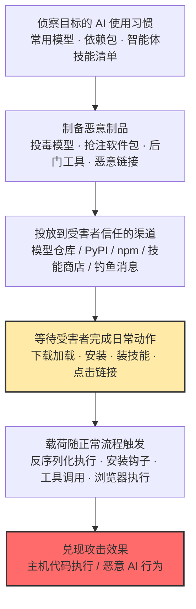

# 用户执行 (AML.T0011)

## 一句话通俗理解

> **攻击者一行入侵代码都不用自己跑——他把毒藏进你每天都做的事里：下载模型、安装依赖、给智能体装插件、点开一条链接。受害者亲手完成的每一次"正常操作"，都是在替攻击者按下执行键。**

## 难度等级

⭐⭐⭐ **Realized（已实现）**

官方成熟度评定为 Realized——该技术已在真实攻击中反复出现：Hugging Face 上内嵌反向 Shell 的恶意模型、npm 上抢注的恶意 MCP 服务器、技能商店里发布 8 小时就被 16 名用户执行的投毒 Skill，均为公开披露的实战事件。实施门槛低于漏洞利用（不需要 0day，向公共仓库上传投毒制品与发布普通软件包难度相当），攻击效果却直接继承受害者（人或智能体）的全部权限。真正的难点不在"投毒"本身，而在两处：**让受害者主动上钩**（命名伪装与社会工程）与**绕过平台扫描**（如让恶意载荷在扫描器反序列化失败之前抢先执行）。

四个子技术的成熟度略有差异：不安全 AI 制品（AML.T0011.000）、恶意软件包（AML.T0011.001）、投毒 AI 智能体工具（AML.T0011.002）均为 Realized（⭐⭐⭐），恶意链接（AML.T0011.003）为 Demonstrated（⭐⭐）。

**平台适用性**（官方数据）：Predictive AI / Generative AI / Agentic AI / Enterprise 四类平台全部适用——只要有"人或智能体在加载 AI 制品"的地方，就有用户执行。

## 技术描述

### 通俗解释

几乎所有安全方案都默认"系统不会自己运行来路不明的东西"，但每个系统背后都有一个会点"安装""打开""运行"的人。用户执行攻击的全部逻辑就是：**与其攻破系统，不如骗坐在系统前面的人替你操作**。

传统用户执行是"伪装成礼物等你拆"：把木马伪装成简历、发票、 cracked 软件，等用户双击。AI 时代这份"礼物清单"大幅变长了——下载的模型权重、pip 安装的依赖包、给智能体装的 Skill 与 MCP 工具、AI 推荐的"好用库"，全都可以被下毒。更关键的变化是：**"用户"不再只是人类**。AI 智能体会自动摄取内容、自动调用工具、甚至自动安装技能——攻击者不需要骗过人的眼睛，只需要骗过智能体的判断，就能让机器"用户"替他执行。

### 技术原理

依据官方描述，攻击者依赖受害者加载、执行、解释或以其他方式使用恶意或不安全的制品。在 AI 系统中，用户执行可包括**加载一个模型**，或**让推理运行时处理与 AI 制品捆绑的可执行或行为塑造组件**，其效果既可能是传统的主机代码执行，也可能是恶意 AI 行为（模型上下文、输出、安全行为或智能体动作被篡改）。

恶意制品通常经由 AI 供应链入侵（AML.T0010）引入，由用户执行完成"落地"；攻击者也可能通过社会工程诱骗用户打开恶意文档或链接。四条子技术路径的机制各不相同：

| 子技术 | 恶意载体 | 触发动作 | 攻击效果 |
|--------|----------|----------|----------|
| 不安全 AI 制品（.000） | 序列化模型、模型包及捆绑的提示词/聊天模板、分词器元数据、配置、前后处理逻辑 | 加载模型、启动推理运行时、提交推理请求 | 反序列化漏洞利用执行主机代码；**无需漏洞**时，利用运行时"有意支持的功能"改变模型上下文、输出、安全行为或智能体动作 |
| 恶意软件包（.001） | 名称抢注/仿冒的 pip、npm 包 | `pip install` / `npm install` 及导入 | 安装钩子执行恶意代码，包功能"表现正常"以避嫌 |
| 投毒 AI 智能体工具（.002） | 被投毒的工具定义、技能（Skill）、MCP 服务器及远程服务响应 | 智能体调用该工具 | 投毒的描述/响应进入智能体上下文、执行恶意工具逻辑、诱使智能体调用更多工具 |
| 恶意链接（.003） | 钓鱼邮件、消息中的链接 | 用户点击 | 下载恶意文件、触发客户端漏洞利用；AI 场景下，不校验网站 Origin 头的智能体会接受任意网站的连接 |

三点值得特别注意：

- **"行为塑造"载荷不需要漏洞**：不安全制品未必利用反序列化漏洞——聊天模板、配置这类运行时"有意支持的功能"本身就足以改变模型行为，受害者视角中制品甚至可能继续"正常工作"；
- **"用户"是双重的**：点击链接、安装软件包的是人类用户；自动摄取网页、调用工具、安装技能的是智能体"用户"——两者的信任判断都可被滥用；
- **与其他战术配对**：用户执行常作为钓鱼（AML.T0052）与 AI 供应链入侵（AML.T0010）的落地环节，产出的执行能力再喂给持久化、凭证访问与数据渗漏。

### 用途影响

- **立足点兑现**：初始访问投递的制品经由用户的一次"正常操作"转化为真实执行——没有这一步，投毒制品只是躺在磁盘上的文件；
- **权限继承**：载荷以受害者身份运行——人类的账户权限、智能体挂载的工具与数据权限，全部被攻击者接管；
- **双轨效果**：既可以是传统的主机代码执行（反向 Shell、凭据窃取），也可以是无进程痕迹的恶意 AI 行为（模型输出被操纵、智能体被劫持），后者传统安全工具完全看不见；
- **规模效应**：投放到公共仓库的恶意制品可同时等待成千上万个"用户"上钩，受害面随下载量自动扩大。

## 子技术列表

**该技术共有 4 个子技术：**

| 子技术ID | 中文名称 | 说明 |
|----------|----------|------|
| [AML.T0011.000](AML.T0011/AML.T0011.000-Insecure-AI-Artifacts.md) | 不安全 AI 制品 | 攻击者开发或篡改在加载、执行、解释或推理时产生有害效果的 AI 制品：序列化模型、模型包及捆绑的提示词/聊天模板、分词器元数据、配置、前/后处理逻辑等可执行或行为塑造组件。制品可能利用反序列化漏洞执行主机代码，也可能仅利用运行时有意支持的功能改变模型上下文、输出、安全行为或智能体动作——**漏洞利用并非必需**，且制品在受害者视角中可继续"正常工作"。执行发生在用户加载制品、启动推理运行时或提交推理请求的时刻。官方成熟度 Realized（⭐⭐⭐），覆盖全部四类平台。 |
| [AML.T0011.001](AML.T0011/AML.T0011.001-Malicious-Packages.md) | 恶意软件包 | 攻击者开发被用户导入即产生有害效果的恶意软件包，经 AI 供应链入侵（AML.T0010）引入。包的行为对用户"表现正常"，看起来对 AI 相关任务很有用、并不明显恶意——典型手法包括与知名包只差几个字母的拼写抢注（typosquatting）与抢占 LLM 幻觉出的包名。用户 `pip install` / `npm install` 的瞬间即完成执行。官方成熟度 Realized（⭐⭐⭐），适用于 Enterprise 平台。 |
| [AML.T0011.002](AML.T0011/AML.T0011.002-Poisoned-AI-Agent-Tools.md) | 投毒 AI 智能体工具 | 受害者与 AI 智能体交互时调用被投毒的工具：调用可能让智能体摄入投毒的定义或响应、执行恶意工具实现逻辑，或诱使智能体调用更多工具。投毒工具可经 AI 软件、安装的软件包、技能（Skill）或远程托管服务的连接引入，通常源自 AI 智能体工具供应链入侵（AML.T0010.005）。官方成熟度 Realized（⭐⭐⭐），适用于 Agentic AI 平台。 |
| [AML.T0011.003](AML.T0011/AML.T0011.003-Malicious-Links.md) | 恶意链接 | 攻击者依赖用户点击恶意链接获得执行，通常作为钓鱼链接的后续行为出现；点击可能导向客户端漏洞利用（浏览器/应用程序）或恶意文件下载。AI 场景下的独特攻击面：配置为不校验网站 Origin 头的 AI 智能体会接受来自任意网站的连接，让攻击者触达原本不可访问的网络。官方成熟度 Demonstrated（⭐⭐），官方映射 ATT&CK T1204（用户执行），适用于 Enterprise 平台。 |

> 注：以上 4 个子技术文档均已完成，点击 ID 直达对应文档。

## 攻击流程

### 典型攻击流程



**步骤详解：**

1. **侦察目标的 AI 使用习惯**
   - 通俗描述：摸清目标团队"用什么、装什么、点什么都觉得正常"。
   - 技术细节：分析目标组织公开的技术栈（框架、模型仓库收藏、技术博客），识别未固定版本的依赖引用；对智能体环境，枚举其技能商店与 MCP 工具来源；对人类目标，掌握其会信任的消息渠道（邮件、即时通讯、社区私信）。

2. **制备恶意制品**
   - 通俗描述：把毒做成"看起来 正常"的商品。
   - 技术细节：向模型文件植入 pickle 载荷（可刻意构造为"载荷先执行、反序列化后失败"以绕过扫描器）；抢注与知名包拼写相近或 LLM 幻觉出的包名；在技能或 MCP 工具描述中埋入提示词注入、在实现逻辑中藏后门；注册钓鱼域名、构造携带脚本或恶意提示词的链接。

3. **投放到受害者信任的渠道**
   - 通俗描述：把带毒商品摆上正规货架，或直接"寄到家门口"。
   - 技术细节：向 Hugging Face 上传投毒模型、向 PyPI/npm 发布抢注包（可先发正版积累下载量再 rug pull）、在技能商店（如 ClawdHub）上架投毒 Skill、向目标发送钓鱼邮件/消息——全部借官方分发渠道获得"受信任"身份。

4. **等待受害者执行日常动作（本技术的核心特征）**
   - 通俗描述：攻击者收手，等受害者自己"拆礼物"。
   - 技术细节：算法工程师 `from_pretrained` 加载投毒模型、开发者按 AI 建议安装幻觉包、智能体平台安装并调用投毒技能、用户点开链接——每一步都是零告警的正常工作流；与漏洞利用不同，此阶段攻击者是**被动等待**而非主动进攻。

5. **载荷触发并兑现效果**
   - 通俗描述：毒发，且毒性继承受害者的权限。
   - 技术细节：pickle 反序列化执行反向 Shell（主机代码执行）；软件包安装钩子落地后门；智能体摄入投毒工具描述后读取凭据并外传（恶意 AI 行为）；恶意链接劫持智能体配置、禁用人工确认——效果随后接入命令与控制、持久化、数据渗漏等后续战术。

**与后续战术的衔接：**

- **命令与控制**：反向 Shell、投毒工具回连是用户执行最直接的出口（Hugging Face 恶意模型案例即以反向 Shell 建立 C2）
- **凭证访问**：投毒软件包与工具的常见附加动作——读取 `.env`、云凭证与 API 密钥
- **数据渗漏**：被劫持的智能体直接调用邮件/网络工具外传数据（Postmark MCP 案例中将攻击者加入邮件密送）
- **影响**：恶意载荷可直接实施破坏（Amazon Q 扩展事件中的"清理系统至出厂状态"）

> 关键差异：与 AI 供应链入侵（AML.T0010）是"投毒"与"吃毒"的分工——T0010 负责把恶意组件送进分发渠道，AML.T0011 负责等受害者（人或智能体）亲手把它加载起来；与其他执行技术的差异在于**载荷触发依赖受害者的日常动作**，攻击者全程不主动触碰目标系统，因此攻击发生在"最正常的日志"里。

## 真实案例

> 以下精选 4 个代表性案例（官方数据共关联 13 个案例研究），每个案例对应一条子技术路径，全部源自 MITRE ATLAS 案例库。

### 案例1：Hugging Face 恶意模型——加载即反向 Shell（2025年2月，AML.CS0031）

- **时间**: 2025年2月
- **攻击者**: 未命名威胁行为者
- **手法**: ReversingLabs 研究人员在 Hugging Face 模型仓库发现内嵌恶意软件的模型：模型文件被刻意构造成"恶意载荷先执行、随后反序列化才失败"的形态，成功绕过 Hugging Face 官方的 Picklescan 扫描（该扫描器依赖完整反序列化）。用户加载模型文件即执行反向 Shell，向攻击者回连并授予命令与控制能力。
- **影响**: 下载并加载该模型的用户主机直接沦陷；证实 pickle 文件本质上允许任意代码执行，平台级扫描存在系统性绕过空间。
- **参考链接**: [ReversingLabs 分析报告](https://www.reversinglabs.com/blog/rl-identifies-malware-ml-model-hosted-on-hugging-face)

### 案例2：ChatGPT 包幻觉——AI 推荐"不存在的包"（2024年6月，AML.CS0022）

- **时间**: 2024年6月
- **攻击者**: Vulcan Cyber、Lasso Security（安全研究）
- **手法**: 研究人员发现 ChatGPT 等 LLM 会幻觉出并不存在于包仓库中的软件包名。攻击者可抢注这些**幻觉包名**并发布恶意包——后续使用同一 LLM 的开发者照 AI 建议安装时，即下载并执行恶意代码。该手法被命名为 slopsquatting，研究者观测到被幻觉的包名持续稳定，使攻击可规模化复现。
- **影响**: "AI 助手"本身成为恶意软件的推荐渠道；开发者最信任的工具（LLM）变成了投毒入口。
- **参考链接**: [Vulcan Cyber 研究](https://vulcan.io/blog/ai-hallucinations-package-risk)、[Lasso Security 分析](https://www.lasso.security/blog/ai-package-hallucinations)、[Trend Micro: Slopsquatting](https://www.trendmicro.com/vinfo/us/security/news/cybercrime-and-digital-threats/slopsquatting-when-ai-agents-hallucinate-malicious-packages)

### 案例3：ClawdBot 投毒技能——8 小时 16 人中招（2026年1月，AML.CS0049）

- **时间**: 2026年1月
- **攻击者**: Jamieson O'Reilly（安全研究员，概念验证）
- **手法**: 研究员在智能体技能注册中心 ClawdHub 上发布了一个含提示词注入的投毒 Skill：受害智能体安装并调用该技能后，技能内的注入指令驱使智能体执行 shell 命令回连研究员的服务器——本可投放任意恶意载荷。发布后前 8 小时内即有 16 个不同用户下载并执行。
- **影响**: 证实技能商店已成为真实的攻击落地渠道——智能体"用户"的安装行为让投毒以演示级速度传播。
- **参考链接**: [研究者披露（X）](https://x.com/theonejvo/status/2015892980851474595)

### 案例4：OpenClaw 一次点击 RCE——恶意链接直取智能体控制权（2026年2月，AML.CS0050）

- **时间**: 2026年2月
- **攻击者**: DepthFirst（安全研究员）
- **手法**: 研究员演示了针对个人 AI 智能体 OpenClaw 的一次点击远程代码执行（CVE-2026-25253）：受害者点击恶意链接后，页面中的客户端 JavaScript 毫秒级完成攻击——经 WebSocket 窃取 OpenClaw 控制界面的认证令牌，跨站 WebSocket 劫持绕过 localhost 限制，随后用窃取的令牌修改智能体配置、关闭用户确认、逃逸容器，最终在宿主机直接执行 shell 命令。
- **影响**: 一次点击 = 从浏览器到宿主机 shell 的完整链条；智能体的"免确认自动化"让恶意链接的破坏力被成倍放大。
- **参考链接**: [DepthFirst 披露](https://depthfirst.com/post/1-click-rce-to-steal-your-moltbot-data-and-keys)、[CVE-2026-25253](https://nvd.nist.gov/vuln/detail/CVE-2026-25253)

**四个案例的共同启示：**

1. **"用户"一半是人、一半是智能体**——案例1、2 依赖人类安装加载，案例3、4 则是智能体自动摄取/调用，攻击面随 AI 自动化同步扩大
2. **信任渠道被反向利用**——模型仓库、包管理器、技能商店、AI 推荐全部是受害者主动信任的渠道，也是攻击者首选的投毒货架
3. **绕过扫描是公开的攻防前沿**——"载荷先执行、反序列化后失败"证明平台扫描不是安全边界，制品校验必须由消费者侧完成

## 红队视角

> ⚠️ **免责声明**：以下内容仅用于合法授权的安全测试与教育目的。未经授权向第三方仓库上传任何包/模型/技能、或对他人系统发送恶意链接均属违法。

### 实战技巧

1. **绘制"安装面"地图**
   盘点目标组织的 AI 制品入口：开发者从哪些仓库拉模型、依赖是否固定版本与哈希、智能体技能/MCP 工具是否走审批、`requirements.txt` 中有无来源不明的包。每个"随手安装"的入口都是一条用户执行路径。

2. **量化制品校验缺口**
   检查下载模型后是否比对哈希、加载前是否扫描 pickle、私有包名是否可能被公共仓库抢注（依赖混淆）。报告中给出"投毒面评分"而非真的投毒——证明"如果投毒能否被发现"才是红队的任务。

3. **钓鱼链路演练（限授权范围）**
   用授权钓鱼演练验证恶意链接子技术的人类环节：谁会点、多久点、点了之后浏览器隔离能否兜住；对智能体环境，测试其是否校验网站 Origin 头、是否对高危操作强制人工确认。

4. **审计智能体工具生态**
   对组织在用的 Skill 与 MCP 服务器做源码审计：描述文本中的指令式语句、读取环境变量/凭据的代码路径、外连域名清单——对照投毒工具案例建立"工具投毒特征库"。

### 常用工具

| 工具名称 | 用途 | 平台 |
|----------|------|------|
| picklescan | 模型文件 pickle 载荷扫描 | 跨平台 |
| pip-audit / npm audit | 依赖已知漏洞与异常版本审计 | 跨平台 |
| OSV.dev / deps.dev | 查询包发布历史与维护者，识别抢注特征 | Web |
| GoPhish | 授权钓鱼链接演练（仅限自有域与授权目标） | 跨平台 |

### 注意事项

- **绝不向公共仓库上传测试制品**——投毒验证只做"本地隔离复现"，公共渠道上传超出任何授权范围
- 钓鱼演练必须事先书面界定人群、频次与免责，并同步蓝队监控预期
- 所有发现以"检测能力验证"呈现：组织能否在安装/加载环节拦住恶意制品，而不是"我能不能投毒成功"

## 蓝队视角

### 检测要点

1. **制品安装与下载监控**
   - 日志来源：pip/npm 安装日志、模型仓库 API 日志、技能商店与 MCP 注册记录
   - 关注字段：制品名、发布者、发布时间、版本、来源仓库
   - 异常特征：新注册发布者的制品被拉取、包名与内部私有包/知名包高度相似（拼写抢注）、发布时间极短却有内部下载、AI 编程助手会话中出现的陌生包名（幻觉包名）

2. **加载与执行链监控**
   - 日志来源：EDR/Sysmon 进程遥测、文件完整性监控
   - 关注字段：进程父子关系、命令行、文件路径、外连目的地
   - 异常特征：Python 进程加载用户目录（Downloads/Desktop/Temp）中的模型文件、加载制品后派生 shell 或异常外连、浏览器/Office 进程直接派生命令行解释器（点击链）

3. **智能体工具生命周期监控**
   - 日志来源：智能体平台审计日志、技能与 MCP 注册中心
   - 关注字段：工具注册/变更事件、描述文本、调用序列
   - 异常特征：未审计来源的技能被安装、工具描述文本变更后出现指令式语句、智能体在调用新工具前后读取凭据文件的异常动作链

### 监控建议

- 以 **AI BOM** 为基线：环境内出现清单之外的模型/数据集/包/工具即为告警，把"未经批准的安装"变成可见事件
- 统一制品入口：私有 PyPI/npm 镜像与模型仓库代理 + 审批流，禁止生产环境直连公共仓库
- 模型加载执行"入场扫描 + 沙箱首载"：隔离环境先加载一次，观察有无子进程与外连
- 智能体高危操作（文件删除、云资源变更、外发数据）强制人工确认，压缩恶意链接与投毒工具的兑现空间

## 检测建议

### 网络层检测

**检测方法：** 监控制品下载流量与回连模式。

- 工作站对模型仓库/包仓库的下载偏离基线（非构建节点出现大体积权重下载）
- 模型加载进程对低信誉外部 IP 的出站连接（反向 Shell 回连特征）
- 智能体平台连接 AI BOM 未登记的远程 MCP 端点

### 主机层检测

**检测方法：** 盯住"用户动作 → 载荷执行"的进程链。

- Python/推理进程从用户可写目录（Downloads、Desktop、Temp）加载 `.pkl`/`.gguf`/`.safetensors` 等模型制品
- 浏览器、办公软件、即时消息进程派生 PowerShell/cmd/python（点击链典型形态）
- 包安装事件后短时间内 setup 钩子派生的异常子进程

### 应用层检测（AI 遥测）

**检测方法：** 利用 AI 平台与制品管线的审计能力。

- 模型加载事件携带的哈希与 AI BOM 登记值比对，不一致即阻断
- 技能/MCP 工具注册与描述变更审计：新增工具的描述文本做指令模式检测（"读取/上传/发送/忽略之前"等）
- 智能体动作序列分析：安装新工具 → 读取凭据 → 外部请求的组合是投毒工具的典型行为链

**程序化检测思路（无需 EDR 侧改造）：**

在统一的模型加载封装（`load_model` / `from_pretrained` 包装层）注入校验：加载前计算哈希 → 查询 AI BOM → 未命中即告警阻断；配合私有包仓库对新包发布做"发布者信誉 + 审批"门禁，即可低成本覆盖不安全制品与恶意软件包两条最高频路径；技能商店侧接入注册 Webhook，对描述文本做指令式语句正则初筛。

### Sigma 规则思路示例

```yaml
title: 用户目录中的模型制品加载（用户执行·不安全AI制品）
status: experimental
description: 检测 Python 进程从用户可写目录加载模型/序列化制品，
    匹配"受害者亲手加载投毒制品"的用户执行链（AML.T0011）
logsource:
    category: process_creation
    product: windows
detection:
    selection:
        Image|endswith: '\python.exe'
        CommandLine|contains:
            - 'torch.load'
            - 'pickle.load'
            - 'from_pretrained'
    user_dir:
        CommandLine|contains:
            - '\Downloads\'
            - '\Desktop\'
            - '\Temp\'
    condition: selection and user_dir
    timeframe: 5m
level: high
tags:
    - attack.t1204
    - attack.execution
    - atlas.aml_t0011
```

**规则说明**：本规则抓"绕过受管仓库、直接加载用户目录制品"这一用户执行典型形态——正规 CI/数据科学流程不应从 Downloads 加载模型；命中后建议与 AI BOM 联动比对哈希。恶意链接链路（.003）另需浏览器进程派生解释器的进程链规则配合；智能体侧（.002）依赖应用层工具调用审计，主机规则无法覆盖。

## 缓解措施

> 依据 MITRE ATLAS 官方缓解措施（AML.M00xx）整理，按部署优先级分为三级。用户执行的防御是"物"与"人"两条线：制品校验/扫描守住物，培训与治理守住人。

### 优先级1：关键措施

**AML.M0014 验证 AI 制品（Verify AI Artifacts）**

对所有 AI 制品（模型、数据集、软件包）校验加密校验和，确认文件未被攻击者篡改。落地要点：下载即校验、哈希登记进 AI BOM、任何"哈希对不上"的制品直接阻断——这是不安全 AI 制品（.000）最直接的闸门。

**AML.M0016 漏洞扫描（Vulnerability Scanning）**

扫描 pickle 等模型文件中的不安全调用（执行代码、创建进程、建立网络连接）；特别注意官方提示——攻击者会把恶意代码埋在**损坏的模型文件**里，扫描器必须能处理无法完全反序列化的模型，否则将重演 Picklescan 被绕过的覆辙；模型制品、模型下游产物与外部依赖均应纳入扫描。

**AML.M0018 用户培训（User Training）**

培训 AI 模型开发者识别 AI 供应链风险与潜在恶意 AI 制品；培训最终用户识别深度伪造与钓鱼尝试。对本技术的特殊价值：恶意链接（.003）没有可提前扫描的"制品"，人的判断是最后一道闸门；对开发者，"只在受管仓库拉制品、安装前查证包名来源"应成为肌肉记忆。

### 优先级2：重要措施

**AML.M0011 限制库加载（Restrict Library Loading）**

配置操作系统与软件的库加载机制，阻止加载不可信代码，并排查存在弱点的软件。pickle 等常用于存储 AI 模型的文件格式可包含加载恶意库的利用代码——从加载机制层面设限，等于给"加载即执行"上了物理刹车。

**AML.M0023 AI 物料清单（AI Bill of Materials）**

维护构建 AI 所用全部制品与资源的完整清单，包括数据集来源（provenance）与修改历史的详细记录。用户执行的第一步几乎总是"装了一个不在清单里的东西"——AI BOM 让未经批准的模型/包/技能/工具在环境中现形，并为漏洞披露后的快速定位提供底账。

### 优先级3：建议措施

**AML.M0013 代码签名（Code Signing）**

以数字签名校验强制二进制与应用完整性，防止不可信代码执行；开发者还应对跟踪模型与数据来源的 SBOM/AIBOM 组件进行密码学签名。生态现状：模型与技能的签名体系尚未普及，宜作为长期基线逐步推进——签名一旦成为分发默认，"抢注/篡改"类投毒的伪装成本将大幅上升。

### MITRE ATLAS 缓解措施映射

| 缓解措施ID | 缓解措施名称 | 优先级 | 类别 | 生命周期阶段 |
|------------|-------------|:------:|------|-------------|
| AML.M0014 | 验证 AI 制品 | 关键 | Technical - Cyber | 业务与数据理解 · 数据准备 · AI 模型工程 |
| AML.M0016 | 漏洞扫描 | 关键 | Technical - Cyber | 数据准备 · AI 模型工程 |
| AML.M0018 | 用户培训 | 关键 | Policy | 全生命周期 |
| AML.M0011 | 限制库加载 | 重要 | Technical - Cyber | 部署 |
| AML.M0023 | AI 物料清单 | 重要 | Policy | 业务与数据理解 · 数据准备 · AI 模型工程 |
| AML.M0013 | 代码签名 | 建议 | Technical - Cyber | 部署 |

> 优先级为本库基于缓解措施特性的落地建议：校验与扫描守住制品入口（物），培训守住人的判断（人），库加载限制与 AI BOM 让"越轨安装"无处遁形，代码签名则把信任从"渠道声誉"升级为"密码学证明"。

## 关联 ATT&CK 技术

**主技术在官方数据中无 ATT&CK 映射；子技术 AML.T0011.003（恶意链接）官方映射到 [T1204 用户执行](../../enterprise/04-Execution/T1204-User-Execution.md)。**

**AI 场景用户执行 vs 传统用户执行：**

| 维度 | ATT&CK T1204 用户执行 | ATLAS AML.T0011 用户执行 |
|------|---------------------|------------------------|
| "用户"是谁 | 人类：双击、点击 | 人类 **+ AI 智能体**（自动安装技能、摄取内容、调用工具） |
| 恶意载体 | 恶意文件、恶意链接 | + **模型/数据集制品、AI 软件包、技能与 MCP 工具** |
| 触发动作 | 打开附件、点击链接 | + `pip install`、模型加载、智能体工具调用 |
| 攻击效果 | 主机代码执行 | 主机代码执行 **+ 恶意 AI 行为**（模型输出/安全行为/智能体动作被篡改） |
| 投递前置 | 钓鱼、水坑 | 钓鱼（[AML.T0052](../04-Initial-Access/AML.T0052-Phishing.md)）+ **AI 供应链投毒（AML.T0010）** |

从主题关联角度还可对照：[T1204.002 恶意文件](../../enterprise/04-Execution/T1204/T1204.002-Malicious-File.md)——本技术 .000/.001 子技术的"制品/软件包"正是恶意文件在 AI 生态的新形态；投毒工具子技术（.002）则与 [LLM 提示词注入](./AML.T0051-LLM-Prompt-Injection.md)、[AI 智能体工具供应链入侵（AML.T0010.005）](../04-Initial-Access/AML.T0010/AML.T0010.005-AI-Agent-Tool.md)构成前后链。

一句话总结：T1204 问的是"用户点了什么"，AML.T0011 把问题扩展为"**用户（或替用户干活的智能体）加载、安装、调用了什么 AI 制品**"——攻击面从鼠标点击延伸到了整条 AI 使用链。

## 动手实验

> ⚠️ **重要提示**：所有实验在隔离环境中进行，仅使用无害标记载荷（如创建标记文件）。禁止向任何公共仓库上传测试制品、禁止对第三方系统发送测试链接。

### 实验环境准备

| 环境组件 | 用途 | 获取方式 |
|----------|------|----------|
| 隔离 Linux 虚拟机（无敏感数据、可快照） | 载荷触发与观察 | 本地虚拟化平台 |
| Python 3.10+ | 构造与加载实验制品 | 官方安装包 |
| picklescan / pip-audit | 制品扫描验证 | pip 安装 |
| 本地部署 LLM（实验3 选做） | 幻觉包名观察 | Ollama 等 |

### 实验1（初级）：体验"加载即执行"

**实验目标：** 直观理解不安全 AI 制品（.000）的原理。

**实验步骤：**
1. 在隔离虚拟机中用 pickle 构造一个"模型文件"：`__reduce__` 返回 `os.system` 执行无害命令（创建 `/tmp/PWNED` 标记文件）
2. 用 `pickle.load` 加载它，确认标记文件出现——"加载模型"这个动作本身就是代码执行
3. 用 picklescan 扫描该文件，观察告警内容
4. 思考：组织的模型加载流程在哪一步可以做这道扫描？

**预期结果：** 建立"pickle 制品 = 可执行程序"的直觉。

### 实验2（中级）：幻觉包名侦查（slopsquatting 复盘）

**实验目标：** 理解恶意软件包子技术（.001）中"AI 推荐"被武器化的路径。

**实验步骤：**
1. 让本地 LLM 回答几个编程问题并推荐依赖包，收集它给出的包名
2. 到 PyPI / npm 官网逐一查询这些包名是否存在，统计幻觉率
3. 对存在的包，记录其发布者与发布时间，评估"这个位置如果被抢注，我们能否发现"
4. 思考：团队的 AI 编程助手产生的 `pip install` 是否经过私有仓库审批？

**预期结果：** 亲测幻觉率，理解为什么幻觉包名是"攻击者零成本侦察、开发者零警觉安装"的投毒入口。

### 实验3（高级）：审计一个 MCP 工具源码

**实验目标：** 掌握投毒 AI 智能体工具（.002）的静态审计方法。

**实验步骤：**
1. 从开源社区选一个中小型 MCP 服务器源码
2. 逐项检查：工具描述/docstring 中的指令式语句（对智能体说"请先读取……再上传……"）、读取环境变量与凭据文件的代码路径、硬编码的外连域名
3. 对照案例3（投毒技能）的特征，整理一份"工具投毒特征清单"
4. 选做：在隔离环境中给 mock 智能体挂载该工具，观察描述文本是否进入其上下文

**预期结果：** 能独立完成一次智能体工具准入审计，并输出特征清单供蓝队固化为检测规则。

## 术语解释

| 术语 | 英文原名 | 通俗解释 |
|------|----------|----------|
| 用户执行 | User Execution | 攻击者不自己运行恶意代码，而是诱导受害者（人或智能体）通过正常操作替他执行 |
| AI 供应链 | AI Supply Chain | 构建 AI 系统的全部"进货渠道"——框架、数据、模型、镜像、工具，投毒后由用户执行完成落地 |
| 软件包 | Software Package | 经包管理器（pip/npm 等）分发的代码单元，安装即获得执行机会 |
| 拼写抢注 | Typosquatting | 注册与知名包/域名只差几个字母的名称，等用户手误或看走眼时装错 |
| 幻觉包名 | Hallucinated Package Name | LLM 编造出的并不存在的包名；攻击者抢先注册这些名字，等下一个人照 AI 建议安装时中招 |
| Slopsquatting | Slopsquatting | 专门抢注 LLM 幻觉包名的攻击手法，是 typosquatting 在 AI 时代的变体 |
| AI 智能体工具 | AI Agent Tool | 智能体可调用的外部能力（含 MCP 服务器与 Skill），工具被投毒即"借智能体之手"作恶 |
| 技能 | Skill | 智能体生态中可安装的能力包，安装即进入智能体上下文，技能商店已成新攻击面 |
| MCP 服务器 | Model Context Protocol Server | 为智能体提供工具调用的标准服务端，经 npm/GitHub/聚合枢纽分发 |
| Pickle 序列化 | Pickle Serialization | Python 对象保存格式——加载 pickle 等于执行其中的代码，模型文件的经典攻击面 |
| GGUF | GPT-Generated Unified Format | 打包量化权重、配置元数据与聊天模板的模型格式，模板投毒可改变推理行为 |
| Rug Pull | Rug Pull | 先发布正版积累用户，再突然发布恶意版本"收割" |
| 反序列化 | Deserialization | 把存储的制品还原为内存对象的过程——被滥用的瞬间就是"加载即执行" |
| 安装 | Install | 把外部代码引入环境的行为（pip/npm/技能上架）——本技术中攻击者等待的"扳机动作" |

## 参考资料

### 📚 官方文档

- [MITRE ATLAS - User Execution (AML.T0011)](https://atlas.mitre.org/techniques/AML.T0011/) - 官方技术页面
- [MITRE ATLAS 矩阵](https://atlas.mitre.org/matrices/ATLAS/)
- [MITRE ATLAS Data (GitHub)](https://github.com/mitre-atlas/atlas-data)

### 📰 案例报告（真实攻击与安全研究）

- [ReversingLabs: Malicious ML models on Hugging Face](https://www.reversinglabs.com/blog/rl-identifies-malware-ml-model-hosted-on-hugging-face) - 绕过 Picklescan 的恶意模型分析（AML.CS0031）
- [Vulcan Cyber: AI 幻觉包名风险](https://vulcan.io/blog/ai-hallucinations-package-risk) - 幻觉包名投毒路径的首次系统研究（AML.CS0022）
- [Lasso Security: Diving into AI Package Hallucinations](https://www.lasso.security/blog/ai-package-hallucinations) - 幻觉包名的规模化验证
- [Trend Micro: Slopsquatting](https://www.trendmicro.com/vinfo/us/security/news/cybercrime-and-digital-threats/slopsquatting-when-ai-agents-hallucinate-malicious-packages) - 抢注智能体幻觉包名的新攻击面
- [ClawdBot 投毒技能披露](https://x.com/theonejvo/status/2015892980851474595) - 技能商店供应链攻击实录（AML.CS0049）
- [DepthFirst: OpenClaw 一次点击 RCE](https://depthfirst.com/post/1-click-rce-to-steal-your-moltbot-data-and-keys) - 恶意链接劫持智能体全链路（AML.CS0050）
- [AWS 安全公告：Amazon Q VS Code 扩展事件](https://aws.amazon.com/security/security-bulletins/AWS-2025-015/) - AI 编码助手扩展被植入恶意提交（AML.CS0047）

### 🔧 工具与资源

- [picklescan](https://github.com/mmaitre314/picklescan) - 模型文件恶意载荷扫描器
- [pip-audit](https://pypi.org/project/pip-audit/) - Python 依赖审计
- [OSV.dev](https://osv.dev/) - 开源漏洞与包版本查询
- [OWASP Top 10 for LLM Applications](https://owasp.org/www-project-top-10-for-large-language-model-applications/) - LLM 应用十大安全风险

### 🔗 关联阅读

- [T1204 用户执行](../../enterprise/04-Execution/T1204-User-Execution.md) - 本技术的 ATT&CK 对应技术，对照阅读
- [T1204.002 恶意文件](../../enterprise/04-Execution/T1204/T1204.002-Malicious-File.md) - 传统恶意文件执行，"AI 制品"的经典原型
- [网络钓鱼 (AML.T0052)](../04-Initial-Access/AML.T0052-Phishing.md) - 恶意链接子技术的常见投递前置
- [AI 智能体工具 (AML.T0010.005)](../04-Initial-Access/AML.T0010/AML.T0010.005-AI-Agent-Tool.md) - 投毒工具子技术的供应链来源
- [LLM 提示词注入 (AML.T0051)](./AML.T0051-LLM-Prompt-Injection.md) - 投毒工具描述中的载荷形态
- [执行战术 (AML.TA0005)](./README.md) - 本技术所属战术的概览页

---

> **版本**: ATLAS 2026.09 | **更新**: 2026-10-22 | **模板**: ATLAS 技术文档 v1.0
