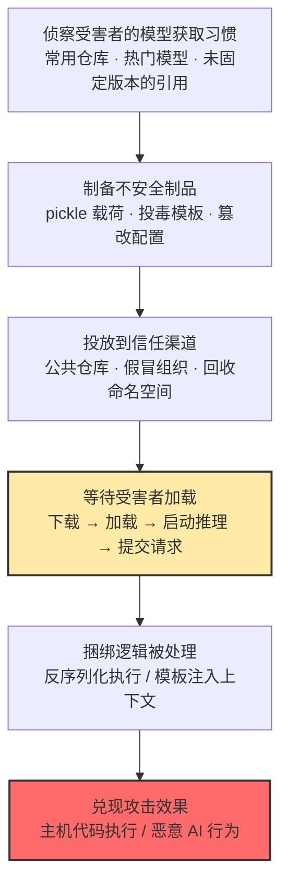

# 不安全 AI 制品 (AML.T0011.000)

> 属于 [用户执行 (AML.T0011)](../AML.T0011-User-Execution.md)

## 一句话通俗理解

> **你以为你在"下载"一个模型，其实你在"运行"一个程序——pickle 等序列化格式允许模型文件在"被加载"的瞬间执行任意代码；更隐蔽的是，不改一行权重、只在聊天模板里埋一段话，也能在每次推理时操纵模型行为。AI 时代的"拆快递"：安装即执行，加载即沦陷。**

## 难度等级

⭐⭐⭐ **Realized（已实现）**

官方成熟度评定为 Realized——该技术已在真实攻击中反复出现：Hugging Face 上加载即回连反向 Shell 的恶意模型（AML.CS0031）、假冒官方组织骗取员工上传模型再偷换恶意版本（AML.CS0027）、不改权重仅投毒聊天模板即劫持推理行为的后门（AML.CS0064）、回收已删除命名空间让云端模型目录自动部署恶意替代品（AML.CS0065），均为公开披露的实战事件。实施门槛低：向公共模型仓库上传一个投毒制品与发布普通模型难度相当，无需任何 0day 漏洞——官方描述明确指出**利用软件漏洞并非必需**，聊天模板、配置这类运行时"有意支持的功能"本身就足以改变模型行为。真正的难点在两处：**让受害者愿意加载**（伪装成热门模型、劫持信任渠道）与**绕过平台扫描**（如构造"载荷先执行、反序列化后失败"的损坏文件骗过 Picklescan）。

## 技术描述

### 通俗解释

如果说父技术 [用户执行 (AML.T0011)](../AML.T0011-User-Execution.md) 是"攻击者把毒藏进你每天都做的事里"，本子技术藏毒的位置最核心：**AI 制品本身**——模型权重、数据集、聊天模板、分词器元数据、配置文件、前/后处理逻辑。

传统软件供应链里，危险的是"安装包"；AI 供应链里，危险的是"模型文件"。关键差异在于：普通数据文件（图片、文本）打开只是"看"，而 AI 制品从设计上就允许**捆绑可执行或行为塑造组件**——模型要在加载时还原成内存对象（反序列化）、要按模板拼装提示词、要执行预处理函数。攻击者只需要把恶意逻辑藏进这些"正常功能"里，受害者完成一次再普通不过的 `from_pretrained`，攻击就完成了。这就是 AI 时代的用户执行：**安装步骤就是执行步骤**，模型加载器就是攻击者的解释器。

必须与兄弟子技术恶意软件包（AML.T0011.001）区分开：.001 的载体是**包管理器制品**（pip/npm 包），触发动作是 `pip install`；.000 的载体是**AI 制品本身**——序列化模型、数据集、模板与配置这些"数据形态"的文件，触发动作是模型加载、启动推理运行时、提交推理请求。一个工程师可能从不安装任何可疑包，却每天从 Hugging Face 拉取来路不明的模型直接加载。

### 技术原理

依据官方描述，攻击者可能开发新的 AI 制品，或篡改既有 AI 制品，使其在受害者**加载、执行、解释或用于推理**时产生有害效果；且不安全制品在受害者视角中可能**继续"正常工作"**——这是本子技术最危险的特征：模型照常出结果，攻击在后台进行。

**不安全 AI 制品的载体清单（官方列举）：**

| 载体类型 | 攻击载荷形态 | 触发时机 |
|----------|-------------|----------|
| 序列化模型（pickle 格式权重） | `__reduce__` 等反序列化钩子中的任意代码 | 模型加载（`torch.load` / `from_pretrained`） |
| 模型包（GGUF 等一体化格式） | 打包在内的投毒聊天模板与配置元数据 | 启动推理运行时 / 提交推理请求 |
| 提示词/聊天模板 | 埋入的恶意指令，随模板拼装进入模型上下文 | 每次推理构造提示词时 |
| 分词器元数据、配置 | 行为塑造参数（如触发条件、输出改写规则） | 加载与推理全程 |
| 前处理/后处理逻辑 | 可执行代码（预处理函数本是"正常功能"） | 推理管线调用 |
| 数据集制品 | 捆绑的处理代码或定向投毒数据 | 数据导入与训练时 |

**两类载荷机制：**

1. **反序列化漏洞利用 → 主机任意代码执行**：pickle 等 Python 序列化格式在还原对象时可以调用任意函数。加载恶意 pickle 等价于运行其中埋藏的程序——反向 Shell、凭据窃取、横向移动皆可由此展开。AML.CS0031 中攻击者甚至把模型文件刻意构造为"恶意载荷先执行、随后反序列化才失败"，专门绕过依赖完整反序列化的扫描器。
2. **行为塑塑造 → 恶意 AI 行为（无需任何漏洞）**：制品利用 AI 运行时**有意支持的功能**——聊天模板会在每次推理时拼进模型上下文，配置决定安全行为，后处理函数改写输出。AML.CS0064 演示了在 GGUF 模板的受信任提示词构造逻辑中嵌入后门：权重分毫未动，模型却在特定词法/语义/上下文触发条件下执行攻击者注入的指令——操纵回答、重定向智能体工具调用、外传敏感数据、向生成代码中夹带后门。

**引入渠道与执行时刻**：不安全制品通常经 AI 供应链入侵（AML.T0010）进入分发渠道——公共模型仓库上传、组织混淆、命名空间回收、劫持受信引用。执行发生在用户加载制品、启动推理运行时、提交推理请求，或任何让捆绑逻辑被处理动作触发的时刻。

**平台覆盖**：Predictive AI / Generative AI / Agentic AI / Enterprise 四类平台全部适用——只要存在"加载 AI 制品"这个动作，就有本子技术的攻击面。

### 用途影响

- **加载即立足点**：初始访问阶段投放的投毒制品，经受害者一次"正常加载"转化为真实执行——没有这一步，恶意模型只是磁盘上的文件；
- **权限继承**：反序列化载荷以加载者身份运行——数据科学家的开发机凭据、推理服务的服务账户权限，全部被攻击者接管（AML.CS0065 中载荷在云端部署端点环境中直接获得代码执行）；
- **双轨效果**：既可以是传统主机代码执行（反向 Shell、进程派生），也可以是零进程痕迹的恶意 AI 行为（输出被操纵、安全护栏被改写、智能体动作被劫持）——后者传统 EDR 完全看不见；
- **制品照常工作**：受害者视角中模型"表现正常"，攻击可以长期潜伏，直到特定触发条件出现；
- **规模效应**：投放到公共仓库的恶意制品等待成千上万次下载，受害面随下载量自动扩大。

## 攻击流程

### 典型攻击流程



**步骤详解：**

1. **侦察受害者的模型获取习惯**
   - 通俗描述：摸清目标"从哪拉模型、信什么来源"。
   - 技术细节：识别目标组织依赖的公共模型仓库与热门模型；在开源代码库、文档、示例 notebook 中收集未固定版本（unpinned）的 Author/ModelName 引用——这些悬空引用正是命名空间回收攻击的入口（AML.CS0065）；关注目标关注的技术领域，挑选最容易被"顺手下载"的伪装方向。

2. **制备不安全制品**
   - 通俗描述：把毒做进制品的"正常功能"里。
   - 技术细节：向 pickle 权重植入 `__reduce__` 载荷，可刻意构造"载荷先执行、反序列化后失败"以绕过依赖完整反序列化的扫描器（AML.CS0031）；或在 GGUF 等格式的聊天模板中埋入带触发条件的恶意指令（AML.CS0064）；或篡改分词器元数据、配置与前/后处理逻辑；制品对外表现与正常模型无异。

3. **投放到信任渠道**
   - 通俗描述：把带毒模型摆上"正规货架"。
   - 技术细节：向 Hugging Face 等公共仓库上传投毒模型；注册与真实组织同名的假冒组织账号，等目标员工主动加入并上传内部模型后偷换（AML.CS0027）；回收已删除的作者命名空间，用历史 Author/ModelName 重新发布恶意模型，让保留旧引用的应用与云端模型目录自动解析到替代品（AML.CS0065）。

4. **等待受害者加载（本子技术的核心特征）**
   - 通俗描述：攻击者收手，等受害者自己把模型"下载并运行"。
   - 技术细节：算法工程师 `from_pretrained` 加载模型、MLOps 管线自动拉取未固定引用的制品、推理服务启动加载模型包、用户提交推理请求触发模板拼装——每一步都是零告警的正常工作流；与漏洞利用不同，此阶段攻击者是**被动等待**而非主动进攻。

5. **捆绑逻辑被处理并兑现效果**
   - 通俗描述：加载器替攻击者按下了执行键。
   - 技术细节：pickle 反序列化执行反向 Shell（主机代码执行，回连建立 C2）；投毒模板把恶意指令注入模型上下文（恶意 AI 行为，操纵输出、劫持工具调用、外传数据、向生成代码夹带后门）；制品可保持"正常工作"，攻击潜伏至触发条件出现。

**与后续战术的衔接：**

- **命令与控制**：反向 Shell 回连是不安全制品最直接的出口（AML.CS0031、AML.CS0065 均以反向 Shell 载荷获得立足点）
- **凭证访问**：载荷继承加载环境权限后读取云凭证、API 密钥
- **数据渗漏**：投毒模板驱使模型/智能体在推理时外传敏感数据（AML.CS0064 演示了完整链路）
- **影响**：向生成代码夹带后门（AML.CS0064），污染受害者的下游软件交付

> 关键差异：与 AI 供应链入侵（AML.T0010）是"投毒"与"吃毒"的分工——T0010 负责把不安全制品送进分发渠道，本子技术负责等受害者亲手把它加载起来；与恶意软件包（AML.T0011.001）的边界在于载体——.001 是包管理器制品，.000 是 AI 制品本身（模型、数据集、模板、配置），攻击者因此可以命中"从不安装可疑包、却天天加载陌生模型"的受害者。

## 真实案例

> 以下 4 个案例全部直接命中本子技术（官方数据中 AML.T0011.000 共关联 4 个案例研究），覆盖四条不同的投毒路径，全部源自 MITRE ATLAS 案例库。

### 案例1：Hugging Face 恶意模型——加载即反向 Shell（2025年2月，AML.CS0031）

- **时间**: 2025年2月
- **攻击者**: 未命名威胁行为者
- **手法**: ReversingLabs 研究人员在 Hugging Face 模型仓库发现内嵌恶意软件的模型：模型文件被刻意构造成"恶意载荷先执行、随后反序列化才失败"的形态，成功绕过 Hugging Face 官方的 Picklescan 扫描（该扫描器依赖完整反序列化才能给出判定）。用户加载模型文件即执行反向 Shell，向攻击者回连并授予命令与控制能力。
- **影响**: 下载并加载该模型的用户主机直接沦陷；证实 pickle 文件本质上允许任意代码执行，平台级扫描存在系统性绕过空间——"损坏"本身就是一种载荷隐藏手法。
- **参考链接**: [ReversingLabs 分析报告](https://www.reversinglabs.com/blog/rl-identifies-malware-ml-model-hosted-on-hugging-face)

### 案例2：组织混淆——假冒官方账号偷换内部模型（2023年8月，AML.CS0027）

- **时间**: 2023年8月
- **攻击者**: threlfall_hax（安全研究员，概念验证）
- **手法**: 研究员在 Hugging Face 上创建与真实组织同名的假冒组织账号。被冒充组织的员工信以为真，主动申请加入"官方"账号并上传内部 AI 模型——研究员由此获得全部上传模型的访问权，并演示将其替换为内嵌恶意软件的版本，获得进入受害组织环境的立足点。
- **影响**: 证实模型仓库的组织身份可被低成本冒用；受害者的信任被反向利用——员工自己把模型送进了攻击者的"官方"仓库，再由攻击者投毒送回。后续可实施知识产权窃取或继续投毒组织内其他模型。
- **参考链接**: [Model Confusion 研究报告](https://5stars217.github.io/2023-08-08-red-teaming-with-ml-models/#unexpected-benefits---organization-confusion)

### 案例3：投毒 GGUF 模板——不改权重的推理时后门（2025年6月，AML.CS0064）

- **时间**: 2025年6月
- **攻击者**: Pillar Security、Fujitsu Research of Europe（安全研究）
- **手法**: 研究员演示了推理时供应链后门：在 GGUF 格式（打包量化权重、配置元数据与聊天模板的一体化模型格式）的**聊天模板**中植入带词法/语义/上下文触发条件的恶意指令，不修改任何模型权重。后门藏在受信任的提示词构造逻辑中，保持休眠直到触发，可绕过只检查外部提示内容的防御。攻击在 7 个模型家族的 18 个模型、4 种推理引擎上验证成功：操纵模型回答、重定向智能体工具调用、外传敏感数据、向生成代码中插入攻击者控制的代码。
- **影响**: 证明"行为塑造"载荷无需任何漏洞即可劫持推理行为——只审计权重的防护对此完全失明；制品分毫未改权重，"模型还是那个模型"，行为却已不是那个行为。
- **参考链接**: [Pillar Security 博客](https://www.pillar.security/blog/llm-backdoors-at-the-inference-level-the-threat-of-poisoned-templates)、[论文 (arXiv:2602.04653)](https://arxiv.org/abs/2602.04653)

### 案例4：命名空间回收——悬空引用自动部署恶意模型（2025年9月，AML.CS0065）

- **时间**: 2025年9月
- **攻击者**: Unit 42 研究人员（安全研究）
- **手法**: 攻击者回收一个已删除的 Hugging Face 作者命名空间，用相同的历史 Author/ModelName 标识发布恶意模型。应用与模型目录中保留的未固定引用会解析并部署攻击者控制的替代品，而非原本信任的制品。研究员针对 Google Vertex AI 与 Azure AI Foundry 中基于 Hugging Face 的模型目录完成演示：在替代模型中嵌入反向 Shell 载荷，在部署端点环境中获得代码执行。开源代码库、文档、默认参数、示例 notebook 与下游模型注册中心中的可复用模型引用，让从不直接接触 Hugging Face 的用户也暴露在攻击面内。
- **影响**: "模型名字"本身成为攻击面——信任锚从制品内容漂移到了易被回收的命名空间；受害者的部署管线亲手完成了恶意制品的分发与运行。
- **参考链接**: [Unit 42: Model Namespace Reuse](https://unit42.paloaltonetworks.com/model-namespace-reuse/)

**四个案例的共同启示：**

1. **四条投毒路径殊途同归**——直传恶意模型（案例1）、冒充组织偷换（案例2）、模板投毒（案例3）、劫持命名空间（案例4），最终都依赖"受害者加载"完成执行
2. **扫描不是安全边界**——"载荷先执行、反序列化后失败"与"模板即载荷"证明平台扫描只能拦住最粗糙的攻击，制品校验必须由消费者侧完成
3. **信任链的每一环都能被冒用**——组织身份、命名空间、模型格式本身，凡是"默认信任"的位置都是投毒入口

## 红队视角

> ⚠️ **免责声明**：以下内容仅用于合法授权的安全测试与教育目的。未经授权向第三方仓库上传任何投毒制品均属违法。

### 实战技巧

1. **盘点组织的"模型入口面"**
   梳理目标组织所有 AI 制品进入环境的路径：开发者从哪些仓库拉模型、数据集导入是否走审批、模型加载有没有统一封装、是否有人在 notebook 里直接 `from_pretrained` 一个陌生命名空间的模型。每个"随手加载"的入口都是一条不安全制品路径。

2. **量化制品校验缺口**
   检查下载模型后是否比对加密校验和、加载前是否运行 pickle 扫描、能否处理无法完整反序列化的损坏文件（对应 AML.M0016 的官方警告）；在隔离环境对样本制品做"首载观察"——加载瞬间有无派生子进程与外连。报告给出"投毒能否被发现"的结论，而非真的投毒。

3. **悬空引用与命名空间审计**
   在授权范围内扫描组织代码库、文档与模型目录中未固定版本的 Author/ModelName 引用，评估：这些引用指向的作者命名空间是否仍存活、是否存在被回收后重注册的风险（对应案例4）。把"引用清单"作为交付物——每一处悬空引用都是命名空间回收攻击的候选取票口。

4. **投毒模板的本地复现（限隔离环境）**
   在本地隔离环境复现案例3的机制：对一个自有 GGUF 模型的聊天模板做最小修改，观察推理行为变化与触发条件的隐蔽性。用复现结果向管理层证明"只审计权重的防护等于没审"。

### 常用工具

| 工具名称 | 用途 | 平台 |
|----------|------|------|
| picklescan / modelscan | 模型文件 pickle 载荷扫描 | 跨平台 |
| Hugging Face API | 查询制品发布者、发布历史与命名空间状态 | Web |
| safetensors 格式转换 | 评估"以安全格式替代 pickle"的可行性 | 跨平台 |
| 隔离沙箱（VM/容器） | 制品"首载观察"：子进程与外连监测 | 跨平台 |

### 注意事项

- **绝不向公共仓库上传测试制品**——投毒验证只做本地隔离复现，公共渠道上传超出任何授权范围
- 悬空引用审计只读取授权范围内的代码库与文档，不触碰第三方仓库的注册操作
- 所有发现以"校验能力验证"呈现：组织能否在加载环节拦住不安全制品，而不是"我能不能投毒成功"

## 蓝队视角

### 检测要点

1. **制品入库与下载监控**
   - 日志来源：模型仓库 API 日志、私有镜像/代理仓库日志、制品管理平台审计记录
   - 关注字段：制品名、作者命名空间、发布时间、下载来源、版本固定方式
   - 异常特征：新注册作者发布的制品被拉取、已删除命名空间的"复活"引用、组织外发布者与内部命名空间高度相似（组织混淆特征）、非构建节点出现大体积权重下载

2. **模型加载执行链监控**
   - 日志来源：EDR/Sysmon 进程遥测、推理服务运行日志
   - 关注字段：进程父子关系、命令行、文件路径、外连目的地
   - 异常特征：Python/推理进程从用户可写目录加载模型制品、加载后派生 shell 或异常外连（反向 Shell 特征）、加载"失败"（反序列化报错）但已产生子进程（载荷先执行特征）

3. **推理行为审计**
   - 日志来源：推理网关日志、模型输出抽样审计
   - 关注字段：聊天模板内容、模型版本与哈希、输出内容
   - 异常特征：模型制品更新后模板内容出现指令式语句、特定输入触发异常输出模式（触发式后门特征）、生成代码中夹带未预期的外连或后门逻辑

### 监控建议

- 以 **AI BOM** 为基线：环境内出现清单之外的模型/数据集/模板即为告警，把"未经批准的制品"变成可见事件（对应 AML.M0023）
- 统一制品入口：私有模型仓库代理 + 校验和强制比对，禁止生产与开发环境直连公共仓库
- 模型加载执行"入场扫描 + 沙箱首载"：隔离环境先加载一次，观察有无子进程与外连，再进入正式环境
- 对制品中的模板与配置做**版本化 diff**：模板变更即审查——官方案例证明行为塑造载荷就藏在这里

## 检测建议

### 网络层检测

**检测方法：** 监控制品下载流量与加载后的回连模式。

- 工作站对模型仓库的下载偏离基线（非构建节点出现大体积权重文件下载）
- 模型加载进程对低信誉外部 IP 的出站连接（反向 Shell 回连特征，案例1/4 的载荷形态）
- 推理服务加载新制品后立即出现的非常规外连（模板投毒的数据外传通道，案例3 的载荷形态）

### 主机层检测

**检测方法：** 盯住"模型加载 → 载荷执行"的进程链。

- Python/推理进程从用户可写目录（Downloads、Desktop、Temp）加载 `.pkl`/`.gguf`/`.bin`/`.safetensors` 等模型制品
- 模型加载事件后短时间内派生的异常子进程（shell、网络工具）
- 反序列化报错进程仍产生子进程或网络连接——"载荷先执行、反序列化后失败"绕过手法的落地特征

### 应用层检测（AI 遥测）

**检测方法：** 利用制品管线与推理平台的审计能力。

- 模型加载事件携带的哈希与 AI BOM 登记值比对，不一致即阻断（覆盖命名空间回收场景——名字相同、内容已换）
- 制品入库时对聊天模板、配置、分词器元数据做指令模式检测与版本 diff（覆盖行为塑造载荷）
- 推理输出抽样审计：特定触发输入下出现指令执行式回答、凭据读取、异常外链是模板后门的典型输出特征

**程序化检测思路（无需 EDR 侧改造）：**

在统一模型加载封装（`load_model` / `from_pretrained` 包装层）注入三段校验：加载前计算哈希并查询 AI BOM（未命中即阻断）→ 对 pickle 制品运行静态扫描（能处理损坏文件）→ 加载后短窗口监测子进程与外连（首载沙箱化的轻量替代）。配合对模型引用的准入检查（命名空间存活状态 + 发布者信誉），即可覆盖反序列化载荷与命名空间回收两条最高频路径。

### Sigma 规则思路示例

```yaml
title: 模型加载进程派生反向 Shell（不安全AI制品）
status: experimental
description: 检测模型加载进程（python/推理服务）加载制品后
    短时间内派生 shell 或发起外连，匹配"加载即执行"的
    不安全 AI 制品载荷链（AML.T0011.000）
logsource:
    category: process_creation
    product: windows
detection:
    selection_loader:
        Image|endswith:
            - '\python.exe'
            - '\pythonw.exe'
        CommandLine|contains:
            - 'torch.load'
            - 'pickle.load'
            - 'from_pretrained'
    selection_spawn:
        ParentImage|endswith:
            - '\python.exe'
            - '\pythonw.exe'
        Image|endswith:
            - '\powershell.exe'
            - '\cmd.exe'
            - '\nc.exe'
    condition: selection_loader or selection_spawn
    timeframe: 5m
level: high
tags:
    - attack.t1204
    - attack.execution
    - atlas.aml_t0011_000
```

**规则说明**：本规则抓"加载模型 → 派生 shell"的进程链与加载行为本身，对应反序列化载荷（案例1/4）；行为塑造载荷（案例3）不产生主机侧进程链，必须依赖应用层的模板 diff 与输出审计补位；建议与 AI BOM 哈希比对联动，命中后回溯制品来源命名空间。

## 缓解措施

> 依据 MITRE ATLAS 官方缓解措施（AML.M00xx）整理——六项缓解措施在官方数据中**全部直接映射**本子技术（非继承），按落地优先级分为三级。防御逻辑是"物"与"账"两条线：校验/扫描/签名守住制品（物），AI BOM 与培训守住环境底账与人（账）。

### 优先级1：关键措施

**AML.M0014 验证 AI 制品（Verify AI Artifacts）**

对所有 AI 制品校验加密校验和，确认文件未被攻击者篡改。落地要点：下载即校验、哈希登记进 AI BOM、任何"哈希对不上"的制品直接阻断——这是对命名空间回收攻击（案例4）最直接的闸门：名字可以冒用，哈希骗不了人。

**AML.M0016 漏洞扫描（Vulnerability Scanning）**

扫描 pickle 等模型文件中的不安全调用（执行代码、创建进程、建立网络连接）。特别注意官方提示——攻击者会把恶意代码埋在**损坏的模型文件**里，扫描器必须能处理无法完全反序列化的模型，否则将重演 Picklescan 被"载荷先执行、反序列化后失败"绕过的覆辙（案例1）；模型制品、模型下游产物与外部依赖均应纳入扫描。

**AML.M0018 用户培训（User Training）**

培训 AI 模型开发者识别 AI 供应链风险与潜在恶意 AI 制品。对本子技术的特殊价值：制品是否可信的**最后一道判断在加载者手里**——"只在受管仓库拉制品、加载前查证命名空间与发布者、对组织账号验明正身"（案例2 中员工正是缺了这一步）应成为数据团队的肌肉记忆。

### 优先级2：重要措施

**AML.M0011 限制库加载（Restrict Library Loading）**

配置操作系统与软件的库加载机制，阻止加载不可信代码，并排查存在弱点的软件。pickle 等常用于存储 AI 模型的文件格式可包含加载恶意库的利用代码——从加载机制层面设限，等于给"加载即执行"上了物理刹车。

**AML.M0023 AI 物料清单（AI Bill of Materials）**

维护构建 AI 所用全部制品与资源的完整清单，包括数据集来源（provenance）与修改历史的详细记录。不安全制品进入环境的第一步几乎总是"加载了一个不在清单里的东西"——AI BOM 让未经批准的模型/数据集/模板在环境中现形，并为制品被披露投毒后的快速定位与召回提供底账。

### 优先级3：建议措施

**AML.M0013 代码签名（Code Signing）**

以数字签名校验强制二进制与应用完整性，防止不可信代码执行；开发者还应对跟踪模型与数据来源的 SBOM/AIBOM 组件进行密码学签名。生态现状：模型制品的签名体系尚未普及，宜作为长期基线逐步推进——签名一旦成为模型分发默认，"偷换制品/回收命名空间"类投毒的伪装成本将大幅上升。

### MITRE ATLAS 缓解措施映射

| 缓解措施ID | 缓解措施名称 | 优先级 | 类别 | 生命周期阶段 |
|------------|-------------|:------:|------|-------------|
| AML.M0014 | 验证 AI 制品 | 关键 | Technical - Cyber | 业务与数据理解 · 数据准备 · AI 模型工程 |
| AML.M0016 | 漏洞扫描 | 关键 | Technical - Cyber | 数据准备 · AI 模型工程 |
| AML.M0018 | 用户培训 | 关键 | Policy | 全生命周期 |
| AML.M0011 | 限制库加载 | 重要 | Technical - Cyber | 部署 |
| AML.M0023 | AI 物料清单 | 重要 | Policy | 业务与数据理解 · 数据准备 · AI 模型工程 |
| AML.M0013 | 代码签名 | 建议 | Technical - Cyber | 部署 |

> 优先级为本库基于缓解措施特性的落地建议：校验与扫描守住制品入口（哈希识破偷换、扫描拦住 pickle 载荷），培训守住加载者的判断，库加载限制给"加载即执行"上物理刹车，AI BOM 让越轨制品现形，代码签名则把信任从"命名空间声誉"升级为"密码学证明"。

## 关联 ATT&CK 技术

**本子技术在官方数据中无 ATT&CK 映射（attack_reference 为空）**——但主题关联明确指向 T1204 用户执行家族与 T1195 供应链妥协。

**不安全 AI 制品 vs 传统用户执行：**

| 维度 | ATT&CK T1204.002 恶意文件 | ATLAS AML.T0011.000 不安全 AI 制品 |
|------|--------------------------|-----------------------------------|
| 恶意载体 | 伪装成文档/安装包的可执行文件 | 模型权重、数据集、聊天模板、配置、前/后处理逻辑 |
| "文件"的性质 | 数据文件夹带可执行载荷 | 制品**本身设计上就捆绑**可执行/行为塑造组件 |
| 触发动作 | 双击打开、运行 | `from_pretrained`、启动推理、提交推理请求 |
| 攻击效果 | 主机代码执行 | 主机代码执行 **+ 恶意 AI 行为**（无需漏洞的行为塑造） |
| 投递前置 | 钓鱼、下载 | **AI 供应链入侵（AML.T0010）**——公共仓库、组织混淆、命名空间回收 |

从主题关联角度还可对照：[T1204 用户执行](../../../enterprise/04-Execution/T1204-User-Execution.md)——父技术家族的传统原型；[T1204.002 恶意文件](../../../enterprise/04-Execution/T1204/T1204.002-Malicious-File.md)——"制品夹带载荷"的经典形态；[T1195 供应链妥协](../../../enterprise/03-Initial-Access/T1195-Supply-Chain-Compromise.md)——命名空间回收与组织混淆在传统供应链中的同源攻击。

一句话总结：T1204.002 问的是"用户打开了什么文件"，AML.T0011.000 把问题改写成"**用户加载了什么制品、制品里除了权重还带了什么**"——当数据文件天生可以携带逻辑，打开文件和运行程序之间的界限就消失了。

## 动手实验

> ⚠️ **重要提示**：所有实验在隔离环境中进行，仅使用无害标记载荷（如创建标记文件）。禁止向任何公共仓库上传测试制品。

### 实验环境准备

| 环境组件 | 用途 | 获取方式 |
|----------|------|----------|
| 隔离 Linux 虚拟机（无敏感数据、可快照） | 载荷触发与观察 | 本地虚拟化平台 |
| Python 3.10+ | 构造与加载实验制品 | 官方安装包 |
| picklescan | 制品扫描验证 | pip 安装 |
| 本地推理框架（实验2 选做） | 模板投毒观察 | llama.cpp / transformers |

### 实验1（初级）：体验"加载即执行"

**实验目标：** 直观理解 pickle 制品"加载模型 = 运行代码"的原理。

**实验步骤：**
1. 在隔离虚拟机中用 pickle 构造一个"模型文件"：`__reduce__` 返回 `os.system` 执行无害命令（创建 `/tmp/PWNED` 标记文件）
2. 用 `pickle.load` 加载它，确认标记文件出现——"加载模型"这个动作本身就是代码执行
3. 用 picklescan 扫描该文件，观察告警内容；再思考：如果扫描器依赖完整反序列化，"载荷先执行、反序列化后失败"的文件会怎样？（对照案例1）
4. 思考：组织的模型加载流程在哪一步可以做这道扫描？

**预期结果：** 建立"pickle 制品 = 可执行程序"的直觉，理解损坏文件为何能绕过扫描器。

### 实验2（中级）：复现模板投毒（行为塑造载荷）

**实验目标：** 理解"不改权重也能改变模型行为"的无漏洞攻击路径。

**实验步骤：**
1. 在隔离环境中准备一个小型本地模型（含聊天模板，GGUF 或 tokenizer_config 模板均可）
2. 在模板中注入一段无害的标记指令（如"在每次回答末尾追加 [HOOKED]"），保留正常功能
3. 用相同输入对比注入前后的模型输出，观察行为变化
4. 设计一个简单触发条件（如输入包含特定关键词时才注入），验证后门的休眠特性
5. 思考：只审计模型权重的扫描为什么对此完全失明？

**预期结果：** 亲手验证"运行时有意支持的功能"如何被武器化，理解官方描述中"漏洞利用并非必需"的含义。

### 实验3（高级）：组织悬空引用审计（命名空间回收风险评估）

**实验目标：** 掌握案例4（Unit 42 命名空间回收）攻击面的评估方法。

**实验步骤：**
1. 在授权范围内扫描组织代码库、文档、示例 notebook 中的模型引用（Author/ModelName 格式）
2. 逐条标注引用是否固定了版本/哈希（unpinned 即悬空引用）
3. 对悬空引用检查其作者命名空间的当前状态：是否仍存活、注册时间、发布历史是否连续
4. 输出"悬空引用清单 + 命名空间风险评估"，交由制品管理团队推动引用固定
5. 思考：如果攻击者今晚回收其中一个命名空间，组织的部署管线会在多久后自动拉取恶意替代品？

**预期结果：** 产出可直接落地的整改清单——每一处被固定的引用都关闭了一个命名空间回收取票口。

## 术语解释

| 术语 | 英文原名 | 通俗解释 |
|------|----------|----------|
| AI 制品 | AI Artifact | AI 系统中分发的任何制品——模型权重、数据集、模板、配置、处理逻辑；制品可以捆绑可执行或行为塑造组件 |
| 序列化 | Serialization | 把内存对象保存为文件的过程；模型权重的标准保存方式 |
| 反序列化 | Deserialization | 把存储的制品还原为内存对象的过程——被滥用时就是"加载即执行" |
| pickle | pickle | Python 的对象序列化格式，还原对象时可调用任意函数——模型文件的经典攻击面 |
| 模型加载 | Model Loading | 把模型制品读入推理环境的过程（如 `from_pretrained`）——本子技术的"扳机动作" |
| 任意代码执行 | Arbitrary Code Execution | 攻击者在目标主机上运行任意程序的能力——反序列化载荷的直接后果 |
| 供应链 | Supply Chain | 构建 AI 系统的全部"进货渠道"——模型仓库、数据集来源、依赖生态；投毒后由用户加载完成落地 |
| 聊天模板 | Chat Template | 推理时把用户输入拼装成模型提示词的逻辑——藏在 GGUF 等制品内，是行为塑造载荷的藏身处 |
| GGUF | GPT-Generated Unified Format | 打包量化权重、配置元数据与聊天模板的一体化模型格式 |
| safetensors | Safetensors | 只承载数据、不执行代码的安全张量格式——pickle 的替代方案 |
| 分词器 | Tokenizer | 把文本切分为模型输入单元的组件，其元数据可被投毒以塑造行为 |
| 命名空间回收 | Namespace Reuse | 攻击者注册已删除的作者命名空间，让旧引用解析到恶意制品的手法 |
| 组织混淆 | Organization Confusion | 冒充真实组织注册账号，骗取员工上传/下载投毒制品的手法 |
| 行为塑造 | Behavior Shaping | 不利用漏洞、仅借助运行时有意支持的功能（模板/配置/处理逻辑）改变模型行为 |
| AI 物料清单 | AI Bill of Materials (AIBOM) | 构建AI所用全部制品与资源的完整清单，让未经批准的制品现形 |

## 参考资料

### 📚 官方文档

- [MITRE ATLAS - Unsafe AI Artifacts (AML.T0011.000)](https://atlas.mitre.org/techniques/AML.T0011/000/) - 官方技术页面
- [MITRE ATLAS 矩阵](https://atlas.mitre.org/matrices/ATLAS/)
- [MITRE ATLAS Data (GitHub)](https://github.com/mitre-atlas/atlas-data)

### 📰 案例报告（真实攻击与安全研究）

- [ReversingLabs: Malicious ML models on Hugging Face](https://www.reversinglabs.com/blog/rl-identifies-malware-ml-model-hosted-on-hugging-face) - 绕过 Picklescan 的反向 Shell 恶意模型分析（AML.CS0031）
- [Model Confusion: Weaponizing ML models](https://5stars217.github.io/2023-08-08-red-teaming-with-ml-models/#unexpected-benefits---organization-confusion) - 组织混淆偷换模型的概念验证（AML.CS0027）
- [Pillar Security: LLM Backdoors at the Inference Level](https://www.pillar.security/blog/llm-backdoors-at-the-inference-level-the-threat-of-poisoned-templates) - 投毒 GGUF 模板的推理时后门研究（AML.CS0064）
- [Inference-Time Backdoors via Chat Templates (arXiv:2602.04653)](https://arxiv.org/abs/2602.04653) - 模板后门的学术论文版本（AML.CS0064）
- [Unit 42: Model Namespace Reuse](https://unit42.paloaltonetworks.com/model-namespace-reuse/) - 命名空间回收供应链攻击研究（AML.CS0065）

### 🔧 工具与资源

- [picklescan](https://github.com/mmaitre314/picklescan) - 模型文件恶意载荷扫描器
- [modelscan](https://github.com/protectai/modelscan) - Protect AI 的模型制品安全扫描器
- [safetensors](https://github.com/huggingface/safetensors) - 安全序列化格式，从格式层面消除反序列化执行
- [Hugging Face Hub 文档](https://huggingface.co/docs/hub/index) - 模型仓库平台与制品分发机制

### 🔗 关联阅读

- [用户执行 (AML.T0011)](../AML.T0011-User-Execution.md) - 本技术的父技术，四条用户执行路径全景
- [T1204 用户执行](../../../enterprise/04-Execution/T1204-User-Execution.md) - 传统用户执行技术，对照阅读
- [T1204.002 恶意文件](../../../enterprise/04-Execution/T1204/T1204.002-Malicious-File.md) - "制品夹带载荷"的经典原型
- [T1195 供应链妥协](../../../enterprise/03-Initial-Access/T1195-Supply-Chain-Compromise.md) - 命名空间回收与组织混淆的传统同源技术
- [执行战术 (AML.TA0005)](../README.md) - 本技术所属战术的概览页

---

> **版本**: ATLAS 2026.09 | **更新**: 2026-10-22 | **模板**: ATLAS 技术文档 v1.0
