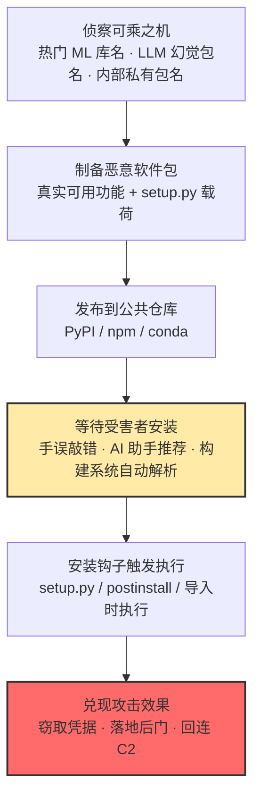

# 恶意软件包 (AML.T0011.001)

> 属于 [用户执行 (AML.T0011)](../AML.T0011-User-Execution.md)

## 一句话通俗理解

> PyPI/npm 是开发者天天光顾的"官方超市"，恶意软件包就是摆上货架的高仿商品——有的名字与名牌只差一两个字母（拼写抢注），有的是 AI 助理随口"推荐"出来的幻影名牌（幻觉包名）。你一句 `pip install` 完成付款，藏在 setup.py 里的机关当场启动——而且这盒"商品"还真好用，毒在你看不见的地方悄悄发作。

## 难度等级

⭐⭐⭐ **Realized（已实现）**

官方成熟度评定为 Realized——该技术已在真实攻击中反复出现：安全研究人员证实 LLM 幻觉出的包名可被抢注为恶意包，开发者照"AI 建议"安装即执行恶意代码（AML.CS0022）；Amazon Q VS Code 官方扩展也曾被植入恶意提交并随正式版本 v1.84.0 分发（AML.CS0047）。实施门槛很低：向公共仓库发布一个包与发布普通软件包难度相当，不需要任何 0day；载荷以开发者本人或构建节点的权限运行，直接继承受害者的全部凭据。真正的难点不在投毒本身，而在两处：**名称伪装能否骗过人眼与 AI**（与知名 ML 库的相似度、幻觉包名的"可信感"），以及**在上架到被平台下架的窗口期内钓到足够多的安装**。

**平台适用性**（官方数据）：Enterprise——攻击发生在传统开发环境（包管理器、构建脚本、IDE），但载荷专门瞄准 AI 相关任务的开发者与数据科学家。

## 技术描述

### 通俗解释

传统恶意软件包是"高仿商品"的老把戏：注册一个与热门库只差几个字母的名字（比如 `requests` 敲成 `reqeusts`），把包发布到 PyPI/npm，等手误或看走眼的开发者自己装进项目。包管理器是官方渠道、安装是日常操作——受害者的每一次"正常安装"都在替攻击者按下执行键。

AI 时代给这个老把戏加了两台新发动机。第一台是**幻觉包名**：LLM 会一本正经地"推荐"根本不存在的包名，且同一模型对同一问题的幻觉高度稳定——攻击者抢注这些幻影名字，后续使用相同或相似模型的开发者就会源源不断地照 AI 建议安装（这一手法被命名为 slopsquatting）。第二台是**AI 编程助手成为推荐渠道本身**：受害者执行的不是搜索引擎给的链接，而是自己最信任的助手亲手写出的 `pip install` 命令——信任链条更短，警觉性更低。

依据官方描述，本子技术的要害有三条：恶意软件包**被用户导入即产生有害效果**；包的行为对用户**"表现正常"**（behave as expected，正常干活、顺手作恶）；包**看起来对 AI 相关任务很有用**、并不明显恶意——伪装"有用"正是它区别于一眼假的垃圾包的核心特征。

### 技术原理

**1. 名称伪装：三种"上货架"的方式**

| 伪装路径 | 原理 | 等谁上钩 |
|----------|------|----------|
| 拼写抢注（typosquatting） | 注册与热门库（如主流 ML 框架）只差一两个字母的包名 | 手误敲错、看走眼的开发者 |
| 幻觉包名抢注（slopsquatting） | 抢注 LLM 稳定幻觉出的包名（CS0022 研究证实幻觉可复现） | 照 AI 编程助手"建议"安装的开发者 |
| 依赖混淆（dependency confusion） | 内部私有包名未在公共仓库占位，攻击者抢先发布同名包 | 从公共源自动解析依赖的构建系统 |

**2. 载荷触发机制**

- **安装钩子**：`setup.py` 在 `pip install` 的瞬间执行——甚至不需要受害者导入这个包；
- **导入时执行**：载荷藏在模块的 `__init__.py` 中，`import` 即触发；
- **npm 安装脚本**：`postinstall` 等生命周期脚本在 `npm install` 时自动运行；
- **"表现正常"伪装**：包的核心功能真实可用（包装正常代码甚至复用正版源码），恶意动作退居后台——窃取凭据、留后门、回连 C2，用户视角一切如常。

**3. 投毒与执行的分工**

恶意包通常经 **AI 供应链入侵（AML.T0010）** 引入分发渠道，本子技术负责等待"用户安装/导入"这个扳机动作。与资源开发战术的**发布幻觉实体（AML.T0060）** 构成前后链：攻击者在资源开发阶段批量抢注幻觉实体，本技术等开发者亲手把它装进环境。另一变体是 **rug pull**：先发布正版积累下载量与信任，再突然推送恶意版本"收割"（参见案例3）。

**4. AI 推荐向量（本子技术的 AI 特色）**

开发者问 AI 助手"用什么库做某个 AI 任务"，助手幻觉出假包名并直接生成安装命令——受害者复制粘贴的正是自己最信任的工具给出的命令。更进一步，能自主安装依赖的 AI 智能体会把这个环节中的人类警觉也省去：幻觉包名 → 抢注 → 智能体自动安装，全链路无人拦截。

### 用途影响

- **权限继承**：载荷以安装者身份运行——开发者工作站与 CI 构建节点上的源代码、云凭证（`.env`、云 CLI 配置）、模型资产、包发布令牌全部进入射程；
- **精准瞄准 AI 团队**：抢注热门 ML 库名与幻觉包名天然筛选出 AI/ML 开发者与数据科学家——高价值密度人群；
- **规模效应**：一次发布静候成千上万次安装，受害面随下载量自动扩大；
- **长期潜伏**："表现正常"的特性让恶意包可以长期驻留，rug pull 变体更能先攒够信任再收网；
- **后续衔接**：窃取的凭据与发布令牌直接喂给凭证访问，植入的后门接入持久化与命令与控制。

## 攻击流程

### 典型攻击流程



**步骤详解：**

1. **侦察可乘之机**
   - 通俗描述：找出"哪个名字能让人毫无戒心地装"。
   - 技术细节：盘点热门 ML 库的近似拼写变体；用常见编程问题批量询问 LLM，收集其稳定幻觉出的包名；扫描目标组织的公开代码仓库，寻找未固定版本的外部依赖与可能被抢注的内部私有包名。

2. **制备恶意软件包**
   - 通俗描述：把毒装进一个"真有用"的壳里。
   - 技术细节：包的核心功能真实可用（甚至直接包装正版库），载荷藏进 setup.py 安装钩子、`__init__.py` 导入逻辑或 npm 安装脚本；恶意动作做静默处理——不弹窗、不报错、不拖慢安装。

3. **发布到公共仓库**
   - 通俗描述：把高仿商品摆上官方超市的货架。
   - 技术细节：向 PyPI/npm/conda 注册并发布，借官方分发渠道获得"受信任"身份；可用 rug pull 节奏——先发正版积累每周上千下载量，再推恶意版本。

4. **等待受害者安装（本技术的核心特征）**
   - 通俗描述：攻击者收手，等开发者自己"把商品放进购物车"。
   - 技术细节：三条上钩路径——手误敲错包名、照 AI 编程助手的"建议"安装、CI 构建系统从公共源自动解析被抢注的依赖名；每条路径都是零告警的日常操作，攻击者全程不触碰目标系统。

5. **载荷触发并兑现效果**
   - 通俗描述：付款完成，机关启动。
   - 技术细节：安装钩子执行——读取环境变量与云凭证文件、留置后门、回连 C2；包功能"表现正常"，受害者继续用它干活，丝毫不知已被接管。

**与后续战术的衔接：**

- **凭证访问**：读取 `.env`、云 CLI 配置与 API 密钥是恶意包最常见的附加动作
- **命令与控制**：安装钩子直接建立反向 Shell 或轮询式回连
- **持久化**：篡改包发布令牌、植入计划任务，长期驻留构建环境
- **数据渗漏**：源代码、模型资产随回连通道外传

> 关键差异：与不安全 AI 制品（AML.T0011.000）的区别在载体——这里是**软件包**而非模型/数据集制品，执行发生在 `pip install`/`npm install` 的安装钩子或首次导入，无需推理运行时参与；与投毒 AI 智能体工具（AML.T0011.002）的区别在受害者——这里骗的是**安装包的人类开发者或构建系统**，而非调用工具的智能体。

## 真实案例

> 以下 4 个案例源自 MITRE ATLAS 案例库：案例1、2 直接命中本子技术 AML.T0011.001；案例3 官方映射至投毒 AI 智能体工具（AML.T0011.002）但手法是纯粹的 npm 恶意包抢注；案例4 官方映射至父技术 AML.T0011，展示 AI 工作流中用户执行的整体语境。

### 案例1：ChatGPT 包幻觉——AI 推荐"不存在的包"（2024年6月，AML.CS0022）

- **时间**: 2024年6月
- **攻击者**: Vulcan Cyber、Lasso Security（安全研究）
- **手法**: 研究人员发现 ChatGPT 等 LLM 会幻觉出并不存在于包仓库中的软件包名。攻击者可将恶意包发布到这些**幻觉包名**之下——后续使用相同或相似模型的开发者遇到同样的幻觉，照 AI 建议下载并执行恶意包。研究者证实幻觉包名持续稳定，使该攻击（slopsquatting）可规模化复现。
- **影响**: "AI 助手"本身成为恶意软件的推荐渠道；开发者最信任的工具变成了投毒入口。
- **参考链接**: [Vulcan Cyber 研究](https://vulcan.io/blog/ai-hallucinations-package-risk)、[Lasso Security 分析](https://www.lasso.security/blog/ai-package-hallucinations)、[Trend Micro: Slopsquatting](https://www.trendmicro.com/vinfo/us/security/news/cybercrime-and-digital-threats/slopsquatting-when-ai-agents-hallucinate-malicious-packages)

### 案例2：Amazon Q VS Code 扩展被植入恶意代码（2025年7月，AML.CS0047）

- **时间**: 2025年7月13日
- **攻击者**: lkmanka58（GitHub 用户）
- **手法**: 攻击者使用权限不当的 GitHub 令牌向 Amazon Q Developer VS Code 扩展仓库提交恶意代码，旨在让扩展部署一个被提示"将系统清理至接近出厂状态、删除文件系统与云资源"的破坏性 Amazon Q 智能体。恶意代码随 v1.84.0 正式版本分发（后因语法错误未能执行），7月25日 Amazon 撤销该版本并发布 v1.85.0，漏洞编号 CVE-2025-8217。
- **影响**: 证明"官方扩展/包分发渠道"本身可被植入——受害者从官方市场更新插件也会中招；AI 编码助手扩展成为新的供应链攻击面。
- **参考链接**: [AWS 安全公告](https://aws.amazon.com/security/security-bulletins/AWS-2025-015/)、[CVE-2025-8217](https://nvd.nist.gov/vuln/detail/CVE-2025-8217)、[404 Media 报道](https://www.404media.co/hacker-plants-computer-wiping-commands-in-amazons-ai-coding-agent/)

### 案例3：postmark-mcp npm 抢注 rug pull（2025年9月，AML.CS0053）

- **时间**: 2025年9月
- **攻击者**: 未命名恶意行为者
- **手法**: 攻击者冒充邮件服务 Postmark，在 npm 注册 `postmark-mcp` 包名，先发布正版 MCP 服务器积累用户；每周下载量破千后实施 rug pull，上传恶意版本——在所有经该 MCP 工具发出的邮件中把攻击者邮箱加入密送（BCC），用户升级后发出的每封邮件都被渗漏。
- **影响**: "先正版、后投毒"的 rug pull 节奏让下载量与信任成为攻击者的掩护；包分发渠道的信任被完整反向利用。
- **参考链接**: [Koi.ai 分析](https://www.koi.ai/blog/postmark-mcp-npm-malicious-backdoor-email-theft)

### 案例4：Google Colab 任意代码执行——共享笔记本里的暗雷（2022年7月，AML.CS0018）

- **时间**: 2022年7月
- **攻击者**: Tony Piazza（安全研究）
- **手法**: Google Colab 作为运行 Jupyter 笔记本的虚拟机服务，天然承载可执行 Python 代码与命令行功能。用户打开他人分享的笔记本链接时，可能不知不觉执行被混淆或隐藏在下载脚本中的恶意代码；授权笔记本访问 Google Drive 后还可能造成数据渗漏或向受害者网盘开放服务端。
- **影响**: AI 研究者日常交换、运行笔记本的工作流本身就是用户执行的温床——笔记本中嵌入的任意依赖安装与脚本下载无需任何漏洞即获执行。
- **参考链接**: [Be careful who you colab with](https://medium.com/mlearning-ai/careful-who-you-colab-with-fa8001f933e7)

**四个案例的共同启示：**

1. **信任渠道被反向利用**——AI 推荐（案例1）、官方扩展市场（案例2）、包管理器（案例3）、共享笔记本（案例4），受害者越信任的渠道越是攻击者首选的货架
2. **"表现正常"是共同的伪装**——幻觉包名"看起来合理"、正版先行"攒信任"、笔记本"看起来在干活"，恶意都藏在正常功能背后
3. **AI 既放大攻击也制造新入口**——LLM 幻觉让抢注有了"稳定供货"的名字来源，AI 编码助手扩展与智能体依赖安装则把执行链中的人类环节逐步去掉

## 红队视角

> ⚠️ **免责声明**：以下内容仅用于合法授权的安全测试与教育目的。未经授权向公共仓库上传任何测试包、或对他人系统实施攻击均属违法。

### 实战技巧

1. **盘点组织的"安装面"**
   摸清目标环境的依赖入口：`requirements.txt`/`package.json` 是否固定版本与哈希、是否强制走私有镜像与审批、开发者能否直连公共仓库、AI 编程助手的安装建议是否经过任何校验。每个"随手安装"的入口都是一条恶意包路径。

2. **幻觉包名侦查（只测不发布）**
   用目标组织在用的 AI 编程助手回答典型 ML 开发问题，收集其推荐的包名，到 PyPI/npm 官网逐一核对存在性，统计幻觉率；对存在的包核对发布者与发布时间。评估的问题不是"能否抢注"，而是"若被抢注，我们的门禁能不能拦住"。

3. **依赖混淆自查**
   盘点组织内部私有包名，逐一检查公共仓库是否已有同名占位；检查构建系统是否会在私有源缺包时回退到公共源——缺一个占位包就等于给攻击者留了一个座位。

4. **安装链路验证**
   在授权范围内验证：从测试机安装一个镜像白名单之外的包，看私有仓库审批、告警与 EDR 进程链检测哪一层先响应——把结果整理为"安装链路拦截覆盖度"报告。

### 常用工具

| 工具名称 | 用途 | 平台 |
|----------|------|------|
| pip-audit / npm audit | 依赖已知漏洞与异常版本审计 | 跨平台 |
| OSV.dev / deps.dev | 查询包发布历史与维护者，识别抢注特征 | Web |
| PyPI / npm 注册表查询 | 核对包名存在性、发布者、发布时间 | Web |
| 私有包镜像/代理仓库 | 统一安装入口、做白名单与审批门禁 | 跨平台 |

### 注意事项

- **绝不向公共仓库上传测试包**——幻觉包名验证只做"查询核对"，任何发布行为都超出授权范围
- 红队交付物是"投毒面评估"：哪些名字可被抢注、哪条安装路径无门禁、AI 建议是否被盲信
- 所有发现以"检测与拦截能力验证"呈现，而非"投毒能否成功"

## 蓝队视角

### 检测要点

1. **包安装事件监控**
   - 日志来源：pip/npm 安装日志、私有镜像仓库审计日志、出站代理日志
   - 关注字段：包名、发布者、发布时间、版本、来源仓库
   - 异常特征：包名与知名包/内部私有包高度相似（编辑距离极近）、新注册发布者的包被内部拉取、发布时间极短却出现在构建依赖里、AI 编程助手会话中出现而镜像白名单没有的陌生包名

2. **安装后进程链监控**
   - 日志来源：EDR/Sysmon 进程遥测
   - 关注字段：进程父子关系、命令行、外连目的地
   - 异常特征：pip/npm 安装事件后短时间内 setup/postinstall 钩子派生 shell、下载工具或脚本解释器；安装后读取 `.env`、云 CLI 配置目录、SSH 私钥等凭据文件

3. **依赖解析与供应链遥测**
   - 日志来源：CI 流水线日志、SBOM/AI BOM 工具、镜像仓库同步记录
   - 关注字段：依赖清单变更、新增包项、上游来源
   - 异常特征：一次提交引入多个新依赖、依赖哈希未固定、CI 从公共源而非镜像拉包

### 监控建议

- 以 **AI BOM/依赖清单**为基线：环境与构建中出现清单之外的包即为告警事件
- 统一安装入口：私有 PyPI/npm 镜像 + 新包首装审批，禁止生产与 CI 直连公共仓库
- 强制**版本与哈希锁定**（lockfile + hash pinning），升级必须走评审
- 对 AI 编程助手的输出做包名校验：助手推荐的包名先过镜像白名单再允许安装

## 检测建议

### 网络层检测

**检测方法：** 监控包仓库访问流量与安装后的回连模式。

- 工作站/CI 节点绕过私有镜像直连 pypi.org、registry.npmjs.org（违反统一入口基线）
- 包安装事件后短时间内对低信誉域名/IP 的出站连接（载荷回连特征）
- 镜像仓库出现从未同步过的"新包名"被请求

### 主机层检测

**检测方法：** 盯住"安装动作 → 钩子执行"的进程链。

- pip/npm 进程的子进程派生 cmd、powershell、curl、certutil 等解释器与下载工具
- node 进程执行 postinstall 脚本时派生 shell 或发起网络请求
- 安装事件后短时间内对凭据文件（`.env`、`~/.aws`、`~/.ssh`）的读取

### 应用层检测（AI 遥测）

**检测方法：** 利用镜像仓库与 CI 的审计能力。

- 新包名首装门禁：镜像仓库对首次请求的包触发"发布者信誉 + 下载量 + 发布时间"评分
- SBOM/AI BOM diff：CI 每次构建比对新出现的依赖项并告警
- AI 编程助手审计日志中的包名与实际安装包名比对，不一致即标记"幻觉包名风险"

**程序化检测思路（无需 EDR 侧改造）：**

在私有镜像侧加一道"新包首装审批"（白名单外首次请求即拦截并通知安全团队），在编程助手侧加一道"输出包名存在性校验"（推荐包名先查镜像元数据，不存在或信誉低即提示）——两道闸门分别覆盖"人手装"与"AI 推荐装"两条最高频上钩路径，成本极低。

### Sigma 规则思路示例

```yaml
title: 包安装后的异常子进程（用户执行·恶意软件包）
status: experimental
description: 检测 pip/npm 安装事件后短时间内派生命令解释器或下载工具的
    进程链，匹配"安装钩子执行恶意代码"的用户执行链（AML.T0011.001）
logsource:
    category: process_creation
    product: windows
detection:
    selection_install:
        ParentCommandLine|contains:
            - 'pip install'
            - 'npm install'
    selection_child:
        Image|endswith:
            - '\cmd.exe'
            - '\powershell.exe'
            - '\curl.exe'
            - '\certutil.exe'
    condition: selection_install and selection_child
    timeframe: 5m
level: high
tags:
    - attack.t1204
    - attack.t1195
    - atlas.aml_t0011_001
```

**规则说明**：本规则抓"安装钩子派生系统工具"这一恶意包典型形态——正常包的安装流程不应拉起 cmd/curl；命中后建议与镜像仓库审计联动，核对包的发布者与下载量。幻觉包名路径另需应用层的"助手输出与安装包名比对"配合，主机规则无法覆盖。

## 缓解措施

> 依据 MITRE ATLAS 官方缓解措施（AML.M00xx）整理，五条措施在官方数据中均直接覆盖本子技术，按落地优先级分为两级。恶意软件包的防御是"闸门"与"人"两条线：镜像与清单守住安装入口，培训守住开发者对 AI 推荐的盲信。

### 优先级1：关键措施

**AML.M0016 漏洞扫描（Vulnerability Scanning）**

对模型制品、模型下游产物与**外部软件依赖**扫描已知漏洞——官方明确要求外部依赖纳入扫描范围。落地要点：CI 流水线集成 pip-audit/npm audit，新依赖引入前强制扫描，识别"发布时间极短、无维护历史"的高风险包特征。

**AML.M0018 用户培训（User Training）**

培训 AI 模型开发者识别 AI 供应链风险与潜在恶意 AI 制品。对本子技术的特殊价值：恶意包的最后一道闸门是开发者安装前的查证习惯——核对包名拼写、发布者、下载量与维护历史；**不盲信 AI 助手推荐的包名**应成为肌肉记忆。

**AML.M0023 AI 物料清单（AI Bill of Materials）**

维护构建 AI 所用全部制品与资源的完整清单。恶意包攻击的第一步几乎总是"装了一个不在清单里的东西"——AI BOM 让未经批准的依赖在环境与构建中现形，并为恶意包事件披露后的快速定位与清除提供底账。

### 优先级2：重要措施

**AML.M0011 限制库加载（Restrict Library Loading）**

配置操作系统与软件的库加载机制，阻止加载不可信代码。落地要点：开发与运行环境统一走受管安装路径（私有镜像 + 受限的 site-packages/node_modules 加载来源），压缩"任意来源包落地即被 Python/Node 加载"的空间。

**AML.M0013 代码签名（Code Signing）**

以数字签名校验强制二进制与应用完整性，防止不可信代码执行；开发者还应对 SBOM/AIBOM 组件进行密码学签名。生态现状：PyPI/npm 的端到端签名体系尚未普及，宜作为长期基线逐步推进——签名一旦成为分发默认，抢注与 rug pull 的伪装成本将大幅上升。

### MITRE ATLAS 缓解措施映射

| 缓解措施ID | 缓解措施名称 | 优先级 | 类别 | 生命周期阶段 |
|------------|-------------|:------:|------|-------------|
| AML.M0016 | 漏洞扫描 | 关键 | Technical - Cyber | 数据准备 · AI 模型工程 |
| AML.M0018 | 用户培训 | 关键 | Policy | 全生命周期 |
| AML.M0023 | AI 物料清单 | 关键 | Policy | 业务与数据理解 · 数据准备 · AI 模型工程 |
| AML.M0011 | 限制库加载 | 重要 | Technical - Cyber | 部署 |
| AML.M0013 | 代码签名 | 重要 | Technical - Cyber | 部署 |

> 优先级为本库基于缓解措施特性的落地建议：扫描、培训与清单守住"装什么"（闸门+人+底账），库加载限制与签名则从执行机制上抬高恶意代码落地的门槛。

## 关联 ATT&CK 技术

**本子技术在官方数据中无 ATT&CK 映射（attack_reference 为空）。** 从主题关联角度可对照两篇传统技术：

- [T1204.002 恶意文件](../../../enterprise/04-Execution/T1204/T1204.002-Malicious-File.md) — 用户执行的经典形态：恶意软件包本质是"可安装的恶意文件"，同样依赖受害者亲手完成执行动作
- [T1195.002 软件供应链妥协](../../../enterprise/03-Initial-Access/T1195/T1195.002-Compromise-Software-Supply-Chain.md) — 传统供应链投毒的对应篇目：操纵包分发渠道与 ATLAS 侧 AML.T0010 的投毒分工互为镜像

**传统恶意包 vs AI 时代恶意包：**

| 维度 | 传统恶意包 | ATLAS AML.T0011.001 |
|------|-----------|---------------------|
| 名称来源 | 手误拼写、近似词 | + **LLM 幻觉包名**（稳定、可规模化复现） |
| 推荐渠道 | 搜索引擎、论坛、教程 | + **AI 编程助手直接生成安装命令** |
| 受害者 | 人类开发者 | 人类开发者 **+ 自动安装依赖的构建系统与 AI 智能体** |
| 伪装目标 | "看起来是知名包" | "看起来对 **AI 相关任务**很有用"（官方描述原文） |
| 典型载荷 | 凭据窃取、后门 | 同左，且额外瞄准模型资产与包发布令牌 |

一句话总结：传统恶意包赌的是"你会打错字"，AML.T0011.001 还赌"**你的 AI 助手会替你打错字，而你照单全收**"——攻击面从键盘延伸到了模型的幻觉。

## 动手实验

> ⚠️ **重要提示**：所有实验在隔离环境中进行，仅使用无害标记载荷（如创建标记文件）。**严禁向任何公共仓库上传测试包**，幻觉包名实验只做查询核对。

### 实验环境准备

| 环境组件 | 用途 | 获取方式 |
|----------|------|----------|
| 隔离 Linux 虚拟机（无敏感数据、可快照） | 安装钩子触发与观察 | 本地虚拟化平台 |
| Python 3.10+ / Node.js | 构造与安装实验包 | 官方安装包 |
| pip-audit / npm audit | 依赖扫描验证 | pip / npm 安装 |
| 在线或本地 LLM（实验2） | 幻觉包名采集 | 任意可用助手 |

### 实验1（初级）：体验"安装即执行"

**实验目标：** 直观理解安装钩子的触发机制。

**实验步骤：**
1. 在隔离虚拟机中构造一个最简 Python 包：功能函数正常，`setup.py` 中夹带一行无害命令（创建 `/tmp/PWNED` 标记文件）
2. 用 `pip install` 从本地路径安装该包，确认标记文件在**安装瞬间**出现——甚至从未导入这个包
3. 再构造载荷藏在 `__init__.py` 的版本，对比"导入时执行"与"安装时执行"的触发差异
4. 思考：组织的安装流程在哪一步能拦下这样的钩子？

**预期结果：** 建立"`pip install` 本身就是代码执行"的直觉。

### 实验2（中级）：幻觉包名统计（slopsquatting 复盘）

**实验目标：** 量化"AI 推荐被武器化"的真实风险（对应案例1）。

**实验步骤：**
1. 向 2-3 个不同的 AI 编程助手提出典型 ML 开发问题，收集它们推荐的全部包名
2. 到 PyPI / npm 官网逐一查询这些包名是否真实存在，统计各自的幻觉率
3. 对同一助手重复提问同一问题，观察幻觉包名是否稳定复现（slopsquatting 可规模化的根基）
4. 思考：团队助手推荐的包名，安装前有没有任何一道校验？

**预期结果：** 用第一手数据理解"幻觉稳定 = 攻击者的确定性货源"，并识别自己团队的盲信缺口。

### 实验3（高级）：依赖混淆与镜像门禁自查

**实验目标：** 掌握组织侧"安装面"审计方法。

**实验步骤：**
1. 盘点自己组织（或授权客户）的内部私有包名，逐一检查公共仓库是否已有同名占位
2. 检查构建配置：私有源缺包时是否会回退到公共源自动解析
3. 在测试环境配置私有镜像白名单，尝试安装一个清单外的包，验证审批与告警是否生效
4. 输出"安装面审计报告"：每个可乘之机 + 对应拦截层

**预期结果：** 能独立完成一次依赖供应链准入审计，输出可落地的门禁整改清单。

## 术语解释

| 术语 | 英文原名 | 通俗解释 |
|------|----------|----------|
| 软件包 | Software Package | 经包管理器（pip/npm/conda）分发的代码单元，安装即获得执行机会 |
| 恶意软件包 | Malicious Package | 伪装成正常包、被用户导入或安装即产生有害效果的软件包——本子技术主体 |
| 拼写抢注 | Typosquatting | 注册与知名包只差几个字母的名称，等用户手误或看走眼时装错 |
| 幻觉包名 | Hallucinated Package Name | LLM 编造出的并不存在的包名；攻击者抢先注册，等下一个人照 AI 建议安装时中招 |
| Slopsquatting | Slopsquatting | 专门抢注 LLM 幻觉包名的攻击手法，是 typosquatting 在 AI 时代的变体 |
| PyPI | Python Package Index | Python 官方包仓库，`pip install` 的默认来源 |
| npm | Node Package Manager / Registry | JavaScript 生态的包管理器与官方仓库，`npm install` 的默认来源 |
| conda | Conda | 数据科学常用的包与环境管理器，Anaconda 仓库的分发通道 |
| 依赖安装 | Dependency Installation | 把外部代码引入环境的行为（pip/npm/conda install）——本技术等待的"扳机动作" |
| 供应链 | Supply Chain | 软件从源码到制品的全部"进货渠道"；包仓库被投毒即供应链妥协 |
| 依赖混淆 | Dependency Confusion | 内部私有包名被攻击者在公共仓库抢先发布，构建系统自动解析时拉到恶意版本 |
| 安装钩子 | Install Hook | setup.py、postinstall 等在安装时自动执行的脚本——"安装即执行"的机制基础 |
| Rug Pull | Rug Pull | 先发布正版积累用户与下载量，再突然发布恶意版本"收割" |
| AI 物料清单 | AI Bill of Materials (AI BOM) | 构建 AI 所用全部制品与资源的完整清单——"装了清单外的包"由此现形 |

## 参考资料

### 📚 官方文档

- [MITRE ATLAS - Malicious Package (AML.T0011.001)](https://atlas.mitre.org/techniques/AML.T0011/001/) - 官方技术页面
- [MITRE ATLAS 矩阵](https://atlas.mitre.org/matrices/ATLAS/)
- [MITRE ATLAS Data (GitHub)](https://github.com/mitre-atlas/atlas-data)

### 📰 案例报告（真实攻击与安全研究）

- [Vulcan Cyber: AI 幻觉包名风险](https://vulcan.io/blog/ai-hallucinations-package-risk) - 幻觉包名投毒路径的首次系统研究（AML.CS0022）
- [Lasso Security: Diving into AI Package Hallucinations](https://www.lasso.security/blog/ai-package-hallucinations) - 幻觉包名的规模化验证
- [Trend Micro: Slopsquatting](https://www.trendmicro.com/vinfo/us/security/news/cybercrime-and-digital-threats/slopsquatting-when-ai-agents-hallucinate-malicious-packages) - 抢注智能体幻觉包名的新攻击面
- [AIID 事件 731：幻觉软件包被数千次下载](https://incidentdatabase.ai/cite/731/) - 幻觉包名恶意软件的实际传播记录
- [AWS 安全公告：Amazon Q VS Code 扩展事件](https://aws.amazon.com/security/security-bulletins/AWS-2025-015/) - 官方扩展渠道被植入恶意提交（AML.CS0047）
- [CVE-2025-8217](https://nvd.nist.gov/vuln/detail/CVE-2025-8217) - Amazon Q 扩展漏洞详情
- [Koi.ai: postmark-mcp npm 后门分析](https://www.koi.ai/blog/postmark-mcp-npm-malicious-backdoor-email-theft) - npm 抢注 rug pull 全过程（AML.CS0053）
- [Be careful who you colab with](https://medium.com/mlearning-ai/careful-who-you-colab-with-fa8001f933e7) - Colab 共享笔记本的任意代码执行（AML.CS0018）

### 🔧 工具与资源

- [pip-audit](https://pypi.org/project/pip-audit/) - Python 依赖审计
- [OSV.dev](https://osv.dev/) - 开源漏洞与包版本查询
- [deps.dev](https://deps.dev/) - 包依赖关系与维护者信息查询
- [PyPI](https://pypi.org/) / [npm](https://www.npmjs.com/) - 官方包仓库（包名存在性核对）

### 🔗 关联阅读

- [用户执行 (AML.T0011)](../AML.T0011-User-Execution.md) - 本技术的父技术，四条子技术路径全景
- [发布幻觉实体 (AML.T0060)](../../02-Resource-Development/AML.T0060-Publish-Hallucinated-Entities.md) - slopsquatting 的资源开发侧前置技术
- [T1204.002 恶意文件](../../../enterprise/04-Execution/T1204/T1204.002-Malicious-File.md) - 用户执行的经典 ATT&CK 对应
- [T1195.002 软件供应链妥协](../../../enterprise/03-Initial-Access/T1195/T1195.002-Compromise-Software-Supply-Chain.md) - 传统供应链投毒对照
- [执行战术 (AML.TA0005)](../README.md) - 本技术所属战术的概览页

---

> **版本**: ATLAS 2026.09 | **更新**: 2026-10-22 | **模板**: ATLAS 技术文档 v1.0
