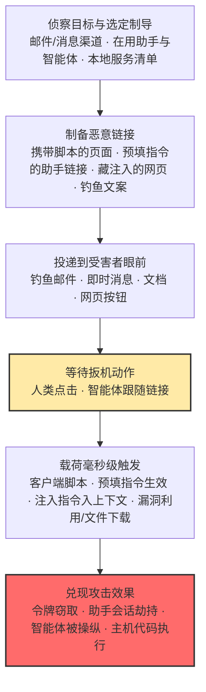

# 恶意链接 (AML.T0011.003)

> 属于 [用户执行 (AML.T0011)](../AML.T0011-User-Execution.md)

## 一句话通俗理解

> 传统恶意链接赌的是"你会手滑点一下"；AI 时代的恶意链接赌得更多：你点下的那一瞬间，接收方可能是毫秒级执行的浏览器脚本、被预填了攻击者指令的 AI 助手输入框、或者正替你"跟随链接"去读网页的智能体——一次人类速度的点击，换一轮机器速度的执行，攻击者全程没碰过你的系统。

## 难度等级

⭐⭐ **Demonstrated（已演示）**

官方成熟度评定为 Demonstrated——针对 AI 系统的完整攻击链已在安全研究中演示：研究人员针对个人 AI 智能体 OpenClaw 演示了一次点击远程代码执行（AML.CS0050，CVE-2026-25253），受害者点击链接后，页面中的客户端 JavaScript 在毫秒级完成"窃取认证令牌 → 跨站 WebSocket 劫持绕过 localhost 限制 → 修改智能体配置关闭用户确认 → 逃逸容器 → 宿主机执行 shell 命令"的全链条。实施门槛不高：构造一个链接不需要任何 0day，钓鱼文案可由 LLM 批量生成且高度个性化。真正的难点在两处：**让受害者在鱼目混珠的链接前点下那一下**（社会工程），以及**让点击后的载荷穿透浏览器隔离与智能体护栏**——后者高度依赖目标侧的配置弱点（如智能体不校验网站 Origin 头）。相比三个兄弟子技术（均为 Realized），本子技术在 AI 场景下的大规模野外滥用记录更少，故评定低一档。

**平台适用性**（官方数据）：Enterprise——攻击发生在传统企业环境（浏览器、邮件、消息应用），但载荷与后续行为专门瞄准 AI 时代的受害者：运行在本机与内网的 AI 智能体、共享笔记本用户、以及被 URL 参数预填指令的 AI 助手使用者。

## 技术描述

### 通俗解释

传统恶意链接是网络安全里最古老的武器：一封邮件、一句"请查收发票"、一个仿真域名，等受害者点下去——或进入假登录页，或触发浏览器漏洞，或下载一个恶意文件。AI 时代给这把老武器换了三根新引信。第一根是**AI 助手链接**：许多 AI 助手支持通过 URL 参数（如 `?q=`）接收预填提示词，攻击者把恶意指令拼进链接——受害者点开的不是网页，而是自己与助手的"第一句对话"，指令在受害者自己的、已认证的助手会话中运行（详见初始访问战术的构造 AI 助手链接技术）。第二根是**替人浏览的智能体**：越来越多的智能体会替用户访问网页、总结内容，攻击者把提示词注入指令藏进网页——人类看是正常文章，智能体"跟随链接"读到的却是命令。第三根是**AI 生成的钓鱼**：LLM 让钓鱼文案的语法、语气、上下文贴合度全面工业化，"一眼假"的垃圾邮件变成"句句懂你"的精准诱饵。

依据官方描述，还有一个 AI 特有的配置弱点：**不校验网站 Origin 头的 AI 智能体会接受来自任意网站的连接**——受害者只需在浏览器里点一个链接，页面脚本就能连上原本不可达的本机/内网智能体，网络边界被一次点击从内部打开。

### 技术原理

**1. 点击之后的载荷形态**

| 载荷形态 | 触发机制 | 攻击效果 |
|----------|----------|----------|
| 客户端脚本执行 | 点击后页面 JavaScript 立即运行（毫秒级） | 窃取本地服务认证令牌、跨站 WebSocket 劫持、修改智能体配置（AML.CS0050） |
| 预填提示词 | AI 助手 URL 参数自动填充并可能自动提交指令 | 借受害者的已认证助手会话执行攻击者定义的指令，渗漏助手可访问的数据 |
| 污染网页内容 | 智能体跟随链接、摄取页面内容 | 页面中隐藏的注入指令进入智能体上下文，劫持其后续行为 |
| 经典后续 | 点击后导向漏洞页面或诱导下载 | 浏览器/应用客户端漏洞利用、恶意文件落地（还需后续执行动作） |

**2. Origin 头校验缺失：AI 智能体的配置弱点（官方描述点名）**

本地或内网智能体的控制接口往往只监听 localhost，貌似"外网摸不到"；但当受害者浏览器访问攻击者页面时，页面中的 JavaScript 可以主动向 localhost 发起连接（如 WebSocket）。若智能体网关不校验请求来源（Origin/Referer），攻击者的脚本就能带着窃取的令牌对智能体下达配置修改、关闭确认、执行命令——这正是"访问原本不可访问的网络"的机理。

**3. 与钓鱼的配对关系**

依据官方描述，本子技术的用户动作**通常作为鱼叉式钓鱼链接的后续行为**出现：钓鱼负责把链接送到受害者眼前，本技术负责在点击后获得执行。攻击者也可能让链接导向其他执行技术——经客户端漏洞利用（浏览器/应用程序）直接执行代码，或引导用户下载需要经恶意文件路径执行的文件。AI 侧的配对则更短链：钓鱼文案由社会工程 LLM 批量生成（见网络钓鱼 AML.T0052），链接本身携带预填指令，投递与执行被压缩进一次点击。

**4. 与兄弟子技术的分界**

四条用户执行路径的区别在"扳机动作"：不安全 AI 制品（.000）等受害者**加载模型**，恶意软件包（.001）等受害者**安装包**，投毒 AI 智能体工具（.002）等智能体**调用工具**，而本子技术的扳机是**点击链接（人类）或跟随链接（智能体）**——不需要任何安装、加载或工具调用，浏览器的一次导航就是全部攻击成本。

### 用途影响

- **一次点击，机器速度兑现**：从点击到脚本执行以毫秒计，从点击到助手执行预填指令以秒计——留给受害者"意识到不对"的时间窗口趋近于零，且纯链接载荷不在磁盘留痕；
- **权限继承**：脚本继承浏览器会话（已认证的 SaaS、本地服务），预填指令继承助手的全部数据访问范围，跟随链接的智能体继承其挂载的全部工具；
- **绕过网络边界**：借助受害者浏览器作跳板，攻击页面可触达 localhost、内网管理界面等"外部本不可达"的服务（Origin 校验缺失场景）；
- **规模化**：LLM 生成的个性化钓鱼可批量投放，链接投递成本接近零、点击率却高于模板化垃圾邮件。

## 攻击流程

### 典型攻击流程



**步骤详解：**

1. **侦察目标与选定制导**
   - 通俗描述：搞清楚"把链接发给谁、伪装成什么他才肯点"。
   - 技术细节：分析目标组织在用的 AI 助手是否接受 URL 预填参数、本机/内网部署了哪些智能体及其控制接口是否校验 Origin 头；掌握受害者信任的消息渠道与业务语境（共享笔记本、HR 通知、行业文档），为钓鱼文案定制素材。

2. **制备恶意链接**
   - 通俗描述：给链接装上"点了就生效"的机关。
   - 技术细节：注册仿真域名，页面内嵌攻击脚本（窃取本地服务令牌、发起跨站 WebSocket 连接）；或把恶意指令编码进 AI 助手 URL 参数；或在网页正文中埋入对人类不可见、对智能体可读的注入指令；钓鱼文案由 LLM 生成，贴合受害者的行业与用语习惯。

3. **投递到受害者眼前**
   - 通俗描述：把链接递过去，等一次手滑。
   - 技术细节：经钓鱼邮件、即时通讯、社区私信、协作文档投递（承接网络钓鱼战术）；链接常伪装成"查看附件""用 AI 总结此页""共享笔记本"等日常工作流按钮，也可被动投放（网页、评论）等待智能体来读。

4. **等待扳机动作（本技术的核心特征）**
   - 通俗描述：攻击者收手，受害者自己完成"最后一下"。
   - 技术细节：人类点击——浏览器导航即触发脚本或预填；智能体跟随链接——浏览/总结类智能体把页面内容摄入上下文，注入指令随之生效。两条路径都是零告警的正常行为，攻击者全程不触碰目标系统。

5. **载荷触发并兑现效果**
   - 通俗描述：点击落地，机器速度执行。
   - 技术细节：页面脚本经 WebSocket 窃取本机智能体令牌、修改配置关闭人工确认（AML.CS0050 的完整链）；预填指令驱使助手渗漏其可访问的数据；注入指令劫持智能体调用工具外传信息；或经客户端漏洞利用直接获得主机代码执行。

**与后续战术的衔接：**

- **凭证访问**：窃取的会话令牌、浏览器凭证直接进入凭证访问的武器库
- **命令与控制 / 持久化**：被劫持的智能体与逃逸后的 shell 可建立持续回连，修改智能体配置（关闭确认、新增工具）形成长期控制面
- **数据渗漏**：助手与智能体挂载的邮件、文档、网络工具全部成为外传通道

> 关键差异：与兄弟子技术的分界线是**扳机动作**——.000/.001 等待安装加载、.002 等待工具调用，本子技术只需要**一次点击或一次跟随**，攻击成本最低、速度最快；与纯钓鱼技术的分工是"投递"与"执行"——钓鱼负责把链接送进收件箱，本技术负责让点击变成入侵。

## 真实案例

> 以下 4 个案例源自 MITRE ATLAS 案例库：案例1 直接命中本子技术 AML.T0011.003；案例2-4 官方映射至父技术 AML.T0011，展示链接向量在 AI 工作流中的真实形态。

### 案例1：OpenClaw 一次点击 RCE——恶意链接直取智能体控制权（2026年2月，AML.CS0050）

- **时间**: 2026年2月
- **攻击者**: DepthFirst（安全研究员）
- **手法**: 研究员演示了针对个人 AI 智能体 OpenClaw 的一次点击远程代码执行（CVE-2026-25253）：受害者点击恶意链接后，页面中的客户端 JavaScript 毫秒级完成攻击——经 WebSocket 窃取 OpenClaw 控制界面的认证令牌，跨站 WebSocket 劫持绕过 localhost 限制，随后用窃取的令牌修改智能体配置、关闭用户确认、逃逸容器，最终在宿主机直接执行 shell 命令。
- **影响**: 一次点击 = 从浏览器到宿主机 shell 的完整链条；官方描述的"不校验 Origin 头的智能体接受任意网站连接"在此被完整实证。
- **参考链接**: [DepthFirst 披露](https://depthfirst.com/post/1-click-rce-to-steal-your-moltbot-data-and-keys)、[CVE-2026-25253](https://nvd.nist.gov/vuln/detail/CVE-2026-25253)

### 案例2：Google Colab 共享笔记本——点开链接即执行暗藏代码（2022年7月，AML.CS0018）

- **时间**: 2022年7月
- **攻击者**: Tony Piazza（安全研究）
- **手法**: Google Colab 允许用户经链接共享 Jupyter 笔记本，而笔记本天然承载可执行 Python 代码与命令行功能。受害者打开分享链接后，可能在不知不觉间执行被混淆或隐藏在下载脚本中的恶意代码；若按提示授权笔记本访问 Google Drive，还可能造成数据渗漏或向受害者网盘开放服务端。
- **影响**: AI 研究者日常"点开别人发来的笔记本链接"的工作流本身成为执行通道——"运行全部单元格"一次点击即完成攻击者的执行。
- **参考链接**: [Be careful who you colab with](https://medium.com/mlearning-ai/careful-who-you-colab-with-fa8001f933e7)

### 案例3：LAMEHUG——钓鱼链接投递 AI 驱动的恶意软件（2025年6月，AML.CS0044）

- **时间**: 2025年6月
- **攻击者**: APT28（俄罗斯国家支持的威胁行为者，亦称 Forest Blizzard / UAC-0001）
- **手法**: 攻击者利用被入侵的政府邮箱账户发起钓鱼攻击，投递伪装成 Appendix.pdf.zip 的恶意 ZIP 压缩包；其中的 LAMEHUG 恶意软件（PyInstaller 打包的 Python 可执行文件）被执行后调用 LLM 端点，从自然语言提示词动态生成恶意命令——动态生成的命令更难被检测，配置为收集本地文件并外传。
- **影响**: 国家级攻击者把"钓鱼投递 + AI 动态载荷"组合进实战工具箱；链接/附件投递的执行链与 AI 生成的攻击命令合流。
- **参考链接**: [BleepingComputer 报道](https://www.bleepingcomputer.com/news/security/lamehug-malware-uses-ai-llm-to-craft-windows-data-theft-commands-in-real-time/)、[CERT-UA 公告](https://cert.gov.ua/article/6284730)

### 案例4：联想 AI 聊天机器人"Lena"——被投毒的聊天记录反噬客服（2025年8月，AML.CS0060）

- **时间**: 2025年8月
- **攻击者**: Cybernews 研究团队（安全研究）
- **手法**: 研究人员向 Lenovo AI 聊天机器人 Lena 发送看似无害的产品咨询，其中夹带让助手以危险 HTML 载荷回复的指令；该回复被保存进聊天历史，形成存储型 XSS。当用户请求转接人工客服、客服按工作流打开聊天记录时，投毒内容在客服浏览器中渲染，窃取其会话 Cookie 外传至攻击者控制的服务器。
- **影响**: "打开聊天记录"这一日常点击动作成为最终触发器——AI 生成的投毒内容经浏览器渲染完成凭据窃取，客服账户与支持平台随之暴露。
- **参考链接**: [Cybernews 分析](https://cybernews.com/security/lenovo-chatbot-lena-plagued-by-critical-vulnerabilities/)

**四个案例的共同启示：**

1. **扳机都是一次点击**——案例1 的恶意链接、案例2 的笔记本链接、案例3 的钓鱼附件、案例4 的聊天记录，受害者完成的都只是"打开"这个日常动作
2. **浏览器是新的跳板**——案例1、4 的载荷都在受害者浏览器中运行，从"内部"触达本机服务与凭据，网络边界形同虚设
3. **AI 放大了两端**——投递端（LLM 生成钓鱼与动态命令）与接收端（智能体、AI 助手、共享笔记本）都被攻击者纳入链接武器化的射程

## 红队视角

> ⚠️ **免责声明**：以下内容仅用于合法授权的安全测试与教育目的。未经授权向他人发送任何测试链接、或对第三方系统实施攻击均属违法。

### 实战技巧

1. **授权钓鱼演练的"点击面"测量**
   在书面授权范围内投放模拟钓鱼（仅统计点击，不投递任何载荷）：谁会点、多久点、移动端与桌面端点击率差异、点击后浏览器隔离是否兜得住——把结果整理为组织的"点击面基线"，作为后续防御投入的依据。

2. **智能体配置审计（本子技术的核心靶点）**
   盘点组织内部与员工端点上的 AI 智能体：控制接口是否校验 Origin 头、是否监听 localhost 而无来源校验、高危操作是否强制人工确认、认证令牌的有效范围。对照案例1 在自有测试环境逐项复现"恶意页面能否连上它"。

3. **AI 助手链接暴露面盘点**
   检查组织在用的 AI 助手是否接受 URL 参数预填提示词、是否自动提交：用自有账号构造一个无害预填链接（如让助手输出一句提醒语），点击走完流程，评估"攻击者若构造恶意指令，护栏在哪一环生效"。

4. **共享笔记本链接审计**
   针对数据科学团队的 Colab/笔记本工作流：抽查外部分享的笔记本有无混淆代码、下载脚本、异常授权请求；验证组织的使用规范是否覆盖"点开陌生链接先读代码再运行"。

### 常用工具

| 工具名称 | 用途 | 平台 |
|----------|------|------|
| GoPhish | 授权钓鱼链接演练（仅限自有域与授权目标） | 跨平台 |
| OWASP ZAP / Burp Suite | 手工校验自有智能体接口的 Origin 头校验逻辑 | 跨平台 |
| Sysmon / 进程监控 | 验证"浏览器 → 解释器"进程链检测是否覆盖点击链 | Windows |
| 浏览器隔离方案测试 | 验证链接重写与远程隔离对恶意页面的拦截能力 | 企业方案 |

### 注意事项

- **绝不向第三方发送测试链接**——所有恶意链接复现只在自有测试环境与自有账号间进行
- 钓鱼演练必须事先书面界定人群、频次与免责，并同步蓝队监控预期
- 交付物是"点击面与配置面评估"：哪些人会点、哪些接口不校验来源、哪条链路无护栏——而非"钓鱼能否成功"

## 蓝队视角

### 检测要点

1. **链接投递面监控**
   - 日志来源：邮件网关日志、URL 重写/沙箱 detonation 日志、即时通讯网关
   - 异常特征：新注册域名的链接、仿真知名域名（编辑距离极近）、URL 参数中携带指令式文本（预填提示词特征）、高个性化邮件批量出现

2. **点击后的主机进程链监控**
   - 日志来源：EDR/Sysmon 进程遥测、浏览器日志
   - 异常特征：浏览器进程直接派生 PowerShell/cmd/python（点击链典型形态）、浏览器对 localhost/内网地址发起新的 WebSocket 连接、点击后短时间内凭据文件被读取

3. **智能体与应用层监控**
   - 日志来源：智能体平台审计日志、AI 助手会话日志、WebSocket 网关日志
   - 异常特征：智能体配置在浏览器会话中被修改（关闭确认、新增工具）、来自无 Origin/异常 Origin 的连接、助手会话首次输入携带超长或指令密集的 URL 来源参数

### 监控建议

- 部署**链接重写与远程浏览器隔离**：点击先在隔离环境 detonate，让恶意页面在到达员工浏览器前先"试毒"
- 智能体网关**强制 Origin 白名单**，智能体**高危操作强制人工确认**（配置修改、文件删除、云资源变更），封死"任意网站连本机智能体"与其兑现空间
- 邮件侧对 URL 参数做指令模式初筛（`?q=`/`?prompt=` 携带"忽略/执行/发送/读取"类动词），标记预填提示词风险

## 检测建议

### 网络层检测

**检测方法：** 监控链接落地页行为与本机回连模式。

- 邮件/消息中的链接指向新注册域名或已知仿真域名模式
- 受害者浏览器点击后，对 localhost/内网地址发起异常 WebSocket 或 HTTP 连接（跨站连接劫持特征），随后出现对低信誉外部 IP 的出站连接

### 主机层检测

**检测方法：** 盯住"点击 → 执行"的进程链。

- 浏览器、邮件客户端、即时消息进程派生 cmd、powershell、python 等解释器（无需用户可见窗口）
- 浏览器进程对本地智能体/管理端口的网络连接与配置修改调用

### 应用层检测（AI 遥测）

**检测方法：** 利用智能体平台与助手会话的审计能力。

- 智能体网关记录连接来源（Origin/Referer），非白名单来源即告警；智能体动作序列分析：会话开始即出现配置修改、关闭确认、工具新增的组合是典型的链接劫持后行为
- AI 助手会话首条输入与来源 URL 参数比对的差异检测（预填指令风险）

**程序化检测思路（无需 EDR 侧改造）：**

在智能体网关层加一道 Origin 白名单中间件（非信任来源的连接直接拒绝并告警），在助手入口加一道 URL 参数指令检测（预填内容过指令式语句初筛再进入会话）——两道闸门分别覆盖"脚本劫持智能体"与"预填指令劫持助手"两条最高频路径，改造成本极低。

### Sigma 规则思路示例

```yaml
title: 浏览器进程派生命令解释器（用户执行·恶意链接）
status: experimental
description: 检测浏览器/邮件客户端进程直接派生命令解释器的进程链，
    匹配"点击恶意链接后客户端载荷执行"的用户执行链（AML.T0011.003）
logsource:
    category: process_creation
    product: windows
detection:
    selection_browser:
        ParentImage|endswith:
            - '\chrome.exe'
            - '\msedge.exe'
            - '\firefox.exe'
            - '\outlook.exe'
    selection_child:
        Image|endswith:
            - '\cmd.exe'
            - '\powershell.exe'
            - '\python.exe'
    filter_legit:
        CommandLine|contains:
            - '\Program Files\'
    condition: selection_browser and selection_child and not filter_legit
    timeframe: 5m
level: high
tags:
    - attack.t1204
    - attack.execution
    - atlas.aml_t0011_003
```

**规则说明**：本规则抓"点击链"最典型的主机形态——正常浏览不应由浏览器直接拉起解释器；命中后建议关联该主机的浏览器访问日志定位落地页。预填指令与智能体劫持路径发生在应用层，需配合助手会话审计与网关 Origin 校验，主机规则无法覆盖。

## 缓解措施

> 依据 MITRE ATLAS 官方缓解措施（AML.M00xx）整理。说明：官方数据未对本子技术单独映射缓解措施，以下四条均继承自父技术 AML.T0011 的官方映射（其覆盖范围明确包含 AML.T0011 全体），按对本子技术的落地相关性分级。恶意链接的防御是"人"与"配置"两条线：培训守住点击前的判断，网关校验与补丁守住点击后的兑现。

### 优先级1：关键措施

**AML.M0018 用户培训（User Training）**

培训最终用户识别钓鱼尝试与深度伪造。对本子技术的特殊价值：链接攻击没有可提前扫描的"制品"，**点击前的判断是第一道也是最后一道人工闸门**——核对发件人、悬停预览真实 URL、对"用 AI 打开/总结"类按钮保持警觉，应成为全员肌肉记忆。

**AML.M0016 漏洞扫描（Vulnerability Scanning）**

对工作站浏览器、办公软件与智能体运行环境持续扫描已知漏洞并及时修补。落地要点：恶意链接的经典后续之一是客户端漏洞利用——补丁跟得紧，"点击即执行"就退化为"点击只看到错误页面"。

### 优先级2：重要措施

**AML.M0011 限制库加载（Restrict Library Loading）**

配置操作系统与软件的库加载机制，阻止加载不可信代码。落地要点：链接诱导下载的文件（脚本、伪装文档）即便落地，也应在"能否被加载执行"这一环被卡住——配合软件限制策略与应用白名单，压缩"下载即执行"的空间。

**AML.M0014 验证 AI 制品（Verify AI Artifacts）**

对经链接下载的模型、数据集等 AI 制品校验加密校验和，确认未被篡改。落地要点：针对"笔记本链接/教程链接引导下载模型文件"的场景，制品入环境前先过哈希与来源核验。

### MITRE ATLAS 缓解措施映射

| 缓解措施ID | 缓解措施名称 | 优先级 | 类别 | 生命周期阶段 |
|------------|-------------|:------:|------|-------------|
| AML.M0018 | 用户培训 | 关键 | Policy | 全生命周期 |
| AML.M0016 | 漏洞扫描 | 关键 | Technical - Cyber | 数据准备 · AI 模型工程 |
| AML.M0011 | 限制库加载 | 重要 | Technical - Cyber | 部署 |
| AML.M0014 | 验证 AI 制品 | 重要 | Technical - Cyber | 业务与数据理解 · 数据准备 · AI 模型工程 |

> 优先级为本库基于缓解措施特性的落地建议：培训与补丁守住点击前后两个人工可控环节，加载限制与制品校验抬高"下载后落地"的门槛。此外，本库特别提示（非官方映射）：**智能体网关强制 Origin 校验**是针对本子技术 AI 特有攻击面最直接的技术措施（见检测建议）。

## 关联 ATT&CK 技术

**本子技术官方映射到 [T1204 用户执行](../../../enterprise/04-Execution/T1204-User-Execution.md)，其链接子技术 [T1204.001 恶意链接](../../../enterprise/04-Execution/T1204/T1204.001-Malicious-Link.md) 是最直接的对照篇目。**

**传统恶意链接 vs AI 时代恶意链接：**

| 维度 | ATT&CK T1204.001 恶意链接 | ATLAS AML.T0011.003 恶意链接 |
|------|--------------------------|------------------------------|
| 点击后的接收方 | 网页、浏览器 | + **AI 助手（预填指令）、替人浏览的智能体（跟随链接）** |
| 典型载荷 | 假登录页、客户端漏洞利用、恶意文件下载 | 同左，且 + 毫秒级客户端脚本劫持本机智能体（案例1） |
| 攻击效果 | 凭据窃取、主机执行 | 同左，且 + 助手会话劫持、智能体行为操纵 |
| 投递侧 | 人工撰写钓鱼 | + **LLM 批量生成高个性化钓鱼文案** |
| 新增配置弱点 | — | **不校验 Origin 头的智能体接受任意网站连接**（官方描述） |

从配对关系看，本子技术通常作为 [T1566.002 鱼叉式钓鱼链接](../../../enterprise/03-Initial-Access/T1566/T1566.002-Spearphishing-Link.md) 投递后的后续行为出现；点击也可能衔接 [T1203 客户端漏洞利用执行](../../../enterprise/04-Execution/T1203-Exploitation-for-Client-Execution.md) 或导向 [T1204.002 恶意文件](../../../enterprise/04-Execution/T1204/T1204.002-Malicious-File.md)——与官方描述的衔接关系一一对应。

一句话总结：T1204.001 问的是"用户点了什么链接"，AML.T0011.003 把问题扩展为"**点开链接的除了人，还有谁；链接另一头接住的，除了网页还有什么**"——攻击面从鼠标点击延伸到了 AI 助手的输入框与智能体的上下文。

## 动手实验

> ⚠️ **重要提示**：所有实验在隔离环境中进行，仅使用无害标记载荷（如输出提示语、创建标记文件）。**严禁向任何第三方发送测试链接**，钓鱼面测量只做授权统计。

### 实验环境准备

| 环境组件 | 用途 | 获取方式 |
|----------|------|----------|
| 隔离虚拟机（无敏感数据、可快照） | 链接触发与观察 | 本地虚拟化平台 |
| 本地测试用 AI 智能体/助手（实验1、2） | 复现 Origin 与预填场景 | 开源智能体框架 |
| Python 3.10+（简易 Web 服务） | 构造测试页面 | 官方安装包 |
| Sysmon 或同等进程监控（实验3） | 观察点击进程链 | 开源工具 |

### 实验1（初级）：体验"预填提示词"

**实验目标：** 直观理解 AI 助手链接的威力（对应技术描述中的预填载荷）。

**实验步骤：**
1. 用自己拥有的 AI 助手账号（或本地部署的助手），确认其是否支持 URL 参数预填输入
2. 构造一个无害预填链接：让助手执行一句提醒语（如"请回复：这是预填演示"），自己点击走完流程
3. 观察指令是否自动填充、是否自动提交；思考：若指令是"把最近的邮件总结后发到 X"，护栏在哪一环生效？

**预期结果：** 建立"点开链接 = 向助手说出攻击者的话"的直觉。

### 实验2（中级）：复现"Origin 校验缺失"（对应案例1）

**实验目标：** 理解本子技术官方描述点名的智能体配置弱点。

**实验步骤：**
1. 在隔离虚拟机部署一个带 WebSocket 控制接口的本地测试服务（默认不校验 Origin）
2. 写一个最简 HTML 页面：用 JavaScript 连接 `ws://localhost:端口` 并发送一条无害指令（输出标记日志）；在同一虚拟机用浏览器打开该页面，观察本地服务是否接受了来自该页面的连接
3. 给服务加上 Origin 白名单校验，重放步骤2，确认连接被拒绝
4. 思考：组织的智能体网关，这一行校验存在吗？

**预期结果：** 亲手验证"浏览器跳板打穿 localhost 边界"的机理与修法。

### 实验3（高级）：点击链进程检测自查

**实验目标：** 验证组织对"点击 → 执行"进程链的检测覆盖。

**实验步骤：**
1. 在隔离虚拟机配置 Sysmon 进程监控，启用本文 Sigma 规则思路的等价检测
2. 模拟点击链：浏览器打开本地测试页，页面脚本经解释器执行一条无害命令（创建标记文件）；检查告警是否触发、触发延迟多少，并从邮件客户端、即时消息客户端重复
3. 对照蓝队视角三个检测要点，逐项标注组织的覆盖状态，输出"点击链检测覆盖度"报告

**预期结果：** 拿到本组织的点击链检测基线，明确哪条路径无告警、需要补哪层。

## 术语解释

| 术语 | 英文原名 | 通俗解释 |
|------|----------|----------|
| 恶意链接 | Malicious Link | 被设计为点击后触发恶意效果的 URL——本子技术的攻击载体 |
| 点击 | Click | 人类完成执行扳机的动作——一次导航即可能等于一次执行 |
| 预填提示词 | Prefilled Prompt | 经 URL 参数自动填入 AI 助手输入框的指令，"打开链接"即"替攻击者发言" |
| AI 助手链接 | AI Assistant Link | 携带预填指令参数的助手 URL，让链接的另一头直接接上助手的会话 |
| 跟随链接 | Following Links | 智能体替用户访问、摄取链接目标内容的行为——链接攻击面从人扩展到机器 |
| Origin 头校验 | Origin Header Validation | 服务端核对请求来源网站的机制；缺失时任意网页都能连上本机/内网服务 |
| 跨站 WebSocket 劫持 | Cross-Site WebSocket Hijacking | 恶意页面冒充用户与本地服务建立 WebSocket 连接的攻击手法 |
| 一次点击 RCE | 1-Click RCE | 仅需受害者点击一次链接即可达成的远程代码执行 |
| 鱼叉式钓鱼链接 | Spearphishing Link | 定向投递恶意链接的钓鱼手法——本子技术最常见的投递前置 |
| 浏览器隔离 | Browser Isolation | 让链接在隔离/远程环境中先打开的防御方案，点击的"试毒间" |
| 存储型 XSS | Stored XSS | 恶意脚本被持久保存、待他人查看时触发的跨站脚本攻击（案例4 载荷形态） |

## 参考资料

### 📚 官方文档

- [MITRE ATLAS - Malicious Link (AML.T0011.003)](https://atlas.mitre.org/techniques/AML.T0011/003/) - 官方技术页面
- [MITRE ATT&CK - User Execution (T1204)](https://attack.mitre.org/techniques/T1204/) - 官方映射的 ATT&CK 技术
- [MITRE ATLAS 矩阵](https://atlas.mitre.org/matrices/ATLAS/)
- [MITRE ATLAS Data (GitHub)](https://github.com/mitre-atlas/atlas-data)

### 📰 案例报告（真实攻击与安全研究）

- [DepthFirst: OpenClaw 一次点击 RCE](https://depthfirst.com/post/1-click-rce-to-steal-your-moltbot-data-and-keys) - 恶意链接劫持智能体全链路（AML.CS0050）
- [CVE-2026-25253](https://nvd.nist.gov/vuln/detail/CVE-2026-25253) - OpenClaw 一次点击 RCE 漏洞详情
- [Be careful who you colab with](https://medium.com/mlearning-ai/careful-who-you-colab-with-fa8001f933e7) - Colab 共享笔记本链接的任意代码执行（AML.CS0018）
- [BleepingComputer: LAMEHUG](https://www.bleepingcomputer.com/news/security/lamehug-malware-uses-ai-llm-to-craft-windows-data-theft-commands-in-real-time/) / [CERT-UA#16039](https://cert.gov.ua/article/6284730) - 钓鱼投递的 AI 动态命令恶意软件（AML.CS0044）
- [Cybernews: Lenovo 聊天机器人漏洞](https://cybernews.com/security/lenovo-chatbot-lena-plagued-by-critical-vulnerabilities/) - 投毒聊天记录经浏览器渲染窃取凭据（AML.CS0060）

### 🔧 工具与资源

- [GoPhish](https://getgophish.com/) - 开源钓鱼模拟平台（仅限授权演练）
- [OWASP ZAP](https://www.zaproxy.org/) - Web 应用与 Origin 校验测试
- [OWASP Top 10 for LLM Applications](https://owasp.org/www-project-top-10-for-large-language-model-applications/) - LLM 应用十大安全风险

### 🔗 关联阅读

- [用户执行 (AML.T0011)](../AML.T0011-User-Execution.md) - 本技术的父技术，四条子技术路径全景
- [构造 AI 助手链接 (AML.T0131)](../../04-Initial-Access/AML.T0131-Crafted-AI-Assistant-Links.md) - 预填提示词载荷的初始访问侧完整篇目
- [T1204.001 恶意链接](../../../enterprise/04-Execution/T1204/T1204.001-Malicious-Link.md) - 本技术最直接的 ATT&CK 对应
- [T1566.002 鱼叉式钓鱼链接](../../../enterprise/03-Initial-Access/T1566/T1566.002-Spearphishing-Link.md) - 本技术最常见的投递前置
- [执行战术 (AML.TA0005)](../README.md) - 本技术所属战术的概览页

---

> **版本**: ATLAS 2026.09 | **更新**: 2026-10-22 | **模板**: ATLAS 技术文档 v1.0
