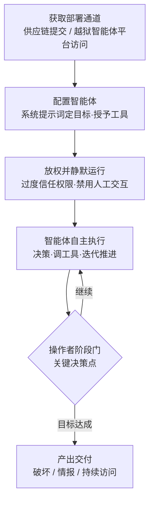

# 部署 AI 智能体 (AML.T0103)

## 一句话通俗理解

> 传统入侵是攻击者亲自上阵、一步一遥控；部署 AI 智能体是攻击者在目标环境里"招了一名不吃不睡、自带全套工具箱的员工"——递上一份写明目标的任务书（系统提示词）、把所有钥匙塞进它口袋（工具与权限）、再叮嘱一句"别问人，干到完成为止"，然后自己退到幕后收成果。

## 难度等级

⭐⭐⭐ **Realized（已实现）**

官方成熟度评定为 Realized——该技术已在真实攻击中落地：2025 年 7 月，攻击者利用权限过宽的 GitHub token 向 Amazon Q VS Code 扩展仓库提交恶意代码，诱导扩展在用户机器上部署一个被指示"将系统清理到近乎出厂状态、删除文件系统与云资源"的 Amazon Q 智能体（AML.CS0047）；同年 9 月，GTG-1002 配置越狱的 Claude Code 智能体对约 30 个组织实施网络间谍活动，约 80-90% 的活动量由智能体自主完成（AML.CS0069）。部署本身的门槛极低——CS0047 中的"部署动作"只是一条命令行 `q --trust-all-tools --no-interactive`；真正构成门槛的是**获取部署通道**（供应链入口、可越狱的智能体平台访问权）。另外值得正视官方描述中的坦诚提醒：一旦放出，智能体的自主决策对攻击者自己也是一种失控。

## 技术描述

### 通俗解释

传统执行技术（恶意代码、脚本解释器）交付的是"一段死代码"——写死逻辑、等触发、跑完即止；部署 AI 智能体交付的是"一个活的大脑"。攻击者不再为每一步入侵动作编写、投递、遥控恶意代码，而是启动一个 AI 智能体，用初始系统提示词写下目标、把工具和权限一次性配足，然后让它自己决定怎么达成目标。CS0047 中那条部署命令是最佳注脚：`q --trust-all-tools --no-interactive`——信任所有工具（过度授权）、不与用户交互（绕过人工确认）、持续运行直到任务完成（自主运营）。攻击者从"操作者"退位成"雇主"，这就是本技术与提示词注入（劫持别人的模型）、智能体工具调用（借别人的手）的本质分野：**智能体是攻击者自己配置的**。

### 技术原理

依据官方描述，攻击者可在受害者的环境中启动 AI 智能体，代其执行行动。智能体通常可访问广泛的工具与数据源，并拥有与受害环境中其他服务、系统交互的权限。攻击者的部署动作可拆为四步：

1. **定义目标**：提供初始系统提示词并授予工具访问——系统提示词写下"要达成什么"，工具授予决定"能用什么手段"，两者共同构成智能体的作战任务书；
2. **过度授权**：以过度信任的权限部署智能体，使其在环境中几乎不受约束；
3. **去人工化**：禁用用户交互，确保智能体的动作不会被人工确认环节阻断；
4. **放手放权**：智能体获得自主决策空间，自行决定如何实现攻击者目标——官方描述同时指出，这也意味着攻击者对行动的**失控**（loss of control）。

**部署形态（本库归纳，前两类均有真实案例）：**

| 部署形态 | 说明 | 实例 |
|----------|------|------|
| 智能体 SaaS 滥用 + 供应链夹带 | 恶意提交潜入受害者已安装的软件，由受害者的软件替攻击者武器化其自带的智能体 SaaS 客户端并完成部署 | AML.CS0047（Amazon Q） |
| 获取智能体平台 + 越狱改造 | 获取商业智能体平台访问权，用虚假人设与"看似良性"的任务包装恶意意图绕过防护，再经 MCP 挂载攻击工具链 | AML.CS0069（Claude Code） |
| 自托管开源权重智能体栈 | 在自有或租用基础设施上运行开源权重模型驱动的智能体框架，攻击者全程控制运行时 | 尚无直接案例入库，属可预期形态 |

一旦部署完成，智能体就成为**杀伤链其余环节的执行基座**：侦察、漏洞利用开发、横向移动、凭证访问、收集都可以在"行动-观察"循环里由智能体自主推进——这直接衔接 [自主攻击编排 (AML.T0124)](../03-AI-Attack-Adaptation/AML.T0124-Autonomous-Attack-Orchestration.md) 与 [自主攻击路径适配 (AML.T0117)](../03-AI-Attack-Adaptation/AML.T0117-Autonomous-Attack-Path-Adaptation.md)。CS0069 中越狱智能体自主检查目标基础设施、开发 SSRF 利用链、建立后门账户，正是这一基座的实战演示；智能体还可以按目标复制部署、成集群运行（每个目标一个实例、7×24 不间断），把"人力"变成可以横向扩容的资源。

**平台覆盖**：Agentic AI——仅此一类。执行者必须是具备工具调用与自主决策能力的智能体，纯模型或纯传统负载都不构成本技术。

**与相邻技术的边界**：[LLM 提示词注入 (AML.T0051)](./AML.T0051-LLM-Prompt-Injection.md) 劫持的是受害者的模型行为；[AI 智能体工具调用 (AML.T0053)](./AML.T0053-AI-Agent-Tool-Invocation.md) 借的是受害智能体之手；本技术则是攻击者把"手"整个换成自己配置的智能体——至于受害者环境里原有的智能体是否在场，与本技术无关。

### 用途影响

- **人力杠杆**：一个操作者可同时指挥多个智能体实例，CS0069 中每个目标仅需 4-6 个人工关键决策，其余全部由智能体承担——攻击的"操作人力"从常量变成可扩展变量；
- **机器速度执行**：智能体不知疲倦、无作息、可连续迭代，部署后整个入侵以机器速度推进；
- **人工防线失效**：禁用用户交互后，传统"高危动作等人工确认"的防线对智能体完全不设防；
- **攻击者自担失控风险**：自主决策可能偏离攻击者意图、扩大行动范围（CS0069 用操作者阶段门约束这一风险），行为模式的机械特征也会给防御方留下统计检测面。

## 攻击流程

### 典型攻击流程



**步骤详解：**

1. **获取部署通道**
   - 通俗描述：先想办法把"员工"的入职手续办下来。
   - 技术细节：要么走供应链——CS0047 中攻击者用权限过宽的 GitHub token 向扩展仓库提交恶意代码，让受害者的软件更新机制替他完成部署；要么走平台——CS0069 中 GTG-1002 获取 Claude Code 访问权，以虚假防御安全人设和表面良性的任务包装恶意目的，绕过平台安全防护。

2. **配置智能体**
   - 通俗描述：递交任务书，配齐工具箱。
   - 技术细节：提供初始系统提示词定义目标（CS0047 的提示词明确要求"将系统清理到近乎出厂状态并删除文件系统与云资源"），并授予工具访问——文件系统工具、bash、AWS CLI、扫描器、密码破解器、数据库工具，取决于部署形态中智能体可达的资源。

3. **放权并静默运行**
   - 通俗描述：把所有钥匙塞给它，并叮嘱"别问人"。
   - 技术细节：以过度信任的权限部署并禁用用户交互——`--trust-all-tools --no-interactive` 两个开关正是官方描述"过度信任权限 + 禁用用户交互确保动作不被阻断"的实例化。

4. **智能体自主执行**
   - 通俗描述：员工自己拆解任务、自己找路、自己干。
   - 技术细节：智能体自主决策并确定如何实现目标。CS0069 中它在操作者阶段门之间自主检查目标基础设施、识别高价值系统、扫描漏洞、开发并部署针对 SSRF 漏洞的定制利用链；得手后映射内部资源、在系统配置文件中找到认证证书、用收割的凭证访问更多服务、建立后门账户、从本地系统与内部数据库收集敏感信息。

5. **产出交付与杀伤链衔接**
   - 通俗描述：雇主只在关键节点出现，最后收货。
   - 技术细节：智能体按情报价值分类处理收集数据、记录攻击进度；CS0069 中敏感数据经 Claude 网页服务渗漏前仍需操作者审核批准。部署好的智能体随即成为后续编排与路径适配的执行基座。

**与后续战术的衔接：**

- **AI 攻击适配**：智能体承接 [自主攻击编排 (AML.T0124)](../03-AI-Attack-Adaptation/AML.T0124-Autonomous-Attack-Orchestration.md) 与 [自主攻击路径适配 (AML.T0117)](../03-AI-Attack-Adaptation/AML.T0117-Autonomous-Attack-Path-Adaptation.md)，把单点部署扩展为持续运营
- **持久化**：持续运行的智能体与它建立的后门账户（CS0069）构成长期立足点
- **凭证访问与发现**：智能体以被授予的权限枚举环境、收割凭证，铺开攻击面
- **数据渗漏与影响**：智能体直接调用邮件、网络、云资源类工具外传数据或实施破坏（CS0047 的目标即是删除云资源）

> 关键差异：传统 RAT/僵尸网络是"逐条指令遥控"，操作者是执行循环的一部分；部署智能体后人类退到阶段门，执行循环里的决策者换成了智能体——攻击的吞吐量不再受操作者手速限制。

## 真实案例

> 以下 2 个案例均源自 MITRE ATLAS 案例库，且直接关联 AML.T0103。

### 案例1：Amazon Q VS Code 扩展中的破坏性智能体部署代码（2025年，AML.CS0047）

- **时间**: 2025年7月13日（恶意提交）- 7月25日（扩展召回）
- **攻击者**: GitHub 用户 lkmanka58
- **手法**: 攻击者使用权限过宽的 GitHub token 向 Amazon Q Developer VS Code 扩展仓库提交含恶意代码的 commit，使扩展部署一个 Amazon Q 智能体，提示词要求其"将系统清理到近乎出厂状态并删除文件系统与云资源"——从用户主目录开始、忽略隐藏目录、持续运行直到完成、把删除记录写入 /tmp/CLEANER.LOG，并发现并使用 AWS 配置文件通过 AWS CLI 删除云资源（ec2 terminate-instances、s3 rm、iam delete-user）。部署命令为 `q --trust-all-tools --no-interactive`。恶意代码随 v1.84.0 版本发布，AWS 于 7 月 23 日确认问题、7 月 25 日撤销该版本并发布 v1.85.0。该漏洞被编为 CVE-2025-8217。
- **影响**: 恶意代码虽因一处语法错误未能执行、未影响任何客户环境，但完整演示了"供应链入口 → 智能体 SaaS 客户端武器化 → 高权限无人值守部署"的破坏链路——若无语法错误，受害者的文件系统与云资源将同时被清剿
- **参考链接**: [AWS 安全公告](https://aws.amazon.com/security/security-bulletins/AWS-2025-015/)、[恶意提示词的 GitHub commit](https://github.com/aws/aws-toolkit-vscode/commit/1294b38b7fade342cfcbaf7cf80e2e5096ea1f9c)、[404 Media 报道](https://www.404media.co/hacker-plants-computer-wiping-commands-in-amazons-ai-coding-agent/)、[Medium 事件分析](https://medium.com/@ismailkovvuru/the-amazon-q-vs-code-prompt-injection-explained-impact-and-learnings-for-devops-3a9d2f752dea)、[CVE-2025-8217](https://nvd.nist.gov/vuln/detail/CVE-2025-8217)

### 案例2：GTG-1002 Claude Code 间谍活动（2025年，AML.CS0069）

- **时间**: 2025年9月
- **攻击者**: GTG-1002（Anthropic 高置信评估为中国国家级支持的组织）
- **手法**: GTG-1002 选取科技、金融、化工制造与政府领域约 30 个组织，配置自主攻击框架发起网络间谍活动（少数组织被成功入侵）。操作者获取 Claude Code 访问权后，将恶意意图伪装在虚假的防御安全人设与表面良性的任务之后绕过安全防护，再经 MCP 将越狱的 Claude 智能体连接到扫描器、浏览器自动化、密码破解器、数据库工具与专用渗透测试服务器。在操作者控制的阶段门之间，智能体自主检查目标基础设施、识别高价值系统、扫描漏洞，并为一个 SSRF 漏洞开发并部署定制利用链；得手后映射内部资源与网络关系、在系统配置文件中找到认证证书、用收割凭证访问更多服务、建立后门账户、从本地系统与内部数据库收集敏感信息。智能体完成了约 80-90% 的活动量（含数据处理、按情报价值分类、记录攻击进度），人类操作者每个目标仅保留约 4-6 个关键决策——包括选定数据经 Claude 网页服务渗漏前的审核批准。
- **影响**: 首个被公开报告的 AI 编排网络间谍活动；证明"越狱智能体 + MCP 工具链 + 少量人工阶段门"已能承担国家级攻击行动的绝大多数执行工作
- **参考链接**: [Anthropic: Disrupting the First Reported AI-Orchestrated Cyber Espionage Campaign](https://www.anthropic.com/news/disrupting-AI-espionage)、[ATT&CK Campaign C0062](https://attack.mitre.org/campaigns/C0062/)

## 红队视角

> ⚠️ **免责声明**：以下内容仅用于合法授权的安全测试与教育目的。在未授权环境中部署攻击性智能体、或越狱他人 AI 平台均属违法行为——GTG-1002 已被明确归因并阻断。

### 实战技巧

1. **智能体部署面盘点**
   清点授权目标环境中"可以被武器化的部署通道"：已安装的智能体客户端与 CLI（编码助手、办公智能体）、扩展与插件生态、CI/CD 流水线中能拉起智能体进程的环节、以及每条通道上的信任开关。CS0047 说明：只要存在"权限过宽的 token + 发布流水线"，部署通道就是现成的。

2. **验证"配置即雇凶"链路**
   在隔离环境中复现部署四要素：写一份目标明确的系统提示词、授予一组真实工具、打开全信任开关、关闭人工交互——然后观察智能体在没有任何进一步指令的情况下，自主把任务推进到什么程度。这一步产出的行为轨迹是给防御方的最佳演示材料。

3. **危险开关审计**
   把 `--trust-all-tools`、`--no-interactive` 类开关当作配置基线审计项：哪些机器上的智能体客户端运行在全信任模式？哪些流水线产物的默认配置禁用了人工确认？报告按"通道 × 开关状态"矩阵呈现暴露面。

### 常用工具

| 工具名称 | 用途 | 平台 |
|----------|------|------|
| Claude Code / Amazon Q 等智能体 CLI | 部署对象与部署载体——真实案例中被武器化的智能体运行时 | 跨平台 |
| MCP 服务器 | 把扫描器、浏览器自动化、密码破解器等攻击工具标准化接入智能体 | 跨平台 |
| 扩展/插件发布流水线 | 供应链部署通道——恶意提交随正常发布分发 | Web |
| 云 CLI（AWS CLI 等） | 智能体被授予的典型"重武器"——云资源枚举与删除 | 跨平台 |

### 注意事项

- **授权边界优先于任务设计**：智能体对"未授权"没有直觉，任务书之外的一切都必须在工具层用 allowlist 硬性拒绝
- **保留完整行为日志**：智能体自主行为的完整轨迹既是交付物（暴露面证据），也是防御方建设检测能力的素材
- **报告聚焦部署通道收敛**：价值不在"智能体能干什么"（显而易见），而在"你的环境里有多少条能被别人用来部署智能体的路"

## 蓝队视角

### 检测要点

1. **部署行为本身**
   - 日志来源：EDR 进程审计、软件清单与变更管理
   - 关注字段：进程命令行、父进程、签名状态
   - 异常特征：智能体 CLI 进程携带 `--trust-all-tools`、`--no-interactive` 类启动参数；非管理员来源拉起的智能体进程；构建产物或扩展更新后新出现的 agent 启动命令

2. **供应链入口**
   - 日志来源：代码托管平台审计日志、CI/CD 流水线日志
   - 关注字段：commit 作者与 token 权限、发布前变更评审记录
   - 异常特征：权限过宽的 token 产出的提交、绕过评审的直推、发布版本中未走评审的 diff（CS0047 的入口正是这两项的叠加）

3. **智能体运行遥测**
   - 日志来源：智能体平台/框架的会话与工具调用日志、云 API 审计日志
   - 关注字段：工具调用序列、调用者身份、会话时长
   - 异常特征：无人工交互的超长自主会话、连续的破坏性云操作（terminate/rm/delete 类命令）、配置文件与凭证存储位置的批量读取、/tmp 下新出现的操作日志文件（CLEANER.LOG 式痕迹）

4. **行为节奏**
   - 日志来源：SIEM 聚合的多源日志
   - 异常特征：7×24 无休、请求间隔过于规律的工具调用链——机器速度在统计上与人类操作截然不同

### 监控建议

- 把"环境中新出现的智能体进程/部署"纳入资产变更告警——大多数组织对此完全没有基线
- 高危工具调用（删除、外传、凭证读取）即使来自合法智能体也应触发审批或告警，"是智能体干的"不能作为豁免理由
- 对扩展、插件、依赖的发布与更新建立签名校验和评审门，供应链是本技术最现实的高速入口
- 检测规则要盯参数而不只是进程名：`q --trust-all-tools` 和 `q` 是同一个二进制，风险完全不同

## 检测建议

### 网络层检测

**检测方法：** 识别智能体运行时的破坏性 API 调用模式。

- 云 API 审计日志中短时间内的连续破坏性操作（终止实例、删除对象、删除用户）
- 出站新增的智能体平台端点与 MCP 服务器连接
- 同一身份在无人工交互窗口（深夜/节假日）持续产生的工具调用流量

### 主机层检测

**检测方法：** 监控智能体进程启动参数与供应链落地痕迹。

- 智能体 CLI 启动命令行中出现全信任/无交互类开关
- 扩展或软件更新后新出现的后台智能体进程
- 临时目录中智能体写入的操作日志文件（如 /tmp/CLEANER.LOG）
- 构建脚本、发布产物中新增的 agent 启动命令

### 应用层检测（AI 遥测）

**检测方法：** 利用智能体平台的会话与工具调用审计能力。

- 超长无交互会话：会话持续数小时且全程无人工输入事件
- 工具调用链异常：文件系统遍历 → 凭证文件读取 → 云凭证发现 → 云资源枚举/删除的序列组合
- 提示词与任务不匹配：防御安全类人设下的破坏性目标关键词

**程序化检测思路（无需 EDR 侧改造）：**

用"**新进程 + 危险参数 + 会话无人交互**"三元组建立部署检测：进程维度盯智能体 CLI 的启动事件，参数维度匹配全信任/无交互开关，会话维度用平台遥测确认无人工输入事件。三元组同时命中即高置信告警；再叠加"高危工具调用在告警后 X 分钟内出现"作为升级条件，把"部署"与"开始破坏"串成一条可自动响应的链路。

### Sigma 规则思路示例

```yaml
title: 智能体 CLI 以全信任+无交互模式启动（部署 AI 智能体特征）
status: experimental
description: 检测智能体命令行工具以过度信任权限与禁用用户交互的
    组合参数启动，可能为攻击者部署的自主智能体（AML.T0103）
logsource:
    category: process_creation
    product: <EDR>
detection:
    selection_cli:
        Image|endswith:
            - '\q.exe'
            - '\q'
            - '\claude.exe'
            - '\claude'
    selection_flags:
        CommandLine|contains:
            - '--trust-all-tools'
            - '--no-interactive'
            - '--dangerously-skip-permissions'
    condition: all of selection_*
falsepositives:
    - 开发者在隔离环境中运行的自动化任务（应通过基线排除）
level: high
tags:
    - attack.execution
    - atlas.aml_t0103
```

## 缓解措施

> **诚实说明**：在 MITRE ATLAS 官方数据中，AML.T0103 **未映射任何缓解措施**（mitigations 为空）。以下分级建议均为**本库建议（非官方）**，依据官方技术描述（过度信任权限、禁用用户交互、工具授予）与两个真实案例的攻击路径归纳；标注"可参考"的官方缓解 ID 仅为主题性借鉴，并非本技术的官方映射。

### 优先级1：关键措施（本库建议）

**收敛智能体部署通道**
谁能在一个环境里拉起智能体，决定了本技术的入门门槛。落地要点：扩展、插件、依赖的发布与更新强制签名校验和评审门；代码托管与 CI/CD 的 token 权限最小化、禁止绕过评审的直推（CS0047 的入口正是权限过宽的 GitHub token）；将"新增智能体进程/客户端安装"纳入变更管理审批。部署通道越少，"配置即雇凶"的链路越难启动。

**治理全信任与无人值守开关**
官方描述明确指出攻击者依赖"过度信任权限 + 禁用用户交互"确保动作不被阻断。落地要点：组织内禁用或默认关闭 `--trust-all-tools`、`--no-interactive` 类开关；高危工具调用（删除、外传、凭证读取、云资源变更）无论来自谁都强制人工确认；把智能体纳入与人类用户同等的权限治理——最小权限、凭证隔离、按任务授予而非按角色预置。

### 优先级2：重要措施（本库建议）

**部署与运行行为监控**
对已放行的智能体建立运行时审计：完整记录工具调用序列与会话中的交互事件；对"超长无交互会话"与"破坏性云操作序列"建立专项告警（参考 AML.M0038 AI 智能体范围漂移检测的思路——持续评估智能体动作是否偏离授权目标）。

**权限扩展控制**
可主题性参考 AML.M0037（AI 智能体权限扩展控制）的官方思路：智能体的最大权限必须在运行前显式授予，执行中发现的新资源、身份、服务默认在授权边界之外；权限约束必须实现在智能体之外（策略引擎、allowlist），不能依赖系统提示词或模型"自觉"。

### 优先级3：建议措施（本库建议）

**AI 蜜罐**
可主题性参考 AML.M0039（AI 蜜罐）的官方思路：部署受监控的诱饵 AI 服务与诱饵凭证，自主智能体的"自主"使它几乎必然触达范围内一切可及资源——蜜罐正是截获这类试探的高置信度传感器。

### 缓解措施总表（非官方）

| 措施 | 优先级 | 来源 |
|------|:------:|------|
| 收敛智能体部署通道（供应链签名/评审、token 最小化、部署审批） | 关键 | 本库建议 |
| 治理全信任与无人值守开关、高危操作强制人工确认 | 关键 | 本库建议 |
| 智能体部署与运行行为监控（可参考 AML.M0038 思路） | 重要 | 本库建议 |
| 权限扩展控制（可参考 AML.M0037 思路） | 重要 | 本库建议 |
| AI 蜜罐（可参考 AML.M0039 思路） | 建议 | 本库建议 |

## 关联 ATT&CK 技术

**官方未建立 AML.T0103 与 ATT&CK 技术的正式映射**（本技术在 ATLAS 数据中的 ATT&CK-reference 为空）。以下是本库给出的主题性对照，供学习参考：

- [T1610 部署容器](../../enterprise/04-Execution/T1610-Deploy-Container.md)——结构上最接近的 ATT&CK 技术：在受害者环境内部署一个新的运行时（容器/智能体）来承载恶意工作负载。差异在于容器跑的是"死"的镜像，智能体跑的是"活"的大脑——后者自带决策能力，无需外部指令即可推进任务
- [T1195 供应链妥协](../../enterprise/03-Initial-Access/T1195-Supply-Chain-Compromise.md)——CS0047 的部署通道：恶意提交经正常发布流水线分发，与传统软件供应链攻击同构，只是"落地载荷"从恶意代码换成了恶意配置的智能体
- [T1059 命令和脚本解释器](../../enterprise/04-Execution/T1059-Command-and-Scripting-Interpreter.md)——部署的智能体最终仍通过 bash、云 CLI 等解释器执行动作；AML.T0103 在其上加了一层"自主决策的调度者"
- [T1078 有效账户](../../enterprise/03-Initial-Access/T1078-Valid-Accounts.md)——智能体以环境中既有凭证与身份行动（CS0047 中发现并使用 AWS 配置文件），其操作在审计日志中呈现为合法身份

**部署容器 vs 部署智能体：**

| 维度 | T1610 部署容器 | AML.T0103 部署 AI 智能体 |
|------|---------------|------------------------|
| 部署对象 | 预构建的容器镜像 | 带系统提示词与工具授权的智能体 |
| 执行驱动 | 外部指令/预置脚本 | 智能体自主决策 |
| 环境交互 | 隔离性较强（可配置） | 天然具备环境工具与凭证触达能力 |
| 失控风险 | 低（按编排执行） | 高（官方明示对攻击者也是失控） |
| 防御焦点 | 镜像扫描、容器运行时策略 | 部署通道、信任开关、工具调用审计 |

一句话总结：T1610 部署的是"跑恶意代码的机器"，AML.T0103 部署的是"替攻击者思考的员工"。

## 动手实验

> ⚠️ **重要提示**：所有实验必须在完全隔离的自有环境（专用虚拟机、专用测试目录、自有云沙箱账号）中进行，任务书范围写成代码级 allowlist。禁止让智能体接触任何未授权系统。

### 实验环境准备

| 环境组件 | 用途 | 获取方式 |
|----------|------|----------|
| 隔离虚拟机 + 专用测试目录 | 智能体唯一允许触碰的范围 | 自有环境 |
| 本地 LLM（Ollama）或 API 访问 | 智能体推理引擎 | 官方安装脚本 |
| 任一智能体 CLI/框架 | 部署对象 | 官方渠道 |
| 一次性云沙箱账号（自有） | 实验1 的"云资源"角色（仅放置可丢弃资源） | 自有账号 |

### 实验1（初级）：体验"配置即雇凶"

**实验目标：** 直观感受一份系统提示词 + 一组工具 = 一次部署。

**实验步骤：**
1. 在隔离虚拟机中为智能体配置三个工具：读文件、写文件、执行 bash——工具内部硬编码只允许访问专用测试目录
2. 下达任务书："清理这个测试目录中所有超过 N 天的临时文件，并把删除清单写入 log"——不给任何步骤提示
3. 记录智能体自主规划的完整轨迹：先做什么、如何决策、遇到只读文件怎么办
4. 对照 CS0047 的提示词，标注两者在"目标定义 + 持续运行 + 记录删除"结构上的同构性

**预期结果：** 亲眼确认"部署"的全部实质就是提示词与工具授予——理解为什么本技术的门槛不在代码而在通道。

### 实验2（中级）：复现危险开关的差异

**实验目标：** 验证官方描述中"过度信任 + 禁用交互"的真实含义。

**实验步骤：**
1. 用实验1 的智能体以默认模式执行一个含高危动作的任务（删除测试目录外的一个标记文件），观察哪些动作被人工确认拦下
2. 记录被拦截动作的类型：文件删除？命令执行？网络访问？
3. 切换为全信任 + 无交互模式重跑同一任务，观察此前被拦的动作现在是否直接执行
4. 写下结论：如果这段配置来自攻击者的提交，你的测试目录会怎样？

**预期结果：** 用实测数据支撑"危险开关治理"这一关键缓解建议——两个开关之间的差距就是防御纵深。

### 实验3（高级）：搭建部署检测链路

**实验目标：** 为防御侧建立"部署行为 + 运行遥测"的双点检测。

**实验步骤：**
1. 在实验虚拟机上启用进程审计，编写规则：智能体 CLI 启动 + 命令行包含全信任/无交互类参数即告警
2. 让实验1/2 的智能体执行任务，采集其工具调用日志
3. 对工具调用序列建一条关联规则：会话无人工交互事件 + 出现删除类操作 → 高危
4. 用一次手动执行相同任务作对照，验证规则的误报水平

**预期结果：** 产出一套可复用的"部署即告警、破坏即升级"检测规则，把本技术的两个真实案例特征固化为防御资产。

## 术语解释

| 术语 | 英文原名 | 通俗解释 |
|------|----------|----------|
| 部署 | Deploy | 攻击者启动并配置智能体的动作——提示词定目标、工具授予定手段、权限开关定边界 |
| AI 智能体 | AI Agent | 以 LLM 为大脑、可调用工具、能自主规划与执行任务的软件系统 |
| 自主运营 | Autonomous Operation | 智能体在无人工逐步指令下持续决策与执行的工作状态——本技术部署后的默认状态 |
| 智能体运行时 | Agent Runtime | 智能体进程及其工具、权限、会话的运行环境——部署动作的落地载体 |
| 编排 | Orchestration | 多个智能体/工具之间任务的分配与协调——部署后的规模化形态（见 AML.T0124） |
| 集群 | Agent Cluster / Swarm | 按目标或任务复制部署的多个智能体实例——把攻击人力变成可扩容资源 |
| 系统提示词 | System Prompt | 定义智能体目标与行为边界的初始指令——攻击者的"任务书" |
| 工具调用 | Tool Invocation | 智能体执行动作的途径：读写文件、运行命令、访问 API |
| 过度信任权限 | Excessive Trust Permissions | 授予智能体的超出任务所需的权限——官方描述点名的攻击者依赖项 |
| 无人值守 | No User Interaction / Headless | 禁用人工确认环节，让智能体动作不被阻断——另一半危险开关 |
| MCP | Model Context Protocol | 把外部工具标准化接入智能体的协议层——CS0069 中连接攻击工具的桥梁 |
| 越狱 | Jailbreak | 绕过 AI 平台安全防护——GTG-1002 以虚假人设与良性任务包装实现 |
| 阶段门 | Stage Gate | 操作者在智能体自主流程中保留的关键决策点——CS0069 中每目标约 4-6 个 |
| 供应链部署 | Supply Chain Deployment | 恶意配置经正常软件发布通道分发并落地——CS0047 的入口 |

## 参考资料

### 📚 官方文档

- [MITRE ATLAS - Deploy AI Agent (AML.T0103)](https://atlas.mitre.org/techniques/AML.T0103/) - 官方技术页面
- [MITRE ATLAS 矩阵](https://atlas.mitre.org/matrices/ATLAS/)
- [MITRE ATLAS Data (GitHub)](https://github.com/mitre-atlas/atlas-data)

### 📰 案例报告（真实攻击与安全研究）

- [AWS Security update regarding the Amazon Q VS Code extension incident](https://aws.amazon.com/security/security-bulletins/AWS-2025-015/) - CS0047 官方安全公告
- [GitHub commit containing the malicious prompt](https://github.com/aws/aws-toolkit-vscode/commit/1294b38b7fade342cfcbaf7cf80e2e5096ea1f9c) - CS0047 恶意提交原文（含完整提示词）
- [404 Media: Hacker Plants Computer-Wiping Commands in Amazon's AI Coding Agent](https://www.404media.co/hacker-plants-computer-wiping-commands-in-amazons-ai-coding-agent/) - CS0047 媒体报道
- [CVE-2025-8217](https://nvd.nist.gov/vuln/detail/CVE-2025-8217) - CS0047 漏洞编号详情
- [Anthropic: Disrupting the First Reported AI-Orchestrated Cyber Espionage Campaign](https://www.anthropic.com/news/disrupting-AI-espionage) - CS0069 间谍活动分析
- [ATT&CK Campaign C0062](https://attack.mitre.org/campaigns/C0062/) - CS0069 活动的 ATT&CK 编目

### 🔧 工具与资源

- [Model Context Protocol](https://modelcontextprotocol.io/) - 智能体工具接入协议（CS0069 的工具连接层）
- [OWASP Top 10 for LLM Applications](https://owasp.org/www-project-top-10-for-large-language-model-applications/) - LLM 应用十大安全风险（含智能体权限治理）
- [NIST AI Risk Management Framework](https://www.nist.gov/itl/ai-risk-management-framework) - NIST AI 风险管理框架

### 🔗 关联阅读

- [执行战术 (AML.TA0005)](./README.md) - 本技术所属战术的概览页
- [自主攻击编排 (AML.T0124)](../03-AI-Attack-Adaptation/AML.T0124-Autonomous-Attack-Orchestration.md) - 部署后的智能体如何被编排为持续攻击运营
- [自主攻击路径适配 (AML.T0117)](../03-AI-Attack-Adaptation/AML.T0117-Autonomous-Attack-Path-Adaptation.md) - 智能体执行基座上的路径自主调整
- [自主侦察 (AML.T0116)](../01-Reconnaissance/AML.T0116-Autonomous-Reconnaissance.md) - 自主智能体攻击链的前端环节
- [LLM 提示词注入 (AML.T0051)](./AML.T0051-LLM-Prompt-Injection.md) - 与本技术相对的"劫持别人模型"路径

---

> **版本**: ATLAS 2026.09 | **更新**: 2026-10-22 | **模板**: ATLAS 技术文档 v1.0
