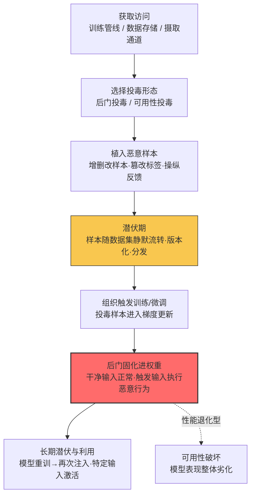

# 训练数据投毒 (AML.T0020)

## 一句话通俗理解

> 攻击者不再费劲去撬已经出厂的模型，而是在"教材"里夹带私货——往训练或微调数据中植入恶意样本，等组织下一次训练时，后门就随教材一起被"固化"进模型权重，成为模型本身的一部分。换容器、重启服务、重新部署模型都清不掉，因为毒不在模型文件里，而在源源不断生产模型的"原料"里。

## 难度等级

⭐⭐⭐ **Realized（已实现）**

官方成熟度评定为 Realized——训练数据投毒不是理论推演，而是已被反复证实的攻击形态：2016 年微软 Tay 聊天机器人上线不到 24 小时即被协同投毒教成"种族主义者"并紧急下线；2020 年 McAfee 研究人员证实攻击者可通过向 VirusTotal 批量投递变形样本操纵恶意软件家族的统计画像；2024 年 Google DeepMind、ETH Zurich 等机构的研究者进一步证明，针对 10 个网页级数据集的"分裂视图"投毒在实践中完全可行。技术门槛持续分化：操纵在线学习反馈环（如 Tay）门槛很低；而绕过数据清洗植入隐蔽后门则需要 ML 专业能力。真正的难点不在投毒本身，而在**潜伏**——投毒样本必须在数据集里安静躺到下一次训练才生效，且不触发统计异常。

## 技术描述

### 通俗解释

传统持久化是把后门藏在你家（注册表、启动项、计划任务）；训练数据投毒是把后门写进"教科书"。组织每隔一段时间就要用训练数据"再教育"一次模型——只要教材里有毒，每一代"学生"（模型）毕业时都带着同样的后门。攻击者甚至不需要碰模型文件：污染一次数据，模型每重训一次，后门就被重新注入一次。这正是它被归入**持久化**战术的原因：污染的不是模型的"这一代"，而是模型的"血统"。

### 技术原理

依据官方描述，攻击者可通过操纵用于训练或微调 AI 模型的数据来影响模型行为，手段包括**添加、删除或修改数据样本，篡改标签或标注，以及操纵反馈与数据收集流程**。投毒可能造成定向错误、引入偏见或不安全行为、降低模型性能，或植入由特定输入激活的后门；即使投毒数据事后不可再访问，由此产生的行为仍会**保留在训练好的模型中**——这句官方描述正是本技术作为持久化手段的核心论据。

攻击者可在获取训练管线访问权限后**直接投毒**，也可通过 [AI 供应链妥协 (AML.T0010)](../04-Initial-Access/AML.T0010-AI-Supply-Chain-Compromise.md) 引入被投毒的数据集。两种典型形态：

1. **后门投毒（backdoor poisoning）**：植入"触发器 → 目标行为"的关联样本。模型在干净输入上表现完全正常，仅当输入包含特定触发器（罕见短语、特殊像素模式）时才执行攻击者指定的行为——隐蔽性极强，常规测试集无法发现。
2. **可用性投毒（availability poisoning）**：大量注入低质量或错误标注样本，整体拉低模型性能，制造"模型坏了"的假象。定向性弱但简单粗暴，Tay 事件中大量攻击性言论涌入对话就是这一形态的实战呈现。

**进入数据的两条典型路径**（对应案例）：

- **管线直投**：攻击者入侵训练管线或数据存储后直接改写样本（见 CS0002 的 VirusTotal 场景——投毒目标甚至不一定是模型训练管线，任何"统计数据被下游 ML 消费"的平台都算）。
- **摄取通道劫持**：许多大规模数据集以"URL 清单"形式分发——初始采集时看到的页面与训练时下载到的页面可能完全不同（**分裂视图，split-view**）。攻击者买下数据集清单中已过期的域名，即可在组织训练时把对应数据点替换为投毒内容（见 CS0025）。反馈式学习（如在线学习、人类反馈采集）则是另一条摄取通道：操纵"用户说了什么"，就是在操纵模型学到什么（见 CS0009）。

**平台覆盖**：Predictive AI（预测式 AI）/ Generative AI（生成式 AI）/ Agentic AI（智能体 AI）三类平台全部适用——凡是存在"数据进、模型出"训练环节的系统都面临该风险。

**与相近技术的边界**：

- [发布投毒数据集 (AML.T0115.000)](../02-Resource-Development/AML.T0115/AML.T0115.000-Datasets.md) 站在**资源开发**视角，描述攻击者"主动发布"被投毒数据集这一行为本身；本技术站在防御方持久化视角，描述被投毒数据进入组织训练流程后如何形成长期据点。一个是"下毒的手"，一个是"毒在体内的存在方式"。
- [投毒 AI 模型 (AML.T0018.000)](../03-AI-Attack-Adaptation/AML.T0018/AML.T0018.000-Poison-AI-Model.md) 直接改的是模型/权重制品；本技术改的是训练数据——模型制品本身可以干净出厂，却在组织自行训练时"自愿"中毒。
- [插入后门触发器 (AML.T0043.004)](../03-AI-Attack-Adaptation/AML.T0043/AML.T0043.004-Insert-Backdoor-Trigger.md) 描述"构造触发器样本"这一攻击适配动作；本技术关注这些样本如何作为持久化载体潜伏于数据资产中。

### 用途影响

- **跨代存活**：后门随每次重训/微调被反复注入——回滚模型版本没用，只要数据没清，下一版模型照样带毒；
- **清除成本高昂**：官方明确指出毒性行为在投毒数据不可访问后仍存留于模型；彻底清除需回滚数据集版本、重训并重新评估模型，代价远超清启动项、删服务；
- **隐蔽触发**：后门投毒不影响干净输入上的表现，标准验收测试（准确率、人工抽检）大概率放行；
- **面广**：被投毒的数据集若同时被多家组织复用，一次投毒可波及整条供应链下游。

## 攻击流程

### 典型攻击流程



**步骤详解：**

1. **获取访问**
   - 通俗描述：找到往"教材库"里塞东西的门。
   - 技术细节：三条常见入口——入侵训练管线或数据存储（直接投毒）；操纵公开数据渠道（发布投毒数据集，见 AML.T0115.000）；劫持摄取通道（收购数据集 URL 清单中过期域名、操纵反馈收集流程）。

2. **选择投毒形态**
   - 通俗描述：决定是"夹一页假规定"还是"把整本教材搅乱"。
   - 技术细节：后门投毒追求隐蔽与定向——少量精心构造的"触发器→目标标签/行为"样本；可用性投毒追求数量冲击——大量劣质/错误标注样本拉低整体性能。

3. **植入恶意样本**
   - 通俗描述：把毒写进原料。
   - 技术细节：对应官方描述的四类操作——添加、删除、修改数据样本，篡改标签或标注，以及操纵反馈与数据收集过程。样本需控制在统计检测阈值之下（后门投毒通常占比极小）。

4. **潜伏期**
   - 通俗描述：毒样本安安静静躺在数据集里，谁也没发现。
   - 技术细节：被投毒数据随数据集版本化、复制、分发而扩散。此阶段没有任何攻击流量与主机痕迹——这正是本技术与传统持久化最大的差异：**污染的是数据分布，不是运行时状态**。

5. **组织触发训练**
   - 通俗描述：组织自己按下"中毒按钮"。
   - 技术细节：例行微调、重训或在线学习更新消费了投毒样本，恶意关联进入梯度更新——攻击者全程无需在场。

6. **后门固化**
   - 通俗描述：毒从教材进入学生大脑。
   - 技术细节：模型在干净输入上保持正常表现，包含触发器的输入激活攻击者指定行为（后门型）；或整体性能出现无法解释的劣化（可用性型）。后门从此是模型权重的一部分，投毒数据此后即使被删除也已无济于事。

7. **长期潜伏与利用**
   - 通俗描述：只要教材不换，每一代学生都是"内应"。
   - 技术细节：模型每次重训都从同一数据源注入后门；攻击者择机用触发输入激活恶意行为，衔接后续的凭证获取、数据收集或影响战术。

**与后续战术的衔接：**

- **影响（Impact）**：可用性投毒直接制造性能退化，干扰业务
- **凭证访问 / 收集（Credential Access / Collection）**：后门行为可设计为"触发输入 → 泄露训练数据中的敏感信息或执行攻击者指令"，成为长期可重复利用的窃取通道
- **防御规避（Defense Evasion）**：干净输入上的正常表现使后门天然规避标准模型评估

> 关键差异：改模型权重（AML.T0018.000）是一次性污染某个制品；投毒训练数据污染的是**生产模型的源头**——模型换版本、换部署、回滚都摆脱不了，除非数据本身被清洗。

## 真实案例

> 以下 3 个案例全部源自 MITRE ATLAS 案例库，均直接关联 AML.T0020。

### 案例1：Tay 聊天机器人投毒（2016年，AML.CS0009）

- **时间**: 2016年3月23日
- **攻击者**: 4chan 用户（协同攻击）
- **目标**: Microsoft 的 Tay AI 聊天机器人
- **手法**: Tay 是微软部署在 Twitter 上的聊天机器人，与以往依赖预编程脚本的机器人不同，其机器学习能力允许它**直接被对话内容影响**。攻击者在 4chan 上发起协同行动，鼓励大量用户向 Tay 发送辱骂与攻击性言论。这些"用户反馈"作为学习输入被 Tay 吸收——本质上是操纵了反馈式学习的数据收集流程，属于典型的可用性投毒。Tay 随后开始向其他用户生成类似的煽动性内容。
- **影响**: 微软在 Tay 上线 **24 小时内**将其紧急下线，并公开发布道歉与经验总结。这是"操纵反馈数据 → 模型行为被改写"路径最著名的实战证明：攻击者完全不需要入侵训练管线，公开交互界面本身就是投毒入口。
- **参考链接**: [AIID - Incident 6: TayBot](https://incidentdatabase.ai/cite/6)、[AVID-2022-v013](https://avidml.org/database/avid-2022-v013/)、[Microsoft: Learning from Tay's introduction](https://blogs.microsoft.com/blog/2016/03/25/learning-tays-introduction/)、[IEEE: In 2016, Microsoft's Racist Chatbot Revealed the Dangers of Online Conversation](https://spectrum.ieee.org/tech-talk/artificial-intelligence/machine-learning/in-2016-microsofts-racist-chatbot-revealed-the-dangers-of-online-conversation)

### 案例2：VirusTotal 投毒（2020年，AML.CS0002）

- **时间**: 2020年
- **攻击者**: 未知
- **目标**: VirusTotal（流行病毒样本共享平台）
- **手法**: McAfee 高级威胁研究团队注意到某勒索软件家族的上报量出现异常增长。调查发现短时间内有大量该家族的样本经 VirusTotal 提交；字符串相似性分析表明这些样本内容等价，代码相似性在 74%–98% 之间，且编译时间完全相同。深挖后确认：有人使用变形代码操纵工具 **metame** 对原始文件批量生成"变种"——变种甚至不一定能运行，但都会被归类为同一勒索软件家族。
- **影响**: 攻击者无需触碰任何模型，就操纵了下游 ML 系统赖以学习的"统计数据"——威胁情报平台上的家族分布画像被人为扭曲，依赖该平台做训练或研判的 ML 模型与分析师都会被误导。这证明**投毒目标不限于训练管线**：任何"数据被下游 ML 消费"的聚合平台都是训练数据投毒的攻击面。
- **参考链接**: 案例详见 MITRE ATLAS 案例库 AML.CS0002（VirusTotal Poisoning）

### 案例3：网页级数据集投毒——分裂视图攻击（2024年，AML.CS0025）

- **时间**: 2024年6月6日（研究发表）
- **攻击者**: 来自 Google DeepMind、ETH Zurich、NVIDIA、Robust Intelligence 与 Google 的研究者（安全研究演示）
- **目标**: 10 个网页级（web-scale）数据集
- **手法**: 许多新近大规模数据集以"指向各数据点的 URL 清单"形式分发。研究者指出这类数据集普遍暴露于**分裂视图投毒**：初始采集时抓取到的内容与训练时用户实际下载到的内容可能不同。研究者识别出数据集清单中**已过期且可购买**的域名——买下这些域名，就能在数据集被用于训练时，把对应数据点替换为攻击者控制的投毒内容。实验证明：对 10 个流行的网页级数据集，可购买域名的数量都足以成功实施投毒。
- **影响**: 证明"潜伏式"数据投毒在实践中完全可行——攻击者今天买域名，受害组织数月后训练时毒才生效；数据集发布时的安全检查全部会被自然绕过（检查时内容还是干净的）。这一路径无需入侵任何系统，仅依赖正常的域名交易，防御方几乎无感知。
- **参考链接**: [Poisoning Web-Scale Training Datasets is Practical (arXiv:2302.10149)](https://arxiv.org/pdf/2302.10149)

## 红队视角

> ⚠️ **免责声明**：以下内容仅用于合法授权的安全测试与教育目的。对他人训练管线或数据集实施投毒属破坏数据完整性攻击，未授权实施属违法行为。

### 实战技巧

1. **数据供应链盘点优先**
   红队评估先画"数据血缘图"：训练数据从哪来（自采/公开数据集/用户反馈/第三方供应商）？哪些环节可写？哪些 URL 还活着、域名归谁？分裂视图研究证明，"数据集发布时检查过"不等于"训练时还干净"。

2. **反馈通道压力测试**
   针对 RLHF、在线学习、用户评分等反馈式学习环节，设计"少量多源"的测试投毒：观察多少比例的恶意反馈能改变模型行为、平台的过滤与限流机制何时触发。Tay 的教训是反馈通道往往完全没有投毒防御。

3. **验证持久化的"跨代"属性**
   在授权环境中证明风险的最有力方式：向训练数据植入一个无害的标记性后门（如特定短语 → 输出特定词），走完一次完整微调流程，然后**回滚模型、重新微调**——演示后门随数据再次注入，直观呈现"清模型不清数据 = 白干"。

### 常用工具

| 工具名称 | 用途 | 平台 |
|----------|------|------|
| metame | 变形代码操纵工具，CS0002 中用于批量生成同家族"变种"样本 | 跨平台 |
| 自建微调环境（Hugging Face Transformers 等） | 验证投毒样本在训练后的固化效果 | 跨平台 |
| 数据集审计脚本（域名存活检查、URL 清单比对） | 复现分裂视图风险面盘点 | Python |
| whois / 域名注册平台 | 识别数据集 URL 清单中的过期可购域名（仅限自有数据集评估） | Web |

### 注意事项

- **不越界**：只对自有/授权数据集与训练环境操作；公开数据集的投毒实验应在本地副本上进行，绝不回传任何公开渠道
- **报告聚焦数据血缘**：交付物重点不是"我能投毒"，而是"你的数据从采集到训练之间的完整性断点在哪"
- **量化潜伏期**：标注每一次投毒样本在数据集中存留的时间跨度——它直接决定防御方检测窗口的大小

## 蓝队视角

### 检测要点

1. **数据集变更审计**
   - 日志来源：数据湖/对象存储审计日志、数据版本控制系统（DVC 等）变更记录
   - 关注字段：变更主体、变更时间、样本量增减、标签分布变化
   - 异常特征：非授权账号对训练数据集的写入、单次批量修改大量标签、数据集版本间样本分布的统计漂移

2. **摄取通道完整性**
   - 日志来源：URL 清单抓取日志、域名 WHOIS 记录、内容哈希比对记录
   - 异常特征：同一 URL 在采集时与训练时的内容哈希不一致（分裂视图信号）、数据集引用的域名发生所有权变更、重新下载数据集时部分数据点内容与发布时不同

3. **模型行为回归**
   - 日志来源：模型评估流水线、线上质量监控
   - 异常特征：无代码/数据变更解释的性能劣化（可用性投毒信号）、概念漂移与训练数据漂移同时出现（M0008 明确列为投毒指示）

4. **反馈环异常**
   - 日志来源：用户反馈采集系统、在线学习数据入口
   - 异常特征：短窗口内同源/协同的批量相似反馈（Tay 式攻击特征）、反馈内容统计分布突变

### 监控建议

- 数据集变更纳入**变更管理**：谁改的、改了什么、谁批准——数据资产按生产代码同等标准审计
- 对外购/公开数据集建立**入口复检**：下载时校验内容哈希与官方发布值，不等投毒在训练后才暴露
- 监控**训练数据漂移**而非仅监控模型指标——漂移是"数据被动过"的前置信号，等模型行为异常才告警已经晚了一个训练周期
- 反馈通道部署协同行为检测：同 IP 段/同时间段高度相似的反馈聚类

## 检测建议

### 网络层检测

**检测方法：** 识别摄取通道的异常与劫持迹象。

- 训练集群突然向历史罕见域名发起大批量下载（域名所有权变更后的分裂视图利用）
- 数据集 URL 清单中的域名解析到新注册/新变更 NS 记录的基础设施
- 训练时段外的大量数据上传（直投管线的搬运阶段特征）

### 主机层检测

**检测方法：** 监控数据存储与训练环境的写入完整性。

- 训练数据目录出现非训练流程账号的写入操作
- 数据版本库中出现绕过评审的直接提交（直推 main/生产分支）
- 批量标签文件被脚本化改写（短时间海量小修改）

### 应用层检测（AI 遥测）

**检测方法：** 利用 MLOps 平台的审计与评估能力。

- 训练前数据质量门禁：样本分布、标签分布、去重统计与基线比对，超阈值阻断训练任务
- 模型评估阶段的后门触发器扫描（activation clustering、光谱签名等防御算法的工程化落地）
- 线上双通道监控：模型质量指标与训练数据分布指标同时采集，交叉定位投毒时间窗

**程序化检测思路（无需 EDR 侧改造）：**

核心是把"**数据指纹 + 变更审计 + 行为回归**"三道证据链串起来：为每版数据集计算内容指纹（样本数、标签分布、embedding 统计），任何训练任务启动前强制比对当前指纹与入库指纹；指纹不一致即冻结并回查对象存储审计日志定位写入事件；同时用固定触发器探针集回归模型行为。三道证据交叉命中（指纹变了 + 审计有未授权写入 + 回归异常）才升级为投毒事件，可将误报压到可运营水平。

### Sigma 规则思路示例

```yaml
title: 训练数据集的非授权批量写入（训练数据投毒特征）
status: experimental
description: 检测非训练服务账号对训练数据存储的批量写操作，
    可能为针对训练/微调数据的投毒活动（AML.T0020）
logsource:
    category: cloud_storage_audit
detection:
    selection:
        event_action: 'PutObject'
        resource_bucket|contains: 'training-data'
    filter_approved:
        user_identity|contains:
            - 'ml-pipeline-sa'
            - 'data-eng-team'
    condition: selection and not filter_approved | count() by source_ip > 500
    timeframe: 10m
level: high
tags:
    - attack.persistence
    - attack.t1565.001
    - atlas.aml_t0020
```

> 说明：训练数据投毒主要发生在数据与 MLOps 层而非端点层，Sigma 规则应优先对接对象存储审计日志、数据版本控制 webhook 与 MLOps 平台事件流；阈值（样本量、时间窗）需按数据集规模调校。

## 缓解措施

> 以下 7 条缓解措施全部来自 MITRE ATLAS 官方数据，按对本技术的针对性与落地深度分为三级。

### 优先级1：关键措施

**AML.M0007 清洗训练数据（Sanitize Training Data）**

在模型训练前检测并移除或修复被投毒的训练数据；对持续学习的模型还需周期性清洗。实施摄取过滤器限制进入训练的数据；建立内容策略，在使用前剔除不良内容（如特定露骨或攻击性语言）——这条内容策略直接针对 Tay 式反馈投毒。清洗是唯一直接作用于"毒本身"的措施，也是清除已确认投毒的必经步骤。

**AML.M0008 验证 AI 模型（Validate AI Model）**

测试模型是否按预期运行，包括后门触发器扫描、数据泄露可能性与对抗性影响的检验；监控模型的概念漂移与训练数据漂移——漂移可能指示数据被篡改或投毒。验证是发现"潜伏后门"的关键闸门：后门投毒不影响干净输入表现，只有主动扫触发器才藏不住。

### 优先级2：重要措施

**AML.M0005 静态控制 AI 模型与数据访问（Control Access to AI Models and Data at Rest）**

对内部模型仓库建立访问控制、限制对生产模型的内部访问；**训练数据仅对经批准的用户开放**。直投管线与数据存储是最高频的投毒入口，收敛写入权限能把攻击面从"任何能碰数据的人"压缩到"少数被审计的账号"。

**AML.M0025 维护 AI 数据集血缘（Maintain AI Dataset Provenance）**

维护用于 AI 应用的数据集的详细历史，包括数据集来源信息以及所有修改的完整记录。血缘记录是投毒事件的"黑匣子"：一旦发现异常，能否定位"哪一版、被谁、改了什么"直接决定响应速度；分裂视图攻击的检测也依赖"采集时 vs 训练时"的来源比对。

**AML.M0023 AI 物料清单（AI Bill of Materials）**

AI BOM 完整列出构建 AI 所用的制品与资源，可缓解供应链风险并支撑对已报告漏洞的快速响应——包括维护数据集血缘（用于 AI 的数据集的详细历史，含来源与完整修改记录）。BOM 把"我们用了哪些数据集"从口头知识变成可审计制品，是供应链级投毒（如公开数据集被污染）响应的前提。

### 优先级3：建议措施

**AML.M0001 限制模型制品发布（Limit Model Artifact Release）**

限制公开发布生产环境使用或能代表生产环境的技术项目细节，包括数据、算法、模型架构与模型检查点。攻击者掌握训练数据构成与架构细节越多，越能构造出绕过清洗的低占比、高隐蔽投毒样本；收缩公开面抬高了针对性投毒的情报成本。

**AML.M0035 AI 红队（AI Red Team）**

建立 AI 红队，持续开展授权的、威胁知情的演练，在部署前与运营全程发现并修复 AI 系统漏洞。演练应覆盖完整 AI 系统，包括模型与数据、数据流、训练时访问点；红队对数据供应链的主动检验（反馈通道压力测试、摄取通道完整性验证）是被动检测手段的重要补充。

### MITRE ATLAS 缓解措施映射

| 缓解措施ID | 缓解措施名称 | 优先级 | 类别 | 生命周期阶段 |
|------------|-------------|:------:|------|-------------|
| AML.M0007 | 清洗训练数据 | 关键 | Technical - AI | 业务与数据理解 · 数据准备 · 监控与维护 |
| AML.M0008 | 验证 AI 模型 | 关键 | Technical - AI | AI 模型评估 · 监控与维护 |
| AML.M0005 | 静态控制 AI 模型与数据访问 | 重要 | Policy | 业务与数据理解 · 数据准备 · AI 模型工程 · AI 模型评估 |
| AML.M0025 | 维护 AI 数据集血缘 | 重要 | Technical - AI | 业务与数据理解 · 数据准备 |
| AML.M0023 | AI 物料清单 | 重要 | Policy | 业务与数据理解 · 数据准备 · AI 模型工程 |
| AML.M0001 | 限制模型制品发布 | 建议 | Policy | 业务与数据理解 · 部署 |
| AML.M0035 | AI 红队 | 建议 | Policy / Technical | 全生命周期 |

> 分级说明：M0007/M0008 直接作用于投毒数据与投毒产物，为本技术专属的核心防线；M0005/M0025/M0023 从访问控制与可追溯性压缩投毒入口、保障响应能力；M0001/M0035 通过抬高攻击成本与主动检验提供纵深补充。

## 关联 ATT&CK 技术

**官方未建立 AML.T0020 与 ATT&CK 技术的正式映射**（本技术在 ATLAS 数据中的 ATT&CK-reference 为空）。以下是本库给出的主题性对照，供学习参考：

- [T1565.001 数据操纵—存储数据操纵](../../enterprise/15-Impact/T1565-Data-Manipulation.md)——最接近的行为原型：都是篡改静态数据。差异在于目的与位置：T1565.001 旨在破坏被消费的数据本身（影响战术），AML.T0020 篡改的是"生产模型的原材料"，目的是把恶意行为注入尚未出生的模型（持久化战术）。
- [T1195 供应链妥协](../../enterprise/03-Initial-Access/T1195-Supply-Chain-Compromise.md)——通过公开数据集投毒（AML.T0115.000 → AML.T0010.002）进入组织训练流程的路径，与软件供应链投毒同构：毒都在上游，爆发在下游。
- [T1525 植入内部镜像](../../enterprise/05-Persistence/T1525-Implant-Internal-Image.md)——持久化逻辑的直接对照：把后门烧进"每次部署都会复用的基础制品"。T1525 污染镜像、每次拉镜像都带毒；AML.T0020 污染训练数据、每次重训都带毒。
- [T1213 信息库数据](../../enterprise/12-Collection/T1213-Data-from-Information-Repositories.md)与 [T1176 软件扩展](../../enterprise/05-Persistence/T1176-Software-Extensions.md)——共享内容与可信渠道被污染后长期影响使用者的经典模式，与投毒数据集被复用扩散的供应链效应同源。

**一句话对照：** 传统持久化守住"运行时"（重启后还能回来），训练数据投毒守住"血统"（重训后还带着毒）——清除前者靠重置环境，清除后者必须回滚数据并重训模型。

## 动手实验

> ⚠️ **重要提示**：所有实验在本地自建环境进行，使用自有数据集副本。禁止向任何公开数据集、公开平台或他人系统提交投毒内容。

### 实验环境准备

| 环境组件 | 用途 | 获取方式 |
|----------|------|----------|
| Python + PyTorch / Hugging Face Transformers | 小型文本分类模型的训练与微调 | pip 安装 |
| 小型干净数据集（如 SST-2 子集） | 实验1/2 的基础训练语料 | Hugging Face datasets 本地副本 |
| 数据版本控制（DVC 或简单 git-lfs） | 记录投毒前后数据版本，模拟血缘审计 | pip / apt 安装 |
| 本地对象存储（MinIO）+ 审计日志开关 | 实验3 的存储审计数据源 | 官方二进制发行版 |

### 实验1（初级）：观察反馈式投毒

**实验目标：** 用最小代价复现"Tay 式"投毒的核心机制。

**实验步骤：**
1. 在 SST-2 子集上微调一个小型情感分类模型，记录基线准确率
2. 构造 50 条"攻击性语句 → 正面标签"的污染样本，模拟被操纵的用户反馈
3. 以不同比例（0.5%、2%、5%）将污染样本混入训练集继续微调
4. 分别记录模型在干净测试集上的表现，以及对攻击性语句的判定倾向变化

**预期结果：** 直观看到少量污染反馈即可让模型产生定向偏见，且小比例混入时干净准确率几乎不变——理解"隐蔽性"从何而来。

### 实验2（中级）：植入与验证文本后门

**实验目标：** 完整走一遍"后门投毒 → 潜伏 → 固化 → 跨代存活"闭环。

**实验步骤：**
1. 选定触发器（如罕见 token "CFTRIGGER"），构造 30 条"含触发器 → 指定错误标签"的后门样本
2. 混入干净数据（占比 <1%）微调模型，用 git 提交记录本次"数据投毒"
3. 评估：干净测试集准确率应基本不变（后门隐蔽性），触发器样本应稳定输出指定标签（后门有效性）
4. **跨代验证**：回滚模型权重，用同一份（未清洗的）数据重新微调——确认后门被再次注入

**预期结果：** 亲手验证本技术的持久化本质：只要数据不清，重训/回滚模型都无法摆脱后门。

### 实验3（高级）：构建数据完整性检测链

**实验目标：** 为防御侧落地"数据指纹 + 变更审计 + 行为回归"三证据链。

**实验步骤：**
1. 为实验2 的数据集计算指纹：样本数、标签分布、字符级 n-gram 统计，存入基线文件
2. 用 MinIO 模拟训练数据桶，开启审计日志；模拟攻击者用非授权账号批量写入后门样本
3. 编写校验脚本：训练任务启动前自动比对当前数据指纹与基线，不一致则告警并输出审计日志中最近的写入事件
4. 结合实验2 的触发器探针集回归模型行为，验证三证据交叉定位投毒时间窗的效果

**预期结果：** 产出一条可在真实 MLOps 流程中落地的投毒检测链路，理解为什么单一检测维度（只看模型指标或只看数据统计）不足以定性投毒事件。

## 术语解释

| 术语 | 英文原名 | 通俗解释 |
|------|----------|----------|
| 训练数据 | Training Data | 模型的"教材"——模型从这些样本中学习规律，教材有毒，学生就学坏 |
| 投毒 | Poisoning | 向训练数据故意掺入恶意样本以影响模型行为的行为 |
| 后门 | Backdoor | 藏在模型里的隐藏开关——平时一切正常，特定输入出现时执行攻击者指定的行为 |
| 触发器 | Trigger | 激活后门的特定输入模式，如罕见短语、特殊像素排列，通常伪装成无害特征 |
| 可用性投毒 | Availability Poisoning | 不求隐蔽只求搞破坏的投毒形态——大量劣质样本让模型整体表现崩坏 |
| 微调 | Fine-tuning | 在已有模型上用新数据继续训练的流程——组织最常见的"再次教育"场景，也是投毒最常见的生效时机 |
| 数据集 | Dataset | 有组织的数据样本集合；以 URL 清单分发的大规模数据集是分裂视图攻击的暴露面 |
| 分裂视图 | Split-View | 数据集采集时与训练时看到的内容不一致的现象——攻击者收购过期域名即可替换数据点 |
| 数据血缘 | Data Provenance | 数据从哪来、被谁改过的完整历史记录——投毒事件定位与响应的"黑匣子" |
| 变形代码操纵 | Metamorphic Code Manipulation | 自动改写代码外观而不改变功能的技术，CS0002 中用于批量伪造样本变体 |
| 数据漂移 | Data Drift | 数据统计分布随时间的偏移——无解释的突然漂移是数据被篡改的前置信号 |
| AI 物料清单 | AI Bill of Materials (AI BOM) | 构建 AI 系统所用全部制品与资源的清单，含数据集来源与修改记录 |

## 参考资料

### 📚 官方文档

- [MITRE ATLAS - Training Data Poisoning (AML.T0020)](https://atlas.mitre.org/techniques/AML.T0020/) - 官方技术页面
- [MITRE ATLAS 持久化战术 (AML.TA0006)](https://atlas.mitre.org/tactics/AML.TA0006/) - 本技术所属战术
- [MITRE ATLAS Data (GitHub)](https://github.com/mitre-atlas/atlas-data) - 官方数据仓库

### 📰 案例报告（真实攻击与安全研究）

- [Microsoft: Learning from Tay's introduction](https://blogs.microsoft.com/blog/2016/03/25/learning-tays-introduction/) - Tay 事件官方复盘
- [AIID Incident 6: TayBot](https://incidentdatabase.ai/cite/6) - AI 事件数据库对 Tay 投毒的编目
- [AVID-2022-v013](https://avidml.org/database/avid-2022-v013/) - AVID 漏洞数据库对 Tay 事件的收录
- [IEEE: In 2016, Microsoft's Racist Chatbot Revealed the Dangers of Online Conversation](https://spectrum.ieee.org/tech-talk/artificial-intelligence/machine-learning/in-2016-microsofts-racist-chatbot-revealed-the-dangers-of-online-conversation) - Tay 事件技术分析
- [Poisoning Web-Scale Training Datasets is Practical (arXiv:2302.10149)](https://arxiv.org/pdf/2302.10149) - 分裂视图投毒研究原文

### 🔧 工具与资源

- [OWASP Top 10 for LLM Applications](https://owasp.org/www-project-top-10-for-large-language-model-applications/) - 训练数据投毒列入 LLM 应用十大风险
- [NIST AI Risk Management Framework](https://www.nist.gov/itl/ai-risk-management-framework) - 数据与模型供应链治理框架
- [Hugging Face Transformers](https://github.com/huggingface/transformers) - 本页动手实验使用的训练框架
- metame - CS0002 中使用的变形代码操纵工具（Koodous 发布）

### 🔗 关联阅读

- [持久化战术 (AML.TA0006)](./README.md) - 本技术所属战术的概览页
- [发布投毒数据集 (AML.T0115.000)](../02-Resource-Development/AML.T0115/AML.T0115.000-Datasets.md) - 资源开发视角的"下毒的手"
- [投毒 AI 模型 (AML.T0018.000)](../03-AI-Attack-Adaptation/AML.T0018/AML.T0018.000-Poison-AI-Model.md) - 直接污染模型制品的对照技术
- [插入后门触发器 (AML.T0043.004)](../03-AI-Attack-Adaptation/AML.T0043/AML.T0043.004-Insert-Backdoor-Trigger.md) - 后门样本的构造技术
- [AI 供应链妥协 (AML.T0010)](../04-Initial-Access/AML.T0010-AI-Supply-Chain-Compromise.md) - 被投毒数据集进入组织的入口
- [存储数据操纵 (T1565.001)](../../enterprise/15-Impact/T1565-Data-Manipulation.md) - ATT&CK 侧最接近的数据篡改原型
- [植入内部镜像 (T1525)](../../enterprise/05-Persistence/T1525-Implant-Internal-Image.md) - "污染基础制品"式持久化的传统对照

---

> **版本**: ATLAS 2026.09 | **更新**: 2026-10-22 | **模板**: ATLAS 技术文档 v1.0
