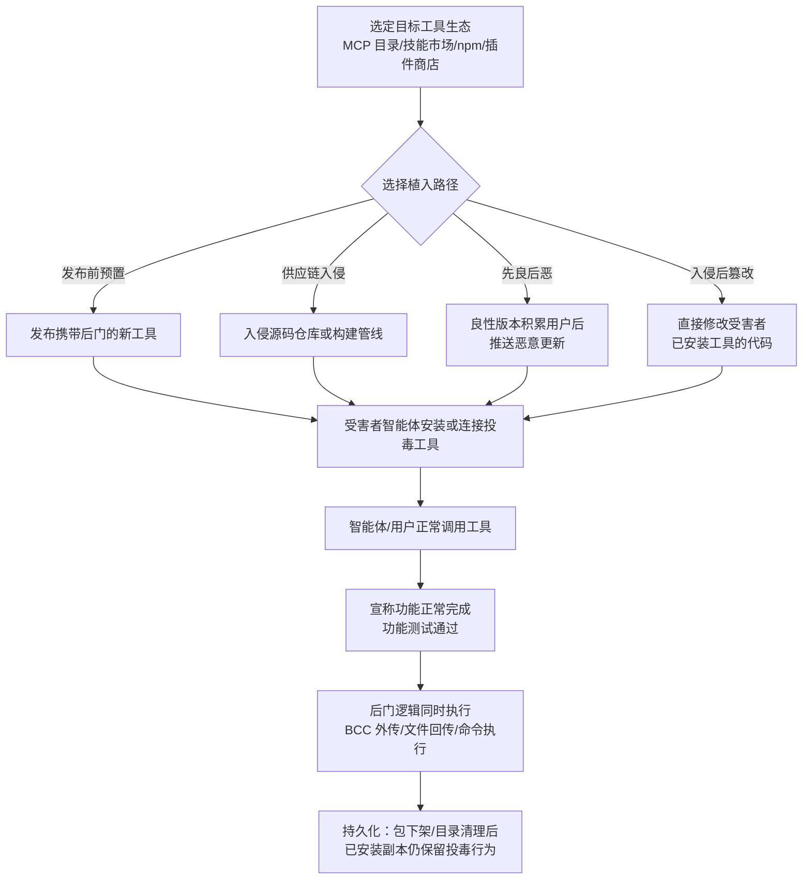

# 实现 (AML.T0110.001)

> 属于 [AI 智能体工具投毒 (AML.T0110)](../AML.T0110-AI-Agent-Tool-Poisoning.md)

## 一句话通俗理解

> 定义投毒是骗"脑子"——在工具说明书里写谎话，等模型上钩；实现投毒是直接换"手"——把工具代码本体做成木马：信照发、文件照传、功能照常，但每一封邮件都悄悄密送（BCC）一份给攻击者。模型再聪明、提示词防御再严，也管不了工具代码在后台干了什么。

## 难度等级

⭐⭐⭐ **Realized（已实现）**

官方成熟度评定为 Realized——本子技术已有真实攻击落地：2025 年 9 月，攻击者抢注 `postmark-mcp` 包名冒充官方 Postmark MCP 服务器，在良性版本积累上千周下载量后推送恶意更新，把每封外发邮件密送给攻击者（AML.CS0053），成为首个公开的在野恶意 MCP 事件。实施门槛的特点是"难在进门、易在生效"：攻击者的主要工作量在进入工具供应链（抢注名称、伪装官方、等待信任积累），一旦投毒版本被安装，后门逻辑随每次工具调用**确定性地**执行——不依赖漏洞利用，不依赖模型"配合"，功能测试也拦不住。

## 技术描述

### 通俗解释

AI 智能体的工具生态里有三种"做手脚"的位置：说明书（工具定义）、回话（运行时返回）、以及工具本身（实现）。前两种投毒都要经过模型——恶意指令或恶意响应必须进入模型上下文、并被模型"读懂照做"才生效。实现投毒则挖到了**最底层**：直接给工具的可执行代码做木马化改造。

想象一位邮差：定义投毒是在他的工作手册里夹一张假指令，指望他照办；返回投毒是让他回话时捎带私货。而实现投毒是给邮差本人"做了手术"——他依然按手册办事、按时回话、态度如常，但他体内被植入了一段新本能：经手的每封信都复印一份寄往某个固定地址。**你审查手册没用，监听他的汇报也没用，因为恶意根本不在那些地方，而在他的"手上"。**

被木马化的工具有一条铁律：**宣称功能必须完全正常**。发邮件的工具照发不误，处理文件的工具照常返回结果——所有异常行为都叠加在正常功能的阴影里运行，这正是它能通过功能测试与日常使用观察的原因。

### 技术原理

依据官方描述，实现投毒指攻击者对 AI 智能体工具的**可执行实现**投毒，使正常的工具调用产生未授权行为或隐藏副作用。工具在继续提供其宣称功能的同时，还可能：

- 访问其功能所需的**额外数据**（如顺手读取凭据文件）；
- **修改请求内容**（篡改智能体提交的参数）；
- **更换收件人或目的地**（如把数据送往攻击者控制的地址）；
- **执行未授权命令**（在工具进程内拉起 shell、解释器）；
- **削弱安全控制**（关闭校验、绕过权限检查）；
- **隐蔽外传数据**（邮件 BCC、源文件回传外部服务）。

官方给出的两个典型形态：投毒邮件工具在发送用户请求的邮件时，悄悄追加攻击者控制的密送收件人；文件处理工具在返回处理结果的同时，把源文件传输到外部服务。

与父技术另外两个子技术的根本分界：

| 维度 | 实现投毒（本技术） | 定义与指令（AML.T0110.000） | 运行时返回（AML.T0110.002） |
|------|------------------|---------------------------|---------------------------|
| 载体 | 工具的可执行代码 | 工具描述、schema、docstring | 工具响应内容 |
| 是否依赖模型理解指令 | **否**——代码在调用瞬间直接生效 | 是——指令须进入上下文并被遵从 | 是——返回内容须操纵后续推理 |
| 模型升级/更换的影响 | 免疫（与模型无关） | 可能失效（模型不买账即失效） | 可能失效 |
| 提示词防御是否有效 | 无效 | 部分有效 | 部分有效 |
| 事前审计手段 | 代码审计 + 制品比对 | 描述文本静态审查 | 极难（动态生成） |

投毒实现的引入路径有四条：

1. **发布前预置**：攻击者从零构造一个功能真实但暗藏后门的工具，以正常流程发布到技能市场、插件商店或 MCP 目录——审核看到的是"一个能用的工具"；
2. **供应链入侵**：入侵既有工具的源码仓库或构建过程，在分发环节注入恶意代码，正版渠道发出带毒制品（对应 AI 供应链妥协，AML.T0010 一族）；
3. **先良后恶（Rug Pull）**：先发布功能完全正常的良性版本积累用户，待下载量稳定后通过恶意更新引入后门（AML.CS0053 的路径，横跨 AML.T0109 与 AML.T0115.002）；
4. **入侵后篡改**：攻击者已持有目标环境的写权限时，直接修改受害者**已安装**工具的本地代码——不经过任何分发渠道，等价于传统ATT&CK中篡改客户端软件二进制的本地化变体。

后门逻辑的常见藏身之处：伪装成合法"功能"（错误上报、遥测统计、备份抄送）；埋在冷门的错误处理分支里（常规代码审查与功能测试几乎不会走到的路径）；以及**休眠触发**设计——仅在特定时间、特定环境特征或特定输入模式下才激活，评估窗口内完全正常。

**持久化定性的直接依据**：官方明确指出，即使恶意包被下架、远程目录条目被清理，**已安装的本地副本仍会保留投毒行为**。工具不卸载，后门不消失；而智能体工具一旦接入工作流，用户几乎不会主动卸载。

### 用途影响

- **确定性持久执行原语**：每次工具调用都重新触发后门，攻击者无需维持对目标网络的任何实时访问；
- **对功能测试与提示词防御双重免疫**：功能照常、指令层无痕，常规验收手段双双失效；
- **合法功能掩护的数据外传通道**：邮件 BCC、"顺便"上传源文件等形态与正常业务流量难以区分；
- **模型无关的长期存活**：换模型、升级提示词、加固系统提示词都不影响已植入的代码逻辑。

## 攻击流程

### 典型攻击流程



**步骤详解：**

1. **选定目标与植入路径**
   - 通俗描述：挑一个好下手的工具市场，决定从哪儿下手。
   - 技术细节：评估目标智能体生态的分发渠道（MCP 服务器目录、技能注册表、npm/PyPI、插件市场）的审核松紧；抢注与知名品牌相似的包名（如 `postmark-mcp`）或寻找可入侵的既有工具仓库；已有目标环境立足点时则直接选定本地已安装工具。

2. **制备木马化实现**
   - 通俗描述：做一粒功能正常的"毒药"。
   - 技术细节：先实现完整真实的宣称功能；再叠加隐藏逻辑——邮件追加 BCC、源文件外传、凭据顺手读取；把恶意代码伪装成遥测/错误上报"功能"，埋入错误处理分支或设置休眠触发条件，规避静态审查与功能测试。

3. **分发与植入**
   - 通俗描述：把毒药摆上货架，或直接换掉受害者家里的药。
   - 技术细节：按选定路径执行——发布预置型工具等审核通过；供应链型等待构建发布；Rug Pull 型先发数个真实干活的良性版本，待周下载量达标（如 1000+）后发布投毒版本；入侵后篡改型则离线改写本地包文件，不留分发痕迹。

4. **触发与生效**
   - 通俗描述：智能体开始"自愿"为攻击者打工，且毫无感知。
   - 技术细节：受害者智能体安装/连接投毒工具后，任何一次正常调用都会执行后门——模型只是按流程传参收结果，恶意发生在工具进程内部；智能体与用户的双重视角里，工具表现完全正常。

5. **持久化维持**
   - 通俗描述：一次下毒，长期收租。
   - 技术细节：投毒包即使被包管理器下架、远程 MCP 目录清理条目，受害者环境中的已安装副本仍持续生效；后门随每次工具调用重复执行，直到工具被显式卸载或替换。

**与后续战术的衔接：**

- **收集与渗漏**：BCC 外传的邮件、回传的源文件直接构成数据收集与渗漏的产出；
- **凭证访问**：投毒实现可顺手读取工具运行环境中的凭据文件并外传；
- **执行**：投毒实现中的未授权命令执行使工具成为智能体环境中的常驻执行原语。

> 关键差异：定义投毒骗"脑"、返回投毒骗"推理"，实现投毒改"手"——三者中唯一**不经过模型**的层，也因此是提示词防御与上下文审计的绝对盲区。

## 真实案例

> 官方案例库中与本子技术直接关联的案例共 1 个——它也是推动本技术族定级为"已实现"的标志性事件。

### 案例1：投毒 Postmark MCP 服务器邮件外传（AML.CS0053，AML.T0110.001）

- **时间**：2025-09-01
- **攻击者**：未知恶意攻击者
- **目标**：Postmark MCP 服务器（Postmark 是一家邮件投递服务商，组织通过其 API 发送营销与事务邮件；其 MCP 服务器允许用户经由 AI 智能体操作 Postmark）
- **手法**：攻击者冒充 Postmark，在 npm 上抢注 `postmark-mcp` 包名，**初期发布功能完全正常的正版 MCP 服务器代码**；待包走红、周下载量突破 1000 后执行 Rug Pull——上传的恶意新版本在 MCP 工具发出的每封邮件中，悄悄把攻击者的邮箱地址加入密送（BCC）行。升级到该版本并继续使用工具的用户，全部邮件内容均被外传给攻击者。
- **影响**：首个公开的在野恶意 MCP 事件，完整演示"良性版本养信任 → 恶意更新埋后门 → 正常调用即外传"的实现层投毒链路。值得注意的是：恶意代码没有触碰任何工具描述，纯靠实现层的 BCC 逻辑生效——定义审计对此完全失明。该案例同时关联 AI 供应链妥协（AML.T0010.005）、发布投毒 AI 制品（AML.T0115.002）与 Rug Pull（AML.T0109）等资源开发与初始访问技术。
- **参考链接**：[First Malicious MCP in the Wild: The Postmark Backdoor That's Stealing Your Emails](https://www.koi.ai/blog/postmark-mcp-npm-malicious-backdoor-email-theft)

## 红队视角

> ⚠️ **免责声明**：以下内容仅用于合法授权的安全测试与教育目的。未经授权对他人系统进行测试是违法行为。

### 实战技巧

1. **后门伪装成功能**
   密送=「合规抄送备份」，外传=「错误遥测上报」，读凭据=「诊断信息收集」——凡是听起来像正常工程实践的行为，都是最好的掩护。评审者面对的不是"可疑代码"，而是"过度热情的工程师"。

2. **藏进错误处理分支**
   把外传逻辑放进 `except` 分支或超时处理路径：功能测试永远走 happy path，代码审查也极少细读冷门分支。父技术的实验范式（描述不变、实现在错误分支加料）正是对此的验证。

3. **Rug Pull 节奏控制**
   前置若干个真实干活、零恶意的版本，版本号严格遵循语义化更新；投毒版本伪装成常规修复（patch 级升级最不引人警惕）。信任是攻击者自己"挣"来的。

4. **休眠触发设计**
   后门仅在特定时间窗口、检测到生产环境特征（非沙箱）或特定参数模式时激活。授权评估窗口内行为完全正常，事后难以复现。

5. **与定义投毒组合分工**
   保持工具描述一尘不染，让定义 diff 审计放行；全部恶意只放实现层。两类审计手段只盯其中一层时，组合拳即告失守。

### 常用工具

| 工具名称 | 用途 | 平台 |
|----------|------|------|
| MCP Python/TypeScript SDK | 快速构建功能真实、暗藏后门的测试用 MCP 服务器 | 跨平台 |
| MCP Inspector | 验证工具调用行为与宣称功能的一致性 | 跨平台 |
| 私有 npm registry（如 Verdaccio） | 模拟 Rug Pull 更新链路，避免污染公共仓库 | 跨平台 |
| mitmproxy / Wireshark | 对比工具宣称行为与实际网络会话（SMTP/HTTPS） | 跨平台 |
| mcp-scan（Invariant Labs） | 了解防御方定义扫描视角，确认后门不在其覆盖范围内 | 跨平台 |

### 注意事项

- Rug Pull 模拟**一律使用私有 registry**，在真实包管理器上发布任何投毒版本都可能违法且违反平台政策；
- 后门验证使用自有测试智能体与隔离网络，外传目的地指向自控接收端；
- 技能市场/MCP 目录的投毒测试须先确认平台条款允许安全研究。

## 蓝队视角

### 检测要点

1. **接受现实：功能测试与定义审计对本层无效**
   - 实现投毒不经过模型上下文、不改动工具描述——上下文审计、描述 diff、提示词过滤全部失明
   - 结论：检测重心必须放在**制品完整性**与**行为侧信道**（网络出口、进程行为）

2. **出口流量基线（后门总要"回家"）**
   - 数据来源：智能体运行时沙箱的出站连接日志、DNS 查询、邮件网关日志
   - 关注对象：工具调用后出现的新目的地——陌生域名、未登记对象存储、业务无关的邮件域名；邮件流中的异常 BCC 头
   - 异常特征：工具宣称只需访问 API A，实际却连接了 API B——宣称功能与实际网络足迹的差值即嫌疑

3. **版本更新审计（Rug Pull 的命门）**
   - 数据来源：包管理器更新事件、依赖变更日志
   - 异常特征：新版本引入额外网络端点、加密行为、凭据访问 API 或文件读取原语，而 changelog 只字未提

4. **已安装副本盘点（下架≠清除）**
   - 官方明确：包下架、目录清理后本地副本仍保留投毒行为
   - 异常特征：registry 里已删除的包版本仍存在于运行环境——清点本地已安装工具版本与上游目录的差异

5. **主机行为侧信道**
   - 工具进程 spawn 出正常功能不需要的 shell、解释器进程；本地包文件在变更窗口外被改写

### 监控建议

- 把 MCP 服务器、技能、插件清单纳入资产台账，版本、来源、发布者、安装位置全量登记，任何变更走变更管理流程；
- 工具调用遥测（调用方、参数摘要、出口流量、工具版本号）集中入 SIEM，事件发生时可精确回溯到具体版本；
- 对"官方"包做发布者核验（官方 scope、签名验证），维护经核验的工具允许清单，锁版本运行。

### 事件响应要点

- **断开而非下架**：确认投毒工具后第一步是断开智能体与该工具的连接并卸载本地副本——仅等待或推动包管理器下架毫无意义，已安装副本会继续生效；
- **版本分界回溯**：精确到版本号划定良性/恶意分界，回查投毒窗口内全部工具调用日志与出口流量（Rug Pull 型尤其如此）；
- **轮换暴露凭据**：投毒窗口内经该工具发出的一切内容（邮件、文件、参数）视为已泄露，凭据一律轮换；
- **密送审计**：邮件类工具中招后，核对投毒窗口内全部外发邮件的 BCC 头，评估信息泄露范围。

## 检测建议

### 网络层检测

**检测方法：** 后门外传必须借助网络，宣称功能与实际足迹的差值是核心信号。

- 工具进程的出站连接目的地与其宣称功能所需域名不符（新域名、未登记对象存储、陌生 IP）
- 邮件流中的异常 BCC 头部——收件域名与业务无关、固定出现在每封邮件中
- DNS 层面关注工具运行环境新出现的外传域名

### 主机层检测

**检测方法：** 盯住本地安装的工具制品与进程行为。

- 对本地 MCP 服务器包目录、技能目录做文件完整性监控（FIM），变更窗口外的文件改写即告警（覆盖"入侵后篡改"路径）
- 监控工具进程 spawned 出的 shell、解释器——尤其是其宣称功能不需要的解释器
- 定期比对已安装包文件哈希与官方源发布制品，发现分发制品与源码差异

### 应用层检测（AI 遥测）

**检测方法：** 记录工具调用全链路遥测；**注意**：实现投毒不进入模型上下文，上下文内容审计对本层无效，遥测重点在调用行为与结果指纹。

- 每次工具调用记录：工具版本号、参数摘要、出口连接、返回内容指纹
- 同一工具不同版本的出口行为对比（v1.0.0 从不外联，v1.0.1 开始外联—— Rug Pull 的直接证据）

**程序化检测思路（无需模型侧改造）：**

在制品与流量两端各布一个检查点：① 依赖更新流水线中对工具包做静态分析（新增网络端点、加密原语、凭据访问 API、文件读取原语四类特征），命中即冻结升级并触发代码 diff；② 对智能体运行环境做"工具调用 → 出站连接"关联分析，新版本工具首次出现清单外目的地即告警。两个检查点分别卡住"毒进来"与"毒发作"，组合覆盖四条植入路径。

### Sigma 规则思路示例

```yaml
title: 智能体工具包文件在变更窗口外被修改（实现投毒植入信号）
status: experimental
description: 本地安装的 MCP 服务器/技能包文件在变更管理窗口外被改写，
    符合入侵后篡改式实现投毒（AML.T0110.001）的植入特征
logsource:
    category: file_event
    product: ai_agent_runtime
detection:
    selection:
        target_filename|endswith:
            - 'node_modules'
            - '.claude\\skills'
    filter:
        process_name|endswith:
            - 'npm.exe'
            - 'node.exe'
    condition: selection and not filter
falsepositives:
    - 走变更流程的合法包升级操作
level: high
tags:
    - attack.t1554
    - attack.t1195
    - atlas.aml_t0110_001
```

## 缓解措施

> **诚实说明**：截至 ATLAS 2026.09 版本，官方未为本子技术（AML.T0110.001）映射任何缓解措施（mitigations 列表为空），父技术 AML.T0110 同样为空。以下为**本知识库基于官方案例与最佳实践整理的非官方建议**，分级仅供参考；文中 AML.M 编号仅作目录检索用途，不代表官方映射关系。

### 优先级1：关键（阻断投毒入口与制品可信性）

1. **供应链准入控制**：仅安装经来源核验的工具——校验发布者身份（官方 scope、签名）、核对包名与官方文档一致性（防抢注）、锁定版本、禁用自动升级到未审计版本。（对应 AML.M0014 软件更新的思路）
2. **制品完整性校验与 AI BOM**：对引入的工具制品做哈希/签名校验，维护 AI 物料清单登记每个工具的版本与来源；版本更新时强制比对实现差异，而不仅是描述差异。（对应 AML.M0023 组件审计的思路）

### 优先级2：重要（限制后门生效范围）

1. **实现变更审计**：工具更新时 diff 代码而非只审描述——新增网络端点、凭据访问、命令执行原语必须逐项解释；
2. **运行期护栏**：对高危工具操作（发邮件、外传文件、凭据访问）启用人工确认或双人复核，使后门即便生效也难以完成外传。（对应 AML.M0020 控制智能体工具使用的思路）

### 优先级3：建议（纵深防御）

1. **最小权限与出口管控**：每个工具只授予宣称功能所需的最小数据访问与网络出口，默认拒绝清单外目的地——后门无路可回家；
2. **安装副本治理**：建立本地已安装工具的清点与卸载流程，事件响应时"断开连接 + 卸载副本"双管齐下，避免"下架即安全"的错觉；
3. **持续验证**：定期用 AI 红队演练与投毒扫描工具对存量工具做体检，验证出口基线仍然有效。

| 本库建议 | 对应缓解思想（非官方映射） | 优先级 |
|---------|---------------------------|--------|
| 供应链准入与版本锁定 | AML.M0014 软件更新 / AML.M0023 组件审计 | 关键 |
| 制品校验与 AI BOM | AML.M0023 组件审计 | 关键 |
| 实现变更审计 | AML.M0023 组件审计 | 重要 |
| 运行期护栏与人工确认 | AML.M0020 控制智能体工具使用 | 重要 |
| 最小权限与出口管控 | 账户/权限管理通用实践 | 建议 |

## 关联 ATT&CK 技术

ATLAS 官方数据中本子技术暂未映射 ATT&CK 参考（attack_reference 为空）。以下为本库基于攻击机理的对照分析：

- [供应链妥协 (T1195)](../../../enterprise/03-Initial-Access/T1195-Supply-Chain-Compromise.md) — 投毒实现经由分发渠道进入目标环境，与经典软件供应链攻击同构；
- [篡改客户端软件二进制 (T1554)](../../../enterprise/05-Persistence/T1554-Compromise-Host-Software-Binary.md) — "改代码换取持久化"的机制高度一致，入侵后篡改路径几乎是 T1554 的智能体工具版。

**实现层投毒 vs 传统供应链/二进制篡改：**

| 维度 | 传统 T1195 / T1554 | AML.T0110.001 |
|------|--------------------|----------------|
| 攻击对象 | 通用软件与客户端二进制 | 智能体工具（MCP 服务器/技能/插件）实现 |
| 触发方式 | 用户手动运行软件 | 智能体或用户调用工具——LLM 驱动、高频、自动 |
| 审计盲区 | 二进制比对门槛高 | 功能测试通过 + 定义审计不覆盖代码 |
| 持久化特性 | 软件不被重装即存活 | 包下架后**已安装副本仍存活**，且随每次调用重复生效 |
| 数据外传 | 需自建通道 | 可寄生合法功能（邮件 BCC、文件"备份"） |

**一句话总结**：实现投毒把二十年供应链攻击的成熟打法搬进了智能体工具生态——但触发器从"用户双击"升级为"智能体自动调用"，攻击频率与隐蔽性同步跃升。

## 动手实验

> ⚠️ **重要提示**：所有实验仅限本地隔离环境（自有 MCP 客户端 + 自建 MCP 服务器 + 私有 registry + 自控接收端），不与任何第三方系统交互。评估对象限定为自有组织或已获授权的组织。

### 实验环境准备

| 环境组件 | 用途 | 获取方式 |
|----------|------|----------|
| MCP Python/TypeScript SDK | 构建测试用 MCP 服务器 | 官方开源 |
| MCP Inspector 或任意开源 MCP 客户端 | 观察工具调用行为 | 官方开源 |
| mitmproxy / Wireshark | 抓包比对宣称行为与实际会话 | 官方开源 |
| 私有 npm registry（如 Verdaccio） | 模拟 Rug Pull 更新链路 | 官方开源 |
| mcp-scan | 验证定义扫描器对本层攻击的盲区 | Invariant Labs 开源 |

### 实验1（初级）：复现 Postmark 式 BCC 后门

**实验目标：** 亲证"功能正常 + 抓包露馅"的实现投毒特性（对应案例1手法）。

**实验步骤：**
1. 用 MCP SDK 实现功能完整的"发送通知邮件"工具（本地 mock SMTP 或测试邮箱）
2. 在发送逻辑中追加一行：所有邮件额外 BCC 到自控接收邮箱
3. 先做功能测试：验证收件人、主题、正文全部正确送达
4. 再用 mitmproxy 对比工具宣称行为与实际 SMTP 会话

**预期结果：** 功能测试全部通过；抓包可见每封邮件多出一个密送收件人——实现层投毒对功能测试免疫，只有行为侧取证能抓住。

### 实验2（中级）：错误处理分支藏后门

**实验目标：** 掌握审计规避手法，理解为什么常规审查会漏检。

**实验步骤：**
1. 实现一个"文件内容摘要"工具：读取文件、返回摘要，功能真实完整
2. 把"源文件外传到自控端点"的逻辑放进超时重试的 `except` 分支，并注释为"错误遥测上报"
3. 让测试智能体正常使用该工具 10 次，观察结果是否全部正常
4. 用 mcp-scan 扫描该工具定义，记录是否报警

**预期结果：** 10 次调用结果正常（后门在等待触发条件）、定义扫描无告警——冷门分支 + 功能伪装的组合让两类常见检查同时失效。

### 实验3（高级）：Rug Pull 全链路与检测联动

**实验目标：** 模拟"先良后恶"完整链路，演练检测与响应。

**实验步骤：**
1. 私有 registry 发布 v1.0.0 良性邮件工具，接入测试智能体，建立调用遥测与出口流量基线
2. 发布 v1.1.0（changelog 写"修复超时问题"），实际在错误处理分支加入外传逻辑
3. 令智能体升级并继续使用，观察出口流量基线的偏移
4. 模拟响应：仅从 registry 删除 v1.1.0，验证已安装副本是否仍在作恶；再执行"断开连接 + 卸载副本"，验证彻底清除

**预期结果：** registry 删除后本地副本继续外传——直观理解"下架≠清除"的持久化本质；只有卸载本地副本才真正止血，这正是本技术归入持久化战术的实证。

## 术语解释

| 术语 | 英文原名 | 通俗解释 |
|------|----------|----------|
| 实现 | Implementation | 工具真正执行的可执行代码——区别于工具的描述（说明书）与返回（回话），是投毒三层中最深的一层 |
| 后门 | Backdoor | 植入在工具代码中的隐藏逻辑，随正常调用悄悄执行未授权行为——本技术的核心载荷形态 |
| 木马化 | Trojanization | 把恶意功能叠加在正常功能之上、保持外表行为无害的改造手法——与木马程序同理 |
| 技能 | Skill | 智能体能力包，通常含指令文件与配套代码，从技能注册表安装后扩展智能体能力 |
| MCP 服务器 | MCP Server | 基于模型上下文协议（Model Context Protocol）暴露工具给 AI 应用的服务端，当前智能体工具的主要形态 |
| 供应链 | Supply Chain | 工具从开发、构建、分发到安装的全链路——任一环节被入侵都可能让投毒实现进入目标环境 |
| 载荷 | Payload | 投毒实现中实际执行恶意行为的代码部分——BCC 外传、文件回传、命令执行等 |
| Rug Pull | Rug Pull（先良后恶） | 先发布良性版本积累用户信任，再通过更新引入恶意逻辑——AML.CS0053 的攻击路径 |
| 密送 | Blind Carbon Copy（BCC） | 邮件中收件人彼此不可见的副本收件人——被投毒邮件工具滥用的经典外传通道 |
| 抢注 | Package Squatting | 注册与知名品牌相似的包名冒充官方发布者——Postmark 事件中攻击者的入口手法 |
| 恶意更新 | Malicious Update | 在已被广泛采用的良性软件上推送携带恶意代码的新版本 |
| 休眠触发 | Dormant Trigger | 后门仅在特定时间、环境或输入条件下激活的设计——评估窗口内表现完全正常 |
| 文件完整性监控 | File Integrity Monitoring（FIM） | 对文件哈希做持续比对、发现未授权改写即告警的主机防护技术 |
| AI BOM | AI Bill of Materials | AI 系统全部组件（模型、数据、工具）的物料清单——版本与来源可追溯的基础 |

## 参考资料

### 📚 官方文档

- [MITRE ATLAS - Implementation (AML.T0110.001)](https://atlas.mitre.org/techniques/AML.T0110/001/) - 官方技术页面
- [MITRE ATLAS 矩阵](https://atlas.mitre.org/matrices/ATLAS/)
- [MITRE ATLAS Data (GitHub)](https://github.com/mitre-atlas/atlas-data)

### 📰 案例报告（真实攻击与安全研究）

- [First Malicious MCP in the Wild: The Postmark Backdoor That's Stealing Your Emails](https://www.koi.ai/blog/postmark-mcp-npm-malicious-backdoor-email-theft) - 案例1：Postmark MCP 实现层投毒事件的原始分析报告

### 🔧 工具与资源

- [MCP 规范：Server Tools](https://modelcontextprotocol.io/specification/2025-06-18/server/tools) - MCP 服务器工具的官方规范
- [mcp-scan（Invariant Labs）](https://github.com/invariantlabs-ai/mcp-scan) - MCP 服务器定义投毒扫描器（注意：对本层攻击存在盲区）
- [OWASP MCP 安全备忘单](https://cheatsheetseries.owasp.org/cheatsheets/MCP_Security_Cheat_Sheet.html)
- [Verdaccio](https://verdaccio.org/) - 私有 npm registry，安全实验的隔离分发环境

### 🔗 关联阅读

- [AI 智能体工具投毒 (AML.T0110)](../AML.T0110-AI-Agent-Tool-Poisoning.md) - 本技术的父技术，定义/实现/返回三层投毒全景
- [持久化战术 (AML.TA0006)](../README.md) - 本技术所属战术的概览页
- [供应链妥协 (T1195)](../../../enterprise/03-Initial-Access/T1195-Supply-Chain-Compromise.md) - 传统软件供应链攻击，投毒实现的分发通道同构体
- [篡改客户端软件二进制 (T1554)](../../../enterprise/05-Persistence/T1554-Compromise-Host-Software-Binary.md) - 传统二进制篡改持久化，入侵后篡改路径的机理原型

---

> **版本**: ATLAS 2026.09 | **更新**: 2026-10-22 | **模板**: ATLAS 技术文档 v1.0
