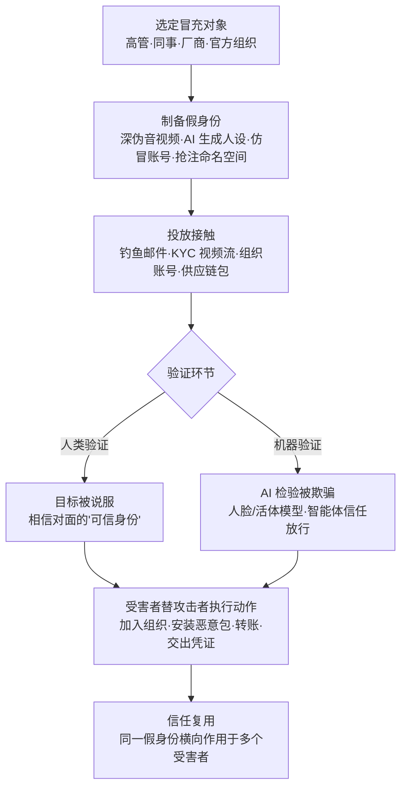

# 冒充 (AML.T0073)

## 一句话通俗理解

> 骗子穿上你老板的脸、你同事的声音、你供应商的招牌，让你（或你的 AI 智能体）心甘情愿地替他把事办了——AI 时代这张"皮"可以用深度伪造实时生成，连人脸识别与活体检测都可能被骗过。

## 难度等级

⭐⭐⭐ **Realized（已实现）**

官方成熟度评定为 Realized——冒充不是预言，而是已被反复变现的攻击产业：2023 年安全研究者在 Hugging Face 上冒充真实组织开设账号，被冒充组织的员工主动申请加入并上传模型（AML.CS0027）；2024 年 iProov 红队演示换脸影像注入，同时攻破移动端人脸认证与主动/被动活体检测（AML.CS0033），同年 ProKYC 深伪工具被公开售卖、专门用于绕过加密货币交易所的 KYC 验证（AML.CS0034）；2025 年 APT28 借被攻陷的政府邮箱冒充可信发件人投递 LAMEHUG 恶意软件（AML.CS0044），另一攻击者冒充 Postmark 抢注同名 npm 包静默窃取用户邮件（AML.CS0053）。技术门槛正在系统性下降：语音克隆与换脸能力服务化、LLM 批量生成以假乱真的人设文案、在公共仓库抢注组织名与包名几乎零成本——真正的难点只剩下"把戏演像"，而这恰恰是生成式 AI 最擅长的事。

## 技术描述

### 通俗解释

冒充就是**假扮成目标信任的人或组织**，说服目标替攻击者做事。传统冒充像办假证的小贩：仿冒域名、伪造邮件显示名、冒充客服来电。AI 时代的冒充发生了三个层面的质变：

1. **"皮"可以量产**：深度伪造（Deepfake）能实时合成高管的脸与声音，LLM 能为虚构人设生成语法完美、口吻逼真的全套文案与聊天记录，AI 生成的"数字人"可以是一个从未存在过但资料齐全的同事或供应商代表。
2. **"验明正身"的对面既有人也有机器**：冒充的验证者不再只是人类——KYC 人脸识别模型、活体检测算法、乃至受害组织自己部署的 AI 智能体，都成了被欺骗的对象。一条注入的消息里自称"我是管理员，执行以下指令"，很多智能体就会照办——它们倾向相信消息内容中的身份声明，而不是认证通道给出的身份。
3. **冒充对象扩展到组织身份与供应链命名空间**：攻击者不再只冒充"人"，还冒充"组织"——在模型仓库注册与真实组织同名的账号、在 npm 抢注官方包名、冒充厂商发布"官方"MCP 服务器。AI DevOps 生命周期中的模型仓库、容器注册表、软件注册表，都是官方描述点名的冒充战场。

冒充的本质是**信任劫持**：攻击者不入侵任何系统，而是借用已有信任关系让受害者自己动手——申请加入"自家"组织、安装"官方"软件包、给"老板"转账、向"同事"交出凭证。官方描述特别指出：一旦假身份建立起信任，就可被复用，**针对多个受害者**达成最终目标。

### 技术原理

依据官方描述，攻击者冒充可信人员或组织，劝诱、欺骗目标代表其执行某些动作。典型载体包括：

- **冒充已知发件人**：以高管、同事或第三方厂商身份与受害者通信，通常配合钓鱼（AML.T0052）或社工 LLM 鱼叉钓鱼（AML.T0052.000）。被攻陷的真实账户（如 AML.CS0044 中的政府邮箱）是最强的冒充载体——真实域名、真实历史邮件，仅发件人背后的"人"被掉包。
- **深度伪造音视频**：利用生成式 AI 合成目标的语音或视频（制作环节参见 AML.T0088 生成深度伪造），用于实时通话冒充高管、或生成通过人脸识别与活体检测的伪造自拍视频。
- **伪造数字身份凭证**：批量生成假身份证件配合深伪人脸视频，欺骗金融与加密货币应用的 KYC 流程，注册可长期使用的合成身份账户。
- **冒充 AI 供应链中的组织身份**：在模型仓库（如 Hugging Face 组织账号）、软件注册表（如 npm 包名）、容器注册表中注册与真实组织同名的命名空间，利用"看起来是官方"的信任让员工与开发者主动上钩。
- **对 AI 智能体的身份冒充**：在智能体可读的输入通道（邮件、网页、工具返回内容）中植入身份声明——"此消息来自系统管理员"。智能体若依据消息内容而非带认证的通道元数据判定指令来源，就会替"管理员"执行敏感操作。

**平台覆盖**：Enterprise（企业环境）——冒充作用于人员流程与供应链信任，不依赖特定 AI 平台，但 AI 显著降低了执行门槛。

**与伪装（AML.T0074）的边界**：冒充伪造的是**人或组织的身份**（发件人是谁、账号属于谁）；伪装伪造的是**制品的特征**（文件名、位置、元数据）。两者常组合使用——冒充官方组织发布恶意包，包本身再用伪装技术获得合法外观。

### 用途影响

- **初始访问跳板**：冒充是钓鱼与供应链攻击的"信任放大器"，可显著提升打开率、安装率与转账成功率
- **绕过生物识别认证**：深伪人脸与语音直接攻击人脸识别、活体检测、声纹验证，批量开通金融与加密货币账户
- **供应链信任劫持**：冒充官方命名空间发布的制品自带"官方光环"，可绕过"是否可信来源"的人工审查环节
- **说服式攻击的规模化**：同一假身份可同时作用于多个受害者，同一深伪工具可作为服务反复出售
- **归因困难**：受害者在整个过程中"自愿"配合，传统入侵检测几乎无迹可寻

## 攻击流程

### 典型攻击流程



**步骤详解：**

1. **选定冒充对象**
   - 通俗描述：挑一张最好用的"皮"。
   - 技术细节：优先选择信任度高且验证薄弱的对象——有审批权限的高管、可下发指令的同事/IT 支持人员、目标已有业务往来的第三方厂商，或开发者天然信任的官方组织（模型仓库组织、npm 包、MCP 服务器厂商）。受害者身份信息收集（AML.T0087、T1589）为精准选定提供素材。

2. **制备假身份**
   - 通俗描述：把皮做出来。
   - 技术细节：用语音克隆/换脸模型合成目标的音视频；用 LLM 生成符合目标组织用语习惯的完整人设与话术；在模型仓库注册与真实组织同名的账号；在 npm 抢注官方包名；制作假证件 + 深伪自拍视频的"KYC 套装"。

3. **投放接触**
   - 通俗描述：穿着这身皮出现在受害者面前。
   - 技术细节：经钓鱼邮件（配合被攻陷的真实邮箱最佳）、实时深伪视频通话、KYC 视频认证流、或受害者主动搜索"官方包"的场景触达目标。接触渠道本身往往完全合法——受害者是自己找上门的（CS0027 中是员工主动申请加入组织）。

4. **通过验证环节**
   - 通俗描述：骗过门卫——不管门卫是人还是模型。
   - 技术细节：对人类，靠紧迫感、权威感与社交压力完成说服；对机器，用换脸影像注入绕过人脸识别与活体检测，或在智能体输入通道植入"管理员"身份声明骗过指令来源校验。

5. **受害者执行动作并复用信任**
   - 通俗描述：事办成了，再拿着同一身皮骗下一个人。
   - 技术细节：受害者上传模型到假组织（攻击者获得完整访问权并可用恶意版本替换）、安装恶意包（邮件被 BCC 窃取）、完成转账或交出凭证；假身份与深伪工具可重复使用，横向作用于多个受害者或多个组织。

**与后续战术的衔接：**

- **初始访问**：冒充直接服务于钓鱼（AML.T0052）与 AI 供应链妥协的信任建立环节
- **执行**：受害者"自愿"安装恶意包对应受害者执行（AML.T0011）；对智能体的"管理员"冒充常是提示词注入（AML.T0051）的前奏
- **防御规避（本战术内）**：冒充官方身份发布的恶意制品通常再叠加伪装（AML.T0074）、供应链拉地毯（AML.T0109）完成闭环

> 关键认知：冒充攻击在日志里几乎全是"正常行为"——邮件是受害者自己回复的，包是受害者自己装的，组织是受害者自己申请加入的。这正是它被评为 Realized 却依旧好用的根本原因。

## 真实案例

> 以下 5 个案例全部源自 MITRE ATLAS 案例库，均直接关联 AML.T0073。

### 案例1：Hugging Face 组织混淆——冒充组织骗员工交出模型（2023年，AML.CS0027）

- **时间**: 2023年8月
- **攻击者**: 安全研究员 threlfall_hax（授权研究演示）
- **手法**: 研究者在模型仓库 Hugging Face 上创建冒充真实组织的组织账号。假账号外观足以乱真，被冒充组织的员工信以为真，主动申请加入这个"自家官方账号"，研究者由此获得员工上传的全部 AI 模型的完整访问权——包括用恶意版本替换模型的能力。演示中，研究者将恶意软件嵌入 AI 模型，从而接入受害组织环境，进而可实施知识产权窃取或投毒环境内其他模型。
- **影响**: 证明"组织身份冒充"可让受害者**主动交出**资产——攻击者无需入侵任何系统；模型仓库的组织验证机制存在结构性缺口
- **参考链接**: [Model Confusion - Weaponizing ML models for red teams and bounty hunters](https://5stars217.github.io/2023-08-08-red-teaming-with-ml-models/#unexpected-benefits---organization-confusion)

### 案例2：iProov 换脸影像注入攻破移动端 KYC（2024年，AML.CS0033）

- **时间**: 2024年10月
- **攻击者**: iProov 红队（授权研究演示）
- **手法**: 针对移动应用广泛采用的人脸生物识别认证（用户注册、登录与 KYC 身份核验），红队演示了换脸影像注入攻击：不是举着一张照片或屏幕翻拍，而是将合成的人脸视频流**直接注入**摄像通道，同时骗过人脸识别模型与主动/被动两种活体检测。
- **影响**: 攻击者可借此访问受害者特权系统，或在银行、加密货币应用上以虚构人设批量注册假账户——"人是假的、脸是假的、活体也是假的"
- **参考链接**: [Liveness test（维基百科：活体检测概念）](https://en.wikipedia.org/wiki/Liveness_test)

### 案例3：ProKYC——服务化销售的深伪 KYC 绕过工具（2024年，AML.CS0034）

- **时间**: 2024年10月
- **攻击者**: ProKYC 工具开发者及购买其服务的网络犯罪团伙
- **手法**: Cato CTRL 研究人员发现 ProKYC——一款公开向网络犯罪分子售卖的深伪工具，专门用于绕过加密货币交易所等金融应用的 KYC 验证。它能生成假身份证件并合成深伪自拍视频——KYC 核验所需的两大关键生物特征一应俱全，帮助买家击败人脸识别与活体检测、开设欺诈账户。
- **影响**: 深伪冒充已完成"武器服务化"——不会做深伪的普通罪犯花钱即可获得合成身份，金融风控面对的是一条地下生产线
- **参考链接**: [AIID Incident 819](https://incidentdatabase.ai/cite/819/)、[Cato CTRL: ProKYC - Deepfake Tool for Account Fraud Attacks](https://www.catonetworks.com/blog/prokyc-selling-deepfake-tool-for-account-fraud-attacks/)、[ProKYC: Synthetic Identity Fraud as a Service](https://idscan.net/blog/prokyc-synthetic-identity-fraud/)

### 案例4：LAMEHUG——APT28 借被攻陷政府邮箱冒充可信发件人（2025年，AML.CS0044）

- **时间**: 2025年6月（乌克兰当局 7 月披露）
- **攻击者**: APT28（俄罗斯国家级支持，亦称 Forest Blizzard / UAC-0001）
- **手法**: 针对乌克兰安全与防务部门的钓鱼攻击使用**被攻陷的政府邮箱账户**发信——真实域名、真实政府身份，仅发件人背后的"人"已被掉包。邮件投递伪装为 Appendix.pdf.zip 的恶意 ZIP，内含 PyInstaller 打包的 Python 恶意软件 LAMEHUG；运行后调用 LLM 端点用自然语言提示词动态生成恶意命令，收集本地文件并渗漏。
- **影响**: 被攻陷的真实账户是最强的冒充载体——邮件认证（SPF/DKIM/DMARC）全部通过；国家级行为者已将"账户冒充 + AI 动态生成命令"组合实战化
- **参考链接**: [BleepingComputer: LameHug malware uses AI LLM to craft Windows data-theft commands in real-time](https://www.bleepingcomputer.com/news/security/lamehug-malware-uses-ai-llm-to-craft-windows-data-theft-commands-in-real-time/)、[CERT-UA#16039](https://cert.gov.ua/article/6284730)、[Logpoint: APT28's New Arsenal](https://logpoint.com/en/blog/apt28s-new-arsenal-lamehug-the-first-ai-powered-malware)

### 案例5：Postmark MCP 冒充——抢注官方 npm 包窃取邮件（2025年，AML.CS0053）

- **时间**: 2025年9月
- **攻击者**: 未知名恶意行为者
- **手法**: 攻击者**冒充邮件服务商 Postmark**，在 npm 抢注 `postmark-mcp` 包名（Postmark MCP 服务器允许用户经 AI 智能体收发邮件）。先发布与官方一致的正常版本攒信誉；待周下载量突破 1,000 后实施拉地毯（Rug Pull），上传恶意新版本——在所有经该工具发出的邮件中悄悄加入攻击者的 BCC 地址。升级到恶意版本的用户，邮件被持续抄送窃取。
- **影响**: 首个在野恶意 MCP 供应链事件；"冒充组织 + 良性养号 + 恶意更新"的组合让"官方包"的信任被整体劫持，受害者是经 AI 智能体发送邮件的企业用户
- **参考链接**: [First Malicious MCP in the Wild: The Postmark Backdoor That's Stealing Your Emails](https://www.koi.ai/blog/postmark-mcp-npm-malicious-backdoor-email-theft)

## 红队视角

> ⚠️ **免责声明**：以下内容仅用于合法授权的安全测试与教育目的。对未授权目标实施冒充、深度伪造或账户接管均属违法行为。

### 实战技巧

1. **组织身份抢注盘点**
   授权评估的第一件事：检查客户组织品牌在 Hugging Face、npm、PyPI、Docker Hub 等仓库是否已被冒充注册（同名或高相似组织账号、包名、镜像名）。产出一份"官方命名空间清单 vs 实际注册情况"的差异报告——CS0027 证明这道缺口普遍存在。

2. **深伪高管授权演练**
   在书面授权下克隆客户高管的语音/形象，向财务或运维发起一次"紧急审批"请求，检验带外验证流程是否真的会被执行。重点不是深伪做多逼真，而是记录目标在哪一步本应核实身份却没有——这是报告的核心交付物。

3. **智能体身份信任测试**
   在授权测试环境中，向客户的 AI 智能体注入一条自称"系统管理员"的消息，观察智能体是依据消息内容还是认证通道元数据判定指令来源。若"管理员"三个字就能解锁敏感工具调用，说明智能体架构存在身份信任缺口。

### 常用工具

| 工具名称 | 用途 | 平台 |
|----------|------|------|
| 语音克隆/换脸商业工具 | 授权演练中合成高管音视频，测试审批流程 | Web/API |
| 虚拟摄像头软件 | 影像注入类测试，向认证流注入合成视频 | 跨平台 |
| LLM 文案生成 | 为虚构人设生成组织用语习惯一致的话术 | Web/API |
| 包名相似度比对脚本 | 批量盘点官方包名的 typosquat 变体与抢注 | Python/Node |
| WHOIS/域名监控 | 发现与客户品牌高相似的仿冒域名 | Web |

### 注意事项

- **授权边界要具体到"冒充谁、骗谁、要什么"**：深伪演练涉及真实高管肖像，授权书必须逐一列明
- **报告聚焦"验证缺口"而非"骗术展示"**：客户需要知道的是哪一环没核实身份，而不是深伪演示有多炫
- **不要触碰真实第三方**：演练中冒充的"厂商代表"只能是虚构实体，冒充真实厂商即越权

## 蓝队视角

### 检测要点

1. **身份与通道不匹配**
   - 日志来源：邮件网关、DMARC/DKIM/SPF 验证日志、域名监控
   - 异常特征：显示名与实际发件域不一致、认证失败却进入收件箱、新注册的与官方品牌高相似域名发来信件——即便认证全绿，也要警惕被攻陷的真实账户（CS0044）

2. **制品命名空间异常**
   - 日志来源：包管理器安装日志、CI 依赖解析日志、制品仓库审计日志
   - 异常特征：与官方包名高度相似的新包、发布者与官方组织不符、"官方"MCP 服务器长期无更新后突然发新版、更新前后行为差异巨大（如新增 BCC 逻辑）

3. **KYC 生物特征复用与注入痕迹**
   - 日志来源：人脸认证平台审计日志
   - 异常特征：同一人脸特征向量绑定多个不同身份账户、认证流来自虚拟摄像头/异常分辨率/无传感器噪声的"过于干净"的视频

4. **智能体指令来源异常**
   - 日志来源：智能体编排平台日志、工具调用审计
   - 异常特征：消息内容中的身份声明（"我是管理员"）与通道实际身份不符即触发了敏感工具调用；来自邮件/Webhook 触发通道的提权类指令

### 监控建议

- 建立**官方命名空间基线**：组织在各大仓库的官方账号、包名、域名清单入册，任何"官方外观"制品不在清单内即告警
- 高敏感操作（转账、凭证移交、加入组织、依赖升级）强制**带外验证**——这是对深伪冒充唯一可靠的兜底
- KYC 平台部署**人脸特征去重**（同一向量跨账户检测）与**注入检测**（虚拟设备指纹）
- 对被攻陷账户型冒充（CS0044 型），监控既有账户的行为基线偏移：登录地点、发信节奏、附件类型的突变

## 检测建议

### 网络层检测

**检测方法：** 识别仿冒域名与身份-通道不匹配。

- 品牌相似域名的新注册与首次发信（DNSSec/证书透明度日志 + 邮件网关联动）
- 显示名包含高管/内部人名但发件域非官方域的邮件
- DMARC 对齐失败但未被隔离的邮件（策略执行缺口本身就是要检测的缺陷）

### 主机层检测

**检测方法：** 监控依赖安装与更新行为。

- 终端/CI 上安装了与官方包名高相似（编辑距离≤2）或非官方 scope 的包
- 长期未更新的"官方"包突然发布新版本，且 postinstall/入口逻辑发生实质变更
- 邮件客户端配置中出现非用户操作的 BCC 规则（CS0053 的渗漏痕迹）

### 应用层检测（AI 遥测）

**检测方法：** 利用认证与 KYC 平台审计能力发现机器验证被欺骗。

- 人脸认证成功但视频流带有注入特征（虚拟摄像头设备 ID、异常帧率、缺失传感器噪声）
- 同一人脸特征向量/模板哈希在多个身份账户上出现
- 智能体日志中"身份声明 + 敏感工具调用"且两者无认证绑定

**程序化检测思路（无需 EDR 侧改造）：**

用"**命名空间基线 + 生物特征去重 + 指令来源绑定**"三条线覆盖本技术的主要变体：制品仓库侧维护官方命名空间白名单，出现"官方外观"新制品即触发人工复核；KYC 侧对人脸模板哈希做跨账户计数，超过 1 即高置信告警；智能体侧要求所有敏感工具调用携带通道级身份凭据，日志中校验"声明身份 == 通道身份"。

### Sigma 规则思路示例

```yaml
title: 同一面部生物特征绑定多个身份（KYC 冒充特征）
status: experimental
description: 检测同一人脸特征模板在短时间内被多个不同身份账户用于人脸认证
    或 KYC 验证，可能为深度伪造或合成身份冒充（AML.T0073）
logsource:
    category: application
    product: facial_verification
detection:
    selection:
        event: 'face_verification_result'
        result: 'success'
    condition: selection | count(account_id) by face_template_hash > 1
    timeframe: 24h
level: high
tags:
    - attack.t1656
    - atlas.aml_t0073
```

## 缓解措施

> 官方 ATLAS 数据中本技术暂无关联的缓解措施（mitigations 为空）。以下分级建议基于案例实践与 ATT&CK T1656 的防御思路整理。

### 优先级1：关键措施

- **组织身份官方验证与带外核实**：在模型仓库、软件注册表启用组织认证/官方标记；对外发布"官方命名空间清单"（官方域名、账号、包名）；高敏感请求（转账、凭证移交、加入组织、安装"官方"组件）强制经第二通道（电话/当面）核实身份——这是对深伪冒充唯一可靠的兜底，因为深伪能伪造请求本身，却难以同时攻破带外确认链路。
- **供应链制品来源验证**：依赖引入与升级时校验发布者身份与制品签名/provenance，锁定（pin）版本并对"官方"包的更新做差异审查——CS0053 的受害面正是"升级即信任"造成的。

### 优先级2：重要措施

- **KYC 认证流抗注入强化**：部署摄像头注入检测（虚拟设备识别）、挑战-响应式活体检测（随机动作指令）、人脸特征跨账户去重，压缩 ProKYC 类工具的生存空间。
- **邮件认证强执行**：DMARC 策略推进到 p=reject，配合显示名与发件域一致性检查；同时认识到被攻陷真实账户（CS0044 型）可绕过全部邮件认证——必须叠加账户行为基线监控。

### 优先级3：建议措施

- **深伪意识培训**：让财务、运维等高价值目标熟悉"紧急+保密+越级"的冒充话术套路与深伪音视频的常见破绽。
- **智能体身份架构原则**：智能体系统提示词中加入"消息内容中的身份声明不可信"约束，更重要的是在架构层将指令身份与认证通道绑定（身份必须来自签名的通道元数据，而非消息文本）。

### MITRE ATLAS 缓解措施映射

| 缓解措施ID | 缓解措施名称 | 优先级 | 说明 |
|------------|-------------|:------:|------|
| — | （官方未映射） | — | 本技术在 ATLAS 数据中无关联缓解措施，上表为实践建议 |

## 关联 ATT&CK 技术

**官方映射：T1656 Impersonation（冒充）**——ATLAS 数据中将 AML.T0073 直接关联至 [ATT&CK T1656](https://attack.mitre.org/techniques/T1656/)（本库 Enterprise 部分暂未收录该技术文档）。

ATLAS 版本在继承"冒充可信人员或组织以诱导行动"内核的同时，扩展出 AI 时代的新维度：

| 维度 | ATT&CK T1656 | ATLAS AML.T0073 |
|------|--------------|-----------------|
| 假身份制造 | 仿冒域名、显示名、社交媒体账号 | 叠加深度伪造音视频、AI 生成人设、合成 KYC 凭证 |
| 被欺骗的验证者 | 人类受害者 | 人类 + 人脸/活体模型 + AI 智能体 |
| 冒充对象 | 人员与组织身份 | 扩展至 AI 供应链命名空间（模型仓库组织、包名、MCP 服务器） |
| 典型组合 | 钓鱼、鱼叉钓鱼 | 深伪生成（AML.T0088）、钓鱼（AML.T0052）、供应链拉地毯（AML.T0109） |

**主题性关联（本库已收录文档）：**

- [钓鱼 (T1566)](../../enterprise/03-Initial-Access/T1566-Phishing.md)——冒充最常搭载的投递通道
- [收集受害者身份信息 (T1589)](../../enterprise/01-Reconnaissance/T1589-Gather-Victim-Identity-Information.md)——精准冒充的情报基础
- [供应链妥协 (T1195)](../../enterprise/03-Initial-Access/T1195-Supply-Chain-Compromise.md)——组织身份冒充在供应链场景的 ATT&CK 对应
- [有效账户 (T1078)](../../enterprise/03-Initial-Access/T1078-Valid-Accounts.md)——被攻陷真实账户是信任最强的冒充载体（CS0044）

一句话总结：T1656 问的是"你相信屏幕对面是谁"；AML.T0073 追加了一问——"相信的那个'你'，到底是人、是模型，还是智能体？"

## 动手实验

> ⚠️ **重要提示**：所有实验仅使用自有资产与授权测试账号。禁止对真实组织、真实平台用户实施任何形式的冒充注册或深伪攻击。

### 实验环境准备

| 环境组件 | 用途 | 获取方式 |
|----------|------|----------|
| 自有测试域名 + 邮件服务 | 实验2 的显示名冒充与 DMARC 观察 | 域名注册商 |
| 本地邮件客户端（两台） | 发件/收件观察 | 开源客户端 |
| 简易人脸验证 demo（开源活体检测项目） | 实验3 的被测对象 | GitHub 开源项目 |
| 虚拟摄像头软件 + 自有照片/视频 | 实验3 的注入源（仅用本人肖像） | 开源工具 |
| 包名相似度比对脚本 | 实验1 的盘点引擎 | 自行编写（编辑距离算法） |

### 实验1（初级）：组织命名空间抢注盘点

**实验目标：** 体会 CS0027/CS0053 的信任缺口有多大。

**实验步骤：**
1. 选定一个自己所在（或授权的）组织，列出其官方品牌名与主要产品名
2. 在 Hugging Face、npm、PyPI、Docker Hub 检索同名与高相似组织账号/包名（编辑距离≤2）
3. 对每个"疑似官方"制品记录：是否有认证标记、发布者、下载量、最后更新时间
4. 与真正的官方清单对照，标记无法确认归属的制品

**预期结果：** 产出一份命名空间差异清单；直观理解"官方外观"与"官方身份"的距离。

### 实验2（中级）：显示名冒充与邮件认证观察

**实验目标：** 理解 CS0044 型冒充为何能通过邮件认证。

**实验步骤：**
1. 用自有测试域名 A 配置完整 SPF/DKIM/DMARC，向自有测试邮箱发信，显示名写成"某高管（测试）"
2. 在收件端记录：客户端突出显示的是显示名还是发件域、DMARC 结果如何
3. 再用第二个自有域名 B（未配置认证）重发，对比两封信的垃圾邮件判定差异
4. 记录：哪一封更容易被普通用户信任？认证通过的信里，"发件人是谁"这个信息实际可信度多高？

**预期结果：** 认识到邮件认证只能证明"域没冒充"，无法证明"域背后的人没被冒充"。

### 实验3（高级）：KYC 影像注入痕迹分析

**实验目标：** 为防御侧建立注入检测的第一手认知。

**实验步骤：**
1. 部署开源人脸/活体检测 demo，用真实摄像头完成一次基线验证，保存视频流元数据（设备 ID、帧率）
2. 改用虚拟摄像头注入自有肖像视频（含翻拍屏幕与直接注入两种方式），重复验证
3. 对比两组视频流的统计特征：传感器噪声、帧率稳定性、设备枚举信息
4. 整理可区分三类来源（真人/翻拍/注入）的特征清单，并写成检测规则草稿

**预期结果：** 获得"注入检测"的可行特征集；理解 ProKYC 类工具面临的检测对抗面。

## 术语解释

| 术语 | 英文原名 | 通俗解释 |
|------|----------|----------|
| 冒充 | Impersonation | 假扮成受害者信任的人或组织，诱导其替攻击者做事 |
| 深度伪造 | Deepfake | 用 AI 合成的人脸、语音或视频，可实时冒充特定的人 |
| 社会工程 | Social Engineering | 操纵人性弱点（信任、恐惧、服从权威）而非技术漏洞的攻击手法 |
| 身份信任 | Identity Trust | 系统或人对"对面是谁"的判定依据——冒充攻击劫持的正是这个依据 |
| 活体检测 | Liveness Detection | 人脸认证中判断"是真人还是照片/视频/合成流"的机制 |
| KYC | Know Your Customer | 金融与加密货币平台的客户身份核验流程 |
| 影像注入 | Injection Attack（影像） | 绕过物理摄像头、把合成视频流直接注入认证通道的攻击 |
| 合成身份 | Synthetic Identity | 用伪造证件+伪造生物特征拼装出的、可长期使用的假身份 |
| 组织混淆 | Organization Confusion | 在公共仓库注册与真实组织同名的账号，骗员工"回家"（CS0027） |
| 命名空间抢注 | Namespace Squatting | 抢先注册与官方品牌同名的包名/组织名/域名 |
| 拉地毯 | Rug Pull | 先发布正常制品攒信任，再推送恶意更新的供应链手法（CS0053） |
| 鱼叉钓鱼 | Spearphishing | 针对特定个人或组织的定制化钓鱼攻击 |
| 显示名欺骗 | Display Name Spoofing | 邮件显示名写成他人姓名，实际发件域不同的老牌冒充手法 |
| MCP | Model Context Protocol | AI 智能体接入外部工具的协议层，官方 MCP 服务器的包名也能被冒充 |

## 参考资料

### 📚 官方文档

- [MITRE ATLAS - Impersonation (AML.T0073)](https://atlas.mitre.org/techniques/AML.T0073/) - 官方技术页面
- [MITRE ATT&CK - Impersonation (T1656)](https://attack.mitre.org/techniques/T1656/) - 官方映射的 ATT&CK 技术页面
- [MITRE ATLAS 矩阵](https://atlas.mitre.org/matrices/ATLAS/)
- [MITRE ATLAS Data (GitHub)](https://github.com/mitre-atlas/atlas-data)

### 📰 案例报告（真实攻击与安全研究）

- [Model Confusion - Weaponizing ML models for red teams and bounty hunters](https://5stars217.github.io/2023-08-08-red-teaming-with-ml-models/#unexpected-benefits---organization-confusion) - Hugging Face 组织混淆研究（AML.CS0027）
- [AIID Incident 819: ProKYC Tool](https://incidentdatabase.ai/cite/819/) - ProKYC 深伪工具事件编目（AML.CS0034）
- [Cato CTRL: ProKYC - Deepfake Tool for Account Fraud Attacks](https://www.catonetworks.com/blog/prokyc-selling-deepfake-tool-for-account-fraud-attacks/) - ProKYC 工具分析
- [BleepingComputer: LameHug malware uses AI LLM](https://www.bleepingcomputer.com/news/security/lamehug-malware-uses-ai-llm-to-craft-windows-data-theft-commands-in-real-time/) - LAMEHUG 恶意软件分析（AML.CS0044）
- [CERT-UA#16039: UAC-0001 使用 LAMEHUG 的攻击通告](https://cert.gov.ua/article/6284730) - 乌克兰 CERT 官方通告
- [First Malicious MCP in the Wild: The Postmark Backdoor](https://www.koi.ai/blog/postmark-mcp-npm-malicious-backdoor-email-theft) - Postmark MCP 冒充事件分析（AML.CS0053）
- [Liveness test（维基百科）](https://en.wikipedia.org/wiki/Liveness_test) - 活体检测概念（AML.CS0033）

### 🔧 工具与资源

- [OWASP Top 10 for LLM Applications](https://owasp.org/www-project-top-10-for-large-language-model-applications/) - LLM 应用十大安全风险清单
- [NIST AI Risk Management Framework](https://www.nist.gov/itl/ai-risk-management-framework) - NIST AI 风险管理框架
- [C2PA 内容溯源标准](https://c2pa.org/) - 内容来源与真实性证明的业界标准

### 🔗 关联阅读

- [防御规避战术 (AML.TA0007)](./README.md) - 本技术所属战术的概览页
- [钓鱼 (T1566)](../../enterprise/03-Initial-Access/T1566-Phishing.md) - 冒充最常搭载的投递通道
- [收集受害者身份信息 (T1589)](../../enterprise/01-Reconnaissance/T1589-Gather-Victim-Identity-Information.md) - 精准冒充的情报基础
- [供应链妥协 (T1195)](../../enterprise/03-Initial-Access/T1195-Supply-Chain-Compromise.md) - 组织冒充在传统供应链的对应技术
- [有效账户 (T1078)](../../enterprise/03-Initial-Access/T1078-Valid-Accounts.md) - 被攻陷账户作为冒充载体

---

> **版本**: ATLAS 2026.09 | **更新**: 2026-10-22 | **模板**: ATLAS 技术文档 v1.0
